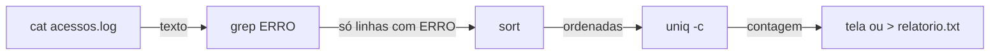

# Linha de comando Linux e shell scripting

## Por que isso importa

Servidores, contêineres, a nuvem e quase todas as ferramentas de desenvolvimento (Git, Python, Node, Docker) são usados pelo terminal. Quem domina a linha de comando faz em uma linha o que levaria vários minutos clicando, e consegue automatizar tarefas repetitivas com scripts. Também é um requisito de qualquer vaga de dev e o ponto de partida das trilhas de SO e DevOps.

## Intuição

A interface gráfica é um **cardápio com fotos**: você aponta e escolhe. O terminal é **falar direto com o cozinheiro**: você precisa saber o nome dos pratos, mas pode pedir qualquer combinação ("o prato 3, sem cebola, e manda a sobra para viagem"). Cada comando é um verbo, as opções são os ajustes, e o pipe `|` é passar o resultado de um cozinheiro para o próximo.

## Visual

O sistema de arquivos do Linux é **uma árvore só**, que começa na raiz `/`:

```
/                          ← raiz
├── bin/                   ← programas básicos (ls, cp, ...)
├── etc/                   ← configurações do sistema
├── tmp/                   ← arquivos temporários
└── home/
    └── israel/            ← ~  (sua pasta pessoal)
        ├── estudos/
        │   ├── notas.txt
        │   └── python/
        │       └── ola.py
        └── fotos/
```

Um pipeline de comandos, cada um fazendo uma coisa e passando o texto adiante:



## Conceito técnico

### Terminal, shell e prompt

- **Terminal**: a janela onde você digita.
- **Shell**: o programa que lê o que você digita e executa (o mais comum é o **bash**; no macOS o padrão é o **zsh**, quase igual).
- **Prompt**: o texto antes do cursor, como `israel@pc:~/estudos$`. O `$` indica usuário comum; `#` indica administrador (root).

No Windows, use o **WSL** (Linux dentro do Windows) ou o **Git Bash**. No celular, apps como o Termux. Também dá para usar um terminal online, como o do GitHub Codespaces.

Formato de um comando:

```
comando  -opções  argumentos
ls       -l -a    estudos/
```

`-la` é o mesmo que `-l -a`. Opções longas usam dois traços: `--help`. Para ler o manual de um comando: `man ls` (sai com `q`) ou `ls --help`.

### Caminhos

| Símbolo | Significa |
|---|---|
| `/` | a raiz (no começo do caminho) ou separador de pastas |
| `~` | sua pasta pessoal (`/home/israel`) |
| `.` | a pasta atual |
| `..` | a pasta de cima (pai) |

- **Caminho absoluto** começa em `/`: `/home/israel/estudos/notas.txt`. Funciona de qualquer lugar.
- **Caminho relativo** parte da pasta atual: estando em `~/estudos`, `python/ola.py` e `../fotos` são relativos.

Dica: a tecla **Tab** completa nomes de arquivos e comandos; Tab duas vezes mostra as opções. A **seta para cima** repete comandos anteriores.

### Comandos essenciais

| Comando | Faz | Exemplo |
|---|---|---|
| `pwd` | mostra a pasta atual | `pwd` |
| `ls` | lista arquivos (`-l` detalhes, `-a` ocultos, `-h` tamanhos legíveis) | `ls -lah` |
| `cd` | muda de pasta (`cd` sozinho volta para `~`, `cd -` volta para a anterior) | `cd estudos/python` |
| `mkdir` | cria pasta (`-p` cria as intermediárias) | `mkdir -p projetos/forca` |
| `touch` | cria arquivo vazio | `touch notas.txt` |
| `cp` | copia (`-r` para pastas) | `cp notas.txt backup.txt` |
| `mv` | move ou renomeia | `mv backup.txt antigo/` |
| `rm` | apaga (`-r` pastas). **Não há lixeira!** | `rm antigo/backup.txt` |
| `cat` | mostra o conteúdo do arquivo | `cat notas.txt` |
| `less` | mostra paginado (setas, `/busca`, `q` sai) | `less grande.log` |
| `head` / `tail` | primeiras / últimas linhas (`-n 5`) | `tail -n 20 app.log` |
| `echo` | imprime texto | `echo "olá"` |
| `grep` | filtra linhas que contêm um texto (`-i` ignora maiúsculas, `-n` numera, `-r` em pastas) | `grep -n def ola.py` |
| `wc` | conta linhas, palavras, bytes (`-l` só linhas) | `wc -l notas.txt` |
| `sort` / `uniq` | ordena / junta linhas repetidas vizinhas (`-c` conta) | `sort nomes.txt \| uniq -c` |
| `find` | procura arquivos | `find . -name "*.py"` |

**Curingas**: `*` casa qualquer sequência de caracteres e `?` casa um caractere. `ls *.py` lista os arquivos que terminam em `.py`. Quem expande o curinga é o shell, antes de chamar o comando.

### Redirecionamento e pipes

Todo programa tem uma **entrada padrão** (stdin, normalmente o teclado), uma **saída padrão** (stdout, a tela) e uma **saída de erros** (stderr).

| Escrita | Faz |
|---|---|
| `cmd > arq` | manda a saída para o arquivo, **apagando** o que havia |
| `cmd >> arq` | **acrescenta** no fim do arquivo |
| `cmd < arq` | usa o arquivo como entrada |
| `cmd 2> erros.txt` | manda só os erros para o arquivo |
| `cmd1 \| cmd2` | a saída do cmd1 vira a entrada do cmd2 |
| `cmd1 && cmd2` | roda cmd2 só se cmd1 deu certo |

Essa é a **filosofia Unix**: programas pequenos que fazem uma coisa bem e se combinam por texto.

### Permissões

`ls -l` mostra algo como:

```
-rwxr-xr--  1 israel  alunos  220  out 31 10:00  backup.sh
│└┬┘└┬┘└┬┘
│ │  │  └── outros:  r--  (só leitura)
│ │  └───── grupo:   r-x  (ler e executar)
│ └──────── dono:    rwx  (ler, escrever, executar)
└────────── tipo: - arquivo, d pasta, l atalho
```

Cada trio é um número octal de 0 a 7 somando **r = 4, w = 2, x = 1** (os três bits que você viu em MD-04). `rwx` = 7, `r-x` = 5, `r--` = 4, então `rwxr-xr--` é **754**.

```
chmod 755 backup.sh    dono tudo; grupo e outros leem e executam
chmod +x backup.sh     só acrescenta o x (executar) para todos
chmod 600 senha.txt    só o dono lê e escreve
```

`sudo comando` executa como administrador. Use com cuidado: `sudo rm -rf` errado pode apagar o sistema.

### Shell script

Um script é um arquivo de texto com comandos que o shell executa em sequência:

```bash
#!/bin/bash
# backup.sh: copia uma pasta para backup-AAAA-MM-DD

origem="$1"                       # primeiro argumento
if [ -z "$origem" ]; then         # -z: o texto está vazio?
    echo "uso: ./backup.sh PASTA"
    exit 1                        # código diferente de 0 = falhou
fi

data=$(date +%F)                  # $( ) roda um comando e guarda a saída
destino="backup-$data"
cp -r "$origem" "$destino"
echo "copiado para $destino"

for arq in "$destino"/*.txt; do   # laço sobre os .txt copiados
    echo "  $(wc -l < "$arq") linhas em $arq"
done
```

Para rodar: `chmod +x backup.sh` e depois `./backup.sh estudos`.

Regras do bash que pegam todo mundo:

- **Sem espaços no `=`**: `nome="Ana"` funciona; `nome = "Ana"` tenta rodar um comando chamado `nome`.
- Para **ler** uma variável use `$`: `echo "$nome"`. Coloque **aspas** em volta para nomes com espaço não quebrarem.
- `$1`, `$2`... são os argumentos; `$#` é quantos foram passados; `$?` é o código de saída do último comando (0 = sucesso).
- `[ ]` precisa de espaços por dentro: `[ "$a" = "$b" ]`. Para números: `-eq`, `-ne`, `-lt`, `-gt`.
- A primeira linha `#!/bin/bash` (o **shebang**) diz qual programa interpreta o arquivo.

## Código

Uma sessão real, com o que você digita (depois do `$`) e o que aparece:

```
$ pwd
/home/israel
$ mkdir -p estudos/python
$ cd estudos
$ echo "print('olá')" > python/ola.py
$ ls python
ola.py
$ python3 python/ola.py
olá
$ echo "linha 1" > notas.txt
$ echo "linha 2" >> notas.txt
$ cat notas.txt
linha 1
linha 2
$ wc -l notas.txt
2 notas.txt
$ cd ..
$ pwd
/home/israel
```

Analisando um log com um pipeline (quais erros mais aparecem?):

```bash
grep "ERRO" app.log | cut -d " " -f 3 | sort | uniq -c | sort -rn | head -n 3
```

Leia da esquerda para a direita: filtra as linhas com ERRO, pega a 3ª palavra de cada linha (o tipo do erro), ordena, conta os repetidos, ordena pela contagem do maior para o menor e mostra os 3 primeiros.

> **Ainda sem executor de shell no app**: rode estes exemplos num terminal de verdade (Linux, macOS, WSL ou Codespaces). O desafio de código no fim usa Python para treinar a conversão de permissões.

## Erros comuns

- **`rm -rf` sem pensar.** Não existe lixeira no terminal. Confira o caminho com `ls` antes, e nunca rode `rm -rf /` ou `rm -rf *` na pasta errada.
- **Espaços em nomes de arquivos.** `cd Meus Documentos` são dois argumentos. Use aspas (`cd "Meus Documentos"`) ou escape (`Meus\ Documentos`).
- **`>` quando queria `>>`.** O `>` apaga o arquivo antes de escrever.
- **Espaço no `=` do bash** (`nome = "Ana"`) ou falta de espaço no `[ ]` (`["$a"="$b"]`).
- **Rodar `script.sh` em vez de `./script.sh`.** O shell só procura comandos nas pastas do `PATH`; a pasta atual precisa ser dita com `./`.
- **"Permission denied" ao rodar um script**: falta o `x`. Use `chmod +x script.sh`.

## Pratique

```quiz
id: SO-08-q1
tipo: multipla_escolha
pergunta: "Você está em `/home/israel/estudos/python`. Para onde `cd ../..` leva?"
opcoes: ["/home/israel/estudos", "/home/israel", "/home", "/"]
resposta: 1
explicacao: "Cada .. sobe um nível: de python para estudos, e de estudos para israel. O resultado é /home/israel, que também é o ~."
dificuldade: 1
```

```quiz
id: SO-08-q2
tipo: multipla_escolha
pergunta: "Qual a diferença entre `echo oi > a.txt` e `echo oi >> a.txt`?"
opcoes: ["Nenhuma", "> acrescenta no fim e >> apaga antes", "> apaga o conteúdo antes e >> acrescenta no fim", ">> manda para a tela e para o arquivo"]
resposta: 2
explicacao: "> substitui todo o conteúdo (o arquivo é zerado antes); >> mantém o que existia e escreve no fim. Os dois criam o arquivo se ele não existir."
dificuldade: 1
```

```quiz
id: SO-08-q3
tipo: multipla_escolha
pergunta: "Qual é a notação octal de `rw-r--r--`?"
opcoes: ["644", "755", "622", "466"]
resposta: 0
explicacao: "rw- = 4 + 2 = 6; r-- = 4; r-- = 4. Logo 644, a permissão típica de um arquivo comum: o dono lê e escreve, os outros só leem."
dificuldade: 1
```

```quiz
id: SO-08-q4
tipo: prever_saida
pergunta: |
  `nomes.txt` tem as linhas `ana`, `bia`, `ana`, `caio`, `ana`, `bia`, nessa ordem. O que este comando mostra?
  ```
  sort nomes.txt | uniq -c | sort -rn | head -n 1
  ```
resposta: "3 ana (com espaços antes do número)"
explicacao: "sort agrupa os iguais (ana, ana, ana, bia, bia, caio); uniq -c conta cada grupo (3 ana, 2 bia, 1 caio); sort -rn ordena pelo número, do maior para o menor; head -n 1 fica só com a primeira linha."
dificuldade: 2
```

```quiz
id: SO-08-q5
tipo: verdadeiro_falso
pergunta: "No bash, `nome = \"Israel\"` guarda o texto Israel na variável nome."
resposta: false
explicacao: "No bash não pode haver espaço em volta do =. Com espaços, o shell entende que nome é um comando e = e \"Israel\" são argumentos, e dá 'command not found'. O certo é nome=\"Israel\"."
dificuldade: 1
```

```quiz
id: SO-08-q6
tipo: multipla_escolha
pergunta: "Qual comando lista os arquivos `.py` de todas as subpastas a partir da pasta atual?"
opcoes: ["ls *.py", "find . -name \"*.py\"", "grep .py", "cat *.py"]
resposta: 1
explicacao: "find percorre a árvore a partir de . (a pasta atual) e -name filtra pelo padrão. ls *.py só olha a pasta atual; grep procura texto dentro dos arquivos; cat mostraria o conteúdo."
dificuldade: 2
```

```quiz
id: SO-08-q7
tipo: prever_saida
pergunta: |
  O que este script imprime quando rodado com `./ola.sh Ana Bia`?
  ```bash
  #!/bin/bash
  echo "recebi $# argumentos"
  for n in "$@"; do
      echo "olá, $n"
  done
  ```
resposta: "recebi 2 argumentos, olá, Ana e olá, Bia (uma linha cada)"
explicacao: "$# é a quantidade de argumentos (2) e \"$@\" é a lista deles. O for repete o bloco entre do e done uma vez para cada argumento."
dificuldade: 2
```

```quiz
id: SO-08-q8
tipo: resposta_curta
pergunta: "O que faz o pipe `|` e por que ele é tão útil?"
resposta: "Ele liga a saída padrão de um comando à entrada padrão do seguinte, sem arquivo intermediário. Assim dá para montar tarefas complexas juntando programas pequenos que fazem uma coisa só, como grep, sort e wc."
palavras_chave: ["saída", "entrada", "comando"]
dificuldade: 1
```

```quiz
id: SO-08-q9
tipo: codigo
linguagem: python
pergunta: |
  **De octal para rwx.** Leia uma permissão em octal com 3 dígitos (como no `chmod`) e imprima a forma `rwx` que o `ls -l` mostraria. Para `754`:

  ```
  rwxr-xr--
  ```

  A tabela `TRIOS` já está pronta: a posição 0 é `---`, a 5 é `r-x`, a 7 é `rwx`.
codigo_inicial: |
  TRIOS = ["---", "--x", "-w-", "-wx", "r--", "r-x", "rw-", "rwx"]
  octal = input("Permissão: ")
usa: [int]
testes:
  - entrada: "754"
    saida: "rwxr-xr--"
  - entrada: "644"
    saida: "rw-r--r--"
  - entrada: "600"
    visivel: false
    saida: "rw-------"
  - entrada: "777"
    visivel: false
    saida: "rwxrwxrwx"
dica: "octal[0] é o primeiro caractere (o dígito do dono). Converta cada dígito com int(...) e use como posição na lista: TRIOS[int(octal[0])]. Junte os três textos com +."
solucao: |
  TRIOS = ["---", "--x", "-w-", "-wx", "r--", "r-x", "rw-", "rwx"]
  octal = input("Permissão: ")
  dono = TRIOS[int(octal[0])]
  grupo = TRIOS[int(octal[1])]
  outros = TRIOS[int(octal[2])]
  print(dono + grupo + outros)
explicacao: "Cada dígito octal são 3 bits (r=4, w=2, x=1), e a lista TRIOS já tem os 8 padrões possíveis na ordem de 0 a 7. 5 = 101 em binário = r-x."
dificuldade: 2
```

## Resumo

- O Linux tem uma **árvore única** a partir de `/`; `~` é sua pasta, `.` a atual e `..` a de cima.
- Comando = **verbo + opções + argumentos**; `man` e `--help` explicam qualquer um.
- `>` grava (apagando), `>>` acrescenta, `|` passa a saída para o próximo comando.
- Permissões `rwx` para dono, grupo e outros; em octal, r=4, w=2, x=1 (ex.: 755, 644).
- Script bash: `#!/bin/bash`, variáveis sem espaço no `=`, `$1` para argumentos, `chmod +x` para executar.

## Para ir além

- Faça as aulas 1 e 2 do **Missing Semester** e os exercícios delas no seu terminal.
- Jogue o **OverTheWire Bandit** (overthewire.org/wargames/bandit): um jogo para treinar terminal, nível a nível.
- **Próximo módulo** no seu caminho: FP-03 Controle de fluxo: condicionais e laços.
