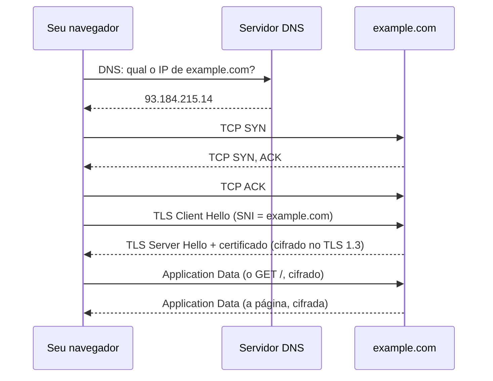

# Projeto: capturar e explicar um acesso HTTPS no Wireshark

## O que você vai construir

Um **relatório** explicando, pacote por pacote, o que acontece quando você abre `https://example.com` no navegador, e um **analisador em Python** que lê uma captura exportada e responde sozinho: qual IP o DNS devolveu, quanto tempo levou o handshake TCP, para qual site foi a conexão cifrada e quantos dados passaram em cada direção.

Este é o projeto da Trilha 6, inspirado nos **Wireshark Labs** do livro de Kurose e Ross. Ele junta as camadas de RD-01 a RD-07 numa história só:



## Parte 1: capturar no seu computador

Esta parte é feita fora do app, com o Wireshark instalado. Se não puder instalar agora, pule para a parte 2: ela traz uma captura pronta.

1. **Instale** o Wireshark ([wireshark.org](https://www.wireshark.org/download.html)). No Linux, `sudo apt install wireshark` e aceite deixar usuários comuns capturarem; depois `sudo usermod -aG wireshark $USER` e entre de novo na sessão.
2. **Feche abas** e programas que usam a rede, para a captura ficar limpa.
3. **Limpe o cache de DNS**, senão a consulta não aparece. No Linux com systemd: `resolvectl flush-caches`. No Windows: `ipconfig /flushdns`. No navegador, uma aba anônima ajuda.
4. **Comece a capturar** na interface que você usa (Wi-Fi ou cabo). O gráfico ao lado do nome mostra qual tem tráfego.
5. **Abra** `https://example.com` e espere carregar. **Pare** a captura (o quadrado vermelho).

### Filtros que você vai usar

Digite no campo de filtro de exibição (a barra acima da lista):

| Filtro | Mostra |
|---|---|
| `dns.qry.name == "example.com"` | a consulta DNS e a resposta |
| `ip.addr == 93.184.215.14` | tudo trocado com o servidor (use o IP que o seu DNS devolveu) |
| `tcp.flags.syn == 1` | o início das conexões TCP (SYN e SYN, ACK) |
| `tls.handshake.type == 1` | o Client Hello do TLS |
| `tls.handshake.extensions_server_name` | conexões TLS que enviaram o nome do site (SNI) |

Para ver um pacote em detalhe, clique nele: o painel do meio mostra as camadas (Ethernet, IP, TCP, TLS), uma dentro da outra, que é o encapsulamento de RD-01.

### Exporte para a parte 2

Com o filtro `dns or ip.addr == <IP do servidor>` aplicado, use **File → Export Packet Dissections → As Plain Text** ou, no terminal, o `tshark` (que vem com o Wireshark):

```bash
tshark -r captura.pcapng -Y 'dns or ip.addr == 93.184.215.14' \
  -T fields -E separator='|' -e frame.number -e frame.time_relative \
  -e ip.src -e ip.dst -e _ws.col.Protocol -e _ws.col.Info
```

Cada linha sai com os campos separados por `|`. É o formato que o analisador da parte 2 lê (com espaços em volta do `|` para ficar legível).

## Parte 2: o analisador

A captura abaixo é de um acesso real, simplificada: os mesmos passos que você deve ter visto. Ela aparece pronta em todos os desafios ("não mude").

```text
1 | 0.000000 | 192.168.0.10 | 192.168.0.1 | DNS | Standard query 0x1a2b A example.com
2 | 0.023114 | 192.168.0.1 | 192.168.0.10 | DNS | Standard query response 0x1a2b A example.com A 93.184.215.14
3 | 0.024010 | 192.168.0.10 | 93.184.215.14 | TCP | 51544 -> 443 [SYN] Seq=0 Len=0
4 | 0.142771 | 93.184.215.14 | 192.168.0.10 | TCP | 443 -> 51544 [SYN, ACK] Seq=0 Ack=1 Len=0
5 | 0.142850 | 192.168.0.10 | 93.184.215.14 | TCP | 51544 -> 443 [ACK] Seq=1 Ack=1 Len=0
6 | 0.143402 | 192.168.0.10 | 93.184.215.14 | TLSv1.3 | Client Hello (SNI=example.com) Len=517
7 | 0.261338 | 93.184.215.14 | 192.168.0.10 | TLSv1.3 | Server Hello, Change Cipher Spec, Application Data Len=2896
8 | 0.262101 | 192.168.0.10 | 93.184.215.14 | TLSv1.3 | Change Cipher Spec, Application Data Len=80
9 | 0.262540 | 192.168.0.10 | 93.184.215.14 | TLSv1.3 | Application Data Len=412
10 | 0.381003 | 93.184.215.14 | 192.168.0.10 | TLSv1.3 | Application Data Len=1380
11 | 0.381200 | 192.168.0.10 | 93.184.215.14 | TCP | 51544 -> 443 [ACK] Seq=1009 Ack=4277 Len=0
12 | 5.402113 | 192.168.0.10 | 93.184.215.14 | TCP | 51544 -> 443 [FIN, ACK] Seq=1009 Ack=4277 Len=0
```

Antes de programar, leia a captura com calma e responda:

```quiz
id: PJ-04-q1
tipo: multipla_escolha
pergunta: "Na captura acima, quais pacotes formam o handshake de três vias do TCP?"
opcoes: ["1, 2 e 3", "3, 4 e 5", "6, 7 e 8", "11 e 12"]
resposta: 1
explicacao: "SYN (3, do cliente), SYN-ACK (4, do servidor) e ACK (5, do cliente). Só depois disso a conexão existe e o TLS começa no pacote 6. Os pacotes 1 e 2 são DNS (UDP, sem handshake); 12 é o início do encerramento (FIN)."
dificuldade: 1
```

```quiz
id: PJ-04-q2
tipo: verdadeiro_falso
pergunta: "Com a captura acima, quem está na mesma rede Wi-Fi consegue ver o caminho (por exemplo `/login`) e os cookies da página que foi pedida."
resposta: false
explicacao: "O pedido HTTP (método, caminho, cabeçalhos, cookies) e a resposta vão dentro dos pacotes 'Application Data', cifrados pelo TLS. O observador vê o IP do servidor, o nome do site (na consulta DNS e no SNI do Client Hello), os tamanhos e os horários dos pacotes, mas não o conteúdo."
dificuldade: 1
```

### Etapa 1: ler a captura

```quiz
id: PJ-04-e1
tipo: codigo
linguagem: python
pergunta: |
  Escreva `ler_captura(texto: str) -> list[dict]`, que transforma cada linha não vazia da captura num dicionário com as chaves `n` (int), `tempo` (float), `origem`, `destino`, `proto` e `info` (textos sem espaços nas pontas). Os campos estão separados por `|`.
codigo_inicial: |
  CAPTURA = """
  1 | 0.000000 | 192.168.0.10 | 192.168.0.1 | DNS | Standard query 0x1a2b A example.com
  2 | 0.023114 | 192.168.0.1 | 192.168.0.10 | DNS | Standard query response 0x1a2b A example.com A 93.184.215.14
  3 | 0.024010 | 192.168.0.10 | 93.184.215.14 | TCP | 51544 -> 443 [SYN] Seq=0 Len=0
  4 | 0.142771 | 93.184.215.14 | 192.168.0.10 | TCP | 443 -> 51544 [SYN, ACK] Seq=0 Ack=1 Len=0
  5 | 0.142850 | 192.168.0.10 | 93.184.215.14 | TCP | 51544 -> 443 [ACK] Seq=1 Ack=1 Len=0
  """


  def ler_captura(texto: str) -> list[dict]:
      pacotes = []
      return pacotes
usa: [def, for, split, strip, return]
testes:
  - chamada: "len(ler_captura(CAPTURA))"
    saida: "5"
  - chamada: "ler_captura(CAPTURA)[0]"
    saida: "{'n': 1, 'tempo': 0.0, 'origem': '192.168.0.10', 'destino': '192.168.0.1', 'proto': 'DNS', 'info': 'Standard query 0x1a2b A example.com'}"
  - chamada: "[(p['n'], p['proto'], p['tempo']) for p in ler_captura(CAPTURA)][2:]"
    visivel: false
    saida: "[(3, 'TCP', 0.02401), (4, 'TCP', 0.142771), (5, 'TCP', 0.14285)]"
  - chamada: "ler_captura('\\n  7 | 1.5 | a | b | UDP | x | y  \\n\\n')"
    visivel: false
    saida: "[{'n': 7, 'tempo': 1.5, 'origem': 'a', 'destino': 'b', 'proto': 'UDP', 'info': 'x | y'}]"
dica: "for linha in texto.splitlines(): linha = linha.strip(); pule as vazias (if not linha: continue). Use linha.split(\"|\", 5): o 5 limita a 6 partes, então um | dentro do info não quebra a linha. Depois strip() em cada parte e int/float nos dois primeiros."
solucao: |
  CAPTURA = """
  1 | 0.000000 | 192.168.0.10 | 192.168.0.1 | DNS | Standard query 0x1a2b A example.com
  2 | 0.023114 | 192.168.0.1 | 192.168.0.10 | DNS | Standard query response 0x1a2b A example.com A 93.184.215.14
  3 | 0.024010 | 192.168.0.10 | 93.184.215.14 | TCP | 51544 -> 443 [SYN] Seq=0 Len=0
  4 | 0.142771 | 93.184.215.14 | 192.168.0.10 | TCP | 443 -> 51544 [SYN, ACK] Seq=0 Ack=1 Len=0
  5 | 0.142850 | 192.168.0.10 | 93.184.215.14 | TCP | 51544 -> 443 [ACK] Seq=1 Ack=1 Len=0
  """


  def ler_captura(texto: str) -> list[dict]:
      pacotes = []
      for linha in texto.splitlines():
          linha = linha.strip()
          if not linha:
              continue
          partes = [p.strip() for p in linha.split("|", 5)]
          pacotes.append({
              "n": int(partes[0]),
              "tempo": float(partes[1]),
              "origem": partes[2],
              "destino": partes[3],
              "proto": partes[4],
              "info": partes[5],
          })
      return pacotes
explicacao: "O `split('|', 5)` é a proteção contra dados reais: a coluna Info do Wireshark pode conter qualquer caractere, inclusive |. Transformar texto em dicionários logo na entrada (parsing) deixa o resto do analisador trabalhar com dados estruturados, não com fatias de string."
dificuldade: 1
```

### Etapa 2: DNS e o handshake TCP

O **RTT** (round-trip time, tempo de ida e volta) é o tempo entre mandar algo e receber a resposta. O handshake TCP mede isso de graça: é o intervalo entre o SYN do cliente e o SYN, ACK do servidor.

```quiz
id: PJ-04-e2
tipo: codigo
linguagem: python
pergunta: |
  Com a `ler_captura` pronta, escreva:

  - `ip_resolvido(pacotes, dominio) -> str`: o IP da primeira resposta DNS (info com `"response"`) para aquele domínio; é a **última palavra** do info. Devolva `""` se não houver.
  - `rtt_ms(pacotes) -> float`: o tempo entre o primeiro pacote com `[SYN]` e o primeiro com `[SYN, ACK]`, em milissegundos, arredondado com `round(..., 1)`.
codigo_inicial: |
  CAPTURA = """
  1 | 0.000000 | 192.168.0.10 | 192.168.0.1 | DNS | Standard query 0x1a2b A example.com
  2 | 0.023114 | 192.168.0.1 | 192.168.0.10 | DNS | Standard query response 0x1a2b A example.com A 93.184.215.14
  3 | 0.024010 | 192.168.0.10 | 93.184.215.14 | TCP | 51544 -> 443 [SYN] Seq=0 Len=0
  4 | 0.142771 | 93.184.215.14 | 192.168.0.10 | TCP | 443 -> 51544 [SYN, ACK] Seq=0 Ack=1 Len=0
  5 | 0.142850 | 192.168.0.10 | 93.184.215.14 | TCP | 51544 -> 443 [ACK] Seq=1 Ack=1 Len=0
  """
  OUTRA = """
  1 | 0.0 | 10.0.0.5 | 1.1.1.1 | DNS | Standard query 0x0001 A sala.dev
  2 | 0.0091 | 1.1.1.1 | 10.0.0.5 | DNS | Standard query response 0x0001 A sala.dev A 185.199.108.153
  3 | 0.0102 | 10.0.0.5 | 185.199.108.153 | TCP | 40000 -> 443 [SYN] Seq=0 Len=0
  4 | 0.0215 | 185.199.108.153 | 10.0.0.5 | TCP | 443 -> 40000 [SYN, ACK] Seq=0 Ack=1 Len=0
  """


  def ler_captura(texto: str) -> list[dict]:
      pacotes = []
      for linha in texto.splitlines():
          if linha.strip():
              p = [x.strip() for x in linha.split("|", 5)]
              pacotes.append({"n": int(p[0]), "tempo": float(p[1]), "origem": p[2],
                              "destino": p[3], "proto": p[4], "info": p[5]})
      return pacotes


  def ip_resolvido(pacotes: list[dict], dominio: str) -> str:
      return ""


  def rtt_ms(pacotes: list[dict]) -> float:
      return 0.0
indentacao: false
usa: [def, for, if, return, round]
testes:
  - chamada: "ip_resolvido(ler_captura(CAPTURA), 'example.com')"
    saida: "'93.184.215.14'"
  - chamada: "rtt_ms(ler_captura(CAPTURA))"
    saida: "118.8"
  - chamada: "ip_resolvido(ler_captura(CAPTURA), 'google.com')"
    visivel: false
    saida: "''"
  - chamada: "(ip_resolvido(ler_captura(OUTRA), 'sala.dev'), rtt_ms(ler_captura(OUTRA)))"
    visivel: false
    saida: "('185.199.108.153', 11.3)"
dica: "ip_resolvido: for p in pacotes: if p[\"proto\"] == \"DNS\" and \"response\" in p[\"info\"] and dominio in p[\"info\"].split(): return p[\"info\"].split()[-1]. rtt_ms: guarde o tempo do primeiro \"[SYN]\" e do primeiro \"[SYN, ACK]\" (cuidado: \"[SYN]\" não está contido em \"[SYN, ACK]\", então o teste com in funciona) e devolva round((t2 - t1) * 1000, 1)."
solucao: |
  CAPTURA = """
  1 | 0.000000 | 192.168.0.10 | 192.168.0.1 | DNS | Standard query 0x1a2b A example.com
  2 | 0.023114 | 192.168.0.1 | 192.168.0.10 | DNS | Standard query response 0x1a2b A example.com A 93.184.215.14
  3 | 0.024010 | 192.168.0.10 | 93.184.215.14 | TCP | 51544 -> 443 [SYN] Seq=0 Len=0
  4 | 0.142771 | 93.184.215.14 | 192.168.0.10 | TCP | 443 -> 51544 [SYN, ACK] Seq=0 Ack=1 Len=0
  5 | 0.142850 | 192.168.0.10 | 93.184.215.14 | TCP | 51544 -> 443 [ACK] Seq=1 Ack=1 Len=0
  """
  OUTRA = """
  1 | 0.0 | 10.0.0.5 | 1.1.1.1 | DNS | Standard query 0x0001 A sala.dev
  2 | 0.0091 | 1.1.1.1 | 10.0.0.5 | DNS | Standard query response 0x0001 A sala.dev A 185.199.108.153
  3 | 0.0102 | 10.0.0.5 | 185.199.108.153 | TCP | 40000 -> 443 [SYN] Seq=0 Len=0
  4 | 0.0215 | 185.199.108.153 | 10.0.0.5 | TCP | 443 -> 40000 [SYN, ACK] Seq=0 Ack=1 Len=0
  """


  def ler_captura(texto: str) -> list[dict]:
      pacotes = []
      for linha in texto.splitlines():
          if linha.strip():
              p = [x.strip() for x in linha.split("|", 5)]
              pacotes.append({"n": int(p[0]), "tempo": float(p[1]), "origem": p[2],
                              "destino": p[3], "proto": p[4], "info": p[5]})
      return pacotes


  def ip_resolvido(pacotes: list[dict], dominio: str) -> str:
      for p in pacotes:
          palavras = p["info"].split()
          if p["proto"] == "DNS" and "response" in palavras and dominio in palavras:
              return palavras[-1]
      return ""


  def rtt_ms(pacotes: list[dict]) -> float:
      syn = None
      syn_ack = None
      for p in pacotes:
          if syn is None and "[SYN]" in p["info"]:
              syn = p["tempo"]
          if syn_ack is None and "[SYN, ACK]" in p["info"]:
              syn_ack = p["tempo"]
      return round((syn_ack - syn) * 1000, 1)
explicacao: "118,8 ms de ida e volta até example.com, contra 11,3 ms até o servidor da outra captura (provavelmente uma CDN perto do usuário). O RTT é o piso de qualquer interação: o handshake TCP custa 1 RTT e o TLS 1.3 mais 1, então antes do primeiro byte da página já se foram uns 240 ms nesse exemplo. Comparar `dominio in palavras` (e não no texto inteiro) evita que 'example.com' case com 'myexample.com'."
dificuldade: 2
```

### Etapa 3: o que o TLS revela

O TLS cifra o conteúdo, mas o **Client Hello** vai em claro e, na extensão **SNI** (Server Name Indication), leva o nome do site: o servidor precisa saber qual certificado mostrar antes da cifra começar. Depois do handshake, tudo é `Application Data`, e o observador só vê **quanto** passou em cada direção.

```quiz
id: PJ-04-e3
tipo: codigo
linguagem: python
pergunta: |
  Escreva `relatorio_tls(pacotes, cliente) -> str` que devolve uma linha resumindo a conexão cifrada:

  ```text
  site=example.com enviados=1009 recebidos=4276
  ```

  - `site`: o que vem depois de `SNI=` no Client Hello, até o `)`;
  - `enviados` e `recebidos`: soma dos `Len=` dos pacotes TLS (proto começa com `"TLS"`) cuja origem é / não é o `cliente`.
codigo_inicial: |
  CAPTURA = """
  6 | 0.143402 | 192.168.0.10 | 93.184.215.14 | TLSv1.3 | Client Hello (SNI=example.com) Len=517
  7 | 0.261338 | 93.184.215.14 | 192.168.0.10 | TLSv1.3 | Server Hello, Change Cipher Spec, Application Data Len=2896
  8 | 0.262101 | 192.168.0.10 | 93.184.215.14 | TLSv1.3 | Change Cipher Spec, Application Data Len=80
  9 | 0.262540 | 192.168.0.10 | 93.184.215.14 | TLSv1.3 | Application Data Len=412
  10 | 0.381003 | 93.184.215.14 | 192.168.0.10 | TLSv1.3 | Application Data Len=1380
  11 | 0.381200 | 192.168.0.10 | 93.184.215.14 | TCP | 51544 -> 443 [ACK] Seq=1009 Ack=4277 Len=0
  """
  OUTRA = """
  5 | 0.02 | 10.0.0.5 | 185.199.108.153 | TLSv1.2 | Client Hello (SNI=sala.dev) Len=300
  6 | 0.03 | 185.199.108.153 | 10.0.0.5 | TLSv1.2 | Server Hello, Certificate Len=3000
  7 | 0.04 | 10.0.0.5 | 185.199.108.153 | TCP | 40000 -> 443 [ACK] Len=0
  8 | 0.05 | 10.0.0.5 | 185.199.108.153 | TLSv1.2 | Application Data Len=200
  """


  def ler_captura(texto: str) -> list[dict]:
      pacotes = []
      for linha in texto.splitlines():
          if linha.strip():
              p = [x.strip() for x in linha.split("|", 5)]
              pacotes.append({"n": int(p[0]), "tempo": float(p[1]), "origem": p[2],
                              "destino": p[3], "proto": p[4], "info": p[5]})
      return pacotes


  def relatorio_tls(pacotes: list[dict], cliente: str) -> str:
      return ""
indentacao: false
usa: [def, for, if, return, startswith]
testes:
  - chamada: "relatorio_tls(ler_captura(CAPTURA), '192.168.0.10')"
    saida: "'site=example.com enviados=1009 recebidos=4276'"
  - chamada: "relatorio_tls(ler_captura(OUTRA), '10.0.0.5')"
    visivel: false
    saida: "'site=sala.dev enviados=500 recebidos=3000'"
dica: "Para o SNI: info.split(\"SNI=\")[1].split(\")\")[0]. Para o tamanho: int(info.split(\"Len=\")[1].split()[0]). Some em enviados quando p[\"origem\"] == cliente, senão em recebidos, só se p[\"proto\"].startswith(\"TLS\")."
solucao: |
  CAPTURA = """
  6 | 0.143402 | 192.168.0.10 | 93.184.215.14 | TLSv1.3 | Client Hello (SNI=example.com) Len=517
  7 | 0.261338 | 93.184.215.14 | 192.168.0.10 | TLSv1.3 | Server Hello, Change Cipher Spec, Application Data Len=2896
  8 | 0.262101 | 192.168.0.10 | 93.184.215.14 | TLSv1.3 | Change Cipher Spec, Application Data Len=80
  9 | 0.262540 | 192.168.0.10 | 93.184.215.14 | TLSv1.3 | Application Data Len=412
  10 | 0.381003 | 93.184.215.14 | 192.168.0.10 | TLSv1.3 | Application Data Len=1380
  11 | 0.381200 | 192.168.0.10 | 93.184.215.14 | TCP | 51544 -> 443 [ACK] Seq=1009 Ack=4277 Len=0
  """
  OUTRA = """
  5 | 0.02 | 10.0.0.5 | 185.199.108.153 | TLSv1.2 | Client Hello (SNI=sala.dev) Len=300
  6 | 0.03 | 185.199.108.153 | 10.0.0.5 | TLSv1.2 | Server Hello, Certificate Len=3000
  7 | 0.04 | 10.0.0.5 | 185.199.108.153 | TCP | 40000 -> 443 [ACK] Len=0
  8 | 0.05 | 10.0.0.5 | 185.199.108.153 | TLSv1.2 | Application Data Len=200
  """


  def ler_captura(texto: str) -> list[dict]:
      pacotes = []
      for linha in texto.splitlines():
          if linha.strip():
              p = [x.strip() for x in linha.split("|", 5)]
              pacotes.append({"n": int(p[0]), "tempo": float(p[1]), "origem": p[2],
                              "destino": p[3], "proto": p[4], "info": p[5]})
      return pacotes


  def relatorio_tls(pacotes: list[dict], cliente: str) -> str:
      site = ""
      enviados = 0
      recebidos = 0
      for p in pacotes:
          if not p["proto"].startswith("TLS"):
              continue
          info = p["info"]
          if "SNI=" in info:
              site = info.split("SNI=")[1].split(")")[0]
          tamanho = int(info.split("Len=")[1].split()[0])
          if p["origem"] == cliente:
              enviados += tamanho
          else:
              recebidos += tamanho
      return f"site={site} enviados={enviados} recebidos={recebidos}"
explicacao: "Confira com o pacote 11: o ACK do cliente diz Seq=1009 e Ack=4277, ou seja, 1009 bytes enviados e 4276 recebidos (o Ack é o próximo byte esperado). O seu analisador chegou ao mesmo número somando os TLS, uma ótima checagem cruzada entre camadas. Esse resumo (site, volumes, horários) é exatamente o que um provedor de internet consegue saber de um acesso HTTPS."
dificuldade: 2
```

## Parte 3: explique a captura

O entregável principal é o **relatório**: um documento curto (pode ser um `README.md` no GitHub, com prints do Wireshark) que responde, com o número dos pacotes da **sua** captura:

1. Qual servidor DNS respondeu, qual IP ele devolveu e quanto tempo a consulta levou.
2. Quais pacotes são o handshake TCP; qual porta o seu computador escolheu e por que o servidor usa a 443.
3. O RTT medido no handshake, e uma comparação com o `ping` para o mesmo IP (RD-07).
4. Qual versão do TLS foi usada, qual o SNI e qual suíte de cifras o servidor escolheu (no Server Hello).
5. Onde está o certificado: no TLS 1.2 ele aparece em claro; no TLS 1.3, dentro de Application Data. Qual foi o seu caso?
6. A lista do que um observador na sua rede vê e do que não vê.

```quiz
id: PJ-04-q3
tipo: resposta_curta
pergunta: "Liste o que um observador na mesma rede Wi-Fi descobre sobre o seu acesso a `https://example.com/conta` e o que fica protegido."
resposta: "Vê: o seu IP e o do servidor, a consulta DNS por example.com (se o DNS não for cifrado), o nome do site no SNI do Client Hello, as portas, os horários e os tamanhos dos pacotes. Não vê: o caminho /conta, o método, os cabeçalhos, os cookies, senhas e o conteúdo da página, que vão cifrados em Application Data. DNS over HTTPS e o ECH (Encrypted Client Hello) escondem também o nome do site."
palavras_chave: ["SNI", "DNS", "IP", "caminho", "cifrad"]
dificuldade: 2
```

```quiz
id: PJ-04-q4
tipo: multipla_escolha
pergunta: "No TLS 1.3, por que o Server Hello já vem acompanhado de 'Application Data' no mesmo pacote (pacote 7)?"
opcoes:
  - "Porque o servidor enviou a página antes de o cliente pedir"
  - "Porque, a partir do Server Hello, o resto do handshake (certificado, Finished) já vai cifrado e aparece como Application Data"
  - "Porque o Wireshark não reconhece o TLS 1.3"
  - "Porque é um erro de captura"
resposta: 1
explicacao: "No TLS 1.3, cliente e servidor trocam as chaves já no Client Hello e no Server Hello. Tudo que vem depois, inclusive o certificado, vai cifrado; para quem olha de fora, é 'Application Data'. Isso economiza um RTT em relação ao TLS 1.2 e esconde o certificado de observadores."
dificuldade: 3
```

## Ideias para ir além

- **HTTP sem S**: capture um acesso a `http://neverssl.com` e compare: o `GET`, os cabeçalhos e a página aparecem inteiros. É o melhor argumento a favor do HTTPS.
- **Ver dentro da cifra**: com a variável de ambiente `SSLKEYLOGFILE=~/chaves.log` no navegador, aponte o Wireshark para o arquivo (Preferences → Protocols → TLS → Pre-Master-Secret log) e veja o HTTP/2 decifrado. Só funciona porque **você** tem as chaves.
- **HTTP/3**: em sites como `cloudflare.com`, procure pacotes QUIC (UDP 443) em vez de TCP. Não há handshake TCP: o QUIC junta transporte e TLS.
- **Analisador completo**: rode o seu Python direto na saída do `tshark` de uma captura real e gere o relatório da parte 3 automaticamente.

## Resumo

- Um acesso HTTPS é **DNS → handshake TCP → handshake TLS → Application Data cifrado → FIN**.
- O **RTT** aparece no intervalo SYN → SYN, ACK; o TCP e o TLS 1.3 custam 1 RTT cada antes do primeiro byte útil.
- O TLS protege **conteúdo, caminho, cabeçalhos e cookies**, mas não esconde **IPs, horários, tamanhos** nem, sem ECH, o **nome do site** (SNI e DNS).
- Filtros de exibição (`dns`, `tcp.flags.syn == 1`, `tls.handshake.type == 1`) transformam milhares de pacotes numa história legível.

## Para ir além

- **Wireshark Labs** de Kurose e Ross: DNS, TCP e TLS, com perguntas guiadas sobre capturas reais.
- **Próximos passos**: RD-05 (HTTP/2 e HTTP/3) e a Trilha 12 (Segurança), que aprofunda certificados e ataques de intermediário (MITM).
