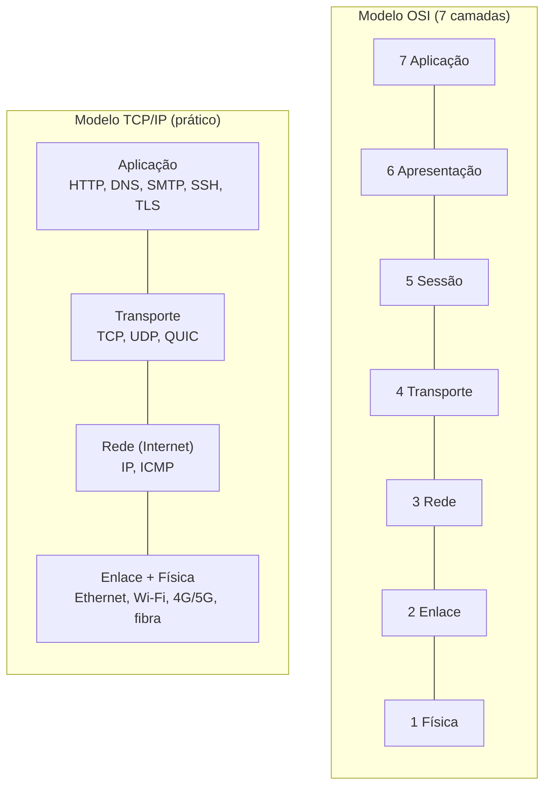

# Modelos OSI e TCP/IP

## Por que isso importa

Quando você digita uma URL e aperta Enter, dezenas de protocolos trabalham juntos: um resolve o nome, outro abre uma conexão confiável, outro decide o caminho entre continentes, outro transforma bits em sinais de rádio no seu Wi-Fi. Ninguém conseguiria projetar (ou depurar) isso como um bloco único. A organização em **camadas** é o mapa mental que todo dev usa ao investigar "a API não responde": é DNS? É firewall? É o TLS? É a aplicação? Também é o vocabulário de entrevistas, de documentação de nuvem (balanceador de "camada 4" ou de "camada 7") e de todas as próximas aulas desta trilha.

## Intuição

Pense em enviar um **presente pelos Correios** para outro país:

1. Você escreve um **cartão** (a mensagem da aplicação).
2. Põe o cartão numa **caixa** com o nome do destinatário e "frágil, entregar em mãos" (transporte: para quem, com que cuidado).
3. Os Correios colocam a caixa num **malote** com o endereço da cidade de destino (rede: endereço global).
4. O malote vai num **caminhão** com a placa do próximo centro de distribuição (enlace: só até o próximo ponto).
5. O caminhão roda pela **estrada** (física).

Em cada centro de distribuição, alguém olha **só** o malote, troca o caminhão e manda adiante. Ninguém abre a caixa. No destino, cada camada desembrulha a sua parte, até o cartão chegar à pessoa certa. Cada camada só conversa com a camada **equivalente** do outro lado e usa os serviços da camada **de baixo**.

## Visual



Encapsulamento de uma requisição HTTP:

| Camada | Unidade | O que é acrescentado | Endereço usado |
|---|---|---|---|
| Aplicação | mensagem | `GET /index.html HTTP/1.1` ... | nome (`exemplo.com`) |
| Transporte | segmento (TCP) / datagrama (UDP) | cabeçalho TCP: portas, números de sequência (20 bytes) | **porta** (443) |
| Rede | pacote | cabeçalho IP: IPs de origem e destino, TTL (20 bytes no IPv4) | **endereço IP** |
| Enlace | quadro | cabeçalho Ethernet (14 bytes) + verificação de erro FCS (4 bytes) | **endereço MAC** |
| Física | bits | sinais elétricos, luz ou rádio | |

```text
| Ethernet | IP | TCP | HTTP: GET /index.html ... | FCS |
  14 B       20 B 20 B  dados da aplicação            4 B
```

## Conceito técnico

### Por que camadas

- **Abstração**: o HTTP não sabe se está em Wi-Fi ou fibra; o Wi-Fi não sabe se carrega HTTP ou um jogo.
- **Troca independente**: o IPv6 substitui o IPv4 sem mudar o TCP; o Wi-Fi 7 substitui o 6 sem mudar o IP.
- **Divisão de responsabilidades**: cada problema (achar o caminho, recuperar perdas, representar dados) é resolvido em um lugar só.

### O modelo OSI

Criado pela ISO nos anos 1980 como referência teórica. Suas 7 camadas:

1. **Física**: bits como sinais (voltagem, luz, rádio), conectores, cabos.
2. **Enlace**: entrega entre dois vizinhos **no mesmo meio**; endereços MAC; detecção de erros (RD-02).
3. **Rede**: entrega **fim a fim** entre redes diferentes; endereços IP; roteamento (RD-03).
4. **Transporte**: entrega entre **processos**; portas; confiabilidade e controle de fluxo (RD-04).
5. **Sessão**: abrir, manter e encerrar diálogos.
6. **Apresentação**: formato dos dados, compressão, criptografia.
7. **Aplicação**: o protocolo que o programa usa (HTTP, SMTP, DNS).

Na prática, as camadas 5 e 6 nunca viraram protocolos separados: suas funções foram absorvidas pela aplicação (TLS, JSON, gzip). Mesmo assim, a **numeração** do OSI ficou no vocabulário: "switch de camada 2", "balanceador de camada 4" (olha IP e porta), "balanceador de camada 7" (olha a URL e os cabeçalhos HTTP).

### O modelo TCP/IP

É o modelo que a Internet realmente usa, nascido junto com os protocolos (anos 1970, ARPANET). Tem 4 camadas: **aplicação**, **transporte**, **rede** (Internet) e **enlace** (acesso à rede). Livros como o Kurose separam a física do enlace e falam em 5 camadas.

O desenho tem a forma de uma **ampulheta**: muitas aplicações em cima, muitas tecnologias físicas embaixo, e **um único** protocolo no meio, o **IP**. Qualquer coisa que fale IP conversa com qualquer outra.

### Princípio fim a fim

Os roteadores no meio do caminho só olham até a camada de **rede**: são simples e rápidos. Funções como confiabilidade, ordem e criptografia ficam nas **pontas** (nos hosts), no transporte e na aplicação. Foi essa escolha que permitiu que a Internet crescesse e recebesse aplicações que ninguém tinha imaginado.

### Encapsulamento e custo

Ao descer as camadas, cada uma acrescenta seu **cabeçalho** (e às vezes um rodapé). Ao subir, do outro lado, cada uma remove o seu. O tamanho máximo de um pacote IP num enlace Ethernet é o **MTU**, normalmente 1500 bytes. Com 20 bytes de IP e 20 de TCP, sobram **1460 bytes** de dados por segmento (o **MSS**). Todo quadro ainda leva 18 bytes de Ethernet (cabeçalho + FCS). Mensagens pequenas pagam proporcionalmente mais cabeçalho.

## Código

Simulando o encapsulamento e o custo dos cabeçalhos:

```python
CABECALHOS = {"Ethernet": 18, "IP": 20, "TCP": 20}

def enviar(mensagem):
    dados = mensagem.encode()
    pacote = f"HTTP<{mensagem}>"
    for camada in ["TCP", "IP", "Ethernet"]:
        pacote = f"{camada}<{pacote}>"
        print(f"desceu para {camada:9}: {pacote}")
    no_fio = len(dados) + sum(CABECALHOS.values())
    print(f"{len(dados)} bytes úteis viraram {no_fio} no fio ({len(dados) / no_fio:.0%} de eficiência)\n")

enviar("GET / HTTP/1.1")
enviar("x" * 1460)        # segmento cheio: os cabeçalhos pesam pouco
```

## Erros comuns

- **Achar que o OSI descreve a Internet.** Ele é uma referência de vocabulário; a Internet segue o modelo TCP/IP.
- **Colocar o IP na camada de transporte ou o TCP na de rede.** IP leva pacotes entre **máquinas**; TCP leva bytes entre **processos**.
- **Confundir MAC e IP.** O MAC só vale no enlace local e muda a cada salto; o IP de destino vale do início ao fim (salvo NAT, RD-03).
- **Esquecer que cada camada tem sua unidade**: quadro (enlace), pacote (rede), segmento ou datagrama (transporte), mensagem (aplicação).
- **Achar que roteadores leem o HTTP.** Roteadores comuns param no IP; quem olha a aplicação são proxies, balanceadores de camada 7 e firewalls de aplicação.

## Pratique

```quiz
id: RD-01-q1
tipo: multipla_escolha
pergunta: "Em qual camada do modelo TCP/IP fica o protocolo que escolhe o caminho entre redes diferentes, usando endereços IP?"
opcoes: ["Aplicação", "Transporte", "Rede", "Enlace"]
resposta: 2
explicacao: "A camada de rede (o IP) cuida da entrega entre máquinas em redes diferentes e do roteamento. O transporte cuida da entrega entre processos (portas), e o enlace só entre vizinhos no mesmo meio."
dificuldade: 1
```

```quiz
id: RD-01-q2
tipo: multipla_escolha
pergunta: "Um balanceador de carga 'de camada 4' decide para qual servidor mandar cada conexão olhando:"
opcoes: ["A URL e os cookies", "Os IPs e as portas", "Só o endereço MAC", "O conteúdo do JSON"]
resposta: 1
explicacao: "Camada 4 é o transporte: o balanceador vê IPs (camada 3) e portas TCP/UDP, mas não abre a mensagem HTTP. Um balanceador de camada 7 lê a requisição e pode rotear por caminho, cabeçalho ou cookie."
dificuldade: 2
```

```quiz
id: RD-01-q3
tipo: verdadeiro_falso
pergunta: "Ao longo do caminho de um pacote na Internet, o endereço MAC de destino no quadro muda a cada salto, mas o IP de destino continua o mesmo."
resposta: true
explicacao: "O enlace só leva o quadro até o próximo vizinho, então cada roteador monta um quadro novo com o MAC do próximo salto. O IP de destino identifica o destino final e não muda (exceto quando há NAT)."
dificuldade: 2
```

```quiz
id: RD-01-q4
tipo: multipla_escolha
pergunta: "Qual a ordem correta dos cabeçalhos num quadro que carrega uma requisição HTTP, do primeiro byte para o último?"
opcoes: ["HTTP, TCP, IP, Ethernet", "Ethernet, IP, TCP, HTTP", "IP, Ethernet, TCP, HTTP", "TCP, IP, Ethernet, HTTP"]
resposta: 1
explicacao: "A camada mais baixa envolve todas as outras, então o cabeçalho dela vem primeiro no fio: Ethernet, depois IP, depois TCP, e só então os dados do HTTP (e o FCS do Ethernet no final)."
dificuldade: 1
```

```quiz
id: RD-01-q5
tipo: resposta_curta
pergunta: "O que diz o princípio fim a fim e por que ele foi importante para a Internet?"
resposta: "Que funções como confiabilidade, ordem e segurança devem ficar nas pontas (nos computadores que se comunicam), e não nos roteadores do meio. Assim a rede fica simples e rápida, e novas aplicações podem ser criadas só mudando as pontas, sem pedir mudança em todos os roteadores."
palavras_chave: ["pontas", "roteadores", "simples", "aplicações"]
dificuldade: 2
```

```quiz
id: RD-01-q6
tipo: codigo
linguagem: python
pergunta: |
  **Encapsular.** Escreva `encapsular(dados, camadas)` que recebe a mensagem e a lista de camadas **de cima para baixo** e devolve a string com cada camada envolvendo a anterior no formato `Camada[conteúdo]`. Exemplo: `encapsular('oi', ['TCP', 'IP'])` devolve `'IP[TCP[oi]]'`.
codigo_inicial: |
  def encapsular(dados, camadas):
      return '['.join(camadas) + '[' + dados
usa: [def, for, return]
testes:
  - chamada: "encapsular('GET /', ['HTTP', 'TCP', 'IP', 'Ethernet'])"
    saida: "'Ethernet[IP[TCP[HTTP[GET /]]]]'"
  - chamada: "encapsular('oi', [])"
    saida: "'oi'"
  - chamada: "encapsular('x', ['UDP'])"
    visivel: false
    saida: "'UDP[x]'"
dica: "Comece com pacote = dados e, para cada camada na ordem dada, faça pacote = f'{camada}[{pacote}]'. A última camada da lista fica por fora."
solucao: |
  def encapsular(dados, camadas):
      pacote = dados
      for camada in camadas:
          pacote = f'{camada}[{pacote}]'
      return pacote
explicacao: "Cada camada trata o que recebeu de cima como dados opacos e só acrescenta o próprio envelope. Por isso a ordem da lista (de cima para baixo) vira a ordem de dentro para fora."
dificuldade: 1
```

```quiz
id: RD-01-q7
tipo: codigo
linguagem: javascript
pergunta: |
  **Desencapsular.** Do outro lado, cada camada tira o seu envelope. Escreva `desencapsular(pacote)` que recebe uma string no formato da questão anterior e devolve um objeto `{ camadas, dados }`, com as camadas na ordem em que foram **removidas** (de fora para dentro). Um nome de camada tem só letras e dígitos; se a string não começar com `Nome[` e terminar com `]`, o que sobrou são os dados (que podem conter colchetes).
codigo_inicial: |
  function desencapsular(pacote) {
    const partes = pacote.split('[');
    return { camadas: partes.slice(0, -1), dados: partes[partes.length - 1] };
  }
usa: [function, while, return]
testes:
  - chamada: "desencapsular('Ethernet[IP[TCP[HTTP[GET /]]]]')"
    saida: "{ camadas: [ 'Ethernet', 'IP', 'TCP', 'HTTP' ], dados: 'GET /' }"
  - chamada: "desencapsular('oi')"
    saida: "{ camadas: [], dados: 'oi' }"
  - chamada: "desencapsular('IP[UDP[a[b]c]]')"
    visivel: false
    saida: "{ camadas: [ 'IP', 'UDP' ], dados: 'a[b]c' }"
dica: "Use uma expressão regular com âncoras: /^([A-Za-z0-9]+)\\[(.*)\\]$/s. Enquanto ela casar com a string atual, guarde o grupo 1 em camadas e continue com o grupo 2."
solucao: |
  function desencapsular(pacote) {
    const camadas = [];
    let p = pacote;
    let m = /^([A-Za-z0-9]+)\[(.*)\]$/s.exec(p);
    while (m) {
      camadas.push(m[1]);
      p = m[2];
      m = /^([A-Za-z0-9]+)\[(.*)\]$/s.exec(p);
    }
    return { camadas, dados: p };
  }
explicacao: "O código inicial quebra em todo '[' e se perde quando os dados têm colchetes, como no teste oculto. Na rede real é ainda mais simples: cada cabeçalho tem tamanho conhecido e um campo dizendo qual protocolo vem dentro (o EtherType no Ethernet, o campo Protocol no IP, a porta no TCP), e é assim que cada camada sabe para quem entregar."
dificuldade: 2
```

```quiz
id: RD-01-q8
tipo: codigo
linguagem: python
pergunta: |
  **Quanto custam os cabeçalhos?** Para enviar `tamanho` bytes por TCP/IPv4 sobre Ethernet com um dado `mtu`, cada segmento leva no máximo `mtu - 40` bytes de dados (o MSS) e cada quadro acrescenta **58** bytes de cabeçalhos (18 do Ethernet, 20 do IP, 20 do TCP). Escreva `bytes_no_fio(tamanho, mtu=1500)` que devolve a tupla `(quadros, total_de_bytes, eficiencia)`, com `eficiencia = tamanho / total` arredondada com `round(..., 3)` (e `0.0` se nada for enviado).
codigo_inicial: |
  def bytes_no_fio(tamanho, mtu=1500):
      quadros = tamanho // mtu
      total = tamanho + 58
      return (quadros, total, round(tamanho / total, 3))
usa: [def, return]
testes:
  - chamada: "bytes_no_fio(1000000)"
    saida: "(685, 1039730, 0.962)"
  - chamada: "bytes_no_fio(100)"
    saida: "(1, 158, 0.633)"
  - chamada: "bytes_no_fio(1461)"
    saida: "(2, 1577, 0.926)"
  - chamada: "bytes_no_fio(0)"
    saida: "(0, 0, 0.0)"
  - chamada: "bytes_no_fio(10**9, 9000)"
    visivel: false
    saida: "(111608, 1006473264, 0.994)"
dica: "quadros = teto(tamanho / (mtu - 40)), que em inteiros é -(-tamanho // mss). O total é tamanho + 58 * quadros."
solucao: |
  def bytes_no_fio(tamanho, mtu=1500):
      mss = mtu - 40
      quadros = -(-tamanho // mss)
      total = tamanho + 58 * quadros
      eficiencia = round(tamanho / total, 3) if total else 0.0
      return (quadros, total, eficiencia)
explicacao: "Uma mensagem de 100 bytes gasta 37% do que vai pelo fio com cabeçalhos; um arquivo grande, menos de 4%. Por isso protocolos tentam juntar mensagens pequenas, e redes de data center usam 'jumbo frames' (MTU 9000): no teste oculto a eficiência sobe para 99,4%. Um byte a mais que o MSS (1461) custa um quadro inteiro a mais."
dificuldade: 2
```

## Resumo

- Redes são organizadas em **camadas**: cada uma oferece um serviço à de cima e usa o da de baixo.
- **OSI** (7 camadas) é a referência de vocabulário; **TCP/IP** (aplicação, transporte, rede, enlace) é o que a Internet usa.
- Endereços por camada: **porta** (transporte), **IP** (rede), **MAC** (enlace).
- **Encapsulamento**: cada camada acrescenta seu cabeçalho; com MTU 1500, sobram 1460 bytes para dados TCP.
- **Princípio fim a fim**: inteligência nas pontas, rede simples no meio; o IP é a "cintura" da ampulheta.

## Para ir além

- Leia a seção 1.5 do Kurose & Ross e assista às primeiras aulas do Stanford CS144.
- Abra o Wireshark (RD-07), capture o acesso a um site e expanda as camadas de um pacote.
- **Próximo módulo**: RD-02 Camada física e de enlace: Ethernet, MAC, Wi-Fi.
