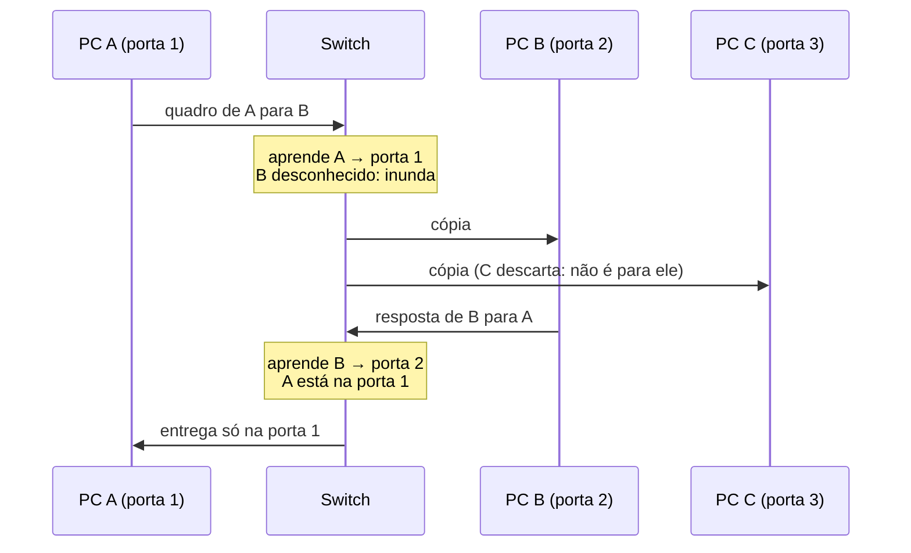

# Camada física e de enlace: Ethernet, MAC, Wi-Fi

## Por que isso importa

É aqui que a rede encosta no mundo físico: cabos, fibras, ondas de rádio. Quase todo problema de "internet lenta em casa" mora nessas camadas: interferência no Wi-Fi, um cabo ruim gerando retransmissões, um roteador longe demais. Para devs, ela aparece em lugares inesperados: redes do Docker e do Kubernetes criam "switches" virtuais com endereços MAC, máquinas virtuais na nuvem têm placas de rede virtuais, e o ARP explica por que dois servidores na mesma sub-rede se acham sem passar pelo roteador. A detecção de erros com CRC, que você vai implementar, também protege arquivos ZIP, PNG e discos.

## Intuição

A **camada física** é a **estrada**: decide como representar 0 e 1 (uma voltagem, um pulso de luz, uma mudança na onda de rádio) e em que velocidade.

A **camada de enlace** é o **trânsito de um bairro**: entrega um pacote de uma casa para a **vizinha**, no mesmo trecho de rua. Cada casa tem um **número de série** gravado de fábrica (o **endereço MAC**). O **switch** é um porteiro esperto de condomínio: no começo não sabe em que bloco mora cada pessoa, então grita a encomenda em todos os blocos (**inundação**). Mas ele anota quem mandou cada coisa e de qual bloco veio, e na próxima vez entrega direto.

No **Wi-Fi**, todos falam pelo mesmo ar, como numa sala de reunião: antes de falar, você escuta se alguém está falando, espera um tempo aleatório e só então fala. Se duas pessoas começarem juntas, ninguém entende nada.

## Visual

Um switch aprendendo (tabela MAC → porta):



Quadro Ethernet:

```text
| preâmbulo | MAC destino | MAC origem | tipo  | dados (46 a 1500 B) | FCS (CRC-32) |
   8 B          6 B          6 B        2 B                            4 B
                                    0x0800 = IPv4, 0x86DD = IPv6, 0x0806 = ARP
```

## Conceito técnico

### Camada física

Transforma bits em sinais e de volta: **codificação** (como representar 0 e 1), **taxa** (bits por segundo) e **meio**:

| Meio | Exemplos | Características |
|---|---|---|
| Par trançado (cobre) | cabo de rede Cat5e/Cat6 | barato; até ~100 m; 1 a 10 Gb/s |
| Fibra óptica | backbone, FTTH | luz; quilômetros; imune a interferência |
| Rádio | Wi-Fi, 4G/5G, Bluetooth | mobilidade; meio compartilhado; sujeito a interferência e obstáculos |

**Largura de banda** (quantos bits por segundo) é diferente de **latência** (quanto tempo um bit leva para chegar). A luz na fibra viaja a cerca de 200 000 km/s: São Paulo a Lisboa (~8 000 km) leva pelo menos 40 ms só de propagação, qualquer que seja a velocidade do seu plano.

### Endereço MAC

48 bits escritos em hexadecimal, como `3c:22:fb:12:34:56`:

- Os 3 primeiros bytes são o **OUI**, que identifica o **fabricante** (consulte em listas públicas da IEEE).
- O **bit menos significativo do primeiro byte** indica **multicast** (1) ou unicast (0).
- O **segundo bit menos significativo** indica endereço **administrado localmente** (1), como os de máquinas virtuais, contêineres Docker (`02:42:...`) e da randomização de MAC dos celulares, ou **global** (0, gravado de fábrica).
- `ff:ff:ff:ff:ff:ff` é o **broadcast**: todos na rede local recebem.

### Hubs, switches e domínios de colisão

- Um **hub** (obsoleto) repete cada bit para todas as portas: todos compartilham o meio e as colisões são possíveis.
- Um **switch** lê o MAC de destino e encaminha só para a porta certa. Ele **aprende** sozinho:
  1. Ao receber um quadro, anota **MAC de origem → porta de entrada**.
  2. Se o destino é broadcast ou ainda desconhecido: **inunda** (manda para todas as outras portas).
  3. Se o destino está na **mesma** porta de onde veio: **descarta**.
  4. Senão, encaminha **só** para a porta conhecida.
- As entradas expiram depois de alguns minutos, porque máquinas mudam de lugar.
- **VLANs** dividem um switch físico em vários switches lógicos isolados.

### Acesso ao meio: CSMA/CD e CSMA/CA

Quando o meio é compartilhado, é preciso decidir quem fala:

- **CSMA/CD** (Ethernet antiga, com hubs): escuta antes de transmitir; se detectar colisão durante a transmissão, para e espera um tempo aleatório que cresce a cada colisão (*backoff* exponencial). Com switches *full-duplex*, colisões não existem mais.
- **CSMA/CA** (Wi-Fi): no rádio não dá para detectar colisão enquanto se transmite, então se **evita**: escuta, espera um tempo aleatório, transmite e aguarda uma **confirmação** (ACK) da camada de enlace. Sem ACK, retransmite.

### Detecção de erros e CRC

Bits podem chegar trocados (ruído, interferência). O remetente calcula um código a partir dos dados e o envia junto; o receptor recalcula e compara.

- **Paridade**: 1 bit dizendo se o número de 1s é par. Detecta 1 bit errado, mas não 2.
- **CRC** (*cyclic redundancy check*): trata os bits como um polinômio e calcula o **resto da divisão** por um polinômio **gerador**, em aritmética módulo 2 (subtração = XOR, sem "vai um"). O Ethernet usa um gerador de 33 bits (CRC-32) e detecta todos os erros em rajada de até 32 bits.

Para calcular, acrescente n zeros aos dados (n = grau do gerador = tamanho − 1) e divida:

```text
dados 1101, gerador 1011 (n = 3)
1101000
1011            ← XOR onde o bit da frente é 1
-------
 1100
 1011
 -------
  1110
  1011
  ------
   1010
   1011
   ----
   0001  → resto 001: envia 1101 001
```

O receptor divide o quadro inteiro (dados + resto) pelo gerador: resto **zero** significa sem erro detectado.

A camada de enlace **detecta**; em geral não corrige. O Ethernet descarta quadros com CRC errado, e quem percebe a perda e retransmite é o TCP (RD-04). O Wi-Fi retransmite já no enlace, porque erros no rádio são frequentes.

### ARP: do IP para o MAC

Para enviar um pacote IP a uma máquina da **mesma rede local**, o computador precisa do MAC dela. O **ARP** resolve: manda em broadcast "quem tem o IP 192.168.0.20?", e a dona responde "sou eu, meu MAC é ...". A resposta fica numa cache (veja com `arp -a` ou `ip neigh`). Para destinos fora da rede local, o computador usa o MAC do **roteador** (o gateway padrão).

## Código

Um switch que aprende, com tabela que você pode inspecionar:

```python
BROADCAST = "ff:ff:ff:ff:ff:ff"

class Switch:
    def __init__(self, portas):
        self.portas = portas
        self.tabela = {}                       # MAC -> porta

    def receber(self, porta, origem, destino):
        self.tabela[origem] = porta            # aprende de onde veio
        if destino == BROADCAST or destino not in self.tabela:
            saidas = [p for p in range(1, self.portas + 1) if p != porta]
            print(f"{origem}->{destino}: inunda para {saidas}")
        elif self.tabela[destino] == porta:
            print(f"{origem}->{destino}: descarta (destino na mesma porta)")
        else:
            print(f"{origem}->{destino}: encaminha para a porta {self.tabela[destino]}")

sw = Switch(4)
sw.receber(1, "aa:aa", "bb:bb")
sw.receber(2, "bb:bb", "aa:aa")
sw.receber(1, "aa:aa", "bb:bb")
sw.receber(3, "cc:cc", BROADCAST)
print(sw.tabela)
```

## Erros comuns

- **Confundir largura de banda com latência.** Um plano de 1 Gb/s não diminui o tempo que a luz leva para atravessar o oceano.
- **Achar que o MAC é um identificador global e permanente.** Pode ser trocado por software, e celulares usam MACs aleatórios por rede para preservar privacidade.
- **Achar que o MAC atravessa a Internet.** Ele só vale até o próximo roteador; depois disso, o quadro é refeito.
- **Achar que switch e roteador são a mesma coisa.** Switch encaminha por MAC dentro da rede local (camada 2); roteador encaminha por IP entre redes (camada 3). O "roteador" de casa é os dois (e mais um ponto de acesso Wi-Fi).
- **Somar com "vai um" no CRC.** É aritmética módulo 2: cada passo é um XOR.

## Pratique

```quiz
id: RD-02-q1
tipo: multipla_escolha
pergunta: "Um switch recebe na porta 3 um quadro com destino que ainda não está na sua tabela. O que ele faz?"
opcoes: ["Descarta o quadro", "Encaminha para todas as portas, menos a 3", "Pergunta ao roteador", "Devolve para a porta 3"]
resposta: 1
explicacao: "Sem saber onde está o destino, ele inunda as outras portas. Quando o destino responder, o switch aprende a porta dele e passa a encaminhar só para lá."
dificuldade: 1
```

```quiz
id: RD-02-q2
tipo: multipla_escolha
pergunta: "O endereço MAC 02:42:ac:11:00:02 (típico de um contêiner Docker) é:"
opcoes: ["Multicast e global", "Unicast e administrado localmente", "Broadcast", "Unicast e global, de um fabricante registrado"]
resposta: 1
explicacao: "O primeiro byte é 0x02 = 00000010. O bit menos significativo (multicast) é 0: unicast. O segundo bit (local) é 1: o endereço foi atribuído por software, não gravado de fábrica."
dificuldade: 2
```

```quiz
id: RD-02-q3
tipo: verdadeiro_falso
pergunta: "O Wi-Fi usa CSMA/CD porque consegue detectar colisões enquanto transmite."
resposta: false
explicacao: "Um rádio transmitindo não consegue ouvir as outras transmissões fracas ao mesmo tempo, então o Wi-Fi usa CSMA/CA: evita colisões com esperas aleatórias e confirma cada quadro com um ACK, retransmitindo se ele não vier."
dificuldade: 2
```

```quiz
id: RD-02-q4
tipo: multipla_escolha
pergunta: "Para que serve o ARP?"
opcoes: ["Descobrir o IP de um nome como exemplo.com", "Descobrir o MAC de uma máquina da rede local a partir do IP dela", "Atribuir IPs automaticamente", "Detectar erros nos quadros"]
resposta: 1
explicacao: "O ARP pergunta em broadcast 'quem tem este IP?' e guarda a resposta numa cache. Nome para IP é o DNS (RD-05); atribuir IPs é o DHCP; detectar erros é o CRC."
dificuldade: 1
```

```quiz
id: RD-02-q5
tipo: resposta_curta
pergunta: "Qual a diferença entre largura de banda e latência? Dê um exemplo em que aumentar a largura de banda não ajuda."
resposta: "Largura de banda é quantos bits por segundo cabem no enlace; latência é quanto tempo um bit leva para ir de uma ponta à outra. Para um jogo online ou uma requisição pequena para um servidor em outro continente, o que pesa é o tempo de ida e volta, limitado pela distância e pela velocidade da luz; um plano mais rápido não reduz isso."
palavras_chave: ["bits por segundo", "tempo", "distância", "latência"]
dificuldade: 2
```

```quiz
id: RD-02-q6
tipo: codigo
linguagem: python
pergunta: |
  **Switch que aprende.** Escreva `switch(quadros)` que recebe uma lista de `(porta, origem, destino)` e devolve a lista de ações, uma por quadro:

  - primeiro, aprenda `origem → porta` (se a origem mudou de porta, atualize);
  - se o destino for `'ff:ff:ff:ff:ff:ff'` ou desconhecido: `'inunda'`;
  - se o destino estiver na mesma porta de entrada: `'descarta'`;
  - senão: `'porta N'`.
codigo_inicial: |
  def switch(quadros):
      return ['inunda' for _ in quadros]
usa: [def, for, return]
testes:
  - chamada: "switch([(1, 'A', 'B'), (2, 'B', 'A'), (1, 'A', 'B'), (3, 'C', 'ff:ff:ff:ff:ff:ff'), (1, 'D', 'A'), (4, 'A', 'C')])"
    saida: "['inunda', 'porta 1', 'porta 2', 'inunda', 'descarta', 'porta 3']"
  - chamada: "switch([])"
    saida: "[]"
  - chamada: "switch([(1, 'A', 'B'), (2, 'B', 'A'), (3, 'A', 'B'), (2, 'B', 'A')])"
    visivel: false
    saida: "['inunda', 'porta 1', 'porta 2', 'porta 3']"
dica: "Use um dicionário tabela. Para cada quadro: tabela[origem] = porta, e só depois decida a ação olhando tabela.get(destino)."
solucao: |
  def switch(quadros):
      tabela = {}
      acoes = []
      for porta, origem, destino in quadros:
          tabela[origem] = porta
          if destino == 'ff:ff:ff:ff:ff:ff' or destino not in tabela:
              acoes.append('inunda')
          elif tabela[destino] == porta:
              acoes.append('descarta')
          else:
              acoes.append(f'porta {tabela[destino]}')
      return acoes
explicacao: "No primeiro teste, D e A estão no mesmo segmento (porta 1, talvez atrás de outro switch), então o quadro de D para A já chegou lá e não precisa sair. No último quadro, A aparece na porta 4: o switch atualiza a tabela, como faz quando você muda o notebook de tomada. No teste oculto, A muda para a porta 3 e a resposta de B o encontra no lugar novo."
dificuldade: 2
```

```quiz
id: RD-02-q7
tipo: codigo
linguagem: python
pergunta: |
  **CRC.** Escreva `crc(bits, gerador)` que devolve o resto (como string de `len(gerador) - 1` bits) da divisão módulo 2 de `bits` seguido de `len(gerador) - 1` zeros pelo `gerador`. O `gerador` sempre começa com `'1'`.
codigo_inicial: |
  def crc(bits, gerador):
      # isto é só a paridade: conta os 1s
      n = len(gerador) - 1
      return format(bits.count('1') % 2, '0' + str(n) + 'b')
usa: [def, for, return]
testes:
  - chamada: "crc('11010011101100', '1011')"
    saida: "'100'"
  - chamada: "crc('101110', '1001')"
    saida: "'011'"
  - chamada: "crc('1', '11')"
    saida: "'1'"
  - chamada: "crc('0000', '101')"
    saida: "'00'"
  - chamada: "crc('1011' * 25, '100000111')"
    visivel: false
    saida: "'10011110'"
dica: "Transforme bits + '0' * n numa lista. Para cada posição i de 0 a len(bits) - 1: se o bit i for '1', faça XOR do gerador inteiro a partir da posição i (para cada j, resto[i + j] vira '0' se for igual a gerador[j], senão '1'). O resto são os últimos n bits."
solucao: |
  def crc(bits, gerador):
      n = len(gerador) - 1
      resto = list(bits + '0' * n)
      for i in range(len(bits)):
          if resto[i] == '1':
              for j in range(len(gerador)):
                  resto[i + j] = '0' if resto[i + j] == gerador[j] else '1'
      return ''.join(resto[-n:])
explicacao: "É a divisão longa da escola, trocando a subtração por XOR. O primeiro teste é o exemplo clássico com o gerador x³ + x + 1. O oculto usa o gerador do CRC-8 (x⁸ + x² + x + 1). Na prática, o hardware faz isso com um registrador de deslocamento e portas XOR (AC-02), um bit por ciclo, e o software usa tabelas pré-calculadas para processar um byte por vez."
dificuldade: 3
```

```quiz
id: RD-02-q8
tipo: codigo
linguagem: javascript
pergunta: |
  **Ler um MAC.** Escreva `analisarMac(mac)` que aceita 6 pares hexadecimais separados por `:` ou `-`. Se o formato for inválido, devolva `{ valido: false }`. Senão, devolva `{ valido: true, broadcast, multicast, local, fabricante }`, onde `broadcast` é se todos os bytes são `ff`, `multicast` é o bit 0 do primeiro byte, `local` é o bit 1 do primeiro byte, e `fabricante` são os 3 primeiros bytes em maiúsculas separados por `:`.
codigo_inicial: |
  function analisarMac(mac) {
    const partes = mac.split(':');
    return {
      valido: partes.length === 6,
      broadcast: mac === 'ff:ff:ff:ff:ff:ff',
      multicast: false,
      local: false,
      fabricante: partes.slice(0, 3).join(':'),
    };
  }
usa: [function, return]
testes:
  - chamada: "analisarMac('3c:22:fb:12:34:56')"
    saida: "{ valido: true, broadcast: false, multicast: false, local: false, fabricante: '3C:22:FB' }"
  - chamada: "analisarMac('ff:ff:ff:ff:ff:ff')"
    saida: "{ valido: true, broadcast: true, multicast: true, local: true, fabricante: 'FF:FF:FF' }"
  - chamada: "analisarMac('3c:22:fb:12:34')"
    saida: "{ valido: false }"
  - chamada: "analisarMac('01-00-5E-00-00-FB')"
    visivel: false
    saida: "{ valido: true, broadcast: false, multicast: true, local: false, fabricante: '01:00:5E' }"
  - chamada: "analisarMac('02:42:ac:11:00:02')"
    visivel: false
    saida: "{ valido: true, broadcast: false, multicast: false, local: true, fabricante: '02:42:AC' }"
  - chamada: "analisarMac('3c:22:fb:12:34:5')"
    visivel: false
    saida: "{ valido: false }"
dica: "Separe com mac.split(/[:-]/) e confira com /^[0-9a-fA-F]{2}$/ que cada parte tem exatamente 2 dígitos hexadecimais. Depois, const b = parseInt(partes[0], 16); multicast é (b & 1) === 1 e local é (b & 2) === 2."
solucao: |
  function analisarMac(mac) {
    const partes = mac.split(/[:-]/);
    const formatoOk = partes.length === 6 && partes.every((p) => /^[0-9a-fA-F]{2}$/.test(p));
    if (!formatoOk) return { valido: false };
    const primeiro = parseInt(partes[0], 16);
    return {
      valido: true,
      broadcast: partes.every((p) => p.toLowerCase() === 'ff'),
      multicast: (primeiro & 1) === 1,
      local: (primeiro & 2) === 2,
      fabricante: partes.slice(0, 3).join(':').toUpperCase(),
    };
  }
explicacao: "O broadcast é um caso especial de multicast (todos os bits ligados). O endereço 01:00:5E:... é o prefixo de multicast IPv4 (o oculto é o do mDNS, usado para achar impressoras e Chromecasts na rede). Máscaras de bits (& 1, & 2) são a forma padrão de ler campos de protocolos, como você viu na AC-05."
dificuldade: 2
```

## Resumo

- **Física**: bits em sinais; largura de banda ≠ latência.
- **Enlace**: entrega entre vizinhos com endereços **MAC** (OUI do fabricante, bits de multicast e local).
- **Switches** aprendem MAC → porta, inundam desconhecidos e broadcast, e descartam o que já está no segmento certo.
- **CSMA/CD** (Ethernet antiga) detecta colisões; **CSMA/CA** (Wi-Fi) as evita e usa ACKs.
- **CRC**: resto da divisão módulo 2 por um gerador; detecta erros, e o quadro com erro é descartado.
- **ARP** traduz IP em MAC na rede local.

## Para ir além

- Leia as seções 6.2 a 6.4 do Kurose & Ross.
- Rode `ip link`, `ip neigh` (ou `arp -a`) e veja seus MACs e a cache ARP.
- **Próximo módulo**: RD-03 Camada de rede: IP, sub-redes, roteamento.
