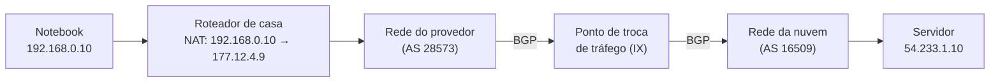

# Camada de rede: IP, sub-redes, roteamento

## Por que isso importa

Toda vez que você configura uma VPC na AWS, um cluster Kubernetes, uma regra de firewall, um container Docker ou a rede de um escritório, aparecem coisas como `10.0.0.0/16`, `192.168.1.0/24` e "gateway padrão". Erros de sub-rede estão entre as causas mais comuns de "o serviço A não fala com o serviço B". Esta aula ensina a fazer essas contas de cabeça (com a ajuda do binário que você viu em MD-04), e a entender como um pacote atravessa dezenas de redes de empresas diferentes até chegar ao destino.

## Intuição

Endereço IP é como um **endereço postal**: `192.168.1.37/24` diz "rua 192.168.1, casa 37". O `/24` diz **quantos bits são a rua** (a rede) e o resto é a casa (o host).

Um **roteador** é um **centro de distribuição dos Correios**. Ele não sabe onde fica cada casa do mundo; tem uma tabela do tipo:

- "Tudo que é para a **rua 10.1.2**, mande pelo caminhão 3."
- "Tudo que é para o **bairro 10.1**, caminhão 2."
- "Tudo que é para a **cidade 10**, caminhão 1."
- "Qualquer outra coisa: mande para o centro **maior** (rota padrão)."

Se um pacote serve para várias linhas, vale a **mais específica**: um pacote para 10.1.2.3 vai pelo caminhão 3. Cada centro só decide o **próximo passo**, e o pacote vai pulando até chegar.

## Visual

Um endereço com máscara /26:

```text
IP         192     .168     .1       .130
           11000000.10101000.00000001.10|000010
máscara    11111111.11111111.11111111.11|000000   (/26 = 26 bits 1)
                                         ^ rede | host (6 bits → 64 endereços)
rede       192.168.1.128   (host zerado)
broadcast  192.168.1.191   (host todo 1)
hosts      192.168.1.129 a 192.168.1.190  → 62 utilizáveis
```

Um pacote saindo de casa até um servidor:



## Conceito técnico

### O pacote IPv4

Campos principais do cabeçalho (20 bytes): **versão**, **tamanho**, **TTL** (*time to live*: cada roteador subtrai 1 e descarta em 0, evitando que pacotes rodem para sempre num laço), **protocolo** (6 = TCP, 17 = UDP, 1 = ICMP), **IP de origem**, **IP de destino** e um *checksum* do cabeçalho.

O IP é **melhor esforço** (*best effort*): pacotes podem se perder, chegar duplicados ou fora de ordem. Quem se preocupa com isso é o transporte (RD-04).

### Endereços e CIDR

Um IPv4 tem 32 bits, escritos como 4 bytes em decimal. Na notação **CIDR** `a.b.c.d/p`, os **p** primeiros bits são a **rede** e os outros `32 − p` são o **host**:

- **Máscara**: p bits 1 seguidos de zeros. `/24` = `255.255.255.0`, `/26` = `255.255.255.192`.
- **Endereço de rede** = IP AND máscara (host todo 0).
- **Broadcast** = rede OR (NOT máscara) (host todo 1).
- **Hosts utilizáveis** = 2^(32 − p) − 2 (os dois extremos são reservados).

Dois computadores estão na **mesma sub-rede** se `ip1 AND máscara == ip2 AND máscara`. Se sim, conversam direto (usando ARP, RD-02); se não, mandam para o **gateway padrão**.

Dividir `/24` em 4 sub-redes: cada uma "rouba" 2 bits do host (2² = 4), virando `/26` com 64 endereços: `.0/26`, `.64/26`, `.128/26`, `.192/26`.

### Endereços especiais, privados e NAT

| Faixa | Uso |
|---|---|
| `10.0.0.0/8`, `172.16.0.0/12`, `192.168.0.0/16` | **privados**: livres para redes internas, não roteados na Internet |
| `127.0.0.0/8` | *loopback* (`127.0.0.1` = a própria máquina) |
| `169.254.0.0/16` | link-local (quando o DHCP falha) |
| `0.0.0.0/0` | "qualquer endereço": a **rota padrão** |
| `100.64.0.0/10` | CGNAT (NAT da operadora) |

Os 2³² ≈ 4,3 bilhões de IPv4 acabaram. O **NAT** é o remendo: o roteador de casa troca o IP privado de origem pelo seu único IP público (e a porta de origem por uma porta livre), guardando o mapeamento numa tabela para traduzir as respostas de volta. Efeito colateral: de fora, ninguém consegue iniciar uma conexão para dentro sem configuração (por isso existem "redirecionamento de portas" e técnicas de *NAT traversal*).

O **DHCP** entrega automaticamente IP, máscara, gateway e servidores DNS quando você conecta a uma rede.

### ICMP

O protocolo de **mensagens de controle**: "destino inalcançável", "TTL expirou", e o par *echo request/reply* que o `ping` usa. O `traceroute` explora o TTL: manda pacotes com TTL 1, 2, 3... e cada roteador que descarta um deles se identifica com um ICMP "TTL expirou" (RD-07).

### Encaminhamento: a regra do prefixo mais longo

A **tabela de roteamento** lista prefixos e para onde mandar. Para cada pacote, o roteador escolhe a entrada **mais específica** (maior `p`) que contém o destino. `0.0.0.0/0` contém tudo, então é a rota de último recurso. Veja a sua com `ip route` (Linux) ou `netstat -rn` (macOS/Windows).

Roteadores de backbone têm tabelas com mais de 1 milhão de prefixos e fazem essa busca em nanossegundos, com hardware especial ou com tries (ED-09).

### Roteamento: quem monta as tabelas

- **Estado de enlace** (OSPF, IS-IS): cada roteador conhece o **mapa inteiro** da rede e roda **Dijkstra** (AL-06).
- **Vetor de distâncias** (RIP): cada roteador só conta aos vizinhos "consigo chegar em X com custo Y"; é o **Bellman-Ford** distribuído. Simples, mas converge devagar quando um enlace cai.
- **BGP**: a Internet é formada por ~75 mil **sistemas autônomos** (AS: provedores, nuvens, universidades). Entre eles, o BGP troca **caminhos** e aplica **políticas** comerciais ("não aceito tráfego de trânsito deste vizinho"). Um erro de BGP pode derrubar um serviço global, como aconteceu com o Facebook em 2021.

### IPv6

128 bits, escritos em hexadecimal: `2001:db8:85a3::8a2e:370:7334` (`::` abrevia uma sequência de zeros). Há endereços suficientes para dispensar o NAT. O cabeçalho é mais simples, não há broadcast (usa multicast), e os hosts podem gerar o próprio endereço (SLAAC). Hoje, cerca de 40% a 50% do tráfego do Google chega por IPv6.

## Código

O módulo `ipaddress` do Python faz essas contas (use-o para conferir as suas):

```python
import ipaddress

rede = ipaddress.ip_network("192.168.1.130/26", strict=False)
print("rede:", rede.network_address, "broadcast:", rede.broadcast_address)
print("máscara:", rede.netmask, "hosts:", rede.num_addresses - 2)

for sub in ipaddress.ip_network("10.0.0.0/24").subnets(new_prefix=26):
    print("sub-rede:", sub)

ip = ipaddress.ip_address("10.0.0.77")
print(ip, "está em 10.0.0.64/26?", ip in ipaddress.ip_network("10.0.0.64/26"))
print("é privado?", ip.is_private, "| 8.8.8.8 é privado?", ipaddress.ip_address("8.8.8.8").is_private)
print(ipaddress.ip_address("2001:db8::1").exploded)
```

## Erros comuns

- **Esquecer que endereço de rede e broadcast não podem ser dados a hosts.** Um /24 tem 254 hosts, não 256.
- **Achar que a máscara precisa terminar num ponto "redondo".** `/20`, `/26`, `/27` são comuns: faça as contas em binário.
- **Escolher a primeira rota que casa.** Vale a **mais específica**, não a primeira da lista.
- **Usar faixas privadas que se sobrepõem** em redes que depois vão se conectar (VPN entre dois escritórios que usam `192.168.0.0/24`).
- **Achar que um IP privado identifica alguém na Internet.** Fora da rede local, todos aparecem com o IP público do NAT.

## Pratique

```quiz
id: RD-03-q1
tipo: multipla_escolha
pergunta: "Quantos endereços de host utilizáveis tem uma rede /27?"
opcoes: ["27", "30", "32", "62"]
resposta: 1
explicacao: "Sobram 32 − 27 = 5 bits de host: 2⁵ = 32 endereços. Tirando o de rede e o de broadcast, ficam 30."
dificuldade: 1
```

```quiz
id: RD-03-q2
tipo: multipla_escolha
pergunta: "Os computadores 192.168.1.70/26 e 192.168.1.130/26 estão na mesma sub-rede?"
opcoes: ["Sim, os três primeiros bytes são iguais", "Não: o primeiro está em 192.168.1.64/26 e o segundo em 192.168.1.128/26", "Sim, porque são IPs privados", "Não dá para saber sem o gateway"]
resposta: 1
explicacao: "Com /26, os blocos são de 64: .0, .64, .128, .192. 70 cai no bloco .64 e 130 no bloco .128. Eles precisam de um roteador para conversar."
dificuldade: 2
```

```quiz
id: RD-03-q3
tipo: verdadeiro_falso
pergunta: "Numa tabela de roteamento, se o destino casa com 10.0.0.0/8 e com 10.1.0.0/16, o roteador usa a rota /16."
resposta: true
explicacao: "Vale a regra do prefixo mais longo: a /16 é mais específica que a /8. A rota 0.0.0.0/0, que casa com tudo, só é usada quando nenhuma outra casa."
dificuldade: 1
```

```quiz
id: RD-03-q4
tipo: resposta_curta
pergunta: "Como o NAT do roteador de casa permite que vários dispositivos com IPs privados acessem a Internet usando um único IP público?"
resposta: "Ao enviar, o roteador troca o IP privado e a porta de origem pelo seu IP público e uma porta livre, e guarda esse mapeamento numa tabela. Quando a resposta chega naquela porta, ele consulta a tabela e traduz de volta para o IP e a porta do dispositivo certo."
palavras_chave: ["porta", "tabela", "público", "traduz"]
dificuldade: 2
```

```quiz
id: RD-03-q5
tipo: multipla_escolha
pergunta: "Qual algoritmo do curso de Algoritmos é o coração do roteamento por estado de enlace (OSPF)?"
opcoes: ["Busca binária", "Dijkstra", "Kruskal", "Quicksort"]
resposta: 1
explicacao: "No estado de enlace, cada roteador conhece o grafo inteiro da rede e calcula os menores caminhos a partir de si com Dijkstra. O vetor de distâncias (RIP) é uma versão distribuída do Bellman-Ford."
dificuldade: 1
```

```quiz
id: RD-03-q6
tipo: codigo
linguagem: python
pergunta: |
  **Calculadora de sub-rede.** Escreva `info_rede(cidr)` que recebe algo como `'192.168.1.130/26'` e devolve a tupla `(rede, broadcast, primeiro_host, ultimo_host, numero_de_hosts)`, com os endereços como strings. Considere prefixos de 0 a 30. Não use o módulo `ipaddress`: converta para inteiro e use operações de bits.
codigo_inicial: |
  def info_rede(cidr):
      ip, p = cidr.split('/')
      partes = ip.split('.')
      rede = '.'.join(partes[:3] + ['0'])
      broadcast = '.'.join(partes[:3] + ['255'])
      return (rede, broadcast, rede[:-1] + '1', broadcast[:-3] + '254', 254)
usa: [def, return]
testes:
  - chamada: "info_rede('192.168.1.130/24')"
    saida: "('192.168.1.0', '192.168.1.255', '192.168.1.1', '192.168.1.254', 254)"
  - chamada: "info_rede('192.168.1.130/26')"
    saida: "('192.168.1.128', '192.168.1.191', '192.168.1.129', '192.168.1.190', 62)"
  - chamada: "info_rede('172.16.5.4/30')"
    saida: "('172.16.5.4', '172.16.5.7', '172.16.5.5', '172.16.5.6', 2)"
  - chamada: "info_rede('200.17.33.250/20')"
    visivel: false
    saida: "('200.17.32.0', '200.17.47.255', '200.17.32.1', '200.17.47.254', 4094)"
  - chamada: "info_rede('10.0.0.1/8')"
    visivel: false
    saida: "('10.0.0.0', '10.255.255.255', '10.0.0.1', '10.255.255.254', 16777214)"
dica: "Converta: n = (a << 24) | (b << 16) | (c << 8) | d. Máscara: (0xFFFFFFFF << (32 - p)) & 0xFFFFFFFF. rede = n & mascara; broadcast = rede | (~mascara & 0xFFFFFFFF). Para voltar: '.'.join(str((x >> s) & 255) for s in (24, 16, 8, 0))."
solucao: |
  def para_int(ip):
      a, b, c, d = map(int, ip.split('.'))
      return (a << 24) | (b << 16) | (c << 8) | d

  def para_ip(n):
      return '.'.join(str((n >> s) & 255) for s in (24, 16, 8, 0))

  def info_rede(cidr):
      ip, p = cidr.split('/')
      p = int(p)
      mascara = (0xFFFFFFFF << (32 - p)) & 0xFFFFFFFF
      rede = para_int(ip) & mascara
      broadcast = rede | (~mascara & 0xFFFFFFFF)
      return (para_ip(rede), para_ip(broadcast), para_ip(rede + 1), para_ip(broadcast - 1), broadcast - rede - 1)
explicacao: "O código inicial só funciona para /24. Com /20, o limite da rede cai no meio do terceiro byte: 33 = 0010 0001, e zerando os 4 bits de host desse byte sobra 0010 0000 = 32. O broadcast liga esses 4 bits: 0010 1111 = 47. Em Python, ~mascara dá um número negativo (inteiros sem tamanho fixo), por isso o & 0xFFFFFFFF."
dificuldade: 2
```

```quiz
id: RD-03-q7
tipo: codigo
linguagem: python
pergunta: |
  **Prefixo mais longo.** Escreva `rotear(tabela, ip)` que recebe uma lista de `(cidr, interface)` e um IP de destino e devolve a interface da rota **mais específica** que contém o IP, ou `None` se nenhuma casar.
codigo_inicial: |
  def rotear(tabela, ip):
      for cidr, interface in tabela:
          rede = cidr.split('/')[0]
          if ip.split('.')[0] == rede.split('.')[0]:
              return interface
      return None
usa: [def, for, return]
testes:
  - chamada: "rotear([('0.0.0.0/0', 'eth0'), ('10.0.0.0/8', 'eth1'), ('10.1.0.0/16', 'eth2'), ('10.1.2.0/24', 'eth3'), ('192.168.0.0/24', 'wlan0')], '10.1.2.3')"
    saida: "'eth3'"
  - chamada: "rotear([('0.0.0.0/0', 'eth0'), ('10.0.0.0/8', 'eth1'), ('10.1.0.0/16', 'eth2'), ('10.1.2.0/24', 'eth3'), ('192.168.0.0/24', 'wlan0')], '10.200.0.1')"
    saida: "'eth1'"
  - chamada: "rotear([('0.0.0.0/0', 'eth0'), ('10.0.0.0/8', 'eth1'), ('10.1.0.0/16', 'eth2'), ('10.1.2.0/24', 'eth3'), ('192.168.0.0/24', 'wlan0')], '192.168.1.1')"
    saida: "'eth0'"
  - chamada: "rotear([('10.0.0.0/8', 'eth1')], '8.8.8.8')"
    saida: "None"
  - chamada: "rotear([('10.1.2.3/32', 'lo'), ('10.1.2.0/24', 'eth3')], '10.1.2.3')"
    visivel: false
    saida: "'lo'"
  - chamada: "[rotear([('%d.%d.0.0/16' % (i % 256, i // 256), 'if%d' % i) for i in range(5000)] + [('7.7.7.0/24', 'x'), ('7.0.0.0/8', 'y')], d) for d in ['7.7.7.7', '7.8.1.1', '200.19.5.5']]"
    visivel: false
    saida: "['x', 'if2055', None]"
dica: "Para cada rota, calcule a máscara do prefixo p e confira (destino & mascara) == (rede & mascara). Entre as que casam, guarde a de maior p."
solucao: |
  def para_int(ip):
      a, b, c, d = map(int, ip.split('.'))
      return (a << 24) | (b << 16) | (c << 8) | d

  def rotear(tabela, ip):
      destino = para_int(ip)
      melhor = None
      melhor_p = -1
      for cidr, interface in tabela:
          rede, p = cidr.split('/')
          p = int(p)
          mascara = (0xFFFFFFFF << (32 - p)) & 0xFFFFFFFF
          if destino & mascara == para_int(rede) & mascara and p > melhor_p:
              melhor = interface
              melhor_p = p
      return melhor
explicacao: "192.168.1.1 não está em 192.168.0.0/24 (o terceiro byte difere), então cai na rota padrão. No teste oculto, 7.7.7.7 casa com três rotas (7.7.0.0/16, 7.0.0.0/8 e 7.7.7.0/24) e a /24 vence. Percorrer a tabela inteira é O(n) por pacote; roteadores reais usam tries de bits para fazer isso em O(32)."
dificuldade: 2
```

```quiz
id: RD-03-q8
tipo: codigo
linguagem: javascript
pergunta: |
  **Dividir em sub-redes.** Escreva `dividir(cidr, n)` que divide a rede em `n` sub-redes iguais e devolve um array de strings CIDR em ordem. `n` precisa ser potência de 2 e o novo prefixo não pode passar de 32; senão, devolva `[]`. Se o IP dado não for o endereço de rede, comece do endereço de rede dele.
codigo_inicial: |
  function dividir(cidr, n) {
    const [ip, p] = cidr.split('/');
    const res = [];
    for (let i = 0; i < n; i++) res.push(`${ip}/${Number(p) + 1}`);
    return res;
  }
usa: [function, for, return]
testes:
  - chamada: "dividir('192.168.0.0/24', 4)"
    saida: "[ '192.168.0.0/26', '192.168.0.64/26', '192.168.0.128/26', '192.168.0.192/26' ]"
  - chamada: "dividir('10.0.0.0/8', 2)"
    saida: "[ '10.0.0.0/9', '10.128.0.0/9' ]"
  - chamada: "dividir('172.16.0.0/16', 3)"
    saida: "[]"
  - chamada: "dividir('200.17.33.250/20', 8)"
    visivel: false
    saida: "[ '200.17.32.0/23', '200.17.34.0/23', '200.17.36.0/23', '200.17.38.0/23', '200.17.40.0/23', '200.17.42.0/23', '200.17.44.0/23', '200.17.46.0/23' ]"
  - chamada: "dividir('0.0.0.0/0', 4)"
    visivel: false
    saida: "[ '0.0.0.0/2', '64.0.0.0/2', '128.0.0.0/2', '192.0.0.0/2' ]"
  - chamada: "dividir('10.0.0.0/31', 4)"
    visivel: false
    saida: "[]"
dica: "Os operadores de bits do JS trabalham com 32 bits com sinal, o que atrapalha com IPs acima de 128.0.0.0. Use números comuns: base = soma de byte × 256^k; tamanho de cada sub-rede = 2 ** (32 - novoP); rede = base - (base % 2 ** (32 - p)). Para voltar: Math.floor(v / 2 ** s) % 256 para s em 24, 16, 8, 0."
solucao: |
  function dividir(cidr, n) {
    const [ip, textoP] = cidr.split('/');
    const p = Number(textoP);
    const bits = Math.log2(n);
    if (!Number.isInteger(bits) || p + bits > 32) return [];
    const base = ip.split('.').reduce((acc, x) => acc * 256 + Number(x), 0);
    const rede = base - (base % 2 ** (32 - p));
    const novoP = p + bits;
    const tamanho = 2 ** (32 - novoP);
    const res = [];
    for (let i = 0; i < n; i++) {
      const v = rede + i * tamanho;
      const bytes = [24, 16, 8, 0].map((s) => Math.floor(v / 2 ** s) % 256);
      res.push(`${bytes.join('.')}/${novoP}`);
    }
    return res;
  }
explicacao: "Dividir em n = 2^k partes é emprestar k bits do host para a rede. Cada sub-rede tem 2^(32 − novoP) endereços, então elas começam em múltiplos desse tamanho. No teste oculto do /20, cada /23 tem 512 endereços, que avançam o terceiro byte de 2 em 2. É o cálculo que você faz ao planejar as sub-redes públicas e privadas de uma VPC."
dificuldade: 3
```

## Resumo

- IPv4: 32 bits; **CIDR** `/p` separa rede e host. Rede = IP AND máscara; broadcast = host todo 1; hosts = 2^(32−p) − 2.
- Mesma sub-rede: conversa direta; senão, **gateway padrão**.
- **Privados** (10/8, 172.16/12, 192.168/16) + **NAT** remediaram a falta de IPv4; **DHCP** configura tudo; **ICMP** carrega erros e o ping.
- Encaminhamento pela regra do **prefixo mais longo**; tabelas montadas por **OSPF** (Dijkstra), **RIP** (Bellman-Ford) e, entre redes de empresas, **BGP**.
- **IPv6**: 128 bits, sem necessidade de NAT.

## Para ir além

- Leia os capítulos 4 e 5 do Kurose & Ross e faça o lab do roteador do CS144.
- Rode `ip addr`, `ip route` e descubra sua máscara e gateway; compare com o IP que sites como "qual é meu IP" mostram.
- **Próximo módulo**: RD-04 Camada de transporte: TCP vs. UDP.
