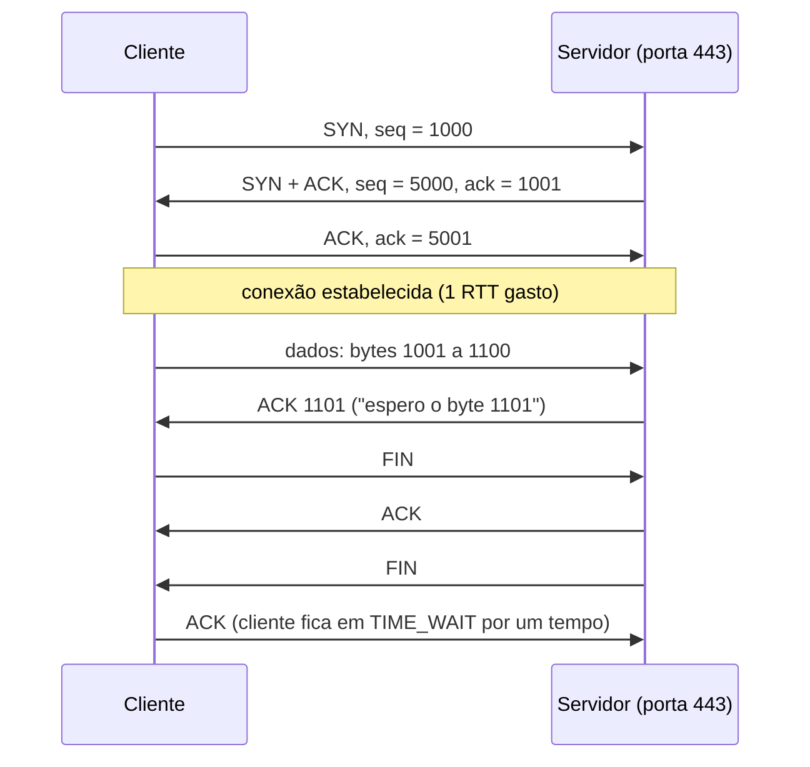

# Camada de transporte: TCP vs. UDP, handshake, controle de congestionamento

## Por que isso importa

O IP (RD-03) entrega pacotes entre **máquinas**, do jeito que der: pode perder, duplicar, embaralhar. Mas seu navegador precisa receber uma página **inteira e na ordem**, e o servidor tem centenas de processos esperando dados. É a camada de transporte que transforma o caos do IP em algo usável. Entender TCP explica latências misteriosas (o handshake custa um RTT antes do primeiro byte), por que um download começa devagar e acelera, o que significam `ECONNREFUSED`, `ECONNRESET` e `TIME_WAIT`, por que jogos e chamadas de vídeo usam UDP, e por que o HTTP/3 trocou o TCP pelo QUIC.

## Intuição

O IP é um **carteiro descuidado**: entrega cartas soltas, às vezes perde uma, às vezes entrega fora de ordem.

O **UDP** é mandar **cartões-postais**: cada um vai sozinho, com o número do apartamento (a **porta**). Rápido e barato; se um se perder, paciência. Ótimo para um placar ao vivo, em que a próxima atualização torna a anterior inútil.

O **TCP** é mandar um **livro em capítulos numerados** com um acordo: antes de começar, os dois lados combinam a numeração (o **handshake**). O leitor avisa "recebi tudo até a página 300" (**ACK**). Se o remetente não ouve nada por um tempo, reenvia. Se chega a página 320 antes da 310, o leitor guarda e espera. E se o carteiro parece sobrecarregado (cartas se perdendo), o remetente **diminui o ritmo** para não piorar o congestionamento de todo mundo.

## Visual

O three-way handshake, a troca de dados e o encerramento:



Janela de congestionamento (em segmentos) ao longo do tempo, no TCP Reno:

```text
cwnd
 20 |                         *
 18 |                      *
 16 |              *  *  *        perda (3 ACKs duplicados):
 12 |                                cwnd cai pela metade
  9 |                            *  *  *  ← cresce +1 por RTT (AIMD)
  8 |           *
  4 |       *
  2 |   *            slow start: dobra por RTT até ssthresh
  1 | *
    +----------------------------------------- RTT
```

## Conceito técnico

### Portas e demultiplexação

Uma **porta** (16 bits, 0 a 65535) identifica o processo dentro da máquina. Portas abaixo de 1024 são as "bem conhecidas" (80 HTTP, 443 HTTPS, 22 SSH, 53 DNS, 5432 PostgreSQL). O cliente usa uma porta **efêmera** aleatória (por exemplo, 51834).

Como o SO decide para qual *socket* entregar:

- **UDP**: só pela **porta de destino**. Um único socket recebe de todo mundo.
- **TCP**: por **quatro valores**: IP e porta de origem, IP e porta de destino. Um servidor na porta 443 tem um socket "de escuta" e um socket **separado para cada conexão**. Um segmento comum que não pertence a nenhuma conexão é respondido com **RST** (no cliente, `ECONNRESET` ou `ECONNREFUSED`). Só um **SYN** (pedido de conexão nova) é aceito pelo socket de escuta.

### UDP

Cabeçalho de 8 bytes: portas de origem e destino, tamanho e checksum. Sem conexão, sem confirmação, sem ordem, sem controle de fluxo. Usado onde **atraso importa mais que perfeição** ou onde a aplicação quer controlar tudo: DNS (uma pergunta, uma resposta), jogos, voz e vídeo em tempo real, e o **QUIC** (a base do HTTP/3, que implementa confiabilidade por cima do UDP).

### TCP: um fluxo de bytes confiável

O TCP oferece um **fluxo de bytes** bidirecional, confiável e ordenado. Ferramentas:

- **Números de sequência**: cada **byte** tem um número. O início é aleatório, combinado no handshake (dificulta ataques de injeção).
- **ACK cumulativo**: "recebi tudo até o byte N − 1, mande o N". Segmentos fora de ordem ficam num buffer, e o ACK continua apontando para o primeiro buraco.
- **Retransmissão**: por **timeout** (o RTO, calculado a partir das medições de RTT) ou por **retransmissão rápida** ao receber **3 ACKs duplicados** (o receptor está avisando que falta um pedaço).
- **Controle de fluxo**: o receptor anuncia uma **janela** (quanto ainda cabe no buffer dele), e o remetente nunca envia mais do que isso sem confirmação. Protege o **receptor**.
- **Controle de congestionamento**: protege a **rede** (abaixo).

### Handshake e encerramento

- **Abertura em 3 vias**: SYN → SYN-ACK → ACK. Custa **1 RTT** antes de qualquer dado. Com TLS por cima (RD-06), mais 1 RTT. Por isso conexões são **reaproveitadas** (keep-alive, pools de conexão com o banco de dados).
- **Encerramento**: cada lado envia seu FIN e recebe ACK (a conexão pode ficar "meio fechada"). Quem fecha primeiro passa por **TIME_WAIT** (tipicamente 60 s) para absorver segmentos atrasados. Servidores que abrem e fecham milhares de conexões por segundo podem acumular milhares de sockets em TIME_WAIT.

### Controle de congestionamento

Se todos enviarem o máximo, as filas dos roteadores enchem, pacotes são descartados, todos retransmitem e a rede colapsa (aconteceu na Internet em 1986). O TCP mantém uma **janela de congestionamento** (`cwnd`) e envia no máximo `min(cwnd, janela do receptor)` sem confirmação:

1. **Slow start**: começa com `cwnd` pequena e **dobra a cada RTT** (cada ACK soma 1), até atingir o limiar `ssthresh`.
2. **Prevenção de congestionamento**: acima de `ssthresh`, soma **1 por RTT** (aumento aditivo).
3. **Perda detectada por 3 ACKs duplicados**: `ssthresh = cwnd / 2` e `cwnd = ssthresh` (diminuição multiplicativa). Juntos, 2 e 3 formam o **AIMD**, que divide a banda de forma justa entre conexões.
4. **Timeout**: sinal de congestionamento grave: `ssthresh = cwnd / 2` e `cwnd` volta a **1**.

A vazão fica em torno de `cwnd / RTT`: com RTT maior, a mesma janela rende menos. Algoritmos modernos como o **CUBIC** (padrão no Linux) e o **BBR** (Google) crescem de outro jeito, mas a ideia de reagir ao congestionamento é a mesma.

### TCP vs. UDP

| | TCP | UDP |
|---|---|---|
| Conexão | sim (handshake) | não |
| Entrega | confiável, ordenada, sem duplicatas | melhor esforço |
| Unidade | fluxo de bytes (não preserva "mensagens") | datagramas (cada envio é uma mensagem) |
| Controle de fluxo e congestionamento | sim | não (a aplicação que se vire) |
| Cabeçalho | 20+ bytes | 8 bytes |
| Exemplos | HTTP/1.1 e /2, SSH, bancos de dados, e-mail | DNS, jogos, VoIP, streaming ao vivo, QUIC/HTTP/3 |

## Código

Um cliente e um servidor TCP de verdade (rode no terminal; o navegador não abre sockets):

```text
# servidor.py
import socket
with socket.socket(socket.AF_INET, socket.SOCK_STREAM) as s:
    s.setsockopt(socket.SOL_SOCKET, socket.SO_REUSEADDR, 1)
    s.bind(("127.0.0.1", 9000))
    s.listen()                       # socket de escuta
    conn, endereco = s.accept()      # handshake feito: novo socket só desta conexão
    with conn:
        print("conectado a", endereco)   # ('127.0.0.1', 51834): porta efêmera do cliente
        dados = conn.recv(1024)
        conn.sendall(dados.upper())

# cliente.py
import socket
with socket.socket(socket.AF_INET, socket.SOCK_STREAM) as c:
    c.connect(("127.0.0.1", 9000))   # SYN, SYN-ACK, ACK
    c.sendall(b"ola tcp")
    print(c.recv(1024))              # b'OLA TCP'
```

E a ideia do ACK cumulativo, que roda aqui mesmo:

```python
def receber(segmentos):
    esperado, buffer, texto = 0, {}, ""
    for seq, dados in segmentos:
        buffer[seq] = dados
        while esperado in buffer:          # entrega tudo que ficou contíguo
            pedaco = buffer.pop(esperado)
            texto += pedaco
            esperado += len(pedaco)
        print(f"chegou seq={seq:2} -> ACK {esperado:2}  entregue: {texto!r}")

receber([(0, "Olá, "), (11, "TCP!"), (5, "mundo ")])
```

## Erros comuns

- **Achar que TCP preserva mensagens.** Dois `send` podem chegar num único `recv`, ou um `send` em dois. Protocolos sobre TCP precisam delimitar mensagens (tamanho no início, ou uma quebra de linha).
- **Achar que UDP é "TCP mais rápido".** Ele é mais simples; a velocidade vem de não esperar handshake nem retransmissões, ao custo de perder dados.
- **Confundir controle de fluxo com controle de congestionamento.** Fluxo protege o receptor (janela anunciada); congestionamento protege a rede (`cwnd`).
- **Abrir uma conexão nova por requisição.** Cada uma custa um handshake (e TLS). Use keep-alive e pools.
- **Achar que a porta identifica a conexão.** No TCP, quem identifica é a quádrupla; milhares de conexões compartilham a porta 443 do servidor.

## Pratique

```quiz
id: RD-04-q1
tipo: multipla_escolha
pergunta: "Qual protocolo de transporte faz mais sentido para uma chamada de voz em tempo real?"
opcoes: ["TCP, porque não perde nada", "UDP, porque um pedaço de áudio atrasado é inútil e retransmitir só aumenta o atraso", "Nenhum: voz usa só IP", "TCP, porque tem controle de congestionamento"]
resposta: 1
explicacao: "Na voz, é melhor perder 20 ms de áudio do que travar a conversa esperando uma retransmissão. Por isso VoIP e videochamadas usam UDP (geralmente com RTP), lidando com perdas na aplicação."
dificuldade: 1
```

```quiz
id: RD-04-q2
tipo: multipla_escolha
pergunta: "O receptor já recebeu os bytes 0 a 999 e depois os bytes 1500 a 1999. Qual ACK ele envia?"
opcoes: ["2000", "1000", "1500", "999"]
resposta: 1
explicacao: "O ACK do TCP é cumulativo: diz o próximo byte esperado na ordem. Falta o trecho 1000 a 1499, então ele continua pedindo 1000 (e guarda os bytes 1500 a 1999 no buffer). ACKs repetidos com o mesmo número são os 'ACKs duplicados' que disparam a retransmissão rápida."
dificuldade: 2
```

```quiz
id: RD-04-q3
tipo: verdadeiro_falso
pergunta: "Se o cliente chama send duas vezes com 100 bytes cada, o servidor sempre recebe duas mensagens separadas de 100 bytes no recv."
resposta: false
explicacao: "TCP é um fluxo de bytes, sem fronteiras de mensagem. O servidor pode receber 200 bytes de uma vez, ou 50 e 150. A aplicação precisa delimitar as mensagens, como o HTTP faz com Content-Length e quebras de linha."
dificuldade: 2
```

```quiz
id: RD-04-q4
tipo: multipla_escolha
pergunta: "No controle de congestionamento do TCP Reno, o que acontece com a cwnd quando ocorre um timeout?"
opcoes: ["Dobra", "Cai pela metade", "Volta a 1 segmento, e ssthresh vira metade da cwnd anterior", "Não muda"]
resposta: 2
explicacao: "Timeout é o sinal mais grave (nem os ACKs duplicados chegaram), então o TCP recomeça do slow start. Com 3 ACKs duplicados, a rede ainda está entregando alguma coisa, e a reação é mais branda: a cwnd cai só pela metade."
dificuldade: 2
```

```quiz
id: RD-04-q5
tipo: resposta_curta
pergunta: "Por que o handshake do TCP deixa mais lenta a primeira requisição a um servidor distante, e como aplicações reduzem esse custo?"
resposta: "Porque o cliente precisa enviar o SYN e esperar o SYN-ACK antes de mandar qualquer dado: um RTT inteiro, que com o servidor longe pode ser 100 ms ou mais (e o TLS acrescenta outro). Aplicações reaproveitam conexões com keep-alive e pools, e protocolos como TLS 1.3 e QUIC reduzem ou juntam essas idas e voltas."
palavras_chave: ["RTT", "SYN", "reaproveit", "keep-alive"]
dificuldade: 2
```

```quiz
id: RD-04-q6
tipo: codigo
linguagem: python
pergunta: |
  **Receptor TCP.** Escreva `receptor(segmentos)` que recebe uma lista de `(seq, dados)` na ordem de chegada (o fluxo começa no byte 0) e devolve a tupla `(acks, entregue)`: `acks` tem o ACK enviado depois de **cada** segmento (o próximo byte esperado) e `entregue` é o texto entregue à aplicação, em ordem. Segmentos fora de ordem ficam guardados até o buraco ser preenchido; segmentos repetidos ou já entregues são ignorados.
codigo_inicial: |
  def receptor(segmentos):
      acks = []
      entregue = ''
      for seq, dados in segmentos:
          entregue += dados
          acks.append(len(entregue))
      return (acks, entregue)
usa: [def, for, while, return]
testes:
  - chamada: "receptor([(0, 'abc'), (3, 'def'), (6, 'gh')])"
    saida: "([3, 6, 8], 'abcdefgh')"
  - chamada: "receptor([(0, 'abc'), (6, 'gh'), (3, 'def')])"
    saida: "([3, 3, 8], 'abcdefgh')"
  - chamada: "receptor([(3, 'def'), (6, 'gh'), (0, 'abc')])"
    saida: "([0, 0, 8], 'abcdefgh')"
  - chamada: "receptor([(0, 'abc'), (0, 'abc'), (3, 'de')])"
    visivel: false
    saida: "([3, 3, 5], 'abcde')"
  - chamada: "receptor([])"
    visivel: false
    saida: "([], '')"
dica: "Guarde esperado = 0 e um dicionário buffer[seq] = dados. Ao receber, se seq >= esperado, guarde no buffer. Depois, enquanto esperado estiver no buffer, tire o pedaço, acrescente a entregue e avance esperado pelo tamanho dele."
solucao: |
  def receptor(segmentos):
      esperado = 0
      buffer = {}
      entregue = ''
      acks = []
      for seq, dados in segmentos:
          if seq >= esperado:
              buffer[seq] = dados
          while esperado in buffer:
              pedaco = buffer.pop(esperado)
              entregue += pedaco
              esperado += len(pedaco)
          acks.append(esperado)
      return (acks, entregue)
explicacao: "É o 'reassembler' do lab do CS144. No segundo teste, o segmento 6 chega antes do 3: o receptor guarda e repete o ACK 3 (um ACK duplicado). Quando o 3 chega, preenche o buraco e os dois pedaços são entregues juntos (ACK 8). A aplicação nunca vê a bagunça: só recebe bytes contíguos e em ordem."
dificuldade: 2
```

```quiz
id: RD-04-q7
tipo: codigo
linguagem: python
pergunta: |
  **Janela de congestionamento.** Escreva `cwnd_por_rtt(n, eventos, ssthresh=16)` que devolve a lista com a `cwnd` no início de cada um dos `n` RTTs. Começa com `cwnd = 1`. `eventos` é um dicionário `{rtt: 'perda' | 'timeout'}` com o que acontece no **fim** daquele RTT:

  - `'timeout'`: `ssthresh = max(cwnd // 2, 2)` e `cwnd = 1`.
  - `'perda'` (3 ACKs duplicados): `ssthresh = max(cwnd // 2, 2)` e `cwnd = ssthresh`.
  - sem evento: se `cwnd < ssthresh`, `cwnd = min(2 * cwnd, ssthresh)`; senão, `cwnd += 1`.
codigo_inicial: |
  def cwnd_por_rtt(n, eventos, ssthresh=16):
      cwnd = 1
      historico = []
      for r in range(n):
          historico.append(cwnd)
          cwnd *= 2
      return historico
usa: [def, for, return]
testes:
  - chamada: "cwnd_por_rtt(10, {})"
    saida: "[1, 2, 4, 8, 16, 17, 18, 19, 20, 21]"
  - chamada: "cwnd_por_rtt(12, {7: 'perda'})"
    saida: "[1, 2, 4, 8, 16, 17, 18, 19, 9, 10, 11, 12]"
  - chamada: "cwnd_por_rtt(12, {7: 'timeout'}, 8)"
    saida: "[1, 2, 4, 8, 9, 10, 11, 12, 1, 2, 4, 6]"
  - chamada: "cwnd_por_rtt(3, {0: 'timeout', 1: 'timeout'})"
    visivel: false
    saida: "[1, 1, 1]"
  - chamada: "sum(cwnd_por_rtt(200, {r: ('perda' if r % 3 else 'timeout') for r in range(30, 200, 17)}))"
    visivel: false
    saida: "4309"
dica: "Em cada RTT: primeiro registre a cwnd atual; depois aplique o evento daquele RTT com eventos.get(r), ou o crescimento normal."
solucao: |
  def cwnd_por_rtt(n, eventos, ssthresh=16):
      cwnd = 1
      historico = []
      for r in range(n):
          historico.append(cwnd)
          evento = eventos.get(r)
          if evento == 'timeout':
              ssthresh = max(cwnd // 2, 2)
              cwnd = 1
          elif evento == 'perda':
              ssthresh = max(cwnd // 2, 2)
              cwnd = ssthresh
          elif cwnd < ssthresh:
              cwnd = min(2 * cwnd, ssthresh)
          else:
              cwnd += 1
      return historico
explicacao: "O primeiro teste mostra as duas fases: crescimento exponencial até 16 e depois linear. Na perda do RTT 7 (cwnd 19), a janela cai para 9 e volta a crescer de 1 em 1: o 'dente de serra' do AIMD. No timeout, ela despenca para 1 e refaz o slow start, agora só até o novo ssthresh (6). A soma do teste oculto é proporcional a quantos dados a conexão conseguiu enviar em 200 RTTs."
dificuldade: 2
```

```quiz
id: RD-04-q8
tipo: codigo
linguagem: javascript
pergunta: |
  **Demultiplexação.** Escreva `demultiplexar(segmentos, sockets)` que devolve, para cada segmento, o `nome` do socket que o recebe:

  - **UDP**: o socket UDP com a mesma `porta`; se não houver, `'ICMP porta inalcançável'`.
  - **TCP**: primeiro, um socket de **conexão** com a mesma `porta` e `remoto` igual à `origem` do segmento. Senão, se o segmento for um SYN (`syn: true`) e houver um socket de **escuta** TCP naquela porta (sem `remoto`), ele. Senão, `'RST'`.
codigo_inicial: |
  function demultiplexar(segmentos, sockets) {
    const nomes = [];
    for (const s of segmentos) {
      const alvo = sockets.find((k) => k.porta === s.porta);
      nomes.push(alvo ? alvo.nome : 'RST');
    }
    return nomes;
  }
usa: [function, return]
testes:
  - chamada: "demultiplexar([{ proto: 'tcp', porta: 443, origem: '1.2.3.4:5000' }, { proto: 'tcp', porta: 443, origem: '1.2.3.4:5001' }, { proto: 'udp', porta: 53, origem: '9.9.9.9:7000' }], [{ proto: 'udp', porta: 53, nome: 'dns' }, { proto: 'tcp', porta: 443, nome: 'escuta-443' }, { proto: 'tcp', porta: 443, remoto: '1.2.3.4:5000', nome: 'conexao-A' }, { proto: 'tcp', porta: 443, remoto: '1.2.3.4:5001', nome: 'conexao-B' }])"
    saida: "[ 'conexao-A', 'conexao-B', 'dns' ]"
  - chamada: "demultiplexar([{ proto: 'tcp', porta: 443, origem: '9.9.9.9:7000', syn: true }, { proto: 'tcp', porta: 443, origem: '9.9.9.9:7000' }], [{ proto: 'tcp', porta: 443, nome: 'escuta-443' }])"
    saida: "[ 'escuta-443', 'RST' ]"
  - chamada: "demultiplexar([{ proto: 'udp', porta: 443, origem: '9.9.9.9:7000' }, { proto: 'tcp', porta: 80, origem: '1.2.3.4:5000', syn: true }], [{ proto: 'udp', porta: 53, nome: 'dns' }, { proto: 'tcp', porta: 443, nome: 'escuta-443' }])"
    visivel: false
    saida: "[ 'ICMP porta inalcançável', 'RST' ]"
  - chamada: "demultiplexar([{ proto: 'udp', porta: 53, origem: '1.1.1.1:999' }, { proto: 'tcp', porta: 53, origem: '1.1.1.1:999', syn: true }], [{ proto: 'udp', porta: 53, nome: 'dns-udp' }, { proto: 'tcp', porta: 53, nome: 'dns-tcp' }])"
    visivel: false
    saida: "[ 'dns-udp', 'dns-tcp' ]"
dica: "Escreva uma função auxiliar para um segmento e use segmentos.map. Para TCP, procure com sockets.find duas vezes: primeiro uma conexão (k.remoto === s.origem), depois a escuta (!k.remoto), e só aceite a escuta se s.syn for verdadeiro. Sempre confira também o proto."
solucao: |
  function destino(s, sockets) {
    if (s.proto === 'udp') {
      const alvo = sockets.find((k) => k.proto === 'udp' && k.porta === s.porta);
      return alvo ? alvo.nome : 'ICMP porta inalcançável';
    }
    const conexao = sockets.find((k) => k.proto === 'tcp' && k.porta === s.porta && k.remoto === s.origem);
    if (conexao) return conexao.nome;
    const escuta = sockets.find((k) => k.proto === 'tcp' && k.porta === s.porta && !k.remoto);
    return escuta && s.syn ? escuta.nome : 'RST';
  }

  function demultiplexar(segmentos, sockets) {
    return segmentos.map((s) => destino(s, sockets));
  }
explicacao: "Duas conexões do mesmo cliente (portas 5000 e 5001) chegam na mesma porta 443 e vão para sockets diferentes: no TCP, quem identifica é a quádrupla. Um segmento comum de quem nunca fez handshake recebe RST. No último teste, UDP e TCP têm espaços de portas separados: o DNS usa a porta 53 nos dois (o TCP para respostas grandes)."
dificuldade: 2
```

## Resumo

- **Portas** identificam processos; UDP demultiplexa só pela porta, TCP pela **quádrupla** (IPs e portas).
- **UDP**: datagramas, sem conexão nem garantias; DNS, jogos, voz, QUIC.
- **TCP**: fluxo de bytes confiável e ordenado com **handshake** (1 RTT), **números de sequência**, **ACK cumulativo**, retransmissão por timeout ou 3 ACKs duplicados, **controle de fluxo** (janela do receptor).
- **Congestionamento**: slow start até `ssthresh`, depois **AIMD** (+1 por RTT, metade na perda, 1 no timeout).
- Reaproveite conexões: handshakes custam RTTs.

## Para ir além

- Faça os labs 0 a 4 do CS144: você implementa um TCP que conversa com o Linux de verdade.
- Rode `ss -tan` (Linux) ou `netstat -an` e veja conexões em ESTABLISHED, LISTEN e TIME_WAIT.
- **Próximo módulo**: RD-05 Camada de aplicação: DNS, HTTP/1.1, HTTP/2, HTTP/3.
