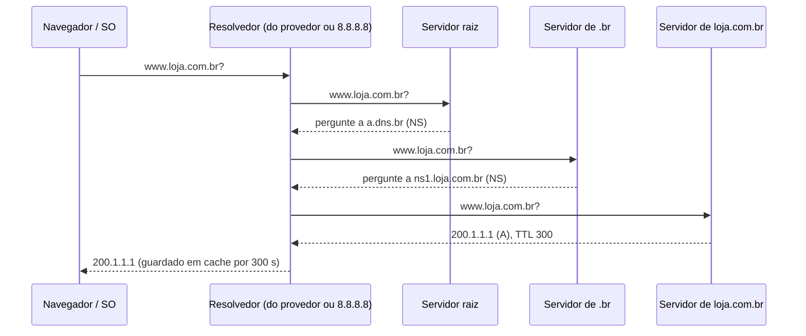

# Camada de aplicação: DNS, HTTP/1.1, HTTP/2, HTTP/3

## Por que isso importa

É nesta camada que você vai trabalhar todo dia como dev: toda API REST, todo `fetch`, todo `curl`, todo deploy que "não resolve o domínio". Saber ler uma requisição HTTP crua, escolher o status certo (404 ou 422? 401 ou 403?), configurar cache, e entender por que mudar o DNS "demora para propagar" separa quem depura em minutos de quem fica horas tentando. As versões novas do HTTP também explicam por que juntar todos os arquivos JavaScript num só já não é tão importante quanto era.

## Intuição

O **DNS** é a **lista telefônica** da Internet, só que distribuída: ninguém tem a lista inteira. Para achar `loja.com.br`, você pergunta à **raiz**: "não sei, mas quem cuida de `.br` é este aqui". O de `.br` diz: "quem cuida de `com.br` é aquele". Este responde: "`loja.com.br` é 200.1.1.1". Seu provedor **anota** a resposta por um tempo (o **TTL**), para não ter de perguntar tudo de novo.

O **HTTP** é um **balcão de atendimento** com formulário padrão: você entrega um pedido ("GET /produtos, aceito JSON") e recebe uma resposta com um código ("200 OK, aqui está" ou "404, não existe"). No HTTP/1.1 o balcão atende **um pedido de cada vez por fila**; no HTTP/2, vários pedidos andam **misturados na mesma fila**; no HTTP/3, cada pedido tem sua própria fila, e um pedido travado não segura os outros.

## Visual

Resolução de `www.loja.com.br` (iterativa, sem nada em cache):



Uma requisição e uma resposta HTTP/1.1 (texto puro; cada linha termina com `\r\n`):

```text
GET /api/produtos?pagina=2 HTTP/1.1          ← método, caminho, versão
Host: loja.com.br                            ← cabeçalhos
Accept: application/json
                                             ← linha vazia: fim dos cabeçalhos

HTTP/1.1 200 OK                              ← versão, status, frase
Content-Type: application/json
Content-Length: 43
Cache-Control: max-age=60

{"produtos": [{"id": 7, "nome": "Caneca"}]}  ← corpo
```

## Conceito técnico

### DNS

- **Hierarquia**: raiz (`.`) → domínios de topo (`.br`, `.com`, `.dev`) → domínios (`loja.com.br`) → subdomínios. Cada nível **delega** ao próximo com registros **NS**.
- **Tipos de registro**: **A** (IPv4), **AAAA** (IPv6), **CNAME** (apelido para outro nome), **MX** (servidor de e-mail), **TXT** (texto livre: verificação de domínio, SPF), **NS** (quem responde pela zona).
- **Resolvedor recursivo**: o servidor do provedor (ou 8.8.8.8, 1.1.1.1) faz o trabalho iterativo por você e guarda tudo em **cache** pelo **TTL** de cada registro. "Propagação de DNS" é só o tempo para os caches antigos expirarem: baixe o TTL **antes** de uma migração.
- Normalmente usa **UDP** na porta 53 (uma pergunta, uma resposta), com TCP para respostas grandes. Hoje também existe DNS sobre HTTPS (DoH), que cifra as consultas.

### HTTP: o modelo

- **Cliente-servidor**, **requisição-resposta**, e **sem estado**: cada requisição é independente. Sessões são simuladas com **cookies** ou **tokens** enviados em cabeçalhos.
- **URL**: `esquema://host:porta/caminho?consulta#fragmento`. Porta padrão 80 (`http`) e 443 (`https`). O **fragmento** nunca é enviado ao servidor. Caracteres especiais são codificados com `%XX` (por exemplo, `é` vira `%C3%A9` em UTF-8; espaço vira `%20` ou `+` na consulta).

### Métodos

| Método | Uso | Seguro (não altera)? | Idempotente (repetir dá o mesmo efeito)? |
|---|---|---|---|
| GET | ler | sim | sim |
| HEAD | como GET, só cabeçalhos | sim | sim |
| POST | criar, ações | não | **não** |
| PUT | substituir inteiro | não | sim |
| PATCH | alterar parte | não | não necessariamente |
| DELETE | remover | não | sim |

Idempotência importa porque redes falham: um cliente pode **repetir** um PUT com segurança, mas repetir um POST de pagamento pode cobrar duas vezes (por isso APIs de pagamento usam chaves de idempotência).

### Códigos de status

- **2xx sucesso**: 200 OK, 201 Created, 204 No Content.
- **3xx redirecionamento**: 301 (permanente), 302/307 (temporário), 304 Not Modified (use sua cópia em cache).
- **4xx erro do cliente**: 400 (requisição malformada), **401** (não autenticado: quem é você?), **403** (autenticado, mas sem permissão), 404, 409 (conflito), 422 (dados inválidos), 429 (muitas requisições).
- **5xx erro do servidor**: 500, 502 (o proxy recebeu resposta inválida do servidor de trás), 503 (indisponível), 504 (o proxy esperou demais).

### Cabeçalhos importantes

`Host` (obrigatório no HTTP/1.1: vários sites no mesmo IP), `Content-Type`, `Content-Length`, `Accept`, `Authorization`, `Cookie` / `Set-Cookie`, `User-Agent`, e os de cache: `Cache-Control: max-age=60` (pode reusar por 60 s), `no-store` (nunca guarde), `no-cache` (guarde, mas confirme antes de usar), `ETag` + `If-None-Match` (o servidor responde 304 se nada mudou).

### HTTP/1.1, HTTP/2 e HTTP/3

| | HTTP/1.1 (1997) | HTTP/2 (2015) | HTTP/3 (2022) |
|---|---|---|---|
| Formato | texto | binário (quadros) | binário |
| Requisições por conexão | uma de cada vez (navegadores abrem ~6 conexões) | **multiplexadas** em uma conexão | multiplexadas |
| Cabeçalhos | repetidos por extenso | comprimidos (HPACK) | comprimidos (QPACK) |
| Transporte | TCP | TCP | **QUIC sobre UDP** |
| Bloqueio na cabeça da fila | na aplicação **e** no TCP | só no TCP | eliminado |
| Handshake (com TLS) | TCP + TLS | TCP + TLS | combinado: 1 RTT, ou 0 em reconexões |

**Bloqueio na cabeça da fila** (*head-of-line blocking*): no HTTP/1.1, uma resposta lenta segura as de trás na mesma conexão. O HTTP/2 resolve isso na aplicação, mas como tudo passa por **um** fluxo TCP, **um pacote perdido** trava todos os fluxos até ser retransmitido. O QUIC tem fluxos independentes no transporte: a perda afeta só o fluxo a que o pacote pertence. Ele também funciona melhor quando você troca de rede (Wi-Fi para 4G), porque a conexão é identificada por um ID, não pela quádrupla de IPs e portas.

## Código

Uma requisição HTTP "na mão", montando o texto que vai pelo fio, e a análise da resposta:

```python
def montar_requisicao(metodo, host, caminho, cabecalhos=None, corpo=""):
    linhas = [f"{metodo} {caminho} HTTP/1.1", f"Host: {host}"]
    for nome, valor in (cabecalhos or {}).items():
        linhas.append(f"{nome}: {valor}")
    if corpo:
        linhas.append(f"Content-Length: {len(corpo.encode())}")
    return "\r\n".join(linhas) + "\r\n\r\n" + corpo

req = montar_requisicao("POST", "api.loja.com.br", "/carrinho",
                        {"Content-Type": "application/json"}, '{"produto": 7, "qtd": 2}')
print(req.replace("\r\n", "⏎\n"))

resposta = "HTTP/1.1 201 Created\r\nLocation: /carrinho/42\r\nContent-Length: 0\r\n\r\n"
status_linha = resposta.split("\r\n")[0]
versao, codigo, frase = status_linha.split(" ", 2)
print(f"versão={versao} código={codigo} ({frase}) → sucesso? {codigo.startswith('2')}")
```

No terminal, `curl -v https://exemplo.com` mostra exatamente essas linhas (as que começam com `>` são enviadas, `<` recebidas), e `dig +trace exemplo.com` mostra a resolução DNS passo a passo.

## Erros comuns

- **Usar GET para ações que alteram dados.** Navegadores, crawlers e caches podem repetir ou pré-carregar GETs.
- **Responder 200 com `{"erro": ...}` no corpo.** Use o status certo: clientes, proxies e monitoramento dependem dele.
- **Confundir 401 e 403.** 401: não sei quem você é. 403: sei, e você não pode.
- **Esperar que uma mudança de DNS valha na hora.** Caches respeitam o TTL antigo.
- **Esquecer de codificar parâmetros na URL.** `?q=a&b` não é o mesmo que `?q=a%26b`.
- **Achar que HTTP/2 dispensa qualquer otimização.** Ele elimina truques como juntar arquivos, mas não a latência de rede nem o tamanho do que é baixado.

## Pratique

```quiz
id: RD-05-q1
tipo: multipla_escolha
pergunta: "Você mudou o registro A do seu domínio para um servidor novo, mas alguns usuários continuam indo ao antigo por algumas horas. Por quê?"
opcoes: ["O DNS demora para ser copiado entre os servidores raiz", "Resolvedores guardaram a resposta antiga em cache e só vão perguntar de novo quando o TTL expirar", "O navegador não aceita IPs novos", "Falta reiniciar o servidor antigo"]
resposta: 1
explicacao: "Cada resolvedor guarda a resposta pelo TTL que o registro tinha. Se ele era 86400 (um dia), alguns usuários podem esperar até um dia. Antes de migrar, reduza o TTL para 60 ou 300 segundos e espere o TTL antigo passar."
dificuldade: 1
```

```quiz
id: RD-05-q2
tipo: multipla_escolha
pergunta: "Um usuário logado tenta apagar um recurso de outro usuário. Qual status a API deve devolver?"
opcoes: ["401 Unauthorized", "403 Forbidden", "404 Not Found sempre", "500 Internal Server Error"]
resposta: 1
explicacao: "Ele está autenticado (a API sabe quem é), mas não tem permissão: 403. O 401 é para quando não há credenciais válidas. Algumas APIs devolvem 404 de propósito para não revelar que o recurso existe, mas a resposta semanticamente correta é 403."
dificuldade: 2
```

```quiz
id: RD-05-q3
tipo: verdadeiro_falso
pergunta: "PUT é idempotente: enviar a mesma requisição PUT duas vezes deixa o servidor no mesmo estado que enviá-la uma vez."
resposta: true
explicacao: "PUT substitui o recurso inteiro pelo conteúdo enviado, então repetir dá o mesmo resultado. POST não é idempotente: dois POSTs podem criar dois recursos. É por isso que clientes podem repetir PUT com segurança após um timeout."
dificuldade: 1
```

```quiz
id: RD-05-q4
tipo: multipla_escolha
pergunta: "Qual problema o HTTP/3 (sobre QUIC) resolve que o HTTP/2 (sobre TCP) não resolve?"
opcoes: ["Comprimir cabeçalhos", "Multiplexar várias requisições numa conexão", "Um pacote perdido travar todas as requisições da conexão", "Usar criptografia"]
resposta: 2
explicacao: "O HTTP/2 já multiplexa e comprime cabeçalhos, mas todas as requisições compartilham um fluxo TCP, que entrega bytes estritamente em ordem: uma perda segura tudo. O QUIC tem fluxos independentes no transporte, então só o fluxo afetado espera a retransmissão."
dificuldade: 2
```

```quiz
id: RD-05-q5
tipo: resposta_curta
pergunta: "Para que serve o cabeçalho Host, obrigatório no HTTP/1.1?"
resposta: "Para dizer ao servidor qual site o cliente quer, porque vários sites (domínios diferentes) podem estar hospedados no mesmo IP e na mesma porta. Sem o Host, o servidor não saberia qual deles responder. É o que permite hospedagem compartilhada e virtual hosts."
palavras_chave: ["mesmo IP", "site", "domínio", "servidor"]
dificuldade: 2
```

```quiz
id: RD-05-q6
tipo: codigo
linguagem: python
pergunta: |
  **Ler uma requisição HTTP.** Escreva `parse_requisicao(texto)` que recebe a requisição crua (linhas separadas por `'\r\n'`, cabeçalhos terminados por uma linha vazia) e devolve `(metodo, caminho, versao, cabecalhos, corpo)`. `cabecalhos` é um dicionário com os nomes em **minúsculas** e valores sem espaços nas pontas. O valor pode conter `:` (como `12:30:00`), e o corpo pode conter linhas vazias.
codigo_inicial: |
  def parse_requisicao(texto):
      linhas = texto.split('\r\n')
      metodo, caminho, versao = linhas[0].split(' ')
      cabecalhos = {}
      for linha in linhas[1:]:
          if linha:
              nome, valor = linha.split(':')
              cabecalhos[nome] = valor
      return (metodo, caminho, versao, cabecalhos, linhas[-1])
usa: [def, for, return]
testes:
  - chamada: "parse_requisicao('GET /index.html HTTP/1.1\\r\\nHost: exemplo.com\\r\\nAccept: */*\\r\\n\\r\\n')"
    saida: "('GET', '/index.html', 'HTTP/1.1', {'host': 'exemplo.com', 'accept': '*/*'}, '')"
  - chamada: "parse_requisicao('POST /api/login HTTP/1.1\\r\\nHost: api.exemplo.com\\r\\nContent-Type: application/json\\r\\nContent-Length: 26\\r\\n\\r\\n{\"usuario\": \"ana\", \"s\": 1}')"
    saida: "('POST', '/api/login', 'HTTP/1.1', {'host': 'api.exemplo.com', 'content-type': 'application/json', 'content-length': '26'}, '{\"usuario\": \"ana\", \"s\": 1}')"
  - chamada: "parse_requisicao('GET / HTTP/1.0\\r\\n\\r\\n')"
    saida: "('GET', '/', 'HTTP/1.0', {}, '')"
  - chamada: "parse_requisicao('GET /x HTTP/1.1\\r\\nX-Hora: 12:30:00\\r\\nHOST:a.com\\r\\n\\r\\nlinha1\\r\\n\\r\\nlinha2')"
    visivel: false
    saida: "('GET', '/x', 'HTTP/1.1', {'x-hora': '12:30:00', 'host': 'a.com'}, 'linha1\\r\\n\\r\\nlinha2')"
dica: "Separe cabeça e corpo só na PRIMEIRA linha vazia: cabeca, _, corpo = texto.partition('\\r\\n\\r\\n'). Para cada cabeçalho, nome, _, valor = linha.partition(':') corta só no primeiro ':'."
solucao: |
  def parse_requisicao(texto):
      cabeca, _, corpo = texto.partition('\r\n\r\n')
      linhas = cabeca.split('\r\n')
      metodo, caminho, versao = linhas[0].split(' ')
      cabecalhos = {}
      for linha in linhas[1:]:
          nome, _, valor = linha.partition(':')
          cabecalhos[nome.strip().lower()] = valor.strip()
      return (metodo, caminho, versao, cabecalhos, corpo)
explicacao: "partition corta só na primeira ocorrência: a primeira linha vazia separa cabeçalhos e corpo (o corpo pode ter outras), e o primeiro ':' separa nome e valor (o valor pode ter outros). Nomes de cabeçalho não diferenciam maiúsculas, então normalizar para minúsculas evita bugs. Servidores reais também usam o Content-Length para saber onde o corpo termina, já que no TCP não há fronteiras de mensagem (RD-04)."
dificuldade: 2
```

```quiz
id: RD-05-q7
tipo: codigo
linguagem: python
pergunta: |
  **Resolução DNS iterativa.** Escreva `resolver(nome, zonas)` que simula um resolvedor sem cache. `zonas[servidor]` é um dicionário `{nome_registrado: (tipo, valor)}` com tipos `'NS'` (delegação: pergunte a `valor`), `'A'` (o IP) ou `'CNAME'` (apelido: resolva `valor` do zero). Comece no servidor `'raiz'` e devolva `(ip, consultas)`, onde `consultas` é a lista dos servidores consultados, em ordem.

  Em cada servidor, use o registro mais longo cuja chave seja igual ao nome ou um sufixo dele (`nome.endswith('.' + chave)`). Se for NS, vá para aquele servidor. Se for A ou CNAME, ele só vale se a chave for **exatamente** o nome. Se nada servir, devolva `(None, consultas)`. Todos os nomes terminam com `'.'`.
codigo_inicial: |
  def resolver(nome, zonas):
      for servidor, zona in zonas.items():
          if nome in zona and zona[nome][0] == 'A':
              return (zona[nome][1], [servidor])
      return (None, [])
usa: [def, for, return]
testes:
  - chamada: "resolver('loja.com.br.', {'raiz': {'br.': ('NS', 'ns.br'), 'com.': ('NS', 'ns.com')}, 'ns.br': {'com.br.': ('NS', 'ns.com.br')}, 'ns.com.br': {'loja.com.br.': ('A', '200.1.1.1'), 'www.loja.com.br.': ('CNAME', 'loja.com.br.')}})"
    saida: "('200.1.1.1', ['raiz', 'ns.br', 'ns.com.br'])"
  - chamada: "resolver('www.loja.com.br.', {'raiz': {'br.': ('NS', 'ns.br'), 'com.': ('NS', 'ns.com')}, 'ns.br': {'com.br.': ('NS', 'ns.com.br')}, 'ns.com.br': {'loja.com.br.': ('A', '200.1.1.1'), 'www.loja.com.br.': ('CNAME', 'loja.com.br.')}})"
    saida: "('200.1.1.1', ['raiz', 'ns.br', 'ns.com.br', 'raiz', 'ns.br', 'ns.com.br'])"
  - chamada: "resolver('nada.com.br.', {'raiz': {'br.': ('NS', 'ns.br'), 'com.': ('NS', 'ns.com')}, 'ns.br': {'com.br.': ('NS', 'ns.com.br')}, 'ns.com.br': {'loja.com.br.': ('A', '200.1.1.1')}})"
    saida: "(None, ['raiz', 'ns.br', 'ns.com.br'])"
  - chamada: "resolver('x.org.', {'raiz': {'br.': ('NS', 'ns.br')}})"
    saida: "(None, ['raiz'])"
  - chamada: "resolver('cdn.loja.com.br.', {'raiz': {'br.': ('NS', 'ns.br'), 'com.': ('NS', 'ns.com')}, 'ns.br': {'com.br.': ('NS', 'ns.com.br'), 'usp.br.': ('NS', 'ns.usp.br')}, 'ns.com.br': {'loja.com.br.': ('A', '200.1.1.1'), 'cdn.loja.com.br.': ('CNAME', 'loja.cdnfacil.com.')}, 'ns.com': {'cdnfacil.com.': ('NS', 'ns.cdnfacil.com')}, 'ns.cdnfacil.com': {'loja.cdnfacil.com.': ('A', '151.101.1.1')}})"
    visivel: false
    saida: "('151.101.1.1', ['raiz', 'ns.br', 'ns.com.br', 'raiz', 'ns.com', 'ns.cdnfacil.com'])"
dica: "Num laço: anote o servidor em consultas; procure em zonas.get(servidor, {}) a chave mais longa que case. NS: troque de servidor. A exato: devolva. CNAME exato: troque o nome e volte para 'raiz'. Limite o laço (por exemplo, 50 voltas) para não rodar para sempre com CNAMEs em ciclo."
solucao: |
  def resolver(nome, zonas):
      consultas = []
      servidor = 'raiz'
      for _ in range(50):
          consultas.append(servidor)
          zona = zonas.get(servidor, {})
          melhor = None
          for chave in zona:
              if nome == chave or nome.endswith('.' + chave):
                  if melhor is None or len(chave) > len(melhor):
                      melhor = chave
          if melhor is None:
              return (None, consultas)
          tipo, valor = zona[melhor]
          if tipo == 'NS':
              servidor = valor
          elif melhor != nome:
              return (None, consultas)
          elif tipo == 'A':
              return (valor, consultas)
          else:
              nome = valor
              servidor = 'raiz'
      return (None, consultas)
explicacao: "Cada servidor só conhece a sua parte da árvore e indica o próximo, como no diagrama. O CNAME do teste oculto é o caso típico de CDN: cdn.loja.com.br aponta para um nome em outro domínio (cdnfacil.com), e a resolução recomeça por outro ramo da árvore. Sem cache, isso custa 6 consultas; um resolvedor real guardaria as delegações de .br e com.br e faria quase tudo numa consulta só."
dificuldade: 3
```

```quiz
id: RD-05-q8
tipo: codigo
linguagem: javascript
pergunta: |
  **Decompor uma URL.** Escreva `analisarUrl(url)` que devolve `{ esquema, host, porta, caminho, consulta }`, sem usar a classe `URL`:

  - ignore o fragmento (`#...`);
  - `host` em minúsculas; `porta` numérica, com padrão 443 para `https` e 80 para os outros;
  - `caminho` sem a consulta, e `'/'` se não houver;
  - `consulta` é um objeto com os parâmetros decodificados (`decodeURIComponent`, e `+` vira espaço); um parâmetro sem `=` vale `''`.
codigo_inicial: |
  function analisarUrl(url) {
    const [esquema, resto] = url.split('://');
    const [host, ...partes] = resto.split('/');
    return { esquema, host, porta: 80, caminho: '/' + partes.join('/'), consulta: {} };
  }
usa: [function, return]
testes:
  - chamada: "analisarUrl('https://Exemplo.com/busca?q=redes+de+computadores&pagina=2#topo')"
    saida: "{ esquema: 'https', host: 'exemplo.com', porta: 443, caminho: '/busca', consulta: { q: 'redes de computadores', pagina: '2' } }"
  - chamada: "analisarUrl('http://localhost:8080')"
    saida: "{ esquema: 'http', host: 'localhost', porta: 8080, caminho: '/', consulta: {} }"
  - chamada: "analisarUrl('https://api.github.com/repos/x/y/issues?state=open&labels=bug%2Curgente&vazio')"
    visivel: false
    saida: "{ esquema: 'https', host: 'api.github.com', porta: 443, caminho: '/repos/x/y/issues', consulta: { state: 'open', labels: 'bug,urgente', vazio: '' } }"
  - chamada: "analisarUrl('http://a.com:3000/caf%C3%A9?nome=Jos%C3%A9')"
    visivel: false
    saida: "{ esquema: 'http', host: 'a.com', porta: 3000, caminho: '/caf%C3%A9', consulta: { nome: 'José' } }"
dica: "Vá cortando: primeiro no '#', depois no '://', depois na primeira '/' (indexOf) para separar host[:porta] do resto, e no '?' para separar caminho e consulta. Para cada par da consulta, const [k, v = ''] = par.split('=')."
solucao: |
  function analisarUrl(url) {
    const [semFragmento] = url.split('#');
    const [esquema, resto] = semFragmento.split('://');
    const barra = resto.indexOf('/');
    const autoridade = barra === -1 ? resto : resto.slice(0, barra);
    const caminhoEConsulta = barra === -1 ? '/' : resto.slice(barra);
    const [host, portaTexto] = autoridade.split(':');
    const porta = portaTexto ? Number(portaTexto) : (esquema === 'https' ? 443 : 80);
    const [caminho, textoConsulta] = caminhoEConsulta.split('?');
    const consulta = {};
    if (textoConsulta) {
      for (const par of textoConsulta.split('&')) {
        const [k, v = ''] = par.split('=');
        consulta[decodeURIComponent(k)] = decodeURIComponent(v.replace(/\+/g, ' '));
      }
    }
    return { esquema, host: host.toLowerCase(), porta, caminho, consulta };
  }
explicacao: "Nomes de host não diferenciam maiúsculas, caminhos sim. %2C é a vírgula e %C3%A9 são os dois bytes UTF-8 do 'é'. O fragmento (#topo) nunca vai ao servidor: é usado só pelo navegador. Na prática, use a classe URL e URLSearchParams, que cobrem muitos outros casos (usuário e senha, IPv6 entre colchetes, normalização), mas fazer na mão mostra o que cada parte significa."
dificuldade: 2
```

## Resumo

- **DNS**: hierarquia raiz → TLD → domínio, com delegação por **NS**; registros A, AAAA, CNAME, MX, TXT; respostas em **cache** pelo **TTL**.
- **HTTP**: requisição (método, caminho, cabeçalhos, corpo) e resposta (status, cabeçalhos, corpo), **sem estado**.
- Métodos seguros e **idempotentes**; status 2xx, 3xx, 4xx (401 ≠ 403), 5xx; cache com `Cache-Control` e `ETag`.
- **HTTP/2** multiplexa numa conexão TCP; **HTTP/3** usa **QUIC** sobre UDP e elimina o bloqueio na cabeça da fila do transporte.

## Para ir além

- Rode `curl -v`, `curl -I` e `dig +trace` em sites que você usa e leia cada linha.
- Abra a aba Rede do DevTools e veja a coluna "Protocolo" (h2, h3) e os cabeçalhos de cache.
- **Próximo módulo**: RD-06 TLS e HTTPS.
