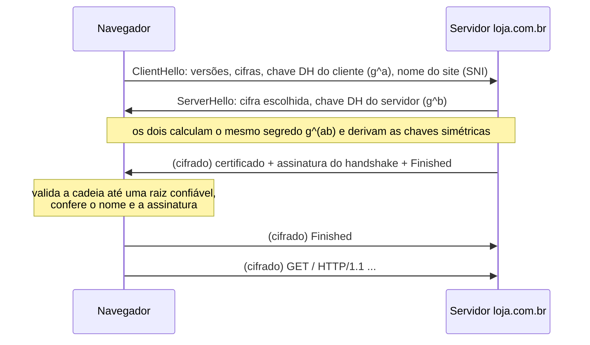

# TLS e HTTPS

## Por que isso importa

Sem TLS, qualquer pessoa no mesmo Wi-Fi do café, o provedor ou um roteador no caminho poderia ler suas senhas e alterar as páginas que você recebe. O cadeado do navegador significa três coisas bem específicas, e entender cada uma evita erros reais: desligar a verificação de certificado "só para testar" (e esquecer em produção), achar que HTTPS protege dados depois que chegam ao servidor, ou não entender um erro de `CERTIFICATE_VERIFY_FAILED`. Você vai configurar HTTPS em todo projeto que publicar, e a trilha de Segurança (SG) parte daqui.

## Intuição

Você quer mandar uma mensagem secreta para uma loja que nunca viu, por um carteiro em quem não confia.

- **Cadeado aberto** (criptografia assimétrica): a loja distribui **cadeados abertos** para qualquer um, mas só ela tem a **chave**. Você tranca a mensagem com o cadeado dela; nem você consegue abrir depois. Lento, mas não exige segredo combinado antes.
- **Cofre com uma chave só** (criptografia simétrica): rápido, mas os dois lados precisam ter a mesma chave. O truque do TLS: usar o método lento uma vez, para **combinar** uma chave secreta, e depois usar o rápido para todo o resto.
- **Carteira de identidade** (certificado): como saber que o cadeado é mesmo da loja, e não de um impostor no meio do caminho? A loja mostra um documento assinado por um **cartório** (autoridade certificadora) que seu navegador já conhece e em quem confia.

## Visual

Handshake do TLS 1.3 (1 RTT antes dos dados):



Cadeia de certificados:

```text
[raiz: ISRG Root X1]        ← já vem instalada no SO/navegador (autoassinada)
        │ assina
[intermediário: R11]        ← enviado pelo servidor
        │ assina
[folha: loja.com.br]        ← enviado pelo servidor; contém a chave pública do site
```

## Conceito técnico

### As três garantias

1. **Confidencialidade**: quem está no meio vê bytes aleatórios. Ainda vê **com quem** você fala (IP e, em geral, o nome do site no SNI) e **quanto** você transfere.
2. **Integridade**: qualquer alteração em trânsito é detectada (cifras autenticadas como AES-GCM e ChaCha20-Poly1305 incluem uma "etiqueta" que falha se um bit mudar).
3. **Autenticidade**: você está mesmo falando com `loja.com.br`, e não com alguém fingindo ser ela (graças ao certificado).

HTTPS é simplesmente **HTTP dentro de TLS**, na porta 443. O TLS não protege o dado **depois** que ele chega: se o banco de dados do servidor vazar, o cadeado não ajuda.

### Simétrica vs. assimétrica

| | Simétrica (AES, ChaCha20) | Assimétrica (RSA, curvas elípticas) |
|---|---|---|
| Chaves | uma, compartilhada | par: **pública** (todos conhecem) e **privada** (só o dono) |
| Velocidade | muito rápida (gigabytes por segundo) | centenas a milhares de vezes mais lenta |
| Problema | como combinar a chave? | lenta; precisa confiar que a pública é de quem diz ser |
| Uso no TLS | cifrar os dados | trocar chaves e **assinar** |

Uma **assinatura digital** é o uso "ao contrário": o dono usa a chave **privada** para gerar uma assinatura que qualquer um verifica com a **pública**. Só quem tem a privada conseguiria produzi-la.

### RSA em miniatura

1. Escolha dois primos `p` e `q`; `n = p × q`; `φ = (p − 1)(q − 1)`.
2. Escolha `e` sem fatores comuns com `φ` (na prática, 65537).
3. `d` = inverso de `e` módulo `φ` (`e × d ≡ 1 mod φ`).
4. Chave pública: `(e, n)`. Privada: `d`.
5. Cifrar: `c = m^e mod n`. Decifrar: `m = c^d mod n`.

Com `p = 61`, `q = 53`: `n = 3233`, `φ = 3120`, `e = 17`, `d = 2753`. A mensagem 65 vira `65^17 mod 3233 = 2790`, e `2790^2753 mod 3233 = 65`. A segurança vem de que, com `n` de 2048 bits, ninguém sabe fatorar `n` em tempo viável para descobrir `φ` e `d`. A exponenciação rápida da AL-04 é o que torna essas contas possíveis.

### Diffie-Hellman

Dois lados combinam um segredo **falando em público**: com um primo `p` e um gerador `g` públicos, Alice escolhe `a` secreto e envia `A = g^a mod p`; Bob escolhe `b` e envia `B = g^b mod p`. Alice calcula `B^a` e Bob `A^b`: os dois dão `g^(ab) mod p`. Quem ouviu `A` e `B` precisaria resolver o **logaritmo discreto** para achar `a`, o que é inviável com números grandes. O TLS 1.3 usa a versão com **curvas elípticas** (ECDHE) e gera chaves **novas a cada conexão**: mesmo que a chave privada do servidor vaze no futuro, as conversas gravadas antes continuam seguras (**sigilo futuro**, *forward secrecy*).

### Certificados e autoridades certificadoras

Um **certificado X.509** diz, essencialmente: "a chave pública X pertence a `loja.com.br`, válido de tal a tal data", assinado por uma **autoridade certificadora** (CA). O navegador:

1. Recebe a **folha** e os **intermediários** do servidor.
2. Confere que cada certificado foi **emitido** pelo próximo da cadeia (e a assinatura bate).
3. Confere as **datas** de validade de todos.
4. Confere que o último foi emitido por uma **raiz** que está no repositório de confiança do sistema.
5. Confere que o **nome** pedido está no certificado (campo *Subject Alternative Name*). Um curinga `*.loja.com.br` vale para **um** nível: `www.loja.com.br`, mas não `loja.com.br` nem `a.b.loja.com.br`.

Hoje o **Let's Encrypt** emite certificados gratuitos e automáticos (válidos por 90 dias, renovados por scripts como o certbot). Um erro comum em produção é o servidor não enviar o **intermediário**: alguns clientes conseguem buscá-lo, outros falham.

### O handshake do TLS 1.3

1. **ClientHello**: versões e cifras suportadas, a parte DH do cliente e o nome do site (SNI).
2. **ServerHello**: a cifra escolhida e a parte DH do servidor. A partir daqui, tudo é cifrado.
3. O servidor envia o **certificado** e uma **assinatura** sobre todo o handshake, feita com sua chave privada (prova que é o dono do certificado).
4. Os dois enviam **Finished** (um resumo autenticado de tudo que foi trocado, para detectar adulteração).

Custa **1 RTT** (o TLS 1.2 custava 2). Em reconexões, o TLS 1.3 permite **0-RTT**, com o cuidado de que esses primeiros dados podem ser repetidos por um atacante.

## Código

RSA e Diffie-Hellman com números pequenos, só para ver as contas (nunca use isso para proteger nada):

```python
# RSA
p, q, e = 61, 53, 17
n, phi = p * q, (p - 1) * (q - 1)
d = pow(e, -1, phi)                 # inverso modular (Python 3.8+)
mensagem = 65
cifrado = pow(mensagem, e, n)       # exponenciação modular rápida
print(f"n={n} d={d} cifrado={cifrado} decifrado={pow(cifrado, d, n)}")

assinatura = pow(mensagem, d, n)    # assina com a PRIVADA
print("assinatura confere?", pow(assinatura, e, n) == mensagem)   # verifica com a PÚBLICA

# Diffie-Hellman
p, g = 23, 5                        # públicos
a, b = 6, 15                        # secretos de Alice e Bob
A, B = pow(g, a, p), pow(g, b, p)   # trocados em público
print("A =", A, "B =", B, "| segredos:", pow(B, a, p), pow(A, b, p))
```

No terminal, `openssl s_client -connect exemplo.com:443 -servername exemplo.com` mostra a cadeia de certificados e a cifra negociada.

## Erros comuns

- **Desligar a verificação de certificado** (`verify=False`, `NODE_TLS_REJECT_UNAUTHORIZED=0`) "para funcionar". Isso remove a autenticidade: qualquer um no meio pode se passar pelo servidor.
- **Achar que HTTPS esconde tudo.** O IP, geralmente o nome do site e o volume de dados continuam visíveis.
- **Criar sua própria criptografia.** Use bibliotecas e protocolos prontos e revisados.
- **Esquecer o certificado intermediário** na configuração do servidor.
- **Deixar o certificado expirar.** Automatize a renovação e monitore a data.
- **Achar que o cadeado garante que o site é honesto.** Ele garante que você fala com o dono do domínio; um site de phishing também pode ter cadeado.

## Pratique

```quiz
id: RD-06-q1
tipo: multipla_escolha
pergunta: "Por que o TLS usa criptografia assimétrica no handshake e simétrica para os dados?"
opcoes: ["Porque a simétrica é mais segura", "Porque a assimétrica resolve a troca de chaves sem segredo prévio, mas é lenta; a simétrica é rápida para grandes volumes", "Porque a assimétrica não consegue cifrar textos", "Por compatibilidade com o HTTP/1.0"]
resposta: 1
explicacao: "A assimétrica (ou o Diffie-Hellman) permite combinar um segredo com um desconhecido por um canal público, mas é muito mais lenta. Depois de combinada a chave, AES ou ChaCha20 cifram gigabytes por segundo."
dificuldade: 1
```

```quiz
id: RD-06-q2
tipo: multipla_escolha
pergunta: "Um certificado para *.loja.com.br é válido para qual destes nomes?"
opcoes: ["loja.com.br", "api.loja.com.br", "v2.api.loja.com.br", "loja.com.br.evil.io"]
resposta: 1
explicacao: "O curinga substitui exatamente um rótulo, o mais à esquerda. Não cobre o domínio sem prefixo nem dois níveis. Por isso certificados costumam listar loja.com.br e *.loja.com.br juntos."
dificuldade: 2
```

```quiz
id: RD-06-q3
tipo: verdadeiro_falso
pergunta: "Com sigilo futuro (forward secrecy), se a chave privada do servidor vazar hoje, um atacante que gravou conversas do ano passado consegue decifrá-las."
resposta: false
explicacao: "Com ECDHE, cada conexão usa chaves Diffie-Hellman temporárias, descartadas no fim. A chave privada do certificado só assina o handshake; ela não permite recalcular os segredos antigos."
dificuldade: 2
```

```quiz
id: RD-06-q4
tipo: prever_saida
pergunta: |
  Diffie-Hellman com p = 23 e g = 5. Alice escolhe a = 6 e Bob escolhe b = 15. Qual é o segredo compartilhado?
  ```python
  p, g, a, b = 23, 5, 6, 15
  A, B = pow(g, a, p), pow(g, b, p)
  print(pow(B, a, p))
  ```
resposta: "2"
explicacao: "A = 5⁶ mod 23 = 8 e B = 5¹⁵ mod 23 = 19. Alice calcula 19⁶ mod 23 = 2 e Bob calcula 8¹⁵ mod 23 = 2. Quem só viu 8 e 19 precisaria descobrir a ou b (o logaritmo discreto)."
dificuldade: 2
```

```quiz
id: RD-06-q5
tipo: resposta_curta
pergunta: "O que o navegador confere num certificado antes de mostrar o cadeado?"
resposta: "Que a cadeia é válida: cada certificado foi emitido e assinado pelo próximo, até uma autoridade raiz em que o sistema confia; que nenhum está fora da data de validade; que o nome do site acessado está no certificado; e que o servidor prova ter a chave privada correspondente, assinando o handshake."
palavras_chave: ["cadeia", "raiz", "validade", "nome"]
dificuldade: 2
```

```quiz
id: RD-06-q6
tipo: codigo
linguagem: python
pergunta: |
  **RSA de brinquedo.** Escreva `rsa(p, q, e, m)` que gera as chaves a partir dos primos `p` e `q` e do expoente público `e`, cifra a mensagem `m` e decifra de volta. Devolva a tupla `(n, d, cifrado, decifrado)`. Use `pow` com três argumentos (exponenciação modular) e `pow(e, -1, phi)` para o inverso modular.
codigo_inicial: |
  def rsa(p, q, e, m):
      n = p * q
      d = 1
      cifrado = m ** e % n
      return (n, d, cifrado, cifrado)
usa: [def, pow, return]
testes:
  - chamada: "rsa(61, 53, 17, 65)"
    saida: "(3233, 2753, 2790, 65)"
  - chamada: "rsa(11, 13, 7, 9)"
    saida: "(143, 103, 48, 9)"
  - chamada: "rsa(1000003, 1000033, 65537, 123456789012)"
    visivel: false
    saida: "(1000036000099, 983264276609, 343370817521, 123456789012)"
dica: "phi = (p - 1) * (q - 1); d = pow(e, -1, phi); cifrado = pow(m, e, n); decifrado = pow(cifrado, d, n)."
solucao: |
  def rsa(p, q, e, m):
      n = p * q
      phi = (p - 1) * (q - 1)
      d = pow(e, -1, phi)
      cifrado = pow(m, e, n)
      decifrado = pow(cifrado, d, n)
      return (n, d, cifrado, decifrado)
explicacao: "pow(m, e, n) usa a exponenciação rápida da AL-04 e reduz módulo n a cada passo, então funciona mesmo com expoentes enormes; m ** e % n calcularia primeiro um número gigantesco. No teste oculto, d tem 12 dígitos e o expoente 65537 é o mesmo usado em certificados reais. A decifragem devolve a mensagem porque e × d ≡ 1 (mod φ), pelo teorema de Euler."
dificuldade: 2
```

```quiz
id: RD-06-q7
tipo: codigo
linguagem: python
pergunta: |
  **Validar a cadeia.** Cada certificado é um dicionário com `sujeito`, `emissor`, `inicio` e `fim` (datas como inteiros `AAAAMMDD`). Escreva `validar_cadeia(cadeia, raizes, agora)` que recebe a lista da folha até o último intermediário, o conjunto de nomes das raízes confiáveis e a data atual, e devolve, conferindo os certificados em ordem e parando no primeiro problema:

  - `'cadeia vazia'` se a lista estiver vazia;
  - `'expirado: <sujeito>'` se `agora` estiver fora de `[inicio, fim]`;
  - `'emissor errado: <sujeito>'` se o `emissor` de um certificado não for o `sujeito` do próximo;
  - `'raiz não confiável'` se o emissor do último não estiver em `raizes`;
  - `'ok'` se tudo passar.
codigo_inicial: |
  def validar_cadeia(cadeia, raizes, agora):
      if cadeia[-1]['emissor'] in raizes:
          return 'ok'
      return 'raiz não confiável'
usa: [def, for, return]
testes:
  - chamada: "validar_cadeia([{'sujeito': 'loja.com.br', 'emissor': 'R11', 'inicio': 20260101, 'fim': 20260401}, {'sujeito': 'R11', 'emissor': 'ISRG Root X1', 'inicio': 20240301, 'fim': 20270312}], {'ISRG Root X1', 'DigiCert Global Root G2'}, 20260215)"
    saida: "'ok'"
  - chamada: "validar_cadeia([{'sujeito': 'loja.com.br', 'emissor': 'R11', 'inicio': 20260101, 'fim': 20260401}, {'sujeito': 'R11', 'emissor': 'ISRG Root X1', 'inicio': 20240301, 'fim': 20270312}], {'ISRG Root X1'}, 20260515)"
    saida: "'expirado: loja.com.br'"
  - chamada: "validar_cadeia([{'sujeito': 'loja.com.br', 'emissor': 'R11', 'inicio': 20260101, 'fim': 20260401}], {'ISRG Root X1'}, 20260215)"
    saida: "'raiz não confiável'"
  - chamada: "validar_cadeia([], {'ISRG Root X1'}, 20260215)"
    saida: "'cadeia vazia'"
  - chamada: "validar_cadeia([{'sujeito': 'loja.com.br', 'emissor': 'R11', 'inicio': 20260101, 'fim': 20260401}, {'sujeito': 'E5', 'emissor': 'ISRG Root X1', 'inicio': 20240301, 'fim': 20270312}], {'ISRG Root X1'}, 20260215)"
    visivel: false
    saida: "'emissor errado: loja.com.br'"
  - chamada: "validar_cadeia([{'sujeito': 'loja.com.br', 'emissor': 'ISRG Root X1', 'inicio': 20260101, 'fim': 20260401}], {'ISRG Root X1'}, 20260101)"
    visivel: false
    saida: "'ok'"
dica: "Percorra com enumerate. Para cada certificado, confira a data; se houver um próximo (i + 1 < len(cadeia)), confira se cert['emissor'] == cadeia[i + 1]['sujeito']. No fim, confira o emissor do último."
solucao: |
  def validar_cadeia(cadeia, raizes, agora):
      if not cadeia:
          return 'cadeia vazia'
      for i, cert in enumerate(cadeia):
          if not (cert['inicio'] <= agora <= cert['fim']):
              return f"expirado: {cert['sujeito']}"
          if i + 1 < len(cadeia) and cert['emissor'] != cadeia[i + 1]['sujeito']:
              return f"emissor errado: {cert['sujeito']}"
      if cadeia[-1]['emissor'] not in raizes:
          return 'raiz não confiável'
      return 'ok'
explicacao: "O terceiro teste é o erro de configuração mais comum: o servidor envia só a folha, sem o intermediário R11, e o cliente não consegue ligar a folha a uma raiz. Num validador real, cada passo também confere a assinatura criptográfica (o emissor assinou mesmo este certificado?), as restrições de uso e se o certificado foi revogado."
dificuldade: 2
```

```quiz
id: RD-06-q8
tipo: codigo
linguagem: javascript
pergunta: |
  **O nome confere?** Escreva `nomeConfere(padrao, host)` que diz se o nome de um certificado (`padrao`) vale para o `host` acessado. A comparação ignora maiúsculas. Um `*` só é aceito como o rótulo **inteiro mais à esquerda** e casa com exatamente **um** rótulo não vazio. Qualquer outro rótulo precisa ser igual.
codigo_inicial: |
  function nomeConfere(padrao, host) {
    if (padrao.startsWith('*')) return host.endsWith(padrao.slice(1));
    return padrao === host;
  }
usa: [function, return]
testes:
  - chamada: "nomeConfere('*.exemplo.com', 'www.exemplo.com')"
    saida: "true"
  - chamada: "nomeConfere('*.exemplo.com', 'exemplo.com')"
    saida: "false"
  - chamada: "nomeConfere('*.exemplo.com', 'a.b.exemplo.com')"
    saida: "false"
  - chamada: "nomeConfere('WWW.Exemplo.com', 'www.exemplo.COM')"
    saida: "true"
  - chamada: "nomeConfere('www.*.com', 'www.exemplo.com')"
    visivel: false
    saida: "false"
  - chamada: "nomeConfere('exemplo.com', 'exemplo.com.br')"
    visivel: false
    saida: "false"
dica: "Separe os dois em rótulos com toLowerCase().split('.'). Se a quantidade for diferente, é false. Depois, cada rótulo i precisa ser igual, exceto quando i === 0 e o rótulo do padrão é '*'."
solucao: |
  function nomeConfere(padrao, host) {
    const p = padrao.toLowerCase().split('.');
    const h = host.toLowerCase().split('.');
    if (p.length !== h.length) return false;
    return p.every((rotulo, i) => (i === 0 && rotulo === '*' ? h[0] !== '' : rotulo === h[i]));
  }
explicacao: "O código inicial aceita a.b.exemplo.com, porque só confere o final. Comparar rótulo por rótulo, com a mesma quantidade, garante que o curinga cubra exatamente um nível. Um * no meio do nome (www.*.com) não é aceito pelos navegadores, porque permitiria certificados abrangentes demais."
dificuldade: 2
```

## Resumo

- TLS dá **confidencialidade**, **integridade** e **autenticidade**; HTTPS é HTTP dentro de TLS.
- **Assimétrica** (RSA, curvas elípticas) para trocar chaves e assinar; **simétrica** (AES, ChaCha20) para os dados.
- **Diffie-Hellman efêmero** dá **sigilo futuro**.
- **Certificados** ligam um nome a uma chave pública; a confiança vem da cadeia até uma **CA raiz**. O nome precisa conferir (curinga vale um nível).
- **TLS 1.3**: handshake de 1 RTT (0-RTT em reconexões).

## Para ir além

- Percorra o handshake byte a byte em tls13.xargs.org.
- Rode `openssl s_client` e inspecione certificados no navegador (clique no cadeado).
- **Próximo módulo**: RD-07 Ferramentas: ping, traceroute, curl, Wireshark.
