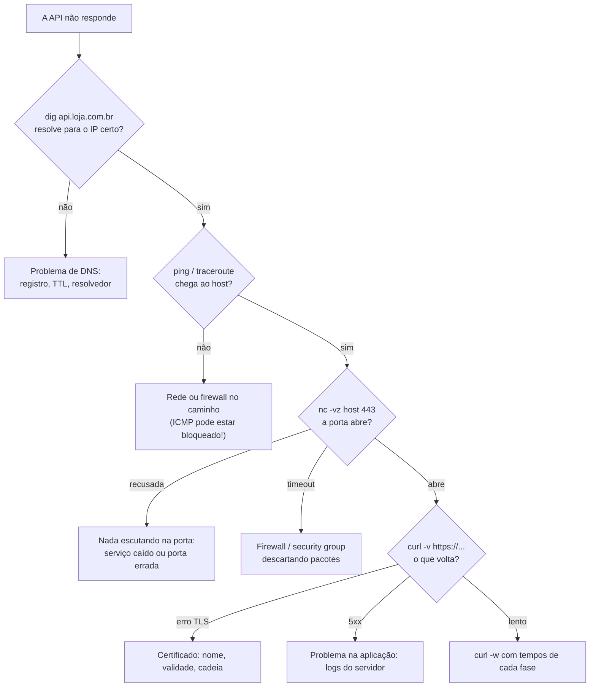

# Ferramentas: ping, traceroute, curl, Wireshark

## Por que isso importa

"Não está funcionando" é a frase mais comum em suporte e em incidentes. As ferramentas desta aula transformam isso numa pergunta precisa: o nome resolve? A máquina responde? Onde o caminho fica lento? A porta está aberta? O servidor responde 500 ou nem responde? Saber usar cada uma, na ordem certa, é uma das habilidades mais valorizadas em DevOps e em qualquer time de backend. E o Wireshark é a melhor forma de **ver** tudo que você estudou nesta trilha acontecendo de verdade.

## Intuição

Diagnosticar rede é como descobrir por que uma carta não chegou:

- **dig** / **nslookup**: o endereço no envelope está certo? (o nome resolve para o IP esperado?)
- **ping**: tem alguém em casa? Quanto tempo a resposta leva?
- **traceroute**: por quais agências a carta passou, e em qual ela ficou parada?
- **nc** / **ss**: a porta da casa está aberta, e tem alguém atendendo?
- **curl**: entregue a carta e me mostre exatamente o que veio de volta.
- **Wireshark**: abra todos os envelopes e me mostre cada um.

Vá **de baixo para cima** nas camadas: não adianta depurar o JSON se o DNS nem resolve.

## Visual

Um roteiro de diagnóstico:



## Conceito técnico

### ping

Envia ICMP *echo request* e mede o tempo até o *echo reply* (o **RTT**).

```text
$ ping -c 4 8.8.8.8
64 bytes from 8.8.8.8: icmp_seq=0 ttl=117 time=12.3 ms
64 bytes from 8.8.8.8: icmp_seq=1 ttl=117 time=15.1 ms
Request timeout for icmp_seq 2
64 bytes from 8.8.8.8: icmp_seq=3 ttl=117 time=11.8 ms
4 packets transmitted, 3 packets received, 25.0% packet loss
round-trip min/avg/max = 11.8/13.1/15.1 ms
```

- **Perda** e **variação** (jitter) importam tanto quanto a média: chamadas de vídeo sofrem com jitter.
- O **TTL** da resposta dá uma pista da distância (e do SO do outro lado: Linux começa em 64, Windows em 128).
- Muitos servidores e firewalls **bloqueiam ICMP**: ping sem resposta **não** prova que o host está fora do ar.

### traceroute (tracert no Windows)

Manda pacotes com TTL 1, 2, 3... Cada roteador que zera o TTL devolve um ICMP "TTL expirou", revelando-se (RD-03).

```text
$ traceroute google.com
 1  192.168.0.1     1.2 ms      ← seu roteador
 2  100.64.0.1      8.5 ms      ← provedor (CGNAT)
 3  * * *                       ← roteador que não responde ICMP (normal)
 4  200.230.1.9    10.1 ms
 5  213.140.32.1  118.7 ms      ← salto de ~108 ms: cabo submarino
 6  142.250.1.1   120.2 ms
```

Leia os **saltos de latência**: um aumento que **persiste** nos hops seguintes indica distância ou congestionamento naquele trecho. Um hop isolado lento, com os seguintes rápidos, geralmente é só um roteador que dá baixa prioridade a responder ICMP. O `mtr` combina ping e traceroute continuamente.

### dig e nslookup

```text
$ dig +short api.loja.com.br          # só a resposta
$ dig api.loja.com.br A               # resposta completa, com TTL
$ dig @1.1.1.1 api.loja.com.br        # pergunta a um resolvedor específico
$ dig +trace api.loja.com.br          # a resolução iterativa da RD-05, passo a passo
$ dig loja.com.br MX                  # servidores de e-mail
```

Compare a resposta de resolvedores diferentes para saber se uma mudança "já propagou".

### curl

O canivete suíço do HTTP:

```text
$ curl -v https://api.loja.com.br/saude          # mostra handshake TLS e cabeçalhos (> enviados, < recebidos)
$ curl -I https://loja.com.br                    # só os cabeçalhos (HEAD)
$ curl -X POST -H "Content-Type: application/json" -d '{"qtd": 2}' https://api.loja.com.br/carrinho
$ curl -L http://loja.com.br                     # segue redirecionamentos
$ curl -w "dns=%{time_namelookup} tcp=%{time_connect} tls=%{time_appconnect} total=%{time_total}\n" -o /dev/null -s https://loja.com.br
```

A última linha separa o tempo em fases: se o `dns` é alto, o problema é resolução; se `tls − tcp` é alto, é o handshake; se o total é muito maior que o `tls`, o servidor está demorando para processar.

### ss, netstat, nc

```text
$ ss -tlnp                 # portas TCP escutando (l) e o processo dono (p)
$ ss -tan state established
$ nc -vz api.loja.com.br 443     # a porta abre? (recusada = nada escutando; timeout = firewall)
```

"Connection refused" e "timeout" são diagnósticos diferentes: recusada significa que o host respondeu com RST (RD-04); timeout, que algo no caminho descartou os pacotes em silêncio.

### Wireshark e tcpdump

Capturam **todos os pacotes** de uma interface e mostram cada camada decodificada.

- **tcpdump** (terminal, servidores): `sudo tcpdump -i any -n port 53` ou `-w captura.pcap` para abrir depois no Wireshark.
- **Wireshark** (interface gráfica): filtros de exibição como `dns`, `tcp.port == 443`, `ip.addr == 10.0.0.5`, `http.response.code >= 500`, `tcp.analysis.retransmission`. Combine com `&&`, `||` e `!`.
- "Follow TCP Stream" remonta a conversa inteira (como o receptor da RD-04). Com HTTPS, você só vê o handshake e bytes cifrados, a menos que exporte as chaves de sessão (variável `SSLKEYLOGFILE` no navegador).

Capture só em redes e máquinas que são suas ou em que você tem autorização.

## Código

Esses comandos rodam no seu terminal, não no navegador. Mas dá para treinar a **leitura** das saídas, que é o que mais importa. Este script analisa uma saída de ping:

```python
import re

saida = """64 bytes from 8.8.8.8: icmp_seq=0 ttl=117 time=12.3 ms
64 bytes from 8.8.8.8: icmp_seq=1 ttl=117 time=15.1 ms
Request timeout for icmp_seq 2
64 bytes from 8.8.8.8: icmp_seq=3 ttl=117 time=11.8 ms"""

tempos = [float(t) for t in re.findall(r"time=([\d.]+) ms", saida)]
media = sum(tempos) / len(tempos)
jitter = sum(abs(a - b) for a, b in zip(tempos, tempos[1:])) / (len(tempos) - 1)
print(f"recebidos {len(tempos)}/4, média {media:.1f} ms, jitter {jitter:.1f} ms")
```

## Erros comuns

- **Concluir que o servidor caiu porque o ping não responde.** ICMP costuma ser bloqueado; teste a porta do serviço (`nc`, `curl`).
- **Culpar um hop do traceroute que só ele está lento.** Se os seguintes estão rápidos, ele só demora para responder ICMP.
- **Testar só da sua máquina.** O problema pode ser o seu DNS, a sua VPN ou o seu cache. Teste de outro lugar (outra rede, um servidor, `dig @8.8.8.8`).
- **Confundir "connection refused" com timeout.** Um é "ninguém atende", o outro é "a carta nem chegou".
- **Usar `curl -k` (ignorar certificado) e esquecer.** Serve para diagnosticar, nunca para resolver.

## Pratique

```quiz
id: RD-07-q1
tipo: multipla_escolha
pergunta: "O ping para um servidor web não tem resposta, mas o site abre normalmente no navegador. A explicação mais provável é:"
opcoes: ["O site está em cache no navegador", "O servidor ou um firewall bloqueia ICMP, mas permite TCP na porta 443", "O DNS está errado", "O ping só funciona em IPv6"]
resposta: 1
explicacao: "Muitas redes descartam ICMP por política. Ping sem resposta não é prova de nada; para saber se o serviço está no ar, teste o próprio serviço: nc -vz host 443 ou curl."
dificuldade: 1
```

```quiz
id: RD-07-q2
tipo: multipla_escolha
pergunta: "`nc -vz servidor 5432` responde 'Connection refused' imediatamente. O que isso indica?"
opcoes: ["Um firewall está descartando os pacotes", "O host respondeu, mas nenhum processo está escutando na porta 5432", "O DNS não resolveu", "A senha do banco está errada"]
resposta: 1
explicacao: "Recusa imediata é um RST do próprio host: ele está alcançável, mas nada escuta nessa porta (o PostgreSQL caiu ou escuta em outra porta ou interface). Se fosse firewall, normalmente seria um timeout."
dificuldade: 2
```

```quiz
id: RD-07-q3
tipo: verdadeiro_falso
pergunta: "No traceroute, se o hop 4 mostra 300 ms mas os hops 5, 6 e 7 mostram 20 ms, o gargalo está no hop 4."
resposta: false
explicacao: "Se os hops seguintes são rápidos, o tráfego passa bem pelo hop 4. Ele só demora para gerar a resposta ICMP (roteadores dão baixa prioridade a isso). Um problema real faria a latência alta persistir nos hops seguintes."
dificuldade: 2
```

```quiz
id: RD-07-q4
tipo: multipla_escolha
pergunta: "Qual filtro do Wireshark mostra só os pacotes de consultas DNS?"
opcoes: ["port 53 http", "dns", "tcp.port == 443", "ip.src == dns"]
resposta: 1
explicacao: "O filtro de exibição dns seleciona tudo que o Wireshark decodificou como DNS. Também funcionaria udp.port == 53 (mas perderia DNS sobre TCP). Note que filtros de exibição do Wireshark têm sintaxe diferente dos filtros de captura do tcpdump (port 53)."
dificuldade: 1
```

```quiz
id: RD-07-q5
tipo: resposta_curta
pergunta: "Uma página demora 3 segundos para carregar. Como o curl ajuda a descobrir se o problema é DNS, conexão, TLS ou o próprio servidor?"
resposta: "Com curl -w e as variáveis de tempo (time_namelookup, time_connect, time_appconnect, time_starttransfer, time_total) dá para ver quanto tempo cada fase levou. Se o tempo da resolução de nome for alto, é DNS; se for o da conexão, rede; se for o do handshake, TLS; e se o tempo até o primeiro byte for alto depois do TLS, o servidor está demorando para processar."
palavras_chave: ["-w", "time_namelookup", "fase", "primeiro byte"]
dificuldade: 2
```

```quiz
id: RD-07-q6
tipo: codigo
linguagem: python
pergunta: |
  **Estatísticas do ping.** Escreva `estatisticas_ping(saida, enviados)` que lê a saída do ping (texto com várias linhas) e devolve `(recebidos, perda_percentual, minimo, media, maximo)`. Os tempos aparecem como `time=12.3 ms` nas linhas de resposta. A perda e a média são arredondadas com `round(..., 1)`. Sem nenhuma resposta, devolva `(0, perda, None, None, None)`.
codigo_inicial: |
  def estatisticas_ping(saida, enviados):
      linhas = saida.split('\n')
      return (len(linhas), 0.0, None, None, None)
usa: [def, return]
testes:
  - chamada: "estatisticas_ping('PING 8.8.8.8 (8.8.8.8): 56 data bytes\\n64 bytes from 8.8.8.8: icmp_seq=0 ttl=117 time=12.3 ms\\n64 bytes from 8.8.8.8: icmp_seq=1 ttl=117 time=15.1 ms\\nRequest timeout for icmp_seq 2\\n64 bytes from 8.8.8.8: icmp_seq=3 ttl=117 time=11.8 ms', 4)"
    saida: "(3, 25.0, 11.8, 13.1, 15.1)"
  - chamada: "estatisticas_ping('Request timeout for icmp_seq 0\\nRequest timeout for icmp_seq 1', 2)"
    saida: "(0, 100.0, None, None, None)"
  - chamada: "estatisticas_ping('\\n'.join(f'64 bytes from 1.1.1.1: icmp_seq={i} ttl=57 time={(i * 37) % 91 + 100.5} ms' for i in range(1000) if i % 9), 1000)"
    visivel: false
    saida: "(888, 11.2, 100.5, 145.4, 190.5)"
dica: "Com re.findall(r'time=([\\d.]+) ms', saida) você pega todos os tempos como strings. Converta com float e use len, min, max e sum."
solucao: |
  import re

  def estatisticas_ping(saida, enviados):
      tempos = [float(t) for t in re.findall(r'time=([\d.]+) ms', saida)]
      recebidos = len(tempos)
      perda = round(100 * (enviados - recebidos) / enviados, 1)
      if not tempos:
          return (0, perda, None, None, None)
      media = round(sum(tempos) / recebidos, 1)
      return (recebidos, perda, min(tempos), media, max(tempos))
explicacao: "Uma expressão regular com um grupo captura só o número de cada linha de resposta, ignorando cabeçalho e timeouts. É o que o próprio ping imprime no resumo final. Ferramentas de monitoramento fazem exatamente isso, e alertam quando a perda passa de 1% ou a média sobe de repente."
dificuldade: 2
```

```quiz
id: RD-07-q7
tipo: codigo
linguagem: python
pergunta: |
  **Onde a latência aparece?** Escreva `maior_salto(linhas)` que recebe as linhas de um traceroute no formato `' 5  213.140.32.1  118.7 ms'` (número do hop, IP, tempo) e devolve a tupla `(hop, aumento)` do maior aumento de tempo em relação ao **hop anterior que respondeu**, com o aumento arredondado com `round(..., 1)`. Ignore linhas com `*`. Se houver menos de dois hops respondendo, devolva `None`.
codigo_inicial: |
  def maior_salto(linhas):
      maior = None
      for linha in linhas:
          partes = linha.split()
          tempo = float(partes[2])
          if maior is None or tempo > maior[1]:
              maior = (int(partes[0]), tempo)
      return maior
usa: [def, for, return]
testes:
  - chamada: "maior_salto([' 1  192.168.0.1  1.2 ms', ' 2  100.64.0.1  8.5 ms', ' 3  * * *', ' 4  200.230.1.9  10.1 ms', ' 5  213.140.32.1  118.7 ms', ' 6  142.250.1.1  120.2 ms'])"
    saida: "(5, 108.6)"
  - chamada: "maior_salto([' 1  10.0.0.1  0.5 ms'])"
    saida: "None"
  - chamada: "maior_salto([])"
    visivel: false
    saida: "None"
  - chamada: "maior_salto([' 1  a  5.0 ms', ' 2  b  3.0 ms', ' 3  c  4.0 ms'])"
    visivel: false
    saida: "(3, 1.0)"
dica: "Guarde o tempo do último hop que respondeu (anterior). Para cada linha válida, se houver anterior, calcule o aumento e compare com o melhor. Depois atualize anterior com o tempo atual."
solucao: |
  def maior_salto(linhas):
      anterior = None
      melhor = None
      for linha in linhas:
          partes = linha.split()
          if '*' in partes or len(partes) < 3:
              continue
          hop, tempo = int(partes[0]), float(partes[2])
          if anterior is not None:
              aumento = round(tempo - anterior, 1)
              if melhor is None or aumento > melhor[1]:
                  melhor = (hop, aumento)
          anterior = tempo
      return melhor
explicacao: "Com um hop sem resposta no meio, o aumento é medido em relação ao último que respondeu. O salto de 108 ms entre os hops 4 e 5 é típico de um cabo submarino (Brasil para os EUA ou Europa): a luz leva tempo para atravessar milhares de quilômetros. No teste oculto, o tempo cai do hop 1 para o 2, um lembrete de que as medidas de cada hop variam e são independentes."
dificuldade: 2
```

```quiz
id: RD-07-q8
tipo: codigo
linguagem: javascript
pergunta: |
  **Filtro estilo Wireshark.** Escreva `filtrar(pacotes, filtro)` que devolve os números (`n`) dos pacotes que satisfazem **todas** as condições do filtro, separadas por `&&`. Cada condição é `campo op valor` com `op` igual a `==` ou `!=`, e os campos são:

  - `proto`; `ip.src` (origem); `ip.dst` (destino); `ip.addr` (origem **ou** destino);
  - `tcp.port` e `udp.port`: porta de origem **ou** de destino, e só existem se o pacote for daquele protocolo.

  Valores numéricos são comparados como números. Se o campo não existir no pacote, a condição é falsa (para `==` e para `!=`). `!=` é verdadeiro se **nenhum** valor do campo for igual. Use a lista `PACOTES` já pronta para testar.
codigo_inicial: |
  // não mude: os testes usam estes pacotes
  const PACOTES = [
    { n: 1, proto: 'udp', origem: '10.0.0.5', destino: '8.8.8.8', portaOrigem: 51000, portaDestino: 53 },
    { n: 2, proto: 'udp', origem: '8.8.8.8', destino: '10.0.0.5', portaOrigem: 53, portaDestino: 51000 },
    { n: 3, proto: 'tcp', origem: '10.0.0.5', destino: '93.184.216.34', portaOrigem: 52000, portaDestino: 443 },
    { n: 4, proto: 'tcp', origem: '93.184.216.34', destino: '10.0.0.5', portaOrigem: 443, portaDestino: 52000 },
    { n: 5, proto: 'tcp', origem: '10.0.0.7', destino: '10.0.0.5', portaOrigem: 40000, portaDestino: 22 },
    { n: 6, proto: 'icmp', origem: '10.0.0.5', destino: '1.1.1.1' },
  ];

  function filtrar(pacotes, filtro) {
    const [campo, op, valor] = filtro.split(' ');
    return pacotes.filter((p) => p.proto === valor).map((p) => p.n);
  }
usa: [function, return]
testes:
  - chamada: "filtrar(PACOTES, 'tcp.port == 443')"
    saida: "[ 3, 4 ]"
  - chamada: "filtrar(PACOTES, 'udp.port == 53 && ip.src == 8.8.8.8')"
    saida: "[ 2 ]"
  - chamada: "filtrar(PACOTES, 'proto != tcp')"
    saida: "[ 1, 2, 6 ]"
  - chamada: "filtrar(PACOTES, 'ip.addr == 10.0.0.7')"
    visivel: false
    saida: "[ 5 ]"
  - chamada: "filtrar(PACOTES, 'ip.dst == 10.0.0.5 && tcp.port != 443')"
    visivel: false
    saida: "[ 5 ]"
  - chamada: "filtrar(PACOTES, 'tcp.port == 53')"
    visivel: false
    saida: "[]"
dica: "Escreva uma função casa(p, condicao) que separa campo, op e valor com condicao.trim().split(/\\s+/), monta a lista de valores do campo para aquele pacote (vazia se o campo não existe) e aplica o operador. Converta o valor para número se /^\\d+$/ casar. Depois, filtre com condicoes.every."
solucao: |
  // não mude: os testes usam estes pacotes
  const PACOTES = [
    { n: 1, proto: 'udp', origem: '10.0.0.5', destino: '8.8.8.8', portaOrigem: 51000, portaDestino: 53 },
    { n: 2, proto: 'udp', origem: '8.8.8.8', destino: '10.0.0.5', portaOrigem: 53, portaDestino: 51000 },
    { n: 3, proto: 'tcp', origem: '10.0.0.5', destino: '93.184.216.34', portaOrigem: 52000, portaDestino: 443 },
    { n: 4, proto: 'tcp', origem: '93.184.216.34', destino: '10.0.0.5', portaOrigem: 443, portaDestino: 52000 },
    { n: 5, proto: 'tcp', origem: '10.0.0.7', destino: '10.0.0.5', portaOrigem: 40000, portaDestino: 22 },
    { n: 6, proto: 'icmp', origem: '10.0.0.5', destino: '1.1.1.1' },
  ];

  function valoresDoCampo(p, campo) {
    if (campo === 'proto') return [p.proto];
    if (campo === 'ip.src') return [p.origem];
    if (campo === 'ip.dst') return [p.destino];
    if (campo === 'ip.addr') return [p.origem, p.destino];
    if (campo === 'tcp.port' || campo === 'udp.port') {
      return p.proto === campo.slice(0, 3) ? [p.portaOrigem, p.portaDestino] : [];
    }
    return [];
  }

  function casa(p, condicao) {
    const [campo, op, texto] = condicao.trim().split(/\s+/);
    const valor = /^\d+$/.test(texto) ? Number(texto) : texto;
    const valores = valoresDoCampo(p, campo);
    if (valores.length === 0) return false;
    const algum = valores.includes(valor);
    return op === '==' ? algum : !algum;
  }

  function filtrar(pacotes, filtro) {
    const condicoes = filtro.split('&&');
    return pacotes.filter((p) => condicoes.every((c) => casa(p, c))).map((p) => p.n);
  }
explicacao: "tcp.port casa com a porta de origem ou de destino, por isso o filtro tcp.port == 443 pega os dois sentidos da conversa (pacotes 3 e 4). No teste oculto com !=, o pacote 2 (UDP) não entra porque não tem campo tcp.port: é a mesma regra do Wireshark, em que um campo ausente nunca satisfaz a condição. Separar a lógica em funções pequenas (valores do campo, uma condição, o filtro todo) é o mesmo desenho de um interpretador de verdade."
dificuldade: 3
```

## Resumo

- Vá **de baixo para cima**: DNS (`dig`) → alcance (`ping`, `traceroute`) → porta (`nc`, `ss`) → aplicação (`curl`).
- **ping** mede RTT, perda e jitter, mas ICMP pode estar bloqueado.
- **traceroute** revela o caminho; olhe aumentos de latência que **persistem**.
- **curl -v** mostra a conversa HTTP; **curl -w** separa o tempo por fase.
- "Connection refused" = nada escutando; timeout = algo descartando.
- **Wireshark/tcpdump** capturam e decodificam pacotes; filtros como `tcp.port == 443` e `dns`.

## Para ir além

- Faça os Wireshark Labs do Kurose & Ross (HTTP, DNS, TCP e IP).
- Pratique o roteiro do Visual na próxima vez que um site não abrir.
- **Com isso a trilha de Redes está completa.** Próxima trilha: Banco de dados (BD-01).
