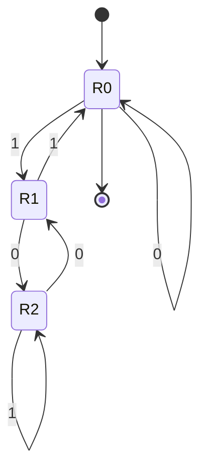

# Autômatos finitos e expressões regulares

## Por que isso importa

Toda vez que você valida um e-mail, procura um padrão com `grep`, destaca a sintaxe no editor ou o compilador separa seu código em palavras, há um **autômato finito** trabalhando. Eles são o modelo de computação mais simples que existe: uma máquina com um número fixo de estados e **nenhuma memória extra**. Entender o que eles conseguem (e o que **não** conseguem) explica por que não dá para validar HTML com regex, por que algumas regex travam servidores (ReDoS) e como protocolos, interfaces e jogos são modelados como máquinas de estados (ES-09). É também a porta de entrada da teoria da computação, que pergunta: o que um computador consegue resolver, afinal?

## Intuição

Pense numa **catraca do metrô**. Ela tem dois estados: **travada** e **liberada**. Passar o cartão leva de travada para liberada; empurrar leva de liberada para travada. Empurrar travada não faz nada; passar o cartão liberada também não. A catraca não lembra quantas pessoas passaram, nem quantos cartões viu: só **em que estado está agora**.

Um autômato finito é isso: lê símbolos um a um e muda de estado conforme uma tabela. No fim, **aceita** a entrada se parou num estado marcado como final. Como a memória é só o estado atual, ele não consegue contar até um número arbitrário: não sabe se uma sequência tem tantos `(` quanto `)`, porque para isso precisaria de infinitos estados.

## Visual

Um AFD que aceita números binários **múltiplos de 3**: o estado é o resto da divisão por 3 do que foi lido até agora.



Lendo `110` (6 em decimal):

```text
estado   símbolo   próximo      por quê
R0       1         R1           (0*2 + 1) mod 3 = 1
R1       1         R0           (1*2 + 1) mod 3 = 0
R0       0         R0           (0*2 + 0) mod 3 = 0
fim em R0, que é final  →  aceita (6 é múltiplo de 3)
```

## Conceito técnico

### Linguagens formais

- **Alfabeto** Σ: um conjunto finito de símbolos (`{0, 1}`, as letras ASCII).
- **Palavra**: uma sequência finita de símbolos; ε é a palavra vazia.
- **Linguagem**: um conjunto de palavras, possivelmente infinito ("binários múltiplos de 3", "e-mails válidos").
- Um **problema de decisão** é uma linguagem: "esta palavra pertence a L?". Esse é o ponto de vista de toda a teoria da computação (TC-03, TC-04).

### Autômato finito determinístico (AFD)

Uma tupla (Q, Σ, δ, q₀, F): estados Q, alfabeto Σ, função de transição δ(estado, símbolo) → estado, estado inicial q₀ e estados finais F. Para cada estado e símbolo há **exatamente uma** transição (ou uma transição implícita para um estado "morto" que rejeita). Simular custa O(n) para uma entrada de tamanho n, com memória constante.

### Autômato finito não determinístico (AFN)

Pode ter **várias** transições para o mesmo símbolo, ou nenhuma, e transições **ε** (que mudam de estado sem ler nada). Aceita se **algum** caminho termina num estado final. Simular: em vez de um estado atual, mantenha o **conjunto** de estados possíveis, fechando-o pelas transições ε a cada passo.

- AFNs são mais fáceis de construir (para "termina com 101", basta "chutar" quando o sufixo começa).
- Todo AFN tem um AFD equivalente (**construção dos subconjuntos**): cada estado do AFD é um conjunto de estados do AFN. Pode haver até 2ⁿ estados, mas o poder de reconhecimento é o mesmo.
- Todo AFD tem um **AFD mínimo** único (algoritmo de Hopcroft), útil para comparar linguagens.

### Expressões regulares

Construídas a partir de símbolos com três operações:

- **união** `a|b`;
- **concatenação** `ab`;
- **fecho de Kleene** `a*` (zero ou mais repetições).

Atalhos práticos: `a+` = `aa*`, `a?` = `(a|ε)`, `[0-9]` = `0|1|...|9`, `.` qualquer símbolo, `{2,4}` repetições.

**Teorema de Kleene**: expressões regulares, AFNs e AFDs descrevem exatamente a mesma classe, as **linguagens regulares**. A **construção de Thompson** transforma uma regex num AFN, e a construção dos subconjuntos o transforma num AFD. É isso que `grep`, `lex` e os analisadores léxicos (TC-05) fazem.

As linguagens regulares são **fechadas** sob união, interseção, complemento, concatenação e fecho: combinar regulares gera regulares (a interseção usa o **autômato produto**, que roda os dois em paralelo).

### Regex no mundo real

- Os motores de Python, JavaScript, Java e PCRE usam **backtracking** e têm recursos que vão além das linguagens regulares (retrovisores `\1`, lookahead). O preço: certas regex levam **tempo exponencial**. `^(a+)+$` contra `aaaaaaaaaaaaaaaaaaaaaaaa!` trava o processo: é o **ReDoS**, que já derrubou a Cloudflare e o Stack Overflow.
- Motores baseados em autômatos (RE2, o `regexp` do Go, o `regex` do Rust, ripgrep) garantem tempo linear, abrindo mão dos retrovisores.
- Prefira regex **ancoradas** (`^...$`), simples e testadas; para formatos complexos (e-mail, URL, HTML, JSON), use um parser de verdade.

### O que não é regular: lema do bombeamento

Se L é regular, existe um p tal que toda palavra de L com tamanho ≥ p pode ser dividida em xyz, com |xy| ≤ p e |y| ≥ 1, de forma que xyⁱz está em L para todo i ≥ 0. Intuição: com p estados, uma palavra longa obriga o autômato a repetir um estado, e o trecho do laço (y) pode ser repetido à vontade.

Exemplo: L = {aⁿbⁿ} (n letras a seguidas de n letras b) **não é regular**. Pegue aᵖbᵖ: como |xy| ≤ p, y só tem letras a; bombear (xyyz) cria mais a do que b, fora de L. Contradição. É por isso que parênteses balanceados, HTML aninhado e expressões aritméticas precisam de algo mais forte: as **gramáticas livres de contexto** (TC-02).

## Código

Um AFD e um AFN simulados lado a lado, reconhecendo a mesma linguagem: palavras binárias que **terminam em 01**.

```python
# AFD: o estado guarda os dois últimos símbolos relevantes
afd = {
    ("inicio", "0"): "viu0", ("inicio", "1"): "inicio",
    ("viu0", "0"): "viu0",   ("viu0", "1"): "viu01",
    ("viu01", "0"): "viu0",  ("viu01", "1"): "inicio",
}
def aceita_afd(palavra):
    estado = "inicio"
    for s in palavra:
        estado = afd[(estado, s)]
    return estado == "viu01"

# AFN: fica em q0 lendo qualquer coisa e "chuta" quando começa o 01 final
afn = {("q0", "0"): {"q0", "q1"}, ("q0", "1"): {"q0"}, ("q1", "1"): {"q2"}}
def aceita_afn(palavra):
    atuais = {"q0"}
    for s in palavra:
        atuais = set().union(*(afn.get((q, s), set()) for q in atuais))
        print(f"   leu {s}: estados possíveis {sorted(atuais)}")
    return "q2" in atuais

for p in ["1101", "0110", "01"]:
    print(p)
    print("   AFD:", aceita_afd(p), "| AFN:", aceita_afn(p))
```

## Erros comuns

- **Esquecer o estado morto**: num AFD, toda combinação estado/símbolo precisa ir a algum lugar.
- **Confundir "aceita" com "passou por um estado final"**: o que importa é onde a leitura **termina**.
- **No AFN, esquecer o fecho ε** antes de ler o primeiro símbolo e depois de cada passo.
- **Regex sem âncoras** para validação: `[0-9]{5}` aceita `abc12345xyz`.
- **Regex para tudo**: HTML, JSON e expressões aninhadas não são regulares.
- **Quantificadores aninhados** (`(a+)+`, `(.*)*`) em motores com backtracking: ReDoS.
- **Usar o lema do bombeamento ao contrário**: ele só prova que algo **não** é regular; satisfazê-lo não prova que é.

## Pratique

```quiz
id: TC-01-q1
tipo: multipla_escolha
pergunta: "Qual destas linguagens sobre {a, b} NÃO é regular?"
opcoes: ["Palavras com número par de a", "Palavras que terminam em ab", "Palavras da forma a^n b^n (n letras a seguidas de n letras b)", "Palavras com pelo menos três b"]
resposta: 2
explicacao: "Para reconhecer a^n b^n seria preciso lembrar n, que pode ser arbitrariamente grande, e um autômato finito só tem memória finita. O lema do bombeamento formaliza isso. As outras só precisam de um contador limitado (paridade, últimos dois símbolos, contar até 3)."
dificuldade: 1
```

```quiz
id: TC-01-q2
tipo: multipla_escolha
pergunta: "Sobre AFN e AFD, é correto afirmar:"
opcoes: ["AFNs reconhecem mais linguagens que AFDs", "Todo AFN pode ser convertido num AFD equivalente, possivelmente com exponencialmente mais estados", "AFDs não conseguem reconhecer linguagens infinitas", "AFNs precisam de uma pilha"]
resposta: 1
explicacao: "A construção dos subconjuntos cria um estado do AFD para cada conjunto de estados do AFN alcançável. O poder é o mesmo (linguagens regulares); a diferença é de tamanho e de facilidade de construção."
dificuldade: 2
```

```quiz
id: TC-01-q3
tipo: verdadeiro_falso
pergunta: "A regex ^[0-9]{5}-?[0-9]{3}$ aceita a string 'CEP: 01310-100'."
resposta: false
explicacao: "As âncoras ^ e $ exigem que a string inteira siga o padrão. Sem elas, a regex encontraria o CEP no meio do texto, o que é útil para buscar e perigoso para validar."
dificuldade: 1
```

```quiz
id: TC-01-q4
tipo: multipla_escolha
pergunta: "Por que a regex ^(a+)+$ pode travar um servidor com a entrada 'aaaaaaaaaaaaaaaaaaaaaaaaaaaa!'?"
opcoes: ["Porque a string é longa demais para a memória", "Porque motores com backtracking testam exponencialmente muitas formas de dividir os a entre os dois + antes de concluir que o ! impede o casamento", "Porque o ! é um caractere especial", "Porque regex não aceitam âncoras"]
resposta: 1
explicacao: "Há 2^(n-1) maneiras de repartir n letras a entre as repetições, e o motor tenta todas. É o ReDoS. Um motor baseado em autômato (RE2, Go, Rust) responde em tempo linear, porque simula todos os caminhos ao mesmo tempo, como o AFN do exemplo."
dificuldade: 2
```

```quiz
id: TC-01-q5
tipo: resposta_curta
pergunta: "Explique, com a intuição do lema do bombeamento, por que um autômato finito não consegue verificar se os parênteses de uma expressão estão balanceados."
resposta: "Um autômato com p estados, ao ler mais de p parênteses abertos seguidos, repete algum estado; a partir daí ele não distingue quantos parênteses abriu. Repetir (bombear) o trecho do laço gera uma palavra com mais aberturas que fechamentos que o autômato aceitaria igual. Verificar o balanceamento exige contar sem limite, ou seja, memória infinita (uma pilha)."
palavras_chave: ["estados", "repete", "contar", "pilha"]
dificuldade: 2
```

```quiz
id: TC-01-q6
tipo: codigo
linguagem: python
pergunta: |
  **Simulando um AFD.** Um AFD é um dicionário com `'inicial'`, `'finais'` (conjunto) e `'delta'`, um dicionário `(estado, símbolo) -> estado`. Escreva `aceita(afd, palavra)`, que devolve `True` se a leitura termina num estado final. Se faltar alguma transição, a palavra é **rejeitada** (estado morto implícito).
codigo_inicial: |
  def aceita(afd, palavra):
      return palavra != ''
usa: [def, for, if, return]
testes:
  - chamada: "aceita({'inicial': 'par', 'finais': {'par'}, 'delta': {('par', 'a'): 'impar', ('impar', 'a'): 'par', ('par', 'b'): 'par', ('impar', 'b'): 'impar'}}, 'abab')"
    saida: "True"
  - chamada: "aceita({'inicial': 'par', 'finais': {'par'}, 'delta': {('par', 'a'): 'impar', ('impar', 'a'): 'par', ('par', 'b'): 'par', ('impar', 'b'): 'impar'}}, 'ab')"
    saida: "False"
  - chamada: "aceita({'inicial': 's', 'finais': {'s'}, 'delta': {}}, '')"
    saida: "True"
  - chamada: "aceita({'inicial': 's', 'finais': {'t'}, 'delta': {('s', 'x'): 't'}}, 'xx')"
    visivel: false
    saida: "False"
  - chamada: "aceita({'inicial': 's', 'finais': {'t'}, 'delta': {('s', 'x'): 't', ('t', 'x'): 't'}}, 'xxxx')"
    visivel: false
    saida: "True"
dica: "Comece com estado = afd['inicial']. Para cada símbolo, se (estado, símbolo) não estiver em delta, devolva False; senão avance. No fim, confira se estado está em afd['finais']."
solucao: |
  def aceita(afd, palavra):
      estado = afd['inicial']
      for simbolo in palavra:
          if (estado, simbolo) not in afd['delta']:
              return False
          estado = afd['delta'][(estado, simbolo)]
      return estado in afd['finais']
explicacao: "Um laço, uma variável e uma consulta à tabela: tempo linear e memória constante, qualquer que seja o tamanho da entrada. Repare no terceiro teste: a palavra vazia é aceita se o estado inicial já for final. Analisadores léxicos (TC-05) são exatamente esse laço com uma tabela gerada a partir de regex."
dificuldade: 1
```

```quiz
id: TC-01-q7
tipo: codigo
linguagem: python
pergunta: |
  **Simulando um AFN com transições ε.** O AFN tem `'inicial'`, `'finais'` e `'delta'`: um dicionário `(estado, símbolo) -> conjunto de estados`, em que o símbolo `''` representa ε. Escreva `fecho(afn, estados)`, que devolve o conjunto de estados alcançáveis a partir de `estados` usando só transições ε (incluindo os próprios), e `aceita_afn(afn, palavra)`.
codigo_inicial: |
  def fecho(afn, estados):
      return set(estados)

  def aceita_afn(afn, palavra):
      atuais = {afn['inicial']}
      for s in palavra:
          proximos = set()
          for q in atuais:
              proximos |= afn['delta'].get((q, s), set())
          atuais = proximos
      return bool(atuais & afn['finais'])
usa: [def, while, for, return]
testes:
  - chamada: "aceita_afn({'inicial': 'q0', 'finais': {'q2'}, 'delta': {('q0', '0'): {'q0', 'q1'}, ('q0', '1'): {'q0'}, ('q1', '1'): {'q2'}}}, '1101')"
    saida: "True"
  - chamada: "aceita_afn({'inicial': 'q0', 'finais': {'q2'}, 'delta': {('q0', '0'): {'q0', 'q1'}, ('q0', '1'): {'q0'}, ('q1', '1'): {'q2'}}}, '0110')"
    saida: "False"
  - chamada: "sorted(fecho({'delta': {('a', ''): {'b'}, ('b', ''): {'c'}, ('c', 'x'): {'d'}}}, {'a'}))"
    saida: "['a', 'b', 'c']"
  - chamada: "aceita_afn({'inicial': 'i', 'finais': {'fa', 'fb'}, 'delta': {('i', ''): {'a0', 'b0'}, ('a0', 'a'): {'fa'}, ('fa', 'a'): {'fa'}, ('b0', 'b'): {'fb'}, ('fb', 'b'): {'fb'}}}, 'bbb')"
    visivel: false
    saida: "True"
  - chamada: "aceita_afn({'inicial': 'i', 'finais': {'f'}, 'delta': {('i', ''): {'f'}}}, '')"
    visivel: false
    saida: "True"
  - chamada: "aceita_afn({'inicial': 'p', 'finais': {'r'}, 'delta': {('p', 'a'): {'q'}, ('q', ''): {'p', 'r'}}}, 'aaa')"
    visivel: false
    saida: "True"
  - chamada: "aceita_afn({'inicial': 'i', 'finais': {'fa', 'fb'}, 'delta': {('i', ''): {'a0', 'b0'}, ('a0', 'a'): {'fa'}, ('fa', 'a'): {'fa'}, ('b0', 'b'): {'fb'}, ('fb', 'b'): {'fb'}}}, 'ab')"
    visivel: false
    saida: "False"
dica: "No fecho, use uma pilha com os estados iniciais e um conjunto de visitados; enquanto a pilha não esvaziar, tire um estado e empilhe os destinos de (estado, '') ainda não vistos. Em aceita_afn, aplique o fecho no conjunto inicial e depois de cada símbolo."
solucao: |
  def fecho(afn, estados):
      vistos = set(estados)
      pilha = list(estados)
      while pilha:
          q = pilha.pop()
          for r in afn['delta'].get((q, ''), set()):
              if r not in vistos:
                  vistos.add(r)
                  pilha.append(r)
      return vistos

  def aceita_afn(afn, palavra):
      atuais = fecho(afn, {afn['inicial']})
      for s in palavra:
          proximos = set()
          for q in atuais:
              proximos |= afn['delta'].get((q, s), set())
          atuais = fecho(afn, proximos)
      return bool(atuais & afn['finais'])
explicacao: "O fecho ε é uma busca em grafo (AL-05) que usa só as arestas ε. Com ele, o AFN do quarto teste reconhece 'a+ ou b+', exatamente como a construção de Thompson monta uma união: um estado inicial com ε para cada alternativa. Manter o conjunto de estados possíveis é a simulação em tempo linear que motores como RE2 usam, sem o backtracking que causa ReDoS."
dificuldade: 2
```

```quiz
id: TC-01-q8
tipo: codigo
linguagem: javascript
pergunta: |
  **Um AFD para múltiplos.** Escreva `multiploDe(n, binario)`, que diz se o número escrito em `binario` é múltiplo de `n`, simulando um AFD de `n` estados: o estado é o resto da divisão por `n` do que já foi lido, e ler o bit `b` leva o estado `r` para `(2 * r + b) % n`. Os números podem ter centenas de bits, então **não** converta a string para número.
codigo_inicial: |
  function multiploDe(n, binario) {
    return parseInt(binario, 2) % n === 0;
  }
usa: [function, for, return]
testes:
  - chamada: "multiploDe(3, '110')"
    saida: "true"
  - chamada: "multiploDe(3, '111')"
    saida: "false"
  - chamada: "multiploDe(5, '1010')"
    saida: "true"
  - chamada: "multiploDe(3, '1'.repeat(64))"
    visivel: false
    saida: "true"
  - chamada: "multiploDe(7, '1' + '0'.repeat(99))"
    visivel: false
    saida: "false"
  - chamada: "multiploDe(3, '1' + '0'.repeat(98) + '1')"
    visivel: false
    saida: "true"
  - chamada: "multiploDe(2, '')"
    visivel: false
    saida: "true"
dica: "Comece com r = 0 e, para cada caractere c da string, faça r = (2 * r + Number(c)) % n. No fim, devolva r === 0."
solucao: |
  function multiploDe(n, binario) {
    let r = 0;
    for (const c of binario) {
      r = (2 * r + Number(c)) % n;
    }
    return r === 0;
  }
explicacao: "O AFD nunca guarda o número, só o resto: memória constante para qualquer tamanho de entrada. O parseInt do código inicial perde precisão acima de 2^53 e erra no teste com 64 bits 1 (2^64 - 1 é múltiplo de 3, porque 4 ≡ 1 mod 3). A ideia de trocar o valor pelo resto é a mesma do hash rolante e das contas modulares do MD-04."
dificuldade: 2
```

## Resumo

- Linguagem formal = conjunto de palavras; decidir pertinência é o modelo de "problema".
- **AFD**: uma transição por estado e símbolo; simulação linear, memória constante.
- **AFN**: várias transições e ε; simule com **conjuntos de estados** e fecho ε; equivale a um AFD (subconjuntos).
- **Regex** = AFN = AFD (Kleene): as **linguagens regulares**, fechadas sob união, interseção, complemento.
- Motores com **backtracking** podem ser exponenciais (**ReDoS**); motores por autômato são lineares.
- **Lema do bombeamento** prova que aⁿbⁿ, parênteses balanceados e HTML não são regulares.

## Para ir além

- Desenhe no JFLAP um AFD para "número de a par e número de b ímpar" e minimize-o.
- Leia o artigo do Russ Cox e implemente a construção de Thompson.
- Assista às duas primeiras aulas do MIT 18.404 com o Sipser.
- **Próximo módulo**: TC-02 Gramáticas livres de contexto e parsing.
