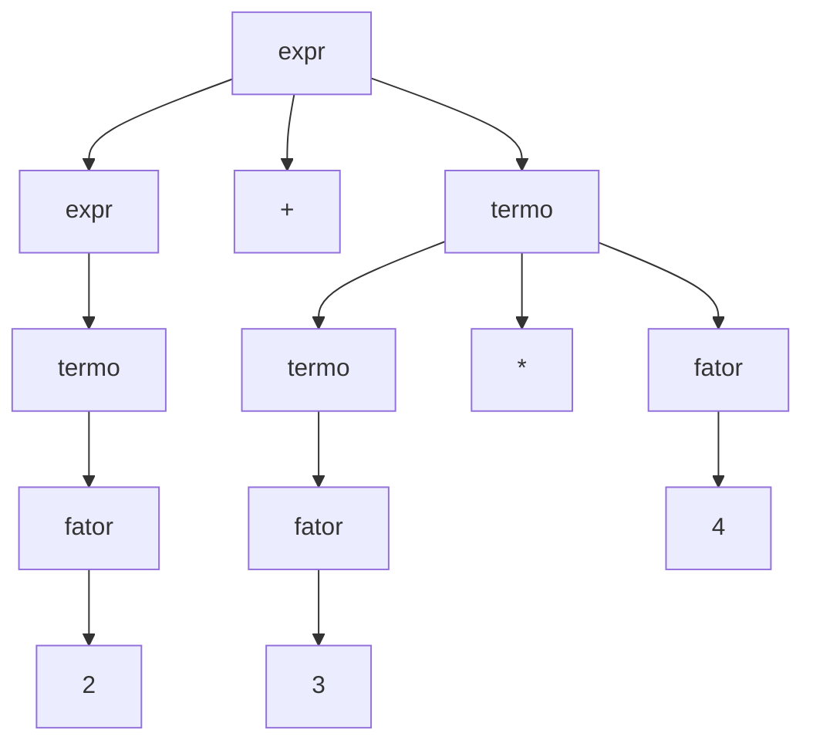

# Gramáticas livres de contexto e parsing

## Por que isso importa

No TC-01 você viu que autômatos finitos não conseguem lidar com estruturas **aninhadas**: parênteses, blocos `{ }` dentro de blocos, HTML dentro de HTML, expressões como `2 * (3 + (4 - 1))`. Mas toda linguagem de programação, todo formato de dados (JSON, XML) e toda fórmula de planilha é cheia de aninhamento. As **gramáticas livres de contexto** (GLCs) descrevem exatamente essas estruturas, e os **parsers** transformam texto em árvores que um programa entende. Todo compilador, interpretador, formatador de código, linter e validador de JSON começa com um parser. Saber escrever um pequeno parser também resolve problemas do dia a dia: ler um formato de configuração, uma linguagem de consulta simples, uma calculadora.

## Intuição

Pense nas regras de uma **receita de bolo de camadas**: "um bolo é **massa**, ou é **massa, recheio e outro bolo**". Com essa única regra recursiva você descreve bolos de 1, 2, 10 camadas. Uma gramática é um conjunto dessas regras de substituição: cada nome (como **bolo**) pode ser trocado pelo que está do lado direito, até sobrarem só ingredientes de verdade.

O **parser** faz o caminho inverso: recebe o bolo pronto e descobre como ele foi montado, camada por camada, construindo a **árvore**. É a árvore que diz que em `2 + 3 * 4` a multiplicação acontece primeiro.

## Visual

Uma gramática para expressões aritméticas com precedência:

```text
expr   → expr + termo | expr - termo | termo          (soma: menor precedência)
termo  → termo * fator | termo / fator | fator        (produto: maior precedência)
fator  → número | ( expr )
```

A árvore de derivação de `2 + 3 * 4`:



O `*` fica mais **fundo** na árvore, então é calculado antes: 2 + 12 = 14.

## Conceito técnico

### Gramática livre de contexto

Uma GLC é uma tupla (V, Σ, R, S):

- **variáveis** (não terminais) V, como `expr`, `termo`;
- **terminais** Σ, os símbolos da linguagem (`+`, `(`, números);
- **regras** R, da forma `A → w`, em que A é uma variável e w uma sequência de variáveis e terminais;
- a **variável inicial** S.

"Livre de contexto" quer dizer que A pode ser substituída **independentemente do que está ao redor**.

Exemplos clássicos:

```text
S → a S b | ε               gera aⁿbⁿ (a linguagem não regular do TC-01)
S → ( S ) S | ε             parênteses balanceados
S → a S a | b S b | a | b | ε   palíndromos sobre {a, b}
```

### Derivações e árvores

Uma **derivação** aplica regras a partir de S até sobrarem só terminais: `S ⇒ aSb ⇒ aaSbb ⇒ aabb`. A **derivação mais à esquerda** sempre substitui a variável mais à esquerda. A **árvore de derivação** (ou árvore sintática) registra quais regras foram usadas, sem se importar com a ordem.

### Ambiguidade

Uma gramática é **ambígua** se alguma palavra tem **duas árvores** diferentes. A gramática `E → E + E | E * E | número` é ambígua: `2 + 3 * 4` pode ser (2 + 3) * 4 = 20 ou 2 + (3 * 4) = 14. Para linguagens de programação, isso é inaceitável. Resolve-se:

- reescrevendo a gramática com **um nível por precedência** (como `expr`/`termo`/`fator` acima);
- definindo **associatividade**: a recursão à esquerda (`expr → expr - termo`) faz `8 - 3 - 2` ser (8 - 3) - 2; a recursão à direita (`pot → fator ^ pot`) faz `2 ^ 3 ^ 2` ser 2 ^ (3 ^ 2);
- ou com declarações de precedência no gerador de parser.

O famoso **"else pendurado"** (`if a then if b then x else y`: o else é de qual if?) é outro exemplo, resolvido pela regra "o else pertence ao if mais próximo".

### Autômatos com pilha

O modelo de máquina das GLCs é o **autômato com pilha**: um autômato finito com uma **pilha** ilimitada. A pilha é a memória que faltava para contar aberturas e fechamentos. GLCs e autômatos com pilha (não determinísticos) reconhecem exatamente as mesmas linguagens. Ainda há limites: {aⁿbⁿcⁿ} não é livre de contexto (há um lema do bombeamento para GLCs), e regras como "variável declarada antes de usar" ficam para a **análise semântica** (TC-05).

### Como fazer o parsing

- **Descendente recursivo** (top-down, LL): uma função por variável da gramática; cada função olha o próximo token e decide qual regra seguir. É simples, rápido e dá ótimas mensagens de erro: GCC, Clang, V8, Go e Rust usam parsers escritos à mão assim. Ele **não aceita recursão à esquerda** (`expr → expr + termo` viraria uma chamada infinita): reescreva como laço, `expr → termo (('+' | '-') termo)*`.
- **Precedence climbing / Pratt**: variação do descendente recursivo que trata operadores com uma tabela de precedências.
- **Shunting-yard** (Dijkstra): usa uma pilha de operadores para converter expressões infixas em notação polonesa reversa (pós-fixa), fácil de avaliar com outra pilha.
- **Ascendente** (bottom-up, LR, LALR): lê tokens e os "reduz" usando uma tabela gerada a partir da gramática. Ferramentas como yacc, Bison e o antigo parser do Python geram esses parsers.
- **CYK** e **Earley**: algoritmos gerais (O(n³)) que aceitam qualquer GLC, inclusive ambíguas; usados em processamento de linguagem natural.
- **PEG** (parsing expression grammars): escolha ordenada no lugar de alternativas, sem ambiguidade por construção; o Python usa um parser PEG desde a versão 3.9.

### Da árvore de derivação à AST

A árvore de derivação tem um nó para cada regra, inclusive os parênteses e as variáveis intermediárias. Os compiladores constroem uma **árvore sintática abstrata** (AST), só com o que importa: `('+', 2, ('*', 3, 4))`. Experimente `import ast; print(ast.dump(ast.parse('2 + 3 * 4')))` no Python.

## Código

Um parser descendente recursivo para a gramática de expressões, que constrói a AST e depois a avalia. Cada função corresponde a uma variável da gramática.

```python
import re

def tokens(texto):
    return re.findall(r"\d+|[-+*/()]", texto)

class Parser:
    def __init__(self, texto):
        self.toks = tokens(texto)
        self.pos = 0

    def olhar(self):
        return self.toks[self.pos] if self.pos < len(self.toks) else None

    def comer(self, esperado=None):
        tok = self.olhar()
        if tok is None or (esperado and tok != esperado):
            raise SyntaxError(f"esperava {esperado or 'algo'}, achei {tok}")
        self.pos += 1
        return tok

    def expr(self):            # expr → termo (('+' | '-') termo)*
        no = self.termo()
        while self.olhar() in ("+", "-"):
            op = self.comer()
            no = (op, no, self.termo())
        return no

    def termo(self):           # termo → fator (('*' | '/') fator)*
        no = self.fator()
        while self.olhar() in ("*", "/"):
            op = self.comer()
            no = (op, no, self.fator())
        return no

    def fator(self):           # fator → número | '(' expr ')'
        if self.olhar() == "(":
            self.comer("(")
            no = self.expr()
            self.comer(")")
            return no
        return int(self.comer())

def avaliar(no):
    if isinstance(no, int):
        return no
    op, a, b = no
    a, b = avaliar(a), avaliar(b)
    return {"+": a + b, "-": a - b, "*": a * b, "/": a / b}[op]

for texto in ["2 + 3 * 4", "(2 + 3) * 4", "8 - 3 - 2", "2 * (3 + (4 - 1))"]:
    arvore = Parser(texto).expr()
    print(f"{texto:20} AST: {arvore}  =  {avaliar(arvore)}")

try:
    Parser("2 * (3 + 4").expr()
except SyntaxError as erro:
    print("erro de sintaxe:", erro)
```

Repare que `8 - 3 - 2` vira `('-', ('-', 8, 3), 2)`: o laço no lugar da recursão à esquerda preserva a associatividade à esquerda.

## Erros comuns

- **Gramática ambígua** sem perceber: teste com `a - b - c` e `a + b * c`.
- **Recursão à esquerda num parser descendente**: laço infinito (ou estouro de pilha).
- **Associatividade errada**: `8 - 3 - 2` dando 7 em vez de 3, ou `2 ^ 3 ^ 2` dando 64 em vez de 512.
- **Não conferir o fim da entrada**: o parser lê `2 + 3` de `2 + 3 )` e ignora o resto.
- **Misturar análise léxica e sintática**: separe em tokens primeiro (TC-05).
- **Tentar resolver aninhamento com regex**: é exatamente o que GLCs existem para fazer.
- **Mensagens de erro vagas**: diga o que esperava e onde.

## Pratique

```quiz
id: TC-02-q1
tipo: multipla_escolha
pergunta: "Qual linguagem a gramática S → a S b | ε gera?"
opcoes: ["Todas as palavras com a e b", "a^n b^n, com n >= 0", "Palavras com a e b alternados", "Palavras com número par de letras"]
resposta: 1
explicacao: "Cada aplicação de S → aSb coloca um a à esquerda e um b à direita, e ε termina. Resultado: ε, ab, aabb, aaabbb... a linguagem que o TC-01 mostrou não ser regular."
dificuldade: 1
```

```quiz
id: TC-02-q2
tipo: multipla_escolha
pergunta: "Por que a gramática E → E + E | E * E | número é um problema para um compilador?"
opcoes: ["Ela não gera números negativos", "Ela é ambígua: 2 + 3 * 4 tem duas árvores, com resultados 14 e 20", "Ela não é livre de contexto", "Ela gera palavras infinitas"]
resposta: 1
explicacao: "Duas árvores para a mesma expressão significam dois significados. A solução é estratificar por precedência (expr, termo, fator) ou declarar precedências no gerador de parser."
dificuldade: 1
```

```quiz
id: TC-02-q3
tipo: verdadeiro_falso
pergunta: "Um parser descendente recursivo consegue usar diretamente a regra expr → expr + termo."
resposta: false
explicacao: "A função expr chamaria expr de novo sem consumir nenhum token, em recursão infinita. A regra é reescrita como expr → termo ('+' termo)*, implementada com um laço, o que ainda mantém a associatividade à esquerda."
dificuldade: 2
```

```quiz
id: TC-02-q4
tipo: multipla_escolha
pergunta: "Qual modelo de máquina reconhece exatamente as linguagens livres de contexto?"
opcoes: ["Autômato finito determinístico", "Autômato com pilha (não determinístico)", "Máquina de Turing com fita limitada a 10 células", "Expressões regulares com âncoras"]
resposta: 1
explicacao: "A pilha é a memória ilimitada (mas só acessível pelo topo) que permite casar aberturas e fechamentos aninhados. Com uma fita livre de leitura e escrita, como numa máquina de Turing (TC-03), o poder cresce."
dificuldade: 2
```

```quiz
id: TC-02-q5
tipo: resposta_curta
pergunta: "Qual a diferença entre a árvore de derivação e a árvore sintática abstrata (AST)?"
resposta: "A árvore de derivação mostra todas as regras da gramática aplicadas, com variáveis intermediárias (expr, termo, fator) e terminais como parênteses. A AST guarda só a estrutura que importa para o significado, como operadores e operandos: ('+', 2, ('*', 3, 4)). Os parênteses e os níveis de precedência ficam implícitos na forma da árvore."
palavras_chave: ["regras", "parênteses", "operadores", "significado"]
dificuldade: 2
```

```quiz
id: TC-02-q6
tipo: codigo
linguagem: python
pergunta: |
  **Uma calculadora de verdade.** Escreva `calcular(texto)`, que avalia expressões com inteiros, `+`, `-`, `*`, `//` (divisão inteira), parênteses e **menos unário** (`-3`, `-(2 + 1)`), respeitando precedência e associatividade à esquerda. Siga a gramática:

  - `expr → termo (('+' | '-') termo)*`
  - `termo → unario (('*' | '//') unario)*`
  - `unario → '-' unario | fator`
  - `fator → número | '(' expr ')'`

  A função `tokens` (não mude) já separa o texto. Não use `eval`.
codigo_inicial: |
  import re

  def tokens(texto):
      # não mude: os testes usam esta função
      return re.findall(r'\d+|//|[-+*()]', texto)

  def calcular(texto):
      total = 0
      for t in tokens(texto):
          if t.isdigit():
              total += int(t)
      return total
usa: [def, while, if, return]
testes:
  - chamada: "calcular('2 + 3 * 4')"
    saida: "14"
  - chamada: "calcular('(2 + 3) * 4')"
    saida: "20"
  - chamada: "calcular('8 - 3 - 2')"
    saida: "3"
  - chamada: "calcular('-3 * -(2 + 1)')"
    saida: "9"
  - chamada: "calcular('100 // 7 // 2')"
    visivel: false
    saida: "7"
  - chamada: "calcular('2 * (3 + (4 - 1)) - 10 // 3')"
    visivel: false
    saida: "9"
  - chamada: "calcular('--5')"
    visivel: false
    saida: "5"
  - chamada: "calcular('42')"
    visivel: false
    saida: "42"
dica: "Guarde os tokens numa lista e a posição atual num dicionário ou lista de um elemento (para as funções internas alterarem). Escreva uma função para cada regra; expr e termo usam while para os operadores, unario chama a si mesma quando vê '-', e fator trata '(' expr ')'."
solucao: |
  import re

  def tokens(texto):
      # não mude: os testes usam esta função
      return re.findall(r'\d+|//|[-+*()]', texto)

  def calcular(texto):
      toks = tokens(texto)
      pos = [0]

      def olhar():
          return toks[pos[0]] if pos[0] < len(toks) else None

      def comer():
          pos[0] += 1
          return toks[pos[0] - 1]

      def expr():
          valor = termo()
          while olhar() in ('+', '-'):
              if comer() == '+':
                  valor += termo()
              else:
                  valor -= termo()
          return valor

      def termo():
          valor = unario()
          while olhar() in ('*', '//'):
              if comer() == '*':
                  valor *= unario()
              else:
                  valor //= unario()
          return valor

      def unario():
          if olhar() == '-':
              comer()
              return -unario()
          return fator()

      def fator():
          if olhar() == '(':
              comer()
              valor = expr()
              comer()
              return valor
          return int(comer())

      return expr()
explicacao: "Cada regra da gramática virou uma função, e a forma da gramática decide tudo: termo é chamado de dentro de expr, então produtos ficam mais fundos e são calculados antes; o while acumula da esquerda para a direita, então 100 // 7 // 2 é (100 // 7) // 2 = 7; o unário recursivo aceita --5. Este é o mesmo esqueleto dos parsers de linguagens reais, só com mais regras."
dificuldade: 3
```

```quiz
id: TC-02-q7
tipo: codigo
linguagem: python
pergunta: |
  **O que uma gramática gera?** A gramática é um dicionário `variável -> lista de lados direitos` (strings), em que **letras maiúsculas são variáveis** e o resto são terminais; `''` é ε. A variável inicial é `'S'`. Escreva `gera(gramatica, n)`, que devolve a lista **ordenada** (por tamanho e depois em ordem alfabética) de todas as palavras de terminais com **tamanho até n** que a gramática gera.

  Faça uma busca em largura sobre as formas sentenciais, sempre substituindo a variável **mais à esquerda**, e descarte formas que já têm mais de `n` terminais (elas nunca vão encolher).
codigo_inicial: |
  def gera(gramatica, n):
      return [w for w in gramatica['S'] if w.islower() and len(w) <= n]
usa: [def, while, for, if, return]
testes:
  - chamada: "gera({'S': ['aSb', '']}, 6)"
    saida: "['', 'ab', 'aabb', 'aaabbb']"
  - chamada: "gera({'S': ['(S)S', '']}, 4)"
    saida: "['', '()', '(())', '()()']"
  - chamada: "gera({'S': ['aSa', 'bSb', 'a', 'b', '']}, 3)"
    saida: "['', 'a', 'b', 'aa', 'bb', 'aaa', 'aba', 'bab', 'bbb']"
  - chamada: "gera({'S': ['AB'], 'A': ['a', 'aA'], 'B': ['b']}, 3)"
    visivel: false
    saida: "['ab', 'aab']"
  - chamada: "gera({'S': ['x']}, 0)"
    visivel: false
    saida: "[]"
  - chamada: "gera({'S': ['S+S', 'n']}, 5)"
    visivel: false
    saida: "['n', 'n+n', 'n+n+n']"
dica: "Use uma fila (lista) começando com 'S' e um conjunto de formas já vistas. Para cada forma, ache o índice da primeira letra maiúscula; se não houver, é uma palavra (guarde no conjunto de resultados). Se houver, troque essa variável por cada lado direito, e enfileire a nova forma se a quantidade de terminais (caracteres que não são maiúsculos) for <= n e ela for nova. No fim, ordene com key=lambda w: (len(w), w)."
solucao: |
  def gera(gramatica, n):
      fila = ['S']
      vistas = {'S'}
      palavras = set()
      while fila:
          forma = fila.pop(0)
          i = next((k for k, c in enumerate(forma) if c.isupper()), None)
          if i is None:
              palavras.add(forma)
              continue
          for lado in gramatica[forma[i]]:
              nova = forma[:i] + lado + forma[i + 1:]
              terminais = sum(1 for c in nova if not c.isupper())
              if terminais <= n and nova not in vistas:
                  vistas.add(nova)
                  fila.append(nova)
      return sorted(palavras, key=lambda w: (len(w), w))
explicacao: "A busca termina porque cada forma guardada tem no máximo n terminais e o conjunto de vistas impede repetições; numa gramática com regras que criam variáveis sem criar terminais (como S → SS), as formas poderiam crescer sem fim, e seria preciso limitar também o tamanho delas. Repare que S → S+S | n é ambígua (n+n+n tem duas árvores), mas gera cada palavra uma vez no resultado: ambiguidade é sobre árvores, não sobre a linguagem."
dificuldade: 3
```

```quiz
id: TC-02-q8
tipo: codigo
linguagem: javascript
pergunta: |
  **Shunting-yard.** Escreva `posfixa(expr)`, que converte uma expressão infixa (tokens separados por espaço) para a notação polonesa reversa, também separada por espaços. Operadores: `+` e `-` (precedência 1), `*` e `/` (2), `^` (3, **associativo à direita**); os demais à esquerda. Há parênteses. Algoritmo de Dijkstra:

  - número: vai direto para a saída;
  - operador `o`: enquanto o topo da pilha for um operador `t` com precedência maior que a de `o`, ou igual e `o` associativo à esquerda, mova `t` para a saída; depois empilhe `o`;
  - `(`: empilhe; `)`: desempilhe para a saída até achar o `(`, e descarte-o;
  - no fim, esvazie a pilha na saída.
codigo_inicial: |
  function posfixa(expr) {
    const toks = expr.split(' ');
    const nums = toks.filter((t) => !'+-*/^()'.includes(t));
    const ops = toks.filter((t) => '+-*/^'.includes(t));
    return [...nums, ...ops].join(' ');
  }
usa: [function, for, while, if, return]
testes:
  - chamada: "posfixa('2 + 3 * 4')"
    saida: "'2 3 4 * +'"
  - chamada: "posfixa('( 2 + 3 ) * 4')"
    saida: "'2 3 + 4 *'"
  - chamada: "posfixa('8 - 3 - 2')"
    saida: "'8 3 - 2 -'"
  - chamada: "posfixa('2 ^ 3 ^ 2')"
    visivel: false
    saida: "'2 3 2 ^ ^'"
  - chamada: "posfixa('3 + 4 * 2 / ( 1 - 5 ) ^ 2 ^ 3')"
    visivel: false
    saida: "'3 4 2 * 1 5 - 2 3 ^ ^ / +'"
  - chamada: "posfixa('7')"
    visivel: false
    saida: "'7'"
dica: "Guarde PREC = { '+': 1, '-': 1, '*': 2, '/': 2, '^': 3 }. Para um operador o, o laço é: while (pilha.length && pilha[pilha.length - 1] !== '(' && (PREC[topo] > PREC[o] || (PREC[topo] === PREC[o] && o !== '^'))) saida.push(pilha.pop())."
solucao: |
  function posfixa(expr) {
    const PREC = { '+': 1, '-': 1, '*': 2, '/': 2, '^': 3 };
    const saida = [];
    const pilha = [];
    for (const t of expr.split(' ')) {
      if (t in PREC) {
        while (pilha.length && pilha[pilha.length - 1] !== '(') {
          const topo = pilha[pilha.length - 1];
          if (PREC[topo] > PREC[t] || (PREC[topo] === PREC[t] && t !== '^')) saida.push(pilha.pop());
          else break;
        }
        pilha.push(t);
      } else if (t === '(') {
        pilha.push(t);
      } else if (t === ')') {
        while (pilha[pilha.length - 1] !== '(') saida.push(pilha.pop());
        pilha.pop();
      } else {
        saida.push(t);
      }
    }
    while (pilha.length) saida.push(pilha.pop());
    return saida.join(' ');
  }
explicacao: "A pilha guarda operadores que ainda esperam o operando da direita; um operador mais fraco chegando 'empurra' os mais fortes para a saída, porque eles já têm tudo de que precisam. A exceção do ^ faz 2 ^ 3 ^ 2 sair como 2 3 2 ^ ^, ou seja, 2 ^ (3 ^ 2) = 512. A notação pós-fixa não precisa de parênteses nem de precedência: é avaliada com uma única pilha, como em calculadoras HP e em máquinas virtuais de pilha (a JVM, o bytecode do Python)."
dificuldade: 3
```

## Resumo

- **GLCs** descrevem estruturas aninhadas com regras `A → w` aplicadas sem olhar o contexto.
- **Derivações** e **árvores**; uma gramática é **ambígua** se uma palavra tem duas árvores.
- **Precedência** com um nível de variável por operador; **associatividade** pela direção da recursão.
- **Autômato com pilha** = GLC; aⁿbⁿcⁿ e regras de declaração ficam além.
- Parsers: **descendente recursivo** (laços no lugar de recursão à esquerda), **Pratt**, **shunting-yard**, **LR**, **CYK/Earley**, **PEG**.
- O parser produz uma **AST**, a entrada do resto do compilador (TC-05).

## Para ir além

- Leia os capítulos 5 e 6 do Crafting Interpreters e escreva o parser em Python.
- Estenda a calculadora com `^` associativo à direita, variáveis e funções como `max(a, b)`.
- Rode `python -m ast` (ou `ast.dump`) em pedaços de código seus e compare com a gramática do Python.
- **Próximo módulo**: TC-03 Máquinas de Turing e computabilidade.
