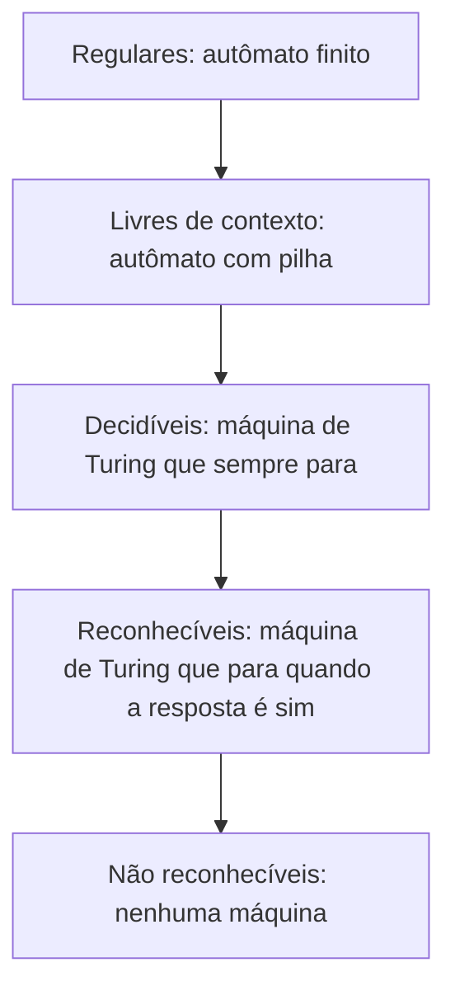

# Máquinas de Turing e computabilidade

## Por que isso importa

Existe algum programa capaz de olhar outro programa e dizer, sempre corretamente, se ele vai travar num laço infinito? Um antivírus perfeito? Um compilador que encontra **todos** os bugs? A resposta é **não**, e não por falta de tecnologia: é **impossível**, demonstrado matematicamente por Alan Turing em 1936, antes de existir um computador eletrônico. Entender esse limite evita perder tempo tentando o impossível e explica por que linters, analisadores estáticos e verificadores de tipos sempre fazem aproximações (dão falsos alarmes ou deixam escapar algo). E a **máquina de Turing** é o modelo que define o que "computar" significa: tudo que seu notebook faz, uma máquina de Turing também faz.

## Intuição

Imagine uma pessoa com um **caderno infinito de quadradinhos**, um lápis, uma borracha e uma **lista curta de instruções**: "se você está no passo 3 e o quadradinho tem um 1, apague, escreva 0, olhe para o quadradinho à esquerda e vá para o passo 5". Ela não precisa ser inteligente, só obediente. Turing argumentou que **qualquer** cálculo que uma pessoa faz seguindo regras pode ser feito assim.

A diferença para os autômatos (TC-01 e TC-02): agora a máquina pode **escrever** na fita e **voltar**. Essa memória ilimitada de leitura e escrita é o salto que a torna equivalente a um computador. E também o que permite a ela **nunca parar**, abrindo a porta para perguntas sem resposta.

## Visual

```text
          cabeçote
              ↓
... _  _  X  a  Y  b  Z  c  _  _ ...      fita infinita (_ = branco)

estado atual: q1
regra:  δ(q1, a) = (q1, a, D)     "em q1 lendo a: escreve a, vai para a direita, fica em q1"
```

A hierarquia das linguagens:



Cada nível contém o anterior: aⁿbⁿ é livre de contexto mas não regular; aⁿbⁿcⁿ é decidível mas não livre de contexto; o problema da parada é reconhecível mas não decidível; o complemento dele nem reconhecível é.

## Conceito técnico

### A máquina de Turing

Uma tupla (Q, Σ, Γ, δ, q₀, q_aceita, q_rejeita):

- estados Q, alfabeto de entrada Σ e alfabeto da fita Γ (inclui o branco `_` e marcas extras como `X`);
- função de transição δ(estado, símbolo) → (novo estado, símbolo a escrever, mover E ou D);
- estado inicial e dois estados de parada: **aceita** e **rejeita**.

A entrada começa escrita na fita, com o cabeçote no primeiro símbolo. Em cada passo a máquina lê, escreve, move e muda de estado. Ela pode **aceitar**, **rejeitar** ou **rodar para sempre**.

Variações (várias fitas, fita infinita só para um lado, não determinismo) **não aumentam** o poder: todas se simulam umas às outras, às vezes com perda de eficiência.

### Tese de Church-Turing

"Tudo que é intuitivamente computável por um procedimento mecânico é computável por uma máquina de Turing." Não é um teorema (intuição não se prova), mas todos os modelos já propostos (cálculo lambda de Church, funções recursivas, máquinas de registradores, Python, JavaScript) se mostraram **equivalentes**. Uma linguagem capaz de simular uma máquina de Turing é chamada **Turing-completa**: quase todas as linguagens de programação são, e até o Excel com LAMBDA, o Minecraft e o PowerPoint com animações.

### A máquina universal

Uma máquina de Turing pode receber a **descrição de outra máquina** como entrada e simulá-la. É a **máquina universal** de Turing: a ideia do computador de **programa armazenado**, em que programas são dados. Seu interpretador Python é uma máquina universal: recebe um programa (texto) e o executa.

### Decidível, reconhecível e não reconhecível

- Uma linguagem é **decidível** se existe uma máquina que **sempre para** e responde certo (sim ou não). Ex.: "este número é primo?", "este grafo tem caminho de s a t?", "este AFD aceita alguma palavra?".
- É **reconhecível** (recursivamente enumerável) se existe uma máquina que para e aceita quando a resposta é **sim**, mas pode rodar para sempre quando é **não**.
- Uma linguagem é decidível exatamente quando ela **e** seu complemento são reconhecíveis.

### O problema da parada é indecidível

PARADA = {⟨P, x⟩ : o programa P para com a entrada x}.

**Reconhecível**: simule P em x; se parar, aceite.

**Não decidível** (prova por diagonalização, como Cantor mostrou que os reais não são enumeráveis):

1. Suponha que existe `para(P, x)`, que sempre termina e diz se P para com x.
2. Construa o programa do contra:

```text
def contra(P):
    if para(P, P):      # P para quando recebe o próprio código?
        while True: pass   # então eu rodo para sempre
    else:
        return             # senão, eu paro
```

3. Pergunte: `contra(contra)` para? Se `para(contra, contra)` disser que sim, `contra` entra no laço e não para. Se disser que não, `contra` retorna e para. Nos dois casos `para` errou. Contradição: `para` não pode existir.

Como há uma quantidade **enumerável** de programas mas uma quantidade **não enumerável** de linguagens, a maioria das linguagens não é sequer reconhecível.

### Reduções e o teorema de Rice

Para mostrar que um problema B é indecidível, **reduza** a parada a ele: mostre que, se B fosse decidível, você decidiria a parada. Exemplos de indecidíveis:

- "Este programa algum dia imprime 'olá'?"
- "Estes dois programas calculam a mesma função?"
- "Esta gramática livre de contexto é ambígua?" (TC-02)
- O **décimo problema de Hilbert**: "esta equação polinomial tem solução inteira?"

O **teorema de Rice** generaliza: **qualquer** propriedade não trivial **do comportamento** de programas (o que eles calculam, não como estão escritos) é indecidível. Por isso ferramentas de análise estática são, inevitavelmente, **conservadoras** (avisam de coisas que talvez não aconteçam) ou **incompletas** (deixam passar coisas que acontecem), ou se limitam a rodar com tempo e memória limitados. Detecção de vírus por comportamento, verificação de que um programa nunca acessa memória inválida, eliminação de todo código morto: todos esbarram aqui.

### O castor ocupado

BB(n) é o maior número de passos que uma máquina de Turing de n estados (alfabeto {0, 1}, começando com a fita em branco) consegue dar **e ainda parar**. Ela cresce mais rápido que qualquer função computável, e por isso é incomputável. Valores conhecidos: BB(2) = 6, BB(3) = 21, BB(4) = 107, e BB(5) = 47.176.870, provado em 2024 por um projeto colaborativo com verificação formal.

## Código

Uma máquina de Turing que decide aⁿbⁿcⁿ, uma linguagem que nenhuma gramática livre de contexto gera. A ideia: marcar um `a` com X, um `b` com Y e um `c` com Z, voltar e repetir; no fim, só pode sobrar marcas.

```python
D, E = +1, -1
delta = {
    ("q0", "a"): ("q1", "X", D),  ("q0", "Y"): ("q4", "Y", D),  ("q0", "_"): ("aceita", "_", D),
    ("q1", "a"): ("q1", "a", D),  ("q1", "Y"): ("q1", "Y", D),  ("q1", "b"): ("q2", "Y", D),
    ("q2", "b"): ("q2", "b", D),  ("q2", "Z"): ("q2", "Z", D),  ("q2", "c"): ("q3", "Z", E),
    ("q3", "a"): ("q3", "a", E),  ("q3", "b"): ("q3", "b", E),  ("q3", "Y"): ("q3", "Y", E),
    ("q3", "Z"): ("q3", "Z", E),  ("q3", "X"): ("q0", "X", D),
    ("q4", "Y"): ("q4", "Y", D),  ("q4", "Z"): ("q4", "Z", D),  ("q4", "_"): ("aceita", "_", D),
}

def rodar(entrada, mostrar=False):
    fita = dict(enumerate(entrada))
    estado, pos, passos = "q0", 0, 0
    while estado not in ("aceita", "rejeita"):
        simbolo = fita.get(pos, "_")
        if mostrar:
            texto = "".join(fita.get(i, "_") for i in range(len(entrada) + 1))
            print(f"   {estado:6} {texto[:pos]}[{texto[pos]}]{texto[pos + 1:]}")
        if (estado, simbolo) not in delta:
            estado = "rejeita"
            break
        estado, fita[pos], mov = delta[(estado, simbolo)]
        pos += mov
        passos += 1
    return estado, passos

print("aabbcc passo a passo:")
print(rodar("aabbcc", mostrar=True))
for palavra in ["abc", "aaabbbccc", "aabbc", "abcabc", ""]:
    print(f"{palavra!r:12} {rodar(palavra)}")
```

## Erros comuns

- **Achar que "indecidível" significa "difícil"**: não há algoritmo nenhum, nem lento. "Difícil" é o assunto do TC-04.
- **Concluir que nenhum caso particular pode ser decidido**: muitos programas específicos claramente param ou não; o impossível é um método que funcione para **todos**.
- **Confundir reconhecível com decidível**: simular e esperar não serve como decisor, porque você nunca sabe se deve esperar mais.
- **Reduzir na direção errada**: para provar que B é indecidível, reduza o problema da parada **a B**, não B à parada.
- **Usar o teorema de Rice para propriedades sintáticas** ("o programa tem mais de 100 linhas?" é decidível).
- **Esquecer o estado de rejeição implícito** ao escrever uma máquina: transição faltando = rejeita.

## Pratique

```quiz
id: TC-03-q1
tipo: multipla_escolha
pergunta: "O que diferencia uma máquina de Turing de um autômato com pilha?"
opcoes: ["A máquina de Turing tem mais estados", "A máquina de Turing pode ler e escrever em qualquer posição de uma fita ilimitada, indo e voltando", "O autômato com pilha não tem memória", "A máquina de Turing só aceita linguagens finitas"]
resposta: 1
explicacao: "A pilha só permite acessar o topo; a fita permite reler e reescrever qualquer posição. Com isso a máquina de Turing reconhece linguagens como a^n b^n c^n e, pela tese de Church-Turing, faz qualquer computação."
dificuldade: 1
```

```quiz
id: TC-03-q2
tipo: multipla_escolha
pergunta: "Um colega propõe um plugin de IDE que avisa, sem erro nenhum, toda vez que uma função entra em laço infinito para alguma entrada. O que se pode dizer?"
opcoes: ["É possível com uma GPU suficientemente rápida", "É impossível em geral: decidiria o problema da parada; o plugin pode, no máximo, avisar de casos suspeitos com falsos positivos ou falsos negativos", "É possível se o código for em Python", "É possível desde que o plugin rode o código por 10 segundos"]
resposta: 1
explicacao: "Pelo teorema de Rice, qualquer propriedade não trivial do comportamento de programas é indecidível. Ferramentas reais detectam padrões conhecidos (while True sem break) e aceitam errar em algum sentido. Rodar por um tempo limitado não decide: o laço pode terminar no segundo 11."
dificuldade: 2
```

```quiz
id: TC-03-q3
tipo: verdadeiro_falso
pergunta: "O problema da parada é reconhecível: existe uma máquina que aceita todo par (P, x) em que P para com x."
resposta: true
explicacao: "Basta simular P com x; se ele parar, aceite. Quando P não para, a simulação roda para sempre, por isso ele é reconhecível mas não decidível. O complemento (P não para com x) não é nem reconhecível."
dificuldade: 2
```

```quiz
id: TC-03-q4
tipo: multipla_escolha
pergunta: "O que a tese de Church-Turing afirma?"
opcoes: ["Que toda função matemática é computável", "Que tudo o que pode ser computado por um procedimento mecânico pode ser computado por uma máquina de Turing", "Que máquinas de Turing são mais rápidas que computadores reais", "Que o problema da parada é decidível em tempo polinomial"]
resposta: 1
explicacao: "É uma tese, não um teorema: liga a noção intuitiva de algoritmo ao modelo formal. Ela se sustenta porque todos os modelos propostos, do cálculo lambda às linguagens modernas, se mostraram equivalentes."
dificuldade: 1
```

```quiz
id: TC-03-q5
tipo: resposta_curta
pergunta: "Resuma a prova de que o problema da parada é indecidível."
resposta: "Suponha um programa para(P, x) que sempre responde se P para com x. Construa contra(P), que entra em laço infinito se para(P, P) disser que sim e para se disser que não. Ao rodar contra(contra), se para disser que ele para, ele não para; se disser que não para, ele para. Nos dois casos para erra, então ele não pode existir. É uma diagonalização."
palavras_chave: ["suponha", "contra", "próprio", "contradição"]
dificuldade: 2
```

```quiz
id: TC-03-q6
tipo: codigo
linguagem: python
pergunta: |
  **Um simulador de máquinas de Turing.** A máquina é `{'inicial': estado, 'delta': {(estado, símbolo): (novo_estado, escreve, mov)}}`, com `mov` igual a `'D'` (direita) ou `'E'` (esquerda), branco `'_'` e fita infinita para os dois lados. Os estados `'aceita'` e `'rejeita'` param a máquina; uma transição faltando também leva a `'rejeita'`. Escreva `executar(mt, entrada, limite)`, que devolve `(resultado, passos, fita)`:

  - `resultado`: `'aceita'`, `'rejeita'` ou `'limite'` (se der `limite` passos sem parar);
  - `passos`: quantas transições foram executadas;
  - `fita`: o conteúdo final, do primeiro ao último símbolo que não é branco (`''` se tudo for branco).
codigo_inicial: |
  def executar(mt, entrada, limite):
      return ('aceita', len(entrada), entrada)
usa: [def, while, if, return]
testes:
  - chamada: "executar({'inicial': 'p', 'delta': {('p', '1'): ('i', '1', 'D'), ('i', '1'): ('p', '1', 'D'), ('p', '_'): ('aceita', '_', 'D'), ('i', '_'): ('rejeita', '_', 'D')}}, '1111', 100)"
    saida: "('aceita', 5, '1111')"
  - chamada: "executar({'inicial': 'p', 'delta': {('p', '1'): ('i', '1', 'D'), ('i', '1'): ('p', '1', 'D'), ('p', '_'): ('aceita', '_', 'D'), ('i', '_'): ('rejeita', '_', 'D')}}, '111', 100)"
    saida: "('rejeita', 4, '111')"
  - chamada: "executar({'inicial': 'q', 'delta': {('q', '_'): ('q', '_', 'D')}}, '', 50)"
    saida: "('limite', 50, '')"
  - chamada: "executar({'inicial': 'p', 'delta': {('p', '1'): ('i', '1', 'D'), ('i', '1'): ('p', '1', 'D')}}, '1a1', 100)"
    visivel: false
    saida: "('rejeita', 1, '1a1')"
  - chamada: "executar({'inicial': 'a', 'delta': {('a', 'x'): ('a', 'x', 'D'), ('a', '_'): ('b', '_', 'E'), ('b', 'x'): ('b', 'y', 'E'), ('b', '_'): ('aceita', '_', 'D')}}, 'xx', 100)"
    visivel: false
    saida: "('aceita', 6, 'yy')"
  - chamada: "executar({'inicial': 's', 'delta': {('s', '_'): ('t', '1', 'E'), ('t', '_'): ('aceita', '1', 'E')}}, '', 10)"
    visivel: false
    saida: "('aceita', 2, '11')"
dica: "Guarde a fita num dicionário posição -> símbolo (fita.get(pos, '_') lê brancos). Enquanto o estado não for de parada e passos < limite, aplique a transição. Para montar a fita final, pegue as posições com símbolo diferente de '_' e junte do menor ao maior índice."
solucao: |
  def executar(mt, entrada, limite):
      fita = dict(enumerate(entrada))
      estado, pos, passos = mt['inicial'], 0, 0
      while estado not in ('aceita', 'rejeita'):
          if passos >= limite:
              estado = 'limite'
              break
          chave = (estado, fita.get(pos, '_'))
          if chave not in mt['delta']:
              estado = 'rejeita'
              break
          estado, fita[pos], mov = mt['delta'][chave]
          pos += 1 if mov == 'D' else -1
          passos += 1
      ocupadas = [i for i, s in fita.items() if s != '_']
      if not ocupadas:
          return (estado, passos, '')
      texto = ''.join(fita.get(i, '_') for i in range(min(ocupadas), max(ocupadas) + 1))
      return (estado, passos, texto)
explicacao: "Este simulador é uma máquina universal em miniatura: recebe uma máquina como dado e a executa. Repare no limite: sem ele, o terceiro teste rodaria para sempre, e não há como o simulador saber de antemão se deveria esperar mais, que é exatamente o problema da parada. O último teste escreve à esquerda da posição 0, por isso a fita é um dicionário e não uma lista."
dificuldade: 2
```

```quiz
id: TC-03-q7
tipo: codigo
linguagem: python
pergunta: |
  **Programe uma máquina de Turing.** Preencha o dicionário `INCREMENTA` com as transições de uma máquina que **soma 1** a um número binário. A máquina começa no estado `'ini'`, com o cabeçote no primeiro dígito, e deve terminar no estado `'para'`. Movimentos: `'D'` ou `'E'`; branco: `'_'`. A função `rodar` (não mude) executa a máquina e devolve o conteúdo final da fita.

  Ideia: em `'ini'`, ande para a direita até o branco depois do número e volte um passo, indo para um estado `'soma'`. Em `'soma'`, um `1` vira `0` e o "vai um" continua para a esquerda; um `0` ou um branco vira `1` e a máquina para.
codigo_inicial: |
  INCREMENTA = {
  }

  def rodar(mt, entrada):
      # não mude: os testes usam esta função
      fita = dict(enumerate(entrada))
      estado, pos = 'ini', 0
      for _ in range(10000):
          if estado == 'para' or (estado, fita.get(pos, '_')) not in mt:
              break
          estado, fita[pos], mov = mt[(estado, fita.get(pos, '_'))]
          pos += 1 if mov == 'D' else -1
      ocupadas = [i for i, s in fita.items() if s != '_']
      return ''.join(fita[i] for i in range(min(ocupadas), max(ocupadas) + 1)) if ocupadas else ''
usa: [def, for, if, return]
testes:
  - chamada: "rodar(INCREMENTA, '1011')"
    saida: "'1100'"
  - chamada: "rodar(INCREMENTA, '111')"
    saida: "'1000'"
  - chamada: "rodar(INCREMENTA, '0')"
    saida: "'1'"
  - chamada: "rodar(INCREMENTA, '10010')"
    visivel: false
    saida: "'10011'"
  - chamada: "rodar(INCREMENTA, '1' * 20)"
    visivel: false
    saida: "'100000000000000000000'"
dica: "São seis transições: ('ini', '0') e ('ini', '1') mantêm o símbolo e vão para a direita; ('ini', '_') vai para 'soma' à esquerda; ('soma', '1') escreve '0' e continua à esquerda; ('soma', '0') e ('soma', '_') escrevem '1' e vão para 'para'."
solucao: |
  INCREMENTA = {
      ('ini', '0'): ('ini', '0', 'D'),
      ('ini', '1'): ('ini', '1', 'D'),
      ('ini', '_'): ('soma', '_', 'E'),
      ('soma', '1'): ('soma', '0', 'E'),
      ('soma', '0'): ('para', '1', 'D'),
      ('soma', '_'): ('para', '1', 'D'),
  }

  def rodar(mt, entrada):
      # não mude: os testes usam esta função
      fita = dict(enumerate(entrada))
      estado, pos = 'ini', 0
      for _ in range(10000):
          if estado == 'para' or (estado, fita.get(pos, '_')) not in mt:
              break
          estado, fita[pos], mov = mt[(estado, fita.get(pos, '_'))]
          pos += 1 if mov == 'D' else -1
      ocupadas = [i for i, s in fita.items() if s != '_']
      return ''.join(fita[i] for i in range(min(ocupadas), max(ocupadas) + 1)) if ocupadas else ''
explicacao: "Seis regras bastam, e você acabou de 'programar' sem variáveis, laços ou funções, só com estados e uma fita. A transição ('soma', '_') é a que cria um dígito novo à esquerda quando o número é todo de 1, como no segundo e no último teste. Com mais estados, máquinas assim somam, multiplicam e, pela tese de Church-Turing, calculam qualquer coisa computável."
dificuldade: 2
```

```quiz
id: TC-03-q8
tipo: codigo
linguagem: javascript
pergunta: |
  **Diagonalização.** A prova do problema da parada usa o mesmo truque de Cantor. Recebendo uma tabela quadrada `linhas` (cada linha é uma lista de 0 e 1, como "a saída do programa i com a entrada j"), escreva `diagonal(linhas)`, que devolve uma linha nova que **difere de cada linha i na posição i** (inverta o elemento da diagonal), e `estaNaTabela(linhas, linha)`, que diz se uma linha igual já existe na tabela.
codigo_inicial: |
  function diagonal(linhas) {
    return linhas.length ? [...linhas[0]] : [];
  }

  function estaNaTabela(linhas, linha) {
    return false;
  }
usa: [function, for, return]
testes:
  - chamada: "diagonal([[0, 1, 1], [1, 1, 0], [0, 0, 0]])"
    saida: "[ 1, 0, 1 ]"
  - chamada: "estaNaTabela([[0, 1], [1, 1]], [1, 1])"
    saida: "true"
  - chamada: "(() => { const t = [[1, 0, 1, 0], [0, 0, 0, 0], [1, 1, 1, 1], [0, 1, 1, 0]]; return [diagonal(t), estaNaTabela(t, diagonal(t))]; })()"
    saida: "[ [ 0, 1, 0, 1 ], false ]"
  - chamada: "(() => { const t = [[1, 1, 1], [1, 1, 1], [0, 0, 1]]; return estaNaTabela(t, diagonal(t)); })()"
    visivel: false
    saida: "false"
  - chamada: "diagonal([])"
    visivel: false
    saida: "[]"
  - chamada: "estaNaTabela([[0, 0], [1, 0]], [0, 1])"
    visivel: false
    saida: "false"
dica: "Em diagonal, a posição i da linha nova é 1 - linhas[i][i]. Em estaNaTabela, compare cada linha elemento a elemento (ou com JSON.stringify)."
solucao: |
  function diagonal(linhas) {
    const nova = [];
    for (let i = 0; i < linhas.length; i++) {
      nova.push(1 - linhas[i][i]);
    }
    return nova;
  }

  function estaNaTabela(linhas, linha) {
    for (const l of linhas) {
      if (l.length === linha.length && l.every((x, j) => x === linha[j])) return true;
    }
    return false;
  }
explicacao: "A linha diagonal nunca está na tabela, qualquer que seja a tabela: ela difere da linha i justamente na coluna i. Cantor usou isso para provar que nenhuma lista contém todos os números reais. Turing aplicou à tabela 'programa i com a entrada i para?': o programa contra é a diagonal invertida, e portanto não pode ser nenhum programa da lista. Mas contra seria um programa se o decisor da parada existisse. Logo, ele não existe."
dificuldade: 1
```

## Resumo

- **Máquina de Turing**: estados + fita infinita de leitura e escrita; pode aceitar, rejeitar ou não parar.
- Variações não mudam o poder; **tese de Church-Turing**: é o limite do que é computável. Linguagens de programação são **Turing-completas**.
- **Máquina universal**: programas como dados (o interpretador).
- **Decidível** (sempre para) ⊂ **reconhecível** (para quando é sim) ⊂ todas as linguagens.
- O **problema da parada** é indecidível, por **diagonalização**; **reduções** espalham a indecidibilidade.
- **Teorema de Rice**: propriedades de comportamento de programas são indecidíveis; análise estática sempre aproxima.

## Para ir além

- Escreva no turingmachinesimulator.com uma máquina que decide palíndromos binários.
- Leia as primeiras páginas do artigo de Turing de 1936: a máquina é descrita como uma pessoa calculando.
- Explore o bbchallenge.org e veja como a comunidade provou BB(5).
- **Próximo módulo**: TC-04 Classes P, NP, NP-completo.
