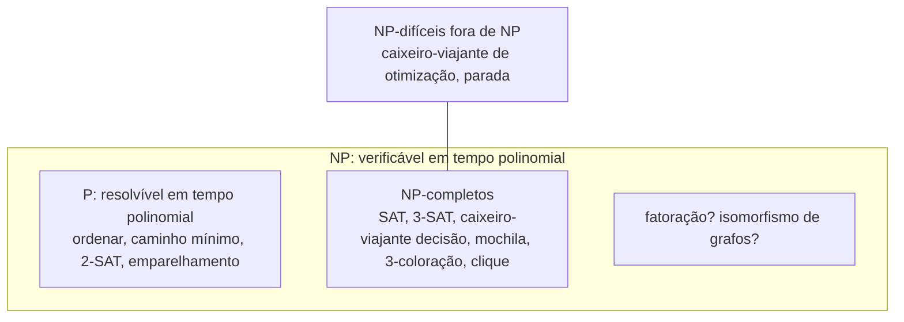

# Classes P, NP, NP-completo

## Por que isso importa

No TC-03 você viu problemas que **nenhum** algoritmo resolve. Aqui a pergunta é outra: quais problemas têm algoritmo, mas **nenhum algoritmo rápido conhecido**? Montar a escala de professores de uma escola, escolher rotas para 50 entregas, encaixar caixas num caminhão, alocar provas sem choque de horário: todos são **NP-completos**. Reconhecer um problema assim no trabalho evita semanas procurando a solução "perfeita e rápida" que provavelmente não existe, e direciona para o que funciona: heurísticas, aproximações, casos especiais ou um solver pronto. Além disso, a pergunta **P = NP?** é o maior problema em aberto da computação, e boa parte da criptografia (SE-02) depende da resposta ser "não".

## Intuição

Pense num **sudoku** gigante, de 100×100. **Resolver** pode levar uma eternidade. Mas, se alguém te entregar o tabuleiro preenchido, **conferir** se está certo é rápido: basta olhar cada linha, coluna e bloco.

- **P** é a classe dos problemas que conseguimos **resolver** rápido.
- **NP** é a classe dos problemas em que conseguimos **conferir** rápido uma solução proposta.

Todo problema que se resolve rápido também se confere rápido (resolva e compare), então P ⊆ NP. A pergunta de um milhão de dólares: **se conferir é fácil, resolver também é?** Quase todo mundo acredita que não, mas ninguém conseguiu provar.

Os problemas **NP-completos** são os "mais difíceis" de NP, e estão todos ligados: um algoritmo rápido para **qualquer um** deles daria um algoritmo rápido para **todos**.

## Visual



(Assumindo P ≠ NP. Se P = NP, as três regiões internas viram uma só.)

Como o tempo cresce:

```text
n       n²          n³              2ⁿ                        n!
10      100         1.000           1.024                     3.628.800
20      400         8.000           1.048.576                 2,4 × 10¹⁸
50      2.500       125.000         1,1 × 10¹⁵                3 × 10⁶⁴
100     10.000      1.000.000       1,3 × 10³⁰  (mais que a idade do universo em ns)
```

## Conceito técnico

### Problemas de decisão e tempo polinomial

Para comparar problemas, usamos versões de **decisão** (resposta sim/não): em vez de "qual a rota mais curta?", "existe rota com custo ≤ k?". Um algoritmo é **polinomial** se roda em O(nᶜ) para alguma constante c, em função do **tamanho da entrada** (em bits).

- **P**: problemas de decisão resolvíveis em tempo polinomial por uma máquina determinística.
- **NP**: problemas em que, quando a resposta é sim, existe um **certificado** (uma solução proposta) de tamanho polinomial que um **verificador** confere em tempo polinomial. Equivalentemente: resolvíveis em tempo polinomial por uma máquina de Turing **não determinística** (que "chuta" o certificado). NP **não** significa "não polinomial".

Cuidado com o tamanho da entrada: o algoritmo de programação dinâmica da mochila (AL-09) é O(n·W), mas W é um **número**, escrito com log W bits; por isso ele é **pseudopolinomial**, e a mochila continua NP-completa.

### Reduções polinomiais

A ≤ₚ B ("A se reduz a B") se existe uma transformação polinomial f tal que x é sim para A **se e somente se** f(x) é sim para B. Então B é **pelo menos tão difícil** quanto A: um algoritmo rápido para B resolveria A.

- **NP-difícil**: todo problema de NP se reduz a ele.
- **NP-completo**: NP-difícil **e** está em NP.

Para provar que um problema novo X é NP-completo: (1) mostre que X está em NP (dê o verificador) e (2) reduza **um NP-completo conhecido a X**. A direção importa.

### Cook-Levin e a família NP-completa

O **teorema de Cook-Levin** (1971) mostrou que **SAT** é NP-completo: qualquer computação de um verificador pode ser codificada como uma fórmula booleana que é satisfazível exatamente quando existe um certificado. A partir daí, Karp (1972) reduziu SAT a 21 outros problemas, e hoje há milhares. Alguns clássicos:

- **SAT** e **3-SAT**: existe atribuição de verdadeiro/falso que satisfaz a fórmula em forma normal conjuntiva (com 3 literais por cláusula)? Curiosamente, **2-SAT** está em P.
- **Caixeiro-viajante** (decisão): há um ciclo por todas as cidades com custo ≤ k?
- **Ciclo hamiltoniano**: há um ciclo que passa por todo vértice uma vez? (O euleriano, que passa por toda **aresta**, está em P.)
- **Clique**, **conjunto independente**, **cobertura de vértices**: ligados por reduções simples (S é independente ⇔ o complemento de S é cobertura).
- **3-coloração** de grafos (alocar provas em 3 horários sem choque). 2-coloração está em P (bipartição, AL-05).
- **Mochila**, **soma de subconjuntos**, **partição**, **bin packing**.
- Sudoku generalizado, Tetris, Campo Minado e Candy Crush, em versões generalizadas.

### P = NP?

Se P = NP, problemas de otimização, planejamento e prova de teoremas ficariam fáceis, e a criptografia de chave pública como conhecemos (SE-02) cairia, porque achar a chave é um problema de NP. A maioria dos pesquisadores acredita que **P ≠ NP**, e há resultados mostrando que as técnicas de prova conhecidas não bastam. Não confunda: fatoração de inteiros está em NP mas **não se sabe** se é NP-completa, e computadores quânticos a resolveriam rápido (algoritmo de Shor) sem que isso resolva P vs NP.

### O que fazer com um problema NP-difícil

Saber que é NP-difícil não é desistir; é mudar a pergunta.

- **A sua instância é pequena ou especial?** n = 20 cabe em 2²⁰ ≈ 1 milhão. Grafos que são árvores, intervalos ou planares muitas vezes têm algoritmos polinomiais. A mochila com pesos pequenos cabe na DP.
- **Algoritmos exatos espertos**: backtracking com poda (AL-10), branch and bound, programação dinâmica sobre subconjuntos (Held-Karp para o caixeiro em O(n²2ⁿ)).
- **Solvers**: SAT solvers modernos (CDCL) resolvem fórmulas industriais com milhões de variáveis; solvers de programação inteira (OR-Tools, Gurobi, HiGHS) e de restrições resolvem escalas e roteamento reais. Muitas vezes o melhor caminho é **modelar** o problema e entregá-lo a um solver.
- **Algoritmos de aproximação** com garantia: cobertura de vértices com fator 2, caixeiro métrico com fator 1,5 (Christofides).
- **Heurísticas** sem garantia mas boas na prática: guloso, vizinho mais próximo, busca local (2-opt), simulated annealing, algoritmos genéticos.

## Código

A assimetria entre resolver e verificar, medida em operações, no problema da soma de subconjuntos: dado um conjunto de números, algum subconjunto soma exatamente o alvo?

```python
from itertools import combinations

def verificar(numeros, alvo, certificado):
    """Verificador de NP: tempo linear no tamanho do certificado."""
    return all(c in numeros for c in certificado) and sum(certificado) == alvo

def forca_bruta(numeros, alvo):
    testados = 0
    for k in range(len(numeros) + 1):
        for sub in combinations(numeros, k):
            testados += 1
            if sum(sub) == alvo:
                return sub, testados
    return None, testados

for n in [10, 15, 20]:
    numeros = [3 ** i % 1009 for i in range(1, n + 1)]
    alvo = 1          # quase sempre impossível: obriga a testar tudo
    resposta, testados = forca_bruta(numeros, alvo)
    print(f"n={n:2}: {testados:>9,} subconjuntos testados, resposta {resposta}")

numeros = [3, 34, 4, 12, 5, 2]
print("verificar o certificado (4, 5):", verificar(numeros, 9, (4, 5)))
print("resolver:", forca_bruta(numeros, 9))
```

Cada número a mais **dobra** o trabalho da força bruta, enquanto verificar um certificado continua custando uma soma.

## Erros comuns

- **"NP significa não polinomial"**: significa polinomial **não determinístico**, verificável em tempo polinomial; P está dentro de NP.
- **Reduzir na direção errada**: para mostrar que X é difícil, reduza um problema difícil **a X**.
- **Achar que NP-difícil quer dizer "impossível na prática"**: instâncias reais são resolvidas todo dia por solvers e heurísticas.
- **Achar que a DP da mochila prova P = NP**: ela é pseudopolinomial (depende do valor de W, não do número de bits).
- **Confundir Euler com Hamilton**, ou 2-SAT com 3-SAT: versões parecidas, complexidades opostas.
- **Gastar semanas atrás do algoritmo exato rápido** sem verificar se o problema é NP-completo.
- **Dizer que a fatoração é NP-completa**: não se sabe.

## Pratique

```quiz
id: TC-04-q1
tipo: multipla_escolha
pergunta: "O que significa um problema estar em NP?"
opcoes: ["Ele não pode ser resolvido em tempo polinomial", "Uma solução proposta (certificado) para uma instância sim pode ser verificada em tempo polinomial", "Ele é indecidível", "Ele só pode ser resolvido por computadores quânticos"]
resposta: 1
explicacao: "NP é a classe dos problemas verificáveis rapidamente. Todos os problemas de P também estão em NP. Não saber resolver rápido é uma questão em aberto, não a definição."
dificuldade: 1
```

```quiz
id: TC-04-q2
tipo: multipla_escolha
pergunta: "Você quer provar que um problema novo X é NP-difícil. Qual é o caminho?"
opcoes: ["Reduzir X a SAT", "Reduzir SAT (ou outro NP-completo conhecido) a X, em tempo polinomial", "Mostrar que a força bruta em X é exponencial", "Mostrar que X está em NP"]
resposta: 1
explicacao: "Se SAT ≤p X, um algoritmo rápido para X resolveria SAT, e com ele todo NP. Reduzir X a SAT só mostra que X não é mais difícil que SAT (e prova que X está em NP, não que é difícil). A força bruta ser lenta não prova nada: pode existir um algoritmo melhor."
dificuldade: 2
```

```quiz
id: TC-04-q3
tipo: verdadeiro_falso
pergunta: "Como a mochila 0/1 tem um algoritmo de programação dinâmica O(n·W), ela está em P, e isso mostraria que P = NP."
resposta: false
explicacao: "O(n·W) é pseudopolinomial: W é escrito com log W bits, então o tempo é exponencial no tamanho da entrada. Com W de 60 bits, a tabela teria 2^60 colunas. A mochila continua NP-completa."
dificuldade: 2
```

```quiz
id: TC-04-q4
tipo: multipla_escolha
pergunta: "Uma escola quer alocar 400 provas em horários sem que nenhum aluno tenha duas no mesmo horário, usando o mínimo de horários. Qual a abordagem mais sensata?"
opcoes: ["Procurar um algoritmo polinomial exato para coloração de grafos", "Reconhecer que é coloração de grafos (NP-difícil) e usar uma heurística gulosa ou um solver de restrições/programação inteira", "Testar todas as combinações de horários", "Desistir, pois é NP-completo"]
resposta: 1
explicacao: "Provas são vértices e alunos em comum são arestas; horários são cores. Heurísticas como DSatur e solvers como OR-Tools resolvem bem instâncias desse tamanho, mesmo sem garantia de ótimo em tempo polinomial."
dificuldade: 2
```

```quiz
id: TC-04-q5
tipo: resposta_curta
pergunta: "Por que se diz que, se um único problema NP-completo tiver algoritmo polinomial, então P = NP?"
resposta: "Porque todo problema de NP se reduz em tempo polinomial a qualquer problema NP-completo. Com um algoritmo polinomial para ele, basta transformar a instância de qualquer problema de NP (em tempo polinomial) e resolvê-la, e a composição de polinômios continua polinomial. Assim todo NP estaria em P."
palavras_chave: ["reduz", "todo problema", "polinomial", "composição"]
dificuldade: 2
```

```quiz
id: TC-04-q6
tipo: codigo
linguagem: python
pergunta: |
  **O verificador de SAT.** Uma fórmula em forma normal conjuntiva é uma lista de cláusulas; cada cláusula é uma lista de inteiros (formato DIMACS): `3` significa "x3 verdadeiro" e `-3` significa "x3 falso". A fórmula é satisfeita se **toda** cláusula tem **pelo menos um** literal verdadeiro. `atribuicao` é um dicionário `variável -> bool`. Escreva `satisfaz(formula, atribuicao)`.
codigo_inicial: |
  def satisfaz(formula, atribuicao):
      return any(atribuicao.values())
usa: [def, for, if, return]
testes:
  - chamada: "satisfaz([[1, -2], [2, 3]], {1: True, 2: False, 3: True})"
    saida: "True"
  - chamada: "satisfaz([[1, -2], [2, 3]], {1: False, 2: True, 3: True})"
    saida: "False"
  - chamada: "satisfaz([], {})"
    saida: "True"
  - chamada: "satisfaz([[1], [-1]], {1: True})"
    visivel: false
    saida: "False"
  - chamada: "satisfaz([[-1, -2, -3]], {1: True, 2: True, 3: True})"
    visivel: false
    saida: "False"
  - chamada: "satisfaz([[1, 2, 3], [-1, -2], [-3, 2]], {1: True, 2: False, 3: False})"
    visivel: false
    saida: "True"
dica: "Um literal l é verdadeiro se atribuicao[abs(l)] == (l > 0). Para cada cláusula, se nenhum literal for verdadeiro, devolva False; se todas passarem, True."
solucao: |
  def satisfaz(formula, atribuicao):
      for clausula in formula:
          if not any(atribuicao[abs(l)] == (l > 0) for l in clausula):
              return False
      return True
explicacao: "Este é o verificador que coloca SAT em NP: ele roda em tempo linear no tamanho da fórmula. A fórmula vazia é satisfeita (não há cláusula para falhar), enquanto [[1], [-1]] exige x1 e não x1 ao mesmo tempo e é insatisfazível com qualquer atribuição. Conferir é fácil; o difícil, no próximo desafio, é encontrar a atribuição."
dificuldade: 1
```

```quiz
id: TC-04-q7
tipo: codigo
linguagem: python
pergunta: |
  **Resolvendo SAT com backtracking.** Escreva `resolver(n, formula)`, que encontra uma atribuição para as variáveis `1..n` que satisfaz a fórmula (mesmo formato do desafio anterior), ou devolve `None`. Atribua as variáveis em ordem (1, 2, ..., n), tentando **primeiro `False`** e depois `True`, e **pode** cedo: se alguma cláusula já tem todos os literais atribuídos e falsos, volte atrás. Devolva a primeira atribuição encontrada nessa ordem, como dicionário.
codigo_inicial: |
  def resolver(n, formula):
      return {v: True for v in range(1, n + 1)}
usa: [def, for, if, return]
testes:
  - chamada: "resolver(2, [[1, 2], [-1]])"
    saida: "{1: False, 2: True}"
  - chamada: "resolver(1, [[1], [-1]])"
    saida: "None"
  - chamada: "resolver(3, [[1, 2, 3], [-1, -2], [-3, 2]])"
    saida: "{1: False, 2: True, 3: False}"
  - chamada: "resolver(3, [])"
    visivel: false
    saida: "{1: False, 2: False, 3: False}"
  - chamada: "resolver(3, [[1, 2], [-1, 2], [1, -2], [-1, -2, 3], [-3]])"
    visivel: false
    saida: "None"
  - chamada: "resolver(4, [[4], [-4, 3], [-3, -2], [2, 1]])"
    visivel: false
    saida: "{1: True, 2: False, 3: True, 4: True}"
dica: "Escreva uma função interna busca(v, atrib). Uma cláusula está 'morta' se todos os literais têm variável já atribuída e nenhum é verdadeiro. Se alguma estiver morta, devolva None. Se v > n, devolva uma cópia de atrib. Senão, para valor em (False, True): atrib[v] = valor, tente busca(v + 1, atrib); ao voltar, remova v."
solucao: |
  def resolver(n, formula):
      def morta(clausula, atrib):
          for l in clausula:
              if abs(l) not in atrib or atrib[abs(l)] == (l > 0):
                  return False
          return True

      def busca(v, atrib):
          if any(morta(c, atrib) for c in formula):
              return None
          if v > n:
              return dict(atrib)
          for valor in (False, True):
              atrib[v] = valor
              r = busca(v + 1, atrib)
              if r is not None:
                  return r
              del atrib[v]
          return None

      return busca(1, {})
explicacao: "No pior caso o backtracking visita 2^n atribuições, mas a poda corta ramos inteiros assim que uma cláusula fica falsa: no último teste, x4 = False já mata a cláusula [4] e metade da árvore é descartada sem olhar. SAT solvers reais (DPLL e CDCL) acrescentam propagação de cláusulas unitárias, aprendizado de cláusulas a partir dos conflitos e reinícios, e resolvem fórmulas industriais com milhões de variáveis."
dificuldade: 3
```

```quiz
id: TC-04-q8
tipo: codigo
linguagem: javascript
pergunta: |
  **Uma heurística para o caixeiro-viajante.** `dist` é uma matriz de distâncias simétrica entre `n` cidades. Escreva `vizinhoMaisProximo(dist)`: comece na cidade 0, vá sempre para a cidade **não visitada mais próxima** (em empate, a de menor índice) e, no fim, volte à 0. Devolva `{ rota, custo }`, em que `rota` inclui o 0 no começo e no fim.
codigo_inicial: |
  function vizinhoMaisProximo(dist) {
    const rota = dist.map((_, i) => i);
    rota.push(0);
    return { rota, custo: 0 };
  }
usa: [function, for, while, if, return]
testes:
  - chamada: "vizinhoMaisProximo([[0, 1, 4], [1, 0, 2], [4, 2, 0]])"
    saida: "{ rota: [ 0, 1, 2, 0 ], custo: 7 }"
  - chamada: "vizinhoMaisProximo([[0, 2, 9, 10], [2, 0, 6, 4], [9, 6, 0, 3], [10, 4, 3, 0]])"
    saida: "{ rota: [ 0, 1, 3, 2, 0 ], custo: 18 }"
  - chamada: "vizinhoMaisProximo([[0]])"
    visivel: false
    saida: "{ rota: [ 0, 0 ], custo: 0 }"
  - chamada: "vizinhoMaisProximo([[0, 1, 1, 5], [1, 0, 9, 1], [1, 9, 0, 1], [5, 1, 1, 0]])"
    visivel: false
    saida: "{ rota: [ 0, 1, 3, 2, 0 ], custo: 4 }"
  - chamada: "vizinhoMaisProximo([[0, 1, 2, 1], [1, 0, 1, 2], [2, 1, 0, 100], [1, 2, 100, 0]])"
    visivel: false
    saida: "{ rota: [ 0, 1, 2, 3, 0 ], custo: 103 }"
dica: "Mantenha um array visitado, a cidade atual e o custo. Enquanto a rota não tiver n cidades, procure com um for a não visitada de menor dist[atual][j] (use < para manter o menor índice no empate). No fim, some dist[atual][0]."
solucao: |
  function vizinhoMaisProximo(dist) {
    const n = dist.length;
    const visitado = new Array(n).fill(false);
    const rota = [0];
    visitado[0] = true;
    let atual = 0;
    let custo = 0;
    while (rota.length < n) {
      let melhor = -1;
      for (let j = 0; j < n; j++) {
        if (!visitado[j] && (melhor === -1 || dist[atual][j] < dist[atual][melhor])) melhor = j;
      }
      visitado[melhor] = true;
      custo += dist[atual][melhor];
      rota.push(melhor);
      atual = melhor;
    }
    custo += dist[atual][0];
    rota.push(0);
    return { rota, custo };
  }
explicacao: "A heurística é O(n²) e costuma ficar uns 25% acima do ótimo, mas pode errar feio: no último teste oculto, a escolha gulosa leva à aresta de custo 100 e o total fica 103, enquanto a rota 0-2-1-3-0 custa 6. Não há garantia nenhuma de qualidade. Na prática ela serve de solução inicial para uma busca local como o 2-opt, que troca pares de arestas enquanto melhorar. Para saber o ótimo de verdade com n pequeno, use a DP de Held-Karp (O(n²2^n)) ou um solver como o OR-Tools."
dificuldade: 2
```

## Resumo

- **P**: resolvível em tempo polinomial; **NP**: verificável em tempo polinomial (com certificado); P ⊆ NP.
- **Reduções polinomiais** comparam dificuldade; **NP-difícil** recebe redução de todo NP; **NP-completo** = NP-difícil e em NP.
- **Cook-Levin**: SAT é NP-completo; daí 3-SAT, caixeiro, clique, coloração, mochila e milhares de outros.
- **P = NP?** está em aberto; a criptografia aposta no não.
- Na prática: instâncias pequenas ou especiais, **backtracking/branch and bound**, **solvers** (SAT, programação inteira), **aproximação** e **heurísticas**.

## Para ir além

- Leia os capítulos 8 e 9 do livro de Dasgupta, Papadimitriou e Vazirani.
- Modele um problema de escala (pessoas, turnos e restrições) no Google OR-Tools.
- Tente a redução de 3-SAT para conjunto independente e implemente-a.
- **Próximo módulo**: TC-05 Compiladores: análise léxica, sintática, geração de código.
