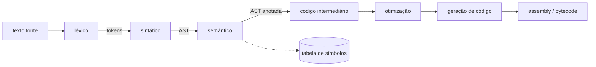

# Compiladores: análise léxica, sintática, geração de código

## Por que isso importa

O compilador é o programa que mais transforma o seu trabalho: cada linha que você escreve passa por ele (ou por um interpretador, que tem quase as mesmas fases). Entender o que acontece por dentro explica mensagens de erro, por que algumas construções são mais rápidas, o que o `dis` do Python mostra, como o TypeScript remove tipos (WB-03), como o Babel converte JavaScript novo em antigo, como linters e formatadores (Prettier, Black, ESLint) entendem seu código. E as técnicas aparecem em lugares inesperados: linguagens de consulta, motores de templates, regras de negócio configuráveis, DSLs. Este módulo junta quase tudo da trilha: autômatos (TC-01), gramáticas (TC-02), assembly (AC-04) e estruturas de dados.

## Intuição

Pense numa **tradução de um livro** do inglês para o português feita por uma equipe:

1. Alguém separa o texto em **palavras e sinais** (análise léxica).
2. Outra pessoa monta a **estrutura das frases**: sujeito, verbo, objeto (análise sintática).
3. Um revisor confere se faz **sentido**: o personagem citado existe? o tempo verbal combina? (análise semântica).
4. O tradutor escreve um **rascunho** numa forma intermediária, depois **melhora** o texto (otimização) e entrega a versão final no idioma de destino (geração de código).

Cada etapa recebe a representação da anterior e entrega uma mais próxima do destino. Separar as etapas permite trocar o idioma de origem ou de destino sem refazer tudo: é o que o **LLVM** faz, servindo C, C++, Rust, Swift e outras com o mesmo meio e o mesmo fim.

## Visual



Uma linha passando pelas fases:

```text
fonte      total = preco * 2 + frete

tokens     ID(total) ATRIB ID(preco) MUL NUM(2) SOMA ID(frete)

AST        atrib(total, soma(mul(var preco, num 2), var frete))

pilha      LOAD preco      RISC-V (AC-04)   lw   t0, preco
           PUSH 2                           slli t0, t0, 1      # *2 virou deslocamento
           MUL                              lw   t1, frete
           LOAD frete                       add  t0, t0, t1
           ADD                              sw   t0, total
           STORE total
```

## Conceito técnico

### Análise léxica (scanner)

Transforma a sequência de caracteres em **tokens**: identificadores, números, palavras-chave, operadores, delimitadores. Descarta espaços e comentários e registra **linha e coluna** para as mensagens de erro.

- Cada tipo de token é uma **expressão regular**; o conjunto vira um AFD (TC-01). Ferramentas como lex/flex geram o scanner a partir das regex; muitos compiladores o escrevem à mão.
- Regra do **casamento mais longo** (maximal munch): `<=` é um token, não `<` seguido de `=`; `iffy` é um identificador, não a palavra-chave `if` seguida de `fy`.
- Palavras-chave costumam ser lidas como identificadores e depois conferidas numa tabela.

### Análise sintática (parser)

Recebe os tokens e constrói a **AST** segundo a gramática (TC-02): descendente recursivo, Pratt ou LR. Erros de sintaxe ("esperava `)`") nascem aqui. Bons parsers **se recuperam** do erro para relatar vários de uma vez.

### Análise semântica

Regras que a gramática livre de contexto não expressa:

- **Tabela de símbolos** e **escopos**: cada nome usado foi declarado? Qual declaração vale aqui (escopo léxico, LP-03)? Uma pilha de dicionários resolve: entra num bloco, empilha; sai, desempilha.
- **Verificação de tipos**: `"a" * 2` é permitido? A função recebe os argumentos certos? Linguagens estáticas fazem isso em tempo de compilação, com **inferência** em muitos casos (LP-01).
- Outras: `return` fora de função, `break` fora de laço, variável usada antes de inicializar.

### Representação intermediária (IR)

Entre a AST e a máquina, uma linguagem simples e uniforme facilita otimizar:

- **Código de três endereços**: `t1 = preco * 2; t2 = t1 + frete; total = t2`.
- **SSA** (static single assignment): cada variável recebe valor uma única vez, o que simplifica muitas análises. A IR do LLVM e do GCC é assim.
- **Bytecode de pilha**: o da JVM, do CPython, do WebAssembly. Compacto e fácil de gerar.
- **Grafo de fluxo de controle**: blocos básicos ligados por desvios.

### Otimização

Transformações que preservam o significado e reduzem tempo ou tamanho:

- **Dobra de constantes**: `60 * 60 * 24` vira `86400` em tempo de compilação.
- **Propagação de constantes** e **eliminação de código morto** (`if (false) { ... }`).
- **Simplificação algébrica** e **redução de força**: `x * 2` → `x << 1`, `x + 0` → `x`.
- **Eliminação de subexpressões comuns**: calcular `a * b` uma vez só.
- **Laços**: mover código invariante para fora, desenrolar, vetorizar (SIMD).
- **Inlining**: copiar o corpo de funções pequenas no lugar da chamada.

Cuidado: otimizações só podem mudar o que o programa **não observa**. Em C, o comportamento indefinido (estouro de inteiro com sinal, por exemplo) dá ao compilador liberdade para surpresas.

### Geração de código

- Para uma **máquina de pilha**: percorra a AST em pós-ordem; folhas viram `PUSH`/`LOAD`, operadores viram a instrução depois dos filhos (como a notação pós-fixa do TC-02).
- Para **registradores** (RISC-V, x86, ARM): **seleção de instruções** (escolher as instruções da máquina para cada padrão da IR), **alocação de registradores** (que valores ficam em registradores e quais vão para a memória; vira um problema de coloração de grafos, TC-04) e **escalonamento** de instruções para o pipeline (AC-06).
- **Convenções de chamada**: onde ficam argumentos, retorno e endereço de volta (a pilha de chamadas do SO-01 e AC-04).

### Compilador, interpretador e JIT

- **Compilador antecipado** (AOT): gera código de máquina antes de rodar (C, Rust, Go).
- **Interpretador de árvore**: percorre a AST executando cada nó. Simples e lento.
- **Interpretador de bytecode**: compila para bytecode e executa numa máquina virtual (CPython, Ruby).
- **JIT**: começa interpretando, mede quais trechos são **quentes** e os compila para código de máquina em tempo de execução, usando os tipos observados (V8, a JVM HotSpot, PyPy). É por isso que JavaScript é rápido.
- **Transpilador**: traduz entre linguagens de alto nível (TypeScript → JavaScript, Babel).

## Código

Um compilador completo em miniatura para atribuições com expressões: léxico, sintático, geração de bytecode de pilha e uma máquina virtual que o executa.

```python
import re

# 1. Léxico
REGRAS = [("NUM", r"\d+"), ("ID", r"[a-z_]\w*"), ("OP", r"[-+*/=()]"), ("ESPACO", r"\s+")]
SCANNER = re.compile("|".join(f"(?P<{n}>{r})" for n, r in REGRAS))

def lexico(texto):
    for m in SCANNER.finditer(texto):
        if m.lastgroup != "ESPACO":
            yield (m.lastgroup, m.group())

# 2. Sintático (descendente recursivo, como no TC-02) produzindo a AST
def sintatico(tokens):
    toks, pos = list(tokens), [0]
    olhar = lambda: toks[pos[0]][1] if pos[0] < len(toks) else None
    def comer():
        pos[0] += 1
        return toks[pos[0] - 1]
    def expr():
        no = termo()
        while olhar() in ("+", "-"):
            no = (comer()[1], no, termo())
        return no
    def termo():
        no = fator()
        while olhar() in ("*", "/"):
            no = (comer()[1], no, fator())
        return no
    def fator():
        tipo, valor = comer()
        if valor == "(":
            no = expr()
            comer()
            return no
        return ("num", int(valor)) if tipo == "NUM" else ("var", valor)
    _, nome = comer()
    comer()                       # o "="
    return ("atrib", nome, expr())

# 3. Geração de código para máquina de pilha (pós-ordem)
OPS = {"+": "ADD", "-": "SUB", "*": "MUL", "/": "DIV"}
def gerar(no):
    if no[0] == "num":
        return [f"PUSH {no[1]}"]
    if no[0] == "var":
        return [f"LOAD {no[1]}"]
    if no[0] == "atrib":
        return gerar(no[2]) + [f"STORE {no[1]}"]
    return gerar(no[1]) + gerar(no[2]) + [OPS[no[0]]]

# 4. A máquina virtual
def executar(codigo, memoria):
    pilha = []
    for instr in codigo:
        op, *arg = instr.split()
        if op == "PUSH":
            pilha.append(int(arg[0]))
        elif op == "LOAD":
            pilha.append(memoria[arg[0]])
        elif op == "STORE":
            memoria[arg[0]] = pilha.pop()
        else:
            b, a = pilha.pop(), pilha.pop()
            pilha.append({"ADD": a + b, "SUB": a - b, "MUL": a * b, "DIV": a // b}[op])
    return memoria

fonte = "total = preco * (2 + qtd) - desconto"
tokens = list(lexico(fonte))
ast = sintatico(tokens)
codigo = gerar(ast)
print("tokens:", tokens[:5], "...")
print("AST:   ", ast)
print("código:", codigo)
print("rodando:", executar(codigo, {"preco": 10, "qtd": 3, "desconto": 7}))
```

## Erros comuns

- **Misturar as fases**: tratar espaços no parser ou tipos no scanner deixa tudo frágil. Cada fase com sua representação.
- **Esquecer o casamento mais longo** no léxico (`<=` virando dois tokens).
- **Perder linha e coluna** dos tokens: as mensagens de erro ficam inúteis.
- **Resolver nomes sem escopos**: a variável local "vazando" para fora do bloco ou sombreando errado.
- **Otimizar mudando o significado**: dobrar `1 / 0` em tempo de compilação, reordenar operações com efeitos colaterais, assumir associatividade em ponto flutuante.
- **Gerar código na ordem errada** para operadores não comutativos (`a - b` virando `b - a` na pilha).
- **Escrever um compilador inteiro antes de testar**: teste cada fase isoladamente, com casos pequenos.

## Pratique

```quiz
id: TC-05-q1
tipo: multipla_escolha
pergunta: "Em qual fase é detectado o erro 'variável total usada sem ser declarada'?"
opcoes: ["Análise léxica", "Análise sintática", "Análise semântica", "Geração de código"]
resposta: 2
explicacao: "Sintaticamente, usar um identificador é perfeitamente válido. Saber se ele foi declarado exige a tabela de símbolos e as regras de escopo, que são parte da análise semântica."
dificuldade: 1
```

```quiz
id: TC-05-q2
tipo: multipla_escolha
pergunta: "Com a regra do casamento mais longo, como o scanner separa o texto 'x<=10'?"
opcoes: ["x, <, =, 10", "x, <=, 10", "x<=10 como um único identificador", "x, <, =10"]
resposta: 1
explicacao: "O scanner sempre prefere o maior token possível a partir da posição atual: depois de x, tanto < quanto <= casam, e <= é mais longo. A mesma regra faz 'iffy' ser um identificador, e não a palavra-chave if."
dificuldade: 1
```

```quiz
id: TC-05-q3
tipo: verdadeiro_falso
pergunta: "Um compilador pode trocar x * 2 por x << 1 para inteiros, mas não deve trocar a + (b + c) por (a + b) + c para números de ponto flutuante sem uma opção explícita."
resposta: true
explicacao: "Para inteiros, multiplicar por 2 e deslocar 1 bit dão o mesmo resultado. Em ponto flutuante a soma não é associativa por causa do arredondamento: (1e20 + -1e20) + 1 é 1, mas 1e20 + (-1e20 + 1) é 0. Opções como -ffast-math liberam essas trocas, aceitando a diferença."
dificuldade: 2
```

```quiz
id: TC-05-q4
tipo: multipla_escolha
pergunta: "Por que um JIT como o V8 consegue deixar JavaScript, uma linguagem dinâmica, tão rápido?"
opcoes: ["Porque converte JavaScript em Python", "Porque observa o programa rodando, descobre os trechos quentes e os tipos que realmente aparecem, e compila código de máquina especializado para eles", "Porque desliga o garbage collector", "Porque interpreta a AST diretamente"]
resposta: 1
explicacao: "Um compilador antecipado não sabe se x será número ou string. O JIT vê que em 99,9% das vezes é número, gera código rápido para esse caso com uma verificação de segurança, e volta ao interpretador (desotimiza) se a suposição falhar."
dificuldade: 2
```

```quiz
id: TC-05-q5
tipo: resposta_curta
pergunta: "Como a alocação de registradores se relaciona com a coloração de grafos?"
resposta: "Monta-se um grafo de interferência em que cada vértice é uma variável e há aresta entre duas variáveis vivas ao mesmo tempo. Atribuir registradores é colorir o grafo com k cores (k registradores) sem que vizinhos tenham a mesma cor. Como colorir é NP-difícil, os compiladores usam heurísticas e, quando não cabe, mandam variáveis para a memória (spill)."
palavras_chave: ["grafo", "interferência", "cores", "spill"]
dificuldade: 3
```

```quiz
id: TC-05-q6
tipo: codigo
linguagem: python
pergunta: |
  **Um analisador léxico.** Escreva `lexico(codigo)`, que devolve a lista de tokens `(tipo, valor)` de uma pequena linguagem, varrendo o texto caractere a caractere (sem `re`):

  - espaços, tabulações e quebras de linha são ignorados; `#` inicia um comentário até o fim da linha;
  - números (`NUM`): sequência de dígitos, valor como `int`;
  - identificadores: letra ou `_` seguido de letras, dígitos ou `_`. Se for `se`, `senao`, `enquanto` ou `retorne`, o tipo é `KW`; senão `ID`;
  - operadores (`OP`), com casamento mais longo: `==`, `!=`, `<=`, `>=` antes de `=`, `<`, `>`, `+`, `-`, `*`, `/`;
  - delimitadores (`DELIM`): `( ) { } ; ,`;
  - qualquer outro caractere vira `('ERRO', caractere)`, e a análise continua.
codigo_inicial: |
  def lexico(codigo):
      return [('ID', p) for p in codigo.split()]
usa: [def, while, if, return]
testes:
  - chamada: "lexico('x = 10 + y2')"
    saida: "[('ID', 'x'), ('OP', '='), ('NUM', 10), ('OP', '+'), ('ID', 'y2')]"
  - chamada: "lexico('se (a <= 3) { retorne a; }')"
    saida: "[('KW', 'se'), ('DELIM', '('), ('ID', 'a'), ('OP', '<='), ('NUM', 3), ('DELIM', ')'), ('DELIM', '{'), ('KW', 'retorne'), ('ID', 'a'), ('DELIM', ';'), ('DELIM', '}')]"
  - chamada: "lexico('total # soma tudo\\n== senaox')"
    saida: "[('ID', 'total'), ('OP', '=='), ('ID', 'senaox')]"
  - chamada: "lexico('a@b')"
    visivel: false
    saida: "[('ID', 'a'), ('ERRO', '@'), ('ID', 'b')]"
  - chamada: "lexico('')"
    visivel: false
    saida: "[]"
  - chamada: "lexico('_v1!=007,enquanto>=-x')"
    visivel: false
    saida: "[('ID', '_v1'), ('OP', '!='), ('NUM', 7), ('DELIM', ','), ('KW', 'enquanto'), ('OP', '>='), ('OP', '-'), ('ID', 'x')]"
  - chamada: "lexico('a ! b')"
    visivel: false
    saida: "[('ID', 'a'), ('ERRO', '!'), ('ID', 'b')]"
dica: "Use um índice i e um while i < len(codigo). Em cada volta, olhe codigo[i]: pule espaços; no '#', avance até '\\n'; para dígitos e letras, avance um j enquanto o caractere servir e corte codigo[i:j]; para operadores, teste primeiro se codigo[i:i + 2] está na lista de operadores duplos."
solucao: |
  PALAVRAS = {'se', 'senao', 'enquanto', 'retorne'}
  DUPLOS = {'==', '!=', '<=', '>='}

  def lexico(codigo):
      tokens = []
      i = 0
      while i < len(codigo):
          c = codigo[i]
          if c in ' \t\n':
              i += 1
          elif c == '#':
              while i < len(codigo) and codigo[i] != '\n':
                  i += 1
          elif c.isdigit():
              j = i
              while j < len(codigo) and codigo[j].isdigit():
                  j += 1
              tokens.append(('NUM', int(codigo[i:j])))
              i = j
          elif c.isalpha() or c == '_':
              j = i
              while j < len(codigo) and (codigo[j].isalnum() or codigo[j] == '_'):
                  j += 1
              palavra = codigo[i:j]
              tokens.append(('KW' if palavra in PALAVRAS else 'ID', palavra))
              i = j
          elif codigo[i:i + 2] in DUPLOS:
              tokens.append(('OP', codigo[i:i + 2]))
              i += 2
          elif c in '=<>+-*/':
              tokens.append(('OP', c))
              i += 1
          elif c in '(){};,':
              tokens.append(('DELIM', c))
              i += 1
          else:
              tokens.append(('ERRO', c))
              i += 1
      return tokens
explicacao: "Cada ramo do if é um pedaço do AFD do scanner: o laço interno de dígitos, o de identificadores, a verificação de dois caracteres antes de um. 'senaox' é um identificador, não a palavra-chave senao seguida de x, e '!' sozinho é erro porque só existe como parte de '!='. Num compilador real cada token guardaria também linha e coluna para as mensagens de erro."
dificuldade: 2
```

```quiz
id: TC-05-q7
tipo: codigo
linguagem: python
pergunta: |
  **Geração de código para uma máquina de pilha.** A AST usa tuplas: `('num', n)`, `('var', nome)`, `(op, esquerda, direita)` com `op` em `+ - * /`, `('atrib', nome, expr)` e `('bloco', [comandos])`. Escreva `gerar(no)`, que devolve a lista de instruções:

  - `num` → `'PUSH n'`; `var` → `'LOAD nome'`;
  - operador → código da esquerda, código da direita e então `'ADD'`, `'SUB'`, `'MUL'` ou `'DIV'`;
  - `atrib` → código da expressão e `'STORE nome'`;
  - `bloco` → o código de cada comando, em ordem.
codigo_inicial: |
  def gerar(no):
      return [str(no)]
usa: [def, if, return]
testes:
  - chamada: "gerar(('+', ('num', 2), ('num', 3)))"
    saida: "['PUSH 2', 'PUSH 3', 'ADD']"
  - chamada: "gerar(('atrib', 'x', ('-', ('var', 'a'), ('*', ('var', 'b'), ('num', 2)))))"
    saida: "['LOAD a', 'LOAD b', 'PUSH 2', 'MUL', 'SUB', 'STORE x']"
  - chamada: "gerar(('bloco', [('atrib', 'a', ('num', 1)), ('atrib', 'b', ('+', ('var', 'a'), ('num', 1)))]))"
    saida: "['PUSH 1', 'STORE a', 'LOAD a', 'PUSH 1', 'ADD', 'STORE b']"
  - chamada: "gerar(('/', ('-', ('num', 8), ('num', 2)), ('var', 'n')))"
    visivel: false
    saida: "['PUSH 8', 'PUSH 2', 'SUB', 'LOAD n', 'DIV']"
  - chamada: "gerar(('bloco', []))"
    visivel: false
    saida: "[]"
  - chamada: "gerar(('var', 'z'))"
    visivel: false
    saida: "['LOAD z']"
dica: "Trate cada tipo de nó com um if. Para operadores, use um dicionário {'+': 'ADD', ...} e devolva gerar(no[1]) + gerar(no[2]) + [instrução]. Para o bloco, junte as listas de cada comando num laço."
solucao: |
  OPS = {'+': 'ADD', '-': 'SUB', '*': 'MUL', '/': 'DIV'}

  def gerar(no):
      tipo = no[0]
      if tipo == 'num':
          return [f'PUSH {no[1]}']
      if tipo == 'var':
          return [f'LOAD {no[1]}']
      if tipo == 'atrib':
          return gerar(no[2]) + [f'STORE {no[1]}']
      if tipo == 'bloco':
          codigo = []
          for comando in no[1]:
              codigo += gerar(comando)
          return codigo
      return gerar(no[1]) + gerar(no[2]) + [OPS[tipo]]
explicacao: "É um percurso em pós-ordem: os filhos geram código que deixa seus valores na pilha, e o operador os consome. A ordem esquerda antes da direita importa para SUB e DIV: a máquina desempilha b e depois a para calcular a - b. É praticamente o que o CPython faz: rode import dis; dis.dis('x = a - b * 2') e compare com o segundo teste."
dificuldade: 2
```

```quiz
id: TC-05-q8
tipo: codigo
linguagem: javascript
pergunta: |
  **Otimização: dobra de constantes e simplificação.** A AST é um número, uma string (variável) ou um array `[op, esquerda, direita]` com `op` em `+ - *`. Escreva `otimizar(no)`, que otimiza **de baixo para cima** (primeiro os filhos):

  - se os dois filhos forem números, calcule o resultado;
  - `x + 0`, `0 + x`, `x - 0`, `x * 1` e `1 * x` viram `x`;
  - `x * 0` e `0 * x` viram `0`;
  - `x - x`, com os dois lados sendo a **mesma variável**, vira `0`;
  - nos outros casos, devolva `[op, esquerda otimizada, direita otimizada]`.
codigo_inicial: |
  function otimizar(no) {
    return no;
  }
usa: [function, if, return]
testes:
  - chamada: "otimizar(['*', ['*', 60, 60], 24])"
    saida: "86400"
  - chamada: "otimizar(['+', ['*', 'x', 1], ['-', 5, 5]])"
    saida: "'x'"
  - chamada: "otimizar(['*', ['+', 'a', 2], ['-', 'b', 0]])"
    saida: "[ '*', [ '+', 'a', 2 ], 'b' ]"
  - chamada: "otimizar(['+', ['*', 'y', ['-', 3, 3]], 'z'])"
    visivel: false
    saida: "'z'"
  - chamada: "otimizar(['-', 'q', 'q'])"
    visivel: false
    saida: "0"
  - chamada: "otimizar(['-', 0, 'x'])"
    visivel: false
    saida: "[ '-', 0, 'x' ]"
  - chamada: "otimizar(7)"
    visivel: false
    saida: "7"
dica: "Se não for array, devolva o próprio nó. Senão, otimize os dois filhos primeiro (a = otimizar(no[1]), b = otimizar(no[2])) e depois teste os casos com typeof a === 'number' e comparações como b === 0."
solucao: |
  function otimizar(no) {
    if (!Array.isArray(no)) return no;
    const op = no[0];
    const a = otimizar(no[1]);
    const b = otimizar(no[2]);
    if (typeof a === 'number' && typeof b === 'number') {
      if (op === '+') return a + b;
      if (op === '-') return a - b;
      return a * b;
    }
    if (op === '+' && b === 0) return a;
    if (op === '+' && a === 0) return b;
    if (op === '-' && b === 0) return a;
    if (op === '-' && typeof a === 'string' && a === b) return 0;
    if (op === '*' && (a === 0 || b === 0)) return 0;
    if (op === '*' && b === 1) return a;
    if (op === '*' && a === 1) return b;
    return [op, a, b];
  }
explicacao: "Otimizar os filhos antes é o que faz as simplificações se encadearem: no teste oculto, 3 - 3 vira 0, então y * 0 vira 0, e 0 + z vira z. O último caso mostra uma regra que não existe: 0 - x não é x (é -x). Compiladores reais fazem essas passadas sobre a IR, junto com propagação de constantes, e precisam de cuidado extra: x * 0 só vira 0 se calcular x não tiver efeitos colaterais, e em ponto flutuante NaN * 0 é NaN."
dificuldade: 2
```

## Resumo

- Fases: **léxica** (texto → tokens, com regex/AFD), **sintática** (tokens → AST, com gramáticas), **semântica** (escopos, tipos, tabela de símbolos), **IR**, **otimização**, **geração de código**.
- Léxico com **casamento mais longo**; parser descendente recursivo ou LR; erros com linha e coluna.
- IRs: três endereços, **SSA**, bytecode de pilha, grafo de fluxo.
- Otimizações: **dobra de constantes**, código morto, redução de força, subexpressões comuns, laços, inlining; sem mudar o observável.
- Máquina de pilha = **pós-ordem**; registradores = seleção, **alocação (coloração)** e escalonamento.
- **AOT**, interpretador, bytecode + VM, **JIT**, transpilador.

## Para ir além

- Leia o Crafting Interpreters e construa o interpretador jlox (ou a versão em C, clox).
- Cole funções pequenas no Compiler Explorer e compare -O0 com -O2.
- Estenda o compilador do exemplo com `se`/`enquanto` gerando instruções de desvio (`JMP`, `JZ`).
- **Fim da trilha.** Do autômato ao compilador, você viu os limites do que é computável e como as linguagens funcionam por dentro.
