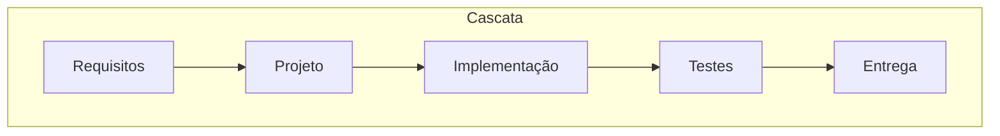
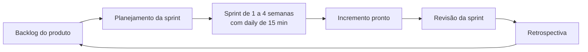

# Ciclo de vida do software e metodologias (cascata, Scrum, Kanban)

## Por que isso importa

Programar é só uma parte de construir software. Alguém precisa decidir **o que** construir, em que **ordem**, **quando** está pronto e **como** o time se organiza. Times que não têm um processo claro trabalham em dez coisas ao mesmo tempo, entregam tarde e descobrem no fim que construíram a coisa errada. Em praticamente toda vaga você vai trabalhar com Scrum, Kanban ou uma mistura dos dois, e entrevistas costumam perguntar como o seu time se organizava. Esta aula dá o vocabulário e, mais importante, o **porquê** de cada prática.

## Intuição

Imagine reformar uma casa de dois jeitos.

No **cascata**, o arquiteto desenha a casa inteira, o cliente aprova, a obra executa tudo e só no fim o cliente entra. Se ele descobrir que queria a cozinha aberta, é tarde e caro.

No jeito **iterativo**, a equipe reforma **um cômodo por vez**, a cada duas semanas. O cliente usa a cozinha nova e diz "a bancada ficou baixa", e isso muda o plano do próximo cômodo. Cada ciclo entrega algo **usável** e o plano se ajusta com o que se aprende.

**Scrum** organiza esse trabalho em ciclos de tamanho fixo (sprints). **Kanban** organiza como um **fluxo contínuo**, com uma regra simples: não comece coisa nova enquanto houver coisa demais pela metade.

## Visual





Um quadro Kanban com limites de WIP:

```text
| A fazer      | Fazendo (WIP 2) | Revisão (WIP 1) | Pronto |
|--------------|-----------------|-----------------|--------|
| login social | busca           | carrinho        | cadastro
| relatórios   | checkout        |                 | home
| exportar CSV |                 |                 |
             ^ "Fazendo" está cheia: ninguém puxa um item novo,
               ajuda a terminar o que já está em andamento.
```

## Conceito técnico

### O ciclo de vida

Todo software passa, de algum jeito, por: **requisitos** (o que e por quê), **projeto** (como), **implementação**, **verificação** (testes), **implantação** e **manutenção**. Estudos clássicos estimam que a **manutenção** consome a maior parte do custo total de um sistema ao longo da vida. As metodologias diferem em **como** ordenam e repetem essas fases.

### Cascata (waterfall)

Fases em sequência, cada uma termina antes da próxima, com documentação formal entre elas.

- **Funciona** quando os requisitos são estáveis e bem conhecidos, e mudar é caríssimo (software embarcado em hardware, contratos regulados).
- **Falha** quando os requisitos mudam ou não são claros: o feedback do usuário chega só no fim, quando corrigir custa mais.

Modelos intermediários: **modelo em V** (cada fase tem um nível de teste correspondente), **espiral** (ciclos guiados por análise de risco), **incremental**.

### Ágil

O **Manifesto Ágil** (2001) valoriza: indivíduos e interações acima de processos e ferramentas; software funcionando acima de documentação abrangente; colaboração com o cliente acima de negociação de contratos; responder a mudanças acima de seguir um plano. O lado direito ainda tem valor; o esquerdo vale **mais**.

### Scrum

| Tipo | Item | Para que serve |
|---|---|---|
| Papel | **Product Owner** | dono do backlog: decide a prioridade, maximiza o valor |
| Papel | **Scrum Master** | facilita o processo, remove impedimentos |
| Papel | **Desenvolvedores** | constroem o incremento; o time se auto-organiza |
| Evento | **Sprint** | ciclo de tamanho fixo (1 a 4 semanas) |
| Evento | **Planejamento** | escolher o objetivo e os itens da sprint |
| Evento | **Daily** | 15 minutos para sincronizar e ajustar o plano do dia |
| Evento | **Revisão** | mostrar o incremento aos interessados e colher feedback |
| Evento | **Retrospectiva** | melhorar o próprio processo do time |
| Artefato | **Backlog do produto** | lista ordenada de tudo que pode ser feito |
| Artefato | **Backlog da sprint** | o que o time se comprometeu a fazer na sprint |
| Artefato | **Incremento** | trabalho que atende à **Definição de Pronto** |

**Estimativas**: muitos times estimam em **pontos de história** (esforço relativo, em geral na sequência 1, 2, 3, 5, 8, 13). A **velocidade** é a soma dos pontos concluídos por sprint; a média das últimas sprints ajuda a prever quantas sprints o backlog restante vai levar. Ela serve para **o time planejar**, não para comparar times.

### Kanban

Kanban não tem sprints nem papéis obrigatórios. Suas práticas centrais:

1. **Visualizar** o fluxo num quadro com colunas.
2. **Limitar o trabalho em andamento (WIP)** por coluna.
3. **Gerenciar o fluxo**, medindo e removendo gargalos.
4. **Puxar** trabalho quando há capacidade, em vez de empurrar.

Métricas de fluxo:

- **Lead time**: do pedido até a entrega (o que o cliente sente).
- **Cycle time**: do início do trabalho até a entrega.
- **Throughput**: itens entregues por unidade de tempo.

A **Lei de Little** liga as três para um sistema estável: **WIP médio = throughput × cycle time médio**. Se o time entrega 5 itens por semana e tem 15 em andamento, cada item leva em média 3 semanas. Para entregar mais rápido sem trabalhar mais, **reduza o WIP**.

### Qual escolher

- **Scrum**: produto em desenvolvimento ativo, trabalho que dá para planejar em blocos, time que se beneficia de cadência.
- **Kanban**: trabalho que chega de forma imprevisível (suporte, operações, manutenção), ou times que querem evoluir o processo atual aos poucos.
- Na prática muitos times usam **Scrumban**: sprints e retrospectivas com quadro e limites de WIP.

## Código

Calculando as métricas de fluxo de um quadro a partir das datas de cada cartão:

```python
from statistics import mean

cartoes = [
    {"id": "A", "criado": 1, "iniciado": 3, "concluido": 7},
    {"id": "B", "criado": 2, "iniciado": 4, "concluido": 6},
    {"id": "C", "criado": 2, "iniciado": 6, "concluido": 12},
    {"id": "D", "criado": 5, "iniciado": 8, "concluido": None},  # em andamento
]

concluidos = [c for c in cartoes if c["concluido"] is not None]
lead = mean(c["concluido"] - c["criado"] for c in concluidos)
ciclo = mean(c["concluido"] - c["iniciado"] for c in concluidos)
print(f"lead time médio: {lead:.1f} dias")
print(f"cycle time médio: {ciclo:.1f} dias")

# Lei de Little: com 6 itens em andamento e 2 entregas por dia,
# quanto tempo cada item leva em média?
wip, throughput = 6, 2
print("cycle time previsto:", wip / throughput, "dias")

# Previsão por velocidade
velocidades = [21, 18, 24]
restante = 130
media = mean(velocidades)
print(f"velocidade média {media:.0f} pontos: cerca de {-(-restante // media):.0f} sprints")
```

## Erros comuns

- **Chamar de ágil um cascata em sprints**: duas semanas de análise, duas de código, duas de teste. Cada sprint precisa entregar algo **pronto** e usável.
- **Usar velocidade como meta** ou para comparar times: os pontos inflam e a métrica perde o sentido.
- **Daily como reunião de status para o chefe**: ela é para o time ajustar o plano do dia.
- **Pular a retrospectiva** quando "está corrido": é justamente a hora em que o processo mais precisa melhorar.
- **Kanban sem limite de WIP**: vira só uma lista de tarefas colorida.
- **Começar tudo e terminar nada**: dez itens a 80% não entregam valor nenhum.
- **Achar que ágil dispensa documentação ou planejamento**: o manifesto diz "acima de", não "em vez de".

## Pratique

```quiz
id: ES-01-q1
tipo: multipla_escolha
pergunta: "Qual situação favorece mais o modelo cascata?"
opcoes: ["Um aplicativo de rede social que testa novas funções toda semana", "O software de controle de um marca-passo, com requisitos fixados por norma e validação regulatória", "Uma startup procurando o encaixe do produto no mercado", "Um time de suporte que recebe chamados imprevisíveis"]
resposta: 1
explicacao: "Requisitos estáveis, conhecidos e regulados, e mudanças tardias muito caras, são o cenário em que planejar tudo antes compensa. Os outros casos têm incerteza ou fluxo imprevisível, onde ciclos curtos com feedback funcionam melhor."
dificuldade: 1
```

```quiz
id: ES-01-q2
tipo: multipla_escolha
pergunta: "No Scrum, quem decide a ordem dos itens no backlog do produto?"
opcoes: ["O Scrum Master", "O Product Owner", "O desenvolvedor mais experiente", "O gerente de projeto, por votação"]
resposta: 1
explicacao: "O Product Owner é responsável por ordenar o backlog para maximizar o valor. O Scrum Master cuida do processo, e os desenvolvedores decidem como fazer o trabalho e quanto cabe na sprint."
dificuldade: 1
```

```quiz
id: ES-01-q3
tipo: verdadeiro_falso
pergunta: "Pela Lei de Little, um time pode reduzir o cycle time médio sem aumentar a velocidade de trabalho, apenas diminuindo a quantidade de itens em andamento."
resposta: true
explicacao: "Cycle time = WIP / throughput. Mantendo o throughput e reduzindo o WIP, cada item espera menos na fila e termina antes. Na prática, menos troca de contexto costuma até aumentar o throughput."
dificuldade: 2
```

```quiz
id: ES-01-q4
tipo: resposta_curta
pergunta: "Qual é a diferença entre a revisão da sprint e a retrospectiva?"
resposta: "A revisão olha para o produto: o time mostra o incremento aos interessados e ajusta o backlog com o feedback. A retrospectiva olha para o processo: o time discute como trabalhou e escolhe melhorias para a próxima sprint."
palavras_chave: ["produto", "processo", "incremento", "melhorias"]
dificuldade: 1
```

```quiz
id: ES-01-q5
tipo: multipla_escolha
pergunta: "Um time entrega em média 4 itens por semana e tem sempre cerca de 12 itens em andamento. Qual o cycle time médio?"
opcoes: ["1/3 de semana", "3 semanas", "4 semanas", "48 semanas"]
resposta: 1
explicacao: "Lei de Little: cycle time = WIP / throughput = 12 / 4 = 3 semanas."
dificuldade: 1
```

```quiz
id: ES-01-q6
tipo: codigo
linguagem: python
pergunta: |
  **Previsão por velocidade.** Escreva `previsao(sprints, restante)`:

  - `sprints` é a lista dos pontos concluídos em cada sprint, da mais antiga para a mais recente;
  - use a **média das últimas 3** sprints (ou de todas, se houver menos de 3);
  - devolva o número **inteiro** de sprints necessárias para concluir `restante` pontos (arredondando **para cima**);
  - se não houver sprints, ou a média for 0, devolva `None`. Se `restante` for 0, devolva 0.
codigo_inicial: |
  def previsao(sprints, restante):
      media = sum(sprints) / len(sprints)
      return restante // media
usa: [def, if, return]
testes:
  - chamada: "previsao([20, 20, 20], 60)"
    saida: "3"
  - chamada: "previsao([10, 30, 20, 25], 110)"
    saida: "5"
  - chamada: "previsao([], 40)"
    saida: "None"
  - chamada: "previsao([12], 25)"
    visivel: false
    saida: "3"
  - chamada: "previsao([0, 0, 0], 10)"
    visivel: false
    saida: "None"
  - chamada: "previsao([5, 8, 40, 0, 0, 0], 30)"
    visivel: false
    saida: "None"
  - chamada: "previsao([18, 21, 24], 0)"
    visivel: false
    saida: "0"
dica: "Pegue sprints[-3:] (funciona com listas menores). Para arredondar para cima sem float, use -(-restante // media) ou math.ceil(restante / media)."
solucao: |
  import math

  def previsao(sprints, restante):
      ultimas = sprints[-3:]
      if not ultimas:
          return None
      media = sum(ultimas) / len(ultimas)
      if media == 0:
          return None
      return math.ceil(restante / media)
explicacao: "No segundo teste, as últimas três sprints são 30, 20 e 25, média 25, e 110 / 25 = 4,4: com 4 sprints faltariam 10 pontos, então são 5. A primeira sprint (10) fica de fora porque times mudam: as sprints recentes refletem melhor a capacidade atual. Quando a média é zero, não há base para prever, e devolver None é mais honesto que dividir por zero ou chutar. Uma previsão melhor ainda dá uma faixa (melhor e pior caso), não um número só."
dificuldade: 1
```

```quiz
id: ES-01-q7
tipo: codigo
linguagem: python
pergunta: |
  **Quadro Kanban com limite de WIP.** O quadro é um dicionário `coluna -> lista de cartões`, e `limites` diz o máximo de cartões por coluna (colunas fora de `limites` não têm limite). Escreva `mover(quadro, limites, cartao, destino)`:

  - se o cartão não estiver em nenhuma coluna, devolva `'cartão não encontrado'`;
  - se o destino já estiver no limite, devolva `'WIP excedido'` e **não** mude o quadro;
  - senão, tire o cartão da coluna atual, coloque no **fim** da coluna de destino e devolva `'ok'`.

  Os testes usam `simular`, que aplica uma lista de movimentos e devolve as respostas e o quadro final.
codigo_inicial: |
  def mover(quadro, limites, cartao, destino):
      for coluna, cartoes in quadro.items():
          if cartao in cartoes:
              cartoes.remove(cartao)
      quadro[destino].append(cartao)
      return 'ok'

  # não mude: os testes usam esta função
  def simular(movimentos):
      quadro = {'a fazer': ['A', 'B', 'C', 'D'], 'fazendo': [], 'revisão': [], 'pronto': []}
      limites = {'fazendo': 2, 'revisão': 1}
      respostas = [mover(quadro, limites, c, d) for c, d in movimentos]
      return respostas, quadro
usa: [def, for, if, return]
testes:
  - chamada: "simular([('A', 'fazendo'), ('B', 'fazendo')])"
    saida: "(['ok', 'ok'], {'a fazer': ['C', 'D'], 'fazendo': ['A', 'B'], 'revisão': [], 'pronto': []})"
  - chamada: "simular([('A', 'fazendo'), ('B', 'fazendo'), ('C', 'fazendo')])"
    saida: "(['ok', 'ok', 'WIP excedido'], {'a fazer': ['C', 'D'], 'fazendo': ['A', 'B'], 'revisão': [], 'pronto': []})"
  - chamada: "simular([('Z', 'fazendo')])"
    saida: "(['cartão não encontrado'], {'a fazer': ['A', 'B', 'C', 'D'], 'fazendo': [], 'revisão': [], 'pronto': []})"
  - chamada: "simular([('A', 'fazendo'), ('B', 'fazendo'), ('A', 'revisão'), ('C', 'fazendo'), ('B', 'revisão'), ('A', 'pronto'), ('B', 'revisão')])"
    visivel: false
    saida: "(['ok', 'ok', 'ok', 'ok', 'WIP excedido', 'ok', 'ok'], {'a fazer': ['D'], 'fazendo': ['C'], 'revisão': ['B'], 'pronto': ['A']})"
  - chamada: "simular([('A', 'pronto'), ('B', 'pronto'), ('C', 'pronto'), ('D', 'pronto')])"
    visivel: false
    saida: "(['ok', 'ok', 'ok', 'ok'], {'a fazer': [], 'fazendo': [], 'revisão': [], 'pronto': ['A', 'B', 'C', 'D']})"
dica: "Primeiro descubra a coluna de origem com um laço (sem mexer em nada). Depois confira o limite com limites.get(destino) e len(quadro[destino]). Só então remova e acrescente."
solucao: |
  def mover(quadro, limites, cartao, destino):
      origem = None
      for coluna, cartoes in quadro.items():
          if cartao in cartoes:
              origem = coluna
      if origem is None:
          return 'cartão não encontrado'
      limite = limites.get(destino)
      if limite is not None and len(quadro[destino]) >= limite:
          return 'WIP excedido'
      quadro[origem].remove(cartao)
      quadro[destino].append(cartao)
      return 'ok'

  # não mude: os testes usam esta função
  def simular(movimentos):
      quadro = {'a fazer': ['A', 'B', 'C', 'D'], 'fazendo': [], 'revisão': [], 'pronto': []}
      limites = {'fazendo': 2, 'revisão': 1}
      respostas = [mover(quadro, limites, c, d) for c, d in movimentos]
      return respostas, quadro
explicacao: "A ordem das verificações importa: validar tudo antes de mudar qualquer coisa evita deixar o quadro pela metade (o cartão sumir da origem sem entrar no destino). No teste oculto, B fica bloqueado enquanto A ocupa a revisão; quando A vai para pronto, a vaga abre e B passa. É o limite de WIP fazendo o time terminar antes de começar."
dificuldade: 2
```

```quiz
id: ES-01-q8
tipo: codigo
linguagem: javascript
pergunta: |
  **Métricas de fluxo.** Cada cartão tem `{ criado, iniciado, concluido }` (dias; `iniciado` ou `concluido` podem ser `null`). Escreva `metricas(cartoes)` que devolve `{ lead, ciclo, wip }`:

  - `lead`: média de `concluido - criado` dos cartões concluídos;
  - `ciclo`: média de `concluido - iniciado` dos cartões concluídos;
  - `wip`: quantos cartões foram iniciados e ainda não concluídos.

  Arredonde as médias para **uma casa decimal** com `Math.round(x * 10) / 10`. Sem cartões concluídos, as médias são `null`.
codigo_inicial: |
  function metricas(cartoes) {
    return { lead: null, ciclo: null, wip: cartoes.length };
  }
usa: [function, for, return]
testes:
  - chamada: "metricas([{ criado: 1, iniciado: 3, concluido: 7 }, { criado: 2, iniciado: 4, concluido: 6 }])"
    saida: "{ lead: 5, ciclo: 3, wip: 0 }"
  - chamada: "metricas([{ criado: 1, iniciado: 3, concluido: 7 }, { criado: 2, iniciado: 4, concluido: null }, { criado: 5, iniciado: null, concluido: null }])"
    saida: "{ lead: 6, ciclo: 4, wip: 1 }"
  - chamada: "metricas([])"
    saida: "{ lead: null, ciclo: null, wip: 0 }"
  - chamada: "metricas([{ criado: 0, iniciado: 1, concluido: 2 }, { criado: 0, iniciado: 2, concluido: 4 }, { criado: 1, iniciado: 1, concluido: 5 }])"
    visivel: false
    saida: "{ lead: 3.3, ciclo: 2.3, wip: 0 }"
  - chamada: "metricas([{ criado: 3, iniciado: 4, concluido: null }, { criado: 3, iniciado: 5, concluido: null }])"
    visivel: false
    saida: "{ lead: null, ciclo: null, wip: 2 }"
dica: "Acumule somaLead, somaCiclo e o número de concluídos num laço for...of; conte o wip quando iniciado !== null e concluido === null."
solucao: |
  function metricas(cartoes) {
    let somaLead = 0;
    let somaCiclo = 0;
    let concluidos = 0;
    let wip = 0;
    for (const c of cartoes) {
      if (c.concluido !== null) {
        somaLead += c.concluido - c.criado;
        somaCiclo += c.concluido - c.iniciado;
        concluidos += 1;
      } else if (c.iniciado !== null) {
        wip += 1;
      }
    }
    const arred = (x) => Math.round(x * 10) / 10;
    if (concluidos === 0) return { lead: null, ciclo: null, wip };
    return { lead: arred(somaLead / concluidos), ciclo: arred(somaCiclo / concluidos), wip };
  }
explicacao: "O lead time é sempre maior ou igual ao cycle time: a diferença é o tempo que o item esperou na fila antes de alguém começar. Quando o lead é muito maior que o ciclo, o problema não é a velocidade do time, é a fila: priorizar melhor ou aceitar menos pedidos ajuda mais do que trabalhar mais rápido."
dificuldade: 2
```

## Resumo

- Ciclo de vida: requisitos, projeto, implementação, testes, implantação, **manutenção** (a fase mais cara).
- **Cascata**: sequencial, bom para requisitos estáveis e mudança cara. **Ágil**: ciclos curtos com feedback.
- **Scrum**: PO, Scrum Master e desenvolvedores; sprint, planejamento, daily, revisão, retrospectiva; backlog e incremento.
- **Kanban**: visualizar, **limitar o WIP**, gerenciar o fluxo, puxar trabalho.
- **Lei de Little**: WIP = throughput × cycle time. Menos WIP, entrega mais rápida.

## Para ir além

- Leia o Scrum Guide inteiro (cerca de 15 páginas).
- Monte um quadro Kanban para os seus estudos com limite de WIP 2 na coluna "estudando" e meça o seu cycle time por aula.
- **Próximo módulo**: ES-02 Requisitos: histórias de usuário e critérios de aceitação.
