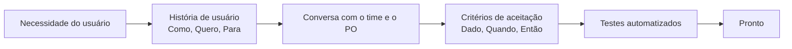

# Requisitos: histórias de usuário e critérios de aceitação

## Por que isso importa

A maior parte dos projetos que dão errado não falha por código ruim, falha por construir **a coisa errada**: o cliente pediu um relatório e queria, na verdade, saber quais clientes estão para cancelar. Bons requisitos são o jeito de o time e o cliente concordarem, **antes** de programar, sobre o que é o problema e como saber se ele foi resolvido. Como desenvolvedor, você vai receber histórias mal escritas toda semana. Saber fazer as perguntas certas ("para quê?", "como vou saber que está pronto?") é uma das habilidades que mais diferenciam um júnior de um pleno.

## Intuição

Um requisito é uma **promessa de conversa**, não um contrato fechado. A história de usuário cabe num cartão de papel justamente para **não** ter todos os detalhes: ela lembra o time de conversar com quem precisa da funcionalidade.

Os **critérios de aceitação** são a parte que fecha a conversa. São exemplos concretos, do tipo "se o carrinho tem R$ 250, o frete sai de graça". Eles viram o teste que diz se a história está pronta. Se você não consegue escrever um exemplo concreto, ainda não entendeu o requisito.

## Visual

Da ideia ao teste:



Uma história completa:

```text
Título: Frete grátis acima de R$ 200

Como cliente da loja,
quero frete grátis em compras a partir de R$ 200,
para economizar quando faço compras maiores.

Critérios de aceitação
  Cenário: compra acima do limite
    Dado um carrinho com subtotal de R$ 250,00
    Quando eu informo o CEP 01310-100
    Então o frete é R$ 0,00

  Cenário: compra abaixo do limite no Sudeste
    Dado um carrinho com subtotal de R$ 100,00
    Quando eu informo o CEP 01310-100
    Então o frete é R$ 15,00
```

## Conceito técnico

### Funcionais e não funcionais

- **Requisito funcional**: **o que** o sistema faz. "O usuário pode redefinir a senha por e-mail."
- **Requisito não funcional** (atributos de qualidade): **como** o sistema se comporta. Desempenho ("a busca responde em menos de 300 ms para 95% das requisições"), disponibilidade, segurança, usabilidade, acessibilidade, manutenibilidade.

Requisito não funcional bom é **mensurável**. "O sistema deve ser rápido" não serve; "p95 abaixo de 300 ms com 1000 usuários simultâneos" serve. Esses requisitos são os que mais influenciam a arquitetura (AS-01).

### Histórias de usuário

Formato mais comum:

```text
Como <tipo de usuário>,
quero <ação ou capacidade>,
para <benefício ou objetivo>.
```

O **"para"** é a parte mais importante e a mais esquecida. Ele explica o **porquê**, e muitas vezes revela uma solução mais simples do que a pedida.

Os **3 Cs** (Ron Jeffries): **Cartão** (a frase curta), **Conversa** (os detalhes combinados com o PO e os usuários) e **Confirmação** (os critérios de aceitação).

### INVEST: o que torna uma história boa

| Letra | Significado | Pergunta para fazer |
|---|---|---|
| **I** | Independente | Dá para fazer sem esperar outra história? |
| **N** | Negociável | Os detalhes ainda podem ser conversados? |
| **V** | Valiosa | Entrega valor visível a alguém? |
| **E** | Estimável | O time consegue estimar? Se não, falta informação ou é grande demais. |
| **S** | Pequena (*small*) | Cabe com folga numa sprint? |
| **T** | Testável | Dá para escrever critérios de aceitação claros? |

### Quebrando histórias grandes

Uma história grande demais (um **épico**) deve ser fatiada **na vertical**: cada fatia atravessa todas as camadas (interface, regra, banco) e entrega algo usável. Fatiar na horizontal ("história 1: criar as tabelas; história 2: a API; história 3: a tela") gera partes que não entregam nada sozinhas.

Jeitos de fatiar: por **caminho** (primeiro o caminho feliz, depois os erros), por **regra de negócio** (frete fixo primeiro, depois por região), por **tipo de dado** (só cartão; depois boleto), por **operação** (criar e listar; depois editar e apagar), por **desempenho** (funciona; depois funciona rápido).

### Critérios de aceitação em Gherkin

Gherkin é o formato do **BDD** (Behavior-Driven Development), usado por ferramentas como Cucumber, behave e pytest-bdd, que transformam cada linha num passo de teste automatizado. Ele tem palavras-chave em português:

| Palavra | Papel |
|---|---|
| `Funcionalidade` | agrupa os cenários de uma funcionalidade |
| `Cenário` | um exemplo concreto |
| `Dado` | o contexto inicial (estado) |
| `Quando` | a ação ou o evento |
| `Então` | o resultado esperado (verificável) |
| `E`, `Mas` | continuam o passo anterior |
| `Esquema do Cenário` + `Exemplos` | o mesmo cenário com uma tabela de valores |

Boas práticas: um comportamento por cenário; linguagem do negócio, não da interface ("quando eu finalizo a compra", e não "quando clico no botão azul"); valores concretos; incluir os casos de **erro** e de **borda** (exatamente R$ 200, CEP inválido).

### Priorização com MoSCoW

- **Must have**: sem isso, a entrega não faz sentido.
- **Should have**: importante, mas há como contornar.
- **Could have**: desejável, entra se sobrar espaço.
- **Won't have (desta vez)**: combinado explicitamente que fica de fora agora.

O "Won't" é valioso: deixar claro o que **não** será feito evita expectativas erradas.

## Código

Um critério de aceitação vira um teste quase linha a linha. Aqui com `assert` simples (na ES-06 veremos pytest):

```python
def frete(subtotal, cep):
    cep = cep.replace("-", "")
    if len(cep) != 8 or not cep.isdigit():
        return None
    if subtotal >= 200:
        return 0
    return 15 if cep[0] in "0123" else 25


# Cenário: compra acima do limite
# Dado um carrinho de R$ 250 / Quando informo o CEP 01310-100 / Então o frete é 0
assert frete(250, "01310-100") == 0

# Cenário: exatamente no limite (caso de borda)
assert frete(200, "50030-000") == 0

# Cenário: abaixo do limite, no Sudeste e fora dele
assert frete(100, "01310-100") == 15
assert frete(100, "50030-000") == 25

# Cenário: CEP inválido
assert frete(100, "123") is None

print("todos os critérios de aceitação passaram")
```

## Erros comuns

- **História sem o "para"**: o time constrói o que foi pedido, e não o que resolve o problema.
- **História técnica disfarçada**: "Como desenvolvedor, quero criar a tabela de pedidos". Isso é uma tarefa, não uma história; não entrega valor ao usuário.
- **Critérios vagos**: "a página deve carregar rápido", "deve ser fácil de usar". Não dá para testar.
- **Critérios que descrevem a interface** ("clicar no botão verde") em vez do comportamento: quebram a cada mudança visual.
- **Só o caminho feliz**: esquecer erros, limites e permissões.
- **Fatiar na horizontal** (banco, depois API, depois tela).
- **Tratar o backlog como contrato**: os detalhes são negociáveis até o time começar.

## Pratique

```quiz
id: ES-02-q1
tipo: multipla_escolha
pergunta: "Qual destes é um requisito NÃO funcional bem escrito?"
opcoes: ["O usuário pode exportar o relatório em PDF", "O sistema deve ser seguro", "95% das buscas devem responder em menos de 300 ms com 500 usuários simultâneos", "Como gerente, quero ver as vendas do mês"]
resposta: 2
explicacao: "É um atributo de qualidade (desempenho) e é mensurável. Exportar PDF e ver vendas são funcionais. 'Ser seguro' é não funcional, mas vago: não dá para testar."
dificuldade: 1
```

```quiz
id: ES-02-q2
tipo: multipla_escolha
pergunta: "A história 'Como usuário, quero um sistema completo de pagamentos (cartão, boleto, Pix, parcelamento e estorno)' viola principalmente qual letra do INVEST?"
opcoes: ["I (independente)", "S (pequena)", "T (testável)", "V (valiosa)"]
resposta: 1
explicacao: "É um épico: não cabe numa sprint. Dá para fatiar na vertical, por exemplo primeiro Pix à vista, depois cartão, depois parcelamento, cada fatia entregando um jeito de pagar que funciona de ponta a ponta."
dificuldade: 1
```

```quiz
id: ES-02-q3
tipo: verdadeiro_falso
pergunta: "Fatiar uma história em 'criar as tabelas', 'criar a API' e 'criar a tela' é um bom jeito de deixá-la pequena."
resposta: false
explicacao: "Isso é fatiar na horizontal: nenhuma das partes entrega valor sozinha, e só no fim se descobre se o todo funciona. O ideal é fatiar na vertical, cada parte atravessando todas as camadas com uma versão menor da funcionalidade."
dificuldade: 1
```

```quiz
id: ES-02-q4
tipo: resposta_curta
pergunta: "Reescreva como critério Dado/Quando/Então: 'O login deve bloquear tentativas suspeitas.'"
resposta: "Por exemplo: Dado um usuário que errou a senha 5 vezes nos últimos 10 minutos, Quando ele tenta entrar de novo, Então o acesso é bloqueado por 15 minutos e ele recebe um e-mail de aviso."
palavras_chave: ["Dado", "Quando", "Então", "vezes", "bloqueado"]
dificuldade: 2
```

```quiz
id: ES-02-q5
tipo: multipla_escolha
pergunta: "Para que serve deixar itens como 'Won't have' no MoSCoW, em vez de simplesmente não listá-los?"
opcoes: ["Para inflar o backlog", "Para registrar o acordo explícito de que ficam de fora agora, alinhando expectativas", "Porque serão feitos primeiro na próxima sprint", "Não serve para nada"]
resposta: 1
explicacao: "Deixar claro o que não será feito evita que alguém espere aquilo na entrega e documenta a decisão. Pode ser revisto no futuro, mas não nesta entrega."
dificuldade: 1
```

```quiz
id: ES-02-q6
tipo: codigo
linguagem: python
pergunta: |
  **Implemente a partir dos critérios.** Escreva `frete(subtotal, cep)` que satisfaz estes critérios de aceitação:

  - **CEP inválido**: se o CEP, sem o hífen, não tem exatamente 8 dígitos, o resultado é `None` (mesmo em compras acima de R$ 200).
  - **Frete grátis**: subtotal de R$ 200 **ou mais**, frete 0.
  - **Sudeste**: subtotal abaixo de R$ 200 e CEP começando com 0, 1, 2 ou 3, frete 15.
  - **Demais regiões**: subtotal abaixo de R$ 200 e qualquer outro CEP válido, frete 25.
codigo_inicial: |
  def frete(subtotal, cep):
      if subtotal > 200:
          return 0
      return 25
usa: [def, if, return]
testes:
  - chamada: "frete(250, '01310-100')"
    saida: "0"
  - chamada: "frete(100, '01310-100')"
    saida: "15"
  - chamada: "frete(100, '50030-000')"
    saida: "25"
  - chamada: "frete(200, '99999-999')"
    visivel: false
    saida: "0"
  - chamada: "frete(199.99, '40000000')"
    visivel: false
    saida: "25"
  - chamada: "frete(300, '123')"
    visivel: false
    saida: "None"
  - chamada: "frete(50, '3999999a')"
    visivel: false
    saida: "None"
  - chamada: "frete(10, '29000-000')"
    visivel: false
    saida: "15"
dica: "Comece pelo cenário de CEP inválido: tire o hífen com replace, confira len(cep) == 8 e cep.isdigit(). Atenção ao limite: R$ 200 exatos já é frete grátis (>=)."
solucao: |
  def frete(subtotal, cep):
      cep = cep.replace('-', '')
      if len(cep) != 8 or not cep.isdigit():
          return None
      if subtotal >= 200:
          return 0
      if cep[0] in '0123':
          return 15
      return 25
explicacao: "O código inicial tem dois erros clássicos que os critérios pegam: usa > em vez de >= (o caso de borda de R$ 200 exatos) e não valida o CEP. A ordem das verificações segue o primeiro cenário: CEP inválido vence até o frete grátis. Sem esse critério escrito, cada desenvolvedor decidiria de um jeito."
dificuldade: 1
```

```quiz
id: ES-02-q7
tipo: codigo
linguagem: python
pergunta: |
  **Lendo Gherkin.** Escreva `passos(texto)` que recebe um cenário em Gherkin (em português) e devolve a lista de passos como tuplas `(palavra, resto)`:

  - considere só as linhas cuja **primeira palavra** é `Dado`, `Quando`, `Então`, `E` ou `Mas` (ignore espaços no começo e as outras linhas);
  - `E` e `Mas` herdam a palavra do último passo principal (`Dado`, `Quando` ou `Então`). Se aparecerem antes de qualquer passo principal, ignore a linha;
  - `resto` é o texto depois da primeira palavra, sem espaços nas pontas.
codigo_inicial: |
  # não mude: os testes usam este texto
  CENARIO = """
  Funcionalidade: Carrinho
    Cenário: cupom de desconto
      Dado um carrinho com 2 livros
      E um cupom de 10%
      Quando eu finalizo a compra
      Então o total tem 10% de desconto
      Mas o frete não tem desconto
  """

  def passos(texto):
      resultado = []
      for linha in texto.split('\n'):
          if linha.strip():
              resultado.append(tuple(linha.strip().split(' ', 1)))
      return resultado
usa: [def, for, if, return]
testes:
  - chamada: "passos(CENARIO)"
    saida: "[('Dado', 'um carrinho com 2 livros'), ('Dado', 'um cupom de 10%'), ('Quando', 'eu finalizo a compra'), ('Então', 'o total tem 10% de desconto'), ('Então', 'o frete não tem desconto')]"
  - chamada: "passos('Quando eu saio\\nEntão volto ao início')"
    saida: "[('Quando', 'eu saio'), ('Então', 'volto ao início')]"
  - chamada: "passos('')"
    saida: "[]"
  - chamada: "passos('  E sozinho\\nDado algo\\n  Eventualmente nada\\nE mais algo')"
    visivel: false
    saida: "[('Dado', 'algo'), ('Dado', 'mais algo')]"
  - chamada: "passos('Cenário: x\\nDado a\\nQuando b\\nE c\\nMas d\\nEntão e\\nE f')"
    visivel: false
    saida: "[('Dado', 'a'), ('Quando', 'b'), ('Quando', 'c'), ('Quando', 'd'), ('Então', 'e'), ('Então', 'f')]"
dica: "Use partes = linha.split(maxsplit=1): a primeira palavra é partes[0] e o resto é partes[1] (cuidado com linhas de uma palavra só). Guarde a última palavra principal numa variável que começa em None."
solucao: |
  # não mude: os testes usam este texto
  CENARIO = """
  Funcionalidade: Carrinho
    Cenário: cupom de desconto
      Dado um carrinho com 2 livros
      E um cupom de 10%
      Quando eu finalizo a compra
      Então o total tem 10% de desconto
      Mas o frete não tem desconto
  """

  def passos(texto):
      principais = ('Dado', 'Quando', 'Então')
      resultado = []
      ultima = None
      for linha in texto.split('\n'):
          partes = linha.split(maxsplit=1)
          if not partes:
              continue
          palavra = partes[0]
          resto = partes[1].strip() if len(partes) > 1 else ''
          if palavra in principais:
              ultima = palavra
              resultado.append((palavra, resto))
          elif palavra in ('E', 'Mas') and ultima is not None:
              resultado.append((ultima, resto))
      return resultado
explicacao: "Comparar a primeira palavra inteira, e não usar startswith('E'), evita confundir 'Eventualmente' ou 'Então' com o conector 'E'. É exatamente assim que ferramentas como Cucumber e behave tratam And/But: o passo continua sendo do tipo anterior, e a ferramenta procura a função de teste que corresponde ao texto."
dificuldade: 2
```

```quiz
id: ES-02-q8
tipo: codigo
linguagem: javascript
pergunta: |
  **Planejando com MoSCoW.** Cada história é `{ id, prioridade, pontos }`, com prioridade `'M'`, `'S'`, `'C'` ou `'W'`. Escreva `planejar(historias, capacidade)` que devolve a lista de ids escolhidos para a sprint:

  1. todas as `'M'`, na ordem dada. Se a soma delas passar da capacidade, devolva `null` (o plano é inviável);
  2. depois as `'S'`, na ordem, incluindo cada uma que ainda caiba (as que não cabem são puladas);
  3. depois as `'C'`, do mesmo jeito;
  4. as `'W'` nunca entram.
codigo_inicial: |
  function planejar(historias, capacidade) {
    return historias.map((h) => h.id);
  }
usa: [function, for, return]
testes:
  - chamada: "planejar([{ id: 'login', prioridade: 'M', pontos: 5 }, { id: 'busca', prioridade: 'S', pontos: 8 }, { id: 'tema', prioridade: 'C', pontos: 2 }, { id: 'chat', prioridade: 'W', pontos: 1 }, { id: 'carrinho', prioridade: 'M', pontos: 8 }], 20)"
    saida: "[ 'login', 'carrinho', 'tema' ]"
  - chamada: "planejar([{ id: 'login', prioridade: 'M', pontos: 5 }, { id: 'busca', prioridade: 'S', pontos: 8 }, { id: 'tema', prioridade: 'C', pontos: 2 }, { id: 'chat', prioridade: 'W', pontos: 1 }, { id: 'carrinho', prioridade: 'M', pontos: 8 }], 21)"
    saida: "[ 'login', 'carrinho', 'busca' ]"
  - chamada: "planejar([{ id: 'login', prioridade: 'M', pontos: 5 }, { id: 'carrinho', prioridade: 'M', pontos: 8 }], 12)"
    saida: "null"
  - chamada: "planejar([{ id: 'login', prioridade: 'M', pontos: 5 }, { id: 'busca', prioridade: 'S', pontos: 8 }, { id: 'tema', prioridade: 'C', pontos: 2 }, { id: 'chat', prioridade: 'W', pontos: 1 }, { id: 'carrinho', prioridade: 'M', pontos: 8 }], 100)"
    visivel: false
    saida: "[ 'login', 'carrinho', 'busca', 'tema' ]"
  - chamada: "planejar([], 5)"
    visivel: false
    saida: "[]"
  - chamada: "planejar([{ id: 'a', prioridade: 'S', pontos: 4 }, { id: 'b', prioridade: 'S', pontos: 2 }, { id: 'c', prioridade: 'C', pontos: 1 }], 3)"
    visivel: false
    saida: "[ 'b', 'c' ]"
dica: "Faça um laço externo sobre as prioridades ['M', 'S', 'C'] e um interno sobre as histórias. Mantenha a soma usada; depois de processar as 'M', confira se a soma passou da capacidade."
solucao: |
  function planejar(historias, capacidade) {
    const escolhidas = [];
    let usado = 0;
    for (const p of ['M', 'S', 'C']) {
      for (const h of historias) {
        if (h.prioridade !== p) continue;
        if (p === 'M' || usado + h.pontos <= capacidade) {
          escolhidas.push(h.id);
          usado += h.pontos;
        }
      }
      if (p === 'M' && usado > capacidade) return null;
    }
    return escolhidas;
  }
explicacao: "Com capacidade 20, as obrigatórias somam 13; a busca (8) estouraria (21), então é pulada, e o tema (2) entra. Com 21, a busca cabe e aí não sobra espaço para o tema. Quando as Must não cabem, o certo não é cortar uma delas em silêncio, e sim devolver o problema ao PO: o escopo ou o prazo precisa mudar."
dificuldade: 2
```

## Resumo

- **Funcional**: o que o sistema faz. **Não funcional**: como ele se comporta; precisa ser **mensurável**.
- História: **Como / Quero / Para**; o "para" diz o porquê. **3 Cs**: cartão, conversa, confirmação.
- **INVEST**: independente, negociável, valiosa, estimável, pequena, testável.
- Fatie **na vertical**, cada parte entregando valor.
- Critérios em **Dado / Quando / Então**, com exemplos concretos, erros e bordas.
- **MoSCoW**: Must, Should, Could, Won't (desta vez).

## Para ir além

- Pegue um aplicativo que você usa e escreva três histórias com critérios de aceitação para uma funcionalidade dele.
- Instale `behave` e automatize os cenários de frete desta aula.
- **Próximo módulo**: ES-03 Código limpo: nomes, funções, comentários.
