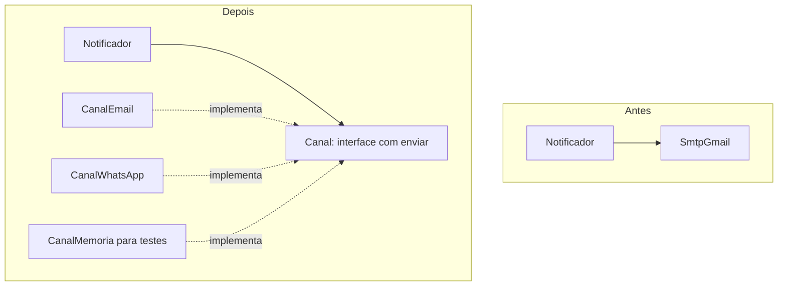

# Princípios SOLID, DRY, KISS, YAGNI

## Por que isso importa

Todo sistema que dá certo **muda**: novas formas de pagamento, novas regras de desconto, um banco de dados diferente. A pergunta não é se o código vai mudar, é **quanto vai custar** mudar. Os princípios desta aula são heurísticas, acumuladas por décadas, para que uma mudança mexa em **poucos** lugares e não quebre o resto. SOLID aparece em praticamente toda entrevista de nível pleno, e entender **quando não aplicar** (KISS, YAGNI) é o que separa quem usa princípios de quem os aplica no automático.

## Intuição

Pense numa **tomada**. O aparelho não sabe se a energia vem de hidrelétrica, solar ou de um gerador: ele depende de uma **interface** padrão (o formato do plugue). Você troca a fonte sem trocar o aparelho, e liga aparelhos novos sem mexer na rede. Isso é, em uma imagem, o **aberto/fechado** e a **inversão de dependência**.

Agora pense num **canivete suíço com 40 ferramentas** que você comprou "para o caso de precisar". Pesado, caro, e você só usa a faca. Isso é o que KISS e YAGNI combatem: construir flexibilidade que ninguém pediu.

Os princípios puxam para lados opostos de propósito: SOLID diz "prepare para mudar", YAGNI diz "não prepare o que não existe". O equilíbrio é aplicar SOLID **onde a mudança já aconteceu ou é certa**.

## Visual

Inversão de dependência: a regra de negócio depende de uma abstração, e os detalhes também.



## Conceito técnico

### S: Responsabilidade única (Single Responsibility)

"Uma classe deve ter **um único motivo para mudar**." O "motivo" é, na prática, **um grupo de pessoas** que pede mudanças. Uma classe `Relatorio` que calcula os números (pedido do financeiro), formata o PDF (pedido do design) e envia por e-mail (pedido da TI) tem três motivos para mudar, e uma mudança no PDF pode quebrar o cálculo.

```text
class Relatorio:                       class CalculadoraDeVendas: ...
    def calcular(self): ...      ->    class FormatadorPDF: ...
    def gerar_pdf(self): ...           class EnviadorDeEmail: ...
    def enviar_email(self): ...
```

### O: Aberto/fechado (Open/Closed)

"Aberto para extensão, fechado para modificação." Adicionar um comportamento novo não deveria exigir editar código que já funciona. O sintoma clássico de violação é uma cadeia de `if/elif` sobre um "tipo" que cresce a cada requisito:

```text
def desconto(tipo, valor):                class Percentual:
    if tipo == "percentual": ...              def aplicar(self, valor): ...
    elif tipo == "fixo": ...         ->   class ValorFixo:
    elif tipo == "black_friday": ...          def aplicar(self, valor): ...
    # cada desconto novo edita aqui       # desconto novo = classe nova
```

### L: Substituição de Liskov

"Se `S` é subtipo de `T`, objetos de `T` podem ser trocados por objetos de `S` sem quebrar o programa." O subtipo precisa honrar o **contrato** do tipo base: não exigir mais nas entradas, não entregar menos nas saídas, não lançar exceções novas.

O exemplo famoso: `Quadrado` herdar de `Retangulo`. Um código que faz `r.largura = 5; r.altura = 4` e espera área 20 quebra com um quadrado, que mantém os lados iguais. Matematicamente um quadrado **é** um retângulo, mas um **quadrado mutável não se comporta** como um retângulo mutável. Outro sintoma: uma subclasse que sobrescreve um método só para lançar `NotImplementedError` (`Pinguim.voar()`).

### I: Segregação de interfaces (Interface Segregation)

"Nenhum cliente deve depender de métodos que não usa." Uma interface `Impressora` com `imprimir`, `digitalizar` e `enviar_fax` obriga uma impressora simples a implementar métodos vazios. Prefira interfaces pequenas: `Imprime`, `Digitaliza`. Em Python, isso aparece como **protocolos** (`typing.Protocol`) pequenos.

### D: Inversão de dependência (Dependency Inversion)

"Módulos de alto nível não devem depender de módulos de baixo nível; ambos devem depender de abstrações." A regra de negócio ("avisar clientes com pedido atrasado") não deveria saber se o aviso vai por e-mail, SMS ou WhatsApp.

O jeito prático de aplicar é a **injeção de dependência**: em vez de a classe **criar** o que usa, ela **recebe** pelo construtor.

```text
class Notificador:                          class Notificador:
    def __init__(self):                         def __init__(self, canal):
        self.canal = SmtpGmail()    ->              self.canal = canal
```

O maior benefício no dia a dia: nos **testes**, você injeta um canal falso que só guarda as mensagens numa lista, e testa a regra sem enviar e-mail de verdade (ES-06).

### DRY, KISS e YAGNI

- **DRY (Don't Repeat Yourself)**: "cada **conhecimento** deve ter uma representação única". O alvo é o **conhecimento** duplicado (a regra de frete escrita em três lugares), não qualquer par de linhas parecidas. Duas funções iguais por coincidência, que vão mudar por motivos diferentes, **não** são duplicação.
- **Regra de três**: tolere a primeira repetição; na terceira, abstraia. Até lá você não sabe qual é a abstração certa. Como diz Sandi Metz: "duplicação é muito mais barata que a abstração errada".
- **KISS (Keep It Simple)**: a solução mais simples que resolve o problema. Uma função antes de uma classe; uma classe antes de uma hierarquia; um `if` antes de um padrão de projeto.
- **YAGNI (You Aren't Gonna Need It)**: não construa algo porque "um dia pode precisar". O custo não é só escrever: é manter, testar e contornar algo que talvez nunca seja usado, e que muitas vezes estará errado quando a necessidade real aparecer.

## Código

O mesmo notificador, antes e depois da injeção de dependência, com um teste que não envia nada de verdade:

```python
from typing import Protocol


class Canal(Protocol):
    def enviar(self, destino: str, texto: str) -> None: ...


class CanalConsole:
    def enviar(self, destino, texto):
        print(f"[para {destino}] {texto}")


class CanalMemoria:
    def __init__(self):
        self.enviadas = []

    def enviar(self, destino, texto):
        self.enviadas.append((destino, texto))


class Notificador:
    def __init__(self, canal: Canal):
        self.canal = canal

    def avisar_atrasos(self, pedidos, hoje):
        atrasados = [p for p in pedidos if p["prazo"] < hoje]
        for p in atrasados:
            self.canal.enviar(p["email"], f"Pedido {p['id']} atrasado")
        return len(atrasados)


pedidos = [
    {"id": 1, "email": "ana@ex.com", "prazo": 10},
    {"id": 2, "email": "bia@ex.com", "prazo": 20},
]

# em produção: um canal real
Notificador(CanalConsole()).avisar_atrasos(pedidos, hoje=15)

# no teste: um canal falso que só registra
canal = CanalMemoria()
assert Notificador(canal).avisar_atrasos(pedidos, hoje=15) == 1
assert canal.enviadas == [("ana@ex.com", "Pedido 1 atrasado")]
print("teste passou sem enviar nenhum e-mail")
```

## Erros comuns

- **Aplicar SOLID em tudo desde o primeiro dia**: interfaces com uma única implementação, fábricas de fábricas. É o canivete suíço de 40 ferramentas.
- **Confundir SRP com "uma classe, um método"**: o critério é o motivo para mudar, não o número de métodos.
- **DRY no texto em vez do conhecimento**: juntar duas funções parecidas com um parâmetro booleano, e depois ir acrescentando `if`s para cada lado.
- **Herança para reaproveitar código** em vez de por "é um" de verdade, quebrando Liskov. Prefira composição.
- **Classe que cria suas próprias dependências** (`self.db = PostgresReal()` no construtor) e por isso não dá para testar.
- **Usar YAGNI como desculpa** para não pensar: YAGNI vale para funcionalidades especulativas, não para testes, tratamento de erro ou nomes bons.

## Pratique

```quiz
id: ES-04-q1
tipo: multipla_escolha
pergunta: "Uma classe Funcionario tem os métodos calcular_salario (regras do RH), salvar_no_banco (equipe de infraestrutura) e gerar_holerite_pdf (equipe de documentos). Qual princípio ela viola mais claramente?"
opcoes: ["Responsabilidade única", "Substituição de Liskov", "Segregação de interfaces", "YAGNI"]
resposta: 0
explicacao: "Três grupos diferentes pedem mudanças nela por motivos diferentes. Uma mudança no layout do holerite pode quebrar o cálculo do salário. Separar em três classes isola cada motivo."
dificuldade: 1
```

```quiz
id: ES-04-q2
tipo: multipla_escolha
pergunta: "A classe Pato tem o método voar. Você cria PatoDeBorracha(Pato) e sobrescreve voar para lançar uma exceção. Qual princípio foi violado?"
opcoes: ["Aberto/fechado", "Substituição de Liskov", "Inversão de dependência", "DRY"]
resposta: 1
explicacao: "Um código que recebe um Pato e chama voar quebra ao receber um PatoDeBorracha: o subtipo não pode substituir o tipo base. A hierarquia está errada; separe a capacidade de voar numa interface própria."
dificuldade: 1
```

```quiz
id: ES-04-q3
tipo: verdadeiro_falso
pergunta: "Duas funções com o mesmo corpo de 4 linhas sempre devem ser unidas numa só, pelo princípio DRY."
resposta: false
explicacao: "DRY é sobre conhecimento, não sobre texto. Se as funções representam regras diferentes que coincidem hoje (o frete de São Paulo e o de Curitiba, por exemplo), vão mudar por motivos diferentes, e uni-las cria acoplamento. A regra de três e o 'qual é o motivo para mudar?' ajudam a decidir."
dificuldade: 2
```

```quiz
id: ES-04-q4
tipo: resposta_curta
pergunta: "Por que receber as dependências pelo construtor (injeção de dependência) facilita os testes?"
resposta: "Porque o teste pode passar uma implementação falsa (um dublê) no lugar da real, por exemplo um canal que guarda as mensagens numa lista em vez de enviar e-mail. Assim se testa a regra de negócio isolada, rápida e sem efeitos externos."
palavras_chave: ["falsa", "dublê", "isolada", "real"]
dificuldade: 2
```

```quiz
id: ES-04-q5
tipo: codigo
linguagem: python
pergunta: |
  **Aberto para extensão.** Substitua a cadeia de `if/elif` por classes com o método `aplicar(valor)`, que devolve o valor com o desconto aplicado:

  - `SemDesconto()`: devolve o próprio valor;
  - `Percentual(p)`: tira `p`% do valor;
  - `ValorFixo(v)`: tira `v` do valor;
  - `Combinado(*descontos)`: aplica cada desconto, em ordem, sobre o resultado do anterior.

  A função `preco_final` já está pronta e impede preço negativo.
codigo_inicial: |
  def desconto(tipo, valor, parametro=0):
      if tipo == 'nenhum':
          return valor
      elif tipo == 'percentual':
          return valor - valor * parametro / 100
      elif tipo == 'fixo':
          return valor - parametro
      # e para combinar dois descontos? mais um elif...

  # não mude: os testes usam esta função
  def preco_final(valor, regra):
      return max(0, round(regra.aplicar(valor), 2))
usa: [class, def, return]
testes:
  - chamada: "preco_final(100, Percentual(10))"
    saida: "90.0"
  - chamada: "preco_final(100, ValorFixo(30))"
    saida: "70"
  - chamada: "preco_final(50, SemDesconto())"
    saida: "50"
  - chamada: "preco_final(20, ValorFixo(30))"
    visivel: false
    saida: "0"
  - chamada: "preco_final(100, Combinado(Percentual(10), ValorFixo(5)))"
    visivel: false
    saida: "85.0"
  - chamada: "preco_final(100, Combinado(ValorFixo(5), Percentual(10)))"
    visivel: false
    saida: "85.5"
  - chamada: "preco_final(80, Combinado())"
    visivel: false
    saida: "80"
dica: "Cada classe guarda o seu parâmetro no __init__. Em Combinado, guarde a tupla de descontos e, no aplicar, percorra-a atualizando o valor."
solucao: |
  class SemDesconto:
      def aplicar(self, valor):
          return valor

  class Percentual:
      def __init__(self, p):
          self.p = p

      def aplicar(self, valor):
          return valor - valor * self.p / 100

  class ValorFixo:
      def __init__(self, v):
          self.v = v

      def aplicar(self, valor):
          return valor - self.v

  class Combinado:
      def __init__(self, *descontos):
          self.descontos = descontos

      def aplicar(self, valor):
          for d in self.descontos:
              valor = d.aplicar(valor)
          return valor

  # não mude: os testes usam esta função
  def preco_final(valor, regra):
      return max(0, round(regra.aplicar(valor), 2))
explicacao: "Agora um desconto novo (Black Friday, primeira compra) é uma classe nova, sem tocar nas que já funcionam: aberto/fechado. Combinado é o padrão Composite (ES-05): um grupo de descontos se comporta como um desconto. Os dois últimos testes mostram que a ordem importa: 10% e depois R$ 5 dá 85; R$ 5 e depois 10% dá 85,50. Uma regra de negócio que estava escondida no código agora fica explícita."
dificuldade: 2
```

```quiz
id: ES-04-q6
tipo: codigo
linguagem: python
pergunta: |
  **Inversão de dependência.** O `Notificador` cria um canal de e-mail real e por isso não dá para testar. Reescreva:

  - `CanalMemoria`: tem a lista `enviadas` e o método `enviar(destino, texto)`, que acrescenta a tupla `(destino, texto)`;
  - `Notificador(canal)`: recebe o canal no construtor. O método `avisar_atrasos(pedidos, hoje)` envia `'Pedido <id> atrasado'` para o `email` de cada pedido com `prazo < hoje`, na ordem, e devolve quantos avisos enviou.
codigo_inicial: |
  class SmtpReal:
      def enviar(self, destino, texto):
          raise RuntimeError('sem rede: não dá para enviar e-mail aqui')

  class Notificador:
      def __init__(self):
          self.canal = SmtpReal()

      def avisar_atrasos(self, pedidos, hoje):
          n = 0
          for p in pedidos:
              if p['prazo'] < hoje:
                  self.canal.enviar(p['email'], f"Pedido {p['id']} atrasado")
                  n += 1
          return n

  # não mude: os testes usam esta função
  def testar(pedidos, hoje):
      canal = CanalMemoria()
      enviados = Notificador(canal).avisar_atrasos(pedidos, hoje)
      return enviados, canal.enviadas
usa: [class, def, return]
testes:
  - chamada: "testar([{'id': 1, 'email': 'ana@ex.com', 'prazo': 10}, {'id': 2, 'email': 'bia@ex.com', 'prazo': 20}], 15)"
    saida: "(1, [('ana@ex.com', 'Pedido 1 atrasado')])"
  - chamada: "testar([], 15)"
    saida: "(0, [])"
  - chamada: "testar([{'id': 7, 'email': 'c@ex.com', 'prazo': 15}], 15)"
    visivel: false
    saida: "(0, [])"
  - chamada: "testar([{'id': 3, 'email': 'x@ex.com', 'prazo': 1}, {'id': 4, 'email': 'y@ex.com', 'prazo': 2}], 30)"
    visivel: false
    saida: "(2, [('x@ex.com', 'Pedido 3 atrasado'), ('y@ex.com', 'Pedido 4 atrasado')])"
dica: "O corpo de avisar_atrasos já está certo; o problema está no __init__. Troque SmtpReal() pelo parâmetro canal e crie a classe CanalMemoria com self.enviadas = [] no construtor."
solucao: |
  class SmtpReal:
      def enviar(self, destino, texto):
          raise RuntimeError('sem rede: não dá para enviar e-mail aqui')

  class CanalMemoria:
      def __init__(self):
          self.enviadas = []

      def enviar(self, destino, texto):
          self.enviadas.append((destino, texto))

  class Notificador:
      def __init__(self, canal):
          self.canal = canal

      def avisar_atrasos(self, pedidos, hoje):
          n = 0
          for p in pedidos:
              if p['prazo'] < hoje:
                  self.canal.enviar(p['email'], f"Pedido {p['id']} atrasado")
                  n += 1
          return n

  # não mude: os testes usam esta função
  def testar(pedidos, hoje):
      canal = CanalMemoria()
      enviados = Notificador(canal).avisar_atrasos(pedidos, hoje)
      return enviados, canal.enviadas
explicacao: "A regra de negócio não mudou uma linha: só a origem do canal. Em produção, o código de inicialização do sistema (o main ou um contêiner de injeção) faz Notificador(SmtpReal()); nos testes, Notificador(CanalMemoria()). O CanalMemoria é um dublê de teste do tipo fake, assunto da ES-06."
dificuldade: 1
```

```quiz
id: ES-04-q7
tipo: codigo
linguagem: javascript
pergunta: |
  **DRY com regras como dados.** Em vez de repetir um `if` para cada campo de cada formulário, descreva as regras como dados. Escreva `validar(dados, regras)`, onde cada regra é:

  - `{ campo, tipo: 'obrigatorio' }`: erro `'<campo> é obrigatório'` se o campo estiver ausente ou for `''`;
  - `{ campo, tipo: 'min', valor }`: erro `'<campo> deve ter pelo menos <valor> caracteres'` se o campo **existir** e for mais curto que `valor`.

  Devolva a lista de mensagens, na ordem das regras.
codigo_inicial: |
  function validar(dados, regras) {
    const erros = [];
    if (!dados.nome) erros.push('nome é obrigatório');
    if (!dados.email) erros.push('email é obrigatório');
    return erros;
  }
usa: [function, for, return]
testes:
  - chamada: "validar({ nome: 'Ana' }, [{ campo: 'nome', tipo: 'obrigatorio' }, { campo: 'email', tipo: 'obrigatorio' }])"
    saida: "[ 'email é obrigatório' ]"
  - chamada: "validar({ senha: '123' }, [{ campo: 'senha', tipo: 'min', valor: 8 }])"
    saida: "[ 'senha deve ter pelo menos 8 caracteres' ]"
  - chamada: "validar({ nome: 'Ana', senha: '12345678' }, [{ campo: 'nome', tipo: 'obrigatorio' }, { campo: 'senha', tipo: 'min', valor: 8 }])"
    saida: "[]"
  - chamada: "validar({ apelido: '' }, [{ campo: 'apelido', tipo: 'obrigatorio' }, { campo: 'bio', tipo: 'min', valor: 10 }])"
    visivel: false
    saida: "[ 'apelido é obrigatório' ]"
  - chamada: "validar({ cep: '123' }, [{ campo: 'cep', tipo: 'obrigatorio' }, { campo: 'cep', tipo: 'min', valor: 8 }, { campo: 'cidade', tipo: 'obrigatorio' }])"
    visivel: false
    saida: "[ 'cep deve ter pelo menos 8 caracteres', 'cidade é obrigatório' ]"
dica: "Percorra as regras com for...of e leia o valor com dados[regra.campo]. Para 'min', só verifique se o valor não é undefined."
solucao: |
  function validar(dados, regras) {
    const erros = [];
    for (const regra of regras) {
      const v = dados[regra.campo];
      if (regra.tipo === 'obrigatorio' && (v === undefined || v === '')) {
        erros.push(`${regra.campo} é obrigatório`);
      } else if (regra.tipo === 'min' && v !== undefined && v.length < regra.valor) {
        erros.push(`${regra.campo} deve ter pelo menos ${regra.valor} caracteres`);
      }
    }
    return erros;
  }
explicacao: "O conhecimento 'como validar um campo obrigatório' agora existe em um lugar só, e cada formulário é só uma lista de regras. Bibliotecas como Zod, Yup e o Pydantic do Python seguem essa ideia. A regra 'min' ignora campo ausente de propósito: cada regra cuida de uma coisa, e quem quer exigir o campo combina as duas."
dificuldade: 2
```

## Resumo

- **S**: um motivo para mudar. **O**: estenda sem modificar. **L**: subtipos honram o contrato. **I**: interfaces pequenas. **D**: dependa de abstrações e **injete** as dependências.
- **DRY** é sobre conhecimento, não texto; **regra de três** antes de abstrair.
- **KISS**: a solução mais simples que funciona. **YAGNI**: não construa o que ninguém pediu.
- Aplique SOLID onde a mudança **já aconteceu** ou é certa.

## Para ir além

- Leia "The Wrong Abstraction", de Sandi Metz.
- Procure no seu código uma cadeia de `if/elif` sobre um tipo e veja se ela merece virar classes, ou se está bem como está.
- **Próximo módulo**: ES-05 Padrões de projeto (GoF).
