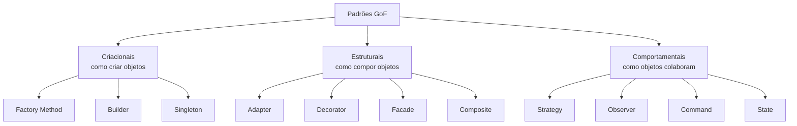
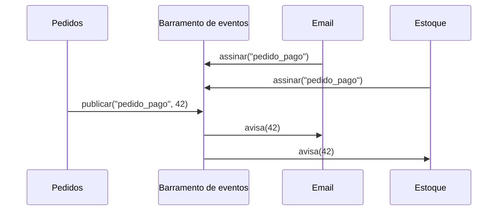

# Padrões de projeto (GoF): criacionais, estruturais, comportamentais

## Por que isso importa

Muitos problemas de desenho se repetem: "preciso trocar o algoritmo em tempo de execução", "preciso avisar várias partes do sistema quando algo acontece", "essa biblioteca tem uma interface diferente da que meu código espera". **Padrões de projeto** são soluções nomeadas para esses problemas recorrentes, catalogadas em 1994 no livro da "Gangue dos Quatro" (GoF). O maior valor deles é o **vocabulário**: dizer "isso é um Observer" no code review comunica uma estrutura inteira em uma palavra. Eles aparecem por toda parte nos frameworks que você vai usar (o `addEventListener` do navegador é um Observer; os middlewares do Express são uma Chain of Responsibility) e são tema frequente de entrevistas.

## Intuição

Um padrão é como uma **receita de culinária com nome**: "molho branco" diz a quem cozinha a estrutura geral (gordura, farinha, leite) sem prescrever a marca da manteiga. Você adapta ao que tem na cozinha.

Do mesmo jeito, um padrão é a **forma** de uma solução, não um código para copiar. E a regra da cozinha também vale: ninguém faz molho branco para um prato que não precisa de molho. Aplicar padrões "porque é boa prática", sem o problema que eles resolvem, só deixa o código mais complicado.

## Visual

As três famílias e os padrões mais usados de cada uma:



O Observer em ação:



## Conceito técnico

### Criacionais: como criar objetos

| Padrão | Problema | Ideia | Em Python |
|---|---|---|---|
| **Factory Method** | o código não deveria saber qual classe concreta instanciar | uma função ou método decide e devolve o objeto | uma função `criar_exportador(formato)` com um dicionário `{"csv": ExportadorCSV, ...}` |
| **Abstract Factory** | criar **famílias** de objetos que combinam (tema claro: botão claro, menu claro) | um objeto fábrica por família | classes de fábrica ou módulos |
| **Builder** | objeto com muitos parâmetros opcionais, montado em passos | um construtor fluente `.com_x().com_y().construir()` | muitas vezes basta argumentos nomeados ou `dataclass` |
| **Singleton** | garantir uma única instância global | a classe controla a própria criação | um **módulo** já é único; prefira injetar a dependência |
| **Prototype** | criar cópias de um objeto pré-configurado | clonar em vez de construir | `copy.deepcopy` |

**Cuidado com o Singleton**: ele é um **estado global** disfarçado. Esconde dependências (a função usa o banco sem recebê-lo), atrapalha testes (um teste deixa sujeira para o próximo) e complica concorrência. Prefira criar um objeto no início do programa e **injetá-lo** (ES-04).

### Estruturais: como compor objetos

| Padrão | Problema | Ideia |
|---|---|---|
| **Adapter** | uma classe tem a interface errada para o seu código (biblioteca antiga, API de terceiros) | um objeto intermediário traduz uma interface na outra |
| **Decorator** | acrescentar responsabilidades a um objeto sem mudar a classe, combinando livremente | envolver o objeto em outro com a **mesma interface**, que faz algo antes ou depois |
| **Facade** | um subsistema complexo com muitas classes | uma classe simples na frente, com os 3 métodos que todo mundo usa |
| **Composite** | tratar um grupo de objetos como se fosse um só (pastas e arquivos, menus e submenus) | o grupo implementa a mesma interface dos itens e repassa as chamadas |
| **Proxy** | controlar o acesso a um objeto (carregar sob demanda, cache, permissão) | um objeto com a mesma interface que fica no caminho |

O padrão Decorator não é a mesma coisa que o `@decorador` do Python, mas a ideia é parecida: o `@decorador` envolve uma **função**; o padrão envolve um **objeto**.

### Comportamentais: como objetos colaboram

| Padrão | Problema | Ideia |
|---|---|---|
| **Strategy** | escolher entre algoritmos em tempo de execução (frete, ordenação, desconto) | cada algoritmo é um objeto com a mesma interface; em Python, basta passar uma **função** |
| **Observer** | vários interessados precisam saber quando algo acontece, sem o emissor conhecê-los | assinantes se registram e o emissor avisa todos (eventos, pub/sub) |
| **Command** | transformar uma ação em objeto para enfileirar, registrar ou **desfazer** | um objeto com `executar()` (e `desfazer()`) |
| **State** | um objeto muda de comportamento conforme o estado (pedido novo, pago, enviado) | um objeto por estado, ou uma tabela de transições, no lugar de `if`s espalhados |
| **Template Method** | um algoritmo com passos fixos e alguns passos variáveis | a classe base define a ordem; subclasses preenchem os passos |
| **Iterator** | percorrer uma coleção sem expor como ela é feita | um objeto com "próximo"; em Python, `__iter__` e geradores |
| **Chain of Responsibility** | uma requisição passa por uma sequência de tratadores | cada um trata ou repassa (middlewares) |

### Padrões numa linguagem moderna

Vários padrões existem para contornar limitações de linguagens como o Java de 1994. Em Python e JavaScript:

- **Strategy** e **Command** muitas vezes são só **funções** passadas como argumento.
- **Iterator** está embutido (`for`, geradores com `yield`).
- **Singleton** é um módulo.
- **Builder** é substituído por argumentos nomeados com valores padrão.

Saber o nome continua útil para conversar, mas implemente a versão mais simples que resolve.

## Código

Strategy, Factory, Adapter e Command em poucas linhas de Python:

```python
import json

# Strategy: o algoritmo é só uma função
def frete_fixo(peso):
    return 20

def frete_por_peso(peso):
    return 5 + 3 * peso

def cotar(peso, estrategia):
    return estrategia(peso)

print("fixo:", cotar(4, frete_fixo), "| por peso:", cotar(4, frete_por_peso))

# Factory: um dicionário decide qual classe criar
class ExportadorCSV:
    def exportar(self, linhas):
        return "\n".join(",".join(map(str, l)) for l in linhas)

class ExportadorJSON:
    def exportar(self, linhas):
        return json.dumps(linhas)

EXPORTADORES = {"csv": ExportadorCSV, "json": ExportadorJSON}

def criar_exportador(formato):
    if formato not in EXPORTADORES:
        raise ValueError(f"formato desconhecido: {formato}")
    return EXPORTADORES[formato]()

print(criar_exportador("csv").exportar([[1, 2], [3, 4]]))

# Adapter: uma API antiga em centavos, adaptada para a interface nova em reais
class GatewayLegado:
    def cobrar_centavos(self, centavos):
        return {"status": "OK", "valor": centavos}

class AdaptadorGateway:
    def __init__(self, legado):
        self.legado = legado

    def pagar(self, reais):
        resposta = self.legado.cobrar_centavos(round(reais * 100))
        return resposta["status"] == "OK"

print("pagou?", AdaptadorGateway(GatewayLegado()).pagar(19.90))

# Command com desfazer
class Inserir:
    def __init__(self, texto, trecho):
        self.texto, self.trecho = texto, trecho

    def executar(self):
        self.texto.append(self.trecho)

    def desfazer(self):
        self.texto.pop()

documento, historico = [], []
for trecho in ["Olá", ", ", "mundo"]:
    cmd = Inserir(documento, trecho)
    cmd.executar()
    historico.append(cmd)
print("".join(documento))
historico.pop().desfazer()
print("depois do desfazer:", "".join(documento))
```

## Erros comuns

- **Procurar onde encaixar um padrão** em vez de partir do problema.
- **Singleton para tudo** que é "global": configuração, banco, logger. Vira dependência escondida e atrapalha os testes.
- **Hierarquias de classes para Strategy** numa linguagem em que uma função resolveria.
- **Observer sem cancelar a assinatura**: assinantes que nunca saem viram vazamento de memória e avisos duplicados.
- **Observer em cadeia** (um evento dispara outro, que dispara outro) que ninguém consegue rastrear.
- **Confundir Decorator com herança**: com herança, cada combinação (leite + chocolate) vira uma subclasse; com Decorator, você empilha em tempo de execução.
- **State com `if` espalhado** por todos os métodos em vez de uma tabela de transições em um só lugar.

## Pratique

```quiz
id: ES-05-q1
tipo: multipla_escolha
pergunta: "Seu sistema usa uma biblioteca de mapas antiga com o método get_coords_latlon(), e o resto do código espera objetos com localizar(). Qual padrão resolve sem mudar nenhum dos dois lados?"
opcoes: ["Observer", "Adapter", "Singleton", "Template Method"]
resposta: 1
explicacao: "O Adapter envolve o objeto da biblioteca e expõe a interface esperada (localizar), traduzindo a chamada por dentro. Nem a biblioteca nem o código cliente mudam."
dificuldade: 1
```

```quiz
id: ES-05-q2
tipo: multipla_escolha
pergunta: "Um editor de texto precisa de Ctrl+Z para desfazer várias ações de tipos diferentes. Qual padrão é o mais indicado?"
opcoes: ["Command", "Facade", "Builder", "Composite"]
resposta: 0
explicacao: "Cada ação vira um objeto com executar e desfazer, guardado numa pilha de histórico. Desfazer é tirar o último comando da pilha e chamar desfazer."
dificuldade: 1
```

```quiz
id: ES-05-q3
tipo: verdadeiro_falso
pergunta: "Em Python, implementar Strategy exige criar uma classe abstrata e uma subclasse para cada estratégia."
resposta: false
explicacao: "Funções são valores em Python: uma estratégia pode ser simplesmente uma função passada como argumento, como key em sorted(lista, key=len). Classes fazem sentido quando a estratégia precisa guardar estado ou ter vários métodos."
dificuldade: 1
```

```quiz
id: ES-05-q4
tipo: resposta_curta
pergunta: "Cite dois problemas de usar Singleton para a conexão com o banco de dados."
resposta: "Ele vira estado global: as funções usam o banco sem recebê-lo, então as dependências ficam escondidas; nos testes, é difícil trocar por um banco falso e um teste pode deixar estado para o outro. Também complica concorrência e o uso de dois bancos ao mesmo tempo."
palavras_chave: ["global", "testes", "escondidas", "trocar"]
dificuldade: 2
```

```quiz
id: ES-05-q5
tipo: multipla_escolha
pergunta: "No navegador, elemento.addEventListener('click', fn) é um exemplo de qual padrão?"
opcoes: ["Decorator", "Observer", "Factory Method", "Proxy"]
resposta: 1
explicacao: "A função fn assina o evento click do elemento, e o navegador avisa todos os assinantes quando o evento acontece. O elemento não sabe quem são os interessados, só que existem."
dificuldade: 1
```

```quiz
id: ES-05-q6
tipo: codigo
linguagem: python
pergunta: |
  **Observer: um barramento de eventos.** Complete a classe `EventBus`:

  - `assinar(evento, fn)`: registra `fn` para o evento. Assinar a **mesma** função duas vezes no mesmo evento não a duplica;
  - `cancelar(evento, fn)`: remove a assinatura; se ela não existir, não faz nada;
  - `publicar(evento, dado)`: chama cada função assinada, **na ordem de assinatura**, com `dado`, e devolve quantas foram chamadas.

  Os testes usam `simular`, que cria assinantes que só registram o que receberam.
codigo_inicial: |
  class EventBus:
      def __init__(self):
          self.assinantes = {}

      def assinar(self, evento, fn):
          self.assinantes[evento] = fn

      def publicar(self, evento, dado):
          if evento in self.assinantes:
              self.assinantes[evento](dado)
              return 1
          return 0

  # não mude: os testes usam esta função
  def simular(operacoes):
      bus = EventBus()
      log = []
      funcoes = {}

      def assinante(nome):
          if nome not in funcoes:
              funcoes[nome] = lambda dado: log.append(f'{nome}:{dado}')
          return funcoes[nome]

      retornos = []
      for op, evento, valor in operacoes:
          if op == 'assinar':
              bus.assinar(evento, assinante(valor))
          elif op == 'cancelar':
              bus.cancelar(evento, assinante(valor))
          else:
              retornos.append(bus.publicar(evento, valor))
      return retornos, log
usa: [class, def, for, return]
testes:
  - chamada: "simular([('assinar', 'pedido', 'email'), ('assinar', 'pedido', 'estoque'), ('publicar', 'pedido', 1)])"
    saida: "([2], ['email:1', 'estoque:1'])"
  - chamada: "simular([('publicar', 'x', 0)])"
    saida: "([0], [])"
  - chamada: "simular([('assinar', 'pedido', 'email'), ('cancelar', 'pedido', 'email'), ('publicar', 'pedido', 5)])"
    saida: "([0], [])"
  - chamada: "simular([('assinar', 'a', 'f'), ('assinar', 'a', 'f'), ('publicar', 'a', 1)])"
    visivel: false
    saida: "([1], ['f:1'])"
  - chamada: "simular([('cancelar', 'a', 'f'), ('assinar', 'b', 'g'), ('publicar', 'a', 1), ('publicar', 'b', 2)])"
    visivel: false
    saida: "([0, 1], ['g:2'])"
  - chamada: "simular([('assinar', 'a', 'f'), ('assinar', 'a', 'g'), ('assinar', 'b', 'f'), ('cancelar', 'a', 'f'), ('publicar', 'a', 'x'), ('publicar', 'b', 'y')])"
    visivel: false
    saida: "([1, 1], ['g:x', 'f:y'])"
dica: "Guarde uma lista por evento: self.assinantes.setdefault(evento, []). Antes de acrescentar, confira se fn já está na lista. No publicar, use self.assinantes.get(evento, [])."
solucao: |
  class EventBus:
      def __init__(self):
          self.assinantes = {}

      def assinar(self, evento, fn):
          lista = self.assinantes.setdefault(evento, [])
          if fn not in lista:
              lista.append(fn)

      def cancelar(self, evento, fn):
          lista = self.assinantes.get(evento, [])
          if fn in lista:
              lista.remove(fn)

      def publicar(self, evento, dado):
          lista = list(self.assinantes.get(evento, []))
          for fn in lista:
              fn(dado)
          return len(lista)

  # não mude: os testes usam esta função
  def simular(operacoes):
      bus = EventBus()
      log = []
      funcoes = {}

      def assinante(nome):
          if nome not in funcoes:
              funcoes[nome] = lambda dado: log.append(f'{nome}:{dado}')
          return funcoes[nome]

      retornos = []
      for op, evento, valor in operacoes:
          if op == 'assinar':
              bus.assinar(evento, assinante(valor))
          elif op == 'cancelar':
              bus.cancelar(evento, assinante(valor))
          else:
              retornos.append(bus.publicar(evento, valor))
      return retornos, log
explicacao: "O publicar percorre uma cópia da lista (list(...)): se um assinante cancelar a própria assinatura enquanto é avisado, a iteração não pula ninguém. O emissor do evento 'pedido' não conhece o e-mail nem o estoque; acrescentar um assinante novo (nota fiscal, por exemplo) não muda o código de pedidos. O preço é a rastreabilidade: para saber o que acontece quando um pedido é pago, é preciso procurar quem assina o evento."
dificuldade: 2
```

```quiz
id: ES-05-q7
tipo: codigo
linguagem: python
pergunta: |
  **Decorator: empilhando comportamentos.** `Texto(s)` tem o método `renderizar()`, que devolve `s`. Crie três decoradores, cada um recebendo o componente que envolve e com o mesmo método `renderizar()`:

  - `Maiusculas(componente)`: devolve o texto do componente em maiúsculas;
  - `Assinatura(componente, nome)`: acrescenta `'\n-- '` e o nome ao final;
  - `Limite(componente, n)`: se o texto tiver mais de `n` caracteres, corta nos `n` primeiros e acrescenta `'...'`; senão, devolve igual.

  Como cada um envolve qualquer componente, eles podem ser combinados em qualquer ordem.
codigo_inicial: |
  class Texto:
      def __init__(self, s):
          self.s = s

      def renderizar(self):
          return self.s
usa: [class, def, return]
testes:
  - chamada: "Maiusculas(Texto('oi')).renderizar()"
    saida: "'OI'"
  - chamada: "Assinatura(Maiusculas(Texto('oi')), 'Ana').renderizar()"
    saida: "'OI\\n-- Ana'"
  - chamada: "Maiusculas(Assinatura(Texto('oi'), 'Ana')).renderizar()"
    saida: "'OI\\n-- ANA'"
  - chamada: "Limite(Texto('abcdef'), 3).renderizar()"
    visivel: false
    saida: "'abc...'"
  - chamada: "Limite(Texto('abc'), 3).renderizar()"
    visivel: false
    saida: "'abc'"
  - chamada: "Assinatura(Limite(Maiusculas(Texto('promoção relâmpago')), 8), 'Loja').renderizar()"
    visivel: false
    saida: "'PROMOÇÃO...\\n-- Loja'"
dica: "Cada decorador guarda o componente no __init__ e, no renderizar, começa chamando self.componente.renderizar(); depois transforma o resultado."
solucao: |
  class Texto:
      def __init__(self, s):
          self.s = s

      def renderizar(self):
          return self.s

  class Maiusculas:
      def __init__(self, componente):
          self.componente = componente

      def renderizar(self):
          return self.componente.renderizar().upper()

  class Assinatura:
      def __init__(self, componente, nome):
          self.componente = componente
          self.nome = nome

      def renderizar(self):
          return self.componente.renderizar() + '\n-- ' + self.nome

  class Limite:
      def __init__(self, componente, n):
          self.componente = componente
          self.n = n

      def renderizar(self):
          texto = self.componente.renderizar()
          if len(texto) > self.n:
              return texto[:self.n] + '...'
          return texto
explicacao: "Os testes 2 e 3 mostram que a ordem de empilhamento muda o resultado: a assinatura só fica em maiúsculas se for aplicada por dentro do Maiusculas. Com herança, cada combinação precisaria de uma subclasse (TextoMaiusculoAssinado, TextoLimitadoAssinado...), e o número delas explodiria. É o mesmo princípio dos middlewares de servidores web e dos fluxos de entrada e saída do Java (BufferedReader envolvendo um FileReader)."
dificuldade: 2
```

```quiz
id: ES-05-q8
tipo: codigo
linguagem: javascript
pergunta: |
  **State: o ciclo de vida de um pedido.** Complete a classe `Pedido`. Ela começa no estado `'novo'`, e o método `acao(nome)` aplica uma ação e devolve o **novo estado**, ou `'inválido'` se a ação não for permitida (o estado não muda). As transições permitidas são:

  - `novo`: `pagar` vai para `pago`; `cancelar` vai para `cancelado`;
  - `pago`: `enviar` vai para `enviado`; `cancelar` vai para `cancelado`;
  - `enviado`: `entregar` vai para `entregue`;
  - `entregue` e `cancelado` são finais.
codigo_inicial: |
  class Pedido {
    constructor() {
      this.estado = 'novo';
    }

    acao(nome) {
      if (nome === 'pagar') this.estado = 'pago';
      if (nome === 'enviar') this.estado = 'enviado';
      return this.estado;
    }
  }

  // não mude: os testes usam esta função
  function simular(acoes) {
    const p = new Pedido();
    return acoes.map((a) => p.acao(a));
  }
usa: [class, return]
testes:
  - chamada: "simular(['pagar', 'enviar', 'entregar'])"
    saida: "[ 'pago', 'enviado', 'entregue' ]"
  - chamada: "simular(['enviar'])"
    saida: "[ 'inválido' ]"
  - chamada: "simular(['pagar', 'cancelar', 'enviar'])"
    saida: "[ 'pago', 'cancelado', 'inválido' ]"
  - chamada: "simular(['pagar', 'enviar', 'cancelar', 'entregar', 'entregar'])"
    visivel: false
    saida: "[ 'pago', 'enviado', 'inválido', 'entregue', 'inválido' ]"
  - chamada: "simular(['cancelar', 'pagar', 'cancelar'])"
    visivel: false
    saida: "[ 'cancelado', 'inválido', 'inválido' ]"
  - chamada: "simular([])"
    visivel: false
    saida: "[]"
dica: "Em vez de ifs, use uma tabela: const TRANSICOES = { novo: { pagar: 'pago', cancelar: 'cancelado' }, ... }. No acao, procure TRANSICOES[this.estado][nome]."
solucao: |
  const TRANSICOES = {
    novo: { pagar: 'pago', cancelar: 'cancelado' },
    pago: { enviar: 'enviado', cancelar: 'cancelado' },
    enviado: { entregar: 'entregue' },
    entregue: {},
    cancelado: {},
  };

  class Pedido {
    constructor() {
      this.estado = 'novo';
    }

    acao(nome) {
      const proximo = TRANSICOES[this.estado][nome];
      if (proximo === undefined) return 'inválido';
      this.estado = proximo;
      return this.estado;
    }
  }

  // não mude: os testes usam esta função
  function simular(acoes) {
    const p = new Pedido();
    return acoes.map((a) => p.acao(a));
  }
explicacao: "Todas as regras do ciclo de vida ficam num lugar só e podem ser lidas como um diagrama de estados (ES-09). Acrescentar o estado 'devolvido' é uma linha na tabela. Na versão clássica do GoF, cada estado é uma classe com um método por ação; quando os estados têm comportamentos diferentes além da transição (o estado pago calcula estorno, por exemplo), as classes compensam."
dificuldade: 2
```

## Resumo

- Padrão de projeto: **solução nomeada** para um problema recorrente; o maior valor é o vocabulário.
- **Criacionais**: Factory Method, Abstract Factory, Builder, Prototype, Singleton (evite: estado global).
- **Estruturais**: Adapter (traduz interface), Decorator (empilha comportamento), Facade (simplifica), Composite (grupo como item), Proxy (controla acesso).
- **Comportamentais**: Strategy (algoritmo trocável), Observer (eventos), Command (ação como objeto, desfazer), State (comportamento por estado), Template Method, Iterator, Chain of Responsibility.
- Em Python e JS, várias versões ficam mais leves: **funções** no lugar de classes de estratégia e comando.

## Para ir além

- Leia o catálogo do Refactoring.Guru e, para cada padrão, procure um exemplo num framework que você usa.
- Leia os capítulos Command e Observer do "Game Programming Patterns".
- **Próximo módulo**: ES-06 Testes: unitário, integração, e2e, TDD.
