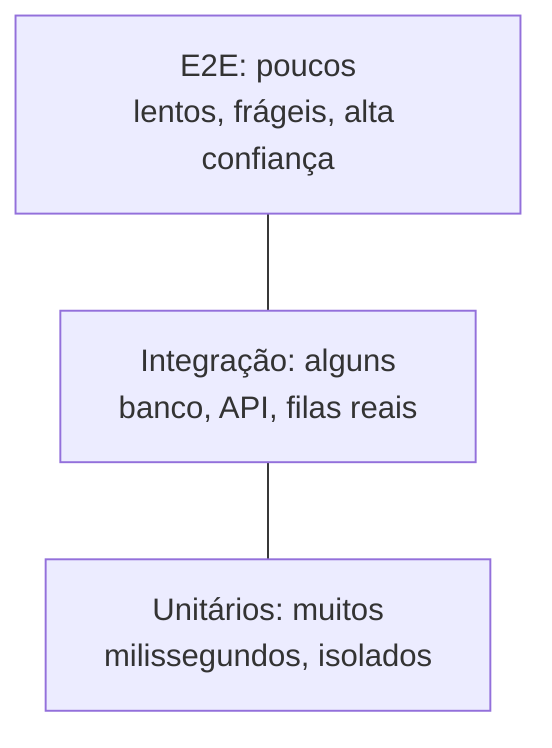
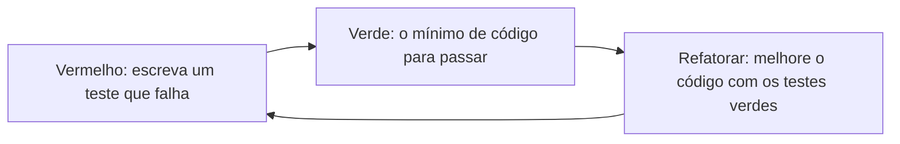

# Testes: unitário, integração, e2e, TDD

## Por que isso importa

Sem testes automatizados, toda mudança é uma aposta: você altera uma linha e torce para não ter quebrado nada em outro canto. Com testes, você muda o código com **confiança**, e o computador confere centenas de comportamentos em segundos. Testes também são a **documentação executável** do que o código deve fazer. Em empresas sérias, nenhum PR entra sem testes, e em testes técnicos para levar para casa, entregar a solução **com testes** costuma ser o que separa os aprovados.

## Intuição

Pense na fabricação de um carro.

- O **teste unitário** é testar cada peça na bancada: o freio para? a lâmpada acende? Rápido e barato, e quando falha você sabe exatamente qual peça.
- O **teste de integração** é montar o sistema de freio inteiro, com pedal, fluido e pastilhas, e ver se as peças conversam.
- O **teste de ponta a ponta (e2e)** é dar uma volta com o carro pronto. Prova que tudo funciona junto, mas é lento, caro, e quando falha você não sabe se foi o motor ou o pneu.

Você quer **muitos** testes de bancada, **alguns** de sistema e **poucos** de volta no carro. Essa é a **pirâmide de testes**.

## Visual



O ciclo do TDD:



## Conceito técnico

### Os níveis

| Nível | Testa | Velocidade | Exemplo |
|---|---|---|---|
| **Unitário** | uma função ou classe, isolada | milissegundos | `calcular_frete(250, "01310-100") == 0` |
| **Integração** | partes reais juntas (código + banco, código + API) | segundos | salvar um pedido no PostgreSQL de teste e ler de volta |
| **E2E** | o sistema inteiro pela interface do usuário | segundos a minutos | Playwright abre o site, faz login, compra e confere o e-mail |

Testes e2e quebram por motivos que não são bugs (um botão mudou de lugar, a rede oscilou): são **frágeis**. Por isso ficam no topo, cobrindo só os fluxos mais críticos.

### Anatomia de um bom teste: AAA

```text
def test_frete_gratis_a_partir_de_200():
    # Arrange (preparar)
    carrinho = Carrinho([Item(preco=200, qtd=1)])
    # Act (agir)
    valor = carrinho.frete(cep="50030-000")
    # Assert (verificar)
    assert valor == 0
```

Bons testes são **FIRST**: rápidos (*Fast*), **independentes** entre si (a ordem não importa), **repetíveis** (o mesmo resultado sempre, sem depender de data, rede ou sorte), **autoverificáveis** (passam ou falham, sem alguém ler a saída) e escritos **no tempo certo** (junto com o código). O nome do teste diz o comportamento: `test_frete_gratis_a_partir_de_200` em vez de `test_frete_2`.

### pytest em 30 segundos

```text
# arquivo test_frete.py
import pytest
from loja import frete

def test_sudeste_abaixo_do_limite():
    assert frete(100, "01310-100") == 15

@pytest.mark.parametrize("subtotal, esperado", [(199.99, 25), (200, 0), (250, 0)])
def test_limite_do_frete_gratis(subtotal, esperado):
    assert frete(subtotal, "50030-000") == esperado

def test_cep_invalido_lanca_erro():
    with pytest.raises(ValueError):
        frete(100, "123")
```

Rode com `pytest` na pasta do projeto. Ele encontra os arquivos `test_*.py`, roda as funções `test_*` e mostra a diferença quando um `assert` falha. **Fixtures** (`@pytest.fixture`) preparam dados ou recursos reaproveitados entre testes.

### Escolhendo os casos

Não dá para testar todas as entradas. Divida o espaço em **classes de equivalência** (entradas que devem se comportar igual) e teste um representante de cada, mais as **bordas** entre elas:

- frete: abaixo de 200, exatamente 200, acima; CEP do Sudeste, de outra região, inválido;
- listas: vazia, um elemento, muitos, com repetidos;
- números: zero, negativo, o maior valor permitido.

Os bugs moram nas bordas: `>` no lugar de `>=`, o laço que começa em 1.

### Dublês de teste

Para testar uma unidade isolada, trocamos suas dependências por **dublês** (como o dublê de cinema):

| Tipo | O que faz | Exemplo |
|---|---|---|
| **Dummy** | só preenche um parâmetro, nunca é usado | `None` no lugar de um logger |
| **Stub** | devolve respostas prontas | uma API de câmbio falsa que sempre responde 5,00 |
| **Spy** | registra como foi chamado, para conferir depois | guarda os e-mails "enviados" numa lista |
| **Mock** | spy com expectativas: falha se não for chamado do jeito esperado | `mock.assert_called_once_with(...)` |
| **Fake** | implementação real, mas simplificada | um repositório em memória no lugar do banco |

Em Python, `unittest.mock` cria stubs, spies e mocks; em JS, o Jest e o Vitest têm `vi.fn()` / `jest.fn()`. **Cuidado**: mockar demais acopla o teste à implementação. O teste passa a quebrar quando você refatora, mesmo sem mudar o comportamento. Prefira testar pelo comportamento visível e mockar só as **bordas** do sistema (rede, relógio, banco, e-mail).

### TDD

**Test-Driven Development**: o teste vem **antes** do código, em ciclos curtos:

1. **Vermelho**: escreva um teste pequeno para o próximo comportamento. Rode e veja falhar (isso prova que o teste testa algo).
2. **Verde**: escreva o **mínimo** de código para passar, mesmo que feio.
3. **Refatorar**: limpe o código e os testes, com tudo verde.

O TDD força interfaces fáceis de usar (você é o primeiro cliente do código) e deixa uma suíte de testes de brinde. Funciona muito bem para regras de negócio e algoritmos; é menos natural para explorar uma API desconhecida ou para código de interface.

### Cobertura e o que ela não diz

**Cobertura** mede quais linhas (ou ramos) rodaram durante os testes (`pytest --cov`). Cobertura baixa mostra código **sem** teste. Mas cobertura alta **não** garante bons testes: um teste sem nenhum `assert` cobre tudo e não verifica nada. Uma medida melhor é o **teste de mutação** (`mutmut`, Stryker): a ferramenta cria versões levemente erradas do código (troca `>=` por `>`, `and` por `or`) e confere se algum teste falha. Mutante que sobrevive é comportamento que nenhum teste verifica.

## Código

Uma suíte com `unittest` (da biblioteca padrão) e um dublê para o relógio, porque testes não podem depender da hora em que rodam:

```python
import unittest
from unittest.mock import Mock


def saudacao(relogio):
    hora = relogio.hora_atual()
    if hora < 12:
        return "Bom dia"
    if hora < 18:
        return "Boa tarde"
    return "Boa noite"


class TestSaudacao(unittest.TestCase):
    def test_manha(self):
        relogio = Mock()
        relogio.hora_atual.return_value = 9      # stub: resposta pronta
        self.assertEqual(saudacao(relogio), "Bom dia")

    def test_borda_do_meio_dia(self):
        relogio = Mock()
        relogio.hora_atual.return_value = 12
        self.assertEqual(saudacao(relogio), "Boa tarde")

    def test_noite_e_consulta_unica(self):
        relogio = Mock()
        relogio.hora_atual.return_value = 23
        self.assertEqual(saudacao(relogio), "Boa noite")
        relogio.hora_atual.assert_called_once()  # mock: verifica a interação


suite = unittest.TestLoader().loadTestsFromTestCase(TestSaudacao)
resultado = unittest.TextTestRunner(verbosity=2).run(suite)
print("todos passaram?", resultado.wasSuccessful())
```

## Erros comuns

- **Testes que dependem uns dos outros** ou da ordem de execução (um cria o usuário que o outro usa).
- **Testes que dependem do relógio, da rede ou de números aleatórios** sem controlá-los: passam hoje e falham amanhã (testes intermitentes).
- **Um teste verificando dez coisas**: quando falha, não se sabe o quê. Um comportamento por teste.
- **Testar a implementação, não o comportamento**: conferir que um método privado foi chamado três vezes.
- **Mockar tudo**, inclusive o próprio código sob teste.
- **Perseguir 100% de cobertura** com testes sem `assert` significativo.
- **Nunca ver o teste falhar**: um teste que nunca falhou pode não estar testando nada.
- **Pirâmide invertida**: centenas de testes e2e lentos e poucos unitários.

## Pratique

```quiz
id: ES-06-q1
tipo: multipla_escolha
pergunta: "Um teste sobe um PostgreSQL de teste, salva um pedido pelo repositório e lê de volta. Que tipo de teste é esse?"
opcoes: ["Unitário", "Integração", "Ponta a ponta (e2e)", "Teste de mutação"]
resposta: 1
explicacao: "Ele verifica que duas partes reais conversam: o código do repositório e o banco de dados. Não é unitário (há uma dependência real) nem e2e (não passa pela interface do usuário)."
dificuldade: 1
```

```quiz
id: ES-06-q2
tipo: multipla_escolha
pergunta: "Para testar que um pedido pago dispara um e-mail, você troca o serviço de e-mail por um objeto que guarda numa lista as mensagens recebidas, e depois confere a lista. Esse dublê é um:"
opcoes: ["Dummy", "Stub", "Spy", "Fake de banco de dados"]
resposta: 2
explicacao: "Um spy registra como foi chamado para o teste conferir depois. Um stub só devolveria respostas prontas; um dummy nem seria usado."
dificuldade: 1
```

```quiz
id: ES-06-q3
tipo: verdadeiro_falso
pergunta: "Se a cobertura de testes de um projeto é 100%, todo comportamento do código está verificado."
resposta: false
explicacao: "Cobertura só diz que as linhas rodaram, não que o resultado foi conferido. Um teste sem assert cobre tudo e não verifica nada. Teste de mutação mede melhor: ele confere se os testes detectam pequenas mudanças no código."
dificuldade: 1
```

```quiz
id: ES-06-q4
tipo: resposta_curta
pergunta: "No TDD, por que é importante ver o teste falhar antes de escrever o código?"
resposta: "Para ter certeza de que o teste realmente verifica o comportamento: se ele passasse antes de existir o código, estaria errado (testando a coisa errada ou sem assert). Ver o vermelho prova que o teste é capaz de falhar."
palavras_chave: ["falhar", "verifica", "certeza", "errado"]
dificuldade: 2
```

```quiz
id: ES-06-q5
tipo: multipla_escolha
pergunta: "Uma função aceita idades de 18 a 65 (inclusive). Qual conjunto de casos de teste é o melhor?"
opcoes: ["30, 40, 50", "17, 18, 65, 66", "0, 100", "18, 30"]
resposta: 1
explicacao: "Os bugs ficam nas bordas: 17 e 66 estão logo fora, 18 e 65 logo dentro. Eles pegam um > no lugar de >= em qualquer um dos limites. Os valores do meio pertencem à mesma classe de equivalência e não acrescentam muito."
dificuldade: 1
```

```quiz
id: ES-06-q6
tipo: codigo
linguagem: python
pergunta: |
  **Testes que matam mutantes.** A função `bissexto(ano)` está correta: um ano é bissexto se for divisível por 4 e não por 100, ou se for divisível por 400. A função `avaliar` roda os seus casos de teste contra a versão correta e contra 4 **mutantes** (versões com um erro sutil) e devolve `(todos_corretos, mutantes_mortos, total_de_mutantes)`.

  Edite a lista `CASOS` (pares `(ano, esperado)`) até que **todos os casos estejam certos** e **os 4 mutantes morram** (cada um falha em pelo menos um caso). Use no máximo 6 casos.
codigo_inicial: |
  CASOS = [
      (2024, True),
  ]

  # não mude daqui para baixo: os testes usam estas funções
  def bissexto(ano):
      return (ano % 4 == 0 and ano % 100 != 0) or ano % 400 == 0

  MUTANTES = [
      lambda ano: ano % 4 == 0,
      lambda ano: ano % 4 == 0 and ano % 100 != 0,
      lambda ano: ano % 400 == 0,
      lambda ano: True,
  ]

  def avaliar(casos):
      corretos = all(bissexto(a) == esperado for a, esperado in casos)
      mortos = sum(1 for m in MUTANTES if any(m(a) != esperado for a, esperado in casos))
      return corretos, mortos, len(MUTANTES)
usa: [def, return]
testes:
  - chamada: "avaliar(CASOS)"
    saida: "(True, 4, 4)"
  - chamada: "len(CASOS) <= 6"
    saida: "True"
  - chamada: "avaliar(CASOS)"
    visivel: false
    saida: "(True, 4, 4)"
dica: "Para cada mutante, pense num ano em que ele erra: o primeiro acha que 1900 é bissexto, o segundo acha que 2000 não é, o terceiro acha que 2024 não é, e o último acha que qualquer ano é."
solucao: |
  CASOS = [
      (2024, True),
      (2023, False),
      (1900, False),
      (2000, True),
  ]

  # não mude daqui para baixo: os testes usam estas funções
  def bissexto(ano):
      return (ano % 4 == 0 and ano % 100 != 0) or ano % 400 == 0

  MUTANTES = [
      lambda ano: ano % 4 == 0,
      lambda ano: ano % 4 == 0 and ano % 100 != 0,
      lambda ano: ano % 400 == 0,
      lambda ano: True,
  ]

  def avaliar(casos):
      corretos = all(bissexto(a) == esperado for a, esperado in casos)
      mortos = sum(1 for m in MUTANTES if any(m(a) != esperado for a, esperado in casos))
      return corretos, mortos, len(MUTANTES)
explicacao: "Quatro casos, um por classe de equivalência da regra: divisível por 4 comum (2024), não divisível por 4 (2023), divisível por 100 mas não por 400 (1900), divisível por 400 (2000). Só com 2024, o teste dava 100% de cobertura de linhas e mesmo assim deixava três mutantes vivos. É exatamente isso que ferramentas como mutmut medem."
dificuldade: 2
```

```quiz
id: ES-06-q7
tipo: codigo
linguagem: python
pergunta: |
  **Um mini pytest.** Escreva `rodar(testes)`, que recebe um dicionário `nome -> função de teste`, roda cada uma (na ordem do dicionário) e devolve um dicionário `nome -> resultado`:

  - `'ok'` se a função terminar sem exceção;
  - `'falhou'` se lançar `AssertionError` sem mensagem, ou `'falhou: <mensagem>'` se tiver mensagem;
  - `'erro: <NomeDaExceção>'` para qualquer outra exceção.

  Um teste que dá erro não pode impedir os seguintes de rodar.
codigo_inicial: |
  def rodar(testes):
      resultados = {}
      for nome, teste in testes.items():
          teste()
          resultados[nome] = 'ok'
      return resultados

  # não mude: os testes usam estas funções
  def t_ok():
      assert 1 + 1 == 2

  def t_falha():
      assert 1 + 1 == 3

  def t_com_mensagem():
      assert [] == [1], 'lista vazia'

  def t_erro():
      return 1 / 0

  def t_chave():
      return {}['x']
usa: [def, for, try, return]
testes:
  - chamada: "rodar({'soma': t_ok})"
    saida: "{'soma': 'ok'}"
  - chamada: "rodar({'a': t_ok, 'b': t_falha})"
    saida: "{'a': 'ok', 'b': 'falhou'}"
  - chamada: "rodar({'div': t_erro, 'depois': t_ok})"
    saida: "{'div': 'erro: ZeroDivisionError', 'depois': 'ok'}"
  - chamada: "rodar({'m': t_com_mensagem, 'k': t_chave, 'ok': t_ok})"
    visivel: false
    saida: "{'m': 'falhou: lista vazia', 'k': 'erro: KeyError', 'ok': 'ok'}"
  - chamada: "rodar({})"
    visivel: false
    saida: "{}"
dica: "Envolva a chamada num try. Trate primeiro except AssertionError as e (str(e) é a mensagem, vazia se não houver) e depois except Exception as e, usando type(e).__name__."
solucao: |
  def rodar(testes):
      resultados = {}
      for nome, teste in testes.items():
          try:
              teste()
              resultados[nome] = 'ok'
          except AssertionError as e:
              mensagem = str(e)
              resultados[nome] = f'falhou: {mensagem}' if mensagem else 'falhou'
          except Exception as e:
              resultados[nome] = f'erro: {type(e).__name__}'
      return resultados

  # não mude: os testes usam estas funções
  def t_ok():
      assert 1 + 1 == 2

  def t_falha():
      assert 1 + 1 == 3

  def t_com_mensagem():
      assert [] == [1], 'lista vazia'

  def t_erro():
      return 1 / 0

  def t_chave():
      return {}['x']
explicacao: "É a distinção que o pytest e o unittest fazem entre falha (F: a verificação não bateu, o código está errado) e erro (E: o teste nem conseguiu chegar ao fim, talvez o próprio teste esteja quebrado). A ordem dos except importa: AssertionError também é uma Exception, então precisa vir antes. O pytest vai além e reescreve os assert para mostrar os valores dos dois lados da comparação."
dificuldade: 2
```

```quiz
id: ES-06-q8
tipo: codigo
linguagem: javascript
pergunta: |
  **Um espião (spy) como o jest.fn().** Escreva `criarEspiao(retorno)` que devolve uma **função**:

  - toda vez que é chamada, guarda a lista de argumentos em `f.chamadas` (uma lista de listas) e devolve `retorno`;
  - tem o método `f.foiChamadoCom(...args)`, que devolve `true` se alguma chamada teve **exatamente** esses argumentos (mesma quantidade e mesmos valores, comparados com `===`).

  Cada espião tem as suas próprias chamadas.
codigo_inicial: |
  function criarEspiao(retorno) {
    function f() {
      return retorno;
    }
    return f;
  }
usa: [function, return]
testes:
  - chamada: "(() => { const f = criarEspiao(42); return [f(1, 2), f('a'), f.chamadas]; })()"
    saida: "[ 42, 42, [ [ 1, 2 ], [ 'a' ] ] ]"
  - chamada: "(() => { const f = criarEspiao(); return [f(), f.chamadas]; })()"
    saida: "[ undefined, [ [] ] ]"
  - chamada: "(() => { const f = criarEspiao(0); f(1, 2); return [f.foiChamadoCom(1, 2), f.foiChamadoCom(2, 1), f.foiChamadoCom(1)]; })()"
    saida: "[ true, false, false ]"
  - chamada: "(() => { const a = criarEspiao('a'); const b = criarEspiao('b'); a(1); a(2); b(3); return [a.chamadas.length, b.chamadas.length, b.foiChamadoCom(1)]; })()"
    visivel: false
    saida: "[ 2, 1, false ]"
  - chamada: "(() => { const f = criarEspiao(null); return [f.foiChamadoCom(), f.chamadas.length]; })()"
    visivel: false
    saida: "[ false, 0 ]"
dica: "Use parâmetros rest: function f(...args) { f.chamadas.push(args); ... }. Funções são objetos em JS, então dá para criar f.chamadas = [] e f.foiChamadoCom = function (...esperados) { ... }."
solucao: |
  function mesmosArgumentos(a, b) {
    if (a.length !== b.length) return false;
    for (let i = 0; i < a.length; i++) {
      if (a[i] !== b[i]) return false;
    }
    return true;
  }

  function criarEspiao(retorno) {
    function f(...args) {
      f.chamadas.push(args);
      return retorno;
    }
    f.chamadas = [];
    f.foiChamadoCom = function (...esperados) {
      for (const c of f.chamadas) {
        if (mesmosArgumentos(c, esperados)) return true;
      }
      return false;
    };
    return f;
  }
explicacao: "É assim, por dentro, que jest.fn() e vi.fn() funcionam: uma função que é também um objeto com o histórico das chamadas (mock.calls) e asserções como toHaveBeenCalledWith. O último teste mostra uma armadilha: um espião que nunca foi chamado não foi chamado com nada, nem com zero argumentos. Bibliotecas reais comparam com igualdade profunda; aqui usamos === por simplicidade."
dificuldade: 2
```

## Resumo

- **Pirâmide**: muitos unitários, alguns de integração, poucos e2e.
- Testes **AAA** (preparar, agir, verificar) e **FIRST** (rápidos, independentes, repetíveis, autoverificáveis, no tempo certo).
- Escolha casos por **classes de equivalência** e **bordas**.
- **Dublês**: dummy, stub, spy, mock, fake. Mocke as bordas (rede, relógio, banco), não o próprio código.
- **TDD**: vermelho, verde, refatorar.
- **Cobertura** mostra o que não foi testado; **teste de mutação** mostra se os testes verificam de verdade.

## Para ir além

- Instale o pytest e escreva testes para os desafios que você já resolveu nesta trilha.
- Faça um kata de TDD (o "String Calculator" é clássico) seguindo o ciclo à risca.
- **Próximo módulo**: ES-07 Refatoração e débito técnico.
