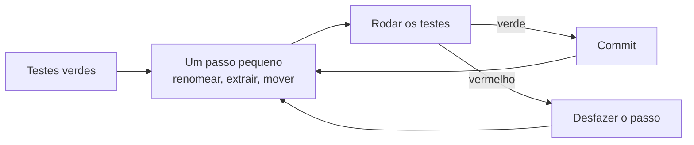

# Refatoração e débito técnico

## Por que isso importa

Quase todo trabalho real é em **código que já existe**, escrito por outras pessoas, com pressa, sob requisitos que mudaram. Você vai passar mais tempo **mudando** código do que escrevendo do zero. Refatorar é a habilidade de melhorar a estrutura desse código **sem quebrar nada**, em passos tão pequenos que dá para parar a qualquer momento. E débito técnico é o vocabulário para conversar com o time e com a gestão sobre **por que** vale a pena gastar tempo nisso, em termos que eles entendem: custo e risco.

## Intuição

Refatorar é **arrumar a cozinha enquanto cozinha**. Você não fecha o restaurante por uma semana para reformar (isso é a reescrita, e quase sempre dá errado). Você guarda a panela que já usou, limpa a bancada antes do próximo prato. Cada arrumação é pequena e o restaurante continua funcionando.

**Débito técnico** é como um **empréstimo**. Às vezes vale pegar: entregar rápido para a feira de amanhã, sabendo que o código está improvisado. Mas o empréstimo cobra **juros**: cada mudança naquele código improvisado custa um pouco mais. Se você nunca paga o principal, os juros comem todo o orçamento, e o time passa o dia contornando gambiarras em vez de construir coisas novas.

## Visual

O ciclo seguro de refatoração:



O quadrante do débito técnico (Martin Fowler):

```text
                 Imprudente                       Prudente
            +-------------------------------+-------------------------------+
Deliberado  | "Não temos tempo para         | "Precisamos lançar agora e    |
            |  design."                     |  vamos lidar com as           |
            |                               |  consequências."              |
            +-------------------------------+-------------------------------+
Inadvertido | "O que é separar em           | "Agora sabemos como           |
            |  camadas?"                    |  deveríamos ter feito."       |
            +-------------------------------+-------------------------------+
```

## Conceito técnico

### O que é (e o que não é) refatorar

**Refatoração** é mudar a estrutura interna do código **sem mudar o comportamento observável**. Se o comportamento muda, não é refatoração: é uma funcionalidade nova ou a correção de um bug. Misturar os dois no mesmo commit dificulta a revisão e o rastreio de problemas. Use os "dois chapéus": ou você está adicionando comportamento, ou está refatorando, nunca os dois ao mesmo tempo.

**Quando refatorar**:

- **Preparatória**: "primeiro torne a mudança fácil (isso pode ser difícil), depois faça a mudança fácil" (Kent Beck). Antes de adicionar um tipo de desconto, transforme o `if/elif` em classes.
- **Para entender**: ao ler um código confuso, renomeie e extraia até ele fazer sentido.
- **Regra do escoteiro**: deixe o código um pouco melhor do que encontrou.
- **No passo "refatorar" do TDD** (ES-06).

**Quando não**: código que ninguém vai mudar; código sem nenhum teste e sem tempo de criar uma rede de proteção; às vésperas de uma entrega crítica.

### Code smells e as refatorações que os tratam

| Smell (sintoma) | Refatoração |
|---|---|
| **Função longa** | Extrair função, decompor condicional |
| **Nome que não diz nada** | Renomear (variável, função, classe) |
| **Código duplicado** (o mesmo conhecimento) | Extrair função, puxar para a classe base |
| **Lista longa de parâmetros** | Introduzir objeto de parâmetro |
| **Condicional complexa** | Decompor condicional, guard clauses, extrair variável explicativa |
| **`switch` sobre tipo repetido em vários lugares** | Substituir condicional por polimorfismo |
| **Número mágico** | Substituir por constante com nome |
| **Inveja de funcionalidade** (método que usa mais dados de outra classe) | Mover função |
| **Classe grande / Deus** | Extrair classe |
| **Grupos de dados** (sempre os mesmos 3 campos juntos) | Extrair classe (`Endereco`, `Periodo`) |
| **Obsessão por primitivos** (CPF como `str` solta) | Substituir primitivo por objeto |
| **Comentário explicando o que o código faz** | Extrair função com o nome do comentário |
| **Código morto** | Apagar |

### Refatorando com segurança

1. **Rede de proteção**: testes cobrindo o comportamento que vai ser mexido. Sem testes, o primeiro passo é escrevê-los.
2. **Passos minúsculos**: cada um leva segundos e deixa o código funcionando. Renomeie; rode os testes. Extraia; rode os testes.
3. **Commits frequentes**: se algo der errado, volte ao último verde (`git restore .`) em vez de depurar.
4. **Use a IDE**: renomear, extrair e mover automáticos (VS Code, PyCharm) atualizam todas as referências sem erro de digitação.

### Código legado

Michael Feathers define código legado como "código sem testes". Para mexer nele:

- **Testes de caracterização**: em vez de testar o que o código **deveria** fazer, registre o que ele **faz hoje**, inclusive as esquisitices. Rode com várias entradas, guarde as saídas, e use isso como rede para refatorar. Corrigir os bugs vem depois, separado.
- **Costuras** (*seams*): pontos onde dá para trocar uma dependência sem editar o código, como um parâmetro com valor padrão, para conseguir testar.
- **Figueira estranguladora** (*strangler fig*): para substituir um sistema inteiro, construa o novo **ao redor** do antigo, desviando uma rota de cada vez, até o antigo não ter mais função. É o oposto da "grande reescrita", que congela o produto por meses e quase sempre atrasa.

### Débito técnico

O termo (Ward Cunningham, 1992) compara atalhos de design a um empréstimo:

- **Principal**: o esforço para fazer do jeito certo.
- **Juros**: o custo extra que cada mudança paga enquanto o atalho existe (tempo, bugs, onboarding mais lento).

Nem todo débito é ruim: o **deliberado e prudente** é uma decisão de negócio legítima, desde que registrada e paga. O perigoso é o **imprudente** e o **invisível**.

**Gerenciando**:

- **Torne visível**: registre itens de débito no backlog com o custo estimado (esforço) e os juros (quanto atrapalha por semana).
- **Priorize pelos juros**: débito em código que ninguém mexe quase não cobra juros. Pague primeiro o que está no caminho do trabalho dos próximos meses.
- **Reserve capacidade**: muitos times reservam uma fatia de cada sprint (por exemplo, 15 a 20%) para débito e melhorias.
- **Pague junto com as funcionalidades**: a refatoração preparatória coloca o pagamento no caminho do valor entregue.

## Código

Um teste de caracterização: registrar o comportamento atual de uma função legada para refatorá-la sem medo.

```python
import itertools

def legado(pontos, vip, dias):
    r = 0
    if vip == True:
        if pontos > 1000:
            r = 3
        else:
            if dias > 30:
                r = 2
            else:
                r = 1
    else:
        if pontos > 1000:
            if dias > 30:
                r = 2
            else:
                r = 1
        else:
            r = 0
    return r

# 1. registra o que a função faz hoje, numa grade de entradas que inclui as bordas
entradas = list(itertools.product([0, 1000, 1001, 5000], [True, False], [0, 30, 31]))
fotografia = {e: legado(*e) for e in entradas}
print(len(fotografia), "comportamentos registrados")

# 2. a versão refatorada
def nivel_fidelidade(pontos, vip, dias):
    muitos_pontos = pontos > 1000
    cliente_antigo = dias > 30
    if vip:
        return 3 if muitos_pontos else (2 if cliente_antigo else 1)
    if not muitos_pontos:
        return 0
    return 2 if cliente_antigo else 1

# 3. confere que nada mudou
divergencias = [e for e in entradas if nivel_fidelidade(*e) != fotografia[e]]
print("divergências:", divergencias)
```

## Erros comuns

- **Refatorar sem testes** e descobrir semanas depois que um caso de borda mudou.
- **Passos grandes demais**: "vou reorganizar o módulo inteiro" e o código fica quebrado por dois dias.
- **Misturar refatoração com funcionalidade** no mesmo commit ou PR.
- **A grande reescrita**: parar tudo para refazer do zero, perder as regras escondidas no código antigo e chegar atrasado com menos funcionalidades.
- **Corrigir as esquisitices do legado durante a refatoração**: alguém pode depender delas. Registre, refatore, e corrija depois, separadamente.
- **Usar "débito técnico" para qualquer código de que você não gosta**: débito é o que cobra juros reais.
- **Nunca pagar o débito**: "depois a gente arruma" que nunca chega.

## Pratique

```quiz
id: ES-07-q1
tipo: multipla_escolha
pergunta: "Qual destas mudanças NÃO é uma refatoração?"
opcoes: ["Renomear a variável d para dias_de_atraso", "Extrair o cálculo de juros para uma função própria", "Corrigir o cálculo de juros que usava 30 dias em vez de 31", "Trocar um número mágico por uma constante com nome"]
resposta: 2
explicacao: "Corrigir o cálculo muda o comportamento observável: é a correção de um bug, não uma refatoração. Deve ir num commit separado, de preferência com um teste que mostre o erro."
dificuldade: 1
```

```quiz
id: ES-07-q2
tipo: multipla_escolha
pergunta: "A função calcular_frete recebe rua, numero, bairro, cidade, estado e cep, e essas seis variáveis aparecem juntas em vários lugares. Qual refatoração é indicada?"
opcoes: ["Renomear a função", "Introduzir um objeto de parâmetro (Endereco)", "Inline function", "Substituir condicional por polimorfismo"]
resposta: 1
explicacao: "É o smell 'grupos de dados' com 'lista longa de parâmetros'. Uma classe Endereco agrupa os campos, reduz os parâmetros e vira o lugar natural para regras como validar o CEP."
dificuldade: 1
```

```quiz
id: ES-07-q3
tipo: verdadeiro_falso
pergunta: "Ao escrever testes de caracterização para código legado, você deve registrar o comportamento correto esperado, mesmo que o código atual faça diferente."
resposta: false
explicacao: "Testes de caracterização registram o que o código faz hoje, inclusive os bugs. O objetivo é ter uma rede de proteção para refatorar sem mudar nada. Corrigir os comportamentos errados vem depois, como mudanças separadas e conscientes."
dificuldade: 2
```

```quiz
id: ES-07-q4
tipo: resposta_curta
pergunta: "Por que a estratégia da figueira estranguladora costuma ser mais segura que reescrever um sistema legado do zero?"
resposta: "Porque substitui o sistema aos poucos, uma rota ou funcionalidade de cada vez, mantendo tudo em produção e entregando valor continuamente. Cada passo é pequeno e reversível, e as regras escondidas no código antigo vão sendo descobertas uma a uma, em vez de tudo de uma vez no fim de uma reescrita longa."
palavras_chave: ["aos poucos", "produção", "reversível", "valor"]
dificuldade: 2
```

```quiz
id: ES-07-q5
tipo: multipla_escolha
pergunta: "O time diz: 'vamos lançar com o pagamento acoplado ao checkout para chegar na Black Friday, e em dezembro separamos'. Em qual quadrante de Fowler isso cai?"
opcoes: ["Deliberado e imprudente", "Deliberado e prudente", "Inadvertido e imprudente", "Inadvertido e prudente"]
resposta: 1
explicacao: "É uma escolha consciente (deliberado), com o custo conhecido e um plano de pagamento (prudente). Continua sendo dívida: se dezembro passar sem o pagamento, os juros começam a pesar."
dificuldade: 1
```

```quiz
id: ES-07-q6
tipo: codigo
linguagem: python
pergunta: |
  **Refatore com rede de proteção.** A função `legado` funciona, mas tem `if`s aninhados e `== True`. Escreva `nivel_fidelidade(pontos, vip, dias)` com **exatamente o mesmo comportamento**, porém legível (guard clauses, variáveis com nome).

  A função `divergencias()` compara as duas numa grade de entradas que inclui as bordas e devolve as entradas em que elas diferem. O objetivo é a lista vazia.
codigo_inicial: |
  def nivel_fidelidade(pontos, vip, dias):
      pass  # reescreva aqui

  # não mude daqui para baixo: os testes usam estas funções
  def legado(pontos, vip, dias):
      r = 0
      if vip == True:
          if pontos > 1000:
              r = 3
          else:
              if dias > 30:
                  r = 2
              else:
                  r = 1
      else:
          if pontos > 1000:
              if dias > 30:
                  r = 2
              else:
                  r = 1
          else:
              r = 0
      return r

  def divergencias():
      entradas = [(p, v, d) for p in (0, 999, 1000, 1001, 5000) for v in (True, False) for d in (0, 30, 31, 400)]
      return [e for e in entradas if nivel_fidelidade(*e) != legado(*e)]
usa: [def, if, return]
testes:
  - chamada: "divergencias()"
    saida: "[]"
  - chamada: "nivel_fidelidade(5000, True, 0)"
    saida: "3"
  - chamada: "nivel_fidelidade(10, False, 400)"
    saida: "0"
  - chamada: "nivel_fidelidade(1001, False, 31)"
    visivel: false
    saida: "2"
  - chamada: "nivel_fidelidade(1000, True, 30)"
    visivel: false
    saida: "1"
dica: "Dê nome às duas perguntas que se repetem: muitos_pontos = pontos > 1000 e cliente_antigo = dias > 30. Depois trate o VIP primeiro, com um return; para o não VIP, um guard clause para quem não tem muitos pontos."
solucao: |
  def nivel_fidelidade(pontos, vip, dias):
      muitos_pontos = pontos > 1000
      cliente_antigo = dias > 30
      if vip:
          if muitos_pontos:
              return 3
          return 2 if cliente_antigo else 1
      if not muitos_pontos:
          return 0
      return 2 if cliente_antigo else 1

  # não mude daqui para baixo: os testes usam estas funções
  def legado(pontos, vip, dias):
      r = 0
      if vip == True:
          if pontos > 1000:
              r = 3
          else:
              if dias > 30:
                  r = 2
              else:
                  r = 1
      else:
          if pontos > 1000:
              if dias > 30:
                  r = 2
              else:
                  r = 1
          else:
              r = 0
      return r

  def divergencias():
      entradas = [(p, v, d) for p in (0, 999, 1000, 1001, 5000) for v in (True, False) for d in (0, 30, 31, 400)]
      return [e for e in entradas if nivel_fidelidade(*e) != legado(*e)]
explicacao: "A grade inclui 1000 e 1001, 30 e 31: as bordas onde um > trocado por >= mudaria o resultado. Refatorada, a regra fica visível: VIP com muitos pontos é nível 3; o tempo de casa só desempata entre 1 e 2; não VIP sem muitos pontos é 0. Repare que 'VIP com poucos pontos' ganha pelo menos 1 e 'não VIP com muitos pontos' também: talvez seja proposital, talvez seja bug, mas essa pergunta é para outra mudança, não para a refatoração."
dificuldade: 2
```

```quiz
id: ES-07-q7
tipo: codigo
linguagem: python
pergunta: |
  **Qual débito pagar primeiro?** Cada item é `(nome, esforco_dias, juros_horas_por_semana)`. O **retorno** de um item é quantas semanas de juros economizados pagam o esforço: `esforco_dias * 8 / juros`. Escreva `priorizar(debitos)` que devolve os nomes ordenados do **menor** retorno para o maior (empate: ordem alfabética). Itens com juros 0 não cobram nada e ficam de fora.
codigo_inicial: |
  def priorizar(debitos):
      return [nome for nome, esforco, juros in sorted(debitos)]
usa: [def, return]
testes:
  - chamada: "priorizar([('testes do checkout', 5, 10), ('separar pagamento', 20, 8), ('renomear tabelas', 1, 1)])"
    saida: "['testes do checkout', 'renomear tabelas', 'separar pagamento']"
  - chamada: "priorizar([('a', 1, 0), ('b', 2, 4)])"
    saida: "['b']"
  - chamada: "priorizar([])"
    saida: "[]"
  - chamada: "priorizar([('zeta', 2, 4), ('alfa', 1, 2), ('meio', 10, 1)])"
    visivel: false
    saida: "['alfa', 'zeta', 'meio']"
  - chamada: "priorizar([('x', 3, 0), ('y', 0, 0)])"
    visivel: false
    saida: "[]"
dica: "Filtre os juros > 0 e ordene com key=lambda d: (d[1] * 8 / d[2], d[0])."
solucao: |
  def priorizar(debitos):
      com_juros = [d for d in debitos if d[2] > 0]
      com_juros.sort(key=lambda d: (d[1] * 8 / d[2], d[0]))
      return [nome for nome, esforco, juros in com_juros]
explicacao: "Os testes do checkout custam 40 horas e economizam 10 por semana: se pagam em 4 semanas. Separar o pagamento é o maior item (160 horas, 20 semanas para se pagar): pode até ser o mais importante, mas não é o melhor retorno agora. Débito sem juros, num código que ninguém mexe, pode ficar onde está. Esse tipo de conta transforma 'o código está feio' numa conversa de custo e benefício com a gestão."
dificuldade: 1
```

```quiz
id: ES-07-q8
tipo: codigo
linguagem: javascript
pergunta: |
  **Caçando duplicação.** Escreva `linhasRepetidas(codigo, minimo)` que devolve as linhas que aparecem **pelo menos** `minimo` vezes no código, como pares `[linha, vezes]`:

  - compare as linhas sem os espaços das pontas (`trim`);
  - ignore linhas vazias e linhas que, sem espaços, são só `{`, `}` ou `};`;
  - ordene por vezes (maior primeiro) e, no empate, pela linha em ordem alfabética (`localeCompare`).
codigo_inicial: |
  function linhasRepetidas(codigo, minimo) {
    return [];
  }
usa: [function, for, return]
testes:
  - chamada: "linhasRepetidas('total += preco;\\nlog(total);\\n  total += preco;\\n', 2)"
    saida: "[ [ 'total += preco;', 2 ] ]"
  - chamada: "linhasRepetidas('if (x) {\\n}\\nif (x) {\\n}\\n', 2)"
    saida: "[ [ 'if (x) {', 2 ] ]"
  - chamada: "linhasRepetidas('a();\\nb();', 2)"
    saida: "[]"
  - chamada: "linhasRepetidas('b();\\na();\\nb();\\na();\\nc();\\nc();\\nc();\\n};\\n};', 2)"
    visivel: false
    saida: "[ [ 'c();', 3 ], [ 'a();', 2 ], [ 'b();', 2 ] ]"
  - chamada: "linhasRepetidas('x;\\n\\n\\n', 1)"
    visivel: false
    saida: "[ [ 'x;', 1 ] ]"
dica: "Conte com um objeto ou Map. Depois transforme em lista de pares, filtre pelo mínimo e ordene com (a, b) => b[1] - a[1] || a[0].localeCompare(b[0])."
solucao: |
  function linhasRepetidas(codigo, minimo) {
    const ignorar = ['', '{', '}', '};'];
    const contagem = new Map();
    for (const bruta of codigo.split('\n')) {
      const linha = bruta.trim();
      if (ignorar.includes(linha)) continue;
      contagem.set(linha, (contagem.get(linha) || 0) + 1);
    }
    return [...contagem.entries()]
      .filter((par) => par[1] >= minimo)
      .sort((a, b) => b[1] - a[1] || a[0].localeCompare(b[0]));
  }
explicacao: "Ferramentas como jscpd, PMD CPD e SonarQube fazem isso com blocos de várias linhas e comparando tokens, para não serem enganadas por espaços ou nomes de variáveis. Mas lembre do DRY da ES-04: duplicação de texto é um sinal para investigar, não uma ordem para abstrair. Duas linhas iguais que representam regras diferentes podem e devem continuar separadas."
dificuldade: 2
```

## Resumo

- **Refatorar** é mudar a estrutura **sem mudar o comportamento**. Um chapéu de cada vez.
- **Code smells** apontam onde refatorar; cada um tem refatorações típicas (extrair, renomear, mover, polimorfismo).
- Segurança: **testes**, **passos minúsculos**, **commits frequentes**, refatorações automáticas da IDE.
- Legado: **testes de caracterização**, costuras e **figueira estranguladora** no lugar da grande reescrita.
- **Débito técnico**: principal e juros; quadrante deliberado/inadvertido e prudente/imprudente; torne visível e pague pelos **juros**.

## Para ir além

- Leia o catálogo do refactoring.com e pratique 5 refatorações com o atalho da sua IDE.
- Faça o kata "Gilded Rose" (há versões em várias linguagens): é código legado de propósito, feito para praticar testes de caracterização e refatoração.
- **Próximo módulo**: ES-08 Code review e colaboração.
