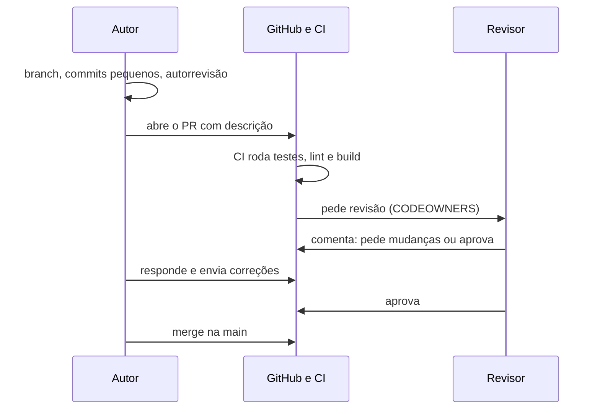

# Code review e colaboração

## Por que isso importa

Software profissional é feito em **time**. Antes de entrar na branch principal, quase todo código passa por um **pull request** (PR) que outra pessoa revisa. É ali que bugs são pegos, que o conhecimento do sistema se espalha e que um júnior mais aprende. Também é ali que muitos atritos acontecem: PRs gigantes que ninguém quer revisar, comentários ríspidos, discussões sobre vírgulas. Saber **pedir** e **fazer** uma boa revisão é uma das habilidades mais visíveis no dia a dia, e o seu histórico de PRs e commits no GitHub é, na prática, parte do seu currículo.

## Intuição

Uma revisão de código é como a **revisão de um texto por um colega antes de publicar**. O revisor não está lá para provar que é mais inteligente, e sim para que o texto publicado seja o melhor possível. Um bom autor facilita: entrega um texto curto, explica o objetivo e aponta onde tem dúvidas. Um bom revisor separa o que é **erro** ("essa data está errada") do que é **gosto** ("eu teria usado outra palavra") e diz com clareza qual é qual.

## Visual

O fluxo de um pull request:



## Conceito técnico

### Para que serve o code review

1. **Encontrar defeitos** cedo, quando são baratos de corrigir.
2. **Espalhar conhecimento**: pelo menos duas pessoas conhecem cada parte do código (menos dependência de uma pessoa só).
3. **Manter a consistência** do design e das convenções.
4. **Ensinar e aprender**, nos dois sentidos.

### O que procurar (em ordem de importância)

1. **Design**: a mudança faz sentido aqui? Encaixa na arquitetura?
2. **Funcionalidade**: faz o que promete? E os casos de borda, os erros, a concorrência?
3. **Complexidade**: dá para entender rápido? Tem algo que poderia ser mais simples?
4. **Testes**: existem, testam o comportamento certo, falhariam se o código quebrasse?
5. **Nomes e comentários** (ES-03).
6. **Segurança**: entrada do usuário validada, sem segredos no código, consultas parametrizadas.
7. **Estilo**: **automatize** com formatador e linter no CI. Humanos não deveriam discutir espaços.

### O lado do autor: PRs fáceis de revisar

- **Pequenos**: estudos de grandes empresas indicam que a qualidade da revisão cai muito acima de algumas centenas de linhas. Uma mudança grande vira vários PRs em sequência.
- **Uma coisa por PR**: refatoração separada de funcionalidade (ES-07).
- **Descrição** com: o **porquê** (link para a história ou issue), o **que** mudou, **como testar**, e capturas de tela para mudanças visuais.
- **Autorrevisão**: leia o próprio diff antes de pedir revisão; você vai achar prints esquecidos e arquivos que não deveriam estar ali.
- **CI verde** antes de chamar alguém.
- **Responda a todos os comentários**: com a correção ou com o motivo de não corrigir.

### O lado do revisor: comentários que ajudam

- **Comente o código, não a pessoa**: "essa função pode receber None" em vez de "você esqueceu o None".
- **Explique o porquê** e, quando puder, sugira o como.
- **Pergunte quando não entender**: "o que acontece se a lista vier vazia?" Às vezes o autor já pensou nisso; às vezes não.
- **Deixe claro o peso** do comentário. O padrão *Conventional Comments* usa rótulos:

```text
problema: a consulta roda dentro do laço, um SELECT por pedido (N+1, BD-07).
sugestão (não bloqueia): extrair essa regra para uma função ajudaria no teste.
pergunta: por que 3 tentativas e não 5?
nit: o nome `tmp` poderia dizer o que guarda.
elogio: ótimo o teste para o caso de borda do fuso horário!
```

- **Elogie o que está bom**: reforça boas práticas e torna a revisão uma conversa, não uma prova.
- **Seja rápido**: um PR parado bloqueia o colega. Muitos times combinam responder no mesmo dia.
- **Aprove com pequenos ajustes**: se só restam nits, aprove e confie no autor para corrigir.

### Fluxos de trabalho com Git

| Fluxo | Como funciona | Quando usar |
|---|---|---|
| **Trunk-based** | branches curtas (horas ou poucos dias), merge frequente na `main`; funcionalidades incompletas ficam atrás de *feature flags* | times com CI forte e deploy contínuo (o mais comum hoje) |
| **GitHub Flow** | branch a partir da `main`, PR, revisão, merge, deploy | a maioria dos projetos web |
| **GitFlow** | branches `develop`, `release/*`, `hotfix/*` além da `main` | software com versões lançadas em datas (aplicativos instalados, bibliotecas) |

Estratégias de merge no PR:

- **Merge commit**: preserva todos os commits e cria um commit de junção.
- **Squash**: junta o PR num único commit na `main` (histórico linear e limpo; o mais usado).
- **Rebase**: reaplica os commits do PR em cima da `main`, sem commit de junção.

**Nunca** reescreva (rebase, `push --force`) uma branch que outras pessoas usam.

### Mensagens de commit: Conventional Commits

```text
feat(carrinho): aplica frete grátis a partir de R$ 200

O limite vem da campanha de novembro (ver issue #142).
O cálculo agora usa o subtotal antes do desconto.

BREAKING CHANGE: calcular_frete agora exige o CEP.
```

Formato: `tipo(escopo opcional): descrição`, em que o tipo é `feat`, `fix`, `docs`, `style`, `refactor`, `perf`, `test`, `build`, `ci` ou `chore`. Um `!` depois do tipo (`feat!:`) ou um rodapé `BREAKING CHANGE:` indicam uma mudança incompatível. Ferramentas geram changelogs e decidem a próxima versão (semver) a partir disso. Boas práticas: título no imperativo e curto (até cerca de 72 caracteres), linha em branco antes do corpo, e o corpo explicando o **porquê**.

### CODEOWNERS e programação em par

- O arquivo **CODEOWNERS** do GitHub associa caminhos a pessoas ou times, que são chamados automaticamente para revisar. **A última regra que corresponde ao arquivo vence**.
- **Programação em par**: duas pessoas, um teclado. Uma conduz (*driver*), a outra navega (*navigator*), trocando a cada 15 a 30 minutos. É revisão em tempo real, ótima para problemas difíceis e para integrar pessoas novas. **Mob programming** é o mesmo com o time inteiro.

## Código

Um verificador simples de mensagens de commit, do tipo que roda num *hook* `commit-msg` do Git:

```python
import re

TIPOS = {"feat", "fix", "docs", "style", "refactor", "perf", "test", "build", "ci", "chore"}
CABECALHO = re.compile(r"^(?P<tipo>[a-z]+)(\((?P<escopo>[a-z0-9-]+)\))?(?P<quebra>!)?: (?P<descricao>.+)$")

def checar(mensagem):
    linhas = mensagem.split("\n")
    m = CABECALHO.match(linhas[0])
    if not m:
        return "cabeçalho fora do formato tipo(escopo): descrição"
    if m["tipo"] not in TIPOS:
        return f"tipo desconhecido: {m['tipo']}"
    if len(linhas[0]) > 72:
        return "cabeçalho com mais de 72 caracteres"
    if len(linhas) > 1 and linhas[1] != "":
        return "falta a linha em branco entre o título e o corpo"
    return "ok" + (" (mudança incompatível)" if m["quebra"] else "")

for msg in [
    "feat(carrinho): aplica frete grátis acima de R$ 200",
    "corrigi umas coisas",
    "fix!: remove o parâmetro antigo do frete",
    "feature: nova tela",
    "docs: atualiza o README\nsem linha em branco",
]:
    print(f"{msg.splitlines()[0]!r:60} -> {checar(msg)}")
```

## Erros comuns

- **PRs gigantes** ("refatorei tudo e adicionei a nova tela"): ninguém revisa de verdade 2000 linhas; aprovam por cansaço.
- **Descrição vazia**: o revisor precisa adivinhar o objetivo.
- **Revisar estilo à mão** em vez de configurar formatador e linter.
- **Comentários vagos ou ríspidos**: "isso está errado", "que gambiarra".
- **Levar a revisão para o pessoal**, dos dois lados.
- **Deixar PRs parados por dias**.
- **Aprovar sem ler** ("LGTM" automático).
- **Mensagens de commit como "ajustes", "wip", "agora vai"**.
- **`push --force` numa branch compartilhada**, apagando o trabalho de alguém.

## Pratique

```quiz
id: ES-08-q1
tipo: multipla_escolha
pergunta: "Numa revisão, qual destes pontos é o mais importante de conferir?"
opcoes: ["Se a indentação usa 2 ou 4 espaços", "Se a mudança faz o que promete, inclusive nos casos de erro e de borda", "Se o autor usou aspas simples ou duplas", "Se o PR tem pelo menos 5 commits"]
resposta: 1
explicacao: "Funcionalidade e design vêm primeiro. Indentação e aspas são estilo, que deve ser resolvido automaticamente por formatador e linter, não por pessoas."
dificuldade: 1
```

```quiz
id: ES-08-q2
tipo: multipla_escolha
pergunta: "Qual comentário de revisão é o mais útil?"
opcoes: ["Isso está errado.", "Você sempre esquece de tratar erro.", "problema: se a API de frete demorar, essa chamada não tem timeout e trava a requisição inteira. Que tal timeout de 2 s com fallback para o frete padrão?", "LGTM"]
resposta: 2
explicacao: "Diz qual é o peso (problema), explica a consequência concreta e sugere uma saída. Os dois primeiros não ajudam o autor a corrigir, e o segundo ataca a pessoa."
dificuldade: 1
```

```quiz
id: ES-08-q3
tipo: verdadeiro_falso
pergunta: "No trunk-based development, funcionalidades ainda incompletas podem ir para a main, desde que fiquem desligadas por feature flags."
resposta: true
explicacao: "Esse é justamente o truque que permite branches curtas: o código entra cedo e integrado, mas o comportamento novo só é ligado quando estiver pronto. Evita branches longas que divergem e geram conflitos enormes."
dificuldade: 2
```

```quiz
id: ES-08-q4
tipo: resposta_curta
pergunta: "Cite três coisas que uma boa descrição de pull request deve ter."
resposta: "O porquê da mudança (com link para a issue ou história), o que foi alterado, e como testar ou verificar. Para mudanças visuais, capturas de tela; e avisos de riscos ou pontos onde o autor quer atenção."
palavras_chave: ["porquê", "como testar", "issue", "o que"]
dificuldade: 1
```

```quiz
id: ES-08-q5
tipo: multipla_escolha
pergunta: "Pelas regras do Conventional Commits, qual mensagem indica uma correção que quebra a compatibilidade?"
opcoes: ["fix: ajusta o cálculo", "fix!: muda o formato de retorno de calcular_frete", "breaking: muda o formato", "FIX(frete) - muda o retorno"]
resposta: 1
explicacao: "O ! depois do tipo marca uma mudança incompatível (o mesmo que o rodapé BREAKING CHANGE). Ferramentas de versionamento semântico sobem a versão maior por causa dele."
dificuldade: 1
```

```quiz
id: ES-08-q6
tipo: codigo
linguagem: python
pergunta: |
  **Resumo de um diff.** Escreva `resumo_diff(diff)` que recebe o texto de um *unified diff* (o formato do `git diff`) e devolve um dicionário `arquivo -> (adicionadas, removidas)`:

  - um arquivo novo no diff começa na linha `+++ b/<caminho>`: o caminho é o que vem depois de `+++ b/`;
  - linhas que começam com `+` contam como adicionadas e com `-` como removidas, **exceto** as linhas `+++` e `---` de cabeçalho;
  - as demais linhas (`diff --git`, `@@ ... @@`, contexto começando com espaço) são ignoradas.
codigo_inicial: |
  # não mude: os testes usam este diff
  DIFF = """diff --git a/loja/frete.py b/loja/frete.py
  --- a/loja/frete.py
  +++ b/loja/frete.py
  @@ -1,4 +1,5 @@
   def frete(subtotal, cep):
  -    if subtotal > 200:
  +    if subtotal >= LIMITE_FRETE_GRATIS:
           return 0
  +    # Sudeste
       return 25
  diff --git a/README.md b/README.md
  --- a/README.md
  +++ b/README.md
  @@ -10,2 +10,3 @@
  +Frete grátis a partir de R$ 200.
  """

  def resumo_diff(diff):
      return {}
usa: [def, for, if, return]
testes:
  - chamada: "resumo_diff(DIFF)"
    saida: "{'loja/frete.py': (2, 1), 'README.md': (1, 0)}"
  - chamada: "resumo_diff('')"
    saida: "{}"
  - chamada: "resumo_diff('--- a/x.txt\\n+++ b/x.txt\\n@@ -1 +1 @@\\n-velho\\n+novo\\n-outra')"
    visivel: false
    saida: "{'x.txt': (1, 2)}"
  - chamada: "resumo_diff('+++ b/a.py\\n+++ b/b.py\\n+1\\n+2\\n--- a/c.py\\n+++ b/c.py\\n-3')"
    visivel: false
    saida: "{'a.py': (0, 0), 'b.py': (2, 0), 'c.py': (0, 1)}"
dica: "Percorra as linhas guardando o arquivo atual. Teste os cabeçalhos ('+++ ', '--- ') antes das linhas comuns de '+' e '-'. Guarde contadores como listas [adicionadas, removidas] e converta para tuplas no fim."
solucao: |
  # não mude: os testes usam este diff
  DIFF = """diff --git a/loja/frete.py b/loja/frete.py
  --- a/loja/frete.py
  +++ b/loja/frete.py
  @@ -1,4 +1,5 @@
   def frete(subtotal, cep):
  -    if subtotal > 200:
  +    if subtotal >= LIMITE_FRETE_GRATIS:
           return 0
  +    # Sudeste
       return 25
  diff --git a/README.md b/README.md
  --- a/README.md
  +++ b/README.md
  @@ -10,2 +10,3 @@
  +Frete grátis a partir de R$ 200.
  """

  def resumo_diff(diff):
      contagem = {}
      atual = None
      for linha in diff.split('\n'):
          if linha.startswith('+++ b/'):
              atual = linha[len('+++ b/'):]
              contagem[atual] = [0, 0]
          elif linha.startswith('+++') or linha.startswith('---'):
              continue
          elif linha.startswith('+') and atual is not None:
              contagem[atual][0] += 1
          elif linha.startswith('-') and atual is not None:
              contagem[atual][1] += 1
      return {arquivo: tuple(c) for arquivo, c in contagem.items()}
explicacao: "A ordem dos testes é o ponto delicado: '+++ b/x' também começa com '+', e '--- a/x' com '-'. É o mesmo cálculo do '+12 −3' que o GitHub mostra em cada arquivo do PR, e uma base para alertas como 'este PR passou de 400 linhas, considere dividir'."
dificuldade: 2
```

```quiz
id: ES-08-q7
tipo: codigo
linguagem: python
pergunta: |
  **Validando Conventional Commits.** Escreva `erros_commit(mensagem)` que devolve a **lista** de problemas encontrados (vazia se estiver tudo certo), verificando nesta ordem:

  1. o título (primeira linha) tem o formato `tipo: descrição` ou `tipo(escopo): descrição`, opcionalmente com `!` antes dos dois-pontos. Se não tiver, devolva **só** `['formato']`;
  2. o tipo está em `TIPOS`. Senão, acrescente `'tipo'`;
  3. o título tem no máximo 72 caracteres. Senão, `'tamanho'`;
  4. se houver mais linhas, a segunda é vazia. Senão, `'linha em branco'`.
codigo_inicial: |
  import re

  # não mude: os testes usam esta constante
  TIPOS = {'feat', 'fix', 'docs', 'style', 'refactor', 'perf', 'test', 'build', 'ci', 'chore'}

  def erros_commit(mensagem):
      if ':' not in mensagem:
          return ['formato']
      return []
usa: [def, if, return]
testes:
  - chamada: "erros_commit('feat(carrinho): frete grátis acima de R$ 200')"
    saida: "[]"
  - chamada: "erros_commit('corrigi umas coisas')"
    saida: "['formato']"
  - chamada: "erros_commit('feature: nova tela')"
    saida: "['tipo']"
  - chamada: "erros_commit('fix!: remove parâmetro antigo\\n\\nQuebra quem usava cep2.')"
    visivel: false
    saida: "[]"
  - chamada: "erros_commit('docs: ' + 'a' * 70 + '\\ncorpo grudado')"
    visivel: false
    saida: "['tamanho', 'linha em branco']"
  - chamada: "erros_commit('Feat: maiúscula não vale')"
    visivel: false
    saida: "['formato']"
  - chamada: "erros_commit('wip(x): ' + 'b' * 80)"
    visivel: false
    saida: "['tipo', 'tamanho']"
  - chamada: "erros_commit('fix: ')"
    visivel: false
    saida: "['formato']"
dica: "Use re.match com um padrão como r'^([a-z]+)(\\([a-z0-9-]+\\))?!?: (.+)$' na primeira linha. O grupo 1 é o tipo. Separe as linhas com mensagem.split('\\n')."
solucao: |
  import re

  # não mude: os testes usam esta constante
  TIPOS = {'feat', 'fix', 'docs', 'style', 'refactor', 'perf', 'test', 'build', 'ci', 'chore'}

  def erros_commit(mensagem):
      linhas = mensagem.split('\n')
      titulo = linhas[0]
      m = re.match(r'^([a-z]+)(\([a-z0-9-]+\))?!?: (.+)$', titulo)
      if not m:
          return ['formato']
      erros = []
      if m.group(1) not in TIPOS:
          erros.append('tipo')
      if len(titulo) > 72:
          erros.append('tamanho')
      if len(linhas) > 1 and linhas[1] != '':
          erros.append('linha em branco')
      return erros
explicacao: "Devolver todos os problemas de uma vez (em vez de parar no primeiro) poupa o autor de corrigir, tentar de novo e descobrir o próximo erro. O formato é a exceção: se nem dá para achar o tipo, as outras verificações não fazem sentido. Ferramentas como commitlint fazem exatamente isso num hook do Git ou no CI."
dificuldade: 2
```

```quiz
id: ES-08-q8
tipo: codigo
linguagem: javascript
pergunta: |
  **Quem revisa? (CODEOWNERS simplificado).** Escreva `revisores(arquivos, regras, autor)`:

  - `regras` é uma lista de pares `[padrao, pessoas]`. O padrão `'*'` corresponde a qualquer arquivo; qualquer outro padrão corresponde aos arquivos cujo caminho **começa** com ele;
  - para cada arquivo, vale **a última regra que corresponde** (como no GitHub);
  - junte as pessoas de todos os arquivos, **sem o autor** do PR e sem repetição, e devolva em ordem alfabética.
codigo_inicial: |
  function revisores(arquivos, regras, autor) {
    return regras[0][1];
  }
usa: [function, for, return]
testes:
  - chamada: "revisores(['src/pagamentos/pix.js'], [['*', ['ana']], ['src/pagamentos/', ['bia', 'caio']]], 'zoe')"
    saida: "[ 'bia', 'caio' ]"
  - chamada: "revisores(['README.md', 'src/pagamentos/pix.js'], [['*', ['ana']], ['src/pagamentos/', ['bia', 'caio']]], 'caio')"
    saida: "[ 'ana', 'bia' ]"
  - chamada: "revisores(['docs/x.md'], [['src/', ['bia']]], 'ana')"
    saida: "[]"
  - chamada: "revisores(['src/pagamentos/pix.js'], [['src/pagamentos/', ['bia']], ['*', ['ana']]], 'zoe')"
    visivel: false
    saida: "[ 'ana' ]"
  - chamada: "revisores(['src/a.js', 'src/b.js', 'infra/ci.yml'], [['*', ['ana']], ['src/', ['dani', 'bia']], ['infra/', ['bia', 'eli']]], 'eli')"
    visivel: false
    saida: "[ 'bia', 'dani' ]"
dica: "Para cada arquivo, percorra todas as regras guardando a última que corresponde. Junte as pessoas num Set, depois transforme em lista, tire o autor e ordene com sort()."
solucao: |
  function donosDoArquivo(arquivo, regras) {
    let donos = [];
    for (const [padrao, pessoas] of regras) {
      if (padrao === '*' || arquivo.startsWith(padrao)) donos = pessoas;
    }
    return donos;
  }

  function revisores(arquivos, regras, autor) {
    const todos = new Set();
    for (const arquivo of arquivos) {
      for (const pessoa of donosDoArquivo(arquivo, regras)) todos.add(pessoa);
    }
    todos.delete(autor);
    return [...todos].sort();
  }
explicacao: "A regra da última correspondência é por que o '*' costuma ficar no topo do CODEOWNERS: se ficasse no fim (quarto teste), ele venceria todas as outras e o time de pagamentos nunca seria chamado. Tirar o autor importa porque ninguém deveria aprovar o próprio código; se sobrar uma lista vazia, o repositório precisa de mais de um dono por área."
dificuldade: 2
```

## Resumo

- Code review serve para **achar defeitos**, **espalhar conhecimento**, manter **consistência** e **ensinar**.
- Ordem do que olhar: design, funcionalidade, complexidade, testes, nomes, segurança; **estilo é do linter**.
- Autor: PR **pequeno**, uma coisa só, descrição com porquê e como testar, autorrevisão, CI verde.
- Revisor: comente o código, explique o porquê, **rotule o peso** (problema, sugestão, pergunta, nit), elogie, responda rápido.
- Fluxos: **trunk-based** com feature flags, GitHub Flow, GitFlow; merge, **squash** ou rebase.
- **Conventional Commits**, **CODEOWNERS** (a última regra vence), programação em **par**.

## Para ir além

- Leia o guia de code review do Google (as duas partes, do autor e do revisor).
- Revise um PR aberto de um projeto open source que você usa e leia os comentários dos mantenedores.
- **Próximo módulo**: ES-09 UML e modelagem.
