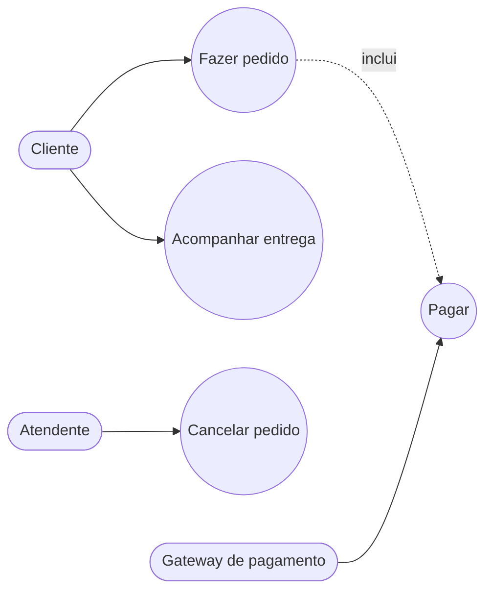
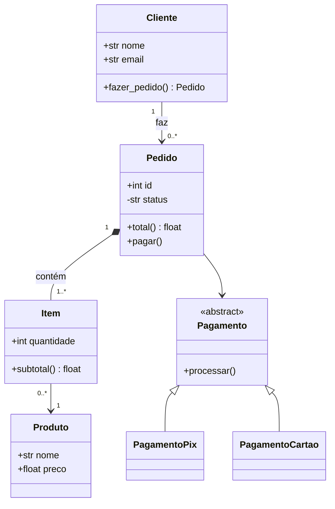
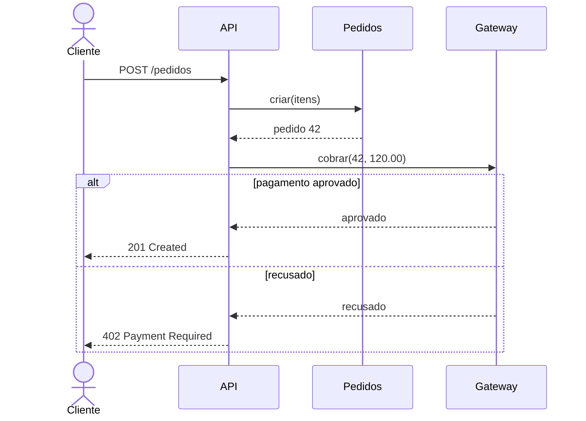
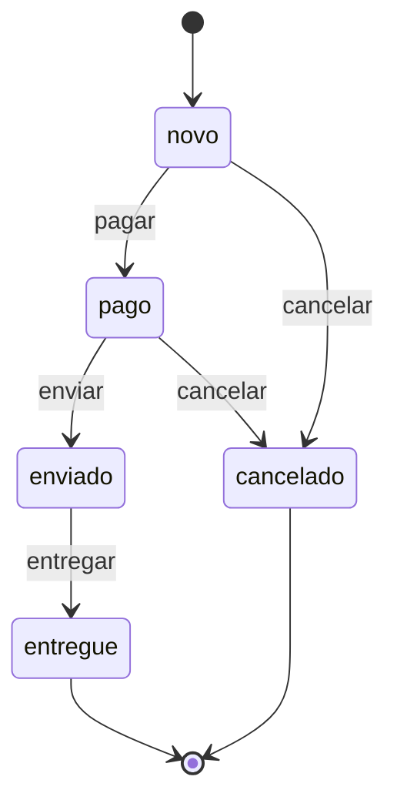

# UML e modelagem: casos de uso, classes, sequência

## Por que isso importa

Antes de construir algo maior, o time precisa **concordar** sobre como as peças se encaixam. Um desenho no quadro vale por meia hora de explicação: quem chama quem, que estados um pedido pode ter, quais classes existem. A **UML** (Unified Modeling Language) é a notação padrão para esses desenhos. Você não vai desenhar UML completa todo dia, mas vai **ler** diagramas em documentação, desenhar esboços em reuniões de design e entrevistas de *system design*, e usar diagramas como código (Mermaid, PlantUML) dentro de READMEs e PRs, como esta plataforma faz.

## Intuição

Diagramas são **mapas**. Um mapa do metrô não mostra cada rua: mostra só estações e linhas, porque é isso que importa para quem anda de metrô. Um bom diagrama também **omite** quase tudo e mostra só o que responde a uma pergunta:

- "**Quem** usa o sistema e para **quê**?" → casos de uso.
- "**Que coisas** existem e como se relacionam?" → classes.
- "**Em que ordem** as partes conversam neste fluxo?" → sequência.
- "**Por quais estados** este objeto passa?" → estados.

Um diagrama que tenta mostrar tudo é tão útil quanto um mapa em escala 1:1.

## Visual

**Casos de uso**: atores (fora do sistema) e o que eles fazem com ele. O Mermaid não tem um tipo próprio, então usamos um fluxograma:



**Classes**: estrutura estática.



**Sequência**: as mensagens de um fluxo, no tempo (de cima para baixo).



**Estados**: o ciclo de vida de um objeto (o mesmo da ES-05).



## Conceito técnico

### Para que modelar, e quanto

Fowler descreve três usos da UML:

- **Esboço** (o mais útil): diagramas rápidos para pensar e comunicar, jogados fora depois.
- **Planta**: diagramas detalhados que guiam a implementação (comum em sistemas críticos ou regulados).
- **Linguagem de programação**: gerar código a partir do modelo (pouco usado hoje).

Na maioria dos times, prefira **esboços** e **diagramas como código** (Mermaid, PlantUML) versionados junto do código, que o PR atualiza junto com a mudança.

### Casos de uso

- **Ator**: papel externo que interage com o sistema (pessoa ou outro sistema). Um mesmo humano pode ter vários papéis.
- **Caso de uso**: um objetivo do ator que o sistema ajuda a cumprir ("fazer pedido", não "clicar em comprar").
- **Inclui** (`<<include>>`): um caso sempre usa outro (fazer pedido inclui pagar). **Estende** (`<<extend>>`): comportamento opcional (aplicar cupom estende fazer pedido).
- Cada caso de uso costuma ter uma **descrição textual**: pré-condições, fluxo principal, fluxos alternativos. Isso conversa diretamente com as histórias e critérios da ES-02.

### Diagrama de classes

Cada classe tem três partes: nome, atributos, métodos. **Visibilidade**: `+` pública, `-` privada, `#` protegida, `~` de pacote.

| Relação | Notação Mermaid | Significado | Exemplo |
|---|---|---|---|
| **Associação** | `A --> B` | A conhece/usa B | Cliente faz Pedidos |
| **Herança (generalização)** | `Base <\|-- Filha` | Filha **é um** Base | PagamentoPix é um Pagamento |
| **Realização** | `Interface <\|.. Classe` | Classe implementa a interface | |
| **Agregação** | `Todo o-- Parte` | "tem um", a parte vive sem o todo | Time e Jogador |
| **Composição** | `Todo *-- Parte` | "é feito de", a parte morre com o todo | Pedido e seus Itens |
| **Dependência** | `A ..> B` | uso temporário (parâmetro, variável local) | |

**Multiplicidade** diz quantos objetos participam de cada lado:

| Notação | Significa |
|---|---|
| `1` | exatamente um |
| `0..1` | nenhum ou um (opcional) |
| `*` ou `0..*` | qualquer quantidade |
| `1..*` | pelo menos um |
| `2..5` | de dois a cinco |

`Pedido "1" *-- "1..*" Item` se lê: cada pedido tem **um ou mais** itens, e cada item pertence a **exatamente um** pedido. A multiplicidade vira regra de negócio (não existe pedido vazio) e, no banco, vira chave estrangeira e restrições (BD-01).

### Diagrama de sequência

- **Participantes** no topo, **linhas de vida** descendo.
- Setas cheias (`->>`) são chamadas; tracejadas (`-->>`) são respostas.
- **Fragmentos**: `alt`/`else` (alternativas), `opt` (opcional), `loop` (repetição), `par` (em paralelo).

É o diagrama mais útil para discutir **integrações** e **ordem de chamadas**: onde colocar o timeout, o que acontece se o gateway não responder, qual chamada pode ser assíncrona.

### Diagrama de estados

Estados, **transições** disparadas por **eventos**, e opcionalmente **condições de guarda** (`pagar [saldo suficiente]`). O pseudo-estado `[*]` marca o início e o fim. Útil para qualquer objeto com ciclo de vida: pedidos, assinaturas, tickets, conexões TCP (RD-04).

### Outros diagramas que você vai encontrar

- **Atividades**: um fluxograma com decisões e paralelismo.
- **Componentes e implantação**: as peças do sistema e onde rodam.
- **C4 model** (AS-01): uma alternativa mais leve para arquitetura, com quatro níveis de zoom (contexto, contêineres, componentes, código).
- **ER** (BD-01): o modelo de dados.

## Código

Gerando um diagrama de classes Mermaid a partir de classes Python de verdade, por introspecção. Diagramas gerados do código nunca ficam desatualizados:

```python
import inspect


class Entidade:
    def __init__(self, id):
        self.id = id


class Produto(Entidade):
    def __init__(self, id, nome, preco):
        super().__init__(id)
        self.nome = nome
        self.preco = preco


class Pedido(Entidade):
    def __init__(self, id, itens):
        super().__init__(id)
        self.itens = itens
        self._status = "novo"

    def total(self):
        return sum(i.preco for i in self.itens)

    def pagar(self):
        self._status = "pago"


def para_mermaid(*classes):
    linhas = ["classDiagram"]
    for cls in classes:
        exemplo = cls.__new__(cls)
        parametros = list(inspect.signature(cls.__init__).parameters)[1:]
        cls.__init__(exemplo, *[[] for _ in parametros])
        linhas.append(f"    class {cls.__name__} {{")
        for nome in vars(exemplo):
            visibilidade = "-" if nome.startswith("_") else "+"
            linhas.append(f"        {visibilidade}{nome.lstrip('_')}")
        for nome, _ in inspect.getmembers(cls, inspect.isfunction):
            if nome in vars(cls) and not nome.startswith("__"):
                linhas.append(f"        +{nome}()")
        linhas.append("    }")
        for base in cls.__bases__:
            if base is not object:
                linhas.append(f"    {base.__name__} <|-- {cls.__name__}")
    return "\n".join(linhas)


print(para_mermaid(Entidade, Produto, Pedido))
```

Cole a saída no [editor do Mermaid](https://mermaid.live) para ver o desenho.

## Erros comuns

- **Diagramar tudo**: cada getter, cada classe utilitária. O diagrama fica ilegível e desatualiza na primeira mudança.
- **Diagrama sem pergunta**: se você não sabe qual dúvida ele responde, não desenhe.
- **Confundir composição com agregação**: a pergunta é "a parte existe sem o todo?".
- **Herança onde a relação é "tem um"**: `Carro` herdar de `Motor`.
- **Esquecer a multiplicidade**, que é justamente onde moram as regras de negócio.
- **Caso de uso que é um clique** ("clicar no botão salvar") em vez de um objetivo.
- **Diagrama de sequência sem os caminhos de erro** (o `alt` do pagamento recusado).
- **Diagramas em imagens soltas** que ninguém atualiza; prefira diagramas como código no repositório.

## Pratique

```quiz
id: ES-09-q1
tipo: multipla_escolha
pergunta: "Você quer discutir com o time a ordem das chamadas entre a API, o serviço de pedidos e o gateway de pagamento, inclusive o que acontece quando o gateway demora. Qual diagrama usar?"
opcoes: ["Casos de uso", "Classes", "Sequência", "ER"]
resposta: 2
explicacao: "O diagrama de sequência mostra as mensagens entre participantes ao longo do tempo, com fragmentos alt e opt para os caminhos alternativos, como timeout e recusa."
dificuldade: 1
```

```quiz
id: ES-09-q2
tipo: multipla_escolha
pergunta: "Um pedido é formado por itens, e os itens não existem sem o pedido (apagou o pedido, apagou os itens). Que relação é essa?"
opcoes: ["Herança", "Agregação", "Composição", "Dependência"]
resposta: 2
explicacao: "Composição (losango cheio, *-- no Mermaid): a parte tem o ciclo de vida preso ao todo. Na agregação (o--), a parte sobrevive ao todo, como um jogador que continua existindo se o time acabar."
dificuldade: 1
```

```quiz
id: ES-09-q3
tipo: verdadeiro_falso
pergunta: "No diagrama Cliente \"1\" --> \"0..*\" Pedido, todo cliente precisa ter pelo menos um pedido."
resposta: false
explicacao: "0..* significa zero ou mais: um cliente recém-cadastrado pode não ter pedido nenhum. Do outro lado, o 1 diz que cada pedido pertence a exatamente um cliente."
dificuldade: 1
```

```quiz
id: ES-09-q4
tipo: resposta_curta
pergunta: "Por que diagramas como código (Mermaid, PlantUML) costumam ficar mais atualizados que imagens desenhadas numa ferramenta gráfica?"
resposta: "Porque ficam no repositório, versionados junto com o código: dá para revisar a mudança do diagrama no mesmo PR que muda o código, ver o histórico com o Git e editar com qualquer editor de texto, sem precisar do arquivo original da ferramenta."
palavras_chave: ["repositório", "versionados", "PR", "Git"]
dificuldade: 1
```

```quiz
id: ES-09-q5
tipo: multipla_escolha
pergunta: "Na notação de visibilidade da UML, o que significa -saldo: float?"
opcoes: ["Um atributo público", "Um atributo privado", "Um atributo removido", "Um atributo negativo"]
resposta: 1
explicacao: "O - marca um membro privado. O + é público, o # é protegido e o ~ é visível no pacote."
dificuldade: 1
```

```quiz
id: ES-09-q6
tipo: codigo
linguagem: python
pergunta: |
  **Multiplicidade como regra.** Escreva `violacoes(contagens, multiplicidade)`:

  - `contagens` é um dicionário `objeto -> quantos objetos do outro lado ele tem` (por exemplo, pedido → número de itens);
  - `multiplicidade` é uma string UML: `'1'`, `'0..1'`, `'*'`, `'0..*'`, `'1..*'` ou um intervalo `'a..b'`;
  - devolva a lista (em ordem alfabética) dos objetos cuja contagem **viola** a multiplicidade.
codigo_inicial: |
  def violacoes(contagens, multiplicidade):
      return [obj for obj, n in contagens.items() if n == 0]
usa: [def, if, return]
testes:
  - chamada: "violacoes({'p1': 2, 'p2': 0, 'p3': 1}, '1..*')"
    saida: "['p2']"
  - chamada: "violacoes({'ana': 0, 'bia': 1, 'caio': 2}, '0..1')"
    saida: "['caio']"
  - chamada: "violacoes({'x': 0, 'y': 99}, '*')"
    saida: "[]"
  - chamada: "violacoes({'t2': 1, 't1': 7, 't3': 3}, '2..5')"
    visivel: false
    saida: "['t1', 't2']"
  - chamada: "violacoes({'a': 1, 'b': 0, 'c': 2}, '1')"
    visivel: false
    saida: "['b', 'c']"
  - chamada: "violacoes({'a': 0}, '0..*')"
    visivel: false
    saida: "[]"
  - chamada: "violacoes({}, '1')"
    visivel: false
    saida: "[]"
dica: "Transforme a multiplicidade num par (minimo, maximo), com maximo = None para '*'. Se não houver '..', o mínimo e o máximo são o mesmo número (ou 0 e None, se for '*')."
solucao: |
  def limites(multiplicidade):
      if multiplicidade == '*':
          return 0, None
      if '..' not in multiplicidade:
          n = int(multiplicidade)
          return n, n
      minimo, maximo = multiplicidade.split('..')
      return int(minimo), (None if maximo == '*' else int(maximo))

  def violacoes(contagens, multiplicidade):
      minimo, maximo = limites(multiplicidade)
      erradas = []
      for obj, n in contagens.items():
          if n < minimo or (maximo is not None and n > maximo):
              erradas.append(obj)
      return sorted(erradas)
explicacao: "Separar limites() (traduzir a notação) de violacoes() (aplicar a regra) deixa cada parte simples e testável. É uma verificação útil de verdade: rodar isso contra o banco de produção revela dados que quebram o modelo, como pedidos sem itens, quase sempre sinal de um bug ou de uma transação que não foi atômica (BD-05)."
dificuldade: 2
```

```quiz
id: ES-09-q7
tipo: codigo
linguagem: python
pergunta: |
  **Gerando um diagrama de sequência.** Escreva `sequencia(chamadas)` que transforma um registro de chamadas num diagrama de sequência do Mermaid, devolvendo a **lista de linhas**:

  - a primeira linha é `'sequenceDiagram'`;
  - depois, uma linha `'    participant X'` para cada participante, **na ordem em que aparece pela primeira vez** (como origem ou destino);
  - depois, uma linha por chamada. Cada chamada é `(origem, destino, mensagem, resposta)`: gere `'    origem->>destino: mensagem'` e, se `resposta` não for `None`, também `'    destino-->>origem: resposta'`.
codigo_inicial: |
  def sequencia(chamadas):
      linhas = ['sequenceDiagram']
      for origem, destino, mensagem, resposta in chamadas:
          linhas.append(f'{origem}->{destino}: {mensagem}')
      return linhas
usa: [def, for, if, return]
testes:
  - chamada: "sequencia([('API', 'Pedidos', 'criar()', 'pedido 42')])"
    saida: "['sequenceDiagram', '    participant API', '    participant Pedidos', '    API->>Pedidos: criar()', '    Pedidos-->>API: pedido 42']"
  - chamada: "sequencia([])"
    saida: "['sequenceDiagram']"
  - chamada: "sequencia([('A', 'B', 'x()', None), ('B', 'C', 'y()', 'ok'), ('A', 'C', 'z()', None)])"
    visivel: false
    saida: "['sequenceDiagram', '    participant A', '    participant B', '    participant C', '    A->>B: x()', '    B->>C: y()', '    C-->>B: ok', '    A->>C: z()']"
  - chamada: "sequencia([('Cliente', 'Cliente', 'pensar()', None)])"
    visivel: false
    saida: "['sequenceDiagram', '    participant Cliente', '    Cliente->>Cliente: pensar()']"
dica: "Faça duas passagens: a primeira coleta os participantes numa lista, sem repetir; a segunda gera as setas."
solucao: |
  def sequencia(chamadas):
      participantes = []
      for origem, destino, _, _ in chamadas:
          for p in (origem, destino):
              if p not in participantes:
                  participantes.append(p)
      linhas = ['sequenceDiagram']
      for p in participantes:
          linhas.append(f'    participant {p}')
      for origem, destino, mensagem, resposta in chamadas:
          linhas.append(f'    {origem}->>{destino}: {mensagem}')
          if resposta is not None:
              linhas.append(f'    {destino}-->>{origem}: {resposta}')
      return linhas
explicacao: "Declarar os participantes antes fixa a ordem das colunas no desenho. Ferramentas de rastreamento distribuído (SD-07) fazem algo parecido: a partir dos spans de uma requisição real, montam a linha do tempo de quem chamou quem e quanto demorou. É o diagrama de sequência gerado da produção, e não desenhado à mão."
dificuldade: 1
```

```quiz
id: ES-09-q8
tipo: codigo
linguagem: javascript
pergunta: |
  **Executando um diagrama de estados.** Escreva `executar(diagrama, eventos)` que lê um diagrama no formato do Mermaid e devolve a lista de estados percorridos:

  - a linha `[*] --> X` define o estado inicial `X`;
  - as linhas `A --> B : evento` definem transições (ignore as que terminam em `[*]` e as linhas sem ` : `);
  - comece no estado inicial (ele é o primeiro da lista) e, para cada evento, se houver transição a partir do estado atual, vá para o destino e acrescente-o à lista; senão, **pare** e devolva a lista até ali.
codigo_inicial: |
  function executar(diagrama, eventos) {
    return [];
  }
usa: [function, for, return]
testes:
  - chamada: "executar('stateDiagram-v2\\n  [*] --> novo\\n  novo --> pago : pagar\\n  pago --> enviado : enviar', ['pagar', 'enviar'])"
    saida: "[ 'novo', 'pago', 'enviado' ]"
  - chamada: "executar('[*] --> novo\\nnovo --> pago : pagar', ['enviar', 'pagar'])"
    saida: "[ 'novo' ]"
  - chamada: "executar('[*] --> a', [])"
    saida: "[ 'a' ]"
  - chamada: "executar('[*] --> ligado\\nligado --> desligado : apertar\\ndesligado --> ligado : apertar\\ndesligado --> [*]', ['apertar', 'apertar', 'apertar'])"
    visivel: false
    saida: "[ 'ligado', 'desligado', 'ligado', 'desligado' ]"
  - chamada: "executar('stateDiagram-v2\\n[*] --> novo\\nnovo --> cancelado : cancelar\\nnovo --> pago : pagar\\ncancelado --> [*]\\npago --> cancelado : cancelar', ['pagar', 'cancelar', 'pagar'])"
    visivel: false
    saida: "[ 'novo', 'pago', 'cancelado' ]"
dica: "Monte uma tabela transicoes[estado][evento] = destino. Para cada linha, use trim(); separe a parte do evento com split(' : ') e as pontas com split(' --> ')."
solucao: |
  function executar(diagrama, eventos) {
    const transicoes = {};
    let inicial = null;
    for (const bruta of diagrama.split('\n')) {
      const linha = bruta.trim();
      if (!linha.includes(' --> ')) continue;
      const [seta, evento] = linha.split(' : ');
      const [origem, destino] = seta.split(' --> ');
      if (origem === '[*]') {
        inicial = destino;
      } else if (destino !== '[*]' && evento !== undefined) {
        if (!transicoes[origem]) transicoes[origem] = {};
        transicoes[origem][evento] = destino;
      }
    }
    const caminho = [inicial];
    let atual = inicial;
    for (const e of eventos) {
      const proximo = transicoes[atual] && transicoes[atual][e];
      if (!proximo) break;
      atual = proximo;
      caminho.push(atual);
    }
    return caminho;
  }
explicacao: "O diagrama deixou de ser só um desenho: virou a própria especificação executável, igual à tabela de transições da ES-05. Bibliotecas como XState (JavaScript) levam essa ideia adiante: você descreve a máquina de estados, e a mesma descrição gera o diagrama e roda na aplicação, então eles nunca divergem."
dificuldade: 2
```

## Resumo

- Modele para **responder uma pergunta**; prefira **esboços** e **diagramas como código**.
- **Casos de uso**: atores e objetivos; inclui e estende.
- **Classes**: atributos, métodos, visibilidade (`+ - # ~`); associação, herança, realização, agregação, **composição**, dependência; **multiplicidade** (`1`, `0..1`, `*`, `1..*`).
- **Sequência**: mensagens no tempo, respostas tracejadas, fragmentos `alt`, `opt`, `loop`.
- **Estados**: estados, eventos, guardas, início e fim `[*]`.

## Para ir além

- Desenhe no [mermaid.live](https://mermaid.live) o diagrama de classes de um projeto seu e o diagrama de sequência do fluxo principal.
- Leia sobre o modelo C4, que será usado em Arquitetura de software.
- **Fim da trilha de Engenharia de software.** Próxima trilha: Arquitetura de software.
