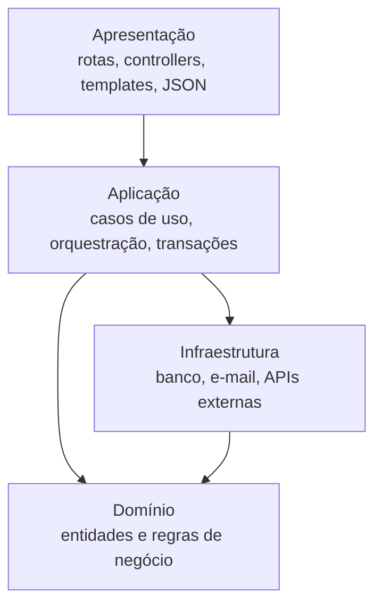
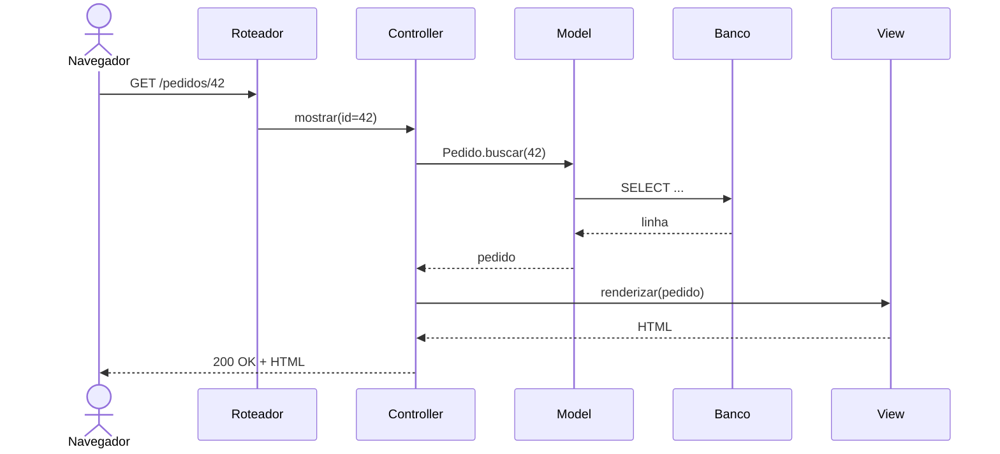

# Monólito, camadas e MVC

## Por que isso importa

Até agora você aprendeu a organizar **funções e classes**. Arquitetura é organizar o sistema **inteiro**: quais são as grandes partes, quem pode depender de quem, onde fica cada responsabilidade. Essas decisões são as mais caras de mudar depois, e determinam se o sistema continua fácil de evoluir quando tiver 100 mil linhas e 20 pessoas mexendo. Quase todo sistema começa como um **monólito em camadas com MVC**: é a estrutura do Django, do Rails, do Spring e do Laravel. Entender bem essa base é o pré-requisito para discutir hexagonal, microsserviços e DDD nas próximas aulas.

## Intuição

Pense num **restaurante**. O salão (garçons) recebe os pedidos e entrega os pratos; a cozinha prepara a comida seguindo as receitas; a despensa guarda os ingredientes. O garçom não entra na despensa, e o cozinheiro não atende mesa. Cada área tem uma responsabilidade e conversa só com a vizinha. Se você trocar o fornecedor da despensa, o salão nem percebe.

Isso é uma **arquitetura em camadas**: apresentação (salão), domínio ou regras (cozinha) e dados (despensa). E o restaurante inteiro, num só prédio, com uma só equipe, é um **monólito**: tudo junto, simples de operar, ótimo enquanto o restaurante não vira uma rede com cem filiais.

## Visual

Camadas e a regra de dependência (cada uma só conhece a de baixo):



O caminho de uma requisição num framework MVC:



## Conceito técnico

### O que é arquitetura

Arquitetura são as **decisões importantes e difíceis de mudar**: como o sistema se divide, como as partes se comunicam, onde os dados moram. Essas decisões são guiadas pelos **atributos de qualidade** (os requisitos não funcionais da ES-02): desempenho, escalabilidade, disponibilidade, segurança, **manutenibilidade**, testabilidade, custo, e a capacidade do **time** de trabalhar em paralelo. Toda decisão é um **trade-off**: ganhar em um atributo costuma custar em outro. Não existe arquitetura "melhor", existe a adequada ao contexto.

### Monólito

Um **monólito** é uma aplicação implantada como **uma unidade só**: um processo (ou várias cópias iguais), um código, normalmente um banco.

| Vantagens | Limites |
|---|---|
| simples de desenvolver, testar e depurar (tudo num lugar) | o build e os testes ficam lentos com o tamanho |
| uma implantação, uma coisa para monitorar | uma mudança pequena exige reimplantar tudo |
| chamadas entre partes são chamadas de função: rápidas e confiáveis | escala o sistema inteiro, mesmo que só uma parte precise |
| transações no banco são simples (BD-05) | sem disciplina, vira uma "grande bola de lama" sem fronteiras |

O problema raramente é ser monólito; é ser um monólito **desorganizado**. A resposta moderna é o **monólito modular**: um só deploy, mas dividido internamente em **módulos** por área de negócio (pedidos, pagamentos, catálogo), cada um com interface pública clara e sem acessar as tabelas dos outros. Se um dia for preciso extrair um microsserviço (AS-04), as fronteiras já existem. Muitas empresas grandes rodam monólitos modulares por anos.

### Arquitetura em camadas

| Camada | Responsabilidade | Exemplos |
|---|---|---|
| **Apresentação** | receber a entrada e formatar a saída | rotas HTTP, controllers, templates, serialização JSON, CLI |
| **Aplicação** (serviços) | orquestrar um caso de uso: buscar, chamar regras, salvar, disparar efeitos | `FinalizarPedido.executar(...)`, controle de transação |
| **Domínio** | as regras de negócio puras | `Pedido.total()`, `Pedido.pode_cancelar()` |
| **Infraestrutura** (dados) | falar com o mundo externo | repositórios SQL, cliente de e-mail, fila, APIs |

A **regra de dependência**: uma camada só chama a camada abaixo dela. Em camadas **estritas**, só a imediatamente abaixo; em camadas **relaxadas**, qualquer uma abaixo. **Nunca para cima**: o domínio não importa nada de apresentação, e o banco não sabe que existe HTTP.

Benefícios: trocar a apresentação (de HTML para API JSON) sem mexer nas regras; testar o domínio sem banco; cada pessoa sabe onde procurar cada coisa. Armadilha comum: a camada de domínio **anêmica**, só com getters e setters, e todas as regras espalhadas nos controllers.

### MVC

**Model-View-Controller** (criado nos anos 1970 para interfaces gráficas) separa:

- **Model**: os dados e as regras (no web, os modelos do ORM e, idealmente, o domínio).
- **View**: a apresentação (o template HTML, o JSON).
- **Controller**: recebe a entrada, chama o model e escolhe a view.

Nos frameworks web, um **roteador** mapeia URL e método HTTP para uma ação de um controller. Variações: o Django chama de **MTV** (Model, Template, View, onde a "view" do Django faz papel de controller); interfaces ricas usam **MVP** e **MVVM** (o ViewModel que os frameworks reativos ligam automaticamente à tela).

**Controller gordo** é o erro clássico: regras de negócio, SQL e formatação, tudo dentro da ação do controller. Mantenha o controller **magro**: ele traduz HTTP para uma chamada de caso de uso e o resultado de volta para HTTP.

### Documentando: C4 e ADRs

- **Modelo C4**: diagramas em quatro níveis de zoom. **Contexto** (o sistema e quem o usa), **Contêineres** (aplicações e bancos que rodam separados), **Componentes** (as partes de dentro de um contêiner) e **Código**. Na prática, os dois primeiros resolvem a maior parte das conversas.
- **ADR** (Architecture Decision Record): um arquivo curto no repositório para cada decisão importante, com **título, contexto, decisão, status e consequências**. Daqui a um ano, quando alguém perguntar "por que usamos PostgreSQL e não MongoDB?", a resposta está lá, com as alternativas consideradas.

```text
# ADR 007: Monólito modular em vez de microsserviços

Status: aceito (2026-03-10)

Contexto: time de 6 pessoas, produto em validação, um único banco PostgreSQL.

Decisão: um único deploy, dividido nos módulos pedidos, catalogo e pagamentos,
que só se comunicam pelas interfaces públicas de cada módulo.

Consequências: deploy e depuração simples; precisamos de um teste automatizado
que impeça um módulo de importar o interior de outro.
```

## Código

Um teste de arquitetura: verificar automaticamente que nenhuma camada importa uma camada de cima. É o que ferramentas como `import-linter` (Python) e ArchUnit (Java) fazem no CI:

```python
CAMADAS = ["apresentacao", "aplicacao", "dominio"]   # de cima para baixo
INFRA = "infraestrutura"                              # pode usar o domínio

modulos = {
    "apresentacao.rotas":       ["aplicacao.pedidos", "apresentacao.templates"],
    "aplicacao.pedidos":        ["dominio.pedido", "infraestrutura.repositorio"],
    "dominio.pedido":           ["dominio.dinheiro"],
    "dominio.dinheiro":         [],
    "infraestrutura.repositorio": ["dominio.pedido"],
    "dominio.desconto":         ["apresentacao.formatos"],     # proibido!
}

def nivel(modulo):
    camada = modulo.split(".")[0]
    return len(CAMADAS) if camada == INFRA else CAMADAS.index(camada)

for modulo, imports in modulos.items():
    for importado in imports:
        de, para = modulo.split(".")[0], importado.split(".")[0]
        if de == INFRA or para == INFRA:
            proibido = de == "dominio" and para == INFRA
        else:
            proibido = nivel(importado) < nivel(modulo)
        if proibido:
            print(f"VIOLAÇÃO: {modulo} importa {importado}")
print("verificação concluída")
```

## Erros comuns

- **Começar com microsserviços** num produto que ainda nem sabe quais são as suas fronteiras (AS-04).
- **Monólito sem módulos**: qualquer arquivo importa qualquer outro, e uma mudança no cadastro quebra o faturamento.
- **Controller gordo**: SQL, regras e formatação dentro da ação.
- **Domínio que importa o ORM, o framework ou o HTTP**, impedindo testar as regras sem subir tudo.
- **Camadas "passa-adiante"** que só repassam chamadas sem acrescentar nada, só por cerimônia.
- **Decisões de arquitetura só na cabeça de alguém**: sem ADR, a próxima pessoa refaz a discussão (ou desfaz a decisão sem saber por quê).
- **Escolher arquitetura por moda** e não pelos atributos de qualidade que o sistema precisa.

## Pratique

```quiz
id: AS-01-q1
tipo: multipla_escolha
pergunta: "Numa arquitetura em camadas, onde deve ficar a regra 'um pedido só pode ser cancelado antes do envio'?"
opcoes: ["No template HTML", "No controller", "Na camada de domínio (por exemplo, Pedido.pode_cancelar())", "Numa trigger do banco de dados"]
resposta: 2
explicacao: "É uma regra de negócio: pertence ao domínio, onde pode ser testada sem HTTP nem banco e reutilizada por todas as entradas (site, API, tarefa agendada). No controller, ela teria que ser repetida em cada ponto de entrada."
dificuldade: 1
```

```quiz
id: AS-01-q2
tipo: verdadeiro_falso
pergunta: "Um monólito modular é implantado como uma unidade só, mas internamente dividido em módulos com interfaces públicas e fronteiras claras."
resposta: true
explicacao: "Ele mantém a simplicidade operacional do monólito (um deploy, transações simples) e ganha a organização por áreas de negócio. As fronteiras também facilitam extrair um serviço no futuro, se um dia for preciso."
dificuldade: 1
```

```quiz
id: AS-01-q3
tipo: multipla_escolha
pergunta: "No MVC de um framework web, qual é o papel do controller?"
opcoes: ["Guardar os dados no banco", "Receber a requisição, chamar o model e escolher a view da resposta", "Desenhar o HTML", "Definir o esquema das tabelas"]
resposta: 1
explicacao: "O controller é o intermediário: traduz a entrada (rota, parâmetros) numa chamada ao model ou caso de uso, e o resultado numa resposta (view). Um controller bom é magro."
dificuldade: 1
```

```quiz
id: AS-01-q4
tipo: resposta_curta
pergunta: "O que um ADR registra e por que isso é útil?"
resposta: "Uma decisão de arquitetura importante: o contexto, a decisão tomada, o status e as consequências (e as alternativas consideradas). É útil porque explica o porquê para quem chegar depois, evita refazer a mesma discussão e permite revisar a decisão quando o contexto mudar."
palavras_chave: ["decisão", "contexto", "consequências", "porquê"]
dificuldade: 1
```

```quiz
id: AS-01-q5
tipo: multipla_escolha
pergunta: "No modelo C4, um diagrama que mostra a aplicação web, a API, o banco PostgreSQL e o Redis, e como eles se comunicam, é de qual nível?"
opcoes: ["Contexto", "Contêineres", "Componentes", "Código"]
resposta: 1
explicacao: "Contêineres são as unidades que rodam separadamente (aplicações, bancos, filas). O contexto mostraria só o sistema como uma caixa e seus usuários; componentes mostrariam o interior de um contêiner."
dificuldade: 2
```

```quiz
id: AS-01-q6
tipo: codigo
linguagem: python
pergunta: |
  **Teste de arquitetura.** Escreva `violacoes(modulos, camadas)`:

  - `camadas` é a lista de camadas **de cima para baixo** (por exemplo, `['apresentacao', 'aplicacao', 'dominio', 'infra']`);
  - `modulos` é um dicionário `nome -> lista de imports`, e a camada de um módulo é o texto antes do primeiro ponto;
  - um import é proibido quando aponta para uma camada **acima** da do módulo (camadas relaxadas: pode importar qualquer camada abaixo ou a mesma);
  - devolva a lista de pares `(modulo, importado)` proibidos, ordenada.
codigo_inicial: |
  def violacoes(modulos, camadas):
      return []
usa: [def, for, if, return]
testes:
  - chamada: "violacoes({'dominio.pedido': ['apresentacao.json']}, ['apresentacao', 'aplicacao', 'dominio'])"
    saida: "[('dominio.pedido', 'apresentacao.json')]"
  - chamada: "violacoes({'apresentacao.rotas': ['dominio.pedido', 'aplicacao.casos']}, ['apresentacao', 'aplicacao', 'dominio'])"
    saida: "[]"
  - chamada: "violacoes({'aplicacao.a': ['aplicacao.b'], 'aplicacao.b': []}, ['apresentacao', 'aplicacao', 'dominio'])"
    saida: "[]"
  - chamada: "violacoes({'infra.repo': ['aplicacao.casos', 'dominio.pedido'], 'dominio.pedido': ['infra.sql', 'dominio.dinheiro']}, ['apresentacao', 'aplicacao', 'dominio', 'infra'])"
    visivel: false
    saida: "[('infra.repo', 'aplicacao.casos'), ('infra.repo', 'dominio.pedido')]"
  - chamada: "violacoes({}, ['a', 'b'])"
    visivel: false
    saida: "[]"
dica: "A posição de uma camada na lista é o seu nível: camadas.index(nome.split('.')[0]). Um import é proibido se o nível do importado for menor que o do módulo."
solucao: |
  def violacoes(modulos, camadas):
      def nivel(nome):
          return camadas.index(nome.split('.')[0])

      erradas = []
      for modulo, imports in modulos.items():
          for importado in imports:
              if nivel(importado) < nivel(modulo):
                  erradas.append((modulo, importado))
      return sorted(erradas)
explicacao: "No teste oculto, a infra está no fundo da lista. Assim o domínio pode importar a infra (dominio.pedido usando infra.sql é permitido), mas a infra não pode importar o domínio. Isso deixa as regras de negócio dependentes do banco, o que dificulta testá-las sem ele. É exatamente esse incômodo que a arquitetura hexagonal (AS-02) resolve, invertendo a dependência: o domínio define interfaces e a infra as implementa. Rodar uma verificação dessas no CI impede que a arquitetura se degrade aos poucos."
dificuldade: 2
```

```quiz
id: AS-01-q7
tipo: codigo
linguagem: python
pergunta: |
  **Um MVC de terminal.** Complete o controller de uma lista de tarefas. O **model** (`Tarefas`) e a **view** (`renderizar`) já estão prontos. `Controlador.tratar(comando)` recebe um texto e devolve o que deve aparecer na tela:

  - `'add <texto>'`: adiciona a tarefa e devolve `'adicionada: <texto>'`;
  - `'feito <n>'`: marca a tarefa de número `n` (começando em 1) e devolve `'ok'`; se o número não existir, `'tarefa inexistente'`;
  - `'listar'`: devolve `renderizar(...)` com as tarefas do model;
  - qualquer outra coisa: `'comando desconhecido'`.

  O controller não deve guardar tarefas nem montar o texto da lista: isso é trabalho do model e da view.
codigo_inicial: |
  # não mude: model e view
  class Tarefas:
      def __init__(self):
          self.itens = []

      def adicionar(self, texto):
          self.itens.append({'texto': texto, 'feito': False})

      def concluir(self, indice):
          if not 0 <= indice < len(self.itens):
              return False
          self.itens[indice]['feito'] = True
          return True

  def renderizar(itens):
      if not itens:
          return '(vazia)'
      return '\n'.join(f"{i}. [{'x' if t['feito'] else ' '}] {t['texto']}" for i, t in enumerate(itens, 1))

  # complete o controller
  class Controlador:
      def __init__(self, modelo):
          self.modelo = modelo

      def tratar(self, comando):
          return 'comando desconhecido'

  # não mude: os testes usam esta função
  def sessao(comandos):
      c = Controlador(Tarefas())
      return [c.tratar(cmd) for cmd in comandos]
usa: [class, def, if, return]
testes:
  - chamada: "sessao(['listar'])"
    saida: "['(vazia)']"
  - chamada: "sessao(['add estudar', 'add treinar', 'feito 1', 'listar'])"
    saida: "['adicionada: estudar', 'adicionada: treinar', 'ok', '1. [x] estudar\\n2. [ ] treinar']"
  - chamada: "sessao(['feito 3'])"
    saida: "['tarefa inexistente']"
  - chamada: "sessao(['add ler o capítulo 2', 'pular', 'feito 0', 'listar'])"
    visivel: false
    saida: "['adicionada: ler o capítulo 2', 'comando desconhecido', 'tarefa inexistente', '1. [ ] ler o capítulo 2']"
  - chamada: "sessao(['add a', 'feito 1', 'feito 1', 'listar'])"
    visivel: false
    saida: "['adicionada: a', 'ok', 'ok', '1. [x] a']"
dica: "Separe com comando.split(' ', 1). Para 'feito', converta o número com int(...) e passe n - 1 para o model. O 'listar' só repassa self.modelo.itens para renderizar."
solucao: |
  # não mude: model e view
  class Tarefas:
      def __init__(self):
          self.itens = []

      def adicionar(self, texto):
          self.itens.append({'texto': texto, 'feito': False})

      def concluir(self, indice):
          if not 0 <= indice < len(self.itens):
              return False
          self.itens[indice]['feito'] = True
          return True

  def renderizar(itens):
      if not itens:
          return '(vazia)'
      return '\n'.join(f"{i}. [{'x' if t['feito'] else ' '}] {t['texto']}" for i, t in enumerate(itens, 1))

  # complete o controller
  class Controlador:
      def __init__(self, modelo):
          self.modelo = modelo

      def tratar(self, comando):
          partes = comando.split(' ', 1)
          acao = partes[0]
          argumento = partes[1] if len(partes) > 1 else ''
          if acao == 'add':
              self.modelo.adicionar(argumento)
              return f'adicionada: {argumento}'
          if acao == 'feito':
              if self.modelo.concluir(int(argumento) - 1):
                  return 'ok'
              return 'tarefa inexistente'
          if acao == 'listar':
              return renderizar(self.modelo.itens)
          return 'comando desconhecido'

  # não mude: os testes usam esta função
  def sessao(comandos):
      c = Controlador(Tarefas())
      return [c.tratar(cmd) for cmd in comandos]
explicacao: "O controller só traduz: texto do usuário vira chamada ao model, e o resultado vira texto pela view. Repare no 'feito 0': ele vira o índice -1, que em Python seria o último item da lista; é o model que barra isso, com a validação 0 <= indice. A regra de validade mora no model, então qualquer outra entrada (uma API, uma interface gráfica) ganha a mesma proteção sem repetir o código."
dificuldade: 2
```

```quiz
id: AS-01-q8
tipo: codigo
linguagem: javascript
pergunta: |
  **Um roteador.** Escreva `rotear(rotas, metodo, caminho)`:

  - `rotas` é uma lista de `[metodo, padrao, acao]`, por exemplo `['GET', '/pedidos/:id', 'pedidos.mostrar']`;
  - um padrão casa com o caminho quando têm o **mesmo número de segmentos** (separados por `/`) e cada segmento é igual, ou o do padrão começa com `:` (um parâmetro, que captura o valor);
  - devolva `{ acao, params }` da **primeira** rota que casa (com o mesmo método), ou `null` se nenhuma casar.
codigo_inicial: |
  function rotear(rotas, metodo, caminho) {
    for (const [m, padrao, acao] of rotas) {
      if (m === metodo && padrao === caminho) return { acao, params: {} };
    }
    return null;
  }
usa: [function, for, return]
testes:
  - chamada: "rotear([['GET', '/pedidos', 'pedidos.listar'], ['GET', '/pedidos/:id', 'pedidos.mostrar']], 'GET', '/pedidos')"
    saida: "{ acao: 'pedidos.listar', params: {} }"
  - chamada: "rotear([['GET', '/pedidos', 'pedidos.listar'], ['GET', '/pedidos/:id', 'pedidos.mostrar']], 'GET', '/pedidos/42')"
    saida: "{ acao: 'pedidos.mostrar', params: { id: '42' } }"
  - chamada: "rotear([['GET', '/pedidos/:id', 'pedidos.mostrar']], 'DELETE', '/pedidos/42')"
    saida: "null"
  - chamada: "rotear([['GET', '/clientes/:cid/pedidos/:pid', 'pedidos.doCliente']], 'GET', '/clientes/7/pedidos/99')"
    visivel: false
    saida: "{ acao: 'pedidos.doCliente', params: { cid: '7', pid: '99' } }"
  - chamada: "rotear([['GET', '/pedidos/novo', 'pedidos.formulario'], ['GET', '/pedidos/:id', 'pedidos.mostrar']], 'GET', '/pedidos/novo')"
    visivel: false
    saida: "{ acao: 'pedidos.formulario', params: {} }"
  - chamada: "rotear([['GET', '/pedidos/:id', 'pedidos.mostrar']], 'GET', '/pedidos/42/itens')"
    visivel: false
    saida: "null"
dica: "Escreva uma função auxiliar casar(padrao, caminho) que devolve o objeto de parâmetros ou null. Compare os arrays de padrao.split('/') e caminho.split('/') posição por posição."
solucao: |
  function casar(padrao, caminho) {
    const p = padrao.split('/');
    const c = caminho.split('/');
    if (p.length !== c.length) return null;
    const params = {};
    for (let i = 0; i < p.length; i++) {
      if (p[i].startsWith(':')) {
        params[p[i].slice(1)] = c[i];
      } else if (p[i] !== c[i]) {
        return null;
      }
    }
    return params;
  }

  function rotear(rotas, metodo, caminho) {
    for (const [m, padrao, acao] of rotas) {
      if (m !== metodo) continue;
      const params = casar(padrao, caminho);
      if (params !== null) return { acao, params };
    }
    return null;
  }
explicacao: "A ordem das rotas importa: se /pedidos/:id viesse antes de /pedidos/novo, a palavra 'novo' seria capturada como id. Por isso frameworks como Express respeitam a ordem de declaração, e outros (Rails, FastAPI) recomendam declarar as rotas fixas antes das com parâmetro. Os parâmetros chegam como strings: converter e validar ('42' é um número?) é trabalho do controller."
dificuldade: 2
```

## Resumo

- Arquitetura: decisões **difíceis de mudar**, guiadas por **atributos de qualidade** e cheias de **trade-offs**.
- **Monólito**: um deploy, simples e rápido de começar. **Monólito modular**: fronteiras internas por área de negócio.
- **Camadas**: apresentação, aplicação, domínio, infraestrutura; dependências **só para baixo**.
- **MVC**: model (dados e regras), view (apresentação), controller (traduz a entrada); controllers **magros**.
- Documente com **C4** (contexto e contêineres) e **ADRs**.

## Para ir além

- Leia "MonolithFirst" e "PresentationDomainDataLayering" no site do Martin Fowler.
- Escreva um ADR para uma decisão de um projeto seu (a linguagem, o banco, o framework).
- **Próximo módulo**: AS-02 Arquitetura hexagonal e Clean Architecture.
