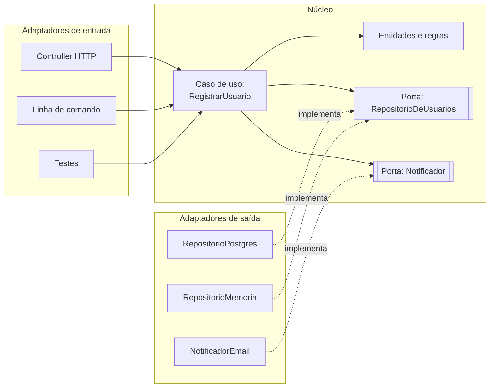

# Arquitetura hexagonal e Clean Architecture

## Por que isso importa

Na AS-01, as camadas dependem de cima para baixo, e o domínio acaba dependendo do banco de dados. Resultado: para testar uma regra de desconto, você precisa subir um PostgreSQL; para trocar o provedor de e-mail, você mexe em código de negócio. A **arquitetura hexagonal** e a **Clean Architecture** invertem isso: o **núcleo** com as regras de negócio não depende de nada externo, e banco, web, filas e APIs viram **detalhes plugáveis**. É a base de como sistemas de longa vida são organizados, e um tema recorrente em entrevistas de nível pleno e sênior.

## Intuição

Pense num **notebook** e suas **portas**: USB, HDMI, fone. O notebook define o formato de cada porta; ele não sabe se no USB vai um mouse, um pendrive ou um teclado. Qualquer fabricante pode fazer um aparelho que encaixe, desde que siga o formato. E se a sua TV só tem uma entrada antiga, você usa um **adaptador**.

No software: o **núcleo** (as regras de negócio) define **portas** (interfaces) como "preciso salvar um usuário" ou "preciso enviar uma notificação". Do lado de fora, **adaptadores** implementam essas portas para tecnologias concretas: PostgreSQL, SendGrid, uma lista em memória para testes. Trocar o banco é trocar o adaptador; o núcleo nem percebe.

## Visual

Portas e adaptadores. À esquerda, quem **dirige** o sistema (entradas); à direita, o que o sistema **usa** (saídas):



Os anéis da Clean Architecture. As setas de dependência apontam **sempre para dentro**:

```text
+-----------------------------------------------------------+
| Frameworks e drivers: web, banco, UI, dispositivos         |
|   +---------------------------------------------------+   |
|   | Adaptadores de interface: controllers, gateways,  |   |
|   | presenters, repositórios                          |   |
|   |   +-------------------------------------------+   |   |
|   |   | Casos de uso: regras da aplicação          |   |   |
|   |   |   +-----------------------------------+   |   |   |
|   |   |   | Entidades: regras de negócio      |   |   |   |
|   |   |   +-----------------------------------+   |   |   |
|   |   +-------------------------------------------+   |   |
|   +---------------------------------------------------+   |
+-----------------------------------------------------------+
           dependências  ---->  sempre para dentro
```

## Conceito técnico

### Arquitetura hexagonal (portas e adaptadores)

Proposta por Alistair Cockburn (2005). O hexágono não tem significado especial além de "vários lados, todos iguais": não existe "em cima" e "embaixo", só **dentro** (a aplicação) e **fora** (o mundo).

- **Porta**: uma interface definida **pelo núcleo**, na linguagem do domínio. Exemplo: `RepositorioDeUsuarios` com `existe_email(email)` e `salvar(usuario)`.
- **Porta de entrada** (*driving*, primária): como o mundo aciona a aplicação, normalmente os casos de uso.
- **Porta de saída** (*driven*, secundária): o que a aplicação precisa do mundo (persistência, notificação, pagamento, relógio).
- **Adaptador**: código que conecta uma tecnologia concreta a uma porta. Um controller HTTP é um adaptador de entrada; um repositório SQL é um adaptador de saída.

A grande diferença para as camadas da AS-01 é a **inversão de dependência** (o "D" do SOLID, ES-04): o núcleo define a interface do repositório, e a infraestrutura **depende do núcleo** para implementá-la. O banco virou um detalhe.

### Clean Architecture

Robert C. Martin (2012) reuniu a mesma ideia em anéis concêntricos:

1. **Entidades**: regras de negócio da empresa, que existiriam mesmo sem software (como se calcula juros).
2. **Casos de uso**: regras da aplicação; orquestram entidades para um objetivo (`RegistrarUsuario`, `FinalizarPedido`).
3. **Adaptadores de interface**: convertem dados entre o formato dos casos de uso e o do mundo externo (controllers, presenters, repositórios).
4. **Frameworks e drivers**: Django, FastAPI, SQLAlchemy, o banco em si.

**Regra de dependência**: o código de um anel só pode citar coisas de anéis **mais internos**. Nenhum nome de framework, tabela ou formato HTTP aparece nas entidades ou nos casos de uso. Os dados que cruzam fronteiras são estruturas simples (DTOs), não objetos do ORM nem requisições HTTP.

Hexagonal, Clean e Onion Architecture são variações da mesma ideia: **núcleo independente, detalhes plugáveis, dependências apontando para dentro**.

### O ponto de composição

Se o núcleo não cria seus adaptadores, alguém precisa criar e ligar tudo. Esse lugar é a **raiz de composição** (*composition root*): o `main`, a fábrica da aplicação, ou um contêiner de injeção de dependência. É o único lugar que conhece todas as peças concretas:

```text
def criar_app():
    repositorio = RepositorioPostgres(url_do_banco)
    notificador = NotificadorEmail(chave_api)
    registrar = RegistrarUsuario(repositorio, notificador)
    return AppWeb(registrar)
```

Nos testes, uma outra raiz monta o mesmo caso de uso com `RepositorioMemoria` e um notificador falso.

### Benefícios e custos

| Benefícios | Custos |
|---|---|
| regras de negócio testáveis em milissegundos, sem banco nem rede | mais arquivos, interfaces e mapeamentos entre objetos |
| trocar tecnologia (banco, provedor, framework) mexe só nos adaptadores | mais indireção para seguir ao ler o código |
| decisões de infraestrutura podem ser adiadas | excesso de cerimônia num CRUD simples |
| a mesma lógica serve web, CLI, fila e testes | o time precisa entender e manter a disciplina |

**Quando compensa**: domínio com regras de negócio de verdade, sistema de vida longa, várias formas de entrada, integrações que mudam. **Quando não**: um CRUD fino sobre o banco, um protótipo, um script. Para esses, o MVC simples do framework é a escolha certa.

## Código

Um caso de uso com duas portas de saída, montado com adaptadores diferentes para produção e para teste:

```python
from typing import Protocol
from dataclasses import dataclass


# ---------- núcleo: entidades, portas e caso de uso ----------
@dataclass
class Usuario:
    email: str
    nome: str


class RepositorioDeUsuarios(Protocol):
    def existe_email(self, email: str) -> bool: ...
    def salvar(self, usuario: Usuario) -> int: ...


class Notificador(Protocol):
    def boas_vindas(self, usuario: Usuario) -> None: ...


class RegistrarUsuario:
    def __init__(self, repositorio: RepositorioDeUsuarios, notificador: Notificador):
        self.repositorio = repositorio
        self.notificador = notificador

    def executar(self, email, nome):
        email = email.strip().lower()
        if "@" not in email:
            return ("erro", "e-mail inválido")
        if self.repositorio.existe_email(email):
            return ("erro", "e-mail já cadastrado")
        usuario = Usuario(email, nome)
        novo_id = self.repositorio.salvar(usuario)
        self.notificador.boas_vindas(usuario)
        return ("ok", novo_id)


# ---------- adaptadores de saída ----------
class RepositorioMemoria:
    def __init__(self):
        self.usuarios = {}

    def existe_email(self, email):
        return any(u.email == email for u in self.usuarios.values())

    def salvar(self, usuario):
        novo_id = len(self.usuarios) + 1
        self.usuarios[novo_id] = usuario
        return novo_id


class NotificadorConsole:
    def boas_vindas(self, usuario):
        print(f"[e-mail para {usuario.email}] Bem-vindo(a), {usuario.nome}!")


# ---------- raiz de composição ----------
registrar = RegistrarUsuario(RepositorioMemoria(), NotificadorConsole())
print(registrar.executar("Ana@Exemplo.com ", "Ana"))
print(registrar.executar("ana@exemplo.com", "Outra Ana"))
print(registrar.executar("sem-arroba", "Bia"))
```

Para usar PostgreSQL, basta escrever um `RepositorioPostgres` com os mesmos dois métodos e trocar **uma linha** na raiz de composição.

## Erros comuns

- **Entidades que herdam do modelo do ORM** (`class Usuario(db.Model)`): o núcleo passa a depender do framework.
- **Portas desenhadas pela tecnologia**: `executar_sql(query)` não é uma porta de domínio; `buscar_pedidos_atrasados()` é.
- **Vazar formatos externos**: o caso de uso recebe o `request` do Flask ou devolve um `Response` HTTP.
- **Interfaces para tudo**, até para o que nunca vai ter uma segunda implementação nem precisa de dublê.
- **Aplicar a um CRUD simples**: quatro camadas e três mapeamentos para salvar um formulário.
- **Esquecer a raiz de composição** e deixar cada classe criar suas dependências, o que desfaz todo o ganho.
- **Lógica de negócio no adaptador** (o repositório decidindo se o usuário pode ser salvo).

## Pratique

```quiz
id: AS-02-q1
tipo: multipla_escolha
pergunta: "Na arquitetura hexagonal, quem define a interface RepositorioDeUsuarios?"
opcoes: ["O adaptador do PostgreSQL", "O núcleo da aplicação, na linguagem do domínio", "O ORM", "O controller HTTP"]
resposta: 1
explicacao: "A porta pertence ao núcleo, que diz do que precisa (existe_email, salvar). Os adaptadores dependem dela para implementá-la. Essa é a inversão de dependência que separa o hexagonal das camadas tradicionais."
dificuldade: 1
```

```quiz
id: AS-02-q2
tipo: multipla_escolha
pergunta: "Qual destes trechos viola a regra de dependência da Clean Architecture?"
opcoes: ["Um controller que chama o caso de uso FinalizarPedido", "Um repositório SQL que implementa a porta do domínio", "Uma entidade Pedido que importa sqlalchemy para declarar suas colunas", "A raiz de composição que cria os adaptadores"]
resposta: 2
explicacao: "As entidades são o anel mais interno e não podem citar nada de fora, muito menos um framework de banco. As outras opções são dependências apontando para dentro, ou a raiz de composição, que existe justamente para conhecer as peças concretas."
dificuldade: 2
```

```quiz
id: AS-02-q3
tipo: verdadeiro_falso
pergunta: "Um sistema CRUD simples, que só cadastra e lista registros sem regras de negócio, se beneficia muito de uma Clean Architecture completa com quatro anéis."
resposta: false
explicacao: "Sem regras de negócio para proteger, as camadas extras são só cerimônia: mais arquivos e mapeamentos sem ganho real. Para um CRUD, o MVC do framework resolve. A arquitetura deve ser proporcional à complexidade do domínio."
dificuldade: 1
```

```quiz
id: AS-02-q4
tipo: resposta_curta
pergunta: "O que é a raiz de composição e por que ela é importante nessas arquiteturas?"
resposta: "É o único ponto do programa (como o main ou a fábrica da aplicação) que cria os adaptadores concretos e os injeta nos casos de uso. Ela é importante porque permite que todo o resto dependa só de interfaces; trocar uma tecnologia ou montar a versão de teste é mudar só esse lugar."
palavras_chave: ["cria", "adaptadores", "injeta", "único"]
dificuldade: 2
```

```quiz
id: AS-02-q5
tipo: multipla_escolha
pergunta: "Um controller HTTP, uma tarefa agendada e um consumidor de fila acionam o mesmo caso de uso. Na linguagem hexagonal, eles são:"
opcoes: ["Portas de saída", "Adaptadores de entrada (primários)", "Entidades", "Adaptadores de saída"]
resposta: 1
explicacao: "Eles dirigem a aplicação: traduzem um estímulo externo (requisição, horário, mensagem) numa chamada à porta de entrada. Como o caso de uso não depende de nenhum deles, os três reaproveitam a mesma lógica."
dificuldade: 1
```

```quiz
id: AS-02-q6
tipo: codigo
linguagem: python
pergunta: |
  **Um caso de uso com portas.** Complete:

  - `RepositorioMemoria`, o adaptador de teste, com `existe_email(email)` e `salvar(email, nome)`, que guarda o usuário e devolve um id sequencial começando em 1;
  - `RegistrarUsuario(repositorio, notificador)` com `executar(email, nome)`:
    1. normaliza o e-mail (`strip()` e `lower()`);
    2. se não tiver `'@'`, devolve `('erro', 'e-mail inválido')`;
    3. se o nome, sem espaços nas pontas, estiver vazio, `('erro', 'nome obrigatório')`;
    4. se o e-mail já existir, `('erro', 'e-mail já cadastrado')`;
    5. senão salva, chama `notificador.boas_vindas(email)` e devolve `('ok', id)`.

  O caso de uso **não pode** criar os próprios adaptadores.
codigo_inicial: |
  class RepositorioMemoria:
      pass

  class RegistrarUsuario:
      def __init__(self, repositorio, notificador):
          pass

      def executar(self, email, nome):
          return ('ok', 1)

  # não mude: os testes usam este notificador e esta função
  class NotificadorEspiao:
      def __init__(self):
          self.enviados = []

      def boas_vindas(self, email):
          self.enviados.append(email)

  def cenario(cadastros):
      notificador = NotificadorEspiao()
      caso = RegistrarUsuario(RepositorioMemoria(), notificador)
      respostas = [caso.executar(email, nome) for email, nome in cadastros]
      return respostas, notificador.enviados
usa: [class, def, if, return]
testes:
  - chamada: "cenario([('ana@ex.com', 'Ana')])"
    saida: "([('ok', 1)], ['ana@ex.com'])"
  - chamada: "cenario([('ana@ex.com', 'Ana'), (' ANA@ex.com ', 'Ana 2')])"
    saida: "([('ok', 1), ('erro', 'e-mail já cadastrado')], ['ana@ex.com'])"
  - chamada: "cenario([('sem-arroba', 'Bia')])"
    saida: "([('erro', 'e-mail inválido')], [])"
  - chamada: "cenario([('a@x.com', '   '), ('b@x.com', 'Bia'), ('c@x.com', 'Caio')])"
    visivel: false
    saida: "([('erro', 'nome obrigatório'), ('ok', 1), ('ok', 2)], ['b@x.com', 'c@x.com'])"
  - chamada: "cenario([('x', ''), ('Y@X.COM', 'Y'), ('y@x.com', 'Y')])"
    visivel: false
    saida: "([('erro', 'e-mail inválido'), ('ok', 1), ('erro', 'e-mail já cadastrado')], ['y@x.com'])"
dica: "O repositório pode guardar um dicionário id -> (email, nome). O caso de uso guarda repositorio e notificador nos atributos e segue os passos na ordem do enunciado, com um return em cada erro."
solucao: |
  class RepositorioMemoria:
      def __init__(self):
          self.usuarios = {}

      def existe_email(self, email):
          return any(e == email for e, _ in self.usuarios.values())

      def salvar(self, email, nome):
          novo_id = len(self.usuarios) + 1
          self.usuarios[novo_id] = (email, nome)
          return novo_id

  class RegistrarUsuario:
      def __init__(self, repositorio, notificador):
          self.repositorio = repositorio
          self.notificador = notificador

      def executar(self, email, nome):
          email = email.strip().lower()
          if '@' not in email:
              return ('erro', 'e-mail inválido')
          if not nome.strip():
              return ('erro', 'nome obrigatório')
          if self.repositorio.existe_email(email):
              return ('erro', 'e-mail já cadastrado')
          novo_id = self.repositorio.salvar(email, nome)
          self.notificador.boas_vindas(email)
          return ('ok', novo_id)

  # não mude: os testes usam este notificador e esta função
  class NotificadorEspiao:
      def __init__(self):
          self.enviados = []

      def boas_vindas(self, email):
          self.enviados.append(email)

  def cenario(cadastros):
      notificador = NotificadorEspiao()
      caso = RegistrarUsuario(RepositorioMemoria(), notificador)
      respostas = [caso.executar(email, nome) for email, nome in cadastros]
      return respostas, notificador.enviados
explicacao: "O teste inteiro roda em microssegundos, sem banco nem servidor de e-mail, e confere até o efeito colateral (quem recebeu boas-vindas). A normalização do e-mail no caso de uso é o que faz ' ANA@ex.com ' ser reconhecido como duplicado; se cada adaptador normalizasse do seu jeito, o PostgreSQL e a memória poderiam discordar. Em produção, a mesma classe recebe um RepositorioPostgres; numa base real, a unicidade também precisa de um índice UNIQUE, porque duas requisições simultâneas podem passar pelo existe_email ao mesmo tempo (BD-05)."
dificuldade: 2
```

```quiz
id: AS-02-q7
tipo: codigo
linguagem: python
pergunta: |
  **Fiscal da regra de dependência.** Os arquivos de um projeto ficam em pastas que são os anéis, do mais interno para o mais externo: `ANEIS = ['entidades', 'casos_de_uso', 'adaptadores', 'frameworks']`. Escreva `violacoes(arquivos)`:

  - `arquivos` é um dicionário `caminho -> código-fonte Python`; o anel de um arquivo é a primeira pasta do caminho;
  - use o módulo `ast` para encontrar os `import x.y` e `from x.y import z`; o anel do módulo importado é a primeira parte do nome (`x`). Imports de módulos que não são anéis (como `datetime`) são ignorados;
  - um import é proibido quando aponta para um anel **mais externo**;
  - devolva a lista ordenada de pares `(caminho, modulo_importado)` proibidos.
codigo_inicial: |
  import ast

  ANEIS = ['entidades', 'casos_de_uso', 'adaptadores', 'frameworks']

  def violacoes(arquivos):
      erradas = []
      for caminho, fonte in arquivos.items():
          if 'frameworks' in fonte:
              erradas.append((caminho, 'frameworks'))
      return erradas
usa: [def, for, if, return]
testes:
  - chamada: "violacoes({'entidades/pedido.py': 'import datetime\\nfrom adaptadores.sql import Tabela'})"
    saida: "[('entidades/pedido.py', 'adaptadores.sql')]"
  - chamada: "violacoes({'adaptadores/sql.py': 'from entidades.pedido import Pedido\\nimport casos_de_uso.registrar'})"
    saida: "[]"
  - chamada: "violacoes({'casos_de_uso/x.py': '# frameworks é só um comentário aqui\\nimport entidades.pedido'})"
    saida: "[]"
  - chamada: "violacoes({'casos_de_uso/r.py': 'import frameworks.web, entidades.e\\nfrom adaptadores import repo', 'entidades/e.py': 'import casos_de_uso.r'})"
    visivel: false
    saida: "[('casos_de_uso/r.py', 'adaptadores'), ('casos_de_uso/r.py', 'frameworks.web'), ('entidades/e.py', 'casos_de_uso.r')]"
  - chamada: "violacoes({'frameworks/app.py': 'import adaptadores.sql\\nimport entidades.e\\nimport os'})"
    visivel: false
    saida: "[]"
dica: "Percorra ast.walk(ast.parse(fonte)). Para ast.Import, os nomes estão em no.names (cada um com .name); para ast.ImportFrom, o módulo está em no.module. Compare ANEIS.index(...) dos dois lados."
solucao: |
  import ast

  ANEIS = ['entidades', 'casos_de_uso', 'adaptadores', 'frameworks']

  def importados(fonte):
      nomes = []
      for no in ast.walk(ast.parse(fonte)):
          if isinstance(no, ast.Import):
              nomes.extend(alias.name for alias in no.names)
          elif isinstance(no, ast.ImportFrom) and no.module:
              nomes.append(no.module)
      return nomes

  def violacoes(arquivos):
      erradas = []
      for caminho, fonte in arquivos.items():
          meu_anel = ANEIS.index(caminho.split('/')[0])
          for modulo in importados(fonte):
              raiz = modulo.split('.')[0]
              if raiz in ANEIS and ANEIS.index(raiz) > meu_anel:
                  erradas.append((caminho, modulo))
      return sorted(erradas)
explicacao: "Ler o código pela árvore sintática, e não procurando texto, evita o falso positivo do comentário no terceiro teste. Os frameworks podem importar tudo (último teste): eles são o anel de fora, onde fica a raiz de composição. É o que o import-linter faz com contratos declarados num arquivo de configuração, e rodar isso no CI transforma a regra de dependência de uma boa intenção numa garantia."
dificuldade: 3
```

```quiz
id: AS-02-q8
tipo: codigo
linguagem: javascript
pergunta: |
  **Um adaptador que traduz.** O gateway de pagamento devolve objetos no formato dele, em inglês e em centavos. Escreva `paraDominio(resposta)` que traduz para o formato do domínio, para que nada do formato externo vaze para dentro:

  - entrada: `{ id, customer: { full_name }, amount_cents, status }`;
  - saída: `{ idExterno, cliente, valor, situacao }`, com `valor` em reais (`amount_cents / 100`) e `situacao` traduzida: `'PAID'` vira `'pago'`, `'FAILED'` e `'DECLINED'` viram `'recusado'`, `'PENDING'` vira `'pendente'`;
  - se o status for desconhecido, ou faltar `customer`, devolva `null`: o adaptador não deixa dado inválido entrar no núcleo.
codigo_inicial: |
  function paraDominio(resposta) {
    return resposta;
  }
usa: [function, return]
testes:
  - chamada: "paraDominio({ id: 'ch_1', customer: { full_name: 'Ana Souza' }, amount_cents: 12990, status: 'PAID' })"
    saida: "{ idExterno: 'ch_1', cliente: 'Ana Souza', valor: 129.9, situacao: 'pago' }"
  - chamada: "paraDominio({ id: 'ch_2', customer: { full_name: 'Bia' }, amount_cents: 500, status: 'DECLINED' })"
    saida: "{ idExterno: 'ch_2', cliente: 'Bia', valor: 5, situacao: 'recusado' }"
  - chamada: "paraDominio({ id: 'ch_3', customer: { full_name: 'Caio' }, amount_cents: 100, status: 'REFUNDED' })"
    saida: "null"
  - chamada: "paraDominio({ id: 'ch_4', amount_cents: 100, status: 'PAID' })"
    visivel: false
    saida: "null"
  - chamada: "paraDominio({ id: 'ch_5', customer: { full_name: 'Duda' }, amount_cents: 0, status: 'PENDING' })"
    visivel: false
    saida: "{ idExterno: 'ch_5', cliente: 'Duda', valor: 0, situacao: 'pendente' }"
  - chamada: "paraDominio({ id: 'ch_6', customer: { full_name: 'Eli' }, amount_cents: 1, status: 'FAILED' })"
    visivel: false
    saida: "{ idExterno: 'ch_6', cliente: 'Eli', valor: 0.01, situacao: 'recusado' }"
dica: "Guarde a tradução num objeto constante: const SITUACOES = { PAID: 'pago', FAILED: 'recusado', ... }. Confira se SITUACOES[resposta.status] existe e se resposta.customer existe antes de montar o resultado."
solucao: |
  const SITUACOES = {
    PAID: 'pago',
    FAILED: 'recusado',
    DECLINED: 'recusado',
    PENDING: 'pendente',
  };

  function paraDominio(resposta) {
    const situacao = SITUACOES[resposta.status];
    if (situacao === undefined || !resposta.customer) return null;
    return {
      idExterno: resposta.id,
      cliente: resposta.customer.full_name,
      valor: resposta.amount_cents / 100,
      situacao,
    };
  }
explicacao: "Se amanhã o gateway mudar o formato, ou você trocar de gateway, só esta função muda; o núcleo continua falando de 'pago' e 'recusado'. Isso é o que o DDD (AS-06) chama de camada anticorrupção. Devolver null para um status novo (REFUNDED) é uma escolha conservadora: melhor tratar explicitamente do que deixar o núcleo receber um valor que ele não conhece. Em produção você registraria esse caso num log de alerta."
dificuldade: 1
```

## Resumo

- **Hexagonal**: o núcleo define **portas**; **adaptadores** conectam tecnologias concretas (entrada: HTTP, CLI, filas; saída: banco, e-mail, APIs).
- **Clean Architecture**: entidades, casos de uso, adaptadores de interface, frameworks. **Dependências só para dentro.**
- A diferença para camadas simples: **inversão de dependência**, o banco vira detalhe.
- A **raiz de composição** é o único lugar que monta as peças concretas.
- Compensa com **regras de negócio reais** e vida longa; é excesso num CRUD.

## Para ir além

- Leia os capítulos 2, 4 e 13 do Cosmic Python (gratuito online).
- Pegue um projeto seu e mova uma regra de negócio do controller para um caso de uso testável sem banco.
- **Próximo módulo**: AS-03 Design de APIs: REST, GraphQL, gRPC.
