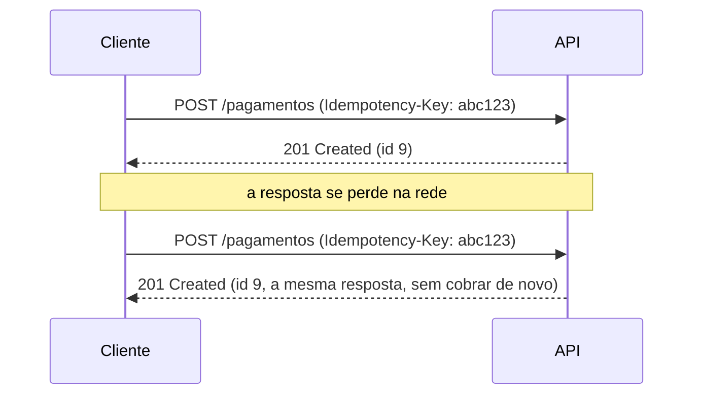

# Design de APIs: REST, GraphQL, gRPC

## Por que isso importa

Uma API é um **contrato**: depois que outros sistemas, aplicativos ou empresas passam a usá-la, cada mudança pode quebrar alguém que você nem conhece. Uma API mal desenhada gera bugs em todos os clientes, suporte sem fim e versões que nunca morrem. Desenhar APIs claras e previsíveis é parte do trabalho de todo backend, é cobrado em entrevistas de *system design* ("desenhe a API de um encurtador de links") e é a base para microsserviços (AS-04).

## Intuição

Pense num **cardápio de restaurante**. Ele é a interface entre a cozinha e o cliente: diz o que existe, como pedir e o que você vai receber. A cozinha pode trocar de fogão, de chef e de fornecedor, e o cardápio continua o mesmo.

- **REST** é o cardápio tradicional: uma lista de **coisas** (recursos) e um conjunto pequeno de verbos padronizados (pedir, trocar, cancelar), que todo mundo entende.
- **GraphQL** é o restaurante onde você monta o prato: diz exatamente quais ingredientes quer, numa só pedida.
- **gRPC** é a comunicação interna da cozinha: rápida, codificada, cheia de abreviações que só a equipe entende.

## Visual

Os mesmos dados pelas três abordagens:

```text
REST (vários recursos, o servidor decide o formato)
  GET /usuarios/7              -> { id, nome, email, criado_em, ... }
  GET /usuarios/7/pedidos      -> [ { id, total, status, ... }, ... ]

GraphQL (um endpoint, o cliente escolhe os campos)
  POST /graphql
  { usuario(id: 7) { nome  pedidos(ultimos: 3) { total } } }
  -> { "data": { "usuario": { "nome": "Ana", "pedidos": [ { "total": 120 } ] } } }

gRPC (contrato em .proto, binário, código gerado)
  service Usuarios { rpc Buscar (BuscarRequest) returns (Usuario); }
  cliente.Buscar(BuscarRequest(id=7))
```

O fluxo de uma criação com chave de idempotência:



## Conceito técnico

### REST

REST (Roy Fielding, 2000) é um estilo arquitetural. Na prática, uma API REST:

- expõe **recursos** identificados por URLs com **substantivos no plural**: `/pedidos`, `/pedidos/42`, `/pedidos/42/itens`;
- usa os **métodos HTTP** para as operações, em vez de verbos na URL (`POST /pedidos`, e não `POST /criarPedido`);
- é **sem estado** (*stateless*): cada requisição traz tudo o que precisa (inclusive a autenticação);
- usa **códigos de status** e cabeçalhos HTTP com o significado padrão (cache, tipo de conteúdo).

| Método | Uso | Seguro? | Idempotente? | Sucesso típico |
|---|---|---|---|---|
| `GET` | ler | sim | sim | 200 |
| `POST` | criar, ou ações que não se encaixam | não | **não** | 201 + `Location` |
| `PUT` | substituir o recurso inteiro | não | sim | 200 ou 204 |
| `PATCH` | alterar parte do recurso | não | não necessariamente | 200 |
| `DELETE` | remover | não | sim | 204 |

**Seguro**: não muda nada no servidor. **Idempotente**: repetir a mesma requisição tem o mesmo efeito de fazê-la uma vez. Isso importa porque redes falham, e clientes e proxies **repetem** requisições. Repetir um `PUT` é inofensivo; repetir um `POST /pagamentos` pode cobrar duas vezes. A solução é a **chave de idempotência**: o cliente gera um identificador único e manda num cabeçalho, e o servidor guarda a resposta associada a ele e a devolve se a mesma chave chegar de novo.

**Códigos de status** mais usados:

| Faixa | Códigos |
|---|---|
| 2xx sucesso | **200** OK, **201** Created, **204** No Content |
| 3xx redirecionamento | 301, 304 Not Modified (cache) |
| 4xx erro do cliente | **400** Bad Request (dados inválidos), **401** não autenticado, **403** sem permissão, **404** não existe, **405** método não permitido, **409** conflito, **422** dados válidos no formato mas que violam regras, **429** limite de requisições |
| 5xx erro do servidor | **500** erro interno, **502/503/504** problemas com o servidor de trás, indisponível ou timeout |

**Erros** devem ter corpo previsível. O padrão RFC 9457 (*Problem Details*) sugere `{ "type", "title", "status", "detail" }` e campos extras, como a lista de campos inválidos.

### Paginação, filtros e versões

- **Filtros e ordenação** pela query string: `GET /pedidos?status=pago&ordem=-criado_em`.
- **Paginação por offset**: `?limite=20&offset=40`. Simples e permite pular para a página 10, mas fica lenta em tabelas grandes (o banco precisa contar e pular as linhas) e pode repetir ou pular itens se algo for inserido enquanto o cliente navega.
- **Paginação por cursor**: a resposta traz um `proximo` (por exemplo, o último id visto), e o cliente pede `?depois_de=<cursor>`. Usa o índice (`WHERE id > ? ORDER BY id LIMIT 20`, BD-04), é estável e escala; mas não dá para pular para uma página arbitrária. É o padrão de feeds e APIs grandes.
- **Versionamento**: mudanças **compatíveis** (novo campo opcional, novo endpoint) não exigem nova versão. Mudanças **incompatíveis** (remover ou renomear campo, mudar tipo) exigem: na URL (`/v2/pedidos`, o mais comum) ou num cabeçalho. Clientes devem **ignorar campos desconhecidos**, para que acrescentar campos nunca quebre ninguém.

**Documentação**: o **OpenAPI** (antigo Swagger) descreve a API em YAML ou JSON, gera documentação navegável, clientes em várias linguagens e validação automática. Frameworks como FastAPI geram o OpenAPI a partir do código.

### GraphQL

Criado pelo Facebook (2015). Um **único endpoint**; o servidor publica um **schema** tipado, e o cliente envia uma **query** dizendo exatamente quais campos quer, inclusive de objetos relacionados.

- Resolve o **overfetching** (receber campos demais) e o **underfetching** (precisar de várias chamadas para montar uma tela), ótimo para aplicativos móveis e telas que combinam muitos dados.
- **Mutations** fazem alterações; **subscriptions** recebem atualizações em tempo real.
- Desafios: o **N+1** no servidor (cada pedido resolvendo seu cliente separadamente, BD-07), resolvido com o padrão **DataLoader** (agrupar as buscas); **cache HTTP** mais difícil (quase tudo é `POST /graphql`); queries **caras** precisam de limites de profundidade e de custo.

### gRPC

Criado pelo Google. O contrato fica num arquivo **`.proto`** (Protocol Buffers), e ferramentas **geram** o código do cliente e do servidor em várias linguagens.

```text
syntax = "proto3";
message BuscarRequest { int64 id = 1; }
message Usuario { int64 id = 1; string nome = 2; string email = 3; }
service Usuarios {
  rpc Buscar (BuscarRequest) returns (Usuario);
  rpc AcompanharPedidos (BuscarRequest) returns (stream Pedido);
}
```

- Mensagens **binárias** e compactas, sobre **HTTP/2** (várias chamadas numa conexão): rápido e eficiente.
- **Streaming** nos dois sentidos.
- Contrato forte e tipado; os números dos campos permitem evoluir o esquema sem quebrar clientes.
- Desvantagens: não é legível a olho nu, navegadores não falam gRPC diretamente (precisa de gRPC-Web ou de um proxy). Por isso brilha na comunicação **entre serviços internos**.

### Como escolher

| Situação | Escolha típica |
|---|---|
| API pública, para terceiros, simples de consumir com qualquer ferramenta | **REST** + OpenAPI |
| Aplicativo com telas que combinam muitos dados, vários tipos de cliente | **GraphQL** (às vezes como camada na frente de serviços REST) |
| Comunicação interna entre microsserviços com alto volume ou streaming | **gRPC** |
| Avisar outro sistema quando algo acontece | **Webhooks** (o seu servidor faz um `POST` para a URL do cliente) |

## Código

Uma API REST de livros em memória, sem framework, para enxergar a lógica de rotas, métodos e status:

```python
import json

livros = {}
proximo_id = 1


def tratar(metodo, caminho, corpo=None):
    global proximo_id
    partes = [p for p in caminho.split("/") if p]
    if partes[:1] != ["livros"]:
        return 404, {"title": "recurso não encontrado"}
    if len(partes) == 1:
        if metodo == "GET":
            return 200, list(livros.values())
        if metodo == "POST":
            if not corpo or not corpo.get("titulo"):
                return 400, {"title": "dados inválidos", "campos": ["titulo"]}
            livro = {"id": proximo_id, "titulo": corpo["titulo"]}
            livros[proximo_id] = livro
            proximo_id += 1
            return 201, livro
        return 405, {"title": "método não permitido"}
    livro_id = int(partes[1])
    if livro_id not in livros:
        return 404, {"title": "livro não encontrado"}
    if metodo == "GET":
        return 200, livros[livro_id]
    if metodo == "DELETE":
        del livros[livro_id]
        return 204, None
    return 405, {"title": "método não permitido"}


for req in [
    ("POST", "/livros", {"titulo": "SICP"}),
    ("POST", "/livros", {}),
    ("GET", "/livros/1", None),
    ("DELETE", "/livros/1", None),
    ("DELETE", "/livros/1", None),
    ("PATCH", "/livros", None),
]:
    status, resposta = tratar(*req)
    print(f"{req[0]:6} {req[1]:10} -> {status} {json.dumps(resposta, ensure_ascii=False)}")
```

Repare no segundo `DELETE`: devolve 404, mas o **estado** do servidor é o mesmo do primeiro (o livro não existe). Idempotência fala do efeito, não do código de resposta.

## Erros comuns

- **Verbos na URL**: `POST /criarUsuario`, `GET /deletarPedido?id=3` (e um `GET` que apaga é perigoso: robôs e prefetch seguem links).
- **Tudo devolve 200**, com `{"erro": true}` no corpo: clientes, proxies e monitoramento não enxergam a falha.
- **500 para erro do cliente**: dado inválido é 400 ou 422, não erro do servidor.
- **`POST` sem idempotência** em operações financeiras.
- **Mudar ou remover campos sem nova versão**.
- **Paginação por offset** em listas enormes ou que mudam o tempo todo.
- **Expor o modelo do banco** como API (nomes de colunas, ids internos, campos sensíveis).
- **GraphQL sem limites** de profundidade e custo, aberto a queries que derrubam o servidor.

## Pratique

```quiz
id: AS-03-q1
tipo: multipla_escolha
pergunta: "Qual é a forma mais adequada, em REST, de cancelar o pedido 42?"
opcoes: ["GET /cancelarPedido?id=42", "POST /pedidos/42/cancelar ou PATCH /pedidos/42 com {\"status\": \"cancelado\"}", "DELETE /cancelar", "GET /pedidos/42?acao=cancelar"]
resposta: 1
explicacao: "Ações que não são simplesmente criar, ler, substituir ou apagar podem virar um sub-recurso de ação (POST .../cancelar) ou uma alteração de estado (PATCH). Usar GET para mudar algo é errado: GET deve ser seguro, e robôs e caches podem disparar a ação sem querer."
dificuldade: 2
```

```quiz
id: AS-03-q2
tipo: multipla_escolha
pergunta: "Um cliente envia um JSON válido, mas com uma data de entrega no passado, o que a regra de negócio não permite. Qual código de status é o mais apropriado?"
opcoes: ["200", "404", "422", "500"]
resposta: 2
explicacao: "422 (Unprocessable Content) indica que a requisição foi entendida, mas viola regras. 400 também é aceito por muitas APIs para qualquer dado inválido. 500 seria dizer que o servidor falhou, o que não é verdade."
dificuldade: 2
```

```quiz
id: AS-03-q3
tipo: verdadeiro_falso
pergunta: "Repetir a mesma requisição PUT várias vezes deixa o servidor no mesmo estado que enviá-la uma vez só."
resposta: true
explicacao: "PUT substitui o recurso pelo conteúdo enviado: a segunda e a terceira vez escrevem exatamente o mesmo. Por isso é idempotente, e clientes podem repeti-lo com segurança após um timeout. POST não tem essa garantia."
dificuldade: 1
```

```quiz
id: AS-03-q4
tipo: resposta_curta
pergunta: "Por que a paginação por cursor costuma ser melhor que a por offset num feed com milhões de itens que recebe itens novos o tempo todo?"
resposta: "Porque o cursor usa o índice (WHERE id > cursor ORDER BY id LIMIT n), com custo constante, enquanto o offset obriga o banco a pular todas as linhas anteriores. E o cursor é estável: itens inseridos durante a navegação não fazem o cliente ver repetidos nem pular itens, o que acontece com offset."
palavras_chave: ["índice", "pular", "estável", "repetidos"]
dificuldade: 2
```

```quiz
id: AS-03-q5
tipo: multipla_escolha
pergunta: "Dois microsserviços internos trocam milhares de mensagens por segundo e precisam de streaming. Qual tecnologia é a mais indicada?"
opcoes: ["REST com JSON", "GraphQL", "gRPC", "Webhooks"]
resposta: 2
explicacao: "gRPC usa mensagens binárias compactas sobre HTTP/2, com contrato tipado e streaming nativo nos dois sentidos. Para tráfego interno de alto volume, é mais eficiente que JSON sobre HTTP/1.1."
dificuldade: 1
```

```quiz
id: AS-03-q6
tipo: codigo
linguagem: python
pergunta: |
  **Uma API REST em memória.** Escreva `tratar(livros, metodo, caminho, corpo)` que manipula o dicionário `livros` (`id -> {'id', 'titulo'}`) e devolve `(status, resposta)`:

  - `GET /livros`: `200` e a lista dos livros, ordenada por id;
  - `POST /livros`: se `corpo` não tiver `'titulo'` não vazio, `400` e `None`; senão cria com id = maior id existente + 1 (ou 1) e devolve `201` e o livro;
  - `GET /livros/<id>`: `200` e o livro, ou `404` e `None`;
  - `PUT /livros/<id>`: se não existe, `404`; se o corpo for inválido, `400`; senão substitui o título e devolve `200` e o livro;
  - `DELETE /livros/<id>`: `204` e `None`, ou `404` e `None`;
  - qualquer outro método numa rota que existe: `405` e `None`.

  O `id` no caminho é sempre um número.
codigo_inicial: |
  def tratar(livros, metodo, caminho, corpo=None):
      return 200, list(livros.values())

  # não mude: os testes usam esta função
  def sessao(requisicoes):
      livros = {}
      return [tratar(livros, *r) for r in requisicoes]
usa: [def, if, return]
testes:
  - chamada: "sessao([('POST', '/livros', {'titulo': 'SICP'}), ('GET', '/livros', None)])"
    saida: "[(201, {'id': 1, 'titulo': 'SICP'}), (200, [{'id': 1, 'titulo': 'SICP'}])]"
  - chamada: "sessao([('POST', '/livros', {}), ('GET', '/livros/1', None)])"
    saida: "[(400, None), (404, None)]"
  - chamada: "sessao([('POST', '/livros', {'titulo': 'A'}), ('DELETE', '/livros/1', None), ('DELETE', '/livros/1', None)])"
    saida: "[(201, {'id': 1, 'titulo': 'A'}), (204, None), (404, None)]"
  - chamada: "sessao([('POST', '/livros', {'titulo': 'A'}), ('POST', '/livros', {'titulo': 'B'}), ('PUT', '/livros/2', {'titulo': 'B2'}), ('PUT', '/livros/2', {'titulo': ''}), ('PUT', '/livros/9', {'titulo': 'X'}), ('GET', '/livros', None)])"
    visivel: false
    saida: "[(201, {'id': 1, 'titulo': 'A'}), (201, {'id': 2, 'titulo': 'B'}), (200, {'id': 2, 'titulo': 'B2'}), (400, None), (404, None), (200, [{'id': 1, 'titulo': 'A'}, {'id': 2, 'titulo': 'B2'}])]"
  - chamada: "sessao([('PATCH', '/livros', None), ('POST', '/livros', {'titulo': 'A'}), ('POST', '/livros/1', {'titulo': 'Z'}), ('GET', '/livros/1', None)])"
    visivel: false
    saida: "[(405, None), (201, {'id': 1, 'titulo': 'A'}), (405, None), (200, {'id': 1, 'titulo': 'A'})]"
  - chamada: "sessao([('POST', '/livros', {'titulo': 'A'}), ('POST', '/livros', {'titulo': 'B'}), ('DELETE', '/livros/1', None), ('POST', '/livros', {'titulo': 'C'})])"
    visivel: false
    saida: "[(201, {'id': 1, 'titulo': 'A'}), (201, {'id': 2, 'titulo': 'B'}), (204, None), (201, {'id': 3, 'titulo': 'C'})]"
dica: "Separe o caminho com [p for p in caminho.split('/') if p]. Com uma parte, você está na coleção; com duas, num item (converta partes[1] com int). Escreva uma função valido(corpo) para reaproveitar entre POST e PUT."
solucao: |
  def valido(corpo):
      return bool(corpo) and bool(corpo.get('titulo'))

  def tratar(livros, metodo, caminho, corpo=None):
      partes = [p for p in caminho.split('/') if p]
      if len(partes) == 1:
          if metodo == 'GET':
              return 200, [dict(livros[i]) for i in sorted(livros)]
          if metodo == 'POST':
              if not valido(corpo):
                  return 400, None
              novo_id = max(livros, default=0) + 1
              livros[novo_id] = {'id': novo_id, 'titulo': corpo['titulo']}
              return 201, dict(livros[novo_id])
          return 405, None
      livro_id = int(partes[1])
      if metodo not in ('GET', 'PUT', 'DELETE'):
          return 405, None
      if livro_id not in livros:
          return 404, None
      if metodo == 'GET':
          return 200, dict(livros[livro_id])
      if metodo == 'DELETE':
          del livros[livro_id]
          return 204, None
      if not valido(corpo):
          return 400, None
      livros[livro_id]['titulo'] = corpo['titulo']
      return 200, dict(livros[livro_id])

  # não mude: os testes usam esta função
  def sessao(requisicoes):
      livros = {}
      return [tratar(livros, *r) for r in requisicoes]
explicacao: "A ordem das verificações define a resposta quando há vários problemas: método não suportado (405) vem antes de procurar o recurso, e o recurso inexistente (404) vem antes de validar o corpo. No último teste, o id 3 é criado depois de apagar o 1: reusar ids apagados confundiria clientes que guardaram links antigos. Repare também que a solução devolve cópias (dict(...)): se devolvesse o próprio dicionário guardado, um PUT posterior alteraria uma resposta já entregue, um bug de aliasing que os testes pegam. Um framework como FastAPI faz essas rotas e validações a partir de anotações, mas a lógica de status é exatamente esta."
dificuldade: 2
```

```quiz
id: AS-03-q7
tipo: codigo
linguagem: python
pergunta: |
  **Paginação por cursor.** Escreva `pagina(itens, limite, depois_de=None)`:

  - `itens` é uma lista de dicionários com a chave `'id'` (inteiros), em qualquer ordem;
  - devolva um dicionário com `'itens'`: os até `limite` itens de **menor id** que sejam **maiores** que `depois_de` (ou desde o começo, se for `None`), em ordem crescente de id;
  - e `'proximo'`: o id do último item da página, se ainda houver itens depois dele; senão `None`.
codigo_inicial: |
  def pagina(itens, limite, depois_de=None):
      return {'itens': itens[:limite], 'proximo': None}
usa: [def, return]
testes:
  - chamada: "pagina([{'id': 1}, {'id': 2}, {'id': 3}], 2)"
    saida: "{'itens': [{'id': 1}, {'id': 2}], 'proximo': 2}"
  - chamada: "pagina([{'id': 1}, {'id': 2}, {'id': 3}], 2, 2)"
    saida: "{'itens': [{'id': 3}], 'proximo': None}"
  - chamada: "pagina([], 5)"
    saida: "{'itens': [], 'proximo': None}"
  - chamada: "pagina([{'id': 30}, {'id': 10}, {'id': 20}, {'id': 40}], 2, 15)"
    visivel: false
    saida: "{'itens': [{'id': 20}, {'id': 30}], 'proximo': 30}"
  - chamada: "pagina([{'id': 5}, {'id': 7}], 2)"
    visivel: false
    saida: "{'itens': [{'id': 5}, {'id': 7}], 'proximo': None}"
  - chamada: "pagina([{'id': 1}, {'id': 9}], 3, 9)"
    visivel: false
    saida: "{'itens': [], 'proximo': None}"
dica: "Filtre e ordene: candidatos = sorted((i for i in itens if depois_de is None or i['id'] > depois_de), key=lambda i: i['id']). A página é candidatos[:limite], e há próxima se len(candidatos) > limite."
solucao: |
  def pagina(itens, limite, depois_de=None):
      candidatos = sorted(
          (i for i in itens if depois_de is None or i['id'] > depois_de),
          key=lambda i: i['id'],
      )
      escolhidos = candidatos[:limite]
      tem_mais = len(candidatos) > limite
      return {'itens': escolhidos, 'proximo': escolhidos[-1]['id'] if tem_mais else None}
explicacao: "No banco, isso é WHERE id > ? ORDER BY id LIMIT ?, e o índice da chave primária faz cada página custar o mesmo, seja a primeira ou a milésima. Um truque comum é buscar limite + 1 linhas: se veio uma a mais, existe próxima página, sem precisar de COUNT. APIs públicas costumam codificar o cursor em base64, para o cliente tratá-lo como opaco e o servidor poder mudar o formato depois."
dificuldade: 2
```

```quiz
id: AS-03-q8
tipo: codigo
linguagem: javascript
pergunta: |
  **A ideia do GraphQL: o cliente escolhe os campos.** Escreva `selecionar(dado, campos)`:

  - `campos` é um objeto em que cada chave é um campo pedido: o valor `true` pega o campo como está; um objeto aninhado aplica a seleção recursivamente ao valor do campo;
  - se o dado (ou um valor aninhado) for um **array**, aplique a seleção a cada elemento;
  - campos pedidos que não existem no dado ficam como `null`.
codigo_inicial: |
  function selecionar(dado, campos) {
    return dado;
  }
usa: [function, for, return]
testes:
  - chamada: "selecionar({ id: 7, nome: 'Ana', email: 'a@x.com', senhaHash: 'xyz' }, { nome: true })"
    saida: "{ nome: 'Ana' }"
  - chamada: "selecionar({ id: 1, autor: { nome: 'Ana', idade: 30 }, titulo: 'SICP' }, { titulo: true, autor: { nome: true } })"
    saida: "{ titulo: 'SICP', autor: { nome: 'Ana' } }"
  - chamada: "selecionar([{ id: 1, n: 'a' }, { id: 2, n: 'b' }], { id: true })"
    saida: "[ { id: 1 }, { id: 2 } ]"
  - chamada: "selecionar({ nome: 'Ana', pedidos: [{ id: 1, total: 10, itens: 3 }, { id: 2, total: 25, itens: 1 }] }, { pedidos: { total: true } })"
    visivel: false
    saida: "{ pedidos: [ { total: 10 }, { total: 25 } ] }"
  - chamada: "selecionar({ nome: 'Ana' }, { nome: true, apelido: true })"
    visivel: false
    saida: "{ nome: 'Ana', apelido: null }"
  - chamada: "selecionar({ autor: null }, { autor: { nome: true } })"
    visivel: false
    saida: "{ autor: null }"
dica: "Comece tratando o array: if (Array.isArray(dado)) devolva um array com selecionar de cada elemento. Para objetos, percorra Object.keys(campos): se campos[c] === true, copie; senão, chame selecionar recursivamente."
solucao: |
  function selecionar(dado, campos) {
    if (dado === null || dado === undefined) return null;
    if (Array.isArray(dado)) {
      const lista = [];
      for (const item of dado) lista.push(selecionar(item, campos));
      return lista;
    }
    const resultado = {};
    for (const c of Object.keys(campos)) {
      const valor = dado[c] === undefined ? null : dado[c];
      resultado[c] = campos[c] === true ? valor : selecionar(valor, campos[c]);
    }
    return resultado;
  }
explicacao: "O primeiro teste mostra o ganho: o cliente pede só o nome, e o senhaHash nunca sai do servidor, nem os campos que a tela não usa (overfetching). Num servidor GraphQL de verdade, cada campo tem um resolver, e um campo como pedidos dispara uma consulta ao banco; com uma lista de 100 autores, isso vira o N+1 da BD-07, resolvido com DataLoader. Repare também que a seleção protege só a resposta: autorização (quem pode ver o e-mail?) continua sendo responsabilidade de cada resolver."
dificuldade: 2
```

## Resumo

- **REST**: recursos com substantivos, métodos HTTP, sem estado, **status corretos**, erros padronizados (RFC 9457), documentação com **OpenAPI**.
- **Seguro** e **idempotente**: GET, PUT e DELETE são idempotentes; POST não, e precisa de **chave de idempotência** em operações críticas.
- **Paginação**: offset (simples) ou **cursor** (escala e é estável). **Versione** só mudanças incompatíveis; clientes ignoram campos novos.
- **GraphQL**: um endpoint, schema tipado, o cliente escolhe os campos; cuidado com N+1 e queries caras.
- **gRPC**: contrato `.proto`, binário sobre HTTP/2, streaming; ideal entre serviços internos.

## Para ir além

- Escreva o OpenAPI de uma API pequena (um encurtador de links) e abra no Swagger Editor.
- Explore a API GraphQL pública do GitHub no explorador deles.
- **Próximo módulo**: AS-04 Microsserviços: quando usar e quando não usar.
