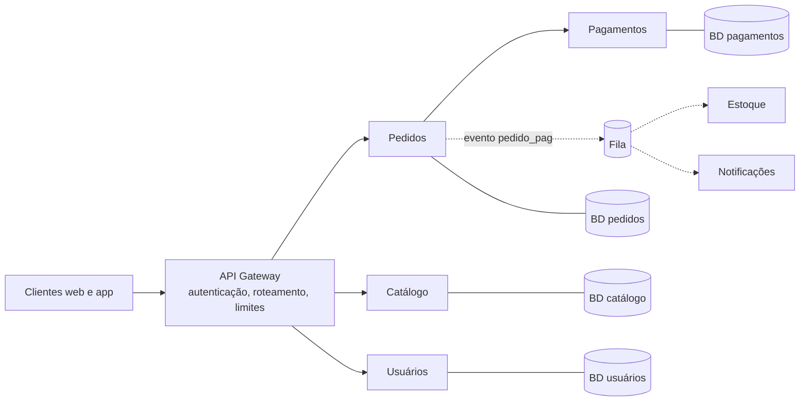
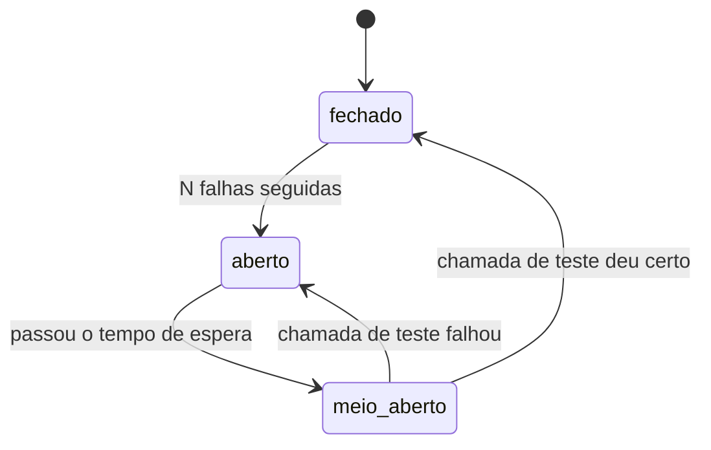

# Microsserviços: quando usar e quando não usar

## Por que isso importa

"Microsserviços" é uma das palavras mais repetidas (e mal usadas) da área. Empresas como Netflix e Amazon popularizaram o modelo, e muitos times copiaram sem ter os problemas que ele resolve, trocando um monólito confuso por **dezenas de serviços confusos que dependem uns dos outros pela rede**. Saber explicar os custos reais e **quando não** usar microsserviços é sinal de maturidade, muito valorizado em entrevistas de nível sênior. E se você for trabalhar numa empresa que já usa, precisa entender os padrões de resiliência que mantêm tudo de pé.

## Intuição

Um monólito é uma **empresa pequena num escritório só**: todo mundo se fala no corredor, as decisões são rápidas, mas quando ela cresce para 300 pessoas, o corredor vira um engarrafamento e uma reforma numa sala atrapalha todas as outras.

Microsserviços são uma **rede de lojas independentes**: cada uma tem sua equipe, seu estoque, seu horário, e abre ou fecha sem pedir permissão às outras. Ótimo para crescer. Mas agora combinar qualquer coisa exige telefonar (a rede), o telefone às vezes não atende (falhas parciais), e saber o estoque total exige ligar para todas (consistência). Ninguém monta uma rede de lojas para vender pastel na esquina.

## Visual



Por que chamadas síncronas em cadeia são perigosas:

```text
Disponibilidade de cada serviço: 99,9%  (8,8 horas fora do ar por ano)

API -> Pedidos -> Pagamentos -> Antifraude -> Câmbio
0,999 x 0,999 x 0,999 x 0,999 x 0,999 = 0,995  (cerca de 44 horas por ano)

Cada dependência síncrona MULTIPLICA a chance de falha.
```

## Conceito técnico

### O que são

Microsserviços são uma arquitetura em que a aplicação é um conjunto de **serviços pequenos e independentes**, cada um:

- organizado em torno de uma **capacidade de negócio** (pedidos, pagamentos, catálogo), não de uma camada técnica;
- **implantado de forma independente**: dá para lançar uma versão nova de pagamentos sem tocar nos outros;
- **dono dos seus dados**: cada serviço tem o seu banco, e os outros só acessam por sua API ou por eventos (*database per service*);
- mantido por **um time** pequeno, do código à produção.

### Benefícios

- **Deploy independente**: times lançam no próprio ritmo, sem um "trem de release" coordenado.
- **Escala independente**: o catálogo, muito acessado, tem 20 cópias; o relatório mensal, uma.
- **Autonomia dos times**: com fronteiras claras, 15 times trabalham em paralelo sem pisar uns nos outros.
- **Isolamento de falhas** (se bem feito): a recomendação cai, a compra continua.
- **Liberdade de tecnologia** por serviço (com moderação).

### Custos (os que mais pesam)

- **A rede não é confiável**: uma chamada de função vira uma chamada remota, que pode demorar, falhar ou falhar **depois** de ter feito o trabalho. As "falácias da computação distribuída" (SD-01) passam a valer para todo o código.
- **Latência**: cada salto soma milissegundos.
- **Consistência de dados**: não há mais `BEGIN ... COMMIT` entre pedidos e estoque. É preciso **sagas** e **consistência eventual** (AS-05).
- **Operação**: dezenas de deploys, bancos, filas, certificados, dashboards. Exige CI/CD maduro, contêineres e orquestração (SD-05 a SD-07).
- **Observabilidade**: um erro atravessa cinco serviços; sem logs centralizados e *tracing* distribuído (SD-08), depurar vira adivinhação.
- **Testes de integração** e mudanças de contrato entre serviços ficam mais difíceis.

### Quando usar (e quando não)

- **Lei de Conway**: "organizações projetam sistemas que copiam suas estruturas de comunicação". Microsserviços são, antes de tudo, uma solução para **escalar times**. Com 5 pessoas, você não tem esse problema.
- **Monolith First** (Fowler): comece com um monólito **modular**; as fronteiras certas só ficam claras depois de entender bem o domínio. Fronteiras erradas entre serviços são muito mais caras de corrigir do que entre módulos.
- Considere microsserviços quando houver: vários times bloqueando uns aos outros no mesmo deploy; partes com necessidades de escala ou disponibilidade muito diferentes; e **pré-requisitos** prontos (deploy automatizado, monitoramento, provisionamento rápido).
- Extraia aos poucos com a **figueira estranguladora** (ES-07), começando pela parte com fronteira mais clara.

### Padrões essenciais

| Padrão | Problema que resolve |
|---|---|
| **API Gateway** | um ponto de entrada para os clientes: roteamento, autenticação, limite de requisições, agregação |
| **Service discovery** | encontrar o endereço atual de um serviço que tem várias cópias que mudam (no Kubernetes, o DNS do *Service*) |
| **Timeout** | nunca esperar para sempre por uma resposta |
| **Retry com backoff exponencial e jitter** | tentar de novo falhas passageiras, esperando cada vez mais e com aleatoriedade, para não criar uma avalanche de retentativas |
| **Circuit breaker** | parar de chamar um serviço que está falhando, falhar rápido e dar tempo para ele se recuperar |
| **Bulkhead** | isolar recursos (conexões, threads) por dependência, para uma lenta não esgotar todas |
| **Fallback** | uma resposta degradada quando a dependência falha (recomendações genéricas, preço em cache) |
| **Saga** | uma transação de negócio que atravessa serviços, com ações de compensação (AS-05) |
| **Comunicação assíncrona** | eventos e filas no lugar de chamadas em cadeia, reduzindo o acoplamento temporal |

**Circuit breaker** em detalhe: no estado **fechado**, as chamadas passam; depois de N falhas seguidas, ele **abre** e rejeita tudo na hora, sem nem tentar; passado um tempo, fica **meio-aberto** e deixa passar uma chamada de teste: se ela der certo, fecha; se falhar, abre de novo.



### Antipadrões

- **Monólito distribuído**: serviços que precisam ser implantados juntos, compartilham o mesmo banco ou se chamam em cadeias síncronas longas. Você ganhou todos os custos da distribuição e nenhum benefício.
- **Serviços pequenos demais** (nanosserviços): um serviço por tabela ou por função.
- **Banco compartilhado**: dois serviços escrevendo nas mesmas tabelas; qualquer mudança de esquema quebra os dois.
- **Dependências cíclicas** entre serviços.
- **Retentativas sem limite e sem backoff**, que transformam uma lentidão pequena numa queda geral (tempestade de retentativas).

## Código

Retentativa com backoff exponencial e jitter, protegendo uma dependência instável:

```python
import random

random.seed(42)  # só para a saída ser sempre a mesma

def servico_instavel(tentativa):
    # falha nas duas primeiras tentativas, depois responde
    if tentativa < 3:
        raise TimeoutError("sem resposta em 2 s")
    return {"cotacao": 5.12}

def chamar_com_retry(operacao, max_tentativas=5, base=0.1, teto=2.0):
    espera_total = 0.0
    for tentativa in range(1, max_tentativas + 1):
        try:
            resultado = operacao(tentativa)
            print(f"tentativa {tentativa}: ok, esperou {espera_total:.2f} s no total")
            return resultado
        except TimeoutError as erro:
            if tentativa == max_tentativas:
                raise
            limite = min(teto, base * 2 ** (tentativa - 1))
            espera = random.uniform(0, limite)   # "full jitter"
            espera_total += espera
            print(f"tentativa {tentativa}: {erro}; nova tentativa em {espera:.2f} s")

print(chamar_com_retry(servico_instavel))
```

O *jitter* (a parte aleatória) espalha as retentativas: se mil clientes falharem juntos, eles não voltam todos no mesmo milissegundo. E retentativas só são seguras em operações **idempotentes** (AS-03).

## Erros comuns

- **Adotar microsserviços por moda** ou por "escalabilidade" num sistema com 100 usuários e 4 desenvolvedores.
- **Dividir por camada técnica** (serviço de banco, serviço de validação) em vez de por capacidade de negócio.
- **Compartilhar o banco** entre serviços.
- **Chamadas síncronas em cadeia** de cinco serviços para atender uma requisição.
- **Sem timeout** em chamadas remotas (o padrão de muitas bibliotecas é esperar para sempre).
- **Retentar sem backoff**, ou retentar operações que não são idempotentes.
- **Sem observabilidade**: logs espalhados, sem id de correlação entre serviços.
- **Começar distribuído antes de entender o domínio**: as fronteiras vão estar erradas.

## Pratique

```quiz
id: AS-04-q1
tipo: multipla_escolha
pergunta: "Uma startup com 4 desenvolvedores e um produto ainda em validação quer começar com 12 microsserviços 'para escalar'. Qual é o melhor conselho?"
opcoes: ["Ótima ideia, quanto antes melhor", "Começar com um monólito modular, com fronteiras internas claras, e extrair serviços quando houver um motivo concreto", "Usar um serviço por tabela do banco", "Usar microsserviços mas com um banco compartilhado"]
resposta: 1
explicacao: "Com 4 pessoas não existe o problema de coordenação entre times que microsserviços resolvem, e as fronteiras certas ainda não são conhecidas. O monólito modular dá velocidade agora e prepara uma extração futura."
dificuldade: 1
```

```quiz
id: AS-04-q2
tipo: multipla_escolha
pergunta: "Os serviços de Pedidos e de Estoque leem e escrevem nas mesmas tabelas de um banco compartilhado, e precisam ser implantados sempre juntos. Isso é:"
opcoes: ["Um exemplo de database per service", "Um monólito distribuído", "Um circuit breaker", "Uma saga"]
resposta: 1
explicacao: "Têm o acoplamento de um monólito (banco compartilhado, deploy conjunto) e os custos de um sistema distribuído (rede, falhas parciais). É o pior dos dois mundos."
dificuldade: 1
```

```quiz
id: AS-04-q3
tipo: verdadeiro_falso
pergunta: "Quando um circuit breaker está aberto, as chamadas ao serviço protegido falham imediatamente, sem nem tentar a rede."
resposta: true
explicacao: "Esse é o objetivo: falhar rápido em vez de esperar timeouts, liberar os recursos do chamador e dar tempo para o serviço com problema se recuperar. Depois do tempo de espera, ele passa a meio-aberto e testa com uma chamada."
dificuldade: 1
```

```quiz
id: AS-04-q4
tipo: resposta_curta
pergunta: "O que diz a Lei de Conway e o que ela tem a ver com microsserviços?"
resposta: "Que as organizações projetam sistemas que copiam suas estruturas de comunicação. Microsserviços funcionam bem quando cada serviço corresponde a um time autônomo; com poucos times, a divisão em muitos serviços não tem a estrutura organizacional que a sustenta. Também dá para usar ao contrário: organizar os times pelas fronteiras que se quer no sistema."
palavras_chave: ["comunicação", "times", "estrutura", "organizações"]
dificuldade: 2
```

```quiz
id: AS-04-q5
tipo: multipla_escolha
pergunta: "Por que se usa jitter (aleatoriedade) no tempo de espera entre retentativas?"
opcoes: ["Para deixar o código mais difícil de entender", "Para evitar que muitos clientes que falharam juntos tentem de novo todos no mesmo instante, sobrecarregando o serviço que está se recuperando", "Para garantir que a operação seja idempotente", "Para reduzir o número de tentativas"]
resposta: 1
explicacao: "Sem jitter, mil clientes que falharam no mesmo segundo voltam juntos depois de 1 s, depois de 2 s, depois de 4 s, em ondas sincronizadas que derrubam o serviço de novo. A aleatoriedade espalha a carga."
dificuldade: 2
```

```quiz
id: AS-04-q6
tipo: codigo
linguagem: python
pergunta: |
  **Circuit breaker.** Complete a classe `Disjuntor(limite, espera)`. O método `chamar(sucesso, agora)` simula uma chamada (a dependência responde com sucesso se `sucesso` for `True`) e devolve o que aconteceu:

  - **fechado**: a chamada é feita. Sucesso zera o contador de falhas e devolve `'ok'`; falha soma 1 e devolve `'falha'`. Ao chegar a `limite` falhas **seguidas**, o disjuntor **abre** no instante `agora`;
  - **aberto**: se `agora - aberto_em < espera`, **não** chama e devolve `'rejeitada'`. Senão, vira **meio-aberto** e faz esta chamada como teste;
  - **meio-aberto** (chamada de teste): sucesso fecha o disjuntor (zera as falhas) e devolve `'ok'`; falha abre de novo, com `aberto_em = agora`, e devolve `'falha'`.
codigo_inicial: |
  class Disjuntor:
      def __init__(self, limite, espera):
          self.limite = limite
          self.espera = espera

      def chamar(self, sucesso, agora):
          return 'ok' if sucesso else 'falha'

  # não mude: os testes usam esta função
  def simular(limite, espera, chamadas):
      d = Disjuntor(limite, espera)
      return [d.chamar(sucesso, agora) for agora, sucesso in chamadas]
usa: [class, def, if, return]
testes:
  - chamada: "simular(2, 10, [(0, False), (1, False), (2, True)])"
    saida: "['falha', 'falha', 'rejeitada']"
  - chamada: "simular(2, 10, [(0, False), (1, True), (2, False), (3, True)])"
    saida: "['falha', 'ok', 'falha', 'ok']"
  - chamada: "simular(1, 5, [(0, False), (3, True), (5, True), (6, True)])"
    saida: "['falha', 'rejeitada', 'ok', 'ok']"
  - chamada: "simular(1, 5, [(0, False), (5, False), (7, True), (10, True)])"
    visivel: false
    saida: "['falha', 'falha', 'rejeitada', 'ok']"
  - chamada: "simular(3, 4, [(0, False), (1, False), (2, False), (3, True), (6, False), (7, False), (11, True), (12, False)])"
    visivel: false
    saida: "['falha', 'falha', 'falha', 'rejeitada', 'falha', 'rejeitada', 'ok', 'falha']"
dica: "Guarde self.estado ('fechado', 'aberto'), self.falhas e self.aberto_em. Comece o chamar tratando o aberto: ou rejeita, ou segue como teste (meio-aberto). Uma falha durante o teste reabre na hora, sem contar até o limite."
solucao: |
  class Disjuntor:
      def __init__(self, limite, espera):
          self.limite = limite
          self.espera = espera
          self.estado = 'fechado'
          self.falhas = 0
          self.aberto_em = None

      def chamar(self, sucesso, agora):
          if self.estado == 'aberto':
              if agora - self.aberto_em < self.espera:
                  return 'rejeitada'
              self.estado = 'meio-aberto'
          if sucesso:
              self.estado = 'fechado'
              self.falhas = 0
              return 'ok'
          if self.estado == 'meio-aberto':
              self.estado = 'aberto'
              self.aberto_em = agora
              return 'falha'
          self.falhas += 1
          if self.falhas >= self.limite:
              self.estado = 'aberto'
              self.aberto_em = agora
          return 'falha'

  # não mude: os testes usam esta função
  def simular(limite, espera, chamadas):
      d = Disjuntor(limite, espera)
      return [d.chamar(sucesso, agora) for agora, sucesso in chamadas]
explicacao: "No último teste, o disjuntor abre em 2, rejeita em 3, testa em 6 (passaram 4) e falha, reabrindo na hora; rejeita em 7; testa em 11, dá certo e fecha; em 12 a falha conta 1 de 3, então ainda passa. Bibliotecas como resilience4j (Java), Polly (.NET) e pybreaker (Python) implementam exatamente essa máquina de estados, com métricas para você ver quando cada circuito abriu."
dificuldade: 3
```

```quiz
id: AS-04-q7
tipo: codigo
linguagem: python
pergunta: |
  **Disponibilidade composta.** Uma requisição a um serviço só funciona se ele **e todas as suas dependências síncronas** (diretas e indiretas) estiverem no ar. Escreva `disponibilidade(chamadas, disp, raiz)`:

  - `chamadas` é um dicionário `servico -> lista de serviços que ele chama de forma síncrona`;
  - `disp` é um dicionário `servico -> disponibilidade` (entre 0 e 1);
  - devolva o produto das disponibilidades da raiz e de **cada serviço alcançável a partir dela, contado uma vez só**, arredondado para 4 casas.
codigo_inicial: |
  def disponibilidade(chamadas, disp, raiz):
      total = disp[raiz]
      for s in chamadas.get(raiz, []):
          total *= disp[s]
      return round(total, 4)
usa: [def, for, while, return]
testes:
  - chamada: "disponibilidade({'api': ['pedidos'], 'pedidos': ['pagamentos']}, {'api': 0.999, 'pedidos': 0.999, 'pagamentos': 0.999}, 'api')"
    saida: "0.997"
  - chamada: "disponibilidade({}, {'api': 0.99}, 'api')"
    saida: "0.99"
  - chamada: "disponibilidade({'a': ['b', 'c'], 'b': ['d'], 'c': ['d']}, {'a': 0.9, 'b': 0.9, 'c': 0.9, 'd': 0.5}, 'a')"
    saida: "0.3645"
  - chamada: "disponibilidade({'a': ['b'], 'b': ['a']}, {'a': 0.99, 'b': 0.98}, 'a')"
    visivel: false
    saida: "0.9702"
  - chamada: "disponibilidade({'a': ['b'], 'b': [], 'x': ['a']}, {'a': 0.9, 'b': 0.8, 'x': 0.1}, 'a')"
    visivel: false
    saida: "0.72"
dica: "Faça uma busca (BFS ou DFS, AL-05) a partir da raiz, com um conjunto de visitados. Multiplique a disponibilidade de cada serviço quando ele for visitado pela primeira vez."
solucao: |
  def disponibilidade(chamadas, disp, raiz):
      visitados = {raiz}
      pilha = [raiz]
      total = 1.0
      while pilha:
          s = pilha.pop()
          total *= disp[s]
          for d in chamadas.get(s, []):
              if d not in visitados:
                  visitados.add(d)
                  pilha.append(d)
      return round(total, 4)
explicacao: "No terceiro teste, d é alcançado por dois caminhos mas conta uma vez: 0,9 × 0,9 × 0,9 × 0,5. O código inicial só olhava as dependências diretas e esquecia as indiretas, o erro clássico ao estimar a disponibilidade de um sistema. O teste com ciclo mostra outro problema: a e b dependem um do outro, um sinal de monólito distribuído. Para fugir dessa multiplicação, troque chamadas síncronas por eventos (AS-05), use caches e fallbacks."
dificuldade: 2
```

```quiz
id: AS-04-q8
tipo: codigo
linguagem: javascript
pergunta: |
  **Encontrando dependências cíclicas.** Escreva `encontrarCiclo(deps)`, onde `deps` é um objeto `servico -> lista de serviços que ele chama`. Devolva um ciclo como lista de nomes, começando e terminando no mesmo serviço (por exemplo `['a', 'b', 'a']`), ou `null` se não houver nenhum.

  Para a resposta ser única: percorra os serviços em ordem alfabética como pontos de partida e, em cada serviço, visite as dependências na ordem em que aparecem; devolva o **primeiro** ciclo encontrado pela busca em profundidade.
codigo_inicial: |
  function encontrarCiclo(deps) {
    return null;
  }
usa: [function, for, return]
testes:
  - chamada: "encontrarCiclo({ a: ['b'], b: ['a'] })"
    saida: "[ 'a', 'b', 'a' ]"
  - chamada: "encontrarCiclo({ api: ['pedidos'], pedidos: ['pagamentos'], pagamentos: [] })"
    saida: "null"
  - chamada: "encontrarCiclo({ pedidos: ['estoque'], estoque: ['catalogo'], catalogo: ['pedidos'], api: ['pedidos'] })"
    saida: "[ 'pedidos', 'estoque', 'catalogo', 'pedidos' ]"
  - chamada: "encontrarCiclo({ a: ['a'] })"
    visivel: false
    saida: "[ 'a', 'a' ]"
  - chamada: "encontrarCiclo({ x: ['y', 'z'], y: ['w'], z: ['x'], w: [] })"
    visivel: false
    saida: "[ 'x', 'z', 'x' ]"
  - chamada: "encontrarCiclo({})"
    visivel: false
    saida: "null"
dica: "Use a DFS com três estados (AL-05): não visitado, no caminho atual e terminado. Guarde o caminho atual numa pilha; ao encontrar uma dependência que está no caminho, o ciclo é o trecho do caminho a partir dela, mais ela de novo."
solucao: |
  function encontrarCiclo(deps) {
    const terminado = new Set();
    const caminho = [];

    function dfs(s) {
      const pos = caminho.indexOf(s);
      if (pos !== -1) return caminho.slice(pos).concat([s]);
      if (terminado.has(s)) return null;
      caminho.push(s);
      for (const d of deps[s] || []) {
        const ciclo = dfs(d);
        if (ciclo) return ciclo;
      }
      caminho.pop();
      terminado.add(s);
      return null;
    }

    for (const s of Object.keys(deps).sort()) {
      const ciclo = dfs(s);
      if (ciclo) return ciclo;
    }
    return null;
  }
explicacao: "No terceiro teste, a busca começa por api (a primeira em ordem alfabética), desce por pedidos, estoque e catalogo e reencontra pedidos no caminho: o ciclo devolvido começa em pedidos, e não em api, que só leva até ele. Ciclos entre serviços significam que nenhum deles pode ser implantado ou subir sozinho, e uma falha em qualquer um se propaga em volta do ciclo. Ferramentas de service mesh e de tracing distribuído (SD-08) desenham esse grafo a partir do tráfego real. Para quebrar um ciclo, normalmente uma das chamadas vira um evento assíncrono, ou a responsabilidade compartilhada é movida para um dos lados."
dificuldade: 3
```

## Resumo

- Microsserviços: serviços por **capacidade de negócio**, **deploy independente**, **banco próprio**, um time por serviço.
- Benefícios: deploy e escala independentes, autonomia dos times, isolamento de falhas.
- Custos: rede não confiável, latência, consistência eventual, operação e observabilidade muito mais complexas.
- **Monolith First** e **Lei de Conway**: microsserviços resolvem principalmente problemas de **organização** em escala.
- Resiliência: **timeout**, **retry com backoff e jitter**, **circuit breaker**, bulkhead, fallback.
- Fuja do **monólito distribuído**: banco compartilhado, deploy conjunto, chamadas síncronas em cadeia, ciclos.

## Para ir além

- Leia o artigo "Microservices" de Fowler e Lewis e o "MicroservicePrerequisites".
- Procure relatos públicos de empresas que voltaram de microsserviços para um monólito e liste os motivos que elas citam.
- **Próximo módulo**: AS-05 Mensageria e eventos: filas, pub/sub, event sourcing.
