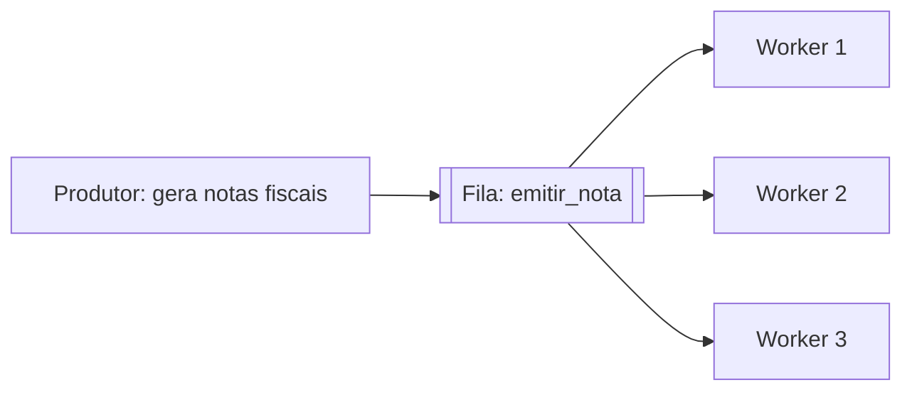
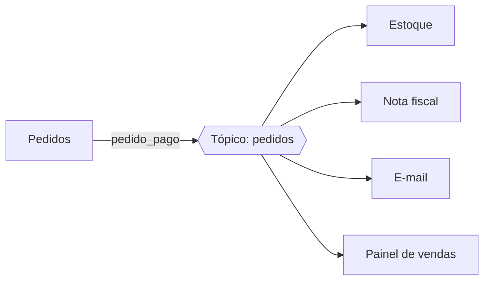
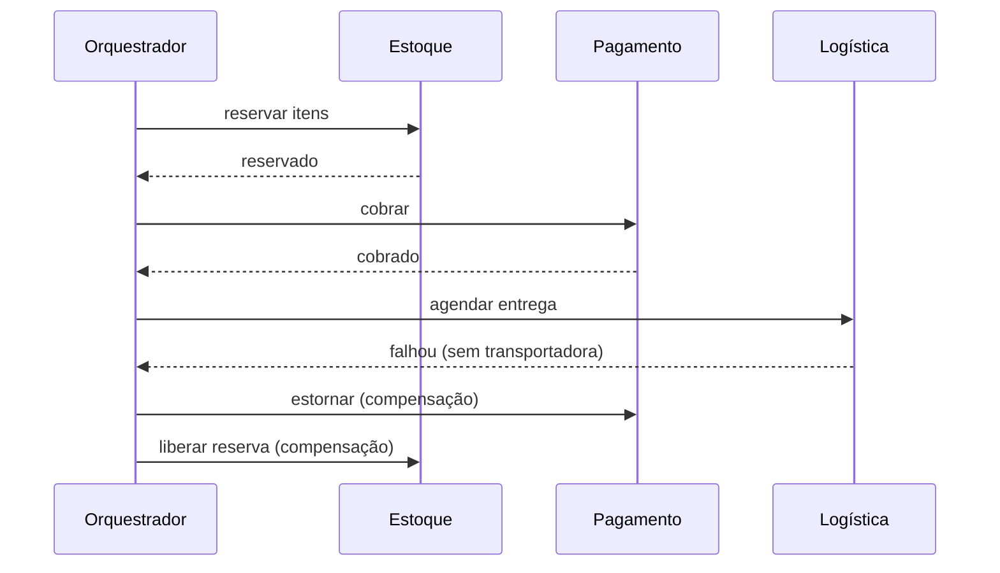

# Mensageria e eventos: filas, pub/sub, event sourcing

## Por que isso importa

Quando um pedido é pago, muita coisa precisa acontecer: baixar o estoque, emitir a nota fiscal, mandar o e-mail, atualizar o painel de vendas. Se o serviço de pedidos chamar cada um diretamente, ele fica lento, frágil (qualquer um fora do ar derruba a compra) e acoplado a todos. **Mensageria** resolve isso: o pedido publica "fui pago" e cada interessado reage no seu tempo. Filas e eventos estão no centro de quase todo sistema de médio porte para cima (RabbitMQ, Kafka, SQS), e as armadilhas, como mensagens duplicadas e transações que atravessam serviços, são assunto certo em entrevistas de backend.

## Intuição

Uma chamada síncrona é um **telefonema**: você liga, a outra pessoa precisa atender **agora**, e você fica esperando na linha. Se ela não atender, você não consegue seguir.

Mensageria é o **correio** (ou o WhatsApp): você deixa a mensagem e segue a vida. A pessoa lê quando puder; se estiver fora do ar, a mensagem fica esperando. Isso desacopla no **tempo** (não precisam estar no ar ao mesmo tempo) e no **espaço** (quem envia nem precisa saber quem lê).

O preço: você não sabe na hora se deu certo, a mensagem pode chegar **duas vezes**, e as coisas ficam consistentes "daqui a pouco", não "agora".

## Visual

Fila de trabalho: cada mensagem vai para **um** consumidor, e eles dividem a carga.



Pub/sub: cada evento vai para **todos** os assinantes.



Uma saga por orquestração, com compensação quando um passo falha:



## Conceito técnico

### Síncrono e assíncrono

| | Síncrono (HTTP, gRPC) | Assíncrono (mensagens) |
|---|---|---|
| Resposta | imediata, o chamador espera | depois, ou nunca (dispara e esquece) |
| Acoplamento temporal | os dois precisam estar no ar | o consumidor pode estar fora do ar |
| Falhas | propagam na hora | ficam na fila e são reprocessadas |
| Picos de carga | derrubam o chamado | a fila absorve (*buffer*) |
| Consistência | mais simples de raciocinar | **eventual** |
| Depuração | um rastro linear | fluxo espalhado, precisa de tracing |

Use síncrono quando o usuário **precisa** da resposta para continuar (validar o cartão no checkout). Use assíncrono para tudo que pode acontecer depois (e-mail, nota fiscal, relatórios).

### Filas, pub/sub e logs

- **Fila de trabalho** (*work queue*, consumidores concorrentes): uma mensagem é entregue a **um** dos consumidores; quando ele confirma (*ack*), ela sai da fila. Escala adicionando workers. Ex.: RabbitMQ, Amazon SQS, filas de tarefas (Celery, Sidekiq).
- **Pub/sub**: o produtor publica num **tópico**, e **cada assinante** recebe uma cópia. O produtor não sabe quem assina. Ex.: exchanges *fanout* do RabbitMQ, Amazon SNS, Google Pub/Sub.
- **Log de eventos** (Kafka, Redpanda, Kinesis): os eventos são **gravados em ordem** num log durável, dividido em **partições**. Cada grupo de consumidores guarda a sua **posição** (*offset*) e pode **reler** o passado. A ordem só é garantida **dentro de uma partição**, por isso eventos da mesma entidade usam a mesma chave de partição (o id do pedido).

**Fila de mensagens mortas** (*dead letter queue*, DLQ): mensagens que falharam N vezes vão para uma fila separada, para investigar, em vez de travar a fila principal ou serem perdidas.

### Garantias de entrega

| Garantia | O que significa | Risco |
|---|---|---|
| **No máximo uma vez** | confirma antes de processar | perder mensagens se o consumidor cair |
| **Pelo menos uma vez** | confirma depois de processar | **duplicatas**, se cair entre processar e confirmar |
| **Exatamente uma vez** | | na prática, é "pelo menos uma vez" + **processamento idempotente** |

A regra de ouro: **todo consumidor deve ser idempotente**. Técnicas: guardar os ids das mensagens já processadas (numa tabela, na mesma transação do efeito); usar operações naturalmente idempotentes (`UPDATE ... SET status = 'pago'` em vez de `saldo = saldo + 10`); usar chaves únicas no banco.

### O problema da escrita dupla e o padrão outbox

O serviço precisa **salvar** o pedido no banco **e** **publicar** o evento. Se salvar e cair antes de publicar, o evento se perde; se publicar e o `COMMIT` falhar, o mundo fica sabendo de um pedido que não existe. Não há transação que abranja o banco e o broker.

**Transactional outbox**: na **mesma transação** que salva o pedido, grave o evento numa tabela `outbox`. Um processo separado lê a outbox e publica no broker (e marca como enviado). Como pode publicar duas vezes se cair no meio, os consumidores precisam ser idempotentes, de novo.

### Sagas

Uma **saga** é uma transação de negócio dividida em passos locais, cada um com uma **ação de compensação** que desfaz o seu efeito no nível do negócio (estornar, liberar a reserva, cancelar a nota). Se um passo falha, as compensações dos passos já feitos rodam em ordem **inversa**.

- **Coreografia**: cada serviço reage a eventos e publica os seus. Sem coordenador, mas o fluxo fica implícito e difícil de acompanhar.
- **Orquestração**: um orquestrador diz a cada serviço o que fazer e conhece o fluxo inteiro. Mais fácil de entender e monitorar (ferramentas como Temporal ajudam).

Sagas não têm o isolamento de uma transação ACID (BD-05): outros podem ver estados intermediários (a reserva feita antes de o pagamento falhar). O desenho precisa tolerar isso.

### Event sourcing e CQRS

- **Event sourcing**: em vez de guardar o **estado atual** (saldo = 70), guarde a **sequência de eventos** que levou até ele (aberta, depositou 100, sacou 30). O estado é **reconstruído** aplicando os eventos em ordem. Ganhos: histórico e auditoria completos, "viajar no tempo" (qual era o saldo dia 3?), novas visões dos dados a partir do passado. Custos: consultas exigem projeções, eventos são imutáveis e o formato deles precisa evoluir com cuidado, reconstruir pode ser caro (resolvido com *snapshots*). Clássico em contabilidade, bancos e sistemas regulados.
- **CQRS** (Command Query Responsibility Segregation): modelos **separados** para escrita (comandos, com as regras) e leitura (consultas, otimizadas para as telas, às vezes num outro banco). Combina naturalmente com event sourcing: os eventos alimentam as **projeções** de leitura. Também traz consistência eventual entre o lado de escrita e o de leitura.

Ambos são ferramentas poderosas e **complexas**: use em partes do sistema que realmente precisam, não no sistema inteiro.

## Código

Uma fila com entrega "pelo menos uma vez" e um consumidor idempotente:

```python
from collections import deque

fila = deque([
    {"id": "m1", "pedido": 1, "valor": 100},
    {"id": "m2", "pedido": 2, "valor": 50},
])

processadas = set()      # num sistema real: uma tabela, na mesma transação do efeito
faturamento = 0
falhar_no_ack = {"m2"}   # simula o consumidor caindo depois de processar, antes de confirmar

while fila:
    msg = fila.popleft()
    if msg["id"] in processadas:
        print(f"{msg['id']}: duplicada, ignorada")
        continue
    faturamento += msg["valor"]
    processadas.add(msg["id"])
    if msg["id"] in falhar_no_ack:
        falhar_no_ack.discard(msg["id"])
        print(f"{msg['id']}: processada, mas caiu antes do ack; o broker reenvia")
        fila.append(msg)
        continue
    print(f"{msg['id']}: processada e confirmada")

print("faturamento:", faturamento)   # 150, e não 200
```

## Erros comuns

- **Consumidor não idempotente** com entrega "pelo menos uma vez": cobranças e e-mails duplicados.
- **Escrita dupla** (salvar no banco e publicar no broker separadamente) sem outbox.
- **Contar com a ordem global** das mensagens; no Kafka a ordem vale só por partição, e retentativas podem reordenar.
- **Fila sem DLQ**: uma mensagem envenenada trava tudo ou some em silêncio.
- **Eventos gordos demais ou magros demais**: eventos com o banco inteiro dentro, ou só um id que obriga todos os consumidores a chamarem o produtor de volta.
- **Mudar o formato de um evento** sem compatibilidade, quebrando consumidores que você nem conhece.
- **Usar mensageria onde o usuário precisa da resposta agora**.
- **Event sourcing no sistema inteiro** sem necessidade.

## Pratique

```quiz
id: AS-05-q1
tipo: multipla_escolha
pergunta: "Você tem 10 workers gerando PDFs e quer que cada pedido de PDF seja feito por apenas um deles. Que modelo usar?"
opcoes: ["Pub/sub, com cada worker assinando o tópico", "Fila de trabalho com consumidores concorrentes", "Chamadas síncronas para todos os workers", "Event sourcing"]
resposta: 1
explicacao: "Na fila de trabalho, cada mensagem é entregue a um único consumidor, e a carga se divide entre eles. No pub/sub, cada worker receberia uma cópia e o PDF seria gerado 10 vezes."
dificuldade: 1
```

```quiz
id: AS-05-q2
tipo: multipla_escolha
pergunta: "Um consumidor processa a mensagem, atualiza o banco e cai antes de confirmar (ack). O broker tem entrega 'pelo menos uma vez'. O que acontece?"
opcoes: ["A mensagem se perde", "A mensagem é entregue de novo, e o consumidor precisa ser idempotente para não aplicar o efeito duas vezes", "O broker desfaz a alteração no banco", "Nada, a mensagem já foi processada"]
resposta: 1
explicacao: "Sem o ack, o broker considera que a mensagem não foi tratada e a reenvia. O broker não tem como desfazer o que o consumidor fez no banco, por isso a idempotência é responsabilidade do consumidor."
dificuldade: 1
```

```quiz
id: AS-05-q3
tipo: verdadeiro_falso
pergunta: "No Kafka, a ordem das mensagens é garantida dentro de uma partição, mas não entre partições diferentes do mesmo tópico."
resposta: true
explicacao: "Cada partição é um log ordenado; partições diferentes são independentes. Por isso eventos que precisam de ordem entre si (os do mesmo pedido) usam a mesma chave de partição, como o id do pedido."
dificuldade: 2
```

```quiz
id: AS-05-q4
tipo: resposta_curta
pergunta: "Que problema o padrão transactional outbox resolve e como?"
resposta: "O da escrita dupla: salvar no banco e publicar no broker não podem estar na mesma transação, então uma das operações pode acontecer sem a outra. O outbox grava o evento numa tabela do próprio banco, na mesma transação da alteração, e um processo separado lê essa tabela e publica no broker, garantindo que todo dado salvo gere o evento (pelo menos uma vez)."
palavras_chave: ["mesma transação", "tabela", "publica", "escrita dupla"]
dificuldade: 2
```

```quiz
id: AS-05-q5
tipo: multipla_escolha
pergunta: "Numa saga de compra (reservar estoque, cobrar, agendar entrega), o agendamento falha. O que deve acontecer?"
opcoes: ["Um ROLLBACK distribuído desfaz tudo automaticamente", "As compensações rodam em ordem inversa: estornar a cobrança e depois liberar a reserva", "Nada, o cliente fica sem entrega mas cobrado", "Tentar agendar para sempre"]
resposta: 1
explicacao: "Sagas não têm rollback de banco entre serviços; cada passo concluído é desfeito por uma ação de compensação de negócio, do último para o primeiro. Retentativas limitadas podem vir antes, mas não infinitas."
dificuldade: 1
```

```quiz
id: AS-05-q6
tipo: codigo
linguagem: python
pergunta: |
  **Event sourcing.** O estado de uma conta não é guardado: só os eventos. Escreva `reconstruir(eventos)` que aplica os eventos em ordem e devolve o estado `{'titular', 'saldo', 'bloqueada'}`:

  - `('aberta', titular)`: começa com saldo 0 e desbloqueada;
  - `('deposito', valor)`: soma ao saldo;
  - `('saque', valor)`: subtrai do saldo;
  - `('bloqueio', None)` e `('desbloqueio', None)`: mudam `bloqueada`.

  Escreva também `saldo_em(eventos, n)`, o saldo depois dos **n primeiros** eventos (viagem no tempo).
codigo_inicial: |
  def reconstruir(eventos):
      return {'titular': None, 'saldo': 0, 'bloqueada': False}

  def saldo_em(eventos, n):
      return 0
usa: [def, for, if, return]
testes:
  - chamada: "reconstruir([('aberta', 'Ana'), ('deposito', 100), ('saque', 30)])"
    saida: "{'titular': 'Ana', 'saldo': 70, 'bloqueada': False}"
  - chamada: "reconstruir([('aberta', 'Bia'), ('bloqueio', None)])"
    saida: "{'titular': 'Bia', 'saldo': 0, 'bloqueada': True}"
  - chamada: "saldo_em([('aberta', 'Ana'), ('deposito', 100), ('saque', 30), ('deposito', 5)], 2)"
    saida: "100"
  - chamada: "reconstruir([('aberta', 'Caio'), ('deposito', 50), ('bloqueio', None), ('deposito', 10), ('desbloqueio', None), ('saque', 60)])"
    visivel: false
    saida: "{'titular': 'Caio', 'saldo': 0, 'bloqueada': False}"
  - chamada: "[saldo_em([('aberta', 'Ana'), ('deposito', 100), ('saque', 30), ('deposito', 5)], n) for n in range(5)]"
    visivel: false
    saida: "[0, 0, 100, 70, 75]"
dica: "Escreva uma função aplicar(estado, evento) que devolve o novo estado. reconstruir é um laço com aplicar; saldo_em é reconstruir(eventos[:n])['saldo']."
solucao: |
  def aplicar(estado, evento):
      tipo, dado = evento
      if tipo == 'aberta':
          return {'titular': dado, 'saldo': 0, 'bloqueada': False}
      novo = dict(estado)
      if tipo == 'deposito':
          novo['saldo'] += dado
      elif tipo == 'saque':
          novo['saldo'] -= dado
      elif tipo == 'bloqueio':
          novo['bloqueada'] = True
      elif tipo == 'desbloqueio':
          novo['bloqueada'] = False
      return novo

  def reconstruir(eventos):
      estado = {'titular': None, 'saldo': 0, 'bloqueada': False}
      for evento in eventos:
          estado = aplicar(estado, evento)
      return estado

  def saldo_em(eventos, n):
      return reconstruir(eventos[:n])['saldo']
explicacao: "aplicar é uma função pura (estado, evento) -> estado, o que torna a reconstrução um simples fold (a função reduce, FP-07). Viajar no tempo sai de graça: basta aplicar menos eventos. Repare que o histórico conta coisas que o saldo sozinho esconde, como o depósito feito com a conta bloqueada no teste oculto: uma regra de negócio deveria ter impedido isso? Com event sourcing, a auditoria consegue responder."
dificuldade: 2
```

```quiz
id: AS-05-q7
tipo: codigo
linguagem: python
pergunta: |
  **Consumidor idempotente.** O broker entrega "pelo menos uma vez", então a mesma mensagem pode chegar repetida. Escreva `consumir(mensagens)` que processa uma lista de mensagens `{'id', 'conta', 'valor'}` e devolve `(saldos, ignoradas)`:

  - `saldos`: dicionário `conta -> soma dos valores`, aplicando **cada id uma vez só** (a primeira ocorrência);
  - `ignoradas`: a lista dos ids das ocorrências repetidas, na ordem em que chegaram.
codigo_inicial: |
  def consumir(mensagens):
      saldos = {}
      for m in mensagens:
          saldos[m['conta']] = saldos.get(m['conta'], 0) + m['valor']
      return saldos, []
usa: [def, for, if, return]
testes:
  - chamada: "consumir([{'id': 'a', 'conta': 1, 'valor': 10}, {'id': 'b', 'conta': 1, 'valor': 5}])"
    saida: "({1: 15}, [])"
  - chamada: "consumir([{'id': 'a', 'conta': 1, 'valor': 10}, {'id': 'a', 'conta': 1, 'valor': 10}])"
    saida: "({1: 10}, ['a'])"
  - chamada: "consumir([])"
    saida: "({}, [])"
  - chamada: "consumir([{'id': 'x', 'conta': 2, 'valor': 7}, {'id': 'y', 'conta': 3, 'valor': 1}, {'id': 'x', 'conta': 2, 'valor': 7}, {'id': 'z', 'conta': 2, 'valor': -2}, {'id': 'y', 'conta': 3, 'valor': 1}, {'id': 'x', 'conta': 2, 'valor': 7}])"
    visivel: false
    saida: "({2: 5, 3: 1}, ['x', 'y', 'x'])"
dica: "Guarde os ids já processados num conjunto. Antes de aplicar uma mensagem, confira se o id está lá."
solucao: |
  def consumir(mensagens):
      saldos = {}
      vistos = set()
      ignoradas = []
      for m in mensagens:
          if m['id'] in vistos:
              ignoradas.append(m['id'])
              continue
          vistos.add(m['id'])
          saldos[m['conta']] = saldos.get(m['conta'], 0) + m['valor']
      return saldos, ignoradas
explicacao: "Sem o controle, o teste oculto daria 19 na conta 2 em vez de 5: três cobranças da mesma mensagem. Num sistema real, o conjunto 'vistos' é uma tabela com o id da mensagem como chave única, gravada na mesma transação que altera o saldo: assim, ou as duas coisas acontecem, ou nenhuma. E ela precisa de uma política de limpeza, já que cresce para sempre."
dificuldade: 1
```

```quiz
id: AS-05-q8
tipo: codigo
linguagem: javascript
pergunta: |
  **Orquestrando uma saga.** Escreva `executarSaga(passos, falhaEm)`:

  - `passos` é uma lista de nomes, executados em ordem; executar um passo registra `'executar:<nome>'` no log;
  - se o passo `falhaEm` for executado, ele **falha**: registre `'falhou:<nome>'` e, em seguida, compense os passos que **já tinham dado certo**, do mais recente para o mais antigo, registrando `'compensar:<nome>'`;
  - se nenhum passo falhar (ou `falhaEm` for `null`), registre `'concluída'` no fim.

  Devolva o log.
codigo_inicial: |
  function executarSaga(passos, falhaEm) {
    const log = [];
    for (const p of passos) log.push(`executar:${p}`);
    log.push('concluída');
    return log;
  }
usa: [function, for, return]
testes:
  - chamada: "executarSaga(['reservar', 'cobrar', 'agendar'], null)"
    saida: "[ 'executar:reservar', 'executar:cobrar', 'executar:agendar', 'concluída' ]"
  - chamada: "executarSaga(['reservar', 'cobrar', 'agendar'], 'agendar')"
    saida: "[ 'executar:reservar', 'executar:cobrar', 'executar:agendar', 'falhou:agendar', 'compensar:cobrar', 'compensar:reservar' ]"
  - chamada: "executarSaga(['reservar', 'cobrar', 'agendar'], 'reservar')"
    saida: "[ 'executar:reservar', 'falhou:reservar' ]"
  - chamada: "executarSaga(['a', 'b', 'c', 'd'], 'c')"
    visivel: false
    saida: "[ 'executar:a', 'executar:b', 'executar:c', 'falhou:c', 'compensar:b', 'compensar:a' ]"
  - chamada: "executarSaga([], 'x')"
    visivel: false
    saida: "[ 'concluída' ]"
  - chamada: "executarSaga(['a', 'b'], 'z')"
    visivel: false
    saida: "[ 'executar:a', 'executar:b', 'concluída' ]"
dica: "Guarde os passos concluídos numa lista. Ao falhar, percorra essa lista de trás para frente (um for com índice decrescente) e devolva o log sem registrar 'concluída'."
solucao: |
  function executarSaga(passos, falhaEm) {
    const log = [];
    const concluidos = [];
    for (const p of passos) {
      log.push(`executar:${p}`);
      if (p === falhaEm) {
        log.push(`falhou:${p}`);
        for (let i = concluidos.length - 1; i >= 0; i--) {
          log.push(`compensar:${concluidos[i]}`);
        }
        return log;
      }
      concluidos.push(p);
    }
    log.push('concluída');
    return log;
  }
explicacao: "O passo que falhou não é compensado: ele não chegou a ter efeito. A ordem inversa importa: estornar a cobrança antes de liberar a reserva evita que, por um instante, o item volte à venda com o cliente ainda cobrado. Na vida real, cada compensação também pode falhar, então elas precisam ser idempotentes e retentadas até dar certo; é para isso que existem orquestradores duráveis como o Temporal."
dificuldade: 2
```

## Resumo

- **Assíncrono** desacopla no tempo e no espaço, absorve picos, mas traz **consistência eventual**.
- **Fila de trabalho**: um consumidor por mensagem. **Pub/sub**: todos os assinantes. **Log** (Kafka): ordem por partição, releitura por offset. **DLQ** para mensagens que falham.
- Entrega **pelo menos uma vez** + **consumidor idempotente** = o "exatamente uma vez" possível.
- **Outbox** resolve a escrita dupla banco + broker.
- **Saga**: passos locais com **compensações** em ordem inversa; coreografia ou orquestração.
- **Event sourcing** guarda eventos e reconstrói o estado; **CQRS** separa escrita e leitura. Poderosos e complexos.

## Para ir além

- Faça os tutoriais 1 a 3 do RabbitMQ em Python.
- Leia "What do you mean by Event-Driven?" do Martin Fowler.
- **Próximo módulo**: AS-06 Domain-Driven Design (DDD).
