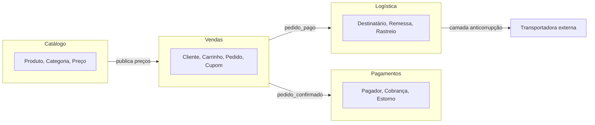
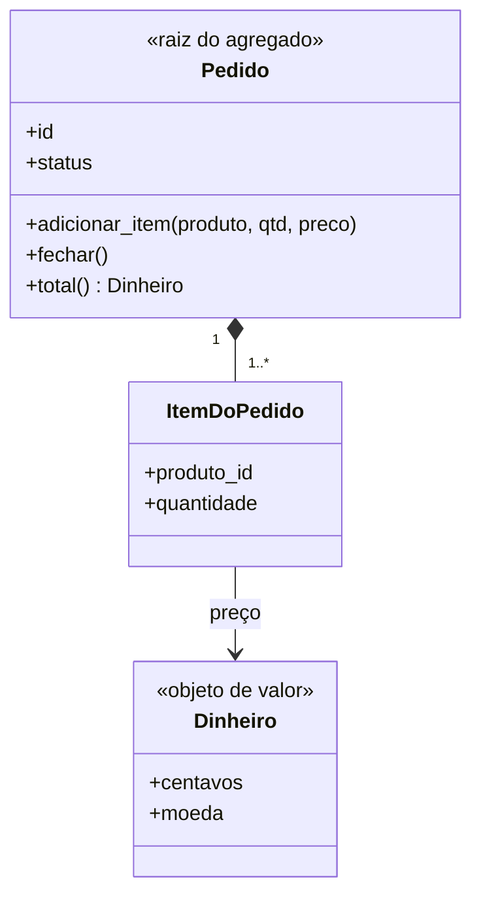

# Domain-Driven Design (DDD)

## Por que isso importa

Os sistemas mais difíceis não são difíceis por causa da tecnologia, e sim do **negócio**: regras de crédito, de frete, de matrícula, de seguros, cheias de exceções que só os especialistas conhecem. **Domain-Driven Design** (Eric Evans, 2003) é um conjunto de práticas para colocar esse conhecimento **dentro** do código, de forma explícita, e para dividir sistemas grandes em partes com fronteiras que fazem sentido para o negócio. Os contextos delimitados do DDD são o jeito mais usado de decidir as fronteiras de microsserviços (AS-04), e termos como agregado e objeto de valor aparecem em toda conversa séria de arquitetura.

## Intuição

Imagine a palavra **"cliente"** numa loja online. Para o time de **vendas**, cliente é quem tem carrinho, cupons e histórico de compras. Para a **logística**, é um endereço de entrega e um telefone para o entregador. Para o **financeiro**, é um CPF, uma forma de pagamento e um limite de crédito. Se você criar uma única classe `Cliente` que agrada a todos, ela vira um monstro de 80 campos que ninguém entende.

O DDD diz: **aceite que cada área tem o seu modelo**, com o seu vocabulário, dentro das suas fronteiras. E dentro de cada fronteira, **converse com os especialistas** até que o código use exatamente as palavras deles. Se o especialista diz "a apólice é **endossada**", o código tem um método `endossar()`, e não `update_policy_status(3)`.

## Visual

Um mapa de contextos de uma loja:



Um agregado e a sua raiz:



## Conceito técnico

### Design estratégico: as fronteiras

- **Domínio**: a área de negócio que o software atende. Divide-se em **subdomínios**:
  - **central** (*core*): o que diferencia a empresa e merece o melhor time e o design mais cuidadoso (o algoritmo de precificação de uma seguradora);
  - **de suporte**: necessário, específico, mas não diferencial;
  - **genérico**: problemas resolvidos (autenticação, e-mail, pagamentos), para **comprar ou usar pronto**.
- **Linguagem ubíqua**: um vocabulário comum, construído **com** os especialistas, usado nas conversas, nos documentos, nos testes e no código. Se uma palavra muda na conversa, muda no código.
- **Contexto delimitado** (*bounded context*): a fronteira dentro da qual um modelo e sua linguagem são consistentes. "Cliente" pode significar coisas diferentes em contextos diferentes, e está tudo bem. Em geral, um contexto corresponde a **um time** e é um bom candidato a módulo ou serviço.
- **Mapa de contextos**: como os contextos se relacionam. Alguns padrões:
  - **Cliente-fornecedor**: o contexto de cima atende às necessidades do de baixo;
  - **Conformista**: o de baixo simplesmente aceita o modelo do de cima;
  - **Camada anticorrupção** (ACL): um tradutor que protege o seu modelo do modelo de outro sistema (o adaptador da AS-02);
  - **Linguagem publicada / serviço aberto**: um contrato estável e documentado para vários consumidores;
  - **Kernel compartilhado**: um pedaço pequeno de modelo dividido por dois times (com muito cuidado).

### Design tático: os blocos de construção

| Bloco | O que é | Exemplo |
|---|---|---|
| **Entidade** | tem **identidade** que persiste no tempo; dois objetos com os mesmos dados mas ids diferentes são coisas diferentes | `Pedido(id=42)`, `Cliente` |
| **Objeto de valor** | definido só pelos seus atributos, **imutável**, sem identidade; dois iguais são intercambiáveis | `Dinheiro(1990, 'BRL')`, `Endereco`, `Periodo`, `Email` |
| **Agregado** | um grupo de entidades e valores tratado como **uma unidade de consistência**, acessado só pela **raiz** | `Pedido` com seus `ItemDoPedido` |
| **Repositório** | coleção ilusória de agregados: buscar e salvar agregados **inteiros** | `RepositorioDePedidos.buscar(42)` |
| **Serviço de domínio** | uma operação de negócio que não pertence naturalmente a uma entidade | `transferir(conta_origem, conta_destino, valor)` |
| **Evento de domínio** | algo que **aconteceu** e importa para o negócio, no passado | `PedidoFechado`, `PagamentoRecusado` |
| **Fábrica** | encapsula a criação complexa de um agregado | `Pedido.a_partir_do_carrinho(carrinho)` |

**Objetos de valor** são subestimados. Em vez de `preco: float` e `moeda: str` soltos (obsessão por primitivos, ES-07), um `Dinheiro` impede somar real com dólar, arredonda do jeito certo e valida a si mesmo na criação. Um `Email` que só existe se for válido elimina validações espalhadas.

### Agregados e invariantes

Uma **invariante** é uma regra que precisa ser **sempre** verdadeira: "um pedido fechado não recebe itens", "o total de um pedido não passa do limite de crédito", "no máximo 10 unidades por produto". O agregado é a fronteira dentro da qual as invariantes são garantidas **imediatamente**, numa transação.

Regras práticas (Vaughn Vernon):

1. **Modele invariantes verdadeiras** dentro do agregado; o resto pode ser eventual.
2. **Agregados pequenos**: só o que precisa mudar junto.
3. **Referencie outros agregados pelo id**, não pelo objeto (`cliente_id`, e não `cliente`).
4. **Uma transação altera um agregado só**; mudanças em outros agregados acontecem por **eventos de domínio** (consistência eventual, AS-05).

Toda alteração passa pela **raiz** (`pedido.adicionar_item(...)`); ninguém de fora mexe direto em `pedido.itens.append(...)`, porque isso furaria as regras.

### Quando usar

O DDD completo é caro: exige acesso a especialistas, tempo de modelagem e disciplina. Compensa no **subdomínio central**, com regras complexas e que mudam. Para CRUDs e subdomínios genéricos, use soluções simples ou prontas. Mesmo sem o pacote completo, **linguagem ubíqua, contextos delimitados e objetos de valor** valem a pena em quase qualquer projeto.

## Código

Um objeto de valor `Dinheiro` imutável e um agregado `Pedido` que protege as suas invariantes:

```python
from dataclasses import dataclass, field


@dataclass(frozen=True)
class Dinheiro:
    centavos: int
    moeda: str = "BRL"

    def __add__(self, outro):
        if self.moeda != outro.moeda:
            raise ValueError("não dá para somar moedas diferentes")
        return Dinheiro(self.centavos + outro.centavos, self.moeda)

    def __mul__(self, n):
        return Dinheiro(self.centavos * n, self.moeda)

    def __str__(self):
        return f"{self.moeda} {self.centavos / 100:.2f}"


@dataclass
class Pedido:
    id: int
    status: str = "aberto"
    itens: dict = field(default_factory=dict)
    eventos: list = field(default_factory=list)

    MAX_POR_PRODUTO = 10

    def adicionar_item(self, produto, quantidade, preco):
        if self.status != "aberto":
            raise ValueError("pedido fechado não recebe itens")
        atual = self.itens.get(produto, (0, preco))[0]
        if atual + quantidade > self.MAX_POR_PRODUTO:
            raise ValueError(f"máximo de {self.MAX_POR_PRODUTO} unidades por produto")
        self.itens[produto] = (atual + quantidade, preco)

    def total(self):
        total = Dinheiro(0)
        for quantidade, preco in self.itens.values():
            total = total + preco * quantidade
        return total

    def fechar(self):
        if not self.itens:
            raise ValueError("pedido vazio não pode ser fechado")
        self.status = "fechado"
        self.eventos.append(("PedidoFechado", self.id, str(self.total())))


p = Pedido(42)
p.adicionar_item("caneca", 2, Dinheiro(2990))
p.adicionar_item("livro", 1, Dinheiro(8900))
print("total:", p.total())
p.fechar()
print("eventos:", p.eventos)
for tentativa in [lambda: p.adicionar_item("caneca", 1, Dinheiro(2990)),
                  lambda: Dinheiro(100) + Dinheiro(100, "USD")]:
    try:
        tentativa()
    except ValueError as erro:
        print("barrado:", erro)
print("Dinheiro(100) == Dinheiro(100)?", Dinheiro(100) == Dinheiro(100))
```

## Erros comuns

- **Modelo anêmico**: classes só com dados, e todas as regras em "services" procedurais. É o oposto do DDD.
- **Um modelo único para a empresa inteira** (o `Cliente` de 80 campos).
- **Usar a linguagem técnica** no lugar da do negócio (`StatusEnum.TYPE_3` em vez de `Endossada`).
- **Agregados gigantes** (o `Cliente` com todos os pedidos, endereços e pagamentos), que travam em concorrência e carregam o banco inteiro.
- **Alterar vários agregados numa transação**, criando acoplamento e conflitos.
- **Entidades acessadas por dentro** (`pedido.itens.append`), furando as invariantes.
- **Aplicar DDD tático num CRUD** só pelo vocabulário.
- **Modelar sem os especialistas**: sem conversa, a linguagem ubíqua vira uma linguagem inventada pelos desenvolvedores.

## Pratique

```quiz
id: AS-06-q1
tipo: multipla_escolha
pergunta: "Qual destes é melhor modelado como objeto de valor, e não como entidade?"
opcoes: ["Um cliente da loja", "Um pedido", "Um endereço de entrega (rua, número, CEP)", "Uma conta bancária"]
resposta: 2
explicacao: "Dois endereços com os mesmos dados são o mesmo endereço; não há identidade própria a acompanhar, e ele pode ser imutável (mudar de endereço é trocar por outro). Cliente, pedido e conta têm identidade que persiste mesmo quando seus dados mudam."
dificuldade: 1
```

```quiz
id: AS-06-q2
tipo: multipla_escolha
pergunta: "Para vendas, 'Produto' tem preço e descrição de marketing; para o estoque, tem localização no depósito e peso. Segundo o DDD, o melhor é:"
opcoes: ["Uma única classe Produto com todos os campos", "Um modelo de Produto em cada contexto delimitado, cada um com o que importa para ele, ligados pelo id", "Proibir o uso da palavra produto no estoque", "Guardar tudo num JSON sem esquema"]
resposta: 1
explicacao: "Cada contexto tem o seu modelo e a sua linguagem. Um modelo único acopla os times e fica enorme. Os contextos se relacionam por ids e por eventos ou APIs, conforme o mapa de contextos."
dificuldade: 1
```

```quiz
id: AS-06-q3
tipo: verdadeiro_falso
pergunta: "Segundo as regras de agregados de Vaughn Vernon, uma transação deve alterar de preferência um único agregado, e mudanças em outros agregados devem acontecer por eventos de domínio."
resposta: true
explicacao: "Isso mantém os agregados pequenos e independentes, reduz conflitos de concorrência e prepara o sistema para distribuir os contextos. As outras mudanças ficam eventualmente consistentes, o que costuma ser aceitável para o negócio."
dificuldade: 2
```

```quiz
id: AS-06-q4
tipo: resposta_curta
pergunta: "O que é a linguagem ubíqua e por que ela importa?"
resposta: "É um vocabulário comum entre desenvolvedores e especialistas do negócio, usado nas conversas, na documentação e no próprio código, dentro de um contexto delimitado. Ela importa porque elimina a tradução mental entre o que o negócio diz e o que o código faz, reduzindo mal-entendidos e deixando as regras visíveis e verificáveis pelos especialistas."
palavras_chave: ["vocabulário", "especialistas", "código", "contexto"]
dificuldade: 1
```

```quiz
id: AS-06-q5
tipo: multipla_escolha
pergunta: "A empresa é uma seguradora cujo diferencial é o cálculo de risco. Onde concentrar o melhor time e o DDD mais cuidadoso?"
opcoes: ["Na autenticação de usuários", "No envio de e-mails", "No subdomínio central de precificação de risco", "No painel administrativo"]
resposta: 2
explicacao: "O subdomínio central é o que diferencia o negócio. Autenticação e e-mail são genéricos, melhor usar soluções prontas; o painel é suporte. Investir igual em tudo desperdiça o recurso mais escasso: bons desenvolvedores."
dificuldade: 1
```

```quiz
id: AS-06-q6
tipo: codigo
linguagem: python
pergunta: |
  **Um objeto de valor que não perde centavos.** Complete a classe imutável `Dinheiro(centavos, moeda)`:

  - igualdade por valor (use `@dataclass(frozen=True)`);
  - `somar(outro)` devolve um **novo** `Dinheiro`; se as moedas forem diferentes, lança `ValueError`;
  - `alocar(proporcoes)` divide o valor em partes proporcionais aos números da lista, em centavos inteiros, **sem perder nem criar** centavos: cada parte recebe `centavos * p // soma`, e os centavos que sobrarem vão **um para cada** parte, a partir da primeira. Devolva a lista de `Dinheiro`.

  Os testes usam `partes`, que mostra só os centavos.
codigo_inicial: |
  from dataclasses import dataclass

  class Dinheiro:
      def __init__(self, centavos, moeda='BRL'):
          self.centavos = centavos
          self.moeda = moeda

  # não mude: os testes usam estas funções
  def partes(valor, proporcoes):
      return [d.centavos for d in Dinheiro(valor).alocar(proporcoes)]

  def tenta_somar(a, b):
      try:
          return a.somar(b).centavos
      except ValueError:
          return 'moedas diferentes'
usa: [class, def, return]
testes:
  - chamada: "Dinheiro(100) == Dinheiro(100)"
    saida: "True"
  - chamada: "tenta_somar(Dinheiro(150), Dinheiro(250))"
    saida: "400"
  - chamada: "partes(100, [1, 1, 1])"
    saida: "[34, 33, 33]"
  - chamada: "tenta_somar(Dinheiro(100), Dinheiro(100, 'USD'))"
    visivel: false
    saida: "'moedas diferentes'"
  - chamada: "partes(5, [3, 7])"
    visivel: false
    saida: "[2, 3]"
  - chamada: "partes(1000, [1, 2, 7])"
    visivel: false
    saida: "[100, 200, 700]"
  - chamada: "sum(partes(9999, [1, 1, 1, 1, 1, 1, 1]))"
    visivel: false
    saida: "9999"
  - chamada: "Dinheiro(100) == Dinheiro(100, 'USD')"
    visivel: false
    saida: "False"
dica: "Com @dataclass(frozen=True) e os campos centavos: int e moeda: str = 'BRL', a igualdade sai pronta. Na alocação, calcule as partes com divisão inteira, veja quanto sobrou (centavos - soma das partes) e some 1 às primeiras 'sobra' partes."
solucao: |
  from dataclasses import dataclass

  @dataclass(frozen=True)
  class Dinheiro:
      centavos: int
      moeda: str = 'BRL'

      def somar(self, outro):
          if self.moeda != outro.moeda:
              raise ValueError('moedas diferentes')
          return Dinheiro(self.centavos + outro.centavos, self.moeda)

      def alocar(self, proporcoes):
          total = sum(proporcoes)
          valores = [self.centavos * p // total for p in proporcoes]
          sobra = self.centavos - sum(valores)
          for i in range(sobra):
              valores[i] += 1
          return [Dinheiro(v, self.moeda) for v in valores]

  # não mude: os testes usam estas funções
  def partes(valor, proporcoes):
      return [d.centavos for d in Dinheiro(valor).alocar(proporcoes)]

  def tenta_somar(a, b):
      try:
          return a.somar(b).centavos
      except ValueError:
          return 'moedas diferentes'
explicacao: "Dividir R$ 1,00 em três com float dá 0,333... e, arredondando cada parte, some ou sobra um centavo, um bug real em rateios de conta, parcelamentos e divisão de frete. Com centavos inteiros e a sobra distribuída, a soma das partes é sempre o total (último teste oculto). Essa é a vantagem do objeto de valor: a regra fica num lugar só, e ninguém mais no sistema precisa lembrar dela. Martin Fowler descreve esse padrão como Money."
dificuldade: 2
```

```quiz
id: AS-06-q7
tipo: codigo
linguagem: python
pergunta: |
  **Um agregado que protege as invariantes.** Complete a raiz `Pedido`:

  - `adicionar(produto, quantidade)`: só se o status for `'aberto'` (senão `ValueError('pedido não está aberto')`); a quantidade precisa ser positiva (senão `ValueError('quantidade inválida')`); cada produto pode somar no máximo 10 unidades (senão `ValueError('limite de 10 por produto')`);
  - `fechar()`: só com pelo menos um item (senão `ValueError('pedido vazio')`); muda o status para `'fechado'` e registra o evento de domínio `('PedidoFechado', id, total_de_unidades)` em `self.eventos`;
  - quando uma operação falha, **nada** muda no pedido.

  Os testes usam `executar`, que aplica uma lista de comandos e devolve o resultado de cada um, os itens e os eventos.
codigo_inicial: |
  class Pedido:
      def __init__(self, id):
          self.id = id
          self.status = 'aberto'
          self.itens = {}
          self.eventos = []

      def adicionar(self, produto, quantidade):
          self.itens[produto] = self.itens.get(produto, 0) + quantidade

      def fechar(self):
          self.status = 'fechado'

  # não mude: os testes usam esta função
  def executar(comandos):
      p = Pedido(7)
      resultados = []
      for cmd in comandos:
          try:
              if cmd[0] == 'add':
                  p.adicionar(cmd[1], cmd[2])
              else:
                  p.fechar()
              resultados.append('ok')
          except ValueError as e:
              resultados.append(str(e))
      return resultados, p.itens, p.eventos
usa: [class, def, if, raise, return]
testes:
  - chamada: "executar([('add', 'caneca', 2), ('fechar',)])"
    saida: "(['ok', 'ok'], {'caneca': 2}, [('PedidoFechado', 7, 2)])"
  - chamada: "executar([('fechar',)])"
    saida: "(['pedido vazio'], {}, [])"
  - chamada: "executar([('add', 'livro', 8), ('add', 'livro', 3)])"
    saida: "(['ok', 'limite de 10 por produto'], {'livro': 8}, [])"
  - chamada: "executar([('add', 'a', 1), ('fechar',), ('add', 'b', 1), ('fechar',)])"
    visivel: false
    saida: "(['ok', 'ok', 'pedido não está aberto', 'pedido não está aberto'], {'a': 1}, [('PedidoFechado', 7, 1)])"
  - chamada: "executar([('add', 'a', 0), ('add', 'a', -3), ('add', 'a', 10), ('add', 'b', 5), ('fechar',)])"
    visivel: false
    saida: "(['quantidade inválida', 'quantidade inválida', 'ok', 'ok', 'ok'], {'a': 10, 'b': 5}, [('PedidoFechado', 7, 15)])"
dica: "Faça todas as verificações antes de alterar qualquer atributo. No fechar, o mesmo teste de status aberto vale: fechar duas vezes também é inválido."
solucao: |
  class Pedido:
      LIMITE_POR_PRODUTO = 10

      def __init__(self, id):
          self.id = id
          self.status = 'aberto'
          self.itens = {}
          self.eventos = []

      def _exigir_aberto(self):
          if self.status != 'aberto':
              raise ValueError('pedido não está aberto')

      def adicionar(self, produto, quantidade):
          self._exigir_aberto()
          if quantidade <= 0:
              raise ValueError('quantidade inválida')
          nova = self.itens.get(produto, 0) + quantidade
          if nova > self.LIMITE_POR_PRODUTO:
              raise ValueError(f'limite de {self.LIMITE_POR_PRODUTO} por produto')
          self.itens[produto] = nova

      def fechar(self):
          self._exigir_aberto()
          if not self.itens:
              raise ValueError('pedido vazio')
          self.status = 'fechado'
          self.eventos.append(('PedidoFechado', self.id, sum(self.itens.values())))

  # não mude: os testes usam esta função
  def executar(comandos):
      p = Pedido(7)
      resultados = []
      for cmd in comandos:
          try:
              if cmd[0] == 'add':
                  p.adicionar(cmd[1], cmd[2])
              else:
                  p.fechar()
              resultados.append('ok')
          except ValueError as e:
              resultados.append(str(e))
      return resultados, p.itens, p.eventos
explicacao: "As invariantes moram na raiz, e cada operação verifica tudo antes de mudar algo: por isso o pedido nunca fica num estado inválido, nem pela metade. O evento PedidoFechado é o gancho para outros agregados e contextos reagirem (reservar estoque, cobrar) sem que o Pedido precise conhecê-los: a aplicação salva o agregado e publica os eventos, de preferência pelo outbox da AS-05."
dificuldade: 2
```

```quiz
id: AS-06-q8
tipo: codigo
linguagem: javascript
pergunta: |
  **O padrão Especificação.** Regras de negócio como "cliente elegível para o cartão premium" viram objetos combináveis. Escreva `satisfaz(objeto, spec)`, onde `spec` é um destes formatos:

  - `{ campo, op, valor }` com `op` sendo `'='`, `'>='`, `'<'` ou `'em'` (o valor do campo está na lista `valor`);
  - `{ e: [spec, ...] }`: todas valem; `{ ou: [spec, ...] }`: pelo menos uma vale; `{ nao: spec }`: a spec não vale.
codigo_inicial: |
  function satisfaz(objeto, spec) {
    return objeto[spec.campo] === spec.valor;
  }
usa: [function, return]
testes:
  - chamada: "satisfaz({ renda: 8000 }, { campo: 'renda', op: '>=', valor: 5000 })"
    saida: "true"
  - chamada: "satisfaz({ uf: 'PE' }, { campo: 'uf', op: 'em', valor: ['SP', 'RJ'] })"
    saida: "false"
  - chamada: "satisfaz({ renda: 8000, inadimplente: false }, { e: [{ campo: 'renda', op: '>=', valor: 5000 }, { nao: { campo: 'inadimplente', op: '=', valor: true } }] })"
    saida: "true"
  - chamada: "satisfaz({ renda: 3000, anosCliente: 12, inadimplente: false }, { e: [{ ou: [{ campo: 'renda', op: '>=', valor: 5000 }, { campo: 'anosCliente', op: '>=', valor: 10 }] }, { nao: { campo: 'inadimplente', op: '=', valor: true } }] })"
    visivel: false
    saida: "true"
  - chamada: "satisfaz({ idade: 17 }, { ou: [{ campo: 'idade', op: '<', valor: 16 }, { campo: 'idade', op: '>=', valor: 18 }] })"
    visivel: false
    saida: "false"
  - chamada: "[satisfaz({}, { e: [] }), satisfaz({}, { ou: [] })]"
    visivel: false
    saida: "[ true, false ]"
dica: "Trate primeiro os três combinadores (e, ou, nao), chamando satisfaz recursivamente com every e some. Depois trate a comparação simples com um switch sobre spec.op."
solucao: |
  function satisfaz(objeto, spec) {
    if (spec.e) return spec.e.every((s) => satisfaz(objeto, s));
    if (spec.ou) return spec.ou.some((s) => satisfaz(objeto, s));
    if (spec.nao) return !satisfaz(objeto, spec.nao);
    const v = objeto[spec.campo];
    switch (spec.op) {
      case '=':
        return v === spec.valor;
      case '>=':
        return v >= spec.valor;
      case '<':
        return v < spec.valor;
      case 'em':
        return spec.valor.includes(v);
      default:
        return false;
    }
  }
explicacao: "A regra de elegibilidade virou dado: pode ter nome ('ClientePremium'), ser testada isoladamente, combinada com outras e até guardada no banco para o time de negócio ajustar. O mesmo objeto spec serve para validar um cliente na memória e, com outro tradutor, gerar um WHERE de SQL para buscar todos os elegíveis. Repare no último teste: 'e' de nada é verdadeiro e 'ou' de nada é falso, como o all() e o any() do Python."
dificuldade: 2
```

## Resumo

- **Linguagem ubíqua**: o código fala a língua dos especialistas.
- **Estratégico**: subdomínios (central, suporte, genérico), **contextos delimitados**, **mapa de contextos** (cliente-fornecedor, conformista, anticorrupção).
- **Tático**: entidades (identidade), **objetos de valor** (imutáveis, por valor), **agregados** (consistência, acesso pela raiz), repositórios, serviços e **eventos de domínio**.
- Agregados **pequenos**, referências **por id**, **um agregado por transação**, o resto por eventos.
- Use o DDD completo no **subdomínio central**; linguagem, contextos e objetos de valor ajudam em qualquer lugar.

## Para ir além

- Leia o "Domain-Driven Design Reference" (gratuito) do Eric Evans.
- Faça um *Event Storming* de 1 hora com amigos sobre um negócio conhecido (uma pizzaria): post-its laranja para eventos, azuis para comandos.
- **Fim da trilha de Arquitetura de software.** Próxima trilha: Sistemas distribuídos, cloud e DevOps.
