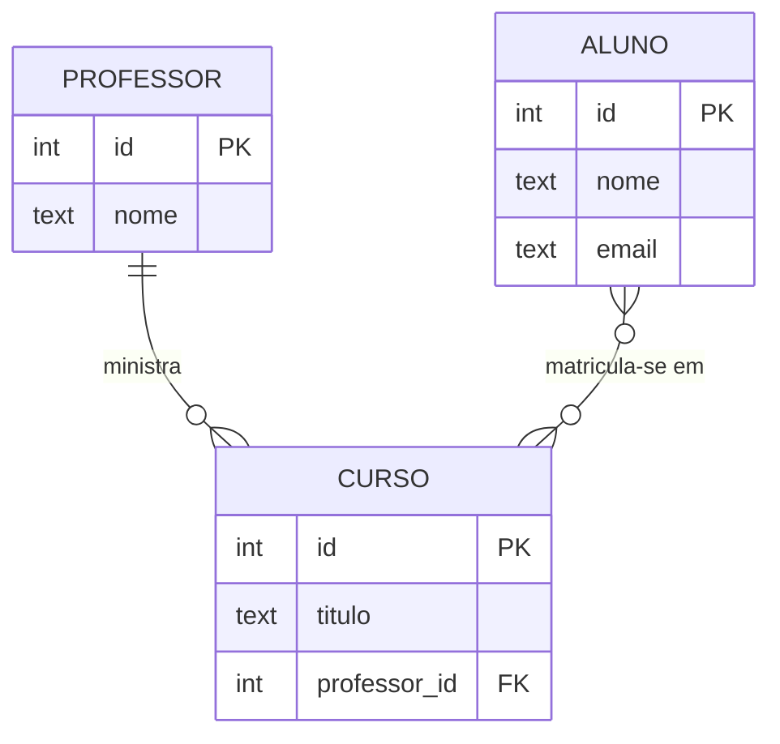

# Modelo relacional e modelagem ER

## Por que isso importa

Quase todo sistema guarda dados em tabelas: contas de um banco, pedidos de uma loja, alunos de uma escola. Um modelo bem feito torna as consultas simples e impede dados inconsistentes (um pedido de um cliente que não existe). Um modelo ruim gera dados duplicados, bugs difíceis e migrações dolorosas para sempre. Modelar é uma das primeiras tarefas de qualquer projeto e um tema frequente em entrevistas ("modele o banco de um Uber"). A teoria vem dos conjuntos e relações que você viu em MD-02: uma tabela **é** uma relação.

## Intuição

Pense numa **planilha bem organizada** de uma biblioteca:

- Uma aba **Autores**, com uma linha por autor. Cada um tem um **número** único (o id), como uma matrícula.
- Uma aba **Livros**, com uma linha por livro. Em vez de escrever o nome do autor em cada livro (e correr o risco de escrever "Machado de Assis" de três jeitos), cada livro guarda **o número do autor**.
- Para saber quem escreveu um livro, você **cruza** as duas abas pelo número.

O **diagrama ER** é o rascunho antes da planilha: quais "coisas" existem (entidades), o que se sabe sobre cada uma (atributos) e como elas se ligam (relacionamentos), incluindo **quantos** de cada lado ("um autor escreve vários livros").

## Visual

Um diagrama ER de uma escola (notação "pé de galinha"):



Como fica em tabelas (o N:N vira uma tabela de ligação):

| professor | | curso | | | matricula | |
|---|---|---|---|---|---|---|
| **id** | nome | **id** | titulo | *professor_id* | *aluno_id* | *curso_id* |
| 1 | Ada | 10 | Banco de Dados | 1 | 100 | 10 |
| 2 | Alan | 11 | Redes | 2 | 100 | 11 |
| | | | | | 101 | 10 |

## Conceito técnico

### O modelo relacional

Proposto por Edgar Codd em 1970:

- Uma **relação** (tabela) é um **conjunto** de **tuplas** (linhas), todas com os mesmos **atributos** (colunas). Como é um conjunto, a ordem das linhas não tem significado e não deveria haver linhas repetidas.
- Cada atributo tem um **domínio** (tipo): inteiro, texto, data...
- O **esquema** é a estrutura (`livro(id, titulo, ano, autor_id)`); a **instância** são os dados num momento.
- `NULL` representa um valor **desconhecido ou inexistente**. Cuidado: `NULL = NULL` não é verdadeiro em SQL (BD-02).

### Chaves

- **Superchave**: conjunto de colunas que identifica unicamente cada linha.
- **Chave candidata**: superchave mínima (sem colunas sobrando). Ex.: `id`, ou `email`, ou `cpf`.
- **Chave primária** (PK): a candidata escolhida para identificar as linhas. Não pode ser nula. Muitas vezes é um número artificial (*surrogate key*), como `id`, em vez de um dado do mundo real que pode mudar.
- **Chave estrangeira** (FK): coluna que referencia a PK de outra tabela. O banco garante a **integridade referencial**: não deixa criar um livro com `autor_id = 99` se o autor 99 não existe, nem apagar um autor que ainda tem livros (a menos que você peça `ON DELETE CASCADE`).

### Modelagem ER

- **Entidade**: algo com existência própria sobre o que se guarda dados (Aluno, Curso).
- **Atributo**: propriedade de uma entidade (nome, email).
- **Relacionamento**: ligação entre entidades, com **cardinalidade**:
  - **1:1** (pessoa e passaporte): FK num dos lados, com `UNIQUE`.
  - **1:N** (professor ministra vários cursos): FK **no lado N** (`curso.professor_id`).
  - **N:N** (alunos e cursos): uma **tabela de ligação** com as duas FKs (`matricula(aluno_id, curso_id)`), cuja PK costuma ser o par. Atributos do relacionamento (nota, data) moram nela.

Erro clássico: tentar guardar um N:N com uma coluna "cursos" contendo `"BD, Redes"` dentro da tabela de alunos. Isso quebra a primeira forma normal (BD-03) e torna impossível consultar direito.

### SQL para criar tabelas (DDL)

```sql
CREATE TABLE autor (
  id   INTEGER PRIMARY KEY,
  nome TEXT NOT NULL
);

CREATE TABLE livro (
  id       INTEGER PRIMARY KEY,
  titulo   TEXT NOT NULL,
  ano      INTEGER CHECK (ano > 0),
  autor_id INTEGER NOT NULL REFERENCES autor(id)
);

INSERT INTO autor (id, nome) VALUES (1, 'Machado de Assis');
INSERT INTO livro (titulo, ano, autor_id) VALUES ('Dom Casmurro', 1899, 1);
SELECT * FROM livro;
```

No SQLite, uma coluna `INTEGER PRIMARY KEY` recebe números automaticamente se você não informar, e as chaves estrangeiras só são verificadas depois de `PRAGMA foreign_keys = ON;` (PostgreSQL e MySQL verificam sempre).

### Álgebra relacional

As consultas SQL são traduzidas para operações sobre conjuntos:

| Operação | Símbolo | Faz | Em SQL |
|---|---|---|---|
| Seleção | σ | filtra **linhas** | `WHERE` |
| Projeção | π | escolhe **colunas** | lista do `SELECT` |
| Junção | ⋈ | combina linhas de duas tabelas que casam | `JOIN ... ON` |
| União, diferença | ∪, − | operações de conjunto | `UNION`, `EXCEPT` |

Por exemplo, "títulos dos livros de autores brasileiros" é π_titulo(σ_pais='Brasil'(livro ⋈ autor)). O otimizador do banco reordena essas operações para executar mais rápido (BD-04).

## Código

O SQLite roda aqui no navegador. Experimente criar, inserir e cruzar tabelas:

```sql
PRAGMA foreign_keys = ON;

CREATE TABLE professor (id INTEGER PRIMARY KEY, nome TEXT NOT NULL);
CREATE TABLE curso (
  id INTEGER PRIMARY KEY,
  titulo TEXT NOT NULL,
  professor_id INTEGER REFERENCES professor(id)
);
CREATE TABLE aluno (id INTEGER PRIMARY KEY, nome TEXT NOT NULL);
CREATE TABLE matricula (
  aluno_id INTEGER REFERENCES aluno(id),
  curso_id INTEGER REFERENCES curso(id),
  nota REAL,
  PRIMARY KEY (aluno_id, curso_id)
);

INSERT INTO professor VALUES (1, 'Ada'), (2, 'Alan');
INSERT INTO curso VALUES (10, 'Banco de Dados', 1), (11, 'Redes', 2);
INSERT INTO aluno VALUES (100, 'Bia'), (101, 'Caio');
INSERT INTO matricula VALUES (100, 10, 9.5), (100, 11, 8.0), (101, 10, 7.0);

SELECT aluno.nome AS aluno, curso.titulo AS curso, professor.nome AS professor, matricula.nota
FROM matricula
JOIN aluno ON aluno.id = matricula.aluno_id
JOIN curso ON curso.id = matricula.curso_id
JOIN professor ON professor.id = curso.professor_id
ORDER BY aluno.nome, curso.titulo;
```

Tente depois acrescentar `INSERT INTO matricula VALUES (999, 10, 5);` e veja a chave estrangeira recusar.

## Erros comuns

- **Guardar listas numa coluna** (`"BD, Redes"`). Use uma tabela de ligação.
- **Repetir dados em vez de referenciar** (o nome do autor em cada livro). Quando ele mudar, alguma cópia fica errada.
- **Pôr a FK no lado errado de um 1:N.** Ela vai no lado "muitos": cada curso aponta para **um** professor.
- **Usar dados mutáveis como chave primária** (e-mail, nome). Prefira um id estável e coloque `UNIQUE` no e-mail.
- **Esquecer NOT NULL** em colunas obrigatórias e deixar o banco aceitar lixo.
- **No SQLite, esquecer o `PRAGMA foreign_keys = ON`** e achar que as FKs estão sendo verificadas.

## Pratique

```quiz
id: BD-01-q1
tipo: multipla_escolha
pergunta: "Num sistema em que cada pedido pertence a um cliente e um cliente pode ter vários pedidos, onde fica a chave estrangeira?"
opcoes: ["Em cliente, uma coluna pedido_id", "Em pedido, uma coluna cliente_id", "Numa tabela de ligação cliente_pedido", "Nas duas tabelas"]
resposta: 1
explicacao: "É um 1:N, e a FK vai no lado N: cada pedido aponta para o seu único cliente. Uma coluna pedido_id em cliente só guardaria um pedido por cliente. Tabela de ligação é para N:N."
dificuldade: 1
```

```quiz
id: BD-01-q2
tipo: multipla_escolha
pergunta: "Como representar que alunos se matriculam em vários cursos e cursos têm vários alunos, guardando também a nota de cada matrícula?"
opcoes: ["Uma coluna cursos em aluno com os nomes separados por vírgula", "Uma tabela matricula(aluno_id, curso_id, nota)", "Uma coluna aluno_id em curso", "Duplicar o aluno para cada curso"]
resposta: 1
explicacao: "N:N vira uma tabela de ligação com as duas chaves estrangeiras. A nota é um atributo do relacionamento (de um aluno em um curso), então mora na própria matrícula."
dificuldade: 1
```

```quiz
id: BD-01-q3
tipo: verdadeiro_falso
pergunta: "Uma chave candidata pode ter colunas desnecessárias, desde que identifique as linhas de forma única."
resposta: false
explicacao: "Isso é uma superchave. A chave candidata é uma superchave mínima: se você tirar qualquer coluna dela, ela deixa de identificar as linhas. Por exemplo, (id, nome) é superchave, mas só id é candidata."
dificuldade: 2
```

```quiz
id: BD-01-q4
tipo: multipla_escolha
pergunta: "Qual operação da álgebra relacional corresponde ao WHERE do SQL?"
opcoes: ["Projeção", "Seleção", "Junção", "União"]
resposta: 1
explicacao: "Seleção (σ) filtra linhas por uma condição, como o WHERE. A projeção (π) escolhe colunas, como a lista depois de SELECT. O nome confunde: o SELECT do SQL é a projeção, não a seleção."
dificuldade: 2
```

```quiz
id: BD-01-q5
tipo: resposta_curta
pergunta: "Por que usar um id numérico como chave primária em vez do e-mail do usuário?"
resposta: "Porque o e-mail pode mudar, e a chave primária é copiada como chave estrangeira em outras tabelas: mudar o e-mail exigiria atualizar todas essas referências. Um id artificial é estável, pequeno e rápido de comparar. O e-mail continua único com uma restrição UNIQUE."
palavras_chave: ["mudar", "estrangeira", "estável", "UNIQUE"]
dificuldade: 2
```

```quiz
id: BD-01-q6
tipo: codigo
linguagem: sql
pergunta: |
  **Criar as tabelas.** Escreva os `CREATE TABLE` para `autor(id, nome, pais)` e `livro(id, titulo, ano, autor_id)`:

  - `id` é a chave primária inteira das duas tabelas;
  - `nome` e `titulo` são textos obrigatórios (`NOT NULL`); `pais` é texto opcional; `ano` é inteiro;
  - `autor_id` é obrigatório e é **chave estrangeira** para `autor(id)`.

  Os `INSERT` e as consultas que vêm depois já estão prontos e não devem ser alterados: a última consulta confere a chave estrangeira e a penúltima, as colunas obrigatórias.
codigo_inicial: |
  -- escreva os CREATE TABLE aqui


  -- não mude daqui para baixo
  INSERT INTO autor (id, nome, pais) VALUES (1, 'Machado de Assis', 'Brasil'), (2, 'Clarice Lispector', 'Brasil'), (3, 'José Saramago', 'Portugal');
  INSERT INTO livro (titulo, ano, autor_id) VALUES ('Dom Casmurro', 1899, 1), ('Memórias Póstumas de Brás Cubas', 1881, 1), ('A Hora da Estrela', 1977, 2), ('Ensaio sobre a Cegueira', 1995, 3);
  SELECT livro.titulo, autor.nome FROM livro JOIN autor ON autor.id = livro.autor_id ORDER BY livro.ano;
  SELECT name, "notnull", pk FROM pragma_table_info('livro');
  SELECT "table", "from", "to" FROM pragma_foreign_key_list('livro');
usa: [CREATE TABLE, PRIMARY KEY, NOT NULL, REFERENCES]
testes:
  - saida: |
      titulo | nome
      Memórias Póstumas de Brás Cubas | Machado de Assis
      Dom Casmurro | Machado de Assis
      A Hora da Estrela | Clarice Lispector
      Ensaio sobre a Cegueira | José Saramago

      name | notnull | pk
      id | 0 | 1
      titulo | 1 | 0
      ano | 0 | 0
      autor_id | 1 | 0

      table | from | to
      autor | autor_id | id
  - visivel: false
    saida: |
      titulo | nome
      Memórias Póstumas de Brás Cubas | Machado de Assis
      Dom Casmurro | Machado de Assis
      A Hora da Estrela | Clarice Lispector
      Ensaio sobre a Cegueira | José Saramago

      name | notnull | pk
      id | 0 | 1
      titulo | 1 | 0
      ano | 0 | 0
      autor_id | 1 | 0

      table | from | to
      autor | autor_id | id
dica: "A sintaxe é CREATE TABLE nome (coluna TIPO restrições, ...). Para a chave estrangeira: autor_id INTEGER NOT NULL REFERENCES autor(id). Crie autor antes de livro."
solucao: |
  CREATE TABLE autor (
    id INTEGER PRIMARY KEY,
    nome TEXT NOT NULL,
    pais TEXT
  );
  CREATE TABLE livro (
    id INTEGER PRIMARY KEY,
    titulo TEXT NOT NULL,
    ano INTEGER,
    autor_id INTEGER NOT NULL REFERENCES autor(id)
  );

  -- não mude daqui para baixo
  INSERT INTO autor (id, nome, pais) VALUES (1, 'Machado de Assis', 'Brasil'), (2, 'Clarice Lispector', 'Brasil'), (3, 'José Saramago', 'Portugal');
  INSERT INTO livro (titulo, ano, autor_id) VALUES ('Dom Casmurro', 1899, 1), ('Memórias Póstumas de Brás Cubas', 1881, 1), ('A Hora da Estrela', 1977, 2), ('Ensaio sobre a Cegueira', 1995, 3);
  SELECT livro.titulo, autor.nome FROM livro JOIN autor ON autor.id = livro.autor_id ORDER BY livro.ano;
  SELECT name, "notnull", pk FROM pragma_table_info('livro');
  SELECT "table", "from", "to" FROM pragma_foreign_key_list('livro');
explicacao: "Os livros não informam o id: como a coluna é INTEGER PRIMARY KEY, o SQLite gera 1, 2, 3, 4. O JOIN cruza livro.autor_id com autor.id, exatamente o 'cruzar as abas pelo número' da intuição. As duas últimas consultas leem o catálogo do próprio banco (os metadados), que é como ferramentas de migração e ORMs descobrem a estrutura das tabelas."
dificuldade: 2
```

```quiz
id: BD-01-q7
tipo: codigo
linguagem: python
pergunta: |
  **Do ER para tabelas.** Escreva `esquema(entidades, relacionamentos)`:

  - `entidades` é um dicionário `{nome: [atributos]}`. Cada entidade vira uma tabela com as colunas `['id'] + atributos`.
  - `relacionamentos` é uma lista de `(a, b, tipo)`. Para `'1:N'` (um `a` para vários `b`) e `'1:1'`, acrescente a coluna `'<a>_id'` no fim da tabela `b`. Para `'N:N'`, crie a tabela `'<a>_<b>'` com as colunas `['<a>_id', '<b>_id']`.

  Devolva o dicionário `{tabela: [colunas]}`, com as tabelas das entidades primeiro (na ordem dada) e depois as de ligação, na ordem dos relacionamentos.
codigo_inicial: |
  def esquema(entidades, relacionamentos):
      tabelas = {}
      for nome, atributos in entidades.items():
          tabelas[nome] = atributos
      return tabelas
usa: [def, for, return]
testes:
  - chamada: "esquema({'aluno': ['nome', 'email'], 'curso': ['titulo'], 'professor': ['nome']}, [('professor', 'curso', '1:N'), ('aluno', 'curso', 'N:N')])"
    saida: "{'aluno': ['id', 'nome', 'email'], 'curso': ['id', 'titulo', 'professor_id'], 'professor': ['id', 'nome'], 'aluno_curso': ['aluno_id', 'curso_id']}"
  - chamada: "esquema({'pessoa': ['nome'], 'passaporte': ['numero']}, [('pessoa', 'passaporte', '1:1')])"
    saida: "{'pessoa': ['id', 'nome'], 'passaporte': ['id', 'numero', 'pessoa_id']}"
  - chamada: "esquema({'x': []}, [])"
    visivel: false
    saida: "{'x': ['id']}"
dica: "Comece com tabelas = {nome: ['id'] + list(atributos) ...}. Depois percorra os relacionamentos: nos tipos com 1, faça tabelas[b].append(f'{a}_id'); no N:N, tabelas[f'{a}_{b}'] = [f'{a}_id', f'{b}_id']."
solucao: |
  def esquema(entidades, relacionamentos):
      tabelas = {nome: ['id'] + list(atributos) for nome, atributos in entidades.items()}
      for a, b, tipo in relacionamentos:
          if tipo == 'N:N':
              tabelas[f'{a}_{b}'] = [f'{a}_id', f'{b}_id']
          else:
              tabelas[b].append(f'{a}_id')
      return tabelas
explicacao: "São as regras de conversão: no 1:N, a FK vai para o lado N (cada curso tem um professor). No N:N, nenhuma das duas tabelas consegue guardar a lista, então nasce uma tabela de ligação. No 1:1, a FK pode ir em qualquer lado, de preferência no que é opcional, e deve ser UNIQUE. Usar list(atributos) cria uma cópia, para não alterar a lista original de quem chamou."
dificuldade: 2
```

```quiz
id: BD-01-q8
tipo: codigo
linguagem: python
pergunta: |
  **Junção natural.** Uma relação é uma lista de dicionários com as mesmas chaves. Escreva `juncao_natural(r, s)` que devolve a lista de linhas combinadas (`{**a, **b}`) para cada par `a` de `r` e `b` de `s` que têm **os mesmos valores em todas as colunas em comum**, na ordem: cada linha de `r`, e para ela cada linha de `s`. Se uma das relações estiver vazia, devolva `[]`. Sem colunas em comum, o resultado é o produto cartesiano.
codigo_inicial: |
  def juncao_natural(r, s):
      return r + s
usa: [def, for, return]
testes:
  - chamada: "juncao_natural([{'aluno_id': 1, 'nome': 'Ana'}, {'aluno_id': 2, 'nome': 'Bruno'}, {'aluno_id': 3, 'nome': 'Caio'}], [{'aluno_id': 1, 'curso': 'BD'}, {'aluno_id': 1, 'curso': 'Redes'}, {'aluno_id': 3, 'curso': 'BD'}])"
    saida: "[{'aluno_id': 1, 'nome': 'Ana', 'curso': 'BD'}, {'aluno_id': 1, 'nome': 'Ana', 'curso': 'Redes'}, {'aluno_id': 3, 'nome': 'Caio', 'curso': 'BD'}]"
  - chamada: "juncao_natural([{'a': 1}], [])"
    saida: "[]"
  - chamada: "juncao_natural([{'a': 1}], [{'b': 2}, {'b': 3}])"
    saida: "[{'a': 1, 'b': 2}, {'a': 1, 'b': 3}]"
  - chamada: "juncao_natural([{'x': 1, 'y': 2}, {'x': 1, 'y': 3}], [{'x': 1, 'y': 3, 'z': 9}, {'x': 2, 'y': 3, 'z': 8}])"
    visivel: false
    saida: "[{'x': 1, 'y': 3, 'z': 9}]"
dica: "As colunas em comum são as chaves de r[0] que também estão em s[0]. Faça dois for aninhados e use all(a[c] == b[c] for c in comuns)."
solucao: |
  def juncao_natural(r, s):
      if not r or not s:
          return []
      comuns = [c for c in r[0] if c in s[0]]
      resultado = []
      for a in r:
          for b in s:
              if all(a[c] == b[c] for c in comuns):
                  resultado.append({**a, **b})
      return resultado
explicacao: "Bruno não aparece porque não tem matrícula (num LEFT JOIN, ele apareceria com curso nulo: BD-02). Sem colunas em comum, all() de uma lista vazia é True e todo par entra: o produto cartesiano, que é o que acontece quando você esquece o ON num JOIN. Este algoritmo de dois laços é a 'junção por laços aninhados', O(|r| × |s|); bancos de dados também usam junção por hash e por ordenação, escolhidas pelo otimizador (BD-04)."
dificuldade: 2
```

## Resumo

- **Tabela = relação**: conjunto de linhas com as mesmas colunas, cada coluna com um tipo.
- **Chave primária** identifica a linha; **chave estrangeira** referencia outra tabela e garante integridade.
- **ER**: entidades, atributos e relacionamentos com cardinalidade. **1:N** → FK no lado N; **N:N** → tabela de ligação; **1:1** → FK única.
- **DDL**: `CREATE TABLE` com `PRIMARY KEY`, `NOT NULL`, `REFERENCES`, `CHECK`, `UNIQUE`.
- **Álgebra relacional**: seleção (WHERE), projeção (SELECT colunas), junção (JOIN).

## Para ir além

- Assista à aula 01 do CMU 15-445 e modele o banco de um app que você usa (Spotify, iFood).
- Desenhe seu modelo no dbdiagram.io ou com `erDiagram` do Mermaid.
- **Próximo módulo**: BD-02 SQL básico: SELECT, WHERE, JOIN, GROUP BY.
