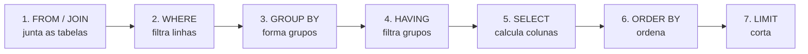

# SQL básico: SELECT, WHERE, JOIN, GROUP BY

## Por que isso importa

SQL tem 50 anos e continua sendo uma das linguagens mais pedidas em vagas de dev, dados e produto. Backends inteiros são, no fundo, um monte de consultas SQL. Saber escrever uma boa consulta resolve em uma linha o que levaria um laço de 30 linhas na aplicação (e roda mais rápido, perto dos dados). E SQL é **declarativo**: você diz **o que** quer, e o banco decide **como** buscar.

## Intuição

Uma consulta SQL é um pedido a um bibliotecário muito eficiente:

- "Das fichas da estante **produtos** (`FROM`),
- só as de **livros com preço abaixo de 50** (`WHERE`),
- me diga o **nome e o preço** (`SELECT`),
- do **mais caro para o mais barato** (`ORDER BY`)."

`JOIN` é pedir para ele **grampear** fichas de estantes diferentes que se referem à mesma coisa (cada pedido com seu cliente). `GROUP BY` é pedir para **separar em pilhas** (uma pilha por cliente) e te dar **um resumo por pilha** (quantos pedidos, quanto gastou).

## Visual

A ordem em que o banco **avalia** uma consulta não é a ordem em que você escreve:



Por isso o `WHERE` não enxerga apelidos criados no `SELECT`, e não pode usar `SUM(...)` (os grupos ainda nem existem): para filtrar por agregado, use `HAVING`.

O banco de exemplo desta aula (já carregado nos desafios):

| clientes | produtos | pedidos | itens |
|---|---|---|---|
| id, nome, cidade | id, nome, categoria, preco | id, cliente_id, data | pedido_id, produto_id, quantidade |

## Conceito técnico

### SELECT, WHERE, ORDER BY, LIMIT

```text
SELECT nome, preco                      -- quais colunas (ou * para todas)
FROM produtos                           -- de onde
WHERE categoria = 'livros' AND preco < 50   -- quais linhas
ORDER BY preco DESC                     -- ordem (ASC é o padrão)
LIMIT 10;                               -- quantas
```

Operadores úteis no `WHERE`: `=`, `<>` (ou `!=`), `<`, `>=`, `AND`, `OR`, `NOT`, `IN ('a', 'b')`, `BETWEEN 10 AND 20`, `LIKE 'Livro%'` (`%` = qualquer sequência, `_` = um caractere). Use `AS` para dar nome a colunas calculadas: `preco * 0.9 AS com_desconto`. `DISTINCT` remove linhas repetidas.

### NULL

`NULL` significa "desconhecido". Qualquer comparação com ele dá **desconhecido**, nem verdadeiro nem falso:

- `cidade = NULL` **nunca** é verdadeiro. Use `cidade IS NULL` / `IS NOT NULL`.
- `COALESCE(cidade, 'sem cidade')` troca NULL por um valor padrão.
- Agregações ignoram NULLs: `COUNT(cidade)` conta só os preenchidos; `COUNT(*)` conta linhas.

### JOIN

- **INNER JOIN** (ou só `JOIN`): só as combinações que casam na condição `ON`.
- **LEFT JOIN**: todas as linhas da tabela da **esquerda**, com NULL nas colunas da direita quando não há par. O padrão "**LEFT JOIN ... WHERE direita.id IS NULL**" encontra quem **não tem** correspondente (clientes sem pedidos).
- Sem `ON`, você ganha o **produto cartesiano**: cada linha com cada linha. Quase sempre é um bug.

```text
SELECT p.id, c.nome
FROM pedidos AS p
JOIN clientes AS c ON c.id = p.cliente_id;
```

### Agregação: GROUP BY e HAVING

Funções de agregação: `COUNT`, `SUM`, `AVG`, `MIN`, `MAX`. Com `GROUP BY`, elas são calculadas **por grupo**:

```text
SELECT categoria, COUNT(*) AS produtos, ROUND(AVG(preco), 2) AS preco_medio
FROM produtos
GROUP BY categoria
HAVING COUNT(*) > 1;
```

Regra: toda coluna no `SELECT` que não está dentro de uma agregação deve estar no `GROUP BY` (o SQLite aceita sem, mas devolve um valor arbitrário do grupo; o PostgreSQL dá erro).

### Subconsultas

Uma consulta dentro de outra: `SELECT nome FROM produtos WHERE preco > (SELECT AVG(preco) FROM produtos);`. Também aparecem com `IN (...)` e `EXISTS (...)`.

### Alterando dados (DML)

```text
INSERT INTO clientes (nome, cidade) VALUES ('Fábio', 'Natal');
UPDATE produtos SET preco = preco * 1.1 WHERE categoria = 'livros';
DELETE FROM pedidos WHERE id = 14;
```

**Sempre** escreva o `WHERE` de um `UPDATE` ou `DELETE` primeiro, e teste-o com um `SELECT`. Sem `WHERE`, a alteração vale para **todas** as linhas.

## Código

Experimente consultas sobre um pequeno banco (cada execução começa do zero):

```sql
CREATE TABLE clientes (id INTEGER PRIMARY KEY, nome TEXT, cidade TEXT);
CREATE TABLE pedidos (id INTEGER PRIMARY KEY, cliente_id INTEGER, valor REAL);
INSERT INTO clientes VALUES (1, 'Ana', 'Recife'), (2, 'Bruno', 'São Paulo'), (3, 'Carla', NULL);
INSERT INTO pedidos VALUES (10, 1, 159.9), (11, 2, 120.0), (12, 1, 134.7);

-- quem comprou e quanto
SELECT c.nome, COUNT(p.id) AS pedidos, COALESCE(SUM(p.valor), 0) AS total
FROM clientes c
LEFT JOIN pedidos p ON p.cliente_id = c.id
GROUP BY c.id, c.nome
ORDER BY total DESC;

-- cuidado com NULL
SELECT COUNT(*) AS linhas, COUNT(cidade) AS com_cidade FROM clientes;
```

## Erros comuns

- **`= NULL` em vez de `IS NULL`.** A primeira forma nunca encontra nada.
- **Usar `WHERE` para filtrar agregados.** `WHERE SUM(x) > 100` é erro; use `HAVING`.
- **Esquecer o `ON` do JOIN** e gerar um produto cartesiano (e somas multiplicadas).
- **Usar INNER JOIN quando queria manter quem não tem par.** Clientes sem pedidos somem; use LEFT JOIN.
- **`UPDATE` ou `DELETE` sem `WHERE`.**
- **Somar depois de juntar com várias tabelas "muitos"** sem perceber que as linhas se multiplicaram. Use `COUNT(DISTINCT ...)` quando precisar.
- **Montar SQL concatenando texto do usuário** (`"... WHERE nome = '" + nome + "'"`): é a porta para SQL injection (SG). Use parâmetros (`?`).

## Pratique

```quiz
id: BD-02-q1
tipo: multipla_escolha
pergunta: "Qual consulta encontra os clientes sem cidade cadastrada?"
opcoes: ["SELECT nome FROM clientes WHERE cidade = NULL", "SELECT nome FROM clientes WHERE cidade IS NULL", "SELECT nome FROM clientes WHERE cidade = ''", "SELECT nome FROM clientes WHERE NOT cidade"]
resposta: 1
explicacao: "Comparar com NULL usando = resulta em 'desconhecido', que o WHERE trata como falso, então a primeira não devolve nada. IS NULL é o operador certo. A string vazia '' é um valor conhecido, diferente de NULL."
dificuldade: 1
```

```quiz
id: BD-02-q2
tipo: multipla_escolha
pergunta: "Você quer listar só as categorias com preço médio acima de 50. Onde vai a condição AVG(preco) > 50?"
opcoes: ["No WHERE", "No HAVING", "No ORDER BY", "No FROM"]
resposta: 1
explicacao: "O WHERE filtra linhas antes de agrupar, quando a média ainda não existe. O HAVING filtra grupos depois do GROUP BY, então pode usar agregações."
dificuldade: 1
```

```quiz
id: BD-02-q3
tipo: verdadeiro_falso
pergunta: "Num LEFT JOIN de clientes com pedidos, um cliente sem nenhum pedido aparece no resultado com as colunas de pedidos em NULL."
resposta: true
explicacao: "O LEFT JOIN preserva todas as linhas da tabela da esquerda. Sem par na direita, as colunas da direita vêm NULL, e é por isso que 'WHERE pedidos.id IS NULL' encontra quem nunca comprou."
dificuldade: 1
```

```quiz
id: BD-02-q4
tipo: prever_saida
pergunta: |
  A tabela t tem 4 linhas, e a coluna cidade vale 'Recife', NULL, 'Natal' e NULL. Qual o resultado?
  ```text
  SELECT COUNT(*), COUNT(cidade), COUNT(DISTINCT cidade) FROM t;
  ```
resposta: "4 | 2 | 2"
explicacao: "COUNT(*) conta linhas (4). COUNT(coluna) ignora NULLs (2). COUNT(DISTINCT coluna) conta valores diferentes não nulos: Recife e Natal (2)."
dificuldade: 2
```

```quiz
id: BD-02-q5
tipo: codigo
linguagem: sql
pergunta: |
  **Filtrar e ordenar.** Liste `nome` e `preco` dos produtos da categoria `'livros'` que custam **menos de 50**, do mais caro para o mais barato.
preparo: |
  CREATE TABLE clientes (id INTEGER PRIMARY KEY, nome TEXT NOT NULL, cidade TEXT);
  CREATE TABLE produtos (id INTEGER PRIMARY KEY, nome TEXT NOT NULL, categoria TEXT NOT NULL, preco REAL NOT NULL);
  CREATE TABLE pedidos (id INTEGER PRIMARY KEY, cliente_id INTEGER NOT NULL REFERENCES clientes(id), data TEXT NOT NULL);
  CREATE TABLE itens (pedido_id INTEGER NOT NULL REFERENCES pedidos(id), produto_id INTEGER NOT NULL REFERENCES produtos(id), quantidade INTEGER NOT NULL, PRIMARY KEY (pedido_id, produto_id));
  INSERT INTO clientes VALUES (1, 'Ana', 'Recife'), (2, 'Bruno', 'São Paulo'), (3, 'Carla', 'Recife'), (4, 'Davi', 'Curitiba'), (5, 'Elisa', NULL);
  INSERT INTO produtos VALUES (1, 'Caneca', 'casa', 35.0), (2, 'Livro de SQL', 'livros', 89.9), (3, 'Caderno', 'papelaria', 22.5), (4, 'Livro de Python', 'livros', 45.0), (5, 'Luminária', 'casa', 120.0), (6, 'Mangá', 'livros', 29.9);
  INSERT INTO pedidos VALUES (10, 1, '2026-01-05'), (11, 2, '2026-01-07'), (12, 1, '2026-02-10'), (13, 3, '2026-02-11'), (14, 2, '2026-03-01');
  INSERT INTO itens VALUES (10, 2, 1), (10, 1, 2), (11, 5, 1), (12, 6, 3), (12, 3, 2), (13, 4, 1), (14, 1, 1), (14, 6, 2);
codigo_inicial: |
  SELECT nome, preco
  FROM produtos;
usa: [SELECT, WHERE, ORDER BY]
testes:
  - saida: |
      nome | preco
      Livro de Python | 45
      Mangá | 29.9
  - visivel: false
    saida: |
      nome | preco
      Livro de Python | 45
      Mangá | 29.9
dica: "Junte as duas condições com AND no WHERE e use ORDER BY preco DESC."
solucao: |
  SELECT nome, preco
  FROM produtos
  WHERE categoria = 'livros' AND preco < 50
  ORDER BY preco DESC;
explicacao: "O 'Livro de SQL' (89.9) é da categoria certa mas fica fora pelo preço. Sem o ORDER BY, a ordem das linhas não é garantida: em SQL, uma tabela é um conjunto, e a ordem só existe se você pedir."
dificuldade: 1
```

```quiz
id: BD-02-q6
tipo: codigo
linguagem: sql
pergunta: |
  **Total de cada pedido.** Mostre, para cada pedido, as colunas `pedido` (o id), `cliente` (o nome) e `total` (soma de `quantidade * preco` dos itens, arredondada com `ROUND(..., 2)`), do maior total para o menor.
preparo: |
  CREATE TABLE clientes (id INTEGER PRIMARY KEY, nome TEXT NOT NULL, cidade TEXT);
  CREATE TABLE produtos (id INTEGER PRIMARY KEY, nome TEXT NOT NULL, categoria TEXT NOT NULL, preco REAL NOT NULL);
  CREATE TABLE pedidos (id INTEGER PRIMARY KEY, cliente_id INTEGER NOT NULL REFERENCES clientes(id), data TEXT NOT NULL);
  CREATE TABLE itens (pedido_id INTEGER NOT NULL REFERENCES pedidos(id), produto_id INTEGER NOT NULL REFERENCES produtos(id), quantidade INTEGER NOT NULL, PRIMARY KEY (pedido_id, produto_id));
  INSERT INTO clientes VALUES (1, 'Ana', 'Recife'), (2, 'Bruno', 'São Paulo'), (3, 'Carla', 'Recife'), (4, 'Davi', 'Curitiba'), (5, 'Elisa', NULL);
  INSERT INTO produtos VALUES (1, 'Caneca', 'casa', 35.0), (2, 'Livro de SQL', 'livros', 89.9), (3, 'Caderno', 'papelaria', 22.5), (4, 'Livro de Python', 'livros', 45.0), (5, 'Luminária', 'casa', 120.0), (6, 'Mangá', 'livros', 29.9);
  INSERT INTO pedidos VALUES (10, 1, '2026-01-05'), (11, 2, '2026-01-07'), (12, 1, '2026-02-10'), (13, 3, '2026-02-11'), (14, 2, '2026-03-01');
  INSERT INTO itens VALUES (10, 2, 1), (10, 1, 2), (11, 5, 1), (12, 6, 3), (12, 3, 2), (13, 4, 1), (14, 1, 1), (14, 6, 2);
codigo_inicial: |
  SELECT p.id AS pedido, c.nome AS cliente
  FROM pedidos p
  JOIN clientes c ON c.id = p.cliente_id;
usa: [JOIN, GROUP BY, SUM]
testes:
  - saida: |
      pedido | cliente | total
      10 | Ana | 159.9
      12 | Ana | 134.7
      11 | Bruno | 120
      14 | Bruno | 94.8
      13 | Carla | 45
  - visivel: false
    saida: |
      pedido | cliente | total
      10 | Ana | 159.9
      12 | Ana | 134.7
      11 | Bruno | 120
      14 | Bruno | 94.8
      13 | Carla | 45
dica: "Você precisa de quatro tabelas: pedidos, clientes, itens (pelo pedido_id) e produtos (pelo produto_id, para o preço). Agrupe por p.id e c.nome."
solucao: |
  SELECT p.id AS pedido, c.nome AS cliente, ROUND(SUM(i.quantidade * pr.preco), 2) AS total
  FROM pedidos p
  JOIN clientes c ON c.id = p.cliente_id
  JOIN itens i ON i.pedido_id = p.id
  JOIN produtos pr ON pr.id = i.produto_id
  GROUP BY p.id, c.nome
  ORDER BY total DESC;
explicacao: "Depois dos JOINs, há uma linha por item; o GROUP BY junta os itens de cada pedido numa linha só, e o SUM soma dentro do grupo. O ROUND evita resultados como 134.70000000000002, típicos de ponto flutuante: em sistemas de dinheiro de verdade, guarde centavos como inteiros ou use um tipo DECIMAL."
dificuldade: 2
```

```quiz
id: BD-02-q7
tipo: codigo
linguagem: sql
pergunta: |
  **Melhores clientes.** Para cada cliente que gastou **mais de 100** no total, mostre `nome`, `pedidos` (quantos pedidos diferentes fez) e `gasto` (soma de `quantidade * preco`, com `ROUND(..., 2)`), do maior gasto para o menor.
preparo: |
  CREATE TABLE clientes (id INTEGER PRIMARY KEY, nome TEXT NOT NULL, cidade TEXT);
  CREATE TABLE produtos (id INTEGER PRIMARY KEY, nome TEXT NOT NULL, categoria TEXT NOT NULL, preco REAL NOT NULL);
  CREATE TABLE pedidos (id INTEGER PRIMARY KEY, cliente_id INTEGER NOT NULL REFERENCES clientes(id), data TEXT NOT NULL);
  CREATE TABLE itens (pedido_id INTEGER NOT NULL REFERENCES pedidos(id), produto_id INTEGER NOT NULL REFERENCES produtos(id), quantidade INTEGER NOT NULL, PRIMARY KEY (pedido_id, produto_id));
  INSERT INTO clientes VALUES (1, 'Ana', 'Recife'), (2, 'Bruno', 'São Paulo'), (3, 'Carla', 'Recife'), (4, 'Davi', 'Curitiba'), (5, 'Elisa', NULL);
  INSERT INTO produtos VALUES (1, 'Caneca', 'casa', 35.0), (2, 'Livro de SQL', 'livros', 89.9), (3, 'Caderno', 'papelaria', 22.5), (4, 'Livro de Python', 'livros', 45.0), (5, 'Luminária', 'casa', 120.0), (6, 'Mangá', 'livros', 29.9);
  INSERT INTO pedidos VALUES (10, 1, '2026-01-05'), (11, 2, '2026-01-07'), (12, 1, '2026-02-10'), (13, 3, '2026-02-11'), (14, 2, '2026-03-01');
  INSERT INTO itens VALUES (10, 2, 1), (10, 1, 2), (11, 5, 1), (12, 6, 3), (12, 3, 2), (13, 4, 1), (14, 1, 1), (14, 6, 2);
codigo_inicial: |
  SELECT c.nome, COUNT(*) AS pedidos
  FROM clientes c
  JOIN pedidos p ON p.cliente_id = c.id
  GROUP BY c.id, c.nome;
usa: [GROUP BY, HAVING, COUNT, DISTINCT]
testes:
  - saida: |
      nome | pedidos | gasto
      Ana | 2 | 294.6
      Bruno | 2 | 214.8
  - visivel: false
    saida: |
      nome | pedidos | gasto
      Ana | 2 | 294.6
      Bruno | 2 | 214.8
dica: "Junte clientes, pedidos, itens e produtos. Depois de juntar os itens, cada pedido aparece várias vezes, então conte com COUNT(DISTINCT p.id). O filtro pelo total vai no HAVING."
solucao: |
  SELECT c.nome, COUNT(DISTINCT p.id) AS pedidos, ROUND(SUM(i.quantidade * pr.preco), 2) AS gasto
  FROM clientes c
  JOIN pedidos p ON p.cliente_id = c.id
  JOIN itens i ON i.pedido_id = p.id
  JOIN produtos pr ON pr.id = i.produto_id
  GROUP BY c.id, c.nome
  HAVING SUM(i.quantidade * pr.preco) > 100
  ORDER BY gasto DESC;
explicacao: "Com COUNT(*), a Ana apareceria com 4 'pedidos', porque ela tem 4 itens: o JOIN com itens multiplica as linhas. É o erro mais comum ao agregar sobre várias tabelas. A Carla gastou 45 e é cortada pelo HAVING, que filtra grupos depois de calculados."
dificuldade: 3
```

```quiz
id: BD-02-q8
tipo: codigo
linguagem: sql
pergunta: |
  **Quem nunca comprou?** Liste o `nome` dos clientes que **não têm nenhum pedido**, em ordem alfabética.
preparo: |
  CREATE TABLE clientes (id INTEGER PRIMARY KEY, nome TEXT NOT NULL, cidade TEXT);
  CREATE TABLE produtos (id INTEGER PRIMARY KEY, nome TEXT NOT NULL, categoria TEXT NOT NULL, preco REAL NOT NULL);
  CREATE TABLE pedidos (id INTEGER PRIMARY KEY, cliente_id INTEGER NOT NULL REFERENCES clientes(id), data TEXT NOT NULL);
  CREATE TABLE itens (pedido_id INTEGER NOT NULL REFERENCES pedidos(id), produto_id INTEGER NOT NULL REFERENCES produtos(id), quantidade INTEGER NOT NULL, PRIMARY KEY (pedido_id, produto_id));
  INSERT INTO clientes VALUES (1, 'Ana', 'Recife'), (2, 'Bruno', 'São Paulo'), (3, 'Carla', 'Recife'), (4, 'Davi', 'Curitiba'), (5, 'Elisa', NULL);
  INSERT INTO produtos VALUES (1, 'Caneca', 'casa', 35.0), (2, 'Livro de SQL', 'livros', 89.9), (3, 'Caderno', 'papelaria', 22.5), (4, 'Livro de Python', 'livros', 45.0), (5, 'Luminária', 'casa', 120.0), (6, 'Mangá', 'livros', 29.9);
  INSERT INTO pedidos VALUES (10, 1, '2026-01-05'), (11, 2, '2026-01-07'), (12, 1, '2026-02-10'), (13, 3, '2026-02-11'), (14, 2, '2026-03-01');
  INSERT INTO itens VALUES (10, 2, 1), (10, 1, 2), (11, 5, 1), (12, 6, 3), (12, 3, 2), (13, 4, 1), (14, 1, 1), (14, 6, 2);
codigo_inicial: |
  SELECT c.nome
  FROM clientes c
  JOIN pedidos p ON p.cliente_id = c.id
  ORDER BY c.nome;
usa: [LEFT JOIN, IS NULL]
testes:
  - saida: |
      nome
      Davi
      Elisa
  - visivel: false
    saida: |
      nome
      Davi
      Elisa
dica: "Troque o JOIN por LEFT JOIN: os clientes sem pedidos aparecem com p.id NULL. Depois, filtre exatamente esses."
solucao: |
  SELECT c.nome
  FROM clientes c
  LEFT JOIN pedidos p ON p.cliente_id = c.id
  WHERE p.id IS NULL
  ORDER BY c.nome;
explicacao: "O INNER JOIN do código inicial só mostra quem tem par, ou seja, o contrário do pedido (e repete quem tem vários pedidos). O padrão LEFT JOIN + IS NULL é chamado de anti-junção. Outra forma equivalente: WHERE NOT EXISTS (SELECT 1 FROM pedidos p WHERE p.cliente_id = c.id)."
dificuldade: 2
```

## Resumo

- `SELECT colunas FROM tabela WHERE condição ORDER BY ... LIMIT n`.
- Ordem de avaliação: FROM/JOIN → WHERE → GROUP BY → HAVING → SELECT → ORDER BY → LIMIT.
- **NULL**: use `IS NULL` e `COALESCE`; agregações ignoram NULL; `COUNT(*)` conta linhas.
- **INNER JOIN** só pares; **LEFT JOIN** mantém a esquerda (anti-junção com `IS NULL`).
- **GROUP BY** + agregações; **HAVING** filtra grupos; cuidado com linhas multiplicadas por JOINs.
- `INSERT`, `UPDATE`, `DELETE`: teste o `WHERE` antes.

## Para ir além

- Faça as lições do SQLBolt e os exercícios do pgexercises.com.
- Assista à aula 02 do CMU 15-445 (funções de janela, CTEs: o próximo passo depois desta aula).
- **Próximo módulo**: BD-03 Normalização (1FN a FNBC).
