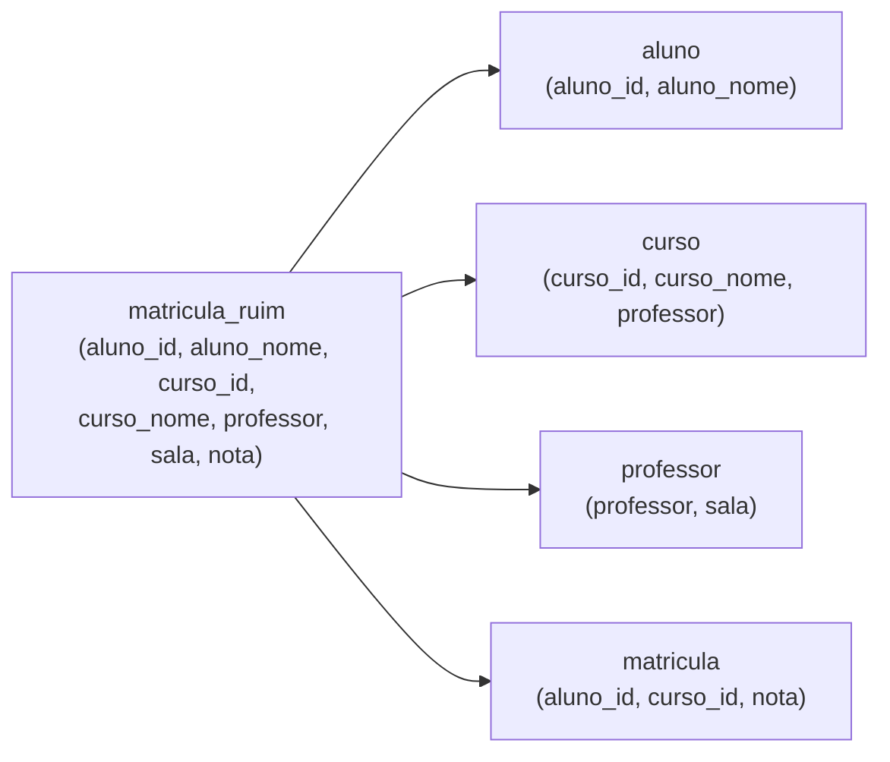

# Normalização (1FN a FNBC)

## Por que isso importa

Uma tabela que mistura assuntos guarda a mesma informação em muitos lugares. Um dia alguém atualiza uma cópia e esquece as outras, e o sistema passa a dizer duas verdades diferentes. Normalização é o método para desenhar tabelas em que **cada fato mora num lugar só**. Ela também explica por que o modelo da BD-01 tem o formato que tem, e é assunto clássico de provas e entrevistas. Saber normalizar também é saber quando **não** normalizar, que é uma decisão de desempenho que você vai tomar em projetos reais.

## Intuição

Imagine a planilha de matrículas de uma escola em que cada linha tem: aluno, nome do aluno, curso, nome do curso, professor do curso e sala do professor.

- O nome do curso "Banco de Dados" aparece em **todas** as matrículas desse curso. Para renomeá-lo, você precisa mudar 300 linhas (**anomalia de atualização**).
- Você não consegue cadastrar um curso novo antes de alguém se matricular nele (**anomalia de inserção**).
- Se o último aluno cancelar a matrícula, você perde a informação de quem dá o curso e em que sala (**anomalia de remoção**).

O problema é que a tabela fala de **várias coisas** (alunos, cursos, professores). A cura é separar cada assunto na sua tabela e ligar as tabelas por chaves.

## Visual

Uma tabela ruim e sua decomposição:

```text
matricula_ruim(aluno_id, aluno_nome, curso_id, curso_nome, professor, sala, nota)

dependências:
  aluno_id            → aluno_nome
  curso_id            → curso_nome, professor
  professor           → sala
  aluno_id, curso_id  → nota
chave: (aluno_id, curso_id)
```



## Conceito técnico

### Dependência funcional

`X → Y` (X **determina** Y) significa: duas linhas com os mesmos valores de X têm obrigatoriamente os mesmos valores de Y. Ex.: `cpf → nome`. Dependências vêm do **significado** dos dados (das regras do negócio), não de uma amostra: só porque, hoje, não existem dois alunos com o mesmo nome, isso não quer dizer que `nome → aluno_id`.

O **fecho** `X⁺` é o conjunto de todos os atributos determinados por X, aplicando as dependências repetidamente até nada mudar. Com `A → B`, `B → C` e `CD → E`:

- `A⁺ = {A, B, C}` (A dá B, B dá C);
- `{A, D}⁺ = {A, B, C, D, E}` (com C e D, chega-se a E).

X é **superchave** se `X⁺` contém todos os atributos. **Chave candidata** é uma superchave mínima. Um atributo que faz parte de alguma chave candidata é **primo**.

### As formas normais

| Forma | Exige | Viola quando... | Exemplo de violação |
|---|---|---|---|
| **1FN** | valores **atômicos**, sem grupos repetidos | uma célula guarda uma lista | `cursos = "BD, Redes"` |
| **2FN** | 1FN + nenhum atributo não primo depende de **parte** de uma chave | chave composta e algo depende só de um pedaço | `(aluno_id, curso_id)` → mas `aluno_id → aluno_nome` |
| **3FN** | 2FN + nenhum atributo não primo depende **transitivamente** da chave (via outro não primo) | `chave → X → Y` | `curso_id → professor → sala` |
| **FNBC** (Boyce-Codd) | para **toda** dependência não trivial `X → Y`, X é **superchave** | algum determinante não é superchave | `professor → sala`, sendo professor não superchave |

Na prática, a pergunta-resumo da FNBC basta: **todo determinante é superchave?** Se não, decomponha: para uma violação `X → Y`, crie uma tabela `(X, Y)` com chave X e tire Y da tabela original.

### Decomposição sem perdas

Ao dividir uma tabela, é preciso conseguir **reconstruí-la** com JOINs (decomposição sem perda de junção). Separar pela dependência que viola garante isso, porque o atributo comum (X) é chave numa das partes. A FNBC às vezes **não preserva** todas as dependências (alguma regra passa a exigir um JOIN para ser verificada); a 3FN sempre consegue preservar, e por isso é o alvo mais comum em projetos.

### 1FN na prática

- Uma coluna `telefones = "9999-0000, 8888-1111"` vira uma tabela `telefone(cliente_id, numero)`.
- Colunas `telefone1`, `telefone2`, `telefone3` também são um grupo repetido disfarçado.

### Desnormalização

Tabelas normalizadas evitam anomalias, mas consultas precisam de mais JOINs. Em sistemas de leitura pesada (relatórios, *data warehouses*, caches), às vezes se **duplica** de propósito: guardar o `total` no pedido em vez de somar os itens toda vez. É uma troca consciente: você ganha velocidade e assume a responsabilidade de manter as cópias consistentes (com transações, gatilhos ou reprocessamento). Normalize primeiro; desnormalize com medição (BD-04).

## Código

Calculando o fecho de atributos em Python:

```python
def fecho(atributos, dependencias):
    resultado = set(atributos)
    mudou = True
    while mudou:
        mudou = False
        for esquerda, direita in dependencias:
            if set(esquerda) <= resultado and not set(direita) <= resultado:
                resultado |= set(direita)
                mudou = True
    return "".join(sorted(resultado))

# A = aluno_id, N = aluno_nome, C = curso_id, T = curso_nome, P = professor, S = sala, G = nota
deps = [("A", "N"), ("C", "TP"), ("P", "S"), ("AC", "G")]
print("A+  =", fecho("A", deps))     # só o aluno
print("C+  =", fecho("C", deps))     # curso, nome, professor e sala
print("AC+ =", fecho("AC", deps))    # tudo: AC é chave
```

## Erros comuns

- **Deduzir dependências olhando os dados de hoje.** Elas vêm das regras do negócio.
- **Confundir 2FN e 3FN.** 2FN é sobre depender de **parte** da chave; 3FN, de **outro atributo que não é chave**.
- **Achar que uma chave simples (um id) garante FNBC.** Com `id` como chave, ainda pode existir `cep → cidade` dentro da tabela.
- **Normalizar até virar dezenas de tabelas minúsculas sem necessidade.** Siga as dependências reais; nem toda coluna precisa de tabela.
- **Desnormalizar "por desempenho" sem medir.** Índices (BD-04) costumam resolver antes.

## Pratique

```quiz
id: BD-03-q1
tipo: multipla_escolha
pergunta: "Uma tabela pedido tem a coluna produtos com valores como 'caneca, caderno, livro'. Qual forma normal ela viola?"
opcoes: ["1FN", "2FN", "3FN", "Nenhuma"]
resposta: 0
explicacao: "A 1FN exige valores atômicos: uma célula com uma lista não pode ser filtrada, indexada nem ligada por chave estrangeira direito. A solução é uma tabela item_pedido(pedido_id, produto_id, ...)."
dificuldade: 1
```

```quiz
id: BD-03-q2
tipo: multipla_escolha
pergunta: "Em matricula(aluno_id, curso_id, aluno_nome, nota), com chave (aluno_id, curso_id) e aluno_id → aluno_nome, qual forma normal é violada primeiro?"
opcoes: ["1FN", "2FN", "3FN", "Nenhuma"]
resposta: 1
explicacao: "aluno_nome depende de apenas parte da chave composta (aluno_id): é uma dependência parcial, que viola a 2FN. O nome do aluno se repete em todas as matrículas dele. Solução: mover aluno_nome para a tabela aluno."
dificuldade: 2
```

```quiz
id: BD-03-q3
tipo: verdadeiro_falso
pergunta: "Uma tabela cliente(id, nome, cep, cidade), com id como chave e cep → cidade, está na FNBC."
resposta: false
explicacao: "cep → cidade é uma dependência em que o determinante (cep) não é superchave: dois clientes com o mesmo CEP repetem a cidade. É uma dependência transitiva (id → cep → cidade), que viola a 3FN e a FNBC. Ter um id como chave não basta."
dificuldade: 2
```

```quiz
id: BD-03-q4
tipo: resposta_curta
pergunta: "O que é uma anomalia de remoção? Dê um exemplo."
resposta: "É perder uma informação que não se queria perder ao apagar outra, porque as duas estavam na mesma linha. Por exemplo, numa tabela de matrículas que também guarda o professor e a sala de cada curso, ao apagar a última matrícula de um curso perde-se o registro de quem dá o curso e em que sala."
palavras_chave: ["apagar", "perde", "mesma linha", "exemplo"]
dificuldade: 1
```

```quiz
id: BD-03-q5
tipo: codigo
linguagem: python
pergunta: |
  **Fecho de atributos.** Os atributos são letras maiúsculas. Escreva `fecho(atributos, dependencias)` que recebe uma string de atributos e uma lista de dependências `(esquerda, direita)` (strings) e devolve o fecho como string em ordem alfabética.
codigo_inicial: |
  def fecho(atributos, dependencias):
      resultado = set(atributos)
      for esquerda, direita in dependencias:
          if esquerda in atributos:
              resultado |= set(direita)
      return ''.join(sorted(resultado))
usa: [def, while, return]
testes:
  - chamada: "fecho('A', [('A', 'B'), ('B', 'C'), ('CD', 'E')])"
    saida: "'ABC'"
  - chamada: "fecho('AD', [('A', 'B'), ('B', 'C'), ('CD', 'E')])"
    saida: "'ABCDE'"
  - chamada: "fecho('E', [('A', 'B'), ('B', 'C'), ('CD', 'E')])"
    saida: "'E'"
  - chamada: "fecho('C', [('CD', 'E'), ('C', 'D'), ('E', 'A')])"
    visivel: false
    saida: "'ACDE'"
dica: "Repita uma passada por todas as dependências enquanto alguma acrescentar algo: se set(esquerda) <= resultado e a direita ainda não está toda lá, acrescente e marque que mudou."
solucao: |
  def fecho(atributos, dependencias):
      resultado = set(atributos)
      mudou = True
      while mudou:
          mudou = False
          for esquerda, direita in dependencias:
              if set(esquerda) <= resultado and not set(direita) <= resultado:
                  resultado |= set(direita)
                  mudou = True
      return ''.join(sorted(resultado))
explicacao: "Uma passada só não basta: no teste oculto, CD → E aparece antes de C → D na lista, então só depois de ganhar D é que CD → E pode ser aplicada. É um cálculo de ponto fixo: repete até nada mudar, como o fecho transitivo da MD-02. O código inicial também erra ao testar a esquerda como substring em vez de subconjunto."
dificuldade: 2
```

```quiz
id: BD-03-q6
tipo: codigo
linguagem: python
pergunta: |
  **Chaves candidatas.** Escreva `chaves_candidatas(todos, dependencias)` que devolve a lista de todas as chaves candidatas (cada uma como string em ordem alfabética), em ordem de tamanho e depois alfabética. Uma chave candidata é um conjunto cujo fecho tem todos os atributos e que não contém outra chave menor. A função `fecho` da questão anterior já está pronta para você usar.
codigo_inicial: |
  from itertools import combinations

  # não mude: os testes usam esta função
  def fecho(atributos, dependencias):
      resultado = set(atributos)
      mudou = True
      while mudou:
          mudou = False
          for esquerda, direita in dependencias:
              if set(esquerda) <= resultado and not set(direita) <= resultado:
                  resultado |= set(direita)
                  mudou = True
      return ''.join(sorted(resultado))

  def chaves_candidatas(todos, dependencias):
      return [''.join(sorted(todos))]
usa: [def, for, return, fecho]
testes:
  - chamada: "chaves_candidatas('ABCDE', [('A', 'B'), ('B', 'C'), ('CD', 'E')])"
    saida: "['AD']"
  - chamada: "chaves_candidatas('ABC', [('A', 'B'), ('B', 'C'), ('C', 'A')])"
    saida: "['A', 'B', 'C']"
  - chamada: "chaves_candidatas('ABCD', [('AB', 'C'), ('C', 'B')])"
    saida: "['ABD', 'ACD']"
  - chamada: "chaves_candidatas('ABCDEFGH', [('A', 'BC'), ('CD', 'E'), ('E', 'A'), ('F', 'G'), ('GH', 'F')])"
    visivel: false
    saida: "['ADFH', 'ADGH', 'CDFH', 'CDGH', 'DEFH', 'DEGH']"
dica: "Para k de 0 até len(todos), percorra combinations(sorted(todos), k). Pule as combinações que contêm uma chave já encontrada (são superchaves, não mínimas). Se fecho(combo) == todos ordenados, guarde."
solucao: |
  from itertools import combinations

  # não mude: os testes usam esta função
  def fecho(atributos, dependencias):
      resultado = set(atributos)
      mudou = True
      while mudou:
          mudou = False
          for esquerda, direita in dependencias:
              if set(esquerda) <= resultado and not set(direita) <= resultado:
                  resultado |= set(direita)
                  mudou = True
      return ''.join(sorted(resultado))

  def chaves_candidatas(todos, dependencias):
      alvo = ''.join(sorted(todos))
      chaves = []
      for k in range(len(todos) + 1):
          for combo in combinations(sorted(todos), k):
              if any(set(c) <= set(combo) for c in chaves):
                  continue
              if fecho(''.join(combo), dependencias) == alvo:
                  chaves.append(''.join(combo))
      return chaves
explicacao: "Testar por tamanho crescente garante a minimalidade: quando um conjunto passa, nenhum subconjunto dele passou antes (senão ele teria sido pulado). No segundo teste, os três atributos se determinam em ciclo, então qualquer um sozinho é chave. Um atributo que não aparece em nenhum lado direito (como D e H no teste oculto) tem de estar em toda chave. O método é exponencial, mas tabelas reais têm poucos atributos."
dificuldade: 3
```

```quiz
id: BD-03-q7
tipo: codigo
linguagem: python
pergunta: |
  **Violações da FNBC.** Escreva `violacoes_fnbc(todos, dependencias)` que devolve a lista das dependências que violam a FNBC, no formato `'esquerda->direita'` e na ordem dada. Uma dependência viola se **não for trivial** (a direita não está toda contida na esquerda) e a esquerda **não for superchave** (seu fecho não contém todos os atributos). A função `fecho` já está pronta.
codigo_inicial: |
  # não mude: os testes usam esta função
  def fecho(atributos, dependencias):
      resultado = set(atributos)
      mudou = True
      while mudou:
          mudou = False
          for esquerda, direita in dependencias:
              if set(esquerda) <= resultado and not set(direita) <= resultado:
                  resultado |= set(direita)
                  mudou = True
      return ''.join(sorted(resultado))

  def violacoes_fnbc(todos, dependencias):
      return []
usa: [def, for, return, fecho]
testes:
  - chamada: "violacoes_fnbc('ABCDE', [('A', 'B'), ('B', 'C'), ('CD', 'E')])"
    saida: "['A->B', 'B->C', 'CD->E']"
  - chamada: "violacoes_fnbc('ABC', [('A', 'B'), ('B', 'C'), ('C', 'A')])"
    saida: "[]"
  - chamada: "violacoes_fnbc('ABCD', [('AB', 'C'), ('C', 'B')])"
    saida: "['AB->C', 'C->B']"
  - chamada: "violacoes_fnbc('AB', [('AB', 'A')])"
    visivel: false
    saida: "[]"
  - chamada: "violacoes_fnbc('ANCTPSG', [('A', 'N'), ('C', 'TP'), ('P', 'S'), ('AC', 'G')])"
    visivel: false
    saida: "['A->N', 'C->TP', 'P->S']"
dica: "Calcule alvo = ''.join(sorted(todos)). Para cada (esquerda, direita): pule se set(direita) <= set(esquerda); senão, viola se fecho(esquerda, dependencias) != alvo."
solucao: |
  # não mude: os testes usam esta função
  def fecho(atributos, dependencias):
      resultado = set(atributos)
      mudou = True
      while mudou:
          mudou = False
          for esquerda, direita in dependencias:
              if set(esquerda) <= resultado and not set(direita) <= resultado:
                  resultado |= set(direita)
                  mudou = True
      return ''.join(sorted(resultado))

  def violacoes_fnbc(todos, dependencias):
      alvo = ''.join(sorted(todos))
      violacoes = []
      for esquerda, direita in dependencias:
          if set(direita) <= set(esquerda):
              continue
          if fecho(esquerda, dependencias) != alvo:
              violacoes.append(f'{esquerda}->{direita}')
      return violacoes
explicacao: "O último teste oculto é a tabela de matrículas do Visual: só AC → G respeita a FNBC, porque AC é chave; cada uma das outras três vira uma tabela própria (aluno, curso, professor). No terceiro teste, a tabela não tem D em nenhuma dependência, então nem AB nem C são superchaves sozinhos. Repare que AB → C ainda viola: sem D, AB não identifica uma linha."
dificuldade: 2
```

```quiz
id: BD-03-q8
tipo: codigo
linguagem: javascript
pergunta: |
  **Para a 1FN.** Escreva `primeiraFN(linhas, coluna)` que recebe um array de objetos e o nome de uma coluna que guarda valores separados por vírgula, e devolve um novo array com **uma linha por valor** (copiando as outras colunas). Tire os espaços das pontas de cada valor e ignore valores vazios; uma linha sem nenhum valor desaparece.
codigo_inicial: |
  function primeiraFN(linhas, coluna) {
    return linhas.map((linha) => ({ ...linha, [coluna]: linha[coluna].split(',')[0] }));
  }
usa: [function, for, return]
testes:
  - chamada: "primeiraFN([{ aluno: 'Ana', cursos: 'BD, Redes' }, { aluno: 'Caio', cursos: 'BD' }], 'cursos')"
    saida: "[ { aluno: 'Ana', cursos: 'BD' }, { aluno: 'Ana', cursos: 'Redes' }, { aluno: 'Caio', cursos: 'BD' } ]"
  - chamada: "primeiraFN([], 'x')"
    saida: "[]"
  - chamada: "primeiraFN([{ id: 1, tel: '9999-0000,8888-1111, ' }, { id: 2, tel: '' }], 'tel')"
    visivel: false
    saida: "[ { id: 1, tel: '9999-0000' }, { id: 1, tel: '8888-1111' } ]"
dica: "Para cada linha, separe com split(','), aplique trim em cada valor, filtre os vazios e, para cada valor, empurre { ...linha, [coluna]: valor } no resultado."
solucao: |
  function primeiraFN(linhas, coluna) {
    const resultado = [];
    for (const linha of linhas) {
      const valores = String(linha[coluna]).split(',').map((v) => v.trim()).filter((v) => v !== '');
      for (const valor of valores) {
        resultado.push({ ...linha, [coluna]: valor });
      }
    }
    return resultado;
  }
explicacao: "É o script de migração típico ao herdar uma tabela com listas em colunas: cada valor vira uma linha, e o resultado pode ir para uma tabela de ligação. O { ...linha } copia o objeto, e a chave entre colchetes [coluna] usa o valor da variável como nome da propriedade. Dados reais vêm sujos, por isso o trim e o filtro de vazios."
dificuldade: 1
```

## Resumo

- Redundância causa anomalias de **inserção**, **atualização** e **remoção**.
- **Dependência funcional** `X → Y`; **fecho** `X⁺`; X é **superchave** se `X⁺` tem tudo; **chave candidata** é superchave mínima.
- **1FN**: valores atômicos. **2FN**: sem dependência de parte da chave. **3FN**: sem dependência transitiva. **FNBC**: todo determinante é superchave.
- Decomponha pela dependência que viola: tabela `(X, Y)` com chave X.
- **Desnormalize** só de propósito e medindo.

## Para ir além

- Faça os exercícios de Relational Design Theory do curso de Stanford (Widom).
- Pegue uma planilha real (de um trabalho, de um evento) e normalize-a até a 3FN.
- **Próximo módulo**: BD-04 Índices e planos de execução.
