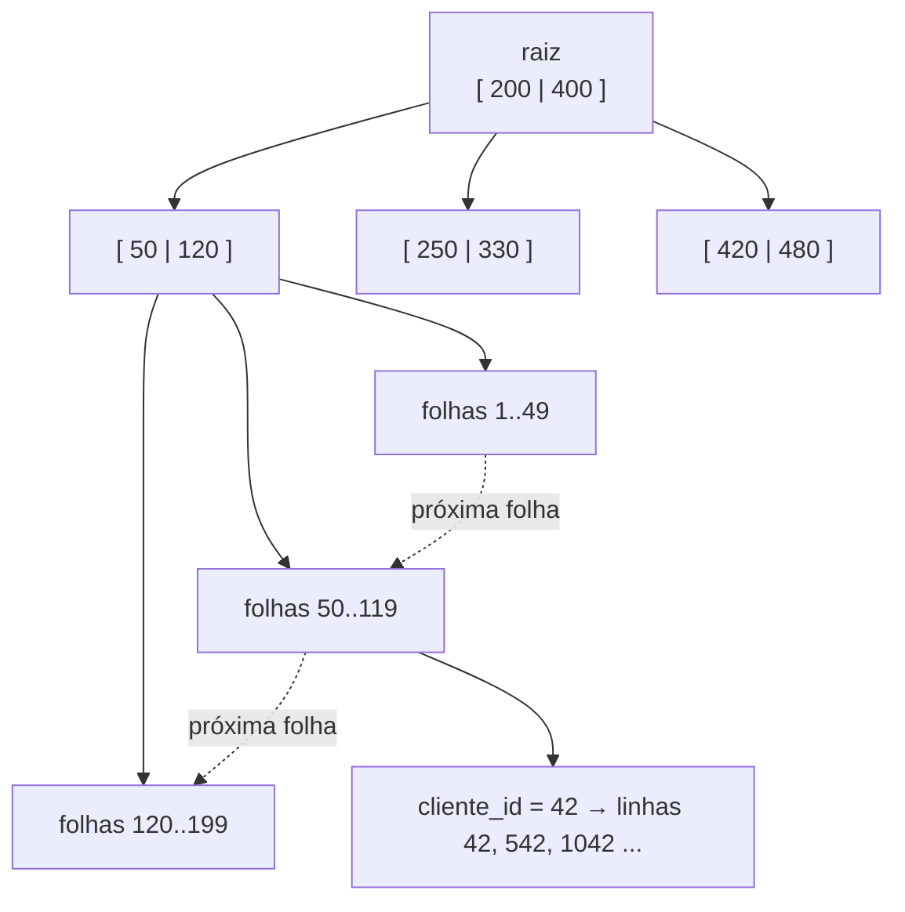

# Índices e planos de execução

## Por que isso importa

A causa número um de lentidão em aplicações web é uma consulta ao banco **sem o índice certo**. Com mil linhas, tudo é rápido; com dez milhões, a mesma consulta passa de 2 ms para 20 segundos, derruba o servidor e vira incidente. Saber criar o índice certo, e ler o plano de execução para confirmar que ele está sendo usado, é uma das habilidades mais práticas de um dev backend. Você já conhece a estrutura por trás: a B-tree da ED-09 e a busca binária da AL-01.

## Intuição

Procurar "fotossíntese" num livro de 800 páginas:

- **Sem índice**: ler página por página até achar. No pior caso, as 800 (**varredura completa**, o *full table scan*).
- **Com o índice remissivo** no fim do livro: os termos estão em **ordem alfabética**, você acha "fotossíntese" em segundos e ele diz "páginas 112, 340". Depois, você vai direto a essas páginas.

O índice tem custos: ocupa páginas extras, e **toda vez que o livro muda** (uma nova edição), o índice precisa ser atualizado. Um livro com índice para cada palavra seria enorme e caro de manter. E o índice de um livro de receitas organizado por "país, depois ingrediente" ajuda a achar "pratos italianos com tomate", mas não ajuda a achar "todos os pratos com tomate": é a **regra do prefixo à esquerda**.

## Visual

Um índice B+ tree sobre `cliente_id` (folhas ordenadas e ligadas entre si; cada folha aponta para as linhas):



Custo aproximado para achar um valor numa tabela de 10 milhões de linhas:

| Estratégia | Leituras | Ordem |
|---|---|---|
| Varredura completa | 10 000 000 linhas | O(n) |
| B+ tree (centenas de chaves por nó) | 3 ou 4 nós + as linhas encontradas | O(log n) |
| Índice hash | ~1 bucket (só para igualdade) | O(1) |

## Conceito técnico

### Como o banco guarda e busca

Tabelas ficam no disco em **páginas** (blocos de 4 a 16 KB). Sem índice, uma consulta com `WHERE cliente_id = 42` precisa ler **todas** as páginas: é o **SCAN**. Com um índice, o banco desce a árvore até a folha com 42 e segue os ponteiros para as linhas: é o **SEARCH**.

A **B+ tree** é o índice padrão de quase todos os bancos relacionais:

- Nós com **centenas** de chaves (uma página cada), então a árvore é muito baixa: 3 ou 4 níveis para bilhões de linhas.
- Só as **folhas** têm os ponteiros para as linhas, e elas são **ligadas em ordem**. Isso permite **intervalos** (`BETWEEN`, `>`, `<`) e **ordenação** (`ORDER BY`) sem ordenar de novo: basta percorrer as folhas.
- Inserções e remoções mantêm a árvore balanceada (ED-06, ED-09).

Índices **hash** só servem para igualdade, sem intervalo nem ordem.

### Tipos de índice

```text
CREATE INDEX idx_pedidos_cliente ON pedidos(cliente_id);               -- simples
CREATE INDEX idx_pedidos_cliente_status ON pedidos(cliente_id, status); -- composto
CREATE UNIQUE INDEX idx_clientes_email ON clientes(email);             -- único: também é uma restrição
```

- A **chave primária** já tem índice (no SQLite, a própria tabela é organizada por ela).
- Uma restrição **UNIQUE** cria um índice.
- **Chaves estrangeiras não ganham índice automaticamente** na maioria dos bancos: crie você, porque JOINs e `ON DELETE` dependem disso.

### Índices compostos e o prefixo à esquerda

Um índice em `(cliente_id, status, criado_em)` está ordenado por `cliente_id`, depois por `status` dentro de cada cliente, depois por data. Ele serve para:

- `WHERE cliente_id = 5` (usa 1 coluna);
- `WHERE cliente_id = 5 AND status = 'pago'` (usa 2);
- `WHERE cliente_id = 5 AND status = 'pago' AND criado_em > '2026-03-01'` (usa 3);
- `WHERE cliente_id = 5 AND criado_em > '2026-03-01'` (usa só 1: falta `status` no meio).

Mas **não** serve para `WHERE status = 'pago'` sozinho: sem a primeira coluna, os valores de status estão espalhados. Uma condição de **intervalo** numa coluna também interrompe o uso das colunas seguintes. Regra prática: colunas comparadas com **igualdade primeiro**, a de intervalo por último.

### Índice de cobertura

Se todas as colunas que a consulta precisa estão **no próprio índice**, o banco nem visita a tabela: `SELECT status FROM pedidos WHERE cliente_id = 5` com índice em `(cliente_id, status)` aparece como **COVERING INDEX** no plano.

### Planos de execução

O **otimizador** transforma o SQL (declarativo) num **plano**: em que ordem juntar as tabelas, que índice usar, qual algoritmo de junção (laços aninhados, hash, ordenação). Ele estima custos com **estatísticas** das tabelas. Para ver o plano:

- SQLite: `EXPLAIN QUERY PLAN SELECT ...`
- PostgreSQL: `EXPLAIN` (estimativa) e `EXPLAIN ANALYZE` (executa e mede).
- MySQL: `EXPLAIN`.

Palavras para procurar: **SCAN** (lê tudo, suspeito em tabelas grandes), **SEARCH ... USING INDEX** (bom), **COVERING INDEX** (ótimo), **USE TEMP B-TREE FOR ORDER BY** (ordenou à parte; um índice poderia evitar).

### Quando o índice não é usado

- Função ou conta sobre a coluna: `WHERE lower(email) = ...` ou `WHERE preco * 2 > 100` (crie um índice de expressão ou reescreva a condição).
- `LIKE '%texto'` (curinga no começo); já `LIKE 'texto%'` pode usar.
- Coluna pouco seletiva: se 90% das linhas têm `status = 'ativo'`, ler a tabela inteira é mais barato que seguir o índice.
- Tipos diferentes na comparação (texto com número) em alguns bancos.

### O custo dos índices

Cada índice é uma estrutura a mais para **atualizar em todo INSERT, UPDATE e DELETE**, e ocupa espaço. Tabelas com muita escrita e muitos índices ficam lentas para gravar. Crie índices para as consultas **que existem** (olhe o log de consultas lentas), não para todas as colunas.

## Código

Veja o plano mudar antes e depois do índice (a tabela tem 5 mil pedidos gerados na hora):

```sql
CREATE TABLE pedidos (id INTEGER PRIMARY KEY, cliente_id INTEGER, status TEXT, total REAL);
WITH RECURSIVE n(i) AS (SELECT 1 UNION ALL SELECT i + 1 FROM n WHERE i < 5000)
INSERT INTO pedidos SELECT i, i % 500, CASE i % 4 WHEN 0 THEN 'pago' ELSE 'novo' END, i % 1000 / 10.0 FROM n;

EXPLAIN QUERY PLAN SELECT * FROM pedidos WHERE cliente_id = 42;          -- SCAN pedidos

CREATE INDEX idx_cliente_status ON pedidos(cliente_id, status);

EXPLAIN QUERY PLAN SELECT * FROM pedidos WHERE cliente_id = 42;          -- SEARCH ... USING INDEX
EXPLAIN QUERY PLAN SELECT status FROM pedidos WHERE cliente_id = 42;     -- COVERING INDEX
EXPLAIN QUERY PLAN SELECT * FROM pedidos WHERE status = 'pago';          -- SCAN de novo: prefixo à esquerda!
EXPLAIN QUERY PLAN SELECT * FROM pedidos WHERE id = 7;                   -- usa a chave primária
```

## Erros comuns

- **Não indexar chaves estrangeiras.** JOINs viram varreduras completas.
- **Criar o índice composto na ordem errada.** `(status, cliente_id)` não ajuda quem filtra só por `cliente_id`.
- **Indexar tudo.** Escritas ficam lentas e o espaço cresce; muitos índices nunca são usados.
- **Envolver a coluna numa função no WHERE** e perder o índice sem perceber.
- **Confiar que o índice "deve estar sendo usado".** Confira com EXPLAIN.
- **Testar desempenho com 100 linhas.** O plano muda com o tamanho e as estatísticas; teste com volume realista.

## Pratique

```quiz
id: BD-04-q1
tipo: multipla_escolha
pergunta: "Por que a B+ tree, e não uma árvore binária de busca, é a estrutura padrão de índices em bancos de dados?"
opcoes: ["Porque usa menos memória RAM", "Porque cada nó guarda centenas de chaves numa página de disco, deixando a árvore com poucos níveis e poucas leituras", "Porque não precisa de chaves ordenadas", "Porque só funciona com números"]
resposta: 1
explicacao: "Ler uma página do disco é caro, então o objetivo é minimizar quantas páginas se visita. Uma árvore binária com 10 milhões de chaves teria ~24 níveis; uma B+ tree com centenas de chaves por nó tem 3 ou 4."
dificuldade: 2
```

```quiz
id: BD-04-q2
tipo: multipla_escolha
pergunta: "Com um índice em (cliente_id, status), qual consulta NÃO consegue usá-lo para buscar?"
opcoes: ["WHERE cliente_id = 7", "WHERE cliente_id = 7 AND status = 'pago'", "WHERE status = 'pago'", "WHERE cliente_id = 7 ORDER BY status"]
resposta: 2
explicacao: "O índice está ordenado primeiro por cliente_id. Sem um filtro nessa coluna, os valores de status estão espalhados por todo o índice. É a regra do prefixo à esquerda. Na quarta opção, o índice serve para o filtro e ainda entrega as linhas já ordenadas por status."
dificuldade: 2
```

```quiz
id: BD-04-q3
tipo: verdadeiro_falso
pergunta: "Criar um índice em cada coluna de uma tabela é sempre uma boa ideia, porque deixa todas as consultas mais rápidas."
resposta: false
explicacao: "Cada índice precisa ser atualizado em todo INSERT, UPDATE e DELETE e ocupa espaço. Tabelas com muitas escritas ficam lentas. Além disso, o otimizador normalmente usa um índice por tabela numa consulta, então índices de uma coluna só não substituem um bom índice composto."
dificuldade: 1
```

```quiz
id: BD-04-q4
tipo: multipla_escolha
pergunta: "Um EXPLAIN mostra 'SCAN usuarios' para a consulta WHERE lower(email) = 'ana@x.com', mesmo existindo um índice em email. Por quê?"
opcoes: ["O índice está corrompido", "A função lower() sobre a coluna impede o uso do índice, que está ordenado pelos valores originais", "Índices não funcionam com texto", "O EXPLAIN sempre mostra SCAN"]
resposta: 1
explicacao: "O índice guarda email, não lower(email). Para usar índice, guarde o e-mail já normalizado, crie um índice sobre a expressão (CREATE INDEX ... ON usuarios(lower(email))) ou use uma coluna/colação que ignore maiúsculas."
dificuldade: 2
```

```quiz
id: BD-04-q5
tipo: resposta_curta
pergunta: "O que é um índice de cobertura e por que ele é mais rápido?"
resposta: "É quando todas as colunas que a consulta precisa (no filtro e no resultado) estão dentro do próprio índice. O banco responde lendo só o índice, sem ir até a tabela buscar cada linha, o que economiza muitas leituras de páginas."
palavras_chave: ["colunas", "índice", "tabela", "leituras"]
dificuldade: 2
```

```quiz
id: BD-04-q6
tipo: codigo
linguagem: sql
pergunta: |
  **O índice certo.** A aplicação faz muito estas duas consultas:

  - `SELECT ... FROM pedidos WHERE cliente_id = ? AND status = ?`
  - `SELECT ... FROM pedidos WHERE cliente_id = ?`

  Crie **um único** índice chamado `idx_pedidos_cliente_status` que sirva às duas. As consultas de conferência já estão no editor; a última mostra as colunas do índice, na ordem.
preparo: |
  CREATE TABLE pedidos (id INTEGER PRIMARY KEY, cliente_id INTEGER NOT NULL, status TEXT NOT NULL, criado_em TEXT NOT NULL, total REAL NOT NULL);
  WITH RECURSIVE n(i) AS (SELECT 1 UNION ALL SELECT i + 1 FROM n WHERE i < 5000)
  INSERT INTO pedidos SELECT i, i % 500, CASE i % 4 WHEN 0 THEN 'pago' WHEN 1 THEN 'enviado' WHEN 2 THEN 'cancelado' ELSE 'novo' END, date('2026-01-01', '+' || (i % 300) || ' days'), (i * 37 % 1000) / 10.0 FROM n;
codigo_inicial: |
  -- crie o índice aqui


  -- não mude daqui para baixo
  SELECT COUNT(*) AS pedidos, ROUND(SUM(total), 1) AS total FROM pedidos WHERE cliente_id = 42 AND status = 'cancelado';
  SELECT COUNT(*) AS pedidos FROM pedidos WHERE cliente_id = 42;
  SELECT seqno, name FROM pragma_index_info('idx_pedidos_cliente_status');
usa: [CREATE INDEX]
testes:
  - saida: |
      pedidos | total
      10 | 304

      pedidos
      10

      seqno | name
      0 | cliente_id
      1 | status
  - visivel: false
    saida: |
      pedidos | total
      10 | 304

      pedidos
      10

      seqno | name
      0 | cliente_id
      1 | status
dica: "A sintaxe é CREATE INDEX nome ON tabela(coluna1, coluna2). Pense em qual coluna aparece nas duas consultas: ela tem de vir primeiro."
solucao: |
  CREATE INDEX idx_pedidos_cliente_status ON pedidos(cliente_id, status);

  -- não mude daqui para baixo
  SELECT COUNT(*) AS pedidos, ROUND(SUM(total), 1) AS total FROM pedidos WHERE cliente_id = 42 AND status = 'cancelado';
  SELECT COUNT(*) AS pedidos FROM pedidos WHERE cliente_id = 42;
  SELECT seqno, name FROM pragma_index_info('idx_pedidos_cliente_status');
explicacao: "Pelo prefixo à esquerda, (cliente_id, status) atende a consulta com as duas colunas e também a que filtra só por cliente_id. Na ordem inversa, (status, cliente_id), a segunda consulta não conseguiria usar o índice. Um índice só em cliente_id também atenderia as duas, mas o composto ainda filtra o status dentro do índice. Rode as consultas com EXPLAIN QUERY PLAN na frente para ver o SEARCH."
dificuldade: 2
```

```quiz
id: BD-04-q7
tipo: codigo
linguagem: python
pergunta: |
  **Um índice ordenado.** Implemente a classe `Indice`, construída a partir de uma lista de linhas (dicionários com `'id'`) e do nome de uma coluna, com os métodos:

  - `buscar(valor)`: ids das linhas com aquele valor;
  - `intervalo(a, b)`: ids das linhas com `a <= valor <= b`.

  Os ids saem em ordem de valor e, no empate, de id. Use uma lista ordenada de pares `(valor, id)` e o módulo `bisect`: os testes ocultos fazem dezenas de milhares de consultas numa tabela de 100 mil linhas, e percorrer a tabela a cada consulta não termina a tempo.
codigo_inicial: |
  import bisect

  class Indice:
      def __init__(self, linhas, coluna):
          self.linhas = linhas
          self.coluna = coluna

      def buscar(self, valor):
          return [l['id'] for l in self.linhas if l[self.coluna] == valor]

      def intervalo(self, a, b):
          return [l['id'] for l in self.linhas if a <= l[self.coluna] <= b]


  # não mude: os testes usam esta função
  def testar(linhas, coluna, consultas):
      indice = Indice(linhas, coluna)
      return [indice.intervalo(*c) if isinstance(c, tuple) else indice.buscar(c) for c in consultas]
usa: [class, def, return, bisect_left]
testes:
  - chamada: "testar([{'id': 1, 'idade': 30}, {'id': 2, 'idade': 25}, {'id': 3, 'idade': 30}, {'id': 4, 'idade': 41}, {'id': 5, 'idade': 19}], 'idade', [30, 25, 99, (20, 30), (42, 50)])"
    saida: "[[1, 3], [2], [], [2, 1, 3], []]"
  - chamada: "testar([], 'x', [1, (0, 9)])"
    saida: "[[], []]"
  - chamada: "sum(len(r) for r in testar([{'id': i, 'cidade': (i * 7919) % 1000} for i in range(100000)], 'cidade', list(range(20000))))"
    visivel: false
    saida: "100000"
  - chamada: "sum(len(r) for r in testar([{'id': i, 'cidade': (i * 7919) % 1000} for i in range(100000)], 'cidade', [(i, i + 2) for i in range(20000)]))"
    visivel: false
    saida: "299700"
dica: "No construtor: self.pares = sorted((linha[coluna], linha['id']) for linha in linhas) e self.chaves = [v for v, _ in self.pares]. Em intervalo: i = bisect.bisect_left(self.chaves, a), j = bisect.bisect_right(self.chaves, b), e devolva os ids de self.pares[i:j]. buscar(v) é intervalo(v, v)."
solucao: |
  import bisect

  class Indice:
      def __init__(self, linhas, coluna):
          self.pares = sorted((linha[coluna], linha['id']) for linha in linhas)
          self.chaves = [valor for valor, _ in self.pares]

      def buscar(self, valor):
          return self.intervalo(valor, valor)

      def intervalo(self, a, b):
          i = bisect.bisect_left(self.chaves, a)
          j = bisect.bisect_right(self.chaves, b)
          return [id_ for _, id_ in self.pares[i:j]]


  # não mude: os testes usam esta função
  def testar(linhas, coluna, consultas):
      indice = Indice(linhas, coluna)
      return [indice.intervalo(*c) if isinstance(c, tuple) else indice.buscar(c) for c in consultas]
explicacao: "Construir o índice custa O(n log n) uma vez; depois, cada busca custa O(log n) mais o tamanho da resposta, contra O(n) da varredura. Com 20 mil consultas em 100 mil linhas, a varredura faria 2 bilhões de comparações. bisect_left e bisect_right acham as bordas do trecho com os valores procurados, exatamente como a descida até as folhas de uma B+ tree, e as fatias contíguas são o 'percorrer as folhas ligadas'. Um dicionário (índice hash) também resolveria buscar, mas não intervalo."
dificuldade: 2
```

```quiz
id: BD-04-q8
tipo: codigo
linguagem: javascript
pergunta: |
  **Prefixo à esquerda.** Escreva `colunasUsadas(indice, filtros)` que diz quantas colunas de um índice composto uma consulta consegue usar. `indice` é o array de colunas, na ordem; `filtros` é um objeto `{ coluna: operador }`, com `'='` para igualdade ou `'>'`, `'<'` para intervalo. Percorra as colunas do índice em ordem: pare na primeira coluna **sem filtro**; uma coluna com **intervalo** conta, mas é a última que pode ser usada.
codigo_inicial: |
  function colunasUsadas(indice, filtros) {
    // conta quantas colunas do índice aparecem nos filtros
    return indice.filter((coluna) => coluna in filtros).length;
  }
usa: [function, for, return]
testes:
  - chamada: "colunasUsadas(['cliente_id', 'status', 'criado_em'], { cliente_id: '=', status: '=' })"
    saida: "2"
  - chamada: "colunasUsadas(['cliente_id', 'status', 'criado_em'], { status: '=' })"
    saida: "0"
  - chamada: "colunasUsadas(['cliente_id', 'status', 'criado_em'], { cliente_id: '=', criado_em: '>' })"
    saida: "1"
  - chamada: "colunasUsadas(['cliente_id', 'status', 'criado_em'], { cliente_id: '>', status: '=' })"
    visivel: false
    saida: "1"
  - chamada: "colunasUsadas(['cliente_id', 'status', 'criado_em'], { criado_em: '<', status: '=', cliente_id: '=' })"
    visivel: false
    saida: "3"
dica: "Use um for...of sobre o índice com um contador. Se filtros[coluna] não existir, break. Senão, conte; e se o operador não for '=', break logo depois de contar."
solucao: |
  function colunasUsadas(indice, filtros) {
    let usadas = 0;
    for (const coluna of indice) {
      const op = filtros[coluna];
      if (!op) break;
      usadas++;
      if (op !== '=') break;
    }
    return usadas;
  }
explicacao: "A ordem das condições no WHERE não importa (último teste oculto); o que importa é a ordem das colunas no índice. Com cliente_id > 10, as entradas de cada cliente estão ordenadas por status, mas o trecho com vários clientes não está ordenado por status como um todo, então o status não ajuda mais a busca. Por isso: colunas de igualdade primeiro, a de intervalo por último."
dificuldade: 2
```

## Resumo

- Sem índice: **SCAN** (O(n)). Com índice B+ tree: **SEARCH** (O(log n)), com intervalos e ordenação de graça.
- **Compostos** seguem o **prefixo à esquerda**; igualdades primeiro, intervalo por último.
- **Cobertura**: a consulta responde só com o índice.
- Leia o plano com **EXPLAIN** (SCAN, SEARCH, COVERING INDEX, TEMP B-TREE).
- Funções na coluna, `LIKE '%...'` e baixa seletividade impedem o uso do índice.
- Índices custam em **escrita** e **espaço**: indexe as consultas reais, inclusive as chaves estrangeiras.

## Para ir além

- Leia os dois primeiros capítulos do "Use The Index, Luke!".
- Ative o log de consultas lentas no seu banco (PostgreSQL: `log_min_duration_statement`) e analise as piores com `EXPLAIN ANALYZE`.
- **Próximo módulo**: BD-05 Transações, ACID e níveis de isolamento.
