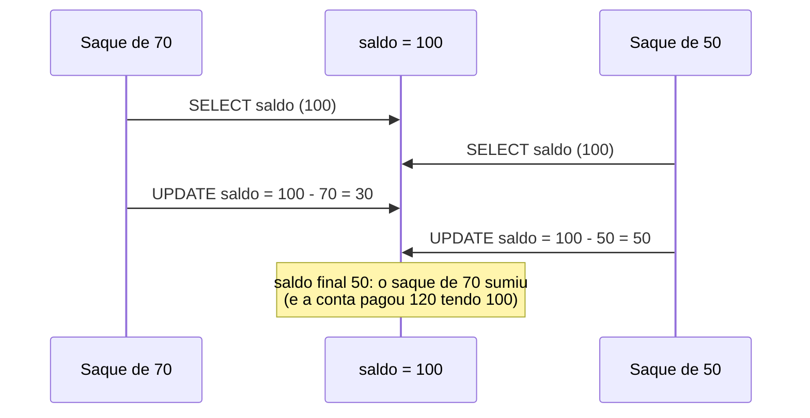

# Transações, ACID e níveis de isolamento

## Por que isso importa

Transferir dinheiro é debitar uma conta **e** creditar outra. Se o servidor cair entre as duas operações, o dinheiro some. Se dois saques simultâneos lerem o mesmo saldo, a conta fica negativa. Transações são a ferramenta que o banco de dados oferece para que esses problemas **não aconteçam**, sem você precisar escrever locks à mão como na SO-04. Mas elas têm configurações (níveis de isolamento) cujos padrões **não** protegem contra tudo, e muitos bugs de produção (estoque negativo, cupom usado duas vezes) vêm de não saber disso.

## Intuição

Uma transação é um **carrinho de compras no caixa**: você junta vários itens, e no fim **ou paga tudo ou não leva nada**. Não existe "paguei metade e a outra metade sumiu".

O isolamento é a **privacidade** de cada cliente enquanto monta o carrinho. No nível mais forte, é como se cada cliente fosse atendido **sozinho**, um depois do outro. Nos níveis mais fracos, os clientes podem ver os carrinhos uns dos outros pela metade, ou pegar o último item da prateleira ao mesmo tempo. Mais isolamento é mais seguro, porém mais lento (mais espera, mais transações abortadas).

## Visual

A atualização perdida, em que duas transações leem o mesmo saldo:



Níveis de isolamento do padrão SQL e as anomalias que cada um **permite**:

| Nível | Leitura suja | Leitura não repetível | Fantasma |
|---|---|---|---|
| READ UNCOMMITTED | sim | sim | sim |
| READ COMMITTED (padrão no PostgreSQL, Oracle, SQL Server) | não | sim | sim |
| REPEATABLE READ (padrão no MySQL/InnoDB) | não | não | sim (no padrão; o PostgreSQL e o InnoDB evitam quase sempre) |
| SERIALIZABLE (padrão no SQLite) | não | não | não |

## Conceito técnico

### Transação e ACID

Uma **transação** é uma sequência de operações tratada como uma unidade:

```text
BEGIN;
UPDATE contas SET saldo = saldo - 30 WHERE id = 1;
UPDATE contas SET saldo = saldo + 30 WHERE id = 2;
COMMIT;          -- ou ROLLBACK; para desfazer tudo
```

- **A**tomicidade: tudo ou nada. Se algo falhar no meio, o `ROLLBACK` desfaz o que já foi feito.
- **C**onsistência: a transação leva o banco de um estado válido a outro válido (respeitando chaves, `CHECK`, `UNIQUE`). Parte disso é responsabilidade da aplicação.
- **I**solamento: transações simultâneas não atrapalham umas às outras (no grau escolhido).
- **D**urabilidade: depois do `COMMIT`, o dado sobrevive a uma queda de energia.

Durabilidade e atomicidade vêm do **log de escrita antecipada** (WAL, *write-ahead log*): antes de mexer nas páginas da tabela, o banco grava no log o que vai fazer e força o log para o disco (`fsync`) no `COMMIT`. Depois de uma queda, ele **refaz** o que foi confirmado e **desfaz** o que não foi. É o mesmo princípio do journaling da SO-07.

**SAVEPOINT** cria um ponto de retorno dentro da transação: `SAVEPOINT antes_do_frete; ... ROLLBACK TO antes_do_frete;`.

### Anomalias

- **Leitura suja**: ler o que outra transação escreveu e ainda **não confirmou** (ela pode desfazer).
- **Leitura não repetível**: ler a mesma linha duas vezes e obter valores diferentes, porque outra transação confirmou uma alteração no meio.
- **Fantasma**: repetir uma consulta com `WHERE` e aparecerem **linhas novas** (inseridas e confirmadas por outra).
- **Atualização perdida**: duas transações fazem ler-modificar-gravar no mesmo dado e uma sobrescreve a outra (Visual).
- **Desvio de escrita** (*write skew*): duas transações leem um dado comum, tomam decisões e escrevem em linhas **diferentes**, violando juntas uma regra (dois médicos de plantão saem ao mesmo tempo, cada um vendo que o outro ficou). Só o SERIALIZABLE evita sempre.

### Serializabilidade

O ideal é que o resultado de transações concorrentes seja igual ao de **alguma execução em série** (uma depois da outra). Um teste prático é a **serializabilidade de conflito**:

1. Duas operações **conflitam** se são de transações diferentes, sobre o **mesmo dado**, e pelo menos uma é escrita.
2. Monte o **grafo de precedência**: aresta Ti → Tj se uma operação de Ti conflita com uma **posterior** de Tj.
3. Sem **ciclo**, a execução é serializável, e uma ordenação topológica (AL-05) dá a ordem serial equivalente. Com ciclo, não é.

### Como os bancos garantem isolamento

- **Bloqueio em duas fases (2PL)**: a transação adquire locks (compartilhados para ler, exclusivos para escrever) e só começa a soltá-los depois de não precisar adquirir mais nenhum. Garante serializabilidade, mas leitores e escritores bloqueiam uns aos outros, e deadlocks (SO-05) acontecem: o banco detecta e aborta uma das transações.
- **MVCC** (controle de concorrência multiversão), usado por PostgreSQL, MySQL/InnoDB, Oracle: cada escrita cria uma **nova versão** da linha. Cada transação lê um **instantâneo** (*snapshot*): só as versões confirmadas antes de ela começar, mais as suas próprias escritas. **Leitores não bloqueiam escritores** e vice-versa. Versões antigas são limpas depois (o `VACUUM` do PostgreSQL).

### Na prática

- Use transações sempre que várias escritas precisam acontecer juntas.
- Para ler-modificar-gravar, prefira uma **atualização atômica** (`UPDATE contas SET saldo = saldo - 70 WHERE id = 1 AND saldo >= 70`), um lock explícito (`SELECT ... FOR UPDATE`) ou o nível SERIALIZABLE com **nova tentativa** em caso de conflito.
- Mantenha transações **curtas**: nada de esperar uma chamada HTTP ou o usuário com uma transação aberta.

## Código

Uma transferência confirmada e outra desfeita (o SQLite roda aqui):

```sql
CREATE TABLE contas (id INTEGER PRIMARY KEY, titular TEXT, saldo REAL CHECK (saldo >= 0));
INSERT INTO contas VALUES (1, 'Ana', 100), (2, 'Bruno', 50);

BEGIN;
UPDATE contas SET saldo = saldo - 30 WHERE id = 1;
UPDATE contas SET saldo = saldo + 30 WHERE id = 2;
COMMIT;

BEGIN;
UPDATE contas SET saldo = saldo + 1000 WHERE id = 2;
SAVEPOINT antes_do_bonus;
UPDATE contas SET saldo = saldo + 999 WHERE id = 1;
ROLLBACK TO antes_do_bonus;     -- desfaz só o segundo UPDATE
ROLLBACK;                       -- desfaz a transação inteira

SELECT titular, saldo FROM contas;    -- Ana 70, Bruno 80
```

Tente trocar o primeiro `- 30` por `- 300`: o `CHECK (saldo >= 0)` falha e nada da transação é aplicado.

## Erros comuns

- **Fazer várias escritas relacionadas sem transação** ("o servidor nunca cai").
- **Achar que o nível padrão é serializável.** No PostgreSQL é READ COMMITTED: ler-modificar-gravar em duas instruções pode perder atualizações.
- **Ler, calcular na aplicação e gravar o resultado** sem lock nem condição. Use `UPDATE ... SET x = x - 1 WHERE x > 0` ou `SELECT ... FOR UPDATE`.
- **Transações longas**, segurando locks ou versões antigas por minutos.
- **Não tratar falhas de serialização.** No SERIALIZABLE, o banco aborta transações em conflito; a aplicação precisa tentar de novo.
- **Esquecer que DDL nem sempre é transacional** (no MySQL, um `ALTER TABLE` confirma a transação implicitamente).

## Pratique

```quiz
id: BD-05-q1
tipo: multipla_escolha
pergunta: "O servidor cai entre o débito e o crédito de uma transferência feita dentro de BEGIN ... COMMIT, antes do COMMIT. O que acontece ao religar?"
opcoes: ["O débito fica, o crédito se perde", "Os dois ficam aplicados", "Nenhum dos dois fica: a transação não confirmada é desfeita", "O banco pergunta ao usuário"]
resposta: 2
explicacao: "Atomicidade: sem COMMIT, a transação é desfeita na recuperação, usando o log. Se o COMMIT tivesse sido concluído, a durabilidade garantiria os dois."
dificuldade: 1
```

```quiz
id: BD-05-q2
tipo: multipla_escolha
pergunta: "Uma transação lê o preço de um produto, outra altera e confirma o preço, e a primeira lê de novo e vê outro valor. Qual anomalia é essa?"
opcoes: ["Leitura suja", "Leitura não repetível", "Fantasma", "Atualização perdida"]
resposta: 1
explicacao: "A mesma linha, lida duas vezes na mesma transação, mudou porque outra transação confirmou uma alteração no meio. Não é suja, porque o valor lido estava confirmado. Fantasma seria aparecerem linhas novas numa consulta repetida."
dificuldade: 2
```

```quiz
id: BD-05-q3
tipo: verdadeiro_falso
pergunta: "No MVCC, uma transação que só lê nunca precisa esperar uma transação que está escrevendo na mesma linha."
resposta: true
explicacao: "A escrita cria uma nova versão, e o leitor continua vendo a versão que estava confirmada quando o seu instantâneo começou. Por isso o MVCC dá ótimo desempenho em cargas com muitas leituras. Escritores na mesma linha ainda conflitam entre si."
dificuldade: 2
```

```quiz
id: BD-05-q4
tipo: resposta_curta
pergunta: "Como evitar a atualização perdida num saque, quando o banco usa READ COMMITTED?"
resposta: "Fazendo a leitura e a escrita numa única instrução atômica, como UPDATE contas SET saldo = saldo - 70 WHERE id = 1 AND saldo >= 70, e conferindo quantas linhas foram afetadas. Outra opção é travar a linha com SELECT ... FOR UPDATE antes de calcular, ou usar o nível SERIALIZABLE e repetir a transação se ela for abortada."
palavras_chave: ["UPDATE", "atômica", "FOR UPDATE", "SERIALIZABLE"]
dificuldade: 2
```

```quiz
id: BD-05-q5
tipo: multipla_escolha
pergunta: "No escalonamento T1: lê A, T2: lê A, T1: escreve A, T2: escreve A, o grafo de precedência tem:"
opcoes: ["Só a aresta T1 → T2", "Só a aresta T2 → T1", "As arestas T1 → T2 e T2 → T1, formando ciclo: não é serializável", "Nenhuma aresta"]
resposta: 2
explicacao: "T1 lê A antes de T2 escrever A (T1 → T2). T2 lê A antes de T1 escrever A (T2 → T1). Com o ciclo, nenhuma ordem serial equivale a essa execução: é exatamente a atualização perdida do Visual."
dificuldade: 3
```

```quiz
id: BD-05-q6
tipo: codigo
linguagem: sql
pergunta: |
  **Confirmar e desfazer.** As contas começam com Ana 100, Bruno 50 e Carla 0. Escreva:

  1. uma transação que transfere **30** da conta 1 (Ana) para a conta 2 (Bruno) e é **confirmada**;
  2. uma segunda transação que tenta transferir **500** da conta 2 para a conta 3, mostra com `SELECT id, saldo FROM contas WHERE saldo < 0;` que o saldo ficaria negativo, e é **desfeita**.

  As consultas finais já estão no editor.
preparo: |
  CREATE TABLE contas (id INTEGER PRIMARY KEY, titular TEXT NOT NULL, saldo REAL NOT NULL);
  INSERT INTO contas VALUES (1, 'Ana', 100), (2, 'Bruno', 50), (3, 'Carla', 0);
codigo_inicial: |
  -- transação 1: transfere 30 da conta 1 para a 2 e confirma

  -- transação 2: tenta transferir 500 da conta 2 para a 3, confere e desfaz

  -- não mude daqui para baixo
  SELECT titular, saldo FROM contas ORDER BY id;
  SELECT SUM(saldo) AS total FROM contas;
usa: [BEGIN, COMMIT, ROLLBACK]
testes:
  - saida: |
      id | saldo
      2 | -420

      titular | saldo
      Ana | 70
      Bruno | 80
      Carla | 0

      total
      150
  - visivel: false
    saida: |
      id | saldo
      2 | -420

      titular | saldo
      Ana | 70
      Bruno | 80
      Carla | 0

      total
      150
dica: "Cada transação começa com BEGIN; e termina com COMMIT; ou ROLLBACK;. Na segunda, os dois UPDATE e o SELECT ficam entre o BEGIN e o ROLLBACK."
solucao: |
  BEGIN;
  UPDATE contas SET saldo = saldo - 30 WHERE id = 1;
  UPDATE contas SET saldo = saldo + 30 WHERE id = 2;
  COMMIT;

  BEGIN;
  UPDATE contas SET saldo = saldo - 500 WHERE id = 2;
  UPDATE contas SET saldo = saldo + 500 WHERE id = 3;
  SELECT id, saldo FROM contas WHERE saldo < 0;
  ROLLBACK;

  -- não mude daqui para baixo
  SELECT titular, saldo FROM contas ORDER BY id;
  SELECT SUM(saldo) AS total FROM contas;
explicacao: "Dentro da segunda transação, o Bruno chega a -420 (a própria transação enxerga suas escritas), mas o ROLLBACK desfaz os dois UPDATE, e a Carla continua com 0. O total de dinheiro no sistema (150) não muda em nenhuma transferência: essa é uma invariante de consistência que a atomicidade protege. Numa aplicação real, a decisão de desfazer viria de um CHECK (saldo >= 0) ou de uma verificação no código."
dificuldade: 1
```

```quiz
id: BD-05-q7
tipo: codigo
linguagem: python
pergunta: |
  **Serializável por conflito?** Um escalonamento é uma lista de `(transacao, op, dado)` com `op` igual a `'R'` ou `'W'`. Escreva `ordem_serial(escalonamento)` que monta o grafo de precedência e devolve uma ordem serial equivalente (lista de transações) ou `None` se houver ciclo.

  - Aresta `Ti → Tj` quando uma operação de `Ti` vem **antes** de uma de `Tj` (transações diferentes), sobre o **mesmo dado**, e pelo menos uma é `'W'`.
  - Para a ordem ser única, use o algoritmo de Kahn escolhendo sempre, entre as transações sem dependências pendentes, a de **menor nome**.
codigo_inicial: |
  def ordem_serial(escalonamento):
      ordem = []
      for t, op, dado in escalonamento:
          if t not in ordem:
              ordem.append(t)
      return ordem
usa: [def, for, while, return]
testes:
  - chamada: "ordem_serial([('T1', 'R', 'A'), ('T1', 'W', 'A'), ('T2', 'R', 'A'), ('T2', 'W', 'A')])"
    saida: "['T1', 'T2']"
  - chamada: "ordem_serial([('T1', 'R', 'A'), ('T2', 'R', 'A'), ('T1', 'W', 'A'), ('T2', 'W', 'A')])"
    saida: "None"
  - chamada: "ordem_serial([('T1', 'R', 'A'), ('T2', 'R', 'A'), ('T3', 'R', 'A')])"
    saida: "['T1', 'T2', 'T3']"
  - chamada: "ordem_serial([])"
    saida: "[]"
  - chamada: "ordem_serial([('T3', 'W', 'X'), ('T1', 'R', 'X'), ('T2', 'W', 'Y'), ('T1', 'R', 'Y')])"
    visivel: false
    saida: "['T2', 'T3', 'T1']"
  - chamada: "ordem_serial([('T1', 'W', 'A'), ('T2', 'R', 'A'), ('T2', 'W', 'B'), ('T3', 'R', 'B'), ('T3', 'W', 'C'), ('T1', 'R', 'C')])"
    visivel: false
    saida: "None"
dica: "Monte um conjunto de arestas comparando cada operação i com as posteriores j. Depois conte o grau de entrada de cada transação e aplique Kahn (AL-05): uma lista de prontos ordenada, tire o primeiro, diminua o grau dos vizinhos. Se a ordem final não tiver todas as transações, há ciclo."
solucao: |
  def ordem_serial(escalonamento):
      transacoes = []
      for t, _, _ in escalonamento:
          if t not in transacoes:
              transacoes.append(t)
      arestas = set()
      for i, (ti, op_i, dado_i) in enumerate(escalonamento):
          for tj, op_j, dado_j in escalonamento[i + 1:]:
              if ti != tj and dado_i == dado_j and 'W' in (op_i, op_j):
                  arestas.add((ti, tj))
      grau = {t: 0 for t in transacoes}
      for _, destino in arestas:
          grau[destino] += 1
      prontos = sorted(t for t in transacoes if grau[t] == 0)
      ordem = []
      while prontos:
          t = prontos.pop(0)
          ordem.append(t)
          for origem, destino in sorted(arestas):
              if origem == t:
                  grau[destino] -= 1
                  if grau[destino] == 0:
                      prontos.append(destino)
                      prontos.sort()
      return ordem if len(ordem) == len(transacoes) else None
explicacao: "Leituras não conflitam entre si (terceiro teste): as três transações podem ir em qualquer ordem. No primeiro oculto, T1 leu X e Y depois de T3 e T2 escreverem, então ela precisa vir depois das duas. No segundo, T1 → T2 → T3 → T1 formam um ciclo, embora nenhum par isolado pareça problemático. Bancos com SERIALIZABLE fazem uma versão incremental desse teste e abortam uma transação quando um ciclo se formaria."
dificuldade: 3
```

```quiz
id: BD-05-q8
tipo: codigo
linguagem: javascript
pergunta: |
  **Leitura por instantâneo (MVCC).** Cada linha tem uma lista de versões em ordem de criação, cada uma `{ valor, tx, commitEm }`, onde `commitEm` é o instante do commit ou `null` se ainda não foi confirmada. Escreva `lerSnapshot(versoes, inicio, meuTx)` que devolve o valor que a transação `meuTx`, iniciada no instante `inicio`, enxerga: a versão **mais recente** que foi escrita por ela mesma ou foi confirmada **antes** de `inicio`. Se nenhuma servir, `null`.
codigo_inicial: |
  function lerSnapshot(versoes, inicio, meuTx) {
    // devolve sempre a última versão
    return versoes.length ? versoes[versoes.length - 1].valor : null;
  }
usa: [function, for, return]
testes:
  - chamada: "lerSnapshot([{ valor: 100, tx: 1, commitEm: 5 }, { valor: 80, tx: 2, commitEm: 12 }, { valor: 50, tx: 3, commitEm: null }], 10, 9)"
    saida: "100"
  - chamada: "lerSnapshot([{ valor: 100, tx: 1, commitEm: 5 }, { valor: 80, tx: 2, commitEm: 12 }, { valor: 50, tx: 3, commitEm: null }], 20, 9)"
    saida: "80"
  - chamada: "lerSnapshot([{ valor: 100, tx: 1, commitEm: 5 }, { valor: 80, tx: 2, commitEm: 12 }, { valor: 50, tx: 3, commitEm: null }], 20, 3)"
    saida: "50"
  - chamada: "lerSnapshot([{ valor: 100, tx: 1, commitEm: 5 }], 3, 9)"
    visivel: false
    saida: "null"
  - chamada: "lerSnapshot([{ valor: 100, tx: 1, commitEm: 5 }, { valor: 80, tx: 2, commitEm: 12 }], 12, 9)"
    visivel: false
    saida: "100"
dica: "Percorra as versões em ordem guardando a última visível. Uma versão é visível se v.tx === meuTx ou se v.commitEm !== null && v.commitEm < inicio."
solucao: |
  function lerSnapshot(versoes, inicio, meuTx) {
    let escolhida = null;
    for (const v of versoes) {
      const visivel = v.tx === meuTx || (v.commitEm !== null && v.commitEm < inicio);
      if (visivel) escolhida = v;
    }
    return escolhida ? escolhida.valor : null;
  }
explicacao: "A versão 50 ainda não foi confirmada, então só a própria transação 3 a enxerga (terceiro teste): nada de leitura suja. Uma transação que começou no instante 10 continua vendo 100 mesmo depois do commit de 80 no instante 12: o instantâneo é fixo, o que dá leitura repetível. No READ COMMITTED, o PostgreSQL tira um instantâneo novo a cada instrução; no REPEATABLE READ, um só por transação."
dificuldade: 2
```

## Resumo

- **Transação**: unidade de trabalho com `BEGIN`, `COMMIT`, `ROLLBACK` (e `SAVEPOINT`).
- **ACID**: atomicidade e durabilidade via **log (WAL)**; consistência via restrições; isolamento via locks ou MVCC.
- Anomalias: **leitura suja**, **não repetível**, **fantasma**, **atualização perdida**, **desvio de escrita**.
- Níveis: READ UNCOMMITTED < READ COMMITTED < REPEATABLE READ < SERIALIZABLE.
- **Serializabilidade de conflito**: grafo de precedência sem ciclo.
- **2PL** bloqueia; **MVCC** dá a cada transação um instantâneo e não bloqueia leitores.

## Para ir além

- Leia o capítulo 7 do "Designing Data-Intensive Applications".
- Abra dois terminais `psql`, rode transações intercaladas e veja cada anomalia acontecer (e sumir) mudando o nível de isolamento.
- **Próximo módulo**: BD-06 NoSQL: documento, chave-valor, coluna, grafo.
