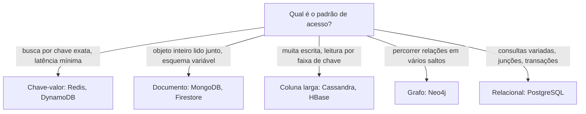

# NoSQL: documento, chave-valor, coluna, grafo

## Por que isso importa

O modelo relacional resolve a maioria dos problemas, mas não todos. Um cache de sessões com milhões de leituras por segundo, um catálogo de produtos em que cada categoria tem atributos diferentes, uma rede social onde a pergunta é "amigos de amigos" e um sistema de métricas que grava bilhões de pontos por dia têm formatos de acesso que um banco relacional atende mal ou com custo alto. "NoSQL" é o nome guarda-chuva para os bancos que trocam parte das garantias e da flexibilidade de consulta do SQL por **escala horizontal**, **esquema flexível** ou um **modelo de dados mais próximo do problema**. Saber quando usar (e quando **não** usar) é uma decisão de arquitetura que você vai tomar ou defender em entrevistas.

## Intuição

Pense em quatro jeitos de guardar as coisas de casa:

- **Chave-valor** é um **guarda-volumes**: você entrega a mala, recebe um número e só consegue pegá-la de volta pelo número. Rapidíssimo, mas não dá para perguntar "quais malas são azuis?".
- **Documento** é uma **pasta por cliente**: tudo sobre aquele cliente (endereços, pedidos recentes) fica junto, em um só lugar, com o formato que fizer sentido para ele.
- **Coluna larga** é um **livro-razão gigante** organizado por chave e ordenado: ótimo para "todas as medições do sensor 42 entre 10h e 11h".
- **Grafo** é um **mapa de relações**: pessoas são pontos e amizades são linhas, e a pergunta natural é "como chego de A até B?".

Nenhum é melhor em tudo. Cada um é ótimo para um **padrão de acesso** e ruim para os outros.

## Visual



O mesmo cliente, em três modelos:

```text
Relacional (3 tabelas, junção na leitura)
  clientes(id=7, nome='Ana')
  enderecos(cliente_id=7, cidade='Recife')
  pedidos(id=31, cliente_id=7, total=120)

Documento (um objeto, lido de uma vez)
  { "_id": 7, "nome": "Ana",
    "enderecos": [{ "cidade": "Recife" }],
    "pedidos_recentes": [{ "id": 31, "total": 120 }] }

Chave-valor (o banco não olha dentro do valor)
  "cliente:7"  ->  '{"nome":"Ana","enderecos":[...]}'
```

## Conceito técnico

### Os quatro modelos

| Modelo | Unidade | Consulta típica | Exemplos | Bom para |
|---|---|---|---|---|
| Chave-valor | par (chave, bytes) | `GET k`, `SET k v` com TTL | Redis, Memcached, DynamoDB | cache, sessões, contadores, filas |
| Documento | documento JSON/BSON | filtro por campos, índices secundários | MongoDB, Couchbase, Firestore | catálogo, perfis, conteúdo |
| Coluna larga | linha com chave de partição + colunas ordenadas | faixa dentro de uma partição | Cassandra, HBase, Bigtable | séries temporais, logs, escrita massiva |
| Grafo | nós e arestas com propriedades | travessias (`MATCH (a)-[:AMIGO*2]->(b)`) | Neo4j, Neptune | redes sociais, recomendação, fraude |

### Modelagem em documentos: embutir ou referenciar

A regra de ouro: **modele pelo jeito que os dados são lidos**, não pela forma "pura" deles.

- **Embutir** (o endereço dentro do cliente) quando os dados são lidos **sempre juntos**, pertencem a um único dono e têm tamanho limitado. Uma leitura traz tudo, sem junção.
- **Referenciar** (guardar só o `_id` do autor no post) quando o dado é **compartilhado** por muitos documentos, cresce sem limite (todos os comentários de um post viral) ou muda com frequência.

Embutir é **desnormalizar** (BD-03): você ganha leitura rápida e paga com duplicação. Se o nome do autor está copiado em 10 mil posts, mudar o nome exige 10 mil escritas.

### Escala horizontal: replicação e particionamento

- **Replicação**: cópias dos mesmos dados em várias máquinas. Dá tolerância a falhas e mais capacidade de leitura. No modelo **líder-seguidor**, as escritas vão para o líder e são copiadas para os seguidores, normalmente com algum atraso.
- **Particionamento (sharding)**: cada máquina guarda **uma parte** dos dados. A **chave de partição** decide para onde cada registro vai. Uma chave ruim (por exemplo, a data de hoje) manda toda a escrita para o mesmo nó: é um **ponto quente**.
- **Hashing consistente**: em vez de `hash(chave) % N` (que move quase todas as chaves quando `N` muda), nós e chaves são posicionados num **anel**. Cada chave pertence ao primeiro nó no sentido horário. Ao adicionar ou remover um nó, só as chaves do trecho vizinho mudam de dono. Cassandra e DynamoDB usam essa ideia.

```text
            0
       C(300)   A(90)        chave com hash 50  -> A
                             chave com hash 250 -> C
          B(200)             chave com hash 310 -> A (dá a volta)
```

### CAP e consistência eventual

O **teorema CAP** diz que, quando há uma **partição de rede** (P, nós que não conseguem conversar), um sistema distribuído precisa escolher entre:

- **Consistência (C)**: toda leitura vê a escrita mais recente, ou dá erro;
- **Disponibilidade (A)**: toda requisição recebe resposta, mesmo que desatualizada.

Como partições acontecem de verdade, a escolha real é **CP** ou **AP** durante a falha. Bancos AP (Cassandra, DynamoDB no modo padrão) oferecem **consistência eventual**: se as escritas pararem, todas as réplicas convergem para o mesmo valor, mas por um tempo leituras diferentes podem ver valores diferentes. Muitos permitem ajustar por operação com **quóruns**: com `N` réplicas, escrever em `W` e ler de `R` réplicas, e `R + W > N` garante que a leitura encontra pelo menos uma réplica com a escrita mais recente.

O **PACELC** completa o CAP: mesmo **sem** partição (E, else), há uma troca entre **latência** (L) e **consistência** (C).

### Quando ficar no relacional

Os bancos relacionais modernos também têm JSON (`jsonb` no PostgreSQL), replicação e particionamento. Escolha NoSQL quando o padrão de acesso pedir de forma clara. Fique no relacional quando houver **consultas variadas e imprevisíveis**, muitas **junções**, ou **transações entre várias entidades** (dinheiro, estoque). É comum usar os dois: PostgreSQL como fonte da verdade e Redis como cache na frente dele.

## Código

Um banco de documentos em miniatura, com dicionários Python, mostrando embutir contra referenciar e uma consulta por campo aninhado:

```python
import json

autores = {"a1": {"_id": "a1", "nome": "Ana"}}

# referenciando: o post guarda só o id do autor
posts = [
    {"_id": 1, "titulo": "Índices", "autor_id": "a1", "tags": ["bd", "desempenho"]},
    {"_id": 2, "titulo": "MVCC", "autor_id": "a1", "tags": ["bd"]},
]

# "junção" feita na aplicação: uma consulta extra por autor
for p in posts:
    autor = autores[p["autor_id"]]
    print(p["titulo"], "por", autor["nome"])

# embutindo: o nome do autor vai copiado em cada post
embutidos = [dict(p, autor={"nome": autores[p["autor_id"]]["nome"]}) for p in posts]
print(json.dumps(embutidos[0], ensure_ascii=False))

# renomear a autora agora exige atualizar cada cópia
for p in embutidos:
    p["autor"]["nome"] = "Ana Souza"

# consulta "tags contém 'desempenho'", como no MongoDB { tags: "desempenho" }
print([p["_id"] for p in posts if "desempenho" in p["tags"]])
```

Em MongoDB, a mesma consulta e um índice nela seriam:

```text
db.posts.find({ tags: "desempenho", "autor.nome": "Ana" })
db.posts.createIndex({ tags: 1 })
```

## Erros comuns

- **Escolher NoSQL "porque escala"** sem ter o problema de escala. Um PostgreSQL bem indexado atende a maioria dos sistemas, e você perde junções e transações à toa.
- **Modelar documentos como tabelas** (uma coleção por entidade, tudo referenciado) e depois fazer dezenas de consultas para montar uma tela. Se é para normalizar tudo, o relacional é melhor nisso.
- **Embutir listas que crescem sem limite** (todos os comentários dentro do post). O documento estoura o tamanho máximo (16 MB no MongoDB) e cada escrita reescreve o documento inteiro.
- **Escolher mal a chave de partição**, criando pontos quentes ou partições gigantes.
- **Supor consistência forte** num banco eventual: ler logo depois de escrever e não ver a própria escrita.
- **Usar o cache como fonte da verdade**. Redis pode perder dados recentes ao reiniciar, conforme a configuração de persistência.

## Pratique

```quiz
id: BD-06-q1
tipo: multipla_escolha
pergunta: "Você precisa guardar sessões de login, lidas e escritas milhares de vezes por segundo pelo id da sessão, e que expiram sozinhas em 30 minutos. Qual modelo encaixa melhor?"
opcoes: ["Grafo", "Chave-valor com TTL", "Coluna larga", "Relacional com junções"]
resposta: 1
explicacao: "O acesso é sempre pela chave exata e o dado tem prazo de validade: é o caso clássico de Redis com TTL. Não há relações a percorrer nem consultas por faixa."
dificuldade: 1
```

```quiz
id: BD-06-q2
tipo: multipla_escolha
pergunta: "Num banco de documentos, um post pode receber centenas de milhares de comentários. Como modelar os comentários?"
opcoes: ["Embutir todos dentro do post", "Em documentos próprios, cada um com o id do post (referência)", "Como uma string única com todos os textos", "Não guardar comentários"]
resposta: 1
explicacao: "Uma lista que cresce sem limite não deve ser embutida: o documento ficaria enorme e cada comentário novo reescreveria o post inteiro. Um padrão comum é referenciar e, se quiser, embutir só os poucos comentários mais recentes para a primeira tela."
dificuldade: 2
```

```quiz
id: BD-06-q3
tipo: verdadeiro_falso
pergunta: "Pelo teorema CAP, um sistema distribuído pode ser consistente, disponível e tolerante a partições ao mesmo tempo, desde que use servidores rápidos o bastante."
resposta: false
explicacao: "Durante uma partição de rede, o sistema precisa escolher: recusar respostas (mantendo a consistência) ou responder com dados possivelmente desatualizados (mantendo a disponibilidade). Velocidade não resolve, porque a partição impede a comunicação entre os nós."
dificuldade: 1
```

```quiz
id: BD-06-q4
tipo: resposta_curta
pergunta: "Com 3 réplicas (N = 3), quais valores de W e R garantem que uma leitura veja a escrita mais recente, e por quê?"
resposta: "Qualquer combinação com R + W > N, como W = 2 e R = 2. Assim o conjunto de réplicas lido sempre tem pelo menos uma réplica em comum com o conjunto que recebeu a escrita."
palavras_chave: ["R + W > N", "W = 2", "R = 2", "comum"]
dificuldade: 2
```

```quiz
id: BD-06-q5
tipo: multipla_escolha
pergunta: "Um sistema usa hash(chave) % N para escolher entre N servidores e passa de 4 para 5 servidores. O que acontece?"
opcoes: ["Nenhuma chave muda de servidor", "Cerca de 1/5 das chaves muda", "A grande maioria das chaves muda de servidor", "Só as chaves novas vão para o servidor 5"]
resposta: 2
explicacao: "Uma chave só fica no mesmo lugar se hash % 4 == hash % 5, o que vale para cerca de 1 em cada 5 hashes. Cerca de 80% das chaves mudam de lugar, o que esvazia um cache inteiro de uma vez. O hashing consistente move só cerca de 1/5 delas."
dificuldade: 2
```

```quiz
id: BD-06-q6
tipo: codigo
linguagem: python
pergunta: |
  **Um `find` de banco de documentos.** Escreva `buscar(docs, filtro)` que devolve a lista dos `_id` dos documentos que satisfazem **todas** as condições do filtro, na ordem original.

  - A chave do filtro pode ser um caminho com pontos: `'loja.cidade'` olha `doc['loja']['cidade']`. Se algum nível não existir, o documento **não** casa.
  - Se a condição for um valor comum, é igualdade. Mas se o campo do documento for uma **lista**, igualdade significa "a lista contém o valor" (como no MongoDB).
  - Se a condição for um dicionário, ele tem operadores: `'$gt'` (maior que), `'$lt'` (menor que) e `'$in'` (o valor está na lista dada). Todos precisam valer.
codigo_inicial: |
  # não mude: os testes usam esta lista
  PRODUTOS = [
      {'_id': 1, 'nome': 'Caneca', 'preco': 30, 'tags': ['cozinha', 'presente'], 'loja': {'cidade': 'Recife'}},
      {'_id': 2, 'nome': 'Livro', 'preco': 80, 'tags': ['leitura'], 'loja': {'cidade': 'Natal'}},
      {'_id': 3, 'nome': 'Fone', 'preco': 150, 'loja': {'cidade': 'Recife'}},
      {'_id': 4, 'nome': 'Agenda', 'preco': 45, 'tags': ['leitura', 'presente']},
  ]

  def buscar(docs, filtro):
      # só entende igualdade em campos do primeiro nível
      return [d['_id'] for d in docs if all(d.get(c) == v for c, v in filtro.items())]
usa: [def, for, if, isinstance, return]
testes:
  - chamada: "buscar(PRODUTOS, {'nome': 'Livro'})"
    saida: "[2]"
  - chamada: "buscar(PRODUTOS, {'preco': {'$gt': 40}})"
    saida: "[2, 3, 4]"
  - chamada: "buscar(PRODUTOS, {'loja.cidade': 'Recife'})"
    saida: "[1, 3]"
  - chamada: "buscar(PRODUTOS, {'tags': 'presente'})"
    saida: "[1, 4]"
  - chamada: "buscar(PRODUTOS, {'preco': {'$gt': 20, '$lt': 100}, 'tags': 'leitura'})"
    visivel: false
    saida: "[2, 4]"
  - chamada: "buscar(PRODUTOS, {'loja.cidade': {'$in': ['Natal', 'Salvador']}})"
    visivel: false
    saida: "[2]"
  - chamada: "buscar(PRODUTOS, {})"
    visivel: false
    saida: "[1, 2, 3, 4]"
  - chamada: "buscar(PRODUTOS, {'tags': 'cozinha', 'preco': {'$lt': 10}})"
    visivel: false
    saida: "[]"
dica: "Separe em duas funções: pegar(doc, caminho), que percorre caminho.split('.') e devolve um marcador especial se faltar algum nível, e casa(valor, condicao), que trata dicionário de operadores, lista e igualdade simples."
solucao: |
  # não mude: os testes usam esta lista
  PRODUTOS = [
      {'_id': 1, 'nome': 'Caneca', 'preco': 30, 'tags': ['cozinha', 'presente'], 'loja': {'cidade': 'Recife'}},
      {'_id': 2, 'nome': 'Livro', 'preco': 80, 'tags': ['leitura'], 'loja': {'cidade': 'Natal'}},
      {'_id': 3, 'nome': 'Fone', 'preco': 150, 'loja': {'cidade': 'Recife'}},
      {'_id': 4, 'nome': 'Agenda', 'preco': 45, 'tags': ['leitura', 'presente']},
  ]

  FALTA = object()

  def pegar(doc, caminho):
      atual = doc
      for parte in caminho.split('.'):
          if not isinstance(atual, dict) or parte not in atual:
              return FALTA
          atual = atual[parte]
      return atual

  def casa(valor, condicao):
      if valor is FALTA:
          return False
      if isinstance(condicao, dict):
          for op, alvo in condicao.items():
              if op == '$gt' and not valor > alvo:
                  return False
              if op == '$lt' and not valor < alvo:
                  return False
              if op == '$in' and valor not in alvo:
                  return False
          return True
      if isinstance(valor, list):
          return condicao in valor
      return valor == condicao

  def buscar(docs, filtro):
      return [d['_id'] for d in docs if all(casa(pegar(d, c), cond) for c, cond in filtro.items())]
explicacao: "O marcador FALTA distingue 'campo ausente' de 'campo com valor None'. O filtro vazio casa com tudo, porque all() de uma sequência vazia é True. A Agenda não tem loja, então nunca casa com 'loja.cidade'. Um banco de verdade faz o mesmo, mas usa índices (inclusive em campos aninhados e em listas, os índices multichave) para não percorrer todos os documentos."
dificuldade: 2
```

```quiz
id: BD-06-q7
tipo: codigo
linguagem: python
pergunta: |
  **Chave-valor com expiração.** Complete a classe `Cache`:

  - `set(chave, valor, agora, ttl)` guarda o valor. Se `ttl` for um número, a chave expira no instante `agora + ttl`; se for `None`, nunca expira. Gravar de novo a mesma chave substitui o valor **e** o prazo.
  - `get(chave, agora)` devolve o valor, ou `None` se a chave não existe ou se `agora` já chegou ao instante de expiração (nesse caso, apague a chave).

  O tempo é passado como parâmetro para os testes serem previsíveis.
codigo_inicial: |
  class Cache:
      def __init__(self):
          self.dados = {}

      def set(self, chave, valor, agora, ttl):
          self.dados[chave] = valor

      def get(self, chave, agora):
          return self.dados.get(chave)

  # não mude: os testes usam esta função
  def simular(operacoes):
      cache = Cache()
      saidas = []
      for op in operacoes:
          if op[0] == 'set':
              _, chave, valor, agora, ttl = op
              cache.set(chave, valor, agora, ttl)
          else:
              _, chave, agora = op
              saidas.append(cache.get(chave, agora))
      return saidas
usa: [class, def, if, return]
testes:
  - chamada: "simular([('set', 'a', 1, 0, 10), ('get', 'a', 5), ('get', 'a', 10)])"
    saida: "[1, None]"
  - chamada: "simular([('set', 'a', 1, 0, None), ('get', 'a', 1000)])"
    saida: "[1]"
  - chamada: "simular([('get', 'x', 0)])"
    saida: "[None]"
  - chamada: "simular([('set', 's', 'v1', 0, 5), ('set', 's', 'v2', 3, 5), ('get', 's', 6), ('get', 's', 8)])"
    visivel: false
    saida: "['v2', None]"
  - chamada: "simular([('set', 'a', 1, 0, 10), ('set', 'a', 2, 1, None), ('get', 'a', 100)])"
    visivel: false
    saida: "[2]"
dica: "Guarde em self.dados uma tupla (valor, expira_em), com expira_em = None quando não há ttl. No get, se expira_em não for None e agora >= expira_em, apague e devolva None."
solucao: |
  class Cache:
      def __init__(self):
          self.dados = {}

      def set(self, chave, valor, agora, ttl):
          expira_em = None if ttl is None else agora + ttl
          self.dados[chave] = (valor, expira_em)

      def get(self, chave, agora):
          if chave not in self.dados:
              return None
          valor, expira_em = self.dados[chave]
          if expira_em is not None and agora >= expira_em:
              del self.dados[chave]
              return None
          return valor

  # não mude: os testes usam esta função
  def simular(operacoes):
      cache = Cache()
      saidas = []
      for op in operacoes:
          if op[0] == 'set':
              _, chave, valor, agora, ttl = op
              cache.set(chave, valor, agora, ttl)
          else:
              _, chave, agora = op
              saidas.append(cache.get(chave, agora))
      return saidas
explicacao: "Essa é a expiração preguiçosa: a chave só é apagada quando alguém tenta lê-la. O Redis faz isso e, além disso, sorteia chaves periodicamente para apagar as expiradas que ninguém lê, para a memória não encher. No quarto teste, regravar no instante 3 empurra a expiração para 8, por isso 'v2' ainda existe em 6."
dificuldade: 2
```

```quiz
id: BD-06-q8
tipo: codigo
linguagem: javascript
pergunta: |
  **Hashing consistente.** O anel vai de 0 a 359. Cada nó é um par `[nome, posicao]`, e a lista pode vir fora de ordem. Escreva `responsavel(nos, h)` que devolve o nome do nó responsável pela chave de hash `h`: o primeiro nó com `posicao >= h` andando no sentido crescente. Se não houver nenhum, dá a volta e devolve o nó de **menor** posição.
codigo_inicial: |
  function responsavel(nos, h) {
    // sempre o primeiro nó da lista
    return nos[0][0];
  }
usa: [function, for, return]
testes:
  - chamada: "responsavel([['A', 90], ['B', 200], ['C', 300]], 50)"
    saida: "'A'"
  - chamada: "responsavel([['A', 90], ['B', 200], ['C', 300]], 90)"
    saida: "'A'"
  - chamada: "responsavel([['A', 90], ['B', 200], ['C', 300]], 250)"
    saida: "'C'"
  - chamada: "responsavel([['A', 90], ['B', 200], ['C', 300]], 310)"
    saida: "'A'"
  - chamada: "responsavel([['C', 300], ['A', 90], ['B', 200]], 150)"
    visivel: false
    saida: "'B'"
  - chamada: "responsavel([['X', 10]], 359)"
    visivel: false
    saida: "'X'"
  - chamada: "responsavel([['C', 300], ['B', 200]], 301)"
    visivel: false
    saida: "'B'"
dica: "Faça uma cópia ordenada por posição com [...nos].sort((a, b) => a[1] - b[1]). Percorra e devolva o primeiro com posição >= h. Se o laço terminar, devolva o nome do primeiro da lista ordenada."
solucao: |
  function responsavel(nos, h) {
    const ordenados = [...nos].sort((a, b) => a[1] - b[1]);
    for (const [nome, posicao] of ordenados) {
      if (posicao >= h) return nome;
    }
    return ordenados[0][0];
  }
explicacao: "Se o nó B (200) sair do anel, só as chaves entre 91 e 200 mudam de dono (passam para C); as de A e C ficam onde estão. Com hash % N, quase tudo mudaria. Na prática, cada servidor ocupa várias posições no anel (nós virtuais) para dividir a carga de forma mais uniforme, e a busca usa busca binária em vez de percorrer a lista."
dificuldade: 2
```

## Resumo

- **Chave-valor**: acesso por chave, TTL, latência mínima. **Documento**: objeto inteiro, esquema flexível. **Coluna larga**: escrita massiva e leitura por faixa. **Grafo**: travessias de relações.
- Em documentos, **embuta** o que é lido junto e limitado; **referencie** o que é compartilhado ou cresce sem limite.
- **Replicação** dá tolerância a falhas; **particionamento** dá capacidade; **hashing consistente** move poucas chaves quando o cluster muda.
- **CAP**: durante uma partição, escolha consistência ou disponibilidade. **Quórum** com `R + W > N` dá leitura atualizada.
- Na dúvida, comece no relacional e adicione NoSQL para o padrão de acesso que pedir.

## Para ir além

- Leia os capítulos 2, 5 e 6 do "Designing Data-Intensive Applications".
- Suba um Redis com Docker e teste `SET sessao:1 abc EX 10`, `TTL sessao:1` e `GET sessao:1` depois de 10 segundos.
- **Próximo módulo**: BD-07 ORMs e migrações.
