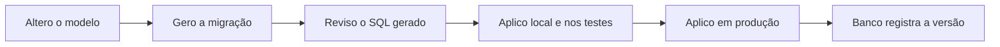

# ORMs e migrações

## Por que isso importa

Na maioria dos projetos você não vai escrever SQL à mão para cada tela. Vai usar um **ORM** (SQLAlchemy, Django ORM, Prisma, Hibernate) e uma ferramenta de **migrações** (Alembic, Django migrations, Flyway). Eles economizam muito trabalho, mas escondem o SQL que roda de verdade. Os dois problemas de banco mais comuns em código de produção vêm justamente daí: a página que faz **centenas de consultas** sem ninguém perceber (o N+1) e a **migração que trava a tabela** principal no meio do dia. Esta aula mostra o que acontece por baixo, para você usar essas ferramentas sem ser surpreendido.

## Intuição

O ORM é um **tradutor simultâneo**: você fala em objetos (`usuario.pedidos`) e ele traduz para SQL. Ele é ótimo nas frases comuns, mas traduz **palavra por palavra** se você deixar: pedir "o autor de cada um destes 100 posts" vira 100 perguntas separadas em vez de uma.

As migrações são o **controle de versão do esquema**. O código está no Git; o formato das tabelas também precisa estar, numa sequência numerada de passos (`001_criar_usuarios`, `002_adicionar_email`). Cada ambiente (sua máquina, o servidor de testes, a produção) sabe em que passo está e aplica só os que faltam.

## Visual

O problema N+1, visto no log do banco:

```text
for post in Post.query.limit(3):        -- 1 consulta
    print(post.autor.nome)              -- + 1 consulta POR post

SELECT * FROM posts LIMIT 3;
SELECT * FROM autores WHERE id = 10;
SELECT * FROM autores WHERE id = 20;
SELECT * FROM autores WHERE id = 10;    -- de novo!
                                        -- total: 1 + N consultas

com carregamento antecipado (selectinload / prefetch_related):
SELECT * FROM posts LIMIT 3;
SELECT * FROM autores WHERE id IN (10, 20);
                                        -- total: 2 consultas, qualquer N
```

O ciclo de vida de uma migração:



## Conceito técnico

### O que um ORM faz

1. **Mapeia** classes para tabelas e atributos para colunas.
2. **Gera SQL** a partir de chamadas de métodos (`filter`, `order_by`, `join`).
3. **Hidrata** objetos a partir das linhas retornadas.
4. Controla uma **unidade de trabalho** (a sessão): acumula as mudanças nos objetos e as envia num `COMMIT`.
5. Navega **relacionamentos** (`post.autor`), carregando sob demanda (**lazy**) ou de forma antecipada (**eager**).

```text
# SQLAlchemy 2.x
class Post(Base):
    __tablename__ = "posts"
    id: Mapped[int] = mapped_column(primary_key=True)
    titulo: Mapped[str]
    autor_id: Mapped[int] = mapped_column(ForeignKey("autores.id"))
    autor: Mapped["Autor"] = relationship()

stmt = select(Post).where(Post.titulo.like("%SQL%")).options(selectinload(Post.autor))
for post in session.scalars(stmt):
    print(post.titulo, post.autor.nome)
```

### O problema N+1 e como evitar

Ele aparece quando um relacionamento **lazy** é acessado dentro de um laço. A correção é pedir o carregamento junto da consulta principal:

| Estratégia | SQL gerado | Quando usar |
|---|---|---|
| `joinedload` / `select_related` | um `JOIN` na mesma consulta | relação para um (post → autor) |
| `selectinload` / `prefetch_related` | segunda consulta com `IN (...)` | relação para muitos (autor → posts) |

Para detectar: ligue o log de SQL em desenvolvimento (`echo=True` no SQLAlchemy, `django-debug-toolbar`) e conte as consultas por requisição. Alguns times escrevem testes que falham se uma tela passar de um limite de consultas.

### Consultas parametrizadas

Nunca monte SQL concatenando valores do usuário:

```text
f"SELECT * FROM usuarios WHERE nome = '{nome}'"
# nome = "x' OR '1'='1"  ->  WHERE nome = 'x' OR '1'='1'   (devolve todos!)
```

O certo é usar **marcadores** (`?`, `%s`, `:nome`) e passar os valores separados. O banco recebe o comando e os dados por canais diferentes, e um valor **nunca** é interpretado como SQL. ORMs fazem isso por padrão; o perigo volta quando você usa `text()`, `raw()` ou `execute()` com strings montadas à mão. Nomes de tabelas e colunas não podem ser parâmetros: se vierem de fora, valide contra uma lista permitida.

### Migrações

Uma migração é um arquivo com duas funções: **`upgrade`** (aplica a mudança) e **`downgrade`** (desfaz). O banco guarda uma tabela de controle (`alembic_version`, `django_migrations`, `schema_migrations`) com o que já foi aplicado.

```text
# alembic/versions/002_adicionar_email.py
revision = "002"
down_revision = "001"

def upgrade():
    op.add_column("usuarios", sa.Column("email", sa.String(255), nullable=True))

def downgrade():
    op.drop_column("usuarios", "email")
```

Regras para produção:

- **Migrações aplicadas são imutáveis.** Errou? Crie uma nova migração que corrige. Editar uma antiga deixa ambientes diferentes com esquemas diferentes.
- **Esquema e dados** podem ir em migrações separadas. Preencher uma coluna nova em milhões de linhas pode demorar e deve ser feito em lotes.
- **Expandir e depois contrair.** Para renomear uma coluna sem derrubar o sistema: (1) adicione a nova, (2) faça o código escrever nas duas, (3) copie os dados antigos, (4) faça o código ler da nova, (5) remova a antiga. Cada passo é um deploy, e a versão anterior do código continua funcionando durante cada um.
- **Cuidado com bloqueios.** `ALTER TABLE ... ADD COLUMN ... NOT NULL DEFAULT ...` e `CREATE INDEX` podem travar a tabela em alguns bancos. No PostgreSQL, use `CREATE INDEX CONCURRENTLY` em tabelas grandes.
- **Revise o que foi gerado.** O autogerador não percebe renomeações (vê "apagar coluna e criar outra", perdendo dados).

## Código

Um mini-ORM em Python que gera SQL parametrizado a partir de uma classe, mostrando o que ferramentas como SQLAlchemy fazem por baixo:

```python
class Modelo:
    tabela = None
    campos = []

    def __init__(self, **valores):
        for campo in self.campos:
            setattr(self, campo, valores.get(campo))

    @classmethod
    def sql_insert(cls, obj):
        colunas = ", ".join(cls.campos)
        marcadores = ", ".join("?" for _ in cls.campos)
        valores = [getattr(obj, c) for c in cls.campos]
        return f"INSERT INTO {cls.tabela} ({colunas}) VALUES ({marcadores})", valores

    @classmethod
    def sql_filtrar(cls, **filtros):
        for campo in filtros:
            if campo not in cls.campos:
                raise ValueError(f"campo desconhecido: {campo}")
        where = " AND ".join(f"{c} = ?" for c in filtros)
        sql = f"SELECT {', '.join(cls.campos)} FROM {cls.tabela}"
        if where:
            sql += f" WHERE {where}"
        return sql, list(filtros.values())


class Usuario(Modelo):
    tabela = "usuarios"
    campos = ["id", "nome", "email"]


ana = Usuario(id=1, nome="Ana", email="ana@exemplo.com")
print(Usuario.sql_insert(ana))
print(Usuario.sql_filtrar(nome="x' OR '1'='1"))
try:
    Usuario.sql_filtrar(senha="123")
except ValueError as erro:
    print("bloqueado:", erro)
```

Repare que o valor malicioso vai para a lista de parâmetros e nunca entra no texto do SQL, e que nomes de campo só são aceitos se estiverem na lista do modelo.

## Erros comuns

- **N+1 escondido** em templates ou serializadores que acessam `obj.relacao` dentro de um laço.
- **Carregar tudo para contar**: `len(Post.query.all())` traz todas as linhas para a memória; use `count()` no banco.
- **Editar uma migração já aplicada** em outro ambiente.
- **Adicionar coluna `NOT NULL` sem valor padrão** numa tabela com dados: a migração falha (ou trava a tabela enquanto preenche).
- **Confiar no autogerador** para renomeações e mudanças de tipo.
- **Usar SQL cru com interpolação de strings** "só desta vez", reabrindo a porta para injeção.
- **Esquecer o `downgrade`**, ou escrever um que nunca foi testado.

## Pratique

```quiz
id: BD-07-q1
tipo: multipla_escolha
pergunta: "Uma página lista 50 pedidos e mostra o nome do cliente de cada um, acessando pedido.cliente.nome com carregamento lazy. Quantas consultas o banco recebe, no pior caso?"
opcoes: ["1", "2", "51", "2500"]
resposta: 2
explicacao: "Uma consulta para os 50 pedidos e mais uma para cada cliente acessado: 1 + 50. Com joinedload (ou select_related) seriam 1; com selectinload, 2."
dificuldade: 1
```

```quiz
id: BD-07-q2
tipo: verdadeiro_falso
pergunta: "Se uma migração já aplicada em produção tem um erro, o certo é editar o arquivo dela e rodar de novo."
resposta: false
explicacao: "A tabela de controle já marca essa migração como aplicada, então ela não rodaria de novo, e os ambientes ficariam diferentes. O certo é criar uma nova migração que corrige o problema."
dificuldade: 1
```

```quiz
id: BD-07-q3
tipo: multipla_escolha
pergunta: "Você precisa renomear a coluna nome para nome_completo numa tabela usada pelo sistema em produção, sem tempo fora do ar. Qual é o caminho seguro?"
opcoes: ["Um ALTER TABLE ... RENAME COLUMN no mesmo deploy da mudança no código", "Adicionar nome_completo, escrever nas duas, copiar os dados, passar a ler da nova e só depois apagar nome", "Apagar a tabela e recriar", "Deixar o autogerador decidir"]
resposta: 1
explicacao: "É o padrão expandir e contrair. Durante um deploy, a versão antiga e a nova do código convivem; se a coluna mudar de nome de uma vez, uma delas quebra. Em passos, cada versão do código encontra as colunas de que precisa."
dificuldade: 2
```

```quiz
id: BD-07-q4
tipo: resposta_curta
pergunta: "Por que uma consulta parametrizada impede injeção de SQL, enquanto escapar aspas à mão é frágil?"
resposta: "Porque o comando SQL e os valores são enviados separados: o banco analisa o comando antes e trata o parâmetro sempre como dado, nunca como código. Escapar à mão depende de lembrar de todos os casos (codificações, tipos de aspas, números) e basta um esquecimento."
palavras_chave: ["separados", "dado", "código", "parâmetro"]
dificuldade: 2
```

```quiz
id: BD-07-q5
tipo: codigo
linguagem: python
pergunta: |
  **Montando o WHERE sem injeção.** Escreva `montar_where(filtros)` que recebe um dicionário no estilo do Django ORM e devolve a tupla `(sql, parametros)`:

  - `'campo': valor` vira `campo = ?`; mas se o valor for `None`, vira `campo IS NULL` (sem parâmetro);
  - `'campo__gt'` vira `campo > ?` e `'campo__lt'` vira `campo < ?`;
  - `'campo__in': [a, b, c]` vira `campo IN (?, ?, ?)` e acrescenta os três valores aos parâmetros.

  As condições são unidas com `' AND '`, na ordem do dicionário, depois de `'WHERE '`. Sem filtros, devolva `('', [])`. **Nenhum valor** pode aparecer dentro do texto do SQL.
codigo_inicial: |
  def montar_where(filtros):
      partes = []
      for chave, valor in filtros.items():
          partes.append(f"{chave} = '{valor}'")
      if not partes:
          return ('', [])
      return ('WHERE ' + ' AND '.join(partes), [])
usa: [def, for, if, return]
testes:
  - chamada: "montar_where({'nome': 'Ana'})"
    saida: "('WHERE nome = ?', ['Ana'])"
  - chamada: "montar_where({'idade__gt': 18, 'cidade': 'Recife'})"
    saida: "('WHERE idade > ? AND cidade = ?', [18, 'Recife'])"
  - chamada: "montar_where({})"
    saida: "('', [])"
  - chamada: "montar_where({'id__in': [1, 2, 3]})"
    visivel: false
    saida: "('WHERE id IN (?, ?, ?)', [1, 2, 3])"
  - chamada: "montar_where({'apagado_em': None, 'idade__lt': 60})"
    visivel: false
    saida: "('WHERE apagado_em IS NULL AND idade < ?', [60])"
  - chamada: "montar_where({'nome': \"x' OR '1'='1\"})"
    visivel: false
    saida: "('WHERE nome = ?', [\"x' OR '1'='1\"])"
dica: "Use chave.split('__') para separar o campo do operador. Para __in, gere ', '.join('?' for _ in valor) e use parametros.extend(valor)."
solucao: |
  def montar_where(filtros):
      partes = []
      parametros = []
      for chave, valor in filtros.items():
          if '__' in chave:
              campo, op = chave.split('__')
          else:
              campo, op = chave, 'eq'
          if op == 'in':
              marcadores = ', '.join('?' for _ in valor)
              partes.append(f'{campo} IN ({marcadores})')
              parametros.extend(valor)
          elif op == 'eq' and valor is None:
              partes.append(f'{campo} IS NULL')
          else:
              simbolo = {'eq': '=', 'gt': '>', 'lt': '<'}[op]
              partes.append(f'{campo} {simbolo} ?')
              parametros.append(valor)
      if not partes:
          return ('', [])
      return ('WHERE ' + ' AND '.join(partes), parametros)
explicacao: "O código inicial é vulnerável: com o último teste, o SQL viraria WHERE nome = 'x' OR '1'='1' e devolveria todas as linhas. Com marcadores, o texto malicioso fica só na lista de parâmetros. O caso None existe porque campo = NULL nunca é verdadeiro em SQL (a comparação com NULL dá NULL), um tropeço clássico que os ORMs tratam por você."
dificuldade: 2
```

```quiz
id: BD-07-q6
tipo: codigo
linguagem: python
pergunta: |
  **Acabe com o N+1.** A função `titulos_com_autor(db, post_ids)` devolve uma lista de tuplas `(titulo, nome_do_autor)`, na ordem de `post_ids`. A versão inicial funciona, mas faz uma consulta por post. Reescreva usando **exatamente duas** consultas: uma com `db.buscar_posts(ids)` e outra com `db.buscar_autores(ids_de_autores)`, que devolve um dicionário `{id: nome}`.

  Os testes chamam `medir(post_ids)`, que devolve o resultado e o número de consultas feitas.
codigo_inicial: |
  def titulos_com_autor(db, post_ids):
      resultado = []
      for post in db.buscar_posts(post_ids):
          autor = db.buscar_autor(post['autor_id'])
          resultado.append((post['titulo'], autor))
      return resultado

  # não mude: os testes usam esta classe e esta função
  class BancoFalso:
      def __init__(self):
          self.consultas = 0
          self.posts = {1: {'titulo': 'Índices', 'autor_id': 10}, 2: {'titulo': 'MVCC', 'autor_id': 20},
                        3: {'titulo': 'Cache', 'autor_id': 10}, 4: {'titulo': 'Filas', 'autor_id': 30}}
          self.autores = {10: 'Ana', 20: 'Bruno', 30: 'Carla'}

      def buscar_posts(self, ids):
          self.consultas += 1
          return [dict(self.posts[i], id=i) for i in ids if i in self.posts]

      def buscar_autor(self, autor_id):
          self.consultas += 1
          return self.autores.get(autor_id)

      def buscar_autores(self, autor_ids):
          self.consultas += 1
          return {a: self.autores[a] for a in autor_ids if a in self.autores}

  def medir(post_ids):
      db = BancoFalso()
      return titulos_com_autor(db, post_ids), db.consultas
usa: [def, return]
testes:
  - chamada: "medir([1, 2])"
    saida: "([('Índices', 'Ana'), ('MVCC', 'Bruno')], 2)"
  - chamada: "medir([1, 2, 3, 4])"
    saida: "([('Índices', 'Ana'), ('MVCC', 'Bruno'), ('Cache', 'Ana'), ('Filas', 'Carla')], 2)"
  - chamada: "medir([4, 2, 1])"
    visivel: false
    saida: "([('Filas', 'Carla'), ('MVCC', 'Bruno'), ('Índices', 'Ana')], 2)"
  - chamada: "medir([3, 1, 3])"
    visivel: false
    saida: "([('Cache', 'Ana'), ('Índices', 'Ana'), ('Cache', 'Ana')], 2)"
dica: "Busque os posts uma vez, junte os autor_id num conjunto, chame buscar_autores com esse conjunto e depois monte as tuplas consultando o dicionário devolvido."
solucao: |
  def titulos_com_autor(db, post_ids):
      posts = db.buscar_posts(post_ids)
      ids_autores = {p['autor_id'] for p in posts}
      nomes = db.buscar_autores(ids_autores)
      return [(p['titulo'], nomes[p['autor_id']]) for p in posts]

  # não mude: os testes usam esta classe e esta função
  class BancoFalso:
      def __init__(self):
          self.consultas = 0
          self.posts = {1: {'titulo': 'Índices', 'autor_id': 10}, 2: {'titulo': 'MVCC', 'autor_id': 20},
                        3: {'titulo': 'Cache', 'autor_id': 10}, 4: {'titulo': 'Filas', 'autor_id': 30}}
          self.autores = {10: 'Ana', 20: 'Bruno', 30: 'Carla'}

      def buscar_posts(self, ids):
          self.consultas += 1
          return [dict(self.posts[i], id=i) for i in ids if i in self.posts]

      def buscar_autor(self, autor_id):
          self.consultas += 1
          return self.autores.get(autor_id)

      def buscar_autores(self, autor_ids):
          self.consultas += 1
          return {a: self.autores[a] for a in autor_ids if a in self.autores}

  def medir(post_ids):
      db = BancoFalso()
      return titulos_com_autor(db, post_ids), db.consultas
explicacao: "Com 4 posts, a versão inicial faz 5 consultas; com 1000, faria 1001. A nova faz sempre 2, e o conjunto evita pedir a mesma autora duas vezes. É exatamente o que selectinload (SQLAlchemy) e prefetch_related (Django) fazem: uma segunda consulta com WHERE id IN (...) e a junção feita em memória."
dificuldade: 2
```

```quiz
id: BD-07-q7
tipo: codigo
linguagem: sql
pergunta: |
  **Uma migração de verdade.** A tabela `usuarios` tem só `nome_completo`. Escreva a migração `002_dividir_nome`, dentro de uma transação:

  1. adicione as colunas `nome` e `sobrenome` (TEXT);
  2. preencha `nome` com a primeira palavra de `nome_completo` e `sobrenome` com o resto; quem tem uma palavra só fica com `sobrenome` **NULL**;
  3. registre `'002_dividir_nome'` na tabela `schema_migrations`.

  As consultas finais já estão no editor. Dica de funções do SQLite: `instr(texto, ' ')` devolve a posição do primeiro espaço (0 se não houver) e `substr(texto, inicio, tamanho)` recorta.
preparo: |
  CREATE TABLE schema_migrations (versao TEXT PRIMARY KEY);
  INSERT INTO schema_migrations VALUES ('001_criar_usuarios');
  CREATE TABLE usuarios (id INTEGER PRIMARY KEY, nome_completo TEXT NOT NULL);
  INSERT INTO usuarios VALUES (1, 'Ana Souza'), (2, 'Bruno Lima Neto'), (3, 'Carla');
codigo_inicial: |
  -- migração 002_dividir_nome

  -- não mude daqui para baixo
  SELECT id, nome, sobrenome FROM usuarios ORDER BY id;
  SELECT versao FROM schema_migrations ORDER BY versao;
usa: [ALTER TABLE, UPDATE, INSERT, COMMIT]
testes:
  - saida: |
      id | nome | sobrenome
      1 | Ana | Souza
      2 | Bruno | Lima Neto
      3 | Carla | NULL

      versao
      001_criar_usuarios
      002_dividir_nome
  - visivel: false
    saida: |
      id | nome | sobrenome
      1 | Ana | Souza
      2 | Bruno | Lima Neto
      3 | Carla | NULL

      versao
      001_criar_usuarios
      002_dividir_nome
dica: "Use CASE WHEN instr(nome_completo, ' ') = 0 THEN ... ELSE ... END. O nome vai da posição 1 até o espaço menos 1; o sobrenome começa no espaço mais 1 (substr sem o terceiro argumento vai até o fim)."
solucao: |
  -- migração 002_dividir_nome
  BEGIN;
  ALTER TABLE usuarios ADD COLUMN nome TEXT;
  ALTER TABLE usuarios ADD COLUMN sobrenome TEXT;
  UPDATE usuarios SET
    nome = CASE WHEN instr(nome_completo, ' ') = 0 THEN nome_completo
                ELSE substr(nome_completo, 1, instr(nome_completo, ' ') - 1) END,
    sobrenome = CASE WHEN instr(nome_completo, ' ') = 0 THEN NULL
                     ELSE substr(nome_completo, instr(nome_completo, ' ') + 1) END;
  INSERT INTO schema_migrations (versao) VALUES ('002_dividir_nome');
  COMMIT;

  -- não mude daqui para baixo
  SELECT id, nome, sobrenome FROM usuarios ORDER BY id;
  SELECT versao FROM schema_migrations ORDER BY versao;
explicacao: "No SQLite e no PostgreSQL, DDL é transacional: se o UPDATE falhasse, o ROLLBACK desfaria também os ALTER TABLE, e a tabela de controle não registraria uma migração pela metade. Repare que nome_completo continua lá: é a fase de expandir. Só depois que todo o código usar nome e sobrenome, outra migração apaga a coluna antiga. Em tabelas grandes, o UPDATE seria feito em lotes, numa migração de dados separada."
dificuldade: 2
```

## Resumo

- ORM mapeia classes em tabelas, gera SQL e controla a sessão; **olhe o SQL** que ele gera.
- **N+1**: relacionamento lazy dentro de laço. Corrija com `joinedload`/`select_related` ou `selectinload`/`prefetch_related`.
- **Consultas parametrizadas** sempre; nomes de colunas vindos de fora, só por lista permitida.
- **Migrações**: versionadas, imutáveis depois de aplicadas, com `upgrade` e `downgrade`.
- Em produção: **expandir e contrair**, migrar dados em lotes, cuidado com bloqueios.

## Para ir além

- Faça o tutorial do Alembic e rode `alembic upgrade head` e `alembic downgrade -1`.
- Ative `echo=True` num projeto SQLAlchemy e conte as consultas de uma página.
- **Fim da trilha de Banco de dados.** Próxima trilha: Engenharia de software.
