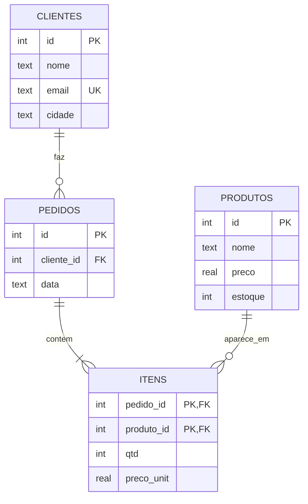

# Projeto: modelar e consultar o banco de um sistema real

## O que você vai construir

O banco de dados de uma **loja online** pequena: clientes, produtos, pedidos e os itens de cada pedido. Você vai desenhar o modelo, criar as tabelas com as regras que protegem os dados, responder às perguntas que o dono da loja faria ("quem mais comprou?", "o que está acabando no estoque?", "o que nunca vendeu?") e, no fim, migrar a planilha bagunçada em que a loja anotava as vendas.

Este é o projeto da Trilha 10, inspirado no curso **Databases** de Stanford. Todo o SQL roda no navegador, num SQLite de verdade: cada execução começa com um banco novo, já com as tabelas e os dados do enunciado.

## Etapa 0: o modelo

Antes do SQL, as perguntas de modelagem (BD-01): quais são as **entidades**, que **atributos** cada uma tem, e como se **relacionam**.

- Um **cliente** faz zero ou muitos **pedidos**; cada pedido é de exatamente um cliente (1:N).
- Um **pedido** tem um ou muitos **produtos**, e um produto aparece em muitos pedidos (N:N). O relacionamento N:N vira uma tabela própria, **itens**, com a quantidade e o **preço pago** naquele dia.



```quiz
id: PJ-05-q1
tipo: multipla_escolha
pergunta: "Por que `itens` guarda `preco_unit` se o produto já tem `preco`?"
opcoes:
  - "É uma redundância que deveria ser removida na normalização"
  - "Porque o preço do produto muda com o tempo, e o pedido precisa lembrar quanto foi cobrado naquele dia"
  - "Porque o SQLite não permite JOIN entre itens e produtos"
  - "Para a consulta ficar mais rápida, sem outro motivo"
resposta: 1
explicacao: "`produtos.preco` é o preço atual; `itens.preco_unit` é um fato histórico (o pedido 4 pagou 75 num mouse que hoje custa 80, numa promoção). Não é redundância: são informações diferentes que por acaso coincidem às vezes. Remover isso faria o faturamento de outubro mudar toda vez que alguém reajustasse um preço."
dificuldade: 2
```

## Etapa 1: criar as tabelas

As restrições são a primeira linha de defesa dos dados: o banco recusa o que é inválido, não importa qual programa tente gravar.

```quiz
id: PJ-05-e1
tipo: codigo
linguagem: sql
pergunta: |
  Crie as tabelas `clientes` e `produtos` (o banco começa vazio nesta etapa):

  - `clientes`: `id` inteiro, chave primária; `nome` texto obrigatório; `email` texto obrigatório e **único**; `cidade` texto obrigatório.
  - `produtos`: `id` inteiro, chave primária; `nome` texto obrigatório; `preco` real obrigatório e **maior que zero**; `estoque` inteiro obrigatório, **padrão 0**, nunca negativo.

  A correção insere dados válidos e inválidos (com `INSERT OR IGNORE`, que pula as linhas que violam as regras) e confere o que ficou.
codigo_inicial: |
  -- crie as duas tabelas aqui
usa: [CREATE TABLE, PRIMARY KEY, UNIQUE, CHECK, DEFAULT, NOT NULL]
testes:
  - chamada: "INSERT INTO clientes (nome, email, cidade) VALUES ('Ana', 'ana@ex.com', 'Recife'); SELECT id, nome FROM clientes;"
    saida: |
      id | nome
      1 | Ana
  - chamada: "INSERT INTO produtos (nome, preco) VALUES ('Mouse', 80); SELECT nome, preco, estoque FROM produtos;"
    saida: |
      nome | preco | estoque
      Mouse | 80 | 0
  - chamada: "INSERT OR IGNORE INTO clientes (nome, email, cidade) VALUES ('Ana', 'ana@ex.com', 'Recife'), ('Outra Ana', 'ana@ex.com', 'Natal'), (NULL, 'x@ex.com', 'Natal'), ('Bia', 'bia@ex.com', NULL), ('Caio', 'caio@ex.com', 'Natal'); SELECT nome FROM clientes ORDER BY id;"
    visivel: false
    saida: |
      nome
      Ana
      Caio
  - chamada: "INSERT OR IGNORE INTO produtos (nome, preco, estoque) VALUES ('Grátis', 0, 1), ('Negativo', 10, -1), (NULL, 10, 1), ('Cabo', 25, 40); SELECT nome, estoque FROM produtos;"
    visivel: false
    saida: |
      nome | estoque
      Cabo | 40
dica: "Uma coluna por linha dentro de CREATE TABLE produtos ( ... ). Exemplo: preco REAL NOT NULL CHECK (preco > 0), e estoque INTEGER NOT NULL DEFAULT 0 CHECK (estoque >= 0). Em SQLite, id INTEGER PRIMARY KEY ganha número automático."
solucao: |
  CREATE TABLE clientes (
    id INTEGER PRIMARY KEY,
    nome TEXT NOT NULL,
    email TEXT NOT NULL UNIQUE,
    cidade TEXT NOT NULL
  );

  CREATE TABLE produtos (
    id INTEGER PRIMARY KEY,
    nome TEXT NOT NULL,
    preco REAL NOT NULL CHECK (preco > 0),
    estoque INTEGER NOT NULL DEFAULT 0 CHECK (estoque >= 0)
  );
explicacao: "Nos testes ocultos, só as linhas válidas sobrevivem: o e-mail repetido, o nome nulo, a cidade nula, o preço zero e o estoque negativo foram recusados pelo banco. Sem as restrições, todas teriam entrado e o bug apareceria muito depois, num relatório errado. Em SQLite, `INTEGER PRIMARY KEY` é um apelido do rowid e recebe o próximo número sozinho."
dificuldade: 1
```

Nas próximas etapas o banco já vem pronto, com estes dados:

```text
clientes                         produtos
id nome  email         cidade    id nome      preco estoque
1  Ana   ana@ex.com    Recife    1  Teclado   150   10
2  Bruno bruno@ex.com  Recife    2  Mouse      80    3
3  Carla carla@ex.com  Natal     3  Monitor   900    2
4  Davi  davi@ex.com   Natal     4  Cabo HDMI  25   40
                                 5  Webcam    220    0
pedidos                  itens
id cliente_id data       pedido_id produto_id qtd preco_unit
1  1  2026-10-01         1  1  1  150
2  1  2026-10-15         1  2  2   80
3  2  2026-10-20         2  4  3   25
4  3  2026-11-02         3  3  1  900
                         3  4  1   25
                         4  2  1   75
```

Os testes ocultos acrescentam linhas a esses dados, então a consulta precisa funcionar para o caso geral, não só para o que está na tela.

## Etapa 2: filtrar e ordenar

```quiz
id: PJ-05-e2
tipo: codigo
linguagem: sql
pergunta: |
  O dono quer a lista de reposição: os produtos com **menos de 5** unidades em estoque, com `nome` e `estoque`, do menor estoque para o maior (empate: pelo nome).
preparo: |
  CREATE TABLE clientes (id INTEGER PRIMARY KEY, nome TEXT NOT NULL, email TEXT NOT NULL UNIQUE, cidade TEXT NOT NULL);
  CREATE TABLE produtos (id INTEGER PRIMARY KEY, nome TEXT NOT NULL, preco REAL NOT NULL CHECK (preco > 0), estoque INTEGER NOT NULL DEFAULT 0 CHECK (estoque >= 0));
  CREATE TABLE pedidos (id INTEGER PRIMARY KEY, cliente_id INTEGER NOT NULL REFERENCES clientes(id), data TEXT NOT NULL);
  CREATE TABLE itens (pedido_id INTEGER NOT NULL REFERENCES pedidos(id), produto_id INTEGER NOT NULL REFERENCES produtos(id), qtd INTEGER NOT NULL CHECK (qtd > 0), preco_unit REAL NOT NULL, PRIMARY KEY (pedido_id, produto_id));
  INSERT INTO clientes VALUES (1, 'Ana', 'ana@ex.com', 'Recife'), (2, 'Bruno', 'bruno@ex.com', 'Recife'), (3, 'Carla', 'carla@ex.com', 'Natal'), (4, 'Davi', 'davi@ex.com', 'Natal');
  INSERT INTO produtos VALUES (1, 'Teclado', 150.0, 10), (2, 'Mouse', 80.0, 3), (3, 'Monitor', 900.0, 2), (4, 'Cabo HDMI', 25.0, 40), (5, 'Webcam', 220.0, 0);
  INSERT INTO pedidos VALUES (1, 1, '2026-10-01'), (2, 1, '2026-10-15'), (3, 2, '2026-10-20'), (4, 3, '2026-11-02');
  INSERT INTO itens VALUES (1, 1, 1, 150.0), (1, 2, 2, 80.0), (2, 4, 3, 25.0), (3, 3, 1, 900.0), (3, 4, 1, 25.0), (4, 2, 1, 75.0);
codigo_inicial: |
  SELECT *
  FROM produtos;
usa: [SELECT, WHERE, ORDER BY]
testes:
  - descricao: "dados do enunciado"
    saida: |
      nome | estoque
      Webcam | 0
      Monitor | 2
      Mouse | 3
  - preparo: "INSERT INTO produtos VALUES (6, 'Hub USB', 60.0, 3), (7, 'Pendrive', 40.0, 5);"
    visivel: false
    saida: |
      nome | estoque
      Webcam | 0
      Monitor | 2
      Hub USB | 3
      Mouse | 3
dica: "SELECT nome, estoque FROM produtos WHERE estoque < 5 ORDER BY estoque, nome;"
solucao: |
  SELECT nome, estoque
  FROM produtos
  WHERE estoque < 5
  ORDER BY estoque, nome;
explicacao: "O segundo critério do ORDER BY só entra em ação nos empates (Hub USB e Mouse, ambos com 3, no teste oculto). O Pendrive, com exatamente 5, fica de fora: 'menos de 5' é `<`, não `<=`."
dificuldade: 1
```

## Etapa 3: juntar tabelas

```quiz
id: PJ-05-e3
tipo: codigo
linguagem: sql
pergunta: |
  Liste todos os pedidos com o **nome do cliente**: colunas `pedido` (id do pedido), `cliente` (nome) e `data`, do pedido mais antigo para o mais novo.
preparo: |
  CREATE TABLE clientes (id INTEGER PRIMARY KEY, nome TEXT NOT NULL, email TEXT NOT NULL UNIQUE, cidade TEXT NOT NULL);
  CREATE TABLE produtos (id INTEGER PRIMARY KEY, nome TEXT NOT NULL, preco REAL NOT NULL CHECK (preco > 0), estoque INTEGER NOT NULL DEFAULT 0 CHECK (estoque >= 0));
  CREATE TABLE pedidos (id INTEGER PRIMARY KEY, cliente_id INTEGER NOT NULL REFERENCES clientes(id), data TEXT NOT NULL);
  CREATE TABLE itens (pedido_id INTEGER NOT NULL REFERENCES pedidos(id), produto_id INTEGER NOT NULL REFERENCES produtos(id), qtd INTEGER NOT NULL CHECK (qtd > 0), preco_unit REAL NOT NULL, PRIMARY KEY (pedido_id, produto_id));
  INSERT INTO clientes VALUES (1, 'Ana', 'ana@ex.com', 'Recife'), (2, 'Bruno', 'bruno@ex.com', 'Recife'), (3, 'Carla', 'carla@ex.com', 'Natal'), (4, 'Davi', 'davi@ex.com', 'Natal');
  INSERT INTO produtos VALUES (1, 'Teclado', 150.0, 10), (2, 'Mouse', 80.0, 3), (3, 'Monitor', 900.0, 2), (4, 'Cabo HDMI', 25.0, 40), (5, 'Webcam', 220.0, 0);
  INSERT INTO pedidos VALUES (1, 1, '2026-10-01'), (2, 1, '2026-10-15'), (3, 2, '2026-10-20'), (4, 3, '2026-11-02');
  INSERT INTO itens VALUES (1, 1, 1, 150.0), (1, 2, 2, 80.0), (2, 4, 3, 25.0), (3, 3, 1, 900.0), (3, 4, 1, 25.0), (4, 2, 1, 75.0);
codigo_inicial: |
  SELECT id, cliente_id, data
  FROM pedidos;
usa: [SELECT, JOIN, ON, ORDER BY]
testes:
  - descricao: "dados do enunciado"
    saida: |
      pedido | cliente | data
      1 | Ana | 2026-10-01
      2 | Ana | 2026-10-15
      3 | Bruno | 2026-10-20
      4 | Carla | 2026-11-02
  - preparo: "INSERT INTO pedidos VALUES (5, 4, '2026-09-30');"
    visivel: false
    saida: |
      pedido | cliente | data
      5 | Davi | 2026-09-30
      1 | Ana | 2026-10-01
      2 | Ana | 2026-10-15
      3 | Bruno | 2026-10-20
      4 | Carla | 2026-11-02
dica: "SELECT p.id AS pedido, c.nome AS cliente, p.data FROM pedidos p JOIN clientes c ON c.id = p.cliente_id ORDER BY p.data;"
solucao: |
  SELECT p.id AS pedido, c.nome AS cliente, p.data
  FROM pedidos p
  JOIN clientes c ON c.id = p.cliente_id
  ORDER BY p.data;
explicacao: "O JOIN casa cada pedido com a linha de clientes cujo id é o cliente_id do pedido. Datas no formato AAAA-MM-DD ordenam certo como texto, por isso o ISO 8601 é o formato recomendado para guardar datas em SQLite."
dificuldade: 1
```

## Etapa 4: agrupar e somar

```quiz
id: PJ-05-e4
tipo: codigo
linguagem: sql
pergunta: |
  Quanto cada cliente já gastou? Mostre `cliente` (nome) e `total` (soma de `qtd * preco_unit` de todos os itens de todos os pedidos dele), **só para quem gastou mais de 100**, do maior total para o menor.
preparo: |
  CREATE TABLE clientes (id INTEGER PRIMARY KEY, nome TEXT NOT NULL, email TEXT NOT NULL UNIQUE, cidade TEXT NOT NULL);
  CREATE TABLE produtos (id INTEGER PRIMARY KEY, nome TEXT NOT NULL, preco REAL NOT NULL CHECK (preco > 0), estoque INTEGER NOT NULL DEFAULT 0 CHECK (estoque >= 0));
  CREATE TABLE pedidos (id INTEGER PRIMARY KEY, cliente_id INTEGER NOT NULL REFERENCES clientes(id), data TEXT NOT NULL);
  CREATE TABLE itens (pedido_id INTEGER NOT NULL REFERENCES pedidos(id), produto_id INTEGER NOT NULL REFERENCES produtos(id), qtd INTEGER NOT NULL CHECK (qtd > 0), preco_unit REAL NOT NULL, PRIMARY KEY (pedido_id, produto_id));
  INSERT INTO clientes VALUES (1, 'Ana', 'ana@ex.com', 'Recife'), (2, 'Bruno', 'bruno@ex.com', 'Recife'), (3, 'Carla', 'carla@ex.com', 'Natal'), (4, 'Davi', 'davi@ex.com', 'Natal');
  INSERT INTO produtos VALUES (1, 'Teclado', 150.0, 10), (2, 'Mouse', 80.0, 3), (3, 'Monitor', 900.0, 2), (4, 'Cabo HDMI', 25.0, 40), (5, 'Webcam', 220.0, 0);
  INSERT INTO pedidos VALUES (1, 1, '2026-10-01'), (2, 1, '2026-10-15'), (3, 2, '2026-10-20'), (4, 3, '2026-11-02');
  INSERT INTO itens VALUES (1, 1, 1, 150.0), (1, 2, 2, 80.0), (2, 4, 3, 25.0), (3, 3, 1, 900.0), (3, 4, 1, 25.0), (4, 2, 1, 75.0);
codigo_inicial: |
  SELECT *
  FROM itens;
usa: [JOIN, GROUP BY, SUM, HAVING, ORDER BY]
testes:
  - descricao: "dados do enunciado"
    saida: |
      cliente | total
      Bruno | 925
      Ana | 385
  - preparo: "INSERT INTO pedidos VALUES (5, 4, '2026-11-05'), (6, 3, '2026-11-06'); INSERT INTO itens VALUES (5, 1, 2, 150.0), (6, 4, 1, 25.0);"
    visivel: false
    saida: |
      cliente | total
      Bruno | 925
      Ana | 385
      Davi | 300
dica: "Junte clientes → pedidos → itens, agrupe por c.id (e c.nome), some SUM(i.qtd * i.preco_unit) AS total e filtre o grupo com HAVING total > 100 (WHERE não vê agregados)."
solucao: |
  SELECT c.nome AS cliente, SUM(i.qtd * i.preco_unit) AS total
  FROM clientes c
  JOIN pedidos p ON p.cliente_id = c.id
  JOIN itens i ON i.pedido_id = p.id
  GROUP BY c.id, c.nome
  HAVING total > 100
  ORDER BY total DESC;
explicacao: "WHERE filtra linhas antes de agrupar; HAVING filtra grupos depois. Carla gastou 75 e fica de fora; no teste oculto ela compra mais 25 e chega a 100, que ainda não é 'mais de 100'. Agrupar por c.id (e não só pelo nome) evita juntar dois clientes homônimos."
dificuldade: 2
```

## Etapa 5: o que está faltando

```quiz
id: PJ-05-e5
tipo: codigo
linguagem: sql
pergunta: |
  Quais produtos **nunca foram vendidos**? Mostre só o `nome`, em ordem alfabética. Use `LEFT JOIN`.
preparo: |
  CREATE TABLE clientes (id INTEGER PRIMARY KEY, nome TEXT NOT NULL, email TEXT NOT NULL UNIQUE, cidade TEXT NOT NULL);
  CREATE TABLE produtos (id INTEGER PRIMARY KEY, nome TEXT NOT NULL, preco REAL NOT NULL CHECK (preco > 0), estoque INTEGER NOT NULL DEFAULT 0 CHECK (estoque >= 0));
  CREATE TABLE pedidos (id INTEGER PRIMARY KEY, cliente_id INTEGER NOT NULL REFERENCES clientes(id), data TEXT NOT NULL);
  CREATE TABLE itens (pedido_id INTEGER NOT NULL REFERENCES pedidos(id), produto_id INTEGER NOT NULL REFERENCES produtos(id), qtd INTEGER NOT NULL CHECK (qtd > 0), preco_unit REAL NOT NULL, PRIMARY KEY (pedido_id, produto_id));
  INSERT INTO clientes VALUES (1, 'Ana', 'ana@ex.com', 'Recife'), (2, 'Bruno', 'bruno@ex.com', 'Recife'), (3, 'Carla', 'carla@ex.com', 'Natal'), (4, 'Davi', 'davi@ex.com', 'Natal');
  INSERT INTO produtos VALUES (1, 'Teclado', 150.0, 10), (2, 'Mouse', 80.0, 3), (3, 'Monitor', 900.0, 2), (4, 'Cabo HDMI', 25.0, 40), (5, 'Webcam', 220.0, 0);
  INSERT INTO pedidos VALUES (1, 1, '2026-10-01'), (2, 1, '2026-10-15'), (3, 2, '2026-10-20'), (4, 3, '2026-11-02');
  INSERT INTO itens VALUES (1, 1, 1, 150.0), (1, 2, 2, 80.0), (2, 4, 3, 25.0), (3, 3, 1, 900.0), (3, 4, 1, 25.0), (4, 2, 1, 75.0);
codigo_inicial: |
  SELECT p.nome
  FROM produtos p
  JOIN itens i ON i.produto_id = p.id;
usa: [LEFT JOIN, IS NULL, ORDER BY]
testes:
  - descricao: "dados do enunciado"
    saida: |
      nome
      Webcam
  - preparo: "INSERT INTO produtos VALUES (6, 'Hub USB', 60.0, 3), (7, 'Fone', 120.0, 8); INSERT INTO itens VALUES (4, 7, 1, 120.0);"
    visivel: false
    saida: |
      nome
      Hub USB
      Webcam
dica: "SELECT p.nome FROM produtos p LEFT JOIN itens i ON i.produto_id = p.id WHERE i.produto_id IS NULL ORDER BY p.nome;"
solucao: |
  SELECT p.nome
  FROM produtos p
  LEFT JOIN itens i ON i.produto_id = p.id
  WHERE i.produto_id IS NULL
  ORDER BY p.nome;
explicacao: "O LEFT JOIN mantém todos os produtos; quem não tem item correspondente fica com as colunas de itens em NULL, e o WHERE ... IS NULL pega exatamente esses. O JOIN comum do código inicial faz o contrário: só mostra o que vendeu. Outra forma é `WHERE p.id NOT IN (SELECT produto_id FROM itens)`."
dificuldade: 2
```

## Etapa 6: o melhor cliente de cada cidade

```quiz
id: PJ-05-e6
tipo: codigo
linguagem: sql
pergunta: |
  Para cada cidade, quem é o cliente que **mais gastou**? Mostre `cidade`, `cliente` e `total`, em ordem de cidade. Clientes sem pedidos não entram. Use uma CTE (`WITH gastos AS (...)`) com o total por cliente e, na consulta principal, compare cada total com o maior da sua cidade.
preparo: |
  CREATE TABLE clientes (id INTEGER PRIMARY KEY, nome TEXT NOT NULL, email TEXT NOT NULL UNIQUE, cidade TEXT NOT NULL);
  CREATE TABLE produtos (id INTEGER PRIMARY KEY, nome TEXT NOT NULL, preco REAL NOT NULL CHECK (preco > 0), estoque INTEGER NOT NULL DEFAULT 0 CHECK (estoque >= 0));
  CREATE TABLE pedidos (id INTEGER PRIMARY KEY, cliente_id INTEGER NOT NULL REFERENCES clientes(id), data TEXT NOT NULL);
  CREATE TABLE itens (pedido_id INTEGER NOT NULL REFERENCES pedidos(id), produto_id INTEGER NOT NULL REFERENCES produtos(id), qtd INTEGER NOT NULL CHECK (qtd > 0), preco_unit REAL NOT NULL, PRIMARY KEY (pedido_id, produto_id));
  INSERT INTO clientes VALUES (1, 'Ana', 'ana@ex.com', 'Recife'), (2, 'Bruno', 'bruno@ex.com', 'Recife'), (3, 'Carla', 'carla@ex.com', 'Natal'), (4, 'Davi', 'davi@ex.com', 'Natal');
  INSERT INTO produtos VALUES (1, 'Teclado', 150.0, 10), (2, 'Mouse', 80.0, 3), (3, 'Monitor', 900.0, 2), (4, 'Cabo HDMI', 25.0, 40), (5, 'Webcam', 220.0, 0);
  INSERT INTO pedidos VALUES (1, 1, '2026-10-01'), (2, 1, '2026-10-15'), (3, 2, '2026-10-20'), (4, 3, '2026-11-02');
  INSERT INTO itens VALUES (1, 1, 1, 150.0), (1, 2, 2, 80.0), (2, 4, 3, 25.0), (3, 3, 1, 900.0), (3, 4, 1, 25.0), (4, 2, 1, 75.0);
codigo_inicial: |
  WITH gastos AS (
    SELECT 1
  )
  SELECT *
  FROM gastos;
usa: [WITH, GROUP BY, MAX]
testes:
  - descricao: "dados do enunciado"
    saida: |
      cidade | cliente | total
      Natal | Carla | 75
      Recife | Bruno | 925
  - preparo: "INSERT INTO pedidos VALUES (5, 4, '2026-11-05'); INSERT INTO itens VALUES (5, 3, 1, 900.0), (5, 2, 1, 80.0);"
    visivel: false
    saida: |
      cidade | cliente | total
      Natal | Davi | 980
      Recife | Bruno | 925
dica: "Na CTE: SELECT c.cidade, c.nome, SUM(i.qtd * i.preco_unit) AS total ... GROUP BY c.id. Na consulta: SELECT cidade, nome AS cliente, total FROM gastos g WHERE total = (SELECT MAX(total) FROM gastos WHERE cidade = g.cidade) ORDER BY cidade."
solucao: |
  WITH gastos AS (
    SELECT c.cidade, c.nome, SUM(i.qtd * i.preco_unit) AS total
    FROM clientes c
    JOIN pedidos p ON p.cliente_id = c.id
    JOIN itens i ON i.pedido_id = p.id
    GROUP BY c.id, c.cidade, c.nome
  )
  SELECT cidade, nome AS cliente, total
  FROM gastos g
  WHERE total = (SELECT MAX(total) FROM gastos WHERE cidade = g.cidade)
  ORDER BY cidade;
explicacao: "A subconsulta é correlacionada: para cada linha g, calcula o máximo da cidade de g. A CTE evita repetir o cálculo dos totais duas vezes e dá nome a um passo intermediário, como uma variável. Em caso de empate, os dois clientes aparecem; bancos modernos também resolvem isso com funções de janela (ROW_NUMBER() OVER (PARTITION BY cidade ...))."
dificuldade: 3
```

## Etapa 7: migrar a planilha

Antes do sistema, a loja anotava tudo numa planilha, uma linha por item vendido. Repetir o nome e o e-mail do cliente em cada linha causa **anomalias** (BD-03): se a Ana muda de e-mail, é preciso achar e corrigir todas as linhas dela. É a planilha que não está nem na 2ª forma normal.

```text
pedido | data       | email         | cliente | cidade | produto | qtd | preco
101    | 2026-08-01 | lia@ex.com    | Lia     | Olinda | Teclado | 1   | 150
101    | 2026-08-01 | lia@ex.com    | Lia     | Olinda | Mouse   | 1   | 80
102    | 2026-08-03 | ana@ex.com    | Ana     | Recife | Monitor | 1   | 850
...
```

```quiz
id: PJ-05-e7
tipo: codigo
linguagem: sql
pergunta: |
  A tabela `planilha` (já criada, com as colunas acima) tem as vendas antigas. Copie os dados para o modelo normalizado com `INSERT ... SELECT`:

  1. **clientes** que ainda não existem (compare pelo `email`; os existentes não podem ser duplicados);
  2. **pedidos** (o `id` é o número do pedido da planilha; o `cliente_id` vem de clientes pelo e-mail);
  3. **itens** (o `produto_id` vem de produtos pelo nome; `preco` vira `preco_unit`).

  A correção confere as contagens e o faturamento antigo depois da sua migração.
preparo: |
  CREATE TABLE clientes (id INTEGER PRIMARY KEY, nome TEXT NOT NULL, email TEXT NOT NULL UNIQUE, cidade TEXT NOT NULL);
  CREATE TABLE produtos (id INTEGER PRIMARY KEY, nome TEXT NOT NULL, preco REAL NOT NULL CHECK (preco > 0), estoque INTEGER NOT NULL DEFAULT 0 CHECK (estoque >= 0));
  CREATE TABLE pedidos (id INTEGER PRIMARY KEY, cliente_id INTEGER NOT NULL REFERENCES clientes(id), data TEXT NOT NULL);
  CREATE TABLE itens (pedido_id INTEGER NOT NULL REFERENCES pedidos(id), produto_id INTEGER NOT NULL REFERENCES produtos(id), qtd INTEGER NOT NULL CHECK (qtd > 0), preco_unit REAL NOT NULL, PRIMARY KEY (pedido_id, produto_id));
  INSERT INTO clientes VALUES (1, 'Ana', 'ana@ex.com', 'Recife'), (2, 'Bruno', 'bruno@ex.com', 'Recife'), (3, 'Carla', 'carla@ex.com', 'Natal'), (4, 'Davi', 'davi@ex.com', 'Natal');
  INSERT INTO produtos VALUES (1, 'Teclado', 150.0, 10), (2, 'Mouse', 80.0, 3), (3, 'Monitor', 900.0, 2), (4, 'Cabo HDMI', 25.0, 40), (5, 'Webcam', 220.0, 0);
  INSERT INTO pedidos VALUES (1, 1, '2026-10-01'), (2, 1, '2026-10-15'), (3, 2, '2026-10-20'), (4, 3, '2026-11-02');
  INSERT INTO itens VALUES (1, 1, 1, 150.0), (1, 2, 2, 80.0), (2, 4, 3, 25.0), (3, 3, 1, 900.0), (3, 4, 1, 25.0), (4, 2, 1, 75.0);
  CREATE TABLE planilha (pedido INTEGER, data TEXT, email TEXT, cliente TEXT, cidade TEXT, produto TEXT, qtd INTEGER, preco REAL);
  INSERT INTO planilha VALUES (101, '2026-08-01', 'lia@ex.com', 'Lia', 'Olinda', 'Teclado', 1, 150), (101, '2026-08-01', 'lia@ex.com', 'Lia', 'Olinda', 'Mouse', 1, 80), (102, '2026-08-03', 'ana@ex.com', 'Ana', 'Recife', 'Monitor', 1, 850), (103, '2026-08-05', 'caio@ex.com', 'Caio', 'Natal', 'Cabo HDMI', 2, 25), (103, '2026-08-05', 'caio@ex.com', 'Caio', 'Natal', 'Mouse', 1, 80);
codigo_inicial: |
  -- 1. clientes novos
  -- 2. pedidos
  -- 3. itens
usa: [INSERT INTO, SELECT, DISTINCT, JOIN]
testes:
  - chamada: "SELECT COUNT(*) AS clientes FROM clientes; SELECT id, cliente_id, data FROM pedidos WHERE id > 100 ORDER BY id;"
    saida: |
      clientes
      6

      id | cliente_id | data
      101 | 5 | 2026-08-01
      102 | 1 | 2026-08-03
      103 | 6 | 2026-08-05
  - chamada: "SELECT SUM(qtd * preco_unit) AS faturamento_antigo FROM itens WHERE pedido_id > 100;"
    saida: |
      faturamento_antigo
      1210
  - preparo: "INSERT INTO planilha VALUES (104, '2026-08-09', 'rui@ex.com', 'Rui', 'Natal', 'Webcam', 1, 210), (104, '2026-08-09', 'rui@ex.com', 'Rui', 'Natal', 'Cabo HDMI', 4, 20);"
    chamada: "SELECT c.nome, COUNT(DISTINCT p.id) AS pedidos, SUM(i.qtd * i.preco_unit) AS total FROM clientes c JOIN pedidos p ON p.cliente_id = c.id JOIN itens i ON i.pedido_id = p.id WHERE p.id > 100 GROUP BY c.id ORDER BY c.nome;"
    visivel: false
    saida: |
      nome | pedidos | total
      Ana | 1 | 850
      Caio | 1 | 130
      Lia | 1 | 230
      Rui | 1 | 290
dica: "1) INSERT INTO clientes (nome, email, cidade) SELECT DISTINCT cliente, email, cidade FROM planilha WHERE email NOT IN (SELECT email FROM clientes); 2) INSERT INTO pedidos (id, cliente_id, data) SELECT DISTINCT pl.pedido, c.id, pl.data FROM planilha pl JOIN clientes c ON c.email = pl.email; 3) parecido, juntando produtos pelo nome."
solucao: |
  INSERT INTO clientes (nome, email, cidade)
  SELECT DISTINCT cliente, email, cidade
  FROM planilha
  WHERE email NOT IN (SELECT email FROM clientes);

  INSERT INTO pedidos (id, cliente_id, data)
  SELECT DISTINCT pl.pedido, c.id, pl.data
  FROM planilha pl
  JOIN clientes c ON c.email = pl.email;

  INSERT INTO itens (pedido_id, produto_id, qtd, preco_unit)
  SELECT pl.pedido, pr.id, pl.qtd, pl.preco
  FROM planilha pl
  JOIN produtos pr ON pr.nome = pl.produto;
explicacao: "A ordem importa: pedidos dependem de clientes (chave estrangeira) e itens dependem de pedidos. O DISTINCT colapsa as várias linhas de um mesmo pedido ou cliente em uma só. Repare que a Ana já existia: comparar pelo e-mail (a chave natural, UNIQUE) evitou um cliente duplicado. Depois da migração, a planilha pode ser apagada sem perder nada."
dificuldade: 3
```

## Etapa 8: um índice para a consulta mais usada

A tela "meus pedidos" roda o tempo todo `SELECT ... FROM pedidos WHERE cliente_id = ?`. Sem índice, o banco lê a tabela inteira (**SCAN**); com um índice em `cliente_id`, ele vai direto às linhas (**SEARCH**), como no índice remissivo de um livro (BD-04).

```quiz
id: PJ-05-e8
tipo: codigo
linguagem: sql
pergunta: |
  Crie um índice em `pedidos(cliente_id)` e, depois dele, rode `EXPLAIN QUERY PLAN` para a consulta `SELECT * FROM pedidos WHERE cliente_id = 1`. A correção confere qual coluna o índice cobre e se o plano passou a usá-lo.
preparo: |
  CREATE TABLE clientes (id INTEGER PRIMARY KEY, nome TEXT NOT NULL, email TEXT NOT NULL UNIQUE, cidade TEXT NOT NULL);
  CREATE TABLE produtos (id INTEGER PRIMARY KEY, nome TEXT NOT NULL, preco REAL NOT NULL CHECK (preco > 0), estoque INTEGER NOT NULL DEFAULT 0 CHECK (estoque >= 0));
  CREATE TABLE pedidos (id INTEGER PRIMARY KEY, cliente_id INTEGER NOT NULL REFERENCES clientes(id), data TEXT NOT NULL);
  CREATE TABLE itens (pedido_id INTEGER NOT NULL REFERENCES pedidos(id), produto_id INTEGER NOT NULL REFERENCES produtos(id), qtd INTEGER NOT NULL CHECK (qtd > 0), preco_unit REAL NOT NULL, PRIMARY KEY (pedido_id, produto_id));
  INSERT INTO clientes VALUES (1, 'Ana', 'ana@ex.com', 'Recife'), (2, 'Bruno', 'bruno@ex.com', 'Recife'), (3, 'Carla', 'carla@ex.com', 'Natal'), (4, 'Davi', 'davi@ex.com', 'Natal');
  INSERT INTO produtos VALUES (1, 'Teclado', 150.0, 10), (2, 'Mouse', 80.0, 3), (3, 'Monitor', 900.0, 2), (4, 'Cabo HDMI', 25.0, 40), (5, 'Webcam', 220.0, 0);
  INSERT INTO pedidos VALUES (1, 1, '2026-10-01'), (2, 1, '2026-10-15'), (3, 2, '2026-10-20'), (4, 3, '2026-11-02');
  INSERT INTO itens VALUES (1, 1, 1, 150.0), (1, 2, 2, 80.0), (2, 4, 3, 25.0), (3, 3, 1, 900.0), (3, 4, 1, 25.0), (4, 2, 1, 75.0);
codigo_inicial: |
  EXPLAIN QUERY PLAN
  SELECT * FROM pedidos WHERE cliente_id = 1;
usa: [CREATE INDEX, EXPLAIN QUERY PLAN]
testes:
  - chamada: "SELECT ii.name AS coluna FROM pragma_index_list('pedidos') AS il, pragma_index_info(il.name) AS ii WHERE il.origin = 'c';"
    saida: |
      coluna
      cliente_id
  - chamada: "SELECT COUNT(*) AS indices_criados, SUM(\"unique\") AS unicos FROM pragma_index_list('pedidos') WHERE origin = 'c';"
    visivel: false
    saida: |
      indices_criados | unicos
      1 | 0
dica: "CREATE INDEX idx_pedidos_cliente ON pedidos (cliente_id); e na linha de baixo o EXPLAIN QUERY PLAN que já está no editor. Rode antes e depois de criar o índice e compare a coluna detail: SCAN vira SEARCH ... USING INDEX."
solucao: |
  CREATE INDEX idx_pedidos_cliente ON pedidos (cliente_id);

  EXPLAIN QUERY PLAN
  SELECT * FROM pedidos WHERE cliente_id = 1;
explicacao: "Com 4 pedidos a diferença é invisível; com 4 milhões, o SCAN lê tudo e o SEARCH lê só as linhas do cliente, em O(log n) para achar o começo na árvore B do índice. O preço: cada INSERT em pedidos também atualiza o índice, e ele ocupa espaço. Por isso se indexam as colunas das consultas frequentes, e não todas."
dificuldade: 2
```

## Para pensar

```quiz
id: PJ-05-q2
tipo: resposta_curta
pergunta: "Na planilha da etapa 7, que problemas (anomalias) aconteceriam se a loja continuasse usando só ela? Dê um exemplo de cada tipo: atualização, inserção e remoção."
resposta: "Atualização: o e-mail da Lia está em várias linhas; mudar só uma deixa dados contraditórios. Inserção: não dá para cadastrar um cliente que ainda não comprou nada, porque cada linha precisa de um pedido e um produto. Remoção: apagar a única venda de um cliente apaga também o cadastro dele."
palavras_chave: ["atualização", "inserção", "remoção", "repet"]
dificuldade: 2
```

## Montando tudo no seu computador

1. Instale o SQLite (`sudo apt install sqlite3`, ou o [DB Browser for SQLite](https://sqlitebrowser.org/) para uma interface gráfica).
2. Crie a pasta do projeto com um arquivo por passo:

```text
loja-db/
  01-esquema.sql      CREATE TABLE (etapa 1 com pedidos e itens)
  02-dados.sql        INSERTs de exemplo
  03-migracao.sql     etapa 7
  04-indices.sql      etapa 8
  consultas/          um .sql por pergunta do dono da loja
  README.md           diagrama ER (o Mermaid funciona no GitHub) e o que cada consulta responde
```

3. Monte o banco do zero quando quiser: `cat 0*.sql | sqlite3 loja.db`, e rode uma consulta com `sqlite3 -header -column loja.db < consultas/top-clientes.sql`.
4. Ative as chaves estrangeiras, que no SQLite vêm desligadas por padrão: `PRAGMA foreign_keys = ON;` no começo de cada sessão.

Ideias para ir além:

- **Transação de compra**: escreva o pedido, os itens e a baixa do estoque dentro de `BEGIN; ... COMMIT;` e veja o `CHECK (estoque >= 0)` abortar uma compra sem estoque (BD-05).
- **Python**: use o módulo `sqlite3` para fazer um menu de terminal que cadastra pedidos com consultas parametrizadas (`?`), nunca montando SQL com f-string (injeção de SQL).
- **Dados de verdade**: importe um CSV público (por exemplo, dados abertos de compras de um governo) e repita as etapas 0 a 8 com ele.
- **PostgreSQL**: rode o mesmo esquema num PostgreSQL (via Docker) e compare tipos, `SERIAL`/`IDENTITY` e o `EXPLAIN ANALYZE`.

## Resumo

- Modele primeiro: **entidades, atributos, cardinalidades**; relacionamento N:N vira tabela própria.
- **Restrições** (PK, FK, NOT NULL, UNIQUE, CHECK) deixam o banco recusar dados inválidos.
- **JOIN** junta, **LEFT JOIN + IS NULL** acha o que falta, **GROUP BY + HAVING** resume, **CTE** organiza consultas grandes.
- Planilha com repetição tem **anomalias**; normalizar é separar cada fato numa tabela e migrar com `INSERT ... SELECT`.
- **Índices** trocam SCAN por SEARCH nas consultas frequentes, ao custo de escrita e espaço.

## Para ir além

- **Stanford Databases**: os módulos de SQL, modelagem e normalização seguem esta mesma sequência, com exercícios corrigidos.
- **Próximos módulos**: BD-04 (índices e planos), BD-05 (transações e ACID) e BD-07 (ORMs e migrações), que automatizam o que você fez à mão aqui.
