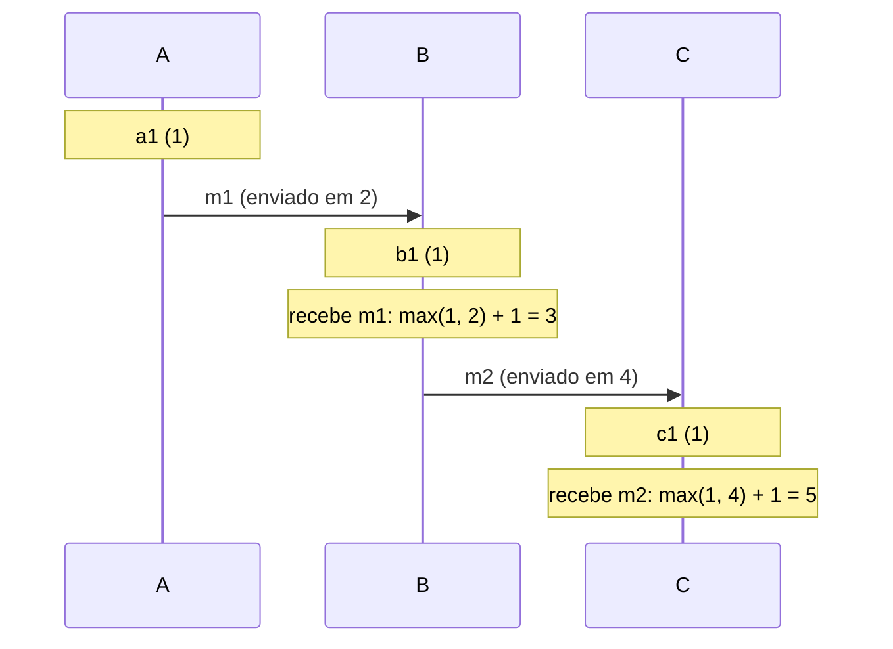

# Fundamentos: latência, falhas parciais, teorema CAP

## Por que isso importa

Um sistema distribuído é aquele em que, como disse Leslie Lamport, "a falha de um computador que você nem sabia que existia pode tornar o seu próprio computador inutilizável". Todo sistema web moderno é distribuído: navegador, balanceador, servidores de aplicação, banco, cache, filas, serviços de terceiros. As intuições de um programa num computador só (a chamada sempre volta, o relógio é confiável, as coisas acontecem numa ordem) **deixam de valer**. Esta aula dá os fundamentos para as próximas (replicação, cache, system design) e para entender por que tantos bugs de produção só aparecem "às vezes".

## Intuição

Imagine coordenar uma viagem com amigos **só por cartas**. Você manda uma carta perguntando "vamos sexta?" e não recebe resposta. O que aconteceu?

- A carta se perdeu no caminho de ida?
- O amigo recebeu, mas está doente e não respondeu?
- Ele respondeu e a resposta se perdeu na volta?
- Ele respondeu e a resposta só vai chegar semana que vem?

Você **não tem como saber**. Isso é uma **falha parcial**: parte do sistema funciona, parte não, e você não consegue distinguir qual. E se dois amigos mandam cartas ao mesmo tempo, "quem falou primeiro?" depende do relógio de cada um, que pode estar errado. Sistemas distribuídos são isso, milhões de vezes por segundo.

## Visual

Números de latência que todo programador deveria conhecer (ordem de grandeza):

```text
Referência na cache L1 ...........................      1 ns
Referência na memória principal (RAM) ............    100 ns
Ler 1 MB em sequência da RAM .....................     10 µs   (10 000 ns)
Ida e volta dentro do mesmo datacenter ...........    500 µs
Ler 1 MB em sequência de um SSD ..................      1 ms
Leitura aleatória num disco giratório ............     10 ms
Ida e volta São Paulo -> Virgínia (EUA) ..........    120 ms
Ida e volta São Paulo -> Europa -> São Paulo .....    200 ms

Uma chamada de rede no mesmo datacenter custa
o mesmo que ~5 000 acessos à RAM.
```

A relação "aconteceu antes" entre processos, com relógios de Lamport:



## Conceito técnico

### O que muda num sistema distribuído

1. **A rede não é confiável**: mensagens se perdem, atrasam, chegam duplicadas ou fora de ordem.
2. **Falhas parciais**: um nó cai, outro fica lento, um link entre dois datacenters cai e os dois lados continuam vivos sem se ver (**partição de rede**).
3. **Não existe relógio global**: cada máquina tem o seu, que adianta ou atrasa (*clock drift*), e é corrigido aos saltos pelo NTP. Comparar horários de máquinas diferentes para decidir "quem foi primeiro" é perigoso.

As **falácias da computação distribuída** (Peter Deutsch e colegas, Sun) resumem as suposições erradas mais comuns: a rede é confiável; a latência é zero; a banda é infinita; a rede é segura; a topologia não muda; há um administrador; o custo de transporte é zero; a rede é homogênea.

### Latência, percentis e a cauda

Média esconde problemas. Use **percentis**: o **p50** (mediana) é o tempo que metade das requisições não ultrapassa; o **p99**, o que 99% não ultrapassa. Um serviço com p50 de 20 ms pode ter p99 de 2 s, e esse 1% são milhares de usuários por hora.

**Latência de cauda em escala** (*tail at scale*): se uma página consulta 100 servidores em paralelo e espera todos, basta **um** lento para a página ficar lenta. Se cada servidor tem 1% de chance de ser lento, a chance de a página ser lenta é `1 - 0,99^100 ≈ 63%`. Técnicas: requisições de reserva (*hedged requests*, mandar uma segunda cópia depois de um tempo), timeouts por requisição, respostas parciais.

### Modelos de falha

| Modelo | O nó... | Exemplo |
|---|---|---|
| **Crash-stop** | para e nunca volta | máquina desligada |
| **Crash-recovery** | para e pode voltar, possivelmente perdendo o que estava só na memória | reinício do processo |
| **Omissão** | deixa de enviar ou receber algumas mensagens | buffer cheio, pacote perdido |
| **Bizantino** | se comporta de forma arbitrária, até maliciosa | bug que corrompe dados, nó atacado |

Quase todos os sistemas comerciais assumem crash-recovery e não-bizantino; blockchains e sistemas aeroespaciais tratam falhas bizantinas.

**Timeouts** são o único detector de falhas prático, mas **não distinguem** um nó morto de um lento ou de uma rede congestionada. Timeout curto demais: declara mortos nós saudáveis, e o sistema faz trabalho dobrado (e pode até piorar a sobrecarga). Longo demais: o usuário espera muito antes de qualquer reação. Por isso operações precisam ser **idempotentes** (AS-03): depois de um timeout, você não sabe se a operação foi feita.

### Relógios e ordem

- **Relógios físicos**: úteis para logs e para tempos aproximados, mas não para ordenar eventos entre máquinas. Um relógio pode até **voltar** no tempo depois de um ajuste do NTP: para medir duração, use relógios **monotônicos** (`time.monotonic()` em Python).
- **Aconteceu-antes** (Lamport): `a → b` se a e b são do mesmo processo e a veio antes; ou se a é o envio de uma mensagem e b o recebimento; ou por transitividade. Se nem `a → b` nem `b → a`, os eventos são **concorrentes**.
- **Relógio de Lamport**: cada processo tem um contador. Em todo evento local, soma 1. Ao enviar, soma 1 e manda o valor junto. Ao receber, faz `max(local, recebido) + 1`. Garante: se `a → b`, então `L(a) < L(b)`. A volta **não** vale: `L(a) < L(b)` não prova que a veio antes.
- **Relógio vetorial**: cada processo guarda um vetor com um contador **por processo**. Permite saber exatamente se dois eventos são ordenados ou **concorrentes**. Usado para detectar escritas conflitantes em bancos replicados (como no Dynamo original).

### CAP, PACELC e modelos de consistência

Revendo a BD-06: durante uma **partição**, um sistema escolhe entre **consistência** (recusar operações para não divergir) e **disponibilidade** (responder com dados que podem estar desatualizados). O **PACELC** acrescenta: **senão** (sem partição), a troca é entre **latência** e **consistência**, porque esperar réplicas confirmarem custa tempo.

Consistência não é sim ou não. Do mais forte ao mais fraco:

| Modelo | Garantia |
|---|---|
| **Linearizável** (forte) | tudo se comporta como se houvesse uma única cópia; depois que uma escrita termina, toda leitura a vê |
| **Sequencial** | todos veem as operações na mesma ordem, que respeita a ordem de cada processo |
| **Causal** | operações relacionadas causalmente (uma resposta depois da pergunta) são vistas na ordem certa por todos; concorrentes podem aparecer em ordens diferentes |
| **Ler as próprias escritas** | você sempre vê o que você mesmo escreveu (mesmo que outros ainda não vejam) |
| **Leituras monotônicas** | você nunca "volta no tempo", vendo um valor mais velho depois de um mais novo |
| **Eventual** | se as escritas pararem, as réplicas convergem; até lá, vale quase tudo |

Muitas aplicações precisam só de algumas garantias de sessão (ler as próprias escritas é o que evita o "postei e meu post sumiu"), que são bem mais baratas que a linearizabilidade.

## Código

Simulando a latência de cauda: uma página que consulta N servidores em paralelo e espera o mais lento.

```python
import random

random.seed(7)

def latencia_servidor():
    # 99% das vezes rápido (5 a 15 ms); 1% das vezes lento (200 a 1000 ms)
    if random.random() < 0.01:
        return random.uniform(200, 1000)
    return random.uniform(5, 15)

def percentil(amostras, p):
    ordenadas = sorted(amostras)
    indice = max(0, -(-p * len(ordenadas) // 100) - 1)   # posição pelo método do posto mais próximo
    return ordenadas[indice]

for fan_out in [1, 10, 100]:
    paginas = [max(latencia_servidor() for _ in range(fan_out)) for _ in range(2000)]
    lentas = sum(1 for t in paginas if t > 100) / len(paginas)
    print(f"fan-out {fan_out:3}: p50 = {percentil(paginas, 50):6.1f} ms | "
          f"p99 = {percentil(paginas, 99):6.1f} ms | páginas lentas = {lentas:.0%} "
          f"(teoria: {1 - 0.99 ** fan_out:.0%})")
```

## Erros comuns

- **Chamada remota sem timeout**: uma dependência travada trava você também.
- **Achar que timeout significa "não aconteceu"**: a operação pode ter sido feita e só a resposta se perdeu.
- **Usar a média de latência** em vez de percentis.
- **Ordenar eventos de máquinas diferentes pelo relógio de parede** ("last write wins" com relógios desalinhados perde escritas em silêncio).
- **Medir duração com `time.time()`**, que pode voltar com um ajuste do NTP; use um relógio monotônico.
- **Tratar CAP como "escolha 2 de 3"** a qualquer momento: a escolha só existe durante uma partição.
- **Prometer consistência forte** sem precisar, pagando em latência e disponibilidade.

## Pratique

```quiz
id: SD-01-q1
tipo: multipla_escolha
pergunta: "O serviço A chama o serviço B e, depois de 2 segundos sem resposta, dá timeout. O que A pode concluir com certeza?"
opcoes: ["B está fora do ar", "B não executou a operação", "Nada com certeza: B pode estar morto, lento, ou ter executado a operação e a resposta ter se perdido", "A rede entre A e B caiu"]
resposta: 2
explicacao: "Esse é o problema central das falhas parciais: um timeout não distingue as causas. Por isso a operação precisa ser idempotente, para A poder tentar de novo sem efeito duplicado."
dificuldade: 1
```

```quiz
id: SD-01-q2
tipo: multipla_escolha
pergunta: "Cada um dos 50 servidores consultados em paralelo por uma página tem 2% de chance de responder lento. Qual é, aproximadamente, a chance de a página ser lenta?"
opcoes: ["2%", "Cerca de 36%", "Cerca de 64%", "100%"]
resposta: 2
explicacao: "A página só é rápida se os 50 forem rápidos: 0,98^50 ≈ 0,36. Então a chance de ser lenta é 1 − 0,36 ≈ 64%. Com fan-out, a cauda de cada servidor vira a experiência típica do usuário."
dificuldade: 2
```

```quiz
id: SD-01-q3
tipo: verdadeiro_falso
pergunta: "Se o relógio de Lamport do evento a é menor que o do evento b, então a aconteceu antes de b."
resposta: false
explicacao: "A garantia é só num sentido: se a aconteceu antes de b, então L(a) < L(b). Dois eventos concorrentes também podem ter L(a) < L(b). Para detectar concorrência, é preciso um relógio vetorial."
dificuldade: 2
```

```quiz
id: SD-01-q4
tipo: resposta_curta
pergunta: "Um usuário edita o perfil, recarrega a página e vê o nome antigo, porque a leitura foi para uma réplica atrasada. Que garantia de consistência resolveria isso e como implementá-la?"
resposta: "Ler as próprias escritas (read-your-writes). Por exemplo, direcionar as leituras desse usuário para o líder por alguns segundos depois de uma escrita, ou guardar a versão da última escrita e só ler de réplicas que já a tenham."
palavras_chave: ["próprias escritas", "líder", "réplica", "versão"]
dificuldade: 2
```

```quiz
id: SD-01-q5
tipo: multipla_escolha
pergunta: "Para medir quanto tempo uma função demora, qual relógio usar?"
opcoes: ["time.time(), o relógio de parede", "time.monotonic(), um relógio monotônico", "O relógio de Lamport", "A hora do servidor NTP"]
resposta: 1
explicacao: "O relógio de parede pode saltar para frente ou para trás quando o NTP ajusta a hora, gerando durações erradas ou até negativas. O monotônico só avança, e é feito para medir intervalos."
dificuldade: 1
```

```quiz
id: SD-01-q6
tipo: codigo
linguagem: python
pergunta: |
  **Percentis e latência de cauda.** Escreva:

  - `percentil(amostras, p)`: o percentil `p` (de 1 a 100) pelo método do **posto mais próximo**: ordene as amostras e devolva o elemento na posição `ceil(p / 100 * n)` (contando a partir de 1);
  - `prob_lenta(p_servidor, n)`: a probabilidade de uma requisição que espera `n` servidores em paralelo ser lenta, se cada um é lento com probabilidade `p_servidor`, arredondada para 4 casas.
codigo_inicial: |
  def percentil(amostras, p):
      return sum(amostras) / len(amostras)

  def prob_lenta(p_servidor, n):
      return p_servidor
usa: [def, return]
testes:
  - chamada: "percentil([15, 20, 35, 40, 50], 50)"
    saida: "35"
  - chamada: "percentil([10, 12, 11, 900, 13, 14, 12, 11, 10, 15], 90)"
    saida: "15"
  - chamada: "prob_lenta(0.01, 100)"
    saida: "0.634"
  - chamada: "percentil([10, 12, 11, 900, 13, 14, 12, 11, 10, 15], 99)"
    visivel: false
    saida: "900"
  - chamada: "percentil([7], 1)"
    visivel: false
    saida: "7"
  - chamada: "prob_lenta(0.02, 50)"
    visivel: false
    saida: "0.6358"
  - chamada: "prob_lenta(0.5, 1)"
    visivel: false
    saida: "0.5"
dica: "Use math.ceil(p / 100 * len(amostras)) para a posição e lembre de subtrair 1 para o índice da lista. A requisição só é rápida se todos forem rápidos: (1 - p) elevado a n."
solucao: |
  import math

  def percentil(amostras, p):
      ordenadas = sorted(amostras)
      posicao = math.ceil(p / 100 * len(ordenadas))
      return ordenadas[max(posicao, 1) - 1]

  def prob_lenta(p_servidor, n):
      return round(1 - (1 - p_servidor) ** n, 4)
explicacao: "No segundo e no quarto testes, a média seria 103,8 ms, um número que não descreve ninguém: 9 requisições levaram cerca de 12 ms e uma levou 900. O p90 (15) mostra a experiência típica, e o p99 (900) mostra o problema. Painéis de monitoramento (SD-08) mostram p50, p95 e p99 lado a lado justamente por isso."
dificuldade: 1
```

```quiz
id: SD-01-q7
tipo: codigo
linguagem: python
pergunta: |
  **Relógios de Lamport.** Escreva `lamport(eventos)`, que recebe eventos na ordem em que aconteceram (cada um `(processo, tipo, mensagem)`) e devolve a lista dos carimbos de cada evento:

  - todo processo começa com contador 0;
  - `'local'` e `'envio'`: o contador do processo soma 1, e esse é o carimbo do evento. No envio, guarde o carimbo junto da mensagem;
  - `'recebe'`: o contador vira `max(contador, carimbo_da_mensagem) + 1`.

  O envio de uma mensagem sempre aparece antes do seu recebimento.
codigo_inicial: |
  def lamport(eventos):
      return list(range(1, len(eventos) + 1))
usa: [def, for, if, return]
testes:
  - chamada: "lamport([('A', 'local', None), ('A', 'envio', 'm1'), ('B', 'local', None), ('B', 'recebe', 'm1')])"
    saida: "[1, 2, 1, 3]"
  - chamada: "lamport([('A', 'envio', 'x'), ('B', 'local', None), ('B', 'local', None), ('B', 'local', None), ('B', 'recebe', 'x')])"
    saida: "[1, 1, 2, 3, 4]"
  - chamada: "lamport([])"
    saida: "[]"
  - chamada: "lamport([('A', 'local', None), ('A', 'envio', 'm1'), ('B', 'local', None), ('B', 'recebe', 'm1'), ('B', 'envio', 'm2'), ('C', 'local', None), ('C', 'recebe', 'm2'), ('A', 'local', None)])"
    visivel: false
    saida: "[1, 2, 1, 3, 4, 1, 5, 3]"
  - chamada: "lamport([('A', 'envio', 'a'), ('B', 'envio', 'b'), ('A', 'recebe', 'b'), ('B', 'recebe', 'a')])"
    visivel: false
    saida: "[1, 1, 2, 2]"
dica: "Guarde dois dicionários: o contador de cada processo (use .get(processo, 0)) e o carimbo de cada mensagem enviada."
solucao: |
  def lamport(eventos):
      relogio = {}
      enviadas = {}
      carimbos = []
      for processo, tipo, msg in eventos:
          atual = relogio.get(processo, 0)
          if tipo == 'recebe':
              atual = max(atual, enviadas[msg]) + 1
          else:
              atual += 1
              if tipo == 'envio':
                  enviadas[msg] = atual
          relogio[processo] = atual
          carimbos.append(atual)
      return carimbos
explicacao: "No último teste, A e B enviam ao mesmo tempo e cada um recebe a mensagem do outro: os dois recebimentos ganham carimbo 2, e os envios são concorrentes, embora ambos tenham carimbo 1. Para desempatar e ter uma ordem total (usada em exclusão mútua distribuída, por exemplo), junta-se o nome do processo: (carimbo, processo)."
dificuldade: 2
```

```quiz
id: SD-01-q8
tipo: codigo
linguagem: javascript
pergunta: |
  **Comparando relógios vetoriais.** Um relógio vetorial é um objeto `processo -> contador` (processo ausente vale 0). Escreva `comparar(a, b)`:

  - `'igual'` se todos os contadores são iguais;
  - `'antes'` se todo contador de `a` é menor ou igual ao de `b` (e algum é menor): `a` aconteceu antes de `b`;
  - `'depois'` no caso simétrico;
  - `'concorrente'` se `a` é maior em algum processo e `b` é maior em outro.
codigo_inicial: |
  function comparar(a, b) {
    return 'igual';
  }
usa: [function, for, return]
testes:
  - chamada: "comparar({ A: 1, B: 0 }, { A: 1, B: 2 })"
    saida: "'antes'"
  - chamada: "comparar({ A: 2, B: 1 }, { A: 1, B: 2 })"
    saida: "'concorrente'"
  - chamada: "comparar({ A: 3 }, { A: 3, B: 0 })"
    saida: "'igual'"
  - chamada: "comparar({ A: 2, C: 1 }, { A: 2 })"
    visivel: false
    saida: "'depois'"
  - chamada: "comparar({ B: 1 }, { A: 1 })"
    visivel: false
    saida: "'concorrente'"
  - chamada: "comparar({}, { X: 5 })"
    visivel: false
    saida: "'antes'"
dica: "Junte as chaves dos dois objetos num Set. Percorra e marque duas flags: aMaior (algum a[k] > b[k]) e bMaior. A resposta sai da combinação das duas."
solucao: |
  function comparar(a, b) {
    const chaves = new Set([...Object.keys(a), ...Object.keys(b)]);
    let aMaior = false;
    let bMaior = false;
    for (const k of chaves) {
      const x = a[k] || 0;
      const y = b[k] || 0;
      if (x > y) aMaior = true;
      if (y > x) bMaior = true;
    }
    if (aMaior && bMaior) return 'concorrente';
    if (aMaior) return 'depois';
    if (bMaior) return 'antes';
    return 'igual';
  }
explicacao: "Quando duas réplicas aceitaram escritas diferentes no mesmo carrinho de compras sem se falar, os relógios ficam concorrentes: nenhuma versão é mais nova que a outra, e o sistema precisa mesclar (por exemplo, unir os itens) ou perguntar ao usuário. É o que o artigo do Dynamo da Amazon descreve. Um relógio de Lamport não conseguiria detectar essa situação, porque ele sempre ordena."
dificuldade: 2
```

## Resumo

- A rede **falha**, **atrasa** e **duplica**; falhas são **parciais**; não há **relógio global**.
- Meça **percentis** (p50, p99); com fan-out, a **cauda** vira regra: `1 − (1 − p)^n`.
- Modelos de falha: crash-stop, crash-recovery, omissão, bizantino. **Timeout não distingue** morto de lento.
- **Lamport**: se a → b, L(a) < L(b). **Vetorial**: detecta concorrência.
- **CAP** na partição, **PACELC** fora dela; consistência vai de **linearizável** a **eventual**, com garantias de sessão no meio.

## Para ir além

- Leia o capítulo 8 do DDIA ("The Trouble with Distributed Systems").
- Leia "Time, Clocks, and the Ordering of Events", de Lamport; são poucas páginas.
- **Próximo módulo**: SD-02 Replicação, particionamento (sharding) e consenso.
