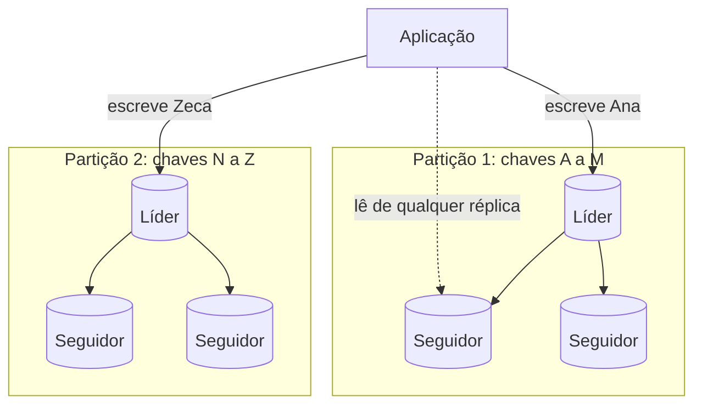
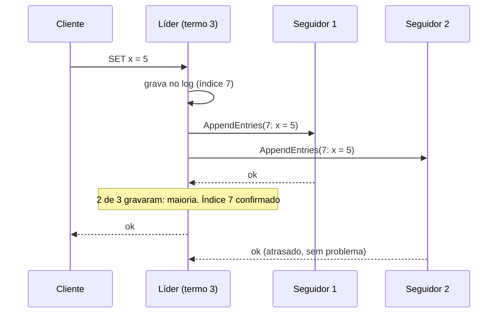

# Replicação, particionamento (sharding) e consenso

## Por que isso importa

Um único servidor de banco tem limites: cabe uma quantidade de dados, aguenta uma quantidade de requisições e, quando cai, o sistema inteiro cai junto. As duas ferramentas para ir além são **replicação** (várias cópias dos mesmos dados) e **particionamento** (cada máquina com uma parte dos dados). E sempre que várias máquinas precisam **concordar** sobre algo (quem é o líder, qual é a próxima entrada do log, quem tem o lock), entra o **consenso**, o problema mais famoso da área. Kubernetes, Kafka, CockroachDB e quase todo banco distribuído se apoiam num algoritmo de consenso como o Raft. Isso aparece em toda entrevista de system design.

## Intuição

**Replicação** é ter **cópias de um documento importante** em vários cofres: se um pega fogo, você não perde nada, e várias pessoas podem ler ao mesmo tempo. O difícil é manter as cópias **iguais** quando o documento muda.

**Particionamento** é dividir uma **enciclopédia enorme** em volumes (A a F, G a M...): nenhuma estante aguenta a coleção inteira, mas cada volume cabe numa. O difícil é dividir de um jeito que nenhum volume fique gigante e todos sejam consultados por igual.

**Consenso** é um **grupo decidindo onde jantar por mensagens**, sabendo que algumas mensagens se perdem e alguém pode desligar o celular no meio. O grupo precisa chegar a **uma** decisão, que ninguém depois desfaz, e isso precisa funcionar mesmo com alguns membros fora do ar. O truque é a **maioria**: duas maiorias sempre têm alguém em comum.

## Visual

Replicação com líder e particionamento juntos (cada partição tem o seu líder):



O Raft replicando uma entrada: ela é **confirmada** quando a maioria a gravou.



## Conceito técnico

### Replicação

Serve para **tolerar falhas**, **escalar leituras** e **reduzir latência** (uma cópia perto do usuário).

| Modelo | Como funciona | Exemplos | Cuidado |
|---|---|---|---|
| **Líder único** | escritas só no líder, que envia as mudanças (o log) aos seguidores; leituras em qualquer um | PostgreSQL, MySQL, MongoDB | o líder é o gargalo de escrita; failover |
| **Múltiplos líderes** | cada datacenter tem um líder que aceita escritas e sincroniza com os outros | bancos geo-distribuídos, apps offline (cada celular é um "líder") | **conflitos** de escrita concorrente |
| **Sem líder** | o cliente escreve e lê em várias réplicas, com quóruns `W + R > N` (BD-06) | Cassandra, DynamoDB, Riak | conflitos; reparo na leitura e anti-entropia |

**Síncrona ou assíncrona**: na síncrona, o líder espera o seguidor confirmar antes de responder (sem perda, porém mais lento e travado se o seguidor cair). Na assíncrona, responde na hora (rápido, mas um failover pode **perder** escritas confirmadas). É comum um meio-termo: um seguidor síncrono e os outros assíncronos.

**Atraso de replicação** (*replication lag*): seguidores assíncronos ficam alguns milissegundos (ou minutos, sob carga) atrás. Daí vêm as anomalias da SD-01: não ver a própria escrita, voltar no tempo entre duas leituras.

**Failover**: quando o líder cai, um seguidor é promovido. Perigos: perder escritas que o novo líder não tinha; **cérebro dividido** (*split brain*), quando o líder antigo volta achando que ainda é líder e os dois aceitam escritas. A defesa é exigir **maioria** para ser líder e usar um número de **termo/época** que sobe a cada eleição, para que mensagens de um líder antigo sejam rejeitadas (*fencing*).

### Conflitos e CRDTs

Com vários líderes ou sem líder, duas réplicas podem aceitar escritas concorrentes no mesmo dado. Estratégias:

- **Última escrita vence** (LWW): fica a de maior carimbo de tempo. Simples, mas **perde** escritas em silêncio (e depende de relógios, SD-01).
- **Guardar as versões concorrentes** (detectadas com relógios vetoriais) e deixar a aplicação ou o usuário mesclar.
- **CRDTs** (*Conflict-free Replicated Data Types*): estruturas de dados projetadas para que **qualquer ordem** de mesclagem dê o mesmo resultado. Exemplos: contador que só cresce (G-Counter: um contador por réplica, mescla pelo máximo de cada um, o valor é a soma), conjuntos com adição e remoção, textos colaborativos. Usados em editores colaborativos e apps que funcionam offline.

### Particionamento (sharding)

Cada registro pertence a **uma** partição, escolhida pela **chave de partição**.

| Estratégia | Como | Vantagem | Desvantagem |
|---|---|---|---|
| **Por intervalo** | cada partição tem uma faixa de chaves (A a F, G a M) | consultas por faixa eficientes (todas as vendas de março) | **pontos quentes** se as chaves forem sequenciais (o dia de hoje recebe toda a escrita) |
| **Por hash** | `hash(chave)` decide a partição | distribui uniformemente | consultas por faixa precisam consultar todas as partições |

**Pontos quentes** também vêm de chaves populares (o perfil de uma celebridade). Uma técnica é acrescentar um sufixo aleatório às chaves quentes e consultar as várias partes na leitura.

**Índices secundários**: um índice **local** (cada partição indexa os seus dados) obriga a buscar em todas as partições (*scatter/gather*); um índice **global** (particionado pelo termo indexado) torna a leitura rápida, mas a escrita precisa atualizar outras partições.

**Rebalanceamento**: quando nós entram ou saem. `hash % N` move quase tudo (BD-06). As soluções são o **hashing consistente** ou um **número fixo de partições** bem maior que o de nós (por exemplo, 1024 partições em 10 nós), em que rebalancear é mover partições inteiras.

### Consenso

O problema: vários nós precisam **concordar com um valor** de modo que todos os que decidem decidam o mesmo (**segurança**), que o valor tenha sido proposto por alguém, e que, com a maioria funcionando e a rede se comportando, uma decisão acabe saindo (**progresso**). O resultado FLP mostra que, num sistema totalmente assíncrono, nenhum algoritmo garante progresso com uma única falha; na prática, usa-se timeouts para contornar.

**Raft** (2014), desenhado para ser entendido:

- Cada nó é **seguidor**, **candidato** ou **líder**. O tempo é dividido em **termos** numerados.
- **Eleição**: se um seguidor não ouve o líder por um tempo aleatório, vira candidato, incrementa o termo e pede votos. Cada nó vota em um só candidato por termo; quem tiver **maioria** vira líder. O tempo aleatório evita empates repetidos.
- **Replicação do log**: o cliente fala com o líder, que acrescenta a entrada ao seu log e a envia aos seguidores. Quando a **maioria** gravou, a entrada está **confirmada** (*committed*) e pode ser aplicada.
- **Segurança**: um candidato só ganha se o seu log estiver tão atualizado quanto o da maioria, então nenhuma entrada confirmada se perde. E o líder só confirma pela contagem de réplicas as entradas **do próprio termo**.
- Com 2f + 1 nós, o Raft tolera **f** falhas: 3 nós aguentam 1; 5 nós aguentam 2. Por isso clusters de consenso têm número **ímpar** de nós (4 nós toleram o mesmo que 3).

**Onde aparece**: etcd (o banco do Kubernetes), Consul, ZooKeeper (com o protocolo ZAB), Kafka (KRaft), CockroachDB, TiDB. Na aplicação, você quase nunca implementa consenso; você **usa** um desses sistemas para eleição de líder, locks distribuídos e configuração.

## Código

Um G-Counter, o CRDT mais simples: réplicas contam curtidas separadas e mesclam em qualquer ordem, sempre chegando ao mesmo total.

```python
def incrementar(contador, replica, n=1):
    novo = dict(contador)
    novo[replica] = novo.get(replica, 0) + n
    return novo

def mesclar(a, b):
    return {r: max(a.get(r, 0), b.get(r, 0)) for r in set(a) | set(b)}

def valor(contador):
    return sum(contador.values())

# três réplicas recebem curtidas sem se comunicar
sp = incrementar({}, "sp", 3)
rj = incrementar({}, "rj", 2)
pe = incrementar(incrementar({}, "pe"), "pe")

# elas trocam estados em ordens diferentes, até com repetições
x = mesclar(mesclar(sp, rj), pe)
y = mesclar(pe, mesclar(rj, mesclar(sp, sp)))
print("x:", valor(x), "| y:", valor(y), "| iguais?", x == y)

# por que não guardar só um número por réplica e somar o que chega?
# se o estado de rj chegar duas vezes (retransmissão), a soma conta em dobro
print("soma ingênua com rj recebido duas vezes:", valor(sp) + valor(rj) + valor(rj) + valor(pe))
print("G-Counter com rj recebido duas vezes:", valor(mesclar(mesclar(mesclar(sp, rj), rj), pe)))
```

## Erros comuns

- **Ler de réplicas assíncronas** e esperar ver a escrita que acabou de fazer.
- **Failover automático sem fencing**, abrindo caminho para o cérebro dividido.
- **Cluster de consenso com número par de nós**, ou com 2 nós (que não tolera nenhuma falha).
- **LWW em dados que não podem perder escritas** (saldos, estoque).
- **Chave de partição sequencial** (data, id incremental) num sistema de muita escrita.
- **Particionar cedo demais**: um único PostgreSQL bem configurado, com réplicas de leitura, aguenta muito mais do que se imagina.
- **Implementar o próprio consenso** em vez de usar etcd, ZooKeeper ou o banco.

## Pratique

```quiz
id: SD-02-q1
tipo: multipla_escolha
pergunta: "Um cluster Raft tem 5 nós. Quantos podem falhar ao mesmo tempo sem que o cluster pare de aceitar escritas?"
opcoes: ["1", "2", "3", "4"]
resposta: 1
explicacao: "Escritas precisam de maioria: 3 de 5. Com 2 nós fora, os 3 restantes ainda formam maioria. Com 3 fora, não. Em geral, 2f + 1 nós toleram f falhas."
dificuldade: 1
```

```quiz
id: SD-02-q2
tipo: multipla_escolha
pergunta: "Um sistema de logs usa a data do evento como chave de partição por intervalo. Qual problema isso causa?"
opcoes: ["Consultas por faixa de datas ficam lentas", "Toda a escrita do dia vai para a mesma partição, um ponto quente", "Os dados de dias diferentes se misturam", "É impossível apagar dados antigos"]
resposta: 1
explicacao: "Com chaves sequenciais no tempo, a partição de hoje recebe 100% das escritas e as outras ficam paradas. Uma saída é prefixar a chave com algo bem distribuído (o id do servidor, por exemplo), mantendo a data como segunda parte."
dificuldade: 2
```

```quiz
id: SD-02-q3
tipo: verdadeiro_falso
pergunta: "Com replicação assíncrona, uma escrita que o líder já confirmou ao cliente pode ser perdida se o líder cair antes de enviá-la aos seguidores."
resposta: true
explicacao: "O líder respondeu antes de qualquer seguidor ter a cópia. Se um seguidor for promovido, ele não tem essa escrita. É o preço da baixa latência; replicação síncrona (ou semissíncrona) evita isso custando tempo de resposta."
dificuldade: 1
```

```quiz
id: SD-02-q4
tipo: resposta_curta
pergunta: "O que é cérebro dividido (split brain) e como o número de termo do Raft ajuda a evitá-lo?"
resposta: "É quando dois nós acreditam ser o líder ao mesmo tempo e aceitam escritas divergentes, geralmente depois de uma partição. No Raft, cada eleição aumenta o termo e exige maioria; um líder antigo, ao ver um termo maior, volta a ser seguidor, e as mensagens dele com termo antigo são rejeitadas pelos outros nós."
palavras_chave: ["dois líderes", "termo", "maioria", "rejeitadas"]
dificuldade: 2
```

```quiz
id: SD-02-q5
tipo: multipla_escolha
pergunta: "Por que o Raft usa tempos de espera aleatórios antes de um seguidor virar candidato?"
opcoes: ["Para economizar energia", "Para reduzir a chance de vários nós virarem candidatos ao mesmo tempo e dividirem os votos sem ninguém ter maioria", "Para criptografar as mensagens", "Para escolher o líder mais rápido"]
resposta: 1
explicacao: "Se todos esperassem o mesmo tempo, todos se candidatariam juntos, cada um votaria em si mesmo, e as eleições empatariam repetidamente. Com tempos aleatórios, normalmente um nó se candidata primeiro e ganha."
dificuldade: 2
```

```quiz
id: SD-02-q6
tipo: codigo
linguagem: python
pergunta: |
  **Quando uma entrada está confirmada no Raft?** O líder sabe, para cada nó (inclusive ele mesmo), o maior índice do log que aquele nó já gravou (`gravados`). `termos` é a lista dos termos de cada entrada do log do líder (a entrada de índice `i` tem termo `termos[i - 1]`; os índices começam em 1). Escreva `indice_confirmado(gravados, termos, termo_atual)`:

  - encontre o **maior índice N** que está gravado numa **maioria** dos nós (mais da metade de `len(gravados)`);
  - pela regra de segurança do Raft, N só pode ser confirmado pela contagem se `termos[N - 1] == termo_atual`; se não for, tente o índice anterior, e assim por diante;
  - se nenhum índice servir, devolva 0.
codigo_inicial: |
  def indice_confirmado(gravados, termos, termo_atual):
      return max(gravados)
usa: [def, for, return]
testes:
  - chamada: "indice_confirmado([7, 7, 5], [1, 1, 2, 2, 3, 3, 3], 3)"
    saida: "7"
  - chamada: "indice_confirmado([7, 5, 4], [1, 1, 2, 2, 3, 3, 3], 3)"
    saida: "5"
  - chamada: "indice_confirmado([4, 4, 1], [1, 1, 2, 2, 3], 3)"
    saida: "0"
  - chamada: "indice_confirmado([9, 8, 8, 2, 1], [1, 1, 1, 2, 2, 2, 3, 3, 3], 3)"
    visivel: false
    saida: "8"
  - chamada: "indice_confirmado([6, 3, 3, 3], [1, 1, 1, 2, 2, 2], 1)"
    visivel: false
    saida: "3"
  - chamada: "indice_confirmado([0, 0, 0], [], 1)"
    visivel: false
    saida: "0"
dica: "Ordene gravados em ordem decrescente: o elemento na posição len // 2 é o maior índice que está em pelo menos metade + 1 dos nós. Depois desça desse N até 1 procurando um termo igual ao atual."
solucao: |
  def indice_confirmado(gravados, termos, termo_atual):
      ordenados = sorted(gravados, reverse=True)
      maioria = ordenados[len(ordenados) // 2]
      for n in range(maioria, 0, -1):
          if termos[n - 1] == termo_atual:
              return n
      return 0
explicacao: "Com 4 nós (penúltimo teste), a maioria é 3: o índice 3 está em 4 nós, mas o 6 só em 1. No terceiro teste, o índice 4 está numa maioria, mas é do termo 2, e o líder está no termo 3: o Raft não confirma entradas de termos antigos só por contagem, porque um líder futuro poderia sobrescrevê-las (é a figura 8 do artigo do Raft). Elas são confirmadas indiretamente quando uma entrada do termo atual, depois delas, for confirmada."
dificuldade: 3
```

```quiz
id: SD-02-q7
tipo: codigo
linguagem: python
pergunta: |
  **Particionamento e rebalanceamento.** Escreva:

  - `particao_por_intervalo(limites, chave)`: `limites` é uma lista ordenada de chaves que **começam** cada partição a partir da segunda (a partição 0 vai do começo até antes de `limites[0]`, a 1 de `limites[0]` até antes de `limites[1]`, e assim por diante). Devolva o número da partição da chave;
  - `movidas(chaves, n, m)`: quantas chaves (inteiros) mudam de partição quando se passa de `chave % n` para `chave % m`.
codigo_inicial: |
  def particao_por_intervalo(limites, chave):
      return 0

  def movidas(chaves, n, m):
      return 0
usa: [def, return]
testes:
  - chamada: "[particao_por_intervalo(['g', 'n', 't'], c) for c in ['ana', 'gabi', 'hugo', 'zeca']]"
    saida: "[0, 1, 1, 3]"
  - chamada: "particao_por_intervalo(['g', 'n', 't'], 'n')"
    saida: "2"
  - chamada: "movidas(range(100), 4, 5)"
    saida: "80"
  - chamada: "particao_por_intervalo([], 'qualquer')"
    visivel: false
    saida: "0"
  - chamada: "movidas(range(1000), 10, 11)"
    visivel: false
    saida: "900"
  - chamada: "movidas(range(60), 3, 6)"
    visivel: false
    saida: "30"
dica: "bisect.bisect_right(limites, chave) devolve exatamente o número da partição. Para movidas, conte as chaves com chave % n != chave % m."
solucao: |
  import bisect

  def particao_por_intervalo(limites, chave):
      return bisect.bisect_right(limites, chave)

  def movidas(chaves, n, m):
      return sum(1 for c in chaves if c % n != c % m)
explicacao: "Passar de 10 para 11 nós com hash % N move 90% das chaves: num cache, é quase o mesmo que esvaziá-lo, e num banco, é mover quase todos os dados pela rede. Ir de 3 para 6 move só metade porque 6 é múltiplo de 3, mas isso não ajuda na prática. É por isso que sistemas reais usam hashing consistente ou um número fixo e grande de partições, movendo partições inteiras."
dificuldade: 1
```

```quiz
id: SD-02-q8
tipo: codigo
linguagem: javascript
pergunta: |
  **Mesclando réplicas: LWW e conjunto CRDT.** Escreva duas funções:

  - `lww(versoes)`: cada versão é `{ valor, tempo, replica }`. Devolva o **valor** da versão de maior `tempo`; no empate, a de maior `replica` (comparando strings). Lista vazia devolve `null`;
  - `mesclarConjunto(a, b)`: cada réplica de um conjunto *2P-Set* é `{ add: [...], rem: [...] }` (elementos adicionados e removidos, sem repetição). Devolva a mescla: a união dos `add` e a união dos `rem`, ambas **ordenadas**, e mais o campo `itens`: os elementos adicionados que **não** foram removidos, também ordenados.
codigo_inicial: |
  function lww(versoes) {
    return versoes.length ? versoes[0].valor : null;
  }

  function mesclarConjunto(a, b) {
    return { add: a.add, rem: a.rem, itens: a.add };
  }
usa: [function, return]
testes:
  - chamada: "lww([{ valor: 'azul', tempo: 10, replica: 'sp' }, { valor: 'verde', tempo: 12, replica: 'rj' }])"
    saida: "'verde'"
  - chamada: "lww([{ valor: 'a', tempo: 5, replica: 'r1' }, { valor: 'b', tempo: 5, replica: 'r2' }])"
    saida: "'b'"
  - chamada: "mesclarConjunto({ add: ['leite', 'pao'], rem: [] }, { add: ['ovos'], rem: ['pao'] })"
    saida: "{ add: [ 'leite', 'ovos', 'pao' ], rem: [ 'pao' ], itens: [ 'leite', 'ovos' ] }"
  - chamada: "lww([])"
    visivel: false
    saida: "null"
  - chamada: "mesclarConjunto({ add: ['x'], rem: ['x'] }, { add: ['x', 'y'], rem: [] })"
    visivel: false
    saida: "{ add: [ 'x', 'y' ], rem: [ 'x' ], itens: [ 'y' ] }"
  - chamada: "JSON.stringify(mesclarConjunto({ add: ['b', 'a'], rem: ['c'] }, { add: ['c'], rem: [] })) === JSON.stringify(mesclarConjunto({ add: ['c'], rem: [] }, { add: ['b', 'a'], rem: ['c'] }))"
    visivel: false
    saida: "true"
dica: "No lww, percorra guardando a melhor versão. No conjunto, use new Set([...a.add, ...b.add]) para unir, transforme em array e ordene; os itens são os de add que não estão no Set de rem."
solucao: |
  function lww(versoes) {
    let melhor = null;
    for (const v of versoes) {
      if (melhor === null || v.tempo > melhor.tempo || (v.tempo === melhor.tempo && v.replica > melhor.replica)) {
        melhor = v;
      }
    }
    return melhor === null ? null : melhor.valor;
  }

  function mesclarConjunto(a, b) {
    const add = [...new Set([...a.add, ...b.add])].sort();
    const remSet = new Set([...a.rem, ...b.rem]);
    const rem = [...remSet].sort();
    const itens = add.filter((x) => !remSet.has(x));
    return { add, rem, itens };
  }
explicacao: "O LWW sempre escolhe um vencedor e descarta o resto em silêncio: no primeiro teste, quem escolheu azul perdeu sem saber. O 2P-Set nunca perde operações, e o último teste confirma a propriedade que define um CRDT: a mescla é comutativa (a ordem não importa). O preço do 2P-Set é que um elemento removido nunca mais pode voltar; CRDTs mais elaborados, como o OR-Set, resolvem isso marcando cada adição com um identificador único."
dificuldade: 2
```

## Resumo

- **Replicação**: líder único (simples), múltiplos líderes e sem líder (conflitos). Síncrona perde menos, assíncrona responde mais rápido.
- **Atraso de replicação** e **failover** com risco de **cérebro dividido**; termos/épocas e maioria evitam.
- **Conflitos**: LWW perde escritas; versões concorrentes; **CRDTs** mesclam em qualquer ordem.
- **Particionamento** por intervalo (faixas, pontos quentes) ou por hash (uniforme); rebalanceie com hashing consistente ou partições fixas.
- **Consenso** com **Raft**: termos, eleição por maioria, log confirmado na maioria; 2f + 1 nós toleram f falhas. Use etcd, ZooKeeper ou o banco, não implemente o seu.

## Para ir além

- Brinque com a visualização do Raft em raft.github.io (derrube o líder e veja a eleição).
- Leia os capítulos 5, 6 e 9 do DDIA.
- **Próximo módulo**: SD-03 Cache, CDN e balanceamento de carga.
