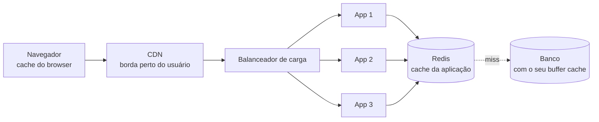
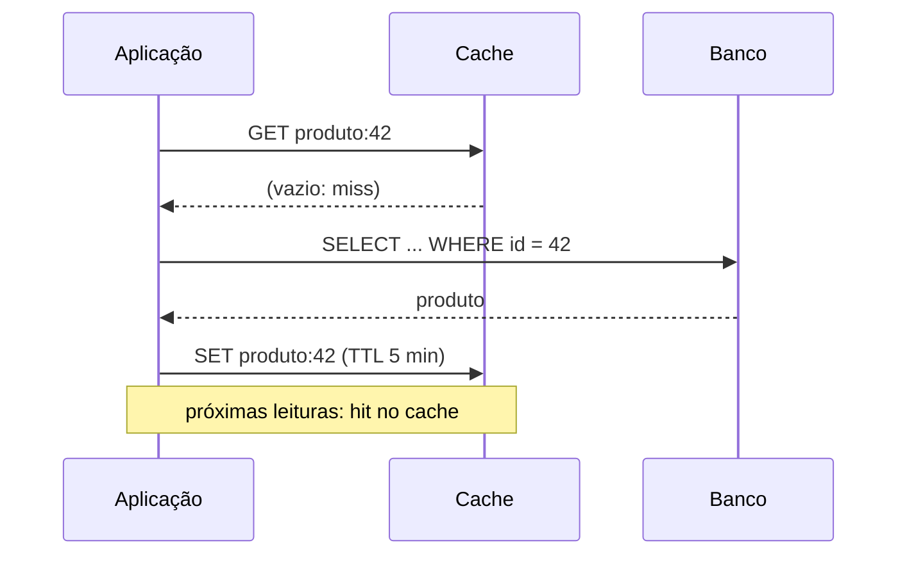

# Cache, CDN e balanceamento de carga

## Por que isso importa

"Há só duas coisas difíceis em computação: invalidar cache e dar nomes às coisas." A frase (de Phil Karlton) é piada e verdade. Cache é a otimização com o maior ganho que existe: transforma uma consulta de 50 ms num acesso de 0,5 ms e tira carga do banco. CDNs levam o conteúdo para perto do usuário e seguram picos que derrubariam qualquer servidor. Balanceadores de carga permitem rodar muitas cópias da aplicação e trocar uma delas sem ninguém perceber. São as três primeiras peças de qualquer resposta de system design (SD-04), e as três têm armadilhas que causam incidentes reais.

## Intuição

**Cache** é a **geladeira**: em vez de ir ao mercado (o banco de dados) toda vez que quer leite, você guarda um pouco em casa. Rápido, mas a geladeira é pequena (precisa decidir o que tirar) e o leite **vence** (o dado fica velho).

**CDN** é ter **mercadinhos em cada bairro** com os produtos mais procurados, abastecidos pelo centro de distribuição (a origem). A maioria das pessoas compra ali perto; só o que é raro precisa vir de longe.

**Balanceador de carga** é a **fila única do banco com vários caixas**: um organizador manda cada cliente para um caixa livre, e se um caixa fecha, ninguém mais é mandado para ele.

## Visual

As camadas de cache no caminho de uma requisição:



O padrão cache-aside (o mais comum):



## Conceito técnico

### Onde cachear

| Camada | O que guarda | Exemplo |
|---|---|---|
| **Navegador** | arquivos estáticos e respostas marcadas como cacheáveis | `Cache-Control: max-age=31536000` em `app.3f9a.js` |
| **CDN** | estáticos, imagens, vídeos, e até páginas inteiras | Cloudflare, CloudFront, Fastly |
| **Proxy reverso** | respostas HTTP inteiras | Nginx, Varnish |
| **Aplicação** | resultados de consultas, objetos montados, sessões | Redis, Memcached, ou memória do processo |
| **Banco** | páginas de dados e índices em memória | o buffer pool do PostgreSQL |

Quanto mais perto do usuário, mais rápido e mais difícil de invalidar.

### Padrões de leitura e escrita

- **Cache-aside** (*lazy loading*): a aplicação procura no cache; se não achar (*miss*), busca no banco e guarda. Simples e só guarda o que é pedido. Desvantagem: o primeiro acesso é lento, e os dados podem ficar velhos.
- **Read-through**: o próprio cache busca no banco no miss (a aplicação só fala com o cache).
- **Write-through**: toda escrita vai para o cache **e** o banco, na mesma operação. O cache fica sempre atualizado, mas cada escrita fica mais lenta.
- **Write-behind** (*write-back*): a escrita vai para o cache e é gravada no banco **depois**, em lote. Muito rápido, mas pode **perder** dados se o cache cair.

### Invalidação

- **TTL** (tempo de vida): o jeito mais simples; aceite que o dado pode ficar velho por até TTL segundos.
- **Invalidação explícita**: ao alterar o produto, apague `produto:42` do cache. Cuidado com corridas: apague **depois** de escrever no banco.
- **Chaves versionadas**: em vez de apagar, mude a chave (`produto:42:v7`) ou o nome do arquivo (`app.3f9a.js`, com o hash do conteúdo). O que é antigo simplesmente deixa de ser usado. É assim que se cacheia estáticos "para sempre".

### Políticas de remoção (o cache encheu)

- **LRU** (*least recently used*): remove o que não é usado há mais tempo (AC-05). O padrão na maioria dos casos.
- **LFU** (*least frequently used*): remove o menos usado no total. Bom quando há itens sempre populares, ruim quando a popularidade muda.
- **FIFO** e **aleatória**: simples, às vezes surpreendentemente boas.

**Taxa de acerto** (*hit ratio*) = acertos / acessos. Um cache com 50% de acerto tira só metade da carga; acima de 90% muda a escala do sistema.

### Avalanche (cache stampede)

Um item muito acessado expira, e mil requisições dão miss ao mesmo tempo e vão todas ao banco, que cai. Defesas:

- **Lock ou coalescência**: só a primeira requisição busca no banco; as outras esperam o resultado.
- **Renovação antecipada**: renove o item um pouco **antes** de expirar, em segundo plano (às vezes de forma probabilística).
- **TTL com jitter**: varie os TTLs aleatoriamente para que milhares de chaves não expirem no mesmo segundo.
- **Servir o velho enquanto renova** (*stale-while-revalidate*).

### Cache no HTTP

| Cabeçalho | Significado |
|---|---|
| `Cache-Control: max-age=3600` | pode usar sem perguntar por 1 hora |
| `Cache-Control: no-cache` | pode guardar, mas precisa **revalidar** com o servidor antes de usar |
| `Cache-Control: no-store` | **não** guarde (dados sensíveis) |
| `Cache-Control: private` / `public` | só o navegador pode guardar / caches compartilhados (CDN) também |
| `ETag: "abc"` + `If-None-Match: "abc"` | revalidação: se não mudou, o servidor responde **304 Not Modified** sem corpo |
| `stale-while-revalidate=60` | pode servir o velho por mais 60 s enquanto busca o novo |

### CDN

Uma rede de servidores de **borda** espalhados pelo mundo. O usuário é direcionado (por DNS ou anycast) para a borda mais próxima; se ela tem o conteúdo, responde na hora; se não, busca na **origem** e guarda. Ganhos: latência (o conteúdo está a 10 ms, não a 150 ms), carga (a origem recebe uma fração das requisições), proteção contra ataques de negação de serviço. Pontos de atenção: a **chave de cache** (que partes da URL e dos cabeçalhos diferenciam as respostas), o **purge** (invalidar depois de publicar), e nunca cachear respostas personalizadas como públicas.

### Balanceamento de carga

- **L4** (transporte): olha IP e porta, repassa conexões TCP. Muito rápido, não entende HTTP.
- **L7** (aplicação): entende HTTP; roteia por caminho (`/api` para um grupo, `/imagens` para outro), por cabeçalho, termina TLS, faz retentativas. Ex.: Nginx, HAProxy, Envoy, os balanceadores de aplicação das nuvens.

Algoritmos:

| Algoritmo | Como escolhe | Quando |
|---|---|---|
| **Round robin** | um de cada vez, em ordem | servidores iguais, requisições parecidas |
| **Round robin com pesos** | proporcional à capacidade | servidores de tamanhos diferentes |
| **Menos conexões** | o com menos conexões abertas | requisições de duração muito variável |
| **Hash do IP ou da chave** | sempre o mesmo servidor para o mesmo cliente | afinidade de sessão, caches locais |
| **Dois aleatórios** (*power of two choices*) | sorteia dois e pega o menos ocupado | grandes frotas; quase tão bom quanto o ótimo e barato |

**Health checks**: o balanceador testa cada servidor (por exemplo, `GET /saude` a cada 5 s) e tira do rodízio quem falhar. **Aplicações sem estado** (a sessão fica no Redis ou num token, não na memória do servidor) são o que permite qualquer servidor atender qualquer requisição; **sessões fixas** (*sticky sessions*) são um remendo que atrapalha o balanceamento e os deploys.

## Código

Cache-aside com TTL e coalescência de requisições, mostrando a diferença numa avalanche:

```python
class Banco:
    def __init__(self):
        self.consultas = 0

    def buscar(self, chave):
        self.consultas += 1
        return f"valor de {chave}"


class Cache:
    def __init__(self, banco, ttl):
        self.banco, self.ttl = banco, ttl
        self.dados = {}            # chave -> (valor, expira_em)
        self.em_andamento = set()  # chaves sendo buscadas agora

    def obter(self, chave, agora, coalescer):
        item = self.dados.get(chave)
        if item and agora < item[1]:
            return "hit"
        if coalescer and chave in self.em_andamento:
            return "esperou a busca em andamento"
        self.em_andamento.add(chave)
        return "miss"

    def concluir(self, chave, agora):
        self.dados[chave] = (self.banco.buscar(chave), agora + self.ttl)
        self.em_andamento.discard(chave)


for coalescer in (False, True):
    banco = Banco()
    cache = Cache(banco, ttl=60)
    # 1000 requisições chegam no mesmo instante, logo depois de a chave expirar
    resultados = [cache.obter("home", agora=0, coalescer=coalescer) for _ in range(1000)]
    for _ in range(resultados.count("miss")):
        cache.concluir("home", agora=0)
    print(f"coalescer={coalescer}: {banco.consultas} consultas ao banco")
```

## Erros comuns

- **Cachear sem TTL nem invalidação**, servindo dados velhos para sempre.
- **Cachear respostas personalizadas como públicas** na CDN (um usuário vê os dados de outro).
- **Invalidar antes de escrever no banco**, abrindo uma janela para outro processo recolocar o valor velho.
- **Ignorar a avalanche** em chaves muito acessadas.
- **Cache como fonte da verdade** sem persistência.
- **Estáticos sem hash no nome**, obrigando a escolher entre cache curto (lento) e usuários com arquivos velhos.
- **Sessão na memória do servidor** com balanceamento, o que exige sticky sessions e quebra no deploy.
- **Health check que só diz "estou vivo"** sem conferir dependências essenciais, ou que confere demais e derruba tudo quando o banco oscila.

## Pratique

```quiz
id: SD-03-q1
tipo: multipla_escolha
pergunta: "Qual cabeçalho usar numa resposta com o extrato bancário do usuário?"
opcoes: ["Cache-Control: public, max-age=86400", "Cache-Control: no-store", "Cache-Control: max-age=3600", "Nenhum cabeçalho"]
resposta: 1
explicacao: "Dados sensíveis e pessoais não devem ser guardados em nenhum cache, nem no navegador. Sem cabeçalho, caches podem aplicar heurísticas próprias; public com max-age permitiria até a CDN guardar e servir para outra pessoa."
dificuldade: 1
```

```quiz
id: SD-03-q2
tipo: multipla_escolha
pergunta: "O arquivo app.js é servido com max-age de 1 ano. Ao publicar uma versão nova, os usuários continuam recebendo a antiga. Qual é a solução padrão?"
opcoes: ["Reduzir o max-age para 1 minuto", "Colocar o hash do conteúdo no nome do arquivo (app.3f9a.js), mudando a URL a cada versão", "Pedir para os usuários limparem o cache", "Desligar a CDN"]
resposta: 1
explicacao: "Com o hash no nome, cada versão é uma URL nova: a antiga pode ficar em cache para sempre sem atrapalhar, e o HTML (com cache curto) aponta para a nova. É o que os empacotadores como Vite e webpack fazem automaticamente."
dificuldade: 1
```

```quiz
id: SD-03-q3
tipo: verdadeiro_falso
pergunta: "Com write-behind, uma escrita confirmada ao usuário pode ser perdida se o cache cair antes de gravá-la no banco."
resposta: true
explicacao: "No write-behind, o banco é atualizado depois, em lote. O ganho de velocidade vem justamente de não esperar o banco, e o risco é a janela em que o dado só existe no cache."
dificuldade: 1
```

```quiz
id: SD-03-q4
tipo: resposta_curta
pergunta: "O que é cache stampede e cite duas formas de evitá-lo."
resposta: "É quando um item muito acessado expira e muitas requisições dão miss ao mesmo tempo, indo todas ao banco e sobrecarregando-o. Formas de evitar: coalescência ou lock (só uma requisição busca e as outras esperam), renovação antecipada antes de expirar, TTL com jitter e servir o valor velho enquanto renova."
palavras_chave: ["expira", "miss", "lock", "jitter"]
dificuldade: 2
```

```quiz
id: SD-03-q5
tipo: multipla_escolha
pergunta: "As requisições de uma API variam de 5 ms a 30 s (relatórios). Qual algoritmo de balanceamento tende a distribuir melhor a carga?"
opcoes: ["Round robin", "Menos conexões (least connections)", "Hash do IP do cliente", "Sempre o primeiro servidor"]
resposta: 1
explicacao: "O round robin manda requisições igualmente, mesmo que um servidor esteja preso com três relatórios longos. Menos conexões olha o trabalho em andamento e evita o servidor sobrecarregado."
dificuldade: 2
```

```quiz
id: SD-03-q6
tipo: codigo
linguagem: python
pergunta: |
  **LRU contra LFU.** Escreva `acertos(acessos, capacidade, politica)` que simula um cache e devolve quantos acessos foram **acertos**:

  - em cada acesso, se a chave está no cache, é um acerto; senão, ela entra no cache (removendo uma, se estiver cheio);
  - `'lru'`: remove a chave usada há **mais tempo**;
  - `'lfu'`: remove a chave com **menos acessos** desde que entrou no cache (a contagem começa em 1 ao entrar e recomeça se ela sair e voltar); no empate, a usada há mais tempo.
codigo_inicial: |
  def acertos(acessos, capacidade, politica):
      cache = []
      total = 0
      for chave in acessos:
          if chave in cache:
              total += 1
          else:
              cache.append(chave)
              if len(cache) > capacidade:
                  cache.pop(0)
      return total
usa: [def, for, if, return]
testes:
  - chamada: "acertos(['a', 'b', 'a', 'c', 'a', 'b'], 2, 'lru')"
    saida: "2"
  - chamada: "acertos(['a', 'a', 'a', 'b', 'c', 'b', 'c', 'a'], 2, 'lfu')"
    saida: "3"
  - chamada: "acertos(['a', 'a', 'a', 'b', 'c', 'b', 'c', 'a'], 2, 'lru')"
    saida: "4"
  - chamada: "acertos([], 3, 'lru')"
    visivel: false
    saida: "0"
  - chamada: "acertos(['x', 'y', 'z', 'x', 'y', 'z'], 2, 'lru')"
    visivel: false
    saida: "0"
  - chamada: "acertos(['x', 'y', 'z', 'x', 'y', 'z'], 3, 'lfu')"
    visivel: false
    saida: "3"
  - chamada: "acertos(['p', 'p', 'q', 'r', 'q', 'r', 'q', 'p'], 2, 'lfu')"
    visivel: false
    saida: "2"
  - chamada: "[acertos(['a', 'b', 'a', 'b', 'c', 'a', 'b'], 2, p) for p in ('lru', 'lfu')]"
    visivel: false
    saida: "[2, 3]"
dica: "Guarde, para cada chave no cache, o instante do último uso e a contagem de usos. Para remover, use min() com a chave certa: (ultimo_uso) para LRU, (contagem, ultimo_uso) para LFU."
solucao: |
  def acertos(acessos, capacidade, politica):
      ultimo_uso = {}
      contagem = {}
      total = 0
      for instante, chave in enumerate(acessos):
          if chave in ultimo_uso:
              total += 1
              contagem[chave] += 1
          else:
              if len(ultimo_uso) >= capacidade:
                  if politica == 'lru':
                      vitima = min(ultimo_uso, key=lambda k: ultimo_uso[k])
                  else:
                      vitima = min(ultimo_uso, key=lambda k: (contagem[k], ultimo_uso[k]))
                  del ultimo_uso[vitima]
                  del contagem[vitima]
              contagem[chave] = 1
          ultimo_uso[chave] = instante
      return total
explicacao: "No segundo e no terceiro testes, a chave a foi muito usada no começo: o LFU a protege, e por isso b e c ficam disputando a única vaga restante, errando sem parar (3 acertos contra 4 do LRU). É a fraqueza do LFU: itens que foram populares no passado ocupam espaço para sempre, e implementações reais envelhecem as contagens com o tempo. No último teste oculto acontece o contrário: depois de a e b serem usados duas vezes, a chegada de c não expulsa o mais útil no LFU, que ganha. No teste com x, y, z e capacidade 2, o LRU erra todos: cada chave sai logo antes de ser pedida de novo. Redis oferece as duas políticas (allkeys-lru e allkeys-lfu), e a escolha depende do padrão de acesso real."
dificuldade: 2
```

```quiz
id: SD-03-q7
tipo: codigo
linguagem: python
pergunta: |
  **Round robin com pesos (suave).** Escreva `escolher(pesos, n)` que devolve a sequência dos `n` servidores escolhidos pelo algoritmo do Nginx:

  - cada servidor tem um peso e um valor `atual`, que começa em 0;
  - a cada escolha: some o peso de cada servidor ao seu `atual`; escolha o de **maior** `atual` (no empate, o que aparece primeiro em `pesos`); subtraia do escolhido a **soma de todos os pesos**.

  `pesos` é um dicionário `servidor -> peso` (a ordem das chaves importa no empate).
codigo_inicial: |
  def escolher(pesos, n):
      servidores = list(pesos)
      return [servidores[i % len(servidores)] for i in range(n)]
usa: [def, for, return]
testes:
  - chamada: "escolher({'a': 1, 'b': 1}, 4)"
    saida: "['a', 'b', 'a', 'b']"
  - chamada: "escolher({'a': 5, 'b': 1, 'c': 1}, 7)"
    saida: "['a', 'a', 'b', 'a', 'c', 'a', 'a']"
  - chamada: "escolher({'grande': 3, 'pequeno': 1}, 8)"
    saida: "['grande', 'grande', 'pequeno', 'grande', 'grande', 'grande', 'pequeno', 'grande']"
  - chamada: "escolher({'x': 2, 'y': 3}, 5)"
    visivel: false
    saida: "['y', 'x', 'y', 'x', 'y']"
  - chamada: "escolher({'s': 4}, 3)"
    visivel: false
    saida: "['s', 's', 's']"
dica: "Mantenha um dicionário atual. Em cada passo, atualize todos, ache o máximo com max(pesos, key=lambda s: atual[s]) (o max devolve o primeiro em caso de empate) e subtraia o total do escolhido."
solucao: |
  def escolher(pesos, n):
      atual = {s: 0 for s in pesos}
      total = sum(pesos.values())
      sequencia = []
      for _ in range(n):
          for s in pesos:
              atual[s] += pesos[s]
          escolhido = max(pesos, key=lambda s: atual[s])
          atual[escolhido] -= total
          sequencia.append(escolhido)
      return sequencia
explicacao: "Um round robin com pesos ingênuo mandaria a, a, a, a, a, b, c: cinco requisições seguidas no mesmo servidor. A versão suave intercala (a, a, b, a, c, a, a) e mantém a proporção exata em cada ciclo de 7. Repare que a soma dos valores atuais é sempre 0 depois de cada passo, o que garante que nenhum servidor fique para trás indefinidamente."
dificuldade: 2
```

```quiz
id: SD-03-q8
tipo: codigo
linguagem: javascript
pergunta: |
  **Posso usar o que está no cache?** Escreva `decidir(cacheControl, idade)` que recebe o valor do cabeçalho `Cache-Control` de uma resposta guardada (diretivas separadas por vírgula, com espaços opcionais) e a idade dela em segundos, e devolve:

  - `'nao-armazenar'` se houver `no-store`;
  - `'revalidar'` se houver `no-cache`;
  - `'fresco'` se houver `max-age=N` e `idade < N`;
  - `'stale-ok'` se a resposta passou do `max-age`, mas há `stale-while-revalidate=M` e `idade < N + M` (pode usar e renovar em segundo plano);
  - `'expirado'` nos demais casos (inclusive sem `max-age`).
codigo_inicial: |
  function decidir(cacheControl, idade) {
    return 'fresco';
  }
usa: [function, for, return]
testes:
  - chamada: "decidir('public, max-age=3600', 100)"
    saida: "'fresco'"
  - chamada: "decidir('max-age=60', 60)"
    saida: "'expirado'"
  - chamada: "decidir('no-store', 0)"
    saida: "'nao-armazenar'"
  - chamada: "decidir('max-age=60, stale-while-revalidate=30', 75)"
    visivel: false
    saida: "'stale-ok'"
  - chamada: "decidir('max-age=60,stale-while-revalidate=30', 95)"
    visivel: false
    saida: "'expirado'"
  - chamada: "decidir('private, no-cache, max-age=600', 1)"
    visivel: false
    saida: "'revalidar'"
  - chamada: "decidir('public', 5)"
    visivel: false
    saida: "'expirado'"
dica: "Separe com split(','), aplique trim() e monte um objeto: diretivas com '=' viram chave e número (Number(...)); as outras viram chave com true."
solucao: |
  function decidir(cacheControl, idade) {
    const d = {};
    for (const parte of cacheControl.split(',')) {
      const [nome, valor] = parte.trim().split('=');
      d[nome] = valor === undefined ? true : Number(valor);
    }
    if (d['no-store']) return 'nao-armazenar';
    if (d['no-cache']) return 'revalidar';
    const maxAge = d['max-age'];
    if (maxAge === undefined) return 'expirado';
    if (idade < maxAge) return 'fresco';
    const swr = d['stale-while-revalidate'] || 0;
    if (idade < maxAge + swr) return 'stale-ok';
    return 'expirado';
  }
explicacao: "A ordem importa: no-store e no-cache vencem o max-age (último teste visível). O stale-while-revalidate é uma ótima ferramenta: o usuário recebe a resposta na hora, e a atualização acontece em segundo plano. Repare em 'max-age=60' com idade exatamente 60: já está expirado, porque o limite é estrito; erros de borda como esse causam caches que duram um segundo a mais ou a menos."
dificuldade: 2
```

## Resumo

- Cache em camadas: **navegador, CDN, proxy, aplicação, banco**.
- Padrões: **cache-aside** (o comum), read-through, **write-through**, write-behind.
- Invalidação: **TTL**, explícita, **chaves versionadas** (hash no nome de estáticos).
- Remoção: **LRU**, LFU; meça a **taxa de acerto**. Evite a **avalanche** com coalescência, renovação antecipada e jitter.
- HTTP: `max-age`, `no-cache`, `no-store`, `ETag`/304, `stale-while-revalidate`. **CDN**: borda, origem, purge.
- Balanceamento **L4/L7**, round robin (com pesos), menos conexões, hash; **health checks**; aplicações **sem estado**.

## Para ir além

- Abra as ferramentas de desenvolvedor do navegador e veja os cabeçalhos `Cache-Control` e `ETag` de sites grandes.
- Suba um Redis com Docker e implemente cache-aside numa API sua.
- **Próximo módulo**: SD-04 System design: projetando sistemas escaláveis.
