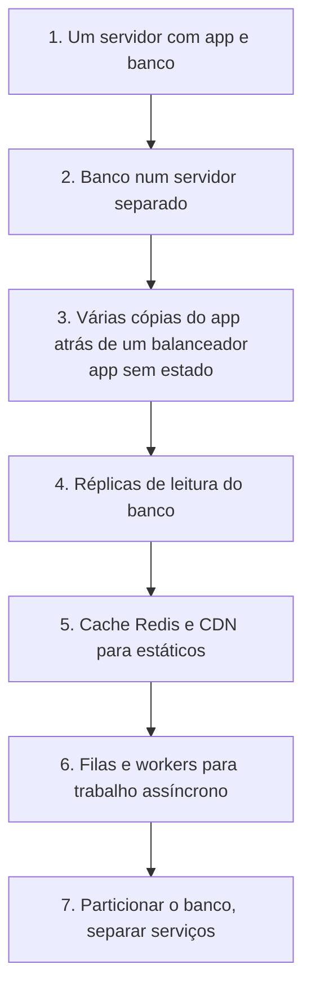
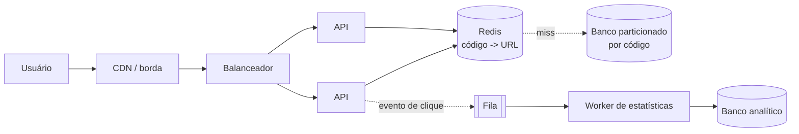

# System design: projetando sistemas escaláveis

## Por que isso importa

A entrevista de **system design** ("projete o Instagram", "projete um encurtador de links") é etapa obrigatória para vagas de nível pleno em diante em muitas empresas. Ela não tem resposta certa: avalia se você **pergunta** os requisitos, **estima** a escala, propõe uma arquitetura **simples** que funciona e sabe **onde ela quebra** e como evoluir. É também exatamente o que você faz no trabalho antes de construir algo grande. Esta aula junta as peças das anteriores (cache, replicação, filas, APIs) num roteiro prático.

## Intuição

Projetar um sistema é como **planejar uma festa**. Antes de comprar qualquer coisa, você pergunta: quantas pessoas? Que tipo de festa? Vai ter comida ou só bebida? (Requisitos.) Faz contas de guardanapo: 100 pessoas, 3 copos cada, então 300 copos. (Estimativas.) Desenha o espaço: a mesa aqui, o som ali. (Arquitetura.) E pensa no que pode dar errado: e se chover? E se vierem 200? (Gargalos e falhas.)

Ninguém aluga um estádio para 20 amigos, e ninguém faz uma festa de 2000 pessoas na sala de casa. O bom design é **proporcional** à escala real.

## Visual

O caminho típico de escala de um sistema web:



Um encurtador de links:



## Conceito técnico

### O roteiro (cerca de 45 minutos)

1. **Requisitos** (5 a 10 min). **Funcionais**: o que o sistema faz (encurtar, redirecionar, estatísticas?). **Não funcionais**: escala, latência, disponibilidade, consistência, durabilidade. Pergunte, não suponha. Corte o escopo explicitamente.
2. **Estimativas** (5 min): usuários, leituras e escritas por segundo, armazenamento, banda. Servem para tomar decisões ("cabe num banco só?"), não para acertar o número exato.
3. **API** (5 min): os endpoints principais (AS-03).
4. **Modelo de dados** (5 min): entidades, chaves, que banco e por quê.
5. **Arquitetura de alto nível** (10 min): as caixas e setas, começando simples.
6. **Aprofundamento** (10 a 15 min): os pontos difíceis. Gargalos, pontos únicos de falha, consistência, cache, particionamento, o que acontece quando algo cai.
7. **Fechamento**: trade-offs assumidos e como evoluiria.

### Estimativas de guardanapo

Números para ter na cabeça:

| Quantidade | Valor aproximado |
|---|---|
| segundos num dia | 86 400 ≈ **10⁵** |
| 1 milhão de requisições por dia | ≈ **12 por segundo** |
| 100 milhões por dia | ≈ 1 200 por segundo |
| pico | média × 2 a 10 (depende do produto) |
| um servidor de aplicação simples | centenas a milhares de requisições por segundo |
| um PostgreSQL bem indexado | milhares de consultas simples por segundo |
| Redis | dezenas a centenas de milhares de operações por segundo |
| proporção leitura/escrita típica de redes sociais | 100:1 ou mais |

Exemplo: 100 milhões de links novos por mês, cada registro com ~500 bytes. Escritas: 10⁸ / (30 × 10⁵) ≈ **40 por segundo**. Com leituras 100 vezes mais frequentes, ≈ **4 000 por segundo**. Armazenamento: 10⁸ × 500 B = 50 GB por mês, ≈ **600 GB por ano**, 6 TB em 10 anos. Conclusão: escrita é pouca, leitura é muita (cache!), e o armazenamento cresce a ponto de pedir particionamento em alguns anos.

### Peças que aparecem sempre

| Necessidade | Peça | Aula |
|---|---|---|
| distribuir carga entre cópias | balanceador de carga, app sem estado | SD-03 |
| ler muito, mudar pouco | cache, CDN, réplicas de leitura | SD-03, SD-02 |
| escrever demais para um banco | particionamento | SD-02 |
| trabalho demorado ou picos | fila e workers | AS-05 |
| busca por texto | índice invertido (Elasticsearch) | |
| arquivos grandes | armazenamento de objetos (S3) + CDN | |
| contadores e rankings | Redis (incremento atômico, sorted sets) | BD-06 |
| proteção contra abuso | limitador de requisições | esta aula |
| IDs únicos sem coordenação | Snowflake, UUID | esta aula |

### Projeto: encurtador de links

- **Requisitos**: criar um código curto para uma URL; redirecionar rápido; links não expiram (ou expiram em N anos); estatísticas de cliques são desejáveis, mas podem atrasar alguns minutos. Leitura muito maior que escrita, latência baixa no redirecionamento, alta disponibilidade.
- **API**: `POST /links {url}` → `201 {codigo}`; `GET /{codigo}` → `301` ou `302` com `Location`. (O 301 é cacheado pelos navegadores e tira carga, mas esconde cliques das estatísticas; o 302 é o contrário. Um trade-off a discutir.)
- **Gerar o código**: com **base62** (`0-9a-zA-Z`), 7 caracteres dão 62⁷ ≈ 3,5 trilhões de códigos. Opções: (a) codificar em base62 um **id numérico único** (sem colisões, mas sequencial e adivinhável); (b) **hash** da URL truncado (colisões precisam ser tratadas); (c) códigos **aleatórios** com verificação de unicidade.
- **Dados**: uma tabela `codigo → url, criado_em, dono`, que cabe num banco chave-valor ou relacional particionado por `codigo`.
- **Leitura**: Redis na frente, com taxa de acerto altíssima (links populares concentram os acessos); CDN pode até responder os redirecionamentos.
- **Estatísticas**: o redirecionamento publica um evento numa fila, e workers agregam, sem atrasar a resposta.

### Limitador de requisições (rate limiting)

Protege contra abuso e sobrecarga, e garante uso justo. Responde **429 Too Many Requests** com `Retry-After`.

| Algoritmo | Ideia | Característica |
|---|---|---|
| **Janela fixa** | contador por minuto (`chave:minuto`) | simples; permite o dobro no limite entre duas janelas |
| **Janela deslizante** | conta as requisições dos últimos 60 s | preciso; mais memória (ou uma aproximação) |
| **Balde de fichas** (*token bucket*) | fichas entram a uma taxa fixa até a capacidade; cada requisição gasta uma | permite rajadas controladas; o mais usado |
| **Balde furado** (*leaky bucket*) | as requisições saem a taxa constante | suaviza o tráfego |

Num sistema distribuído, o estado do limitador fica num lugar compartilhado (Redis), com operações atômicas.

### IDs únicos em sistemas distribuídos

- **Autoincremento** do banco: simples, mas um ponto central e revela volume.
- **UUID v4**: 128 bits aleatórios, sem coordenação; grande e sem ordem (ruim para índices B-tree, BD-04). O **UUID v7** coloca o tempo na frente e resolve a ordenação.
- **Snowflake** (Twitter): 64 bits = **41 bits de tempo** em ms + **10 bits de máquina** + **12 bits de sequência**. Ordenado no tempo, compacto, cada máquina gera até 4096 por milissegundo sem falar com ninguém.

## Código

O gerador de IDs no estilo Snowflake, mostrando como os bits são montados e desmontados:

```python
EPOCA = 1_700_000_000_000  # ms; uma época própria aumenta a vida útil dos 41 bits

def montar(tempo_ms, maquina, sequencia):
    assert 0 <= maquina < 2 ** 10 and 0 <= sequencia < 2 ** 12
    return ((tempo_ms - EPOCA) << 22) | (maquina << 12) | sequencia

def desmontar(id_):
    return {
        "tempo_ms": (id_ >> 22) + EPOCA,
        "maquina": (id_ >> 12) & (2 ** 10 - 1),
        "sequencia": id_ & (2 ** 12 - 1),
    }

a = montar(1_760_000_000_000, maquina=7, sequencia=0)
b = montar(1_760_000_000_000, maquina=7, sequencia=1)
c = montar(1_760_000_000_001, maquina=3, sequencia=0)
print(a, b, c)
print("ordenados pelo tempo?", a < b < c)
print(desmontar(c))
anos = 2 ** 41 / 1000 / 86400 / 365
print(f"41 bits de milissegundos duram cerca de {anos:.0f} anos")
```

## Erros comuns

- **Começar desenhando** sem perguntar os requisitos.
- **Pular as estimativas**, ou fazê-las e não usá-las para nenhuma decisão.
- **Arquitetura de 30 caixas** para 1 000 usuários.
- **Ignorar pontos únicos de falha** (um banco sem réplica, um balanceador só).
- **Não discutir trade-offs**: toda escolha tem um custo; dizer qual é mostra maturidade.
- **Esquecer o que acontece quando algo cai**, e os picos de tráfego.
- **Ficar em silêncio pensando**: na entrevista, pense em voz alta.
- **Decorar a resposta do "projete o Twitter"** em vez de entender as peças.

## Pratique

```quiz
id: SD-04-q1
tipo: multipla_escolha
pergunta: "Um serviço recebe 50 milhões de requisições por dia. Qual é a média aproximada de requisições por segundo?"
opcoes: ["50", "580", "5 800", "50 000"]
resposta: 1
explicacao: "Um dia tem cerca de 86 400 segundos (≈ 10⁵). 5 × 10⁷ / 8,64 × 10⁴ ≈ 580 por segundo. O pico pode ser várias vezes isso."
dificuldade: 1
```

```quiz
id: SD-04-q2
tipo: multipla_escolha
pergunta: "No começo de uma entrevista de system design, qual é o primeiro passo?"
opcoes: ["Escolher o banco de dados", "Desenhar os microsserviços", "Esclarecer os requisitos funcionais e não funcionais e o escopo", "Escrever o código do limitador de requisições"]
resposta: 2
explicacao: "Sem saber o que o sistema faz e em que escala, qualquer escolha é chute. Perguntar e cortar o escopo é parte do que está sendo avaliado."
dificuldade: 1
```

```quiz
id: SD-04-q3
tipo: verdadeiro_falso
pergunta: "Num encurtador de links, responder com 301 (redirecionamento permanente) reduz a carga no servidor, mas dificulta contar todos os cliques."
resposta: true
explicacao: "Navegadores guardam o 301 e, nas próximas vezes, vão direto ao destino sem passar pelo encurtador. Menos carga, menos cliques contados. Com 302, cada clique passa pelo servidor."
dificuldade: 2
```

```quiz
id: SD-04-q4
tipo: resposta_curta
pergunta: "Por que um balde de fichas (token bucket) é popular para limitar requisições?"
resposta: "Porque limita a taxa média (as fichas entram a uma taxa fixa) e ainda permite rajadas curtas até a capacidade do balde, que é como o tráfego real se comporta. É simples, usa pouca memória por cliente (fichas e o horário da última atualização) e dá para implementar de forma atômica no Redis."
palavras_chave: ["taxa", "rajadas", "capacidade", "memória"]
dificuldade: 2
```

```quiz
id: SD-04-q5
tipo: multipla_escolha
pergunta: "Por que um ID no estilo Snowflake é preferível a um UUID v4 como chave primária num banco com índice B-tree?"
opcoes: ["Porque é aleatório", "Porque é ordenado pelo tempo e menor (64 bits), então as inserções vão para o fim do índice em vez de espalhadas", "Porque é texto", "Porque não precisa de relógio"]
resposta: 1
explicacao: "IDs aleatórios inserem em posições espalhadas da árvore, o que causa divisões de páginas e piora o cache. IDs crescentes no tempo inserem no fim. UUID v7 tem a mesma vantagem com 128 bits."
dificuldade: 2
```

```quiz
id: SD-04-q6
tipo: codigo
linguagem: python
pergunta: |
  **Estimativa de guardanapo.** Escreva `estimar(usuarios_dia, acoes_por_usuario, bytes_por_acao, fator_pico)` que devolve um dicionário com:

  - `'qps_medio'`: ações por segundo em média (use 86 400 segundos por dia), arredondado para o inteiro mais próximo;
  - `'qps_pico'`: o médio (sem arredondar) vezes `fator_pico`, arredondado;
  - `'gb_por_ano'`: o armazenamento gerado em 365 dias, em GB (10⁹ bytes), arredondado para 1 casa.
codigo_inicial: |
  def estimar(usuarios_dia, acoes_por_usuario, bytes_por_acao, fator_pico):
      return {'qps_medio': 0, 'qps_pico': 0, 'gb_por_ano': 0}
usa: [def, return]
testes:
  - chamada: "estimar(1_000_000, 10, 500, 3)"
    saida: "{'qps_medio': 116, 'qps_pico': 347, 'gb_por_ano': 1825.0}"
  - chamada: "estimar(86_400, 1, 1000, 1)"
    saida: "{'qps_medio': 1, 'qps_pico': 1, 'gb_por_ano': 31.5}"
  - chamada: "estimar(50_000_000, 2, 200, 5)"
    visivel: false
    saida: "{'qps_medio': 1157, 'qps_pico': 5787, 'gb_por_ano': 7300.0}"
  - chamada: "estimar(0, 10, 100, 2)"
    visivel: false
    saida: "{'qps_medio': 0, 'qps_pico': 0, 'gb_por_ano': 0.0}"
dica: "acoes_dia = usuarios_dia * acoes_por_usuario; qps = acoes_dia / 86400; bytes_ano = acoes_dia * bytes_por_acao * 365."
solucao: |
  def estimar(usuarios_dia, acoes_por_usuario, bytes_por_acao, fator_pico):
      acoes_dia = usuarios_dia * acoes_por_usuario
      qps = acoes_dia / 86400
      bytes_ano = acoes_dia * bytes_por_acao * 365
      return {
          'qps_medio': round(qps),
          'qps_pico': round(qps * fator_pico),
          'gb_por_ano': round(bytes_ano / 1e9, 1),
      }
explicacao: "1 milhão de usuários ativos fazendo 10 ações por dia dá só ~116 por segundo: um único servidor aguenta, e isso evita superprojetar. Já o armazenamento (1,8 TB por ano) é o que vai pedir atenção. No terceiro caso, 50 milhões de usuários geram ~1 200 por segundo e picos de ~5 800, onde cache, réplicas e talvez particionamento entram na conversa. Estimativas servem para decidir, não para acertar casas decimais."
dificuldade: 1
```

```quiz
id: SD-04-q7
tipo: codigo
linguagem: python
pergunta: |
  **Códigos curtos em base62.** O alfabeto é `ALFABETO = '0123456789abcdefghijklmnopqrstuvwxyzABCDEFGHIJKLMNOPQRSTUVWXYZ'`. Escreva:

  - `codificar(n)`: o número inteiro `n >= 0` escrito em base 62 com esse alfabeto (0 vira `'0'`);
  - `decodificar(s)`: o inverso.
codigo_inicial: |
  ALFABETO = '0123456789abcdefghijklmnopqrstuvwxyzABCDEFGHIJKLMNOPQRSTUVWXYZ'

  def codificar(n):
      return str(n)

  def decodificar(s):
      return int(s)
usa: [def, while, for, return]
testes:
  - chamada: "codificar(61)"
    saida: "'Z'"
  - chamada: "codificar(62)"
    saida: "'10'"
  - chamada: "decodificar('Z')"
    saida: "61"
  - chamada: "codificar(0)"
    visivel: false
    saida: "'0'"
  - chamada: "codificar(125)"
    visivel: false
    saida: "'21'"
  - chamada: "decodificar(codificar(3_521_614_606_207))"
    visivel: false
    saida: "3521614606207"
  - chamada: "len(codificar(62 ** 7 - 1))"
    visivel: false
    saida: "7"
dica: "É a mesma conversão de base da MD-01: divida por 62 repetidamente, guardando os restos, e inverta. Para decodificar, acumule valor = valor * 62 + ALFABETO.index(c)."
solucao: |
  ALFABETO = '0123456789abcdefghijklmnopqrstuvwxyzABCDEFGHIJKLMNOPQRSTUVWXYZ'

  def codificar(n):
      if n == 0:
          return ALFABETO[0]
      digitos = []
      while n > 0:
          n, resto = divmod(n, 62)
          digitos.append(ALFABETO[resto])
      return ''.join(reversed(digitos))

  def decodificar(s):
      valor = 0
      for c in s:
          valor = valor * 62 + ALFABETO.index(c)
      return valor
explicacao: "Sete caracteres cobrem até 62⁷ − 1 ≈ 3,5 trilhões de links. Se os ids forem sequenciais, os códigos também serão (qualquer um pode listar os links de todo mundo, trocando o último caractere). Para evitar, embaralhe o id antes de codificar (com uma permutação reversível, como multiplicar por um número coprimo módulo 62⁷) ou use códigos aleatórios."
dificuldade: 1
```

```quiz
id: SD-04-q8
tipo: codigo
linguagem: javascript
pergunta: |
  **Limitador com balde de fichas.** Complete a classe `Balde(capacidade, porSegundo)`:

  - o balde começa **cheio**;
  - `permitir(agora)` (tempo em segundos, sempre crescente): primeiro repõe `(agora - ultimo) * porSegundo` fichas, sem passar da capacidade; depois, se houver **pelo menos 1** ficha, gasta uma e devolve `true`; senão, devolve `false`.
codigo_inicial: |
  class Balde {
    constructor(capacidade, porSegundo) {
      this.capacidade = capacidade;
      this.porSegundo = porSegundo;
    }

    permitir(agora) {
      return true;
    }
  }

  // não mude: os testes usam esta função
  function simular(capacidade, porSegundo, instantes) {
    const b = new Balde(capacidade, porSegundo);
    return instantes.map((t) => b.permitir(t));
  }
usa: [class, return]
testes:
  - chamada: "simular(3, 1, [0, 0, 0, 0])"
    saida: "[ true, true, true, false ]"
  - chamada: "simular(3, 1, [0, 0, 0, 0, 1, 1])"
    saida: "[ true, true, true, false, true, false ]"
  - chamada: "simular(2, 0.5, [0, 0, 1, 2, 2])"
    saida: "[ true, true, false, true, false ]"
  - chamada: "simular(5, 10, [0, 0, 0, 0, 0, 0, 0.1, 100, 100, 100, 100, 100, 100])"
    visivel: false
    saida: "[ true, true, true, true, true, false, true, true, true, true, true, true, false ]"
  - chamada: "simular(1, 1, [0, 0.5, 1, 1.5, 2])"
    visivel: false
    saida: "[ true, false, true, false, true ]"
dica: "Guarde this.fichas = capacidade e this.ultimo = null no construtor. No permitir, se ultimo não for null, reponha com Math.min(capacidade, fichas + (agora - ultimo) * porSegundo); depois atualize ultimo."
solucao: |
  class Balde {
    constructor(capacidade, porSegundo) {
      this.capacidade = capacidade;
      this.porSegundo = porSegundo;
      this.fichas = capacidade;
      this.ultimo = null;
    }

    permitir(agora) {
      if (this.ultimo !== null) {
        const repor = (agora - this.ultimo) * this.porSegundo;
        this.fichas = Math.min(this.capacidade, this.fichas + repor);
      }
      this.ultimo = agora;
      if (this.fichas >= 1) {
        this.fichas -= 1;
        return true;
      }
      return false;
    }
  }

  // não mude: os testes usam esta função
  function simular(capacidade, porSegundo, instantes) {
    const b = new Balde(capacidade, porSegundo);
    return instantes.map((t) => b.permitir(t));
  }
explicacao: "O balde permite uma rajada (5 requisições de uma vez no teste oculto) e depois limita à taxa de reposição. Mesmo depois de 100 segundos parado, o cliente só ganha 5 fichas: a capacidade limita o acúmulo. A grande vantagem é a memória: por cliente, guarda-se só fichas e ultimo, sem lista de horários. Num sistema distribuído, essa mesma conta roda dentro de um script Lua no Redis, para ser atômica entre várias cópias da API."
dificuldade: 2
```

## Resumo

- Roteiro: **requisitos → estimativas → API → dados → arquitetura → aprofundamento → trade-offs**.
- Estimativas: 1 dia ≈ 10⁵ s; 1 milhão por dia ≈ 12/s; pico = média × fator. Use para **decidir**.
- Caminho de escala: banco separado, app sem estado com balanceador, réplicas, cache e CDN, filas, particionamento.
- **Encurtador**: base62, cache na leitura, eventos para estatísticas, 301 contra 302.
- **Limitadores**: janela fixa, deslizante, **balde de fichas**, balde furado. **IDs**: autoincremento, UUID (v4, v7), **Snowflake**.

## Para ir além

- Resolva os exercícios do System Design Primer (Pastebin, cache de busca) em voz alta, com cronômetro de 45 minutos.
- Leia "Scaling your API with rate limiters" da Stripe.
- **Próximo módulo**: SD-05 Contêineres: Docker.
