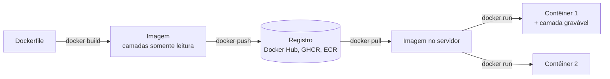

# Contêineres: Docker

## Por que isso importa

"Na minha máquina funciona" é a frase mais antiga do desenvolvimento. Versões diferentes do Python, de uma biblioteca do sistema ou do banco fazem o mesmo código se comportar diferente no seu notebook, no do colega, no CI e em produção. **Contêineres** empacotam a aplicação **com tudo de que ela precisa** e rodam igual em qualquer lugar. Docker virou o padrão da indústria: praticamente toda vaga de backend ou DevOps pede, todo deploy moderno (Kubernetes, serviços de nuvem) roda contêineres, e subir um PostgreSQL de testes vira um comando só.

## Intuição

Antes dos **contêineres de navio**, cada carga era embarcada de um jeito: sacos, barris, caixas de tamanhos diferentes, cada porto com seus guindastes. O contêiner padronizou a **caixa**: o navio, o trem e o caminhão não precisam saber o que vai dentro, só como pegar a caixa.

O contêiner de software faz o mesmo: a aplicação vai dentro com suas dependências, e qualquer máquina com Docker sabe rodá-la. Diferente de uma **máquina virtual**, que leva um sistema operacional inteiro dentro (um navio dentro do navio), o contêiner **compartilha o kernel** da máquina e só isola o que precisa: é leve e sobe em milissegundos.

## Visual

Máquina virtual contra contêiner:

```text
     Máquinas virtuais                      Contêineres
+---------+---------+---------+    +---------+---------+---------+
|  App A  |  App B  |  App C  |    |  App A  |  App B  |  App C  |
|  libs   |  libs   |  libs   |    |  libs   |  libs   |  libs   |
| SO conv.| SO conv.| SO conv.|    +---------+---------+---------+
+---------+---------+---------+    |   Motor de contêineres      |
|        Hipervisor           |    |   (Docker / containerd)     |
+-----------------------------+    +-----------------------------+
|  SO hospedeiro / hardware   |    |  Kernel do SO hospedeiro    |
+-----------------------------+    +-----------------------------+
 cada VM: GBs, sobe em minutos      cada contêiner: MBs, sobe em ms
```

Do Dockerfile ao contêiner:



## Conceito técnico

### Por baixo: recursos do kernel Linux

Um contêiner é um **processo comum** (SO-02) com isolamento:

- **Namespaces**: cada contêiner vê a sua própria árvore de processos (o app é o PID 1), sua rede, seus pontos de montagem, seu hostname e seus usuários.
- **cgroups**: limitam e medem CPU, memória e E/S (`--memory=512m --cpus=1`).
- **Sistema de arquivos em camadas** (OverlayFS): a imagem é uma pilha de camadas somente leitura, e o contêiner ganha uma camada gravável por cima.

Como compartilham o kernel, contêineres isolam **menos** que VMs: um contêiner Linux não roda num kernel Windows sem uma VM no meio (é o que o Docker Desktop faz no Mac e no Windows).

### Imagem, contêiner, registro

- **Imagem**: o pacote imutável (o "molde"), identificada por nome e **tag**: `python:3.12-slim`.
- **Contêiner**: uma instância **em execução** de uma imagem (o "objeto" do molde). Pode haver muitos da mesma imagem.
- **Registro**: onde imagens são guardadas e compartilhadas (Docker Hub, GitHub Container Registry, os das nuvens).

Contêineres são **descartáveis**: o que for gravado na camada do contêiner some quando ele é removido. Dados que precisam sobreviver vão para **volumes**.

### Dockerfile

```text
FROM python:3.12-slim                 # imagem base (fixe a versão!)
WORKDIR /app                          # diretório de trabalho
COPY requirements.txt .               # 1) só a lista de dependências
RUN pip install --no-cache-dir -r requirements.txt   # 2) instala (camada cacheável)
COPY . .                              # 3) o código, que muda sempre
RUN useradd --create-home app
USER app                              # não rodar como root
EXPOSE 8000                           # documenta a porta
CMD ["gunicorn", "-b", "0.0.0.0:8000", "app:app"]
```

Cada instrução gera uma **camada**. O Docker **reaproveita** camadas cujas entradas não mudaram; quando uma muda, **ela e todas as seguintes** são refeitas. Por isso a ordem importa: copiar só o `requirements.txt` e instalar **antes** de copiar o código faz uma mudança no código não reinstalar todas as dependências. Um arquivo **`.dockerignore`** (como o `.gitignore`) evita mandar `.git`, `node_modules` e segredos para o build.

**Build em múltiplos estágios**: um estágio com o compilador e as ferramentas de build, e um estágio final só com o resultado. A imagem final fica pequena e com menos superfície de ataque.

```text
FROM node:22 AS build
WORKDIR /src
COPY package*.json .
RUN npm ci
COPY . .
RUN npm run build

FROM nginx:1.27-alpine
COPY --from=build /src/dist /usr/share/nginx/html
```

### Rodando contêineres

```text
docker run -d --name api -p 8080:8000 -e DATABASE_URL=postgres://... minha-api:1.4
#          |   |          |            |                              imagem:tag
#          |   |          |            variável de ambiente (configuração)
#          |   |          porta do host : porta do contêiner
#          |   nome
#          em segundo plano

docker ps                 # contêineres rodando
docker logs -f api        # logs (a aplicação deve escrever no stdout)
docker exec -it api sh    # abrir um shell dentro do contêiner
docker stop api && docker rm api
docker run -v dados:/var/lib/postgresql/data postgres:17   # volume nomeado
docker run -v "$PWD":/app ...                               # bind mount (desenvolvimento)
```

### Docker Compose

Descreve **vários contêineres** que trabalham juntos num arquivo YAML, para subir o ambiente inteiro com `docker compose up`:

```text
services:
  api:
    build: .
    ports: ["8080:8000"]
    environment:
      DATABASE_URL: postgres://app:segredo@db:5432/app
    depends_on: [db]
  db:
    image: postgres:17
    environment:
      POSTGRES_USER: app
      POSTGRES_PASSWORD: segredo
    volumes: ["dados:/var/lib/postgresql/data"]
volumes:
  dados:
```

Os serviços se enxergam pelo **nome** (`db`) numa rede criada automaticamente.

### Boas práticas

- **Fixe versões** da imagem base (`python:3.12.7-slim`, não `python:latest`).
- **Imagens pequenas**: bases `slim`, `alpine` ou *distroless*, e multi-stage.
- **Não rode como root**.
- **Um processo por contêiner**, que escreve logs no stdout.
- **Configuração por variáveis de ambiente** (12-factor), nunca embutida na imagem.
- **Nada de segredos na imagem**: qualquer um com a imagem consegue ler todas as camadas, inclusive as "apagadas" depois.
- **Varra a imagem** atrás de vulnerabilidades conhecidas (`docker scout`, Trivy).

## Código

Simulando o cache de camadas do Docker: quais passos são refeitos quando um arquivo muda, com o Dockerfile em ordem ruim e em ordem boa.

```python
def refeitos(instrucoes, mudou):
    """instrucoes: lista de (comando, arquivos que ela lê). Devolve os comandos refeitos."""
    for i, (comando, arquivos) in enumerate(instrucoes):
        if mudou & arquivos:
            return [c for c, _ in instrucoes[i:]]
    return []

CODIGO = {"app.py", "rotas.py", "requirements.txt"}

ordem_ruim = [
    ("FROM python:3.12-slim", set()),
    ("COPY . .", CODIGO),
    ("RUN pip install -r requirements.txt", {"requirements.txt"}),
]
ordem_boa = [
    ("FROM python:3.12-slim", set()),
    ("COPY requirements.txt .", {"requirements.txt"}),
    ("RUN pip install -r requirements.txt", {"requirements.txt"}),
    ("COPY . .", CODIGO),
]

for nome, dockerfile in [("ordem ruim", ordem_ruim), ("ordem boa", ordem_boa)]:
    print(f"{nome}, mudei app.py:")
    for comando in refeitos(dockerfile, {"app.py"}):
        print("   refaz", comando)
```

## Erros comuns

- **`FROM imagem:latest`**: o build de amanhã pode trazer outra versão e quebrar.
- **`COPY . .` antes de instalar as dependências**: toda mudança no código reinstala tudo.
- **Esquecer o `.dockerignore`**, mandando `.git`, `node_modules` e `.env` para a imagem.
- **Segredos em `ENV` ou em arquivos copiados**, e achar que um `RUN rm` depois os apaga (eles continuam na camada anterior).
- **Guardar dados importantes dentro do contêiner** sem volume.
- **Rodar como root**.
- **Escutar em `127.0.0.1` dentro do contêiner**: a porta publicada não chega; escute em `0.0.0.0`.
- **Imagens de 2 GB** com compiladores e caches que não são usados em produção.

## Pratique

```quiz
id: SD-05-q1
tipo: multipla_escolha
pergunta: "Qual recurso do kernel Linux faz um contêiner enxergar apenas os seus próprios processos?"
opcoes: ["cgroups", "Namespaces (de PID)", "OverlayFS", "O hipervisor"]
resposta: 1
explicacao: "O namespace de PID dá ao contêiner uma árvore de processos própria, em que a aplicação é o PID 1. Os cgroups limitam recursos, e o OverlayFS monta as camadas do sistema de arquivos."
dificuldade: 1
```

```quiz
id: SD-05-q2
tipo: multipla_escolha
pergunta: "Você muda uma linha do app.py e o build reinstala todas as dependências, demorando 5 minutos. Qual é a causa mais provável?"
opcoes: ["A imagem base é grande", "O COPY . . vem antes do RUN pip install, então a camada de instalação é invalidada a cada mudança no código", "Falta o EXPOSE", "O contêiner roda como root"]
resposta: 1
explicacao: "Quando uma camada muda, todas as seguintes são refeitas. Copiar só o requirements.txt, instalar, e só depois copiar o resto faz a instalação ser reaproveitada enquanto as dependências não mudarem."
dificuldade: 1
```

```quiz
id: SD-05-q3
tipo: verdadeiro_falso
pergunta: "Se um Dockerfile copia um arquivo com senha numa instrução e o apaga com RUN rm na instrução seguinte, a senha não fica na imagem final."
resposta: false
explicacao: "Cada instrução é uma camada, e a imagem guarda todas. A camada do COPY continua com o arquivo; o rm só o esconde nas camadas de cima. Qualquer um com a imagem consegue extrair. Use segredos de build (--secret) ou variáveis no momento da execução."
dificuldade: 2
```

```quiz
id: SD-05-q4
tipo: resposta_curta
pergunta: "Para que serve um build em múltiplos estágios?"
resposta: "Para separar o ambiente de build (compiladores, ferramentas, dependências de desenvolvimento) da imagem final, que recebe só o resultado com COPY --from. A imagem final fica menor, sobe mais rápido e tem menos pacotes que possam ter vulnerabilidades."
palavras_chave: ["build", "final", "menor", "COPY --from"]
dificuldade: 2
```

```quiz
id: SD-05-q5
tipo: multipla_escolha
pergunta: "No Docker Compose, como o serviço api deve se referir ao serviço db na string de conexão?"
opcoes: ["localhost:5432", "127.0.0.1:5432", "db:5432, pelo nome do serviço", "O IP da sua máquina"]
resposta: 2
explicacao: "O Compose cria uma rede em que cada serviço é encontrado pelo nome. Dentro do contêiner da api, localhost é o próprio contêiner da api, onde não há banco."
dificuldade: 1
```

```quiz
id: SD-05-q6
tipo: codigo
linguagem: python
pergunta: |
  **Linter de Dockerfile.** Escreva `avisos(dockerfile)` que recebe o texto de um Dockerfile e devolve a lista **ordenada** dos avisos encontrados (sem repetir):

  - `'latest'`: alguma linha `FROM` usa uma imagem sem tag (sem `:`) ou com a tag `:latest`;
  - `'root'`: não existe nenhuma instrução `USER`;
  - `'ordem'`: existe um `COPY . .` **antes** de alguma linha `RUN` que contenha `install`;
  - `'add'`: alguma instrução começa com `ADD` (prefira `COPY`).

  Ignore linhas vazias e comentários (`#`). As instruções podem ter espaços no começo da linha.
codigo_inicial: |
  def avisos(dockerfile):
      resultado = []
      if 'latest' in dockerfile:
          resultado.append('latest')
      return resultado
usa: [def, for, if, return]
testes:
  - chamada: "avisos('FROM python:3.12-slim\\nCOPY requirements.txt .\\nRUN pip install -r requirements.txt\\nCOPY . .\\nUSER app')"
    saida: "[]"
  - chamada: "avisos('FROM python\\nCOPY . .\\nRUN pip install -r requirements.txt')"
    saida: "['latest', 'ordem', 'root']"
  - chamada: "avisos('FROM node:latest\\nADD . /app\\nUSER node')"
    saida: "['add', 'latest']"
  - chamada: "avisos('# FROM ubuntu\\nFROM alpine:3.20\\n  COPY . .\\n  RUN echo pronto\\nUSER x')"
    visivel: false
    saida: "[]"
  - chamada: "avisos('FROM golang:1.23 AS build\\nCOPY . .\\nRUN go install ./...\\nFROM scratch\\nCOPY --from=build /go/bin/app /app')"
    visivel: false
    saida: "['latest', 'ordem', 'root']"
dica: "Percorra as linhas com strip(). Para o FROM, a imagem é a segunda palavra: confira ':' not in imagem ou imagem.endswith(':latest'). Para a ordem, guarde se já viu um 'COPY . .' e, ao achar um RUN com 'install', verifique essa marca."
solucao: |
  def avisos(dockerfile):
      encontrados = set()
      tem_user = False
      copiou_tudo = False
      for bruta in dockerfile.split('\n'):
          linha = bruta.strip()
          if not linha or linha.startswith('#'):
              continue
          partes = linha.split()
          instrucao = partes[0].upper()
          if instrucao == 'FROM':
              imagem = partes[1]
              if ':' not in imagem or imagem.endswith(':latest'):
                  encontrados.add('latest')
          elif instrucao == 'USER':
              tem_user = True
          elif instrucao == 'ADD':
              encontrados.add('add')
          elif linha == 'COPY . .':
              copiou_tudo = True
          elif instrucao == 'RUN' and 'install' in linha and copiou_tudo:
              encontrados.add('ordem')
      if not tem_user:
          encontrados.add('root')
      return sorted(encontrados)
explicacao: "No último teste, FROM scratch (a imagem vazia, comum em estágios finais de Go) é marcada como sem tag: um linter real como o hadolint tem exceções para scratch e para nomes de estágios (FROM build). Regras simples pegam a maioria dos problemas, e o valor de um linter está em rodar automaticamente no CI, sem depender de alguém lembrar no code review."
dificuldade: 2
```

```quiz
id: SD-05-q7
tipo: codigo
linguagem: python
pergunta: |
  **Quanto o cache de camadas economiza?** Cada instrução é `(comando, segundos, arquivos_lidos)`. Escreva `tempo_build(instrucoes, mudados)`, que devolve quantos segundos o build leva quando os arquivos em `mudados` (um conjunto) foram alterados: a **primeira** instrução que lê algum arquivo mudado é refeita, e **todas as seguintes** também; as anteriores vêm do cache (custo 0). Se nada for afetado, o build leva 0.
codigo_inicial: |
  def tempo_build(instrucoes, mudados):
      return sum(segundos for _, segundos, _ in instrucoes)
usa: [def, for, if, return]
testes:
  - chamada: "tempo_build([('FROM', 5, set()), ('COPY req', 1, {'req.txt'}), ('RUN pip', 120, {'req.txt'}), ('COPY .', 2, {'app.py', 'req.txt'})], {'app.py'})"
    saida: "2"
  - chamada: "tempo_build([('FROM', 5, set()), ('COPY .', 2, {'app.py', 'req.txt'}), ('RUN pip', 120, {'req.txt'})], {'app.py'})"
    saida: "122"
  - chamada: "tempo_build([('FROM', 5, set()), ('COPY req', 1, {'req.txt'}), ('RUN pip', 120, {'req.txt'}), ('COPY .', 2, {'app.py', 'req.txt'})], {'req.txt'})"
    saida: "123"
  - chamada: "tempo_build([('FROM', 5, set()), ('RUN apt', 30, set())], {'app.py'})"
    visivel: false
    saida: "0"
  - chamada: "tempo_build([], {'x'})"
    visivel: false
    saida: "0"
dica: "Percorra com enumerate; ao encontrar a primeira instrução com arquivos & mudados não vazio, devolva a soma dos segundos dela e de todas as seguintes."
solucao: |
  def tempo_build(instrucoes, mudados):
      for i, (_, _, arquivos) in enumerate(instrucoes):
          if arquivos & mudados:
              return sum(segundos for _, segundos, _ in instrucoes[i:])
      return 0
explicacao: "Os dois primeiros testes são o mesmo projeto: com a ordem certa, mudar o código custa 2 segundos; com a errada, 122. Num time que faz dezenas de builds por dia, no CI e na máquina de cada pessoa, essa ordem economiza horas. Mudar o requirements.txt (terceiro teste) refaz a instalação de qualquer jeito, e está certo: as dependências mudaram."
dificuldade: 1
```

```quiz
id: SD-05-q8
tipo: codigo
linguagem: javascript
pergunta: |
  **Entendendo um docker run.** Escreva `analisarRun(comando)` que recebe um comando `docker run` (palavras separadas por espaços simples, sem aspas) e devolve:

  `{ imagem, segundoPlano, nome, portas, env, volumes }`

  - `-d` liga `segundoPlano` (padrão `false`); `--name X` define `nome` (padrão `null`);
  - `-p HOST:CONTAINER` acrescenta `{ host, container }` (números) a `portas`;
  - `-e CHAVE=VALOR` acrescenta a `env` (objeto);
  - `-v ORIGEM:DESTINO` acrescenta a string inteira a `volumes`;
  - a **primeira palavra depois das opções** que não começa com `-` é a imagem (o resto, se houver, é o comando do contêiner e pode ser ignorado).
codigo_inicial: |
  function analisarRun(comando) {
    const partes = comando.split(' ');
    return { imagem: partes[partes.length - 1], segundoPlano: false, nome: null, portas: [], env: {}, volumes: [] };
  }
usa: [function, while, return]
testes:
  - chamada: "analisarRun('docker run -d -p 8080:80 nginx:1.27')"
    saida: "{ imagem: 'nginx:1.27', segundoPlano: true, nome: null, portas: [ { host: 8080, container: 80 } ], env: {}, volumes: [] }"
  - chamada: "analisarRun('docker run --name db -e POSTGRES_PASSWORD=x -e POSTGRES_USER=app -v dados:/var/lib/postgresql/data postgres:17')"
    saida: "{ imagem: 'postgres:17', segundoPlano: false, nome: 'db', portas: [], env: { POSTGRES_PASSWORD: 'x', POSTGRES_USER: 'app' }, volumes: [ 'dados:/var/lib/postgresql/data' ] }"
  - chamada: "analisarRun('docker run -p 5432:5432 -p 9187:9187 postgres:17 postgres -c log_statement=all')"
    visivel: false
    saida: "{ imagem: 'postgres:17', segundoPlano: false, nome: null, portas: [ { host: 5432, container: 5432 }, { host: 9187, container: 9187 } ], env: {}, volumes: [] }"
  - chamada: "analisarRun('docker run -e URL=postgres://a@b:5432/c alpine:3.20')"
    visivel: false
    saida: "{ imagem: 'alpine:3.20', segundoPlano: false, nome: null, portas: [], env: { URL: 'postgres://a@b:5432/c' }, volumes: [] }"
dica: "Pule as duas primeiras palavras (docker run) e percorra com um índice i. Opções com valor (-p, -e, -v, --name) leem partes[i + 1] e avançam i duas posições. No -e, separe só no primeiro '=' com indexOf, porque o valor pode ter outros '='."
solucao: |
  function analisarRun(comando) {
    const partes = comando.split(' ');
    const r = { imagem: null, segundoPlano: false, nome: null, portas: [], env: {}, volumes: [] };
    let i = 2;
    while (i < partes.length && r.imagem === null) {
      const p = partes[i];
      if (p === '-d') {
        r.segundoPlano = true;
        i += 1;
      } else if (p === '--name') {
        r.nome = partes[i + 1];
        i += 2;
      } else if (p === '-p') {
        const [host, container] = partes[i + 1].split(':');
        r.portas.push({ host: Number(host), container: Number(container) });
        i += 2;
      } else if (p === '-e') {
        const par = partes[i + 1];
        const pos = par.indexOf('=');
        r.env[par.slice(0, pos)] = par.slice(pos + 1);
        i += 2;
      } else if (p === '-v') {
        r.volumes.push(partes[i + 1]);
        i += 2;
      } else {
        r.imagem = p;
      }
    }
    return r;
  }
explicacao: "O terceiro teste mostra por que a imagem é a primeira palavra solta e não a última: depois dela vem o comando que substitui o CMD da imagem. No quarto, o valor da variável tem ':' e '@', e separar só no primeiro '=' preserva o resto. Repare também que POSTGRES_PASSWORD=x numa linha de comando fica no histórico do shell e aparece no docker inspect: em produção, segredos vêm de um gerenciador de segredos, não da linha de comando."
dificuldade: 2
```

## Resumo

- Contêiner = **processo isolado** com **namespaces** e **cgroups**, compartilhando o kernel; VM = SO inteiro.
- **Imagem** (camadas imutáveis) → **contêiner** (instância com camada gravável) → **registro**.
- Dockerfile: ordem que aproveita o **cache** (dependências antes do código), **multi-stage**, `.dockerignore`, versão fixa, **usuário não root**.
- `docker run` com `-p`, `-e`, `-v`, `--name`, `-d`; dados que importam em **volumes**.
- **Compose** sobe o ambiente com vários serviços que se acham pelo nome.
- Nada de **segredos** na imagem; configuração por **variáveis de ambiente**.

## Para ir além

- Instale o Docker e coloque um projeto seu num contêiner, com Compose e um PostgreSQL.
- Rode `docker history <imagem>` e veja o tamanho de cada camada; depois reduza a imagem com multi-stage.
- **Próximo módulo**: SD-06 Orquestração: Kubernetes (conceitos).
