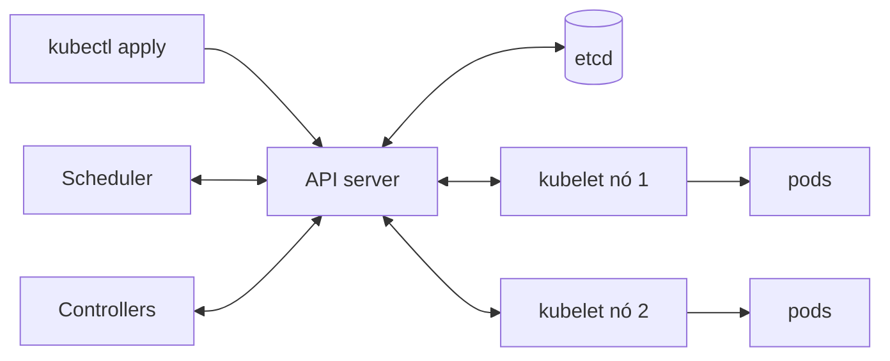

# Orquestração: Kubernetes (conceitos)

## Por que isso importa

Com Docker você roda um contêiner numa máquina. Em produção a pergunta muda: como rodar **50 contêineres em 10 máquinas**, reiniciar o que cai, distribuir pelo hardware, trocar a versão sem derrubar o site e escalar quando chega a Black Friday? Fazer isso com scripts vira um sistema distribuído caseiro e frágil. O **Kubernetes** (K8s) é o orquestrador que venceu essa disputa: os grandes provedores de nuvem oferecem K8s gerenciado (EKS, GKE, AKS), e mesmo quem não opera um cluster precisa ler um manifesto, entender por que um pod está em `CrashLoopBackOff` ou por que o deploy ficou travado.

## Intuição

Pense num **termostato**. Você não diz "ligue o aquecedor por 12 minutos"; você diz **"quero 22 graus"**. O termostato mede a temperatura o tempo todo e liga ou desliga o aquecedor até chegar lá, e volta a agir se alguém abrir a janela.

O Kubernetes funciona do mesmo jeito. Você **declara** o estado desejado ("quero 3 réplicas da api na versão 2.1") e controladores ficam num laço eterno: **observar** o que existe, **comparar** com o desejado e **agir** para diminuir a diferença. Se uma máquina morre levando dois pods, ninguém precisa ser acordado: o controlador vê 1 pod onde deveriam existir 3 e cria outros 2 em máquinas saudáveis.

## Visual

O cluster: um **control plane** que guarda e decide, e **nós** que executam.



Os objetos que você mais usa e como se ligam:

```text
Deployment api (réplicas: 3, imagem api:2.1)
   └── ReplicaSet api-7c9f (garante 3 pods com esse template)
          ├── Pod api-7c9f-a   labels: app=api   10.1.0.4
          ├── Pod api-7c9f-b   labels: app=api   10.1.1.7
          └── Pod api-7c9f-c   labels: app=api   10.1.2.2

Service api (seletor app=api)  →  IP estável + DNS "api"  →  balanceia entre os 3
Ingress  api.exemplo.com/  →  Service api
```

## Conceito técnico

### Arquitetura

- **API server**: a porta de entrada. Tudo (kubectl, controladores, kubelets) conversa com ele por uma API REST.
- **etcd**: o banco chave-valor, replicado com **Raft** (SD-02), onde fica o estado desejado e o observado de todo o cluster.
- **Scheduler**: escolhe **em qual nó** cada pod novo vai rodar, olhando os recursos pedidos, os livres e regras de afinidade.
- **Controllers**: os laços de reconciliação (Deployment, ReplicaSet, Node, Job...). Cada um cuida de um tipo de objeto.
- **kubelet**: o agente em cada nó. Vê os pods atribuídos ao seu nó e manda o runtime de contêineres (containerd) criá-los, e informa o status de volta.
- **kube-proxy / CNI**: a rede: cada pod tem um IP, e os Services são traduzidos em regras de encaminhamento.

### Os objetos principais

- **Pod**: a menor unidade. Um ou mais contêineres que compartilham IP e volumes. Pods são **descartáveis**: morrem, e outros nascem com outro nome e outro IP.
- **ReplicaSet**: garante N pods idênticos rodando. Raramente criado à mão.
- **Deployment**: gerencia ReplicaSets e faz **rolling updates** e **rollbacks**. É o que você usa para aplicações sem estado.
- **StatefulSet**: para bancos e afins, com nomes estáveis (`db-0`, `db-1`) e um volume por réplica.
- **DaemonSet**: um pod por nó (coletor de logs, agente de monitoramento).
- **Job / CronJob**: tarefas que terminam, uma vez ou agendadas.
- **Service**: um IP e um nome DNS **estáveis** na frente de um conjunto de pods escolhidos por **labels**. Tipos: `ClusterIP` (interno), `NodePort`, `LoadBalancer` (cria um balanceador na nuvem).
- **Ingress / Gateway**: roteamento HTTP de fora para dentro por host e caminho, com TLS.
- **ConfigMap** e **Secret**: configuração e segredos injetados como variáveis de ambiente ou arquivos (fator III do Twelve-Factor). Secret é só codificado em base64 por padrão: ative a criptografia em repouso e restrinja o acesso.
- **Namespace**: separa o cluster em espaços lógicos (times, ambientes).

### Labels e seletores

Nada no K8s aponta para nomes de pods. Tudo se liga por **labels**: o Service pega "todos os pods com `app=api`", o ReplicaSet conta "quantos pods com `app=api,pod-template-hash=7c9f` existem". Isso permite trocar os pods livremente.

### Um manifesto

```text
apiVersion: apps/v1
kind: Deployment
metadata:
  name: api
spec:
  replicas: 3
  selector:
    matchLabels: { app: api }
  strategy:
    rollingUpdate: { maxSurge: 1, maxUnavailable: 0 }
  template:
    metadata:
      labels: { app: api }
    spec:
      containers:
        - name: api
          image: registro.exemplo.com/api:2.1
          ports: [{ containerPort: 8000 }]
          envFrom: [{ configMapRef: { name: api-config } }]
          resources:
            requests: { cpu: "250m", memory: "256Mi" }
            limits:   { memory: "512Mi" }
          readinessProbe:
            httpGet: { path: /pronto, port: 8000 }
          livenessProbe:
            httpGet: { path: /saude, port: 8000 }
---
apiVersion: v1
kind: Service
metadata:
  name: api
spec:
  selector: { app: api }
  ports: [{ port: 80, targetPort: 8000 }]
```

`kubectl apply -f api.yaml` envia isso ao API server. Aplicar de novo o mesmo arquivo não faz nada (é **idempotente**); mudar a imagem dispara um rolling update.

### Rolling update

Ao mudar a imagem, o Deployment cria um ReplicaSet novo e vai **trocando aos poucos**: sobe pods novos, espera ficarem prontos, derruba antigos. `maxSurge` diz quantos pods a mais podem existir durante a troca e `maxUnavailable` quantos podem faltar. Se os pods novos nunca ficam prontos, o rollout **para** e o antigo continua servindo; `kubectl rollout undo` volta a versão.

### Probes de saúde

- **readinessProbe**: "posso receber tráfego?". Enquanto falha, o pod sai do Service, mas não é reiniciado (útil durante a inicialização ou quando o banco está fora).
- **livenessProbe**: "estou vivo?". Se falha várias vezes, o kubelet **reinicia** o contêiner. Cuidado: uma liveness que depende do banco reinicia todos os pods quando o banco cai, piorando tudo.
- **startupProbe**: dá tempo extra a aplicações que demoram a subir.

### Requests e limits

- **requests**: quanto o pod **reserva**. O scheduler só coloca o pod num nó com essa folga. CPU em milicores (`250m` = um quarto de núcleo).
- **limits**: o teto. Passou do limite de **CPU**, o contêiner é estrangulado (fica lento). Passou do de **memória**, é morto (`OOMKilled`).
- Sem requests o scheduler empilha pods às cegas; o **HorizontalPodAutoscaler** também usa os requests para calcular a utilização e mudar o número de réplicas.

### Diagnóstico básico

```text
kubectl get pods                     # STATUS: Running, Pending, CrashLoopBackOff, ImagePullBackOff
kubectl describe pod api-7c9f-a      # eventos: por que não agendou, por que reiniciou
kubectl logs api-7c9f-a --previous   # log do contêiner que morreu
kubectl rollout status deploy/api
```

- **Pending**: nenhum nó tem os recursos pedidos (ou falta o volume).
- **ImagePullBackOff**: imagem ou tag errada, ou falta credencial do registro.
- **CrashLoopBackOff**: o contêiner sobe e morre; leia os logs do anterior.

### Quando não usar

Kubernetes é complexo para operar. Um time pequeno com poucos serviços costuma ir melhor com uma plataforma gerenciada (Cloud Run, ECS, Fly, Render, um PaaS) ou com um K8s gerenciado e mínimo. Escolha pelo problema, não pelo currículo.

## Código

O coração do Kubernetes em poucas linhas: um laço de reconciliação que observa, compara e age, inclusive quando um nó cai.

```python
desejado = {"api": 3, "worker": 2}
pods = []           # estado observado: (nome, app)
contador = 0

def reconciliar():
    global contador
    for app, quero in desejado.items():
        tenho = [p for p in pods if p[1] == app]
        for _ in range(quero - len(tenho)):
            contador += 1
            pods.append((f"{app}-{contador}", app))
            print("  criei", pods[-1][0])
        for p in tenho[quero:]:
            pods.remove(p)
            print("  removi", p[0])

print("rodada 1 (cluster vazio)")
reconciliar()

print("rodada 2 (um nó caiu e levou api-1 e worker-4)")
pods[:] = [p for p in pods if p[0] not in ("api-1", "worker-4")]
reconciliar()

print("rodada 3 (alguém mudou o desejado: api 3 -> 1)")
desejado["api"] = 1
reconciliar()

print("rodada 4 (nada mudou)")
reconciliar()
print("estado final:", sorted(p[0] for p in pods))
```

## Erros comuns

- **Usar `:latest`** nos manifestos: o mesmo YAML roda versões diferentes, e o rollback não volta nada.
- **Sem requests e limits**: um pod guloso derruba os vizinhos, e o scheduler decide às cegas.
- **Liveness probe dependente do banco** ou de outros serviços: uma falha externa vira reinício em massa.
- **Sem readiness probe**: o pod recebe tráfego antes de estar pronto, e cada deploy gera erros.
- **Guardar estado no pod** (arquivos enviados, sessões em memória): ele vai morrer.
- **Achar que Secret é criptografado** só porque está em base64, e versioná-lo no Git.
- **Editar recursos à mão com `kubectl edit`** em produção: o próximo `apply` desfaz, e ninguém sabe o que mudou. Os manifestos vivem no Git (SD-07).
- **Kubernetes para um app só**, com um time de duas pessoas.

## Pratique

```quiz
id: SD-06-q1
tipo: multipla_escolha
pergunta: "Um nó do cluster desliga e leva dois pods de um Deployment com replicas: 3. O que acontece?"
opcoes: ["Nada, até alguém rodar kubectl apply de novo", "O controlador percebe que existe 1 pod onde deveriam existir 3 e cria 2 novos em nós saudáveis", "O Deployment é apagado", "O Service passa a apontar para o nó desligado até ele voltar"]
resposta: 1
explicacao: "É o laço de reconciliação: o estado desejado (3) está guardado no etcd, o observado mostra 1, e o controlador age para fechar a diferença. Ninguém precisa intervir."
dificuldade: 1
```

```quiz
id: SD-06-q2
tipo: multipla_escolha
pergunta: "Por que a api deve chamar o serviço de pagamentos pelo Service (http://pagamentos) e não pelo IP de um pod?"
opcoes: ["IPs de pods são mais lentos", "Pods são descartáveis: morrem e voltam com outro IP, enquanto o Service tem IP e nome estáveis e balanceia entre os pods prontos", "O Kubernetes proíbe acessar pods por IP", "O Service criptografa o tráfego"]
resposta: 1
explicacao: "O Service escolhe os pods por label a cada momento, então rolling updates e reinícios ficam invisíveis para quem chama. Um IP de pod anotado em configuração para de funcionar no próximo deploy."
dificuldade: 1
```

```quiz
id: SD-06-q3
tipo: verdadeiro_falso
pergunta: "Se a readinessProbe de um pod falha, o kubelet reinicia o contêiner."
resposta: false
explicacao: "A readiness só tira o pod do Service, parando o tráfego até ele voltar a responder. Quem reinicia é a livenessProbe. Misturar as duas é um erro comum: reinicializar um pod que só está esperando o banco não ajuda em nada."
dificuldade: 2
```

```quiz
id: SD-06-q4
tipo: multipla_escolha
pergunta: "Um pod fica em Pending para sempre e o describe mostra '0/4 nodes are available: insufficient memory'. O que fazer?"
opcoes: ["Aumentar o limit de memória", "Reduzir o request de memória para um valor realista ou adicionar nós com mais memória", "Apagar a readinessProbe", "Trocar a imagem para :latest"]
resposta: 1
explicacao: "O scheduler só coloca o pod num nó com folga igual ao request. Se nenhum nó tem, o pod espera. Requests superestimados desperdiçam o cluster; o certo é medir o consumo real e pedir perto disso, ou escalar os nós (o cluster autoscaler faz isso sozinho)."
dificuldade: 2
```

```quiz
id: SD-06-q5
tipo: resposta_curta
pergunta: "Qual a diferença entre o que acontece quando um contêiner passa do limit de CPU e quando passa do limit de memória?"
resposta: "Acima do limit de CPU o contêiner é estrangulado (throttling) e fica mais lento, mas continua rodando. Acima do limit de memória ele é morto pelo kernel (OOMKilled) e reiniciado, porque memória não pode ser tirada de volta de um processo."
palavras_chave: ["CPU", "estrangulado", "memória", "OOMKilled"]
dificuldade: 2
```

```quiz
id: SD-06-q6
tipo: codigo
linguagem: python
pergunta: |
  **O controlador de ReplicaSet.** `desejado` é um dicionário `app -> réplicas`, e `pods` é uma lista de `(nome, app, status)`. Só pods com status `'Running'` contam como existentes (os `'Failed'` vão ser limpos). Escreva `diferencas(desejado, pods)`, que devolve um dicionário `app -> quantos pods criar (positivo) ou remover (negativo)`, **só** com as apps em que a diferença não é zero. Uma app que tem pods mas não está em `desejado` deve ter todos os seus pods Running removidos.
codigo_inicial: |
  def diferencas(desejado, pods):
      return dict(desejado)
usa: [def, for, if, return]
testes:
  - chamada: "diferencas({'api': 3}, [('api-1', 'api', 'Running')])"
    saida: "{'api': 2}"
  - chamada: "diferencas({'api': 1, 'worker': 2}, [('api-1', 'api', 'Running'), ('api-2', 'api', 'Running'), ('w-1', 'worker', 'Running'), ('w-2', 'worker', 'Running')])"
    saida: "{'api': -1}"
  - chamada: "diferencas({'api': 2}, [('api-1', 'api', 'Running'), ('api-2', 'api', 'Failed')])"
    saida: "{'api': 1}"
  - chamada: "diferencas({'api': 1}, [('api-1', 'api', 'Running'), ('velho-1', 'velho', 'Running'), ('velho-2', 'velho', 'Running')])"
    visivel: false
    saida: "{'velho': -2}"
  - chamada: "diferencas({'api': 2}, [('api-1', 'api', 'Running'), ('api-2', 'api', 'Running'), ('x-1', 'x', 'Failed')])"
    visivel: false
    saida: "{}"
  - chamada: "diferencas({}, [])"
    visivel: false
    saida: "{}"
dica: "Conte os pods Running por app num dicionário. Depois percorra o conjunto de apps (as de desejado e as contadas) e calcule desejado.get(app, 0) - rodando.get(app, 0)."
solucao: |
  def diferencas(desejado, pods):
      rodando = {}
      for _, app, status in pods:
          if status == 'Running':
              rodando[app] = rodando.get(app, 0) + 1
      resultado = {}
      for app in list(desejado) + [a for a in rodando if a not in desejado]:
          diff = desejado.get(app, 0) - rodando.get(app, 0)
          if diff != 0:
              resultado[app] = diff
      return resultado
explicacao: "É a comparação no meio do laço observar, comparar, agir. O último teste oculto mostra por que pods Failed não contam: eles existem como objeto, mas não servem tráfego. No Kubernetes de verdade, o ReplicaSet também ignora pods sendo apagados e os que não batem com o seletor, e cria ou remove em lotes para não sobrecarregar o API server."
dificuldade: 2
```

```quiz
id: SD-06-q7
tipo: codigo
linguagem: python
pergunta: |
  **Um scheduler simples.** `nos` é um dicionário `nome -> {'cpu': milicores livres, 'mem': MiB livres}` e `pods` é uma lista de `(nome, cpu, mem)` com os requests, na ordem de chegada. Escreva `agendar(nos, pods)`, que devolve um dicionário `pod -> nó` (ou `None` se o pod fica Pending). Para cada pod, entre os nós com CPU **e** memória suficientes, escolha o que tem **mais CPU livre**; em empate, o de menor nome. Desconte os recursos do nó escolhido antes do próximo pod. Não altere o dicionário recebido.
codigo_inicial: |
  def agendar(nos, pods):
      primeiro = min(nos)
      return {nome: primeiro for nome, _, _ in pods}
usa: [def, for, if, return]
testes:
  - chamada: "agendar({'n1': {'cpu': 1000, 'mem': 1024}, 'n2': {'cpu': 2000, 'mem': 1024}}, [('a', 500, 256)])"
    saida: "{'a': 'n2'}"
  - chamada: "agendar({'n1': {'cpu': 1000, 'mem': 1024}, 'n2': {'cpu': 1000, 'mem': 1024}}, [('a', 500, 256), ('b', 500, 256), ('c', 500, 256)])"
    saida: "{'a': 'n1', 'b': 'n2', 'c': 'n1'}"
  - chamada: "agendar({'n1': {'cpu': 4000, 'mem': 512}, 'n2': {'cpu': 1000, 'mem': 2048}}, [('a', 500, 1024)])"
    saida: "{'a': 'n2'}"
  - chamada: "agendar({'n1': {'cpu': 1000, 'mem': 1024}}, [('a', 800, 256), ('b', 800, 256), ('c', 200, 256)])"
    visivel: false
    saida: "{'a': 'n1', 'b': None, 'c': 'n1'}"
  - chamada: "agendar({'n1': {'cpu': 500, 'mem': 500}}, [('a', 500, 500)])"
    visivel: false
    saida: "{'a': 'n1'}"
dica: "Faça uma cópia: livres = {n: dict(r) for n, r in nos.items()}. Para cada pod, filtre os nós que cabem e escolha com min(candidatos, key=lambda n: (-livres[n]['cpu'], n))."
solucao: |
  def agendar(nos, pods):
      livres = {n: dict(r) for n, r in nos.items()}
      resultado = {}
      for nome, cpu, mem in pods:
          candidatos = [n for n in livres if livres[n]['cpu'] >= cpu and livres[n]['mem'] >= mem]
          if not candidatos:
              resultado[nome] = None
              continue
          escolhido = min(candidatos, key=lambda n: (-livres[n]['cpu'], n))
          livres[escolhido]['cpu'] -= cpu
          livres[escolhido]['mem'] -= mem
          resultado[nome] = escolhido
      return resultado
explicacao: "O scheduler real faz exatamente essas duas fases: filtrar (nós em que o pod cabe, respeitando taints e afinidades) e pontuar (entre os que cabem, o melhor). Escolher o nó com mais folga espalha a carga; o pod b do teste oculto fica Pending, como no kubectl, enquanto o c, menor, ainda cabe. Note que o scheduler olha os requests, não o consumo real: por isso requests honestos importam tanto."
dificuldade: 2
```

```quiz
id: SD-06-q8
tipo: codigo
linguagem: javascript
pergunta: |
  **Para onde o Service manda o tráfego?** Escreva `endpoints(pods, seletor)`. Cada pod é `{ nome, labels, pronto }` e o seletor é um objeto de labels. Devolva os nomes, em ordem alfabética, dos pods que têm **todas** as labels do seletor com os mesmos valores e que estão **prontos** (readiness ok). Labels extras no pod não atrapalham. Um seletor vazio casa com todos os pods.
codigo_inicial: |
  function endpoints(pods, seletor) {
    return pods.map((p) => p.nome);
  }
usa: [function, for, return]
testes:
  - chamada: "endpoints([{ nome: 'api-b', labels: { app: 'api' }, pronto: true }, { nome: 'api-a', labels: { app: 'api' }, pronto: true }, { nome: 'db-0', labels: { app: 'db' }, pronto: true }], { app: 'api' })"
    saida: "[ 'api-a', 'api-b' ]"
  - chamada: "endpoints([{ nome: 'api-a', labels: { app: 'api', versao: '2' }, pronto: true }, { nome: 'api-b', labels: { app: 'api', versao: '1' }, pronto: true }], { app: 'api', versao: '2' })"
    saida: "[ 'api-a' ]"
  - chamada: "endpoints([{ nome: 'api-a', labels: { app: 'api' }, pronto: false }, { nome: 'api-b', labels: { app: 'api' }, pronto: true }], { app: 'api' })"
    saida: "[ 'api-b' ]"
  - chamada: "endpoints([{ nome: 'x', labels: {}, pronto: true }, { nome: 'w', labels: { app: 'web' }, pronto: true }], {})"
    visivel: false
    saida: "[ 'w', 'x' ]"
  - chamada: "endpoints([{ nome: 'api-a', labels: { tier: 'api' }, pronto: true }], { app: 'api' })"
    visivel: false
    saida: "[]"
dica: "Para cada pod pronto, percorra Object.keys(seletor) e confira se pod.labels[chave] === seletor[chave]. Junte os nomes que passarem e use sort() no final."
solucao: |
  function endpoints(pods, seletor) {
    const nomes = [];
    for (const pod of pods) {
      if (!pod.pronto) continue;
      let casa = true;
      for (const chave of Object.keys(seletor)) {
        if (pod.labels[chave] !== seletor[chave]) casa = false;
      }
      if (casa) nomes.push(pod.nome);
    }
    return nomes.sort();
  }
explicacao: "É o que o controlador de EndpointSlices faz o tempo todo: recalcular quais pods estão atrás de cada Service. Por isso um pod que falha na readiness some do balanceamento sem ser reiniciado, e por isso dá para fazer um canário com uma label extra (versao: '2'). O segundo teste oculto mostra um erro clássico: o Service pede app=api e o pod tem tier=api, e o Service fica sem endpoints."
dificuldade: 1
```

## Resumo

- Kubernetes é **declarativo**: você descreve o estado desejado e **controladores** reconciliam sem parar.
- Control plane (**API server**, **etcd**, **scheduler**, **controllers**) decide; **kubelets** nos nós executam.
- **Pod** (descartável) → **ReplicaSet** → **Deployment** (rolling update e rollback); **Service** dá IP e DNS estáveis por **labels**; **Ingress** traz o tráfego de fora.
- **ConfigMap** e **Secret** para configuração; Secret precisa de cuidado extra.
- **readiness** tira do tráfego, **liveness** reinicia; **requests** guiam o scheduler, **limits** estrangulam (CPU) ou matam (memória).
- Comece pelo `describe` e pelos `logs --previous` quando algo não sobe.

## Para ir além

- Crie um cluster local com kind ou minikube, faça o deploy da imagem que você construiu no SD-05 e mude a versão para ver o rolling update com `kubectl rollout status`.
- Apague um pod à mão e veja o ReplicaSet criar outro em segundos.
- Leia o artigo "Borg, Omega, and Kubernetes" para entender de onde vêm as ideias.
- **Próximo módulo**: SD-07 CI/CD e infraestrutura como código.
