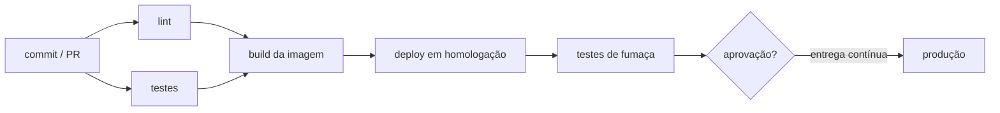

# CI/CD e infraestrutura como código

## Por que isso importa

Times que entregam bem fazem **deploy várias vezes por dia** com menos incidentes do que times que fazem um deploy por mês. Parece contraditório, mas a pesquisa DORA mostrou isso por anos seguidos: mudanças pequenas e frequentes, verificadas automaticamente, são mais seguras do que um pacote enorme instalado à mão numa sexta à noite. O que torna isso possível é um **pipeline** que testa e publica cada mudança sozinho, e uma infraestrutura descrita em **código**, que pode ser revisada, versionada e recriada. Saber montar e ler um pipeline é parte do trabalho de qualquer pessoa desenvolvedora hoje.

## Intuição

Pense numa **linha de montagem com controle de qualidade**. Cada peça passa por estações: medição, encaixe, teste de pressão. Se uma estação reprova, a peça sai da linha **na hora**, e não depois de embalada e enviada ao cliente.

O pipeline faz o mesmo com cada commit: compila, roda o lint, roda os testes, monta a imagem, publica em homologação e, se tudo passar, em produção. A **infraestrutura como código** é a **planta da fábrica** em papel: em vez de lembrar quais máquinas foram ligadas e como, está tudo escrito, e dá para construir outra fábrica igual a partir da planta.

## Visual



As três expressões que se confundem:

```text
Integração contínua (CI)   todo mundo integra na main várias vezes ao dia;
                           cada push roda build + testes automaticamente
Entrega contínua (CD)      a main está sempre pronta para produção;
                           o deploy é um botão (decisão humana)
Implantação contínua       cada commit aprovado vai para produção sozinho
```

## Conceito técnico

### Integração contínua

- **Branches curtos** e integração frequente na main (ou trunk-based development). Branches que vivem semanas geram conflitos enormes.
- **Todo push dispara o pipeline**, e o merge só acontece com ele verde (proteção de branch).
- **Rápido**: o feedback deve vir em minutos. Rode primeiro o que é barato e falha mais (lint, testes de unidade), paralelize, use **cache** de dependências.
- **Main quebrada é prioridade máxima** do time: ninguém empilha mudanças em cima de uma base vermelha.
- **Determinístico**: testes instáveis (flaky) corroem a confiança; conserte ou isole o motivo, não reexecute até passar.

### Anatomia de um pipeline (GitHub Actions)

```text
name: ci
on:
  pull_request:
  push: { branches: [main] }
jobs:
  testes:
    runs-on: ubuntu-latest
    strategy:
      matrix: { python: ["3.11", "3.12"] }
    steps:
      - uses: actions/checkout@v4
      - uses: actions/setup-python@v5
        with: { python-version: "${{ matrix.python }}", cache: pip }
      - run: pip install -r requirements.txt
      - run: pytest
  imagem:
    needs: testes
    if: github.ref == 'refs/heads/main'
    runs-on: ubuntu-latest
    steps:
      - uses: actions/checkout@v4
      - run: docker build -t registro/api:${{ github.sha }} .
      - run: docker push registro/api:${{ github.sha }}
```

- **workflow** (o arquivo), **jobs** (rodam em paralelo, em máquinas separadas), **steps** (em sequência dentro do job).
- `needs` cria dependências: os jobs formam um **grafo acíclico** (DAG), executado por níveis.
- `matrix` roda o mesmo job em várias combinações.
- **Artefatos**: o que um job produz e outro usa (o binário, a imagem). Construa **uma vez** e promova o mesmo artefato por homologação e produção, marcado com o hash do commit.
- **Segredos** ficam no cofre da plataforma, nunca no YAML; prefira credenciais temporárias (OIDC) a chaves fixas.

### Estratégias de deploy

- **Recriar**: derruba tudo e sobe o novo. Simples, com indisponibilidade.
- **Rolling**: troca as instâncias aos poucos (o padrão do Kubernetes, SD-06).
- **Blue-green**: dois ambientes completos; o novo (green) sobe ao lado, é testado, e o roteador vira de uma vez. Rollback é virar de volta.
- **Canário**: manda uma fração pequena do tráfego (1%, 5%, 25%...) para a versão nova e observa as métricas (SD-08) antes de ampliar.
- **Feature flags**: o código novo vai para produção desligado e é ligado por configuração, para alguns usuários. Separa **deploy** (técnico) de **lançamento** (decisão de produto).
- **Migrações de banco** precisam ser compatíveis com a versão antiga e a nova ao mesmo tempo (expandir, migrar, contrair, como no BD-07).

### Versionamento semântico

`MAJOR.MINOR.PATCH`: **PATCH** para correções compatíveis, **MINOR** para funcionalidades compatíveis, **MAJOR** para mudanças que quebram quem usa. Com **Conventional Commits** (`fix:`, `feat:`, `feat!:` ou `BREAKING CHANGE`), a próxima versão e o changelog podem ser calculados automaticamente.

### Infraestrutura como código (IaC)

Em vez de clicar no console da nuvem, a infraestrutura (redes, máquinas, bancos, buckets, DNS) é descrita em arquivos:

```text
resource "aws_s3_bucket" "fotos" {
  bucket = "minha-empresa-fotos"
  tags   = { ambiente = "producao" }
}

resource "aws_db_instance" "principal" {
  engine         = "postgres"
  engine_version = "17"
  instance_class = "db.t4g.medium"
}
```

- **Declarativo**: você descreve o fim, a ferramenta calcula os passos (como o Kubernetes).
- **plan**: compara o código com o **estado** registrado e com a nuvem, e mostra o que vai **criar**, **alterar** e **destruir**. Revise o plan no PR como se fosse código, porque é.
- **apply**: executa o plano.
- **Estado** (state): o mapa entre os recursos do código e os reais. Guarde num backend remoto com trava, nunca no Git (pode conter segredos).
- **Drift**: alguém mudou algo no console e a realidade divergiu do código. O próximo plan mostra (e desfaz). Regra: mudança só pelo código.
- Ferramentas: **Terraform/OpenTofu** e **Pulumi** para provisionar; **Ansible** para configurar máquinas; **Helm** e **Kustomize** para manifestos do Kubernetes. **GitOps** (Argo CD, Flux) leva a ideia ao fim: o cluster se reconcilia sozinho com o que está no Git.

### Medindo

As quatro métricas DORA: **frequência de deploy**, **lead time** (do commit à produção), **taxa de falha** das mudanças e **tempo para restaurar** o serviço. Melhorar as duas primeiras sem piorar as duas últimas é o objetivo.

## Código

Um executor de pipeline em miniatura: jobs com dependências rodam por níveis, e uma falha impede tudo o que depende dela, sem bloquear jobs independentes.

```python
jobs = {
    "lint":     {"needs": [], "passa": True},
    "testes":   {"needs": [], "passa": False},
    "docs":     {"needs": [], "passa": True},
    "imagem":   {"needs": ["lint", "testes"], "passa": True},
    "deploy":   {"needs": ["imagem"], "passa": True},
    "site":     {"needs": ["docs"], "passa": True},
}

resultado = {}
nivel = 1
while len(resultado) < len(jobs):
    prontos = [j for j in jobs if j not in resultado
               and all(d in resultado for d in jobs[j]["needs"])]
    print(f"nível {nivel}:")
    for j in prontos:
        if all(resultado[d] == "ok" for d in jobs[j]["needs"]):
            resultado[j] = "ok" if jobs[j]["passa"] else "falhou"
        else:
            resultado[j] = "pulado"
        print(f"   {j:8} {resultado[j]}")
    nivel += 1
```

## Erros comuns

- **Pipeline de 40 minutos**: ninguém espera, todos fazem merge no escuro. Paralelize, use cache e separe os testes lentos.
- **Reexecutar testes instáveis até passarem**, em vez de corrigir a causa.
- **Gerar um artefato diferente para cada ambiente**: o que foi testado não é o que foi para produção.
- **Segredos no YAML** ou impressos no log do CI.
- **Deploy sem caminho de volta**: sem rollback rápido, sem feature flag, sem migração compatível.
- **Mexer na infraestrutura pelo console** depois de adotar IaC, criando drift.
- **Arquivo de estado do Terraform no Git** ou sem trava, com duas pessoas aplicando ao mesmo tempo.
- **Aplicar sem ler o plan**: um "destroy" de banco passa despercebido numa lista de 80 linhas.

## Pratique

```quiz
id: SD-07-q1
tipo: multipla_escolha
pergunta: "Qual é a diferença entre entrega contínua e implantação contínua?"
opcoes: ["Nenhuma, são sinônimos", "Na entrega contínua o software está sempre pronto e o deploy em produção é uma decisão humana; na implantação contínua cada mudança aprovada no pipeline vai para produção sozinha", "Entrega contínua não tem testes automáticos", "Implantação contínua só existe com Kubernetes"]
resposta: 1
explicacao: "As duas exigem um pipeline confiável. A diferença é o último passo: um botão ou automático. Muitos times começam com entrega contínua e passam à implantação conforme ganham confiança nos testes e no monitoramento."
dificuldade: 1
```

```quiz
id: SD-07-q2
tipo: multipla_escolha
pergunta: "Você quer testar a versão nova com tráfego real, mas expondo só 5% dos usuários e voltando atrás se a taxa de erros subir. Que estratégia é essa?"
opcoes: ["Recriar", "Blue-green", "Canário", "Rolling com maxUnavailable: 0"]
resposta: 2
explicacao: "O canário, como o pássaro levado às minas, avisa cedo: uma fração pequena de tráfego vai para a versão nova enquanto as métricas são comparadas com a antiga. O blue-green vira tudo de uma vez."
dificuldade: 1
```

```quiz
id: SD-07-q3
tipo: verdadeiro_falso
pergunta: "É boa prática construir a imagem Docker de novo em cada ambiente (homologação, produção) para garantir que ela esteja atualizada."
resposta: false
explicacao: "Construir de novo pode trazer outra versão de uma dependência ou da imagem base, e o que vai para produção deixa de ser o que foi testado. O certo é construir uma vez, marcar com o hash do commit e promover o mesmo artefato."
dificuldade: 2
```

```quiz
id: SD-07-q4
tipo: resposta_curta
pergunta: "O que é drift em infraestrutura como código e como evitá-lo?"
resposta: "Drift é a diferença entre a infraestrutura real e a descrita no código, causada por mudanças feitas à mão no console ou por outro processo. Evita-se fazendo toda mudança pelo código (com revisão em PR), restringindo permissões de escrita no console e rodando o plan periodicamente para detectar divergências."
palavras_chave: ["código", "manual", "console", "plan"]
dificuldade: 2
```

```quiz
id: SD-07-q5
tipo: multipla_escolha
pergunta: "A biblioteca está na versão 2.4.1. Você remove um parâmetro de uma função pública. Qual deve ser a próxima versão pelo versionamento semântico?"
opcoes: ["2.4.2", "2.5.0", "3.0.0", "2.4.1-novo"]
resposta: 2
explicacao: "Remover um parâmetro quebra quem chamava a função com ele: é uma mudança incompatível, então o MAJOR sobe e MINOR e PATCH voltam a zero."
dificuldade: 1
```

```quiz
id: SD-07-q6
tipo: codigo
linguagem: python
pergunta: |
  **Em que ordem os jobs rodam?** `jobs` é um dicionário `nome -> lista de jobs de que ele depende` (o `needs`). Escreva `niveis(jobs)`, que devolve a lista de níveis de execução: o nível 1 tem os jobs sem dependências; cada nível seguinte tem os jobs cujas dependências já rodaram todas. Cada nível em ordem alfabética. Se houver um ciclo (algum job nunca fica pronto), devolva `None`.
codigo_inicial: |
  def niveis(jobs):
      return [list(jobs)]
usa: [def, while, for, if, return]
testes:
  - chamada: "niveis({'lint': [], 'testes': [], 'build': ['lint', 'testes'], 'deploy': ['build']})"
    saida: "[['lint', 'testes'], ['build'], ['deploy']]"
  - chamada: "niveis({'a': [], 'b': ['a'], 'c': []})"
    saida: "[['a', 'c'], ['b']]"
  - chamada: "niveis({'a': ['b'], 'b': ['a']})"
    saida: "None"
  - chamada: "niveis({'x': [], 'y': ['x'], 'z': ['y', 'w'], 'w': ['z']})"
    visivel: false
    saida: "None"
  - chamada: "niveis({})"
    visivel: false
    saida: "[]"
  - chamada: "niveis({'e2e': ['api', 'web'], 'web': ['deps'], 'api': ['deps'], 'deps': []})"
    visivel: false
    saida: "[['deps'], ['api', 'web'], ['e2e']]"
dica: "Guarde um conjunto feitos. Enquanto faltarem jobs, monte o nível com os que não estão em feitos e têm todas as dependências em feitos. Se o nível sair vazio, é ciclo."
solucao: |
  def niveis(jobs):
      feitos = set()
      resultado = []
      while len(feitos) < len(jobs):
          nivel = []
          for job, deps in jobs.items():
              if job not in feitos and all(d in feitos for d in deps):
                  nivel.append(job)
          if not nivel:
              return None
          nivel.sort()
          resultado.append(nivel)
          feitos.update(nivel)
      return resultado
explicacao: "É a ordenação topológica por níveis (algoritmo de Kahn) que você viu em grafos. Jobs do mesmo nível podem rodar em paralelo, em máquinas diferentes, e por isso o pipeline do primeiro teste leva o tempo de 3 jobs, não de 4. GitHub Actions e GitLab recusam o workflow quando os needs formam um ciclo, exatamente como o teste oculto com x, y, z e w."
dificuldade: 2
```

```quiz
id: SD-07-q7
tipo: codigo
linguagem: python
pergunta: |
  **O terraform plan.** `desejado` (o código) e `atual` (o estado) são dicionários `id do recurso -> dicionário de atributos`. Escreva `plano(desejado, atual)`, que devolve a frase do resumo do plan:

  `'Plan: X to add, Y to change, Z to destroy.'`

  - **add**: recursos em `desejado` que não existem em `atual`;
  - **destroy**: recursos em `atual` que não estão em `desejado`;
  - **change**: recursos nos dois com atributos diferentes.

  Se não houver nada a fazer, devolva `'No changes.'`.
codigo_inicial: |
  def plano(desejado, atual):
      return f'Plan: {len(desejado)} to add, 0 to change, 0 to destroy.'
usa: [def, for, if, return]
testes:
  - chamada: "plano({'bucket.fotos': {'regiao': 'sa'}}, {})"
    saida: "'Plan: 1 to add, 0 to change, 0 to destroy.'"
  - chamada: "plano({'db': {'versao': '17'}, 'bucket': {'regiao': 'sa'}}, {'db': {'versao': '16'}, 'bucket': {'regiao': 'sa'}})"
    saida: "'Plan: 0 to add, 1 to change, 0 to destroy.'"
  - chamada: "plano({'db': {'versao': '17'}}, {'db': {'versao': '17'}})"
    saida: "'No changes.'"
  - chamada: "plano({'a': {'x': 1}, 'b': {'x': 2}}, {'b': {'x': 3}, 'c': {'x': 1}, 'd': {}})"
    visivel: false
    saida: "'Plan: 1 to add, 1 to change, 2 to destroy.'"
  - chamada: "plano({}, {'velho': {'x': 1}})"
    visivel: false
    saida: "'Plan: 0 to add, 0 to change, 1 to destroy.'"
dica: "Percorra desejado contando quem não está em atual (add) e quem está mas com atributos diferentes (change). Depois conte em atual quem não está em desejado (destroy)."
solucao: |
  def plano(desejado, atual):
      add = change = destroy = 0
      for rid, attrs in desejado.items():
          if rid not in atual:
              add += 1
          elif atual[rid] != attrs:
              change += 1
      for rid in atual:
          if rid not in desejado:
              destroy += 1
      if add + change + destroy == 0:
          return 'No changes.'
      return f'Plan: {add} to add, {change} to change, {destroy} to destroy.'
explicacao: "É o mesmo diff de estado desejado contra estado atual do Kubernetes, aplicado à nuvem. No Terraform real, alguns atributos não podem ser alterados no lugar (mudar o nome de um bucket, por exemplo) e o recurso é destruído e recriado: o plan mostra isso como -/+ e conta em add e destroy. Por isso ler o plan antes do apply é obrigatório."
dificuldade: 1
```

```quiz
id: SD-07-q8
tipo: codigo
linguagem: javascript
pergunta: |
  **Calculando a próxima versão.** Escreva `proximaVersao(versao, commits)`. `versao` é uma string `'MAJOR.MINOR.PATCH'` e `commits` é uma lista de mensagens no padrão Conventional Commits:

  - mensagem que começa com `fix:` ou `fix(` pede **patch**;
  - que começa com `feat:` ou `feat(` pede **minor**;
  - que tem `!:` antes da descrição (`feat!:`, `refactor(api)!:`) ou contém `BREAKING CHANGE` pede **major**;
  - outras (`docs:`, `chore:`, `test:`) não mudam a versão.

  Vale o **maior** pedido entre os commits. Subir o major zera minor e patch; subir o minor zera o patch.
codigo_inicial: |
  function proximaVersao(versao, commits) {
    const [ma, mi, pa] = versao.split('.').map(Number);
    return `${ma}.${mi}.${pa + 1}`;
  }
usa: [function, for, if, return]
testes:
  - chamada: "proximaVersao('1.2.3', ['fix: corrige total', 'docs: readme'])"
    saida: "'1.2.4'"
  - chamada: "proximaVersao('1.2.3', ['fix: corrige total', 'feat(carrinho): cupom'])"
    saida: "'1.3.0'"
  - chamada: "proximaVersao('1.2.3', ['feat!: remove a v1 da API'])"
    saida: "'2.0.0'"
  - chamada: "proximaVersao('0.9.0', ['chore: atualiza deps', 'test: mais casos'])"
    visivel: false
    saida: "'0.9.0'"
  - chamada: "proximaVersao('2.4.1', ['fix(auth): token', 'refactor(api)!: troca o formato das datas'])"
    visivel: false
    saida: "'3.0.0'"
  - chamada: "proximaVersao('1.0.9', ['feat: exporta CSV\\n\\nBREAKING CHANGE: muda a ordem das colunas', 'fix: typo'])"
    visivel: false
    saida: "'2.0.0'"
dica: "Dê um peso a cada commit (0 nada, 1 patch, 2 minor, 3 major) com startsWith e includes, e guarde o maior. Para o !, pegue o texto antes do primeiro ':' com indexOf e veja se termina com '!'."
solucao: |
  function proximaVersao(versao, commits) {
    let [ma, mi, pa] = versao.split('.').map(Number);
    let nivel = 0;
    for (const msg of commits) {
      const tipo = msg.slice(0, msg.indexOf(':'));
      let peso = 0;
      if (tipo.endsWith('!') || msg.includes('BREAKING CHANGE')) peso = 3;
      else if (msg.startsWith('feat:') || msg.startsWith('feat(')) peso = 2;
      else if (msg.startsWith('fix:') || msg.startsWith('fix(')) peso = 1;
      if (peso > nivel) nivel = peso;
    }
    if (nivel === 3) return `${ma + 1}.0.0`;
    if (nivel === 2) return `${ma}.${mi + 1}.0`;
    if (nivel === 1) return `${ma}.${mi}.${pa + 1}`;
    return versao;
  }
explicacao: "Ferramentas como semantic-release e release-please fazem exatamente isso no pipeline: leem os commits desde a última tag, calculam a versão, geram o changelog e publicam. O último teste oculto mostra o rodapé BREAKING CHANGE no corpo da mensagem, que vale tanto quanto o !. A disciplina nas mensagens de commit vira automação de release."
dificuldade: 2
```

## Resumo

- **CI**: integrar cedo e sempre, com build e testes automáticos e rápidos; main vermelha é prioridade.
- **CD**: a main está sempre pronta (entrega) ou vai sozinha para produção (implantação).
- Pipeline = **DAG de jobs** com `needs`, matriz, cache, **artefato único** promovido entre ambientes, segredos no cofre.
- Deploy seguro: **rolling**, **blue-green**, **canário**, **feature flags**, migrações compatíveis e rollback rápido.
- **SemVer** com Conventional Commits automatiza versões e changelogs.
- **IaC**: infraestrutura declarada em código, **plan** revisado, **apply**, estado remoto com trava, nada de **drift**.

## Para ir além

- Crie um workflow do GitHub Actions para um projeto seu que rode lint e testes em cada PR, e proteja a main exigindo o check verde.
- Faça o tutorial do Terraform (ou OpenTofu) criando um bucket, mude uma tag, leia o plan e destrua tudo no final.
- Meça o tempo do seu pipeline e tente cortá-lo pela metade com cache e paralelismo.
- **Próximo módulo**: SD-08 Observabilidade: logs, métricas, traces.
