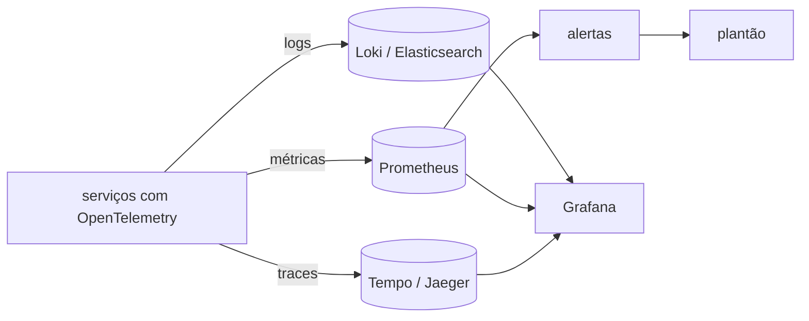

# Observabilidade: logs, métricas, traces

## Por que isso importa

Em produção não existe depurador nem `print`. Quando um cliente diz "o checkout ficou lento ontem às 15h", tudo que você tem é o que o sistema **registrou**. Num monólito, um log talvez baste. Numa arquitetura com dez serviços, filas e caches (SD-04, AS-04), uma requisição passa por vários processos em várias máquinas, e sem as ferramentas certas encontrar o culpado vira adivinhação. Observabilidade é o que separa "ficamos 4 horas fora do ar procurando" de "em 5 minutos vimos que era o serviço de estoque". E saber definir um **SLO** é o que permite ao time decidir, com números, quando acelerar e quando parar para estabilizar.

## Intuição

Pense num **carro**. O **painel** mostra poucos números o tempo todo: velocidade, combustível, temperatura. São as **métricas**: baratas, agregadas, ótimas para perceber que algo está errado. A **luz de alerta** é o alerta. Quando ela acende, o mecânico conecta o scanner e lê o **registro de eventos** do motor: são os **logs**, detalhados e caros. E se o problema é "o carro engasga quando subo a serra com o ar ligado", ele precisa acompanhar uma **viagem inteira** passo a passo: é o **trace**.

Monitoramento responde perguntas que você já previu ("a CPU está alta?"). **Observabilidade** é conseguir responder perguntas novas, que você não previu, olhando os dados que o sistema emite, sem precisar subir código novo.

## Visual

Um trace: a requisição do usuário e o tempo de cada parte, em cascata.

```text
trace 4bf92f...  GET /checkout                         [=========================] 480 ms
  span  api-gateway: autenticar                        [==]                         35 ms
  span  pedidos: criar pedido                             [====================]   410 ms
    span  postgres: INSERT pedidos                        [=]                       12 ms
    span  estoque: reservar itens  (HTTP)                   [================]     340 ms   <- gargalo
      span  postgres: SELECT ... FOR UPDATE                 [===============]      320 ms   <- espera de trava
    span  kafka: publicar PedidoCriado                                       [=]     8 ms
```



## Conceito técnico

### Logs

- **Estruturados**: em vez de `"Pedido 42 falhou para usuario 7"`, emita campos: `{"nivel":"erro","evento":"pedido_falhou","pedido":42,"usuario":7,"motivo":"estoque","trace_id":"4bf92f..."}`. Dá para filtrar, agrupar e contar.
- **Níveis**: `DEBUG` (desligado em produção), `INFO` (eventos de negócio), `WARN` (algo estranho, mas tratado), `ERROR` (falhou e alguém deveria olhar).
- **Correlação**: todo log carrega o **trace_id** (ou request_id), propagado entre serviços em cabeçalhos HTTP (`traceparent`). Assim um clique leva de um log ao trace inteiro.
- **Nunca** registre senhas, tokens, números de cartão ou dados pessoais desnecessários (LGPD).
- Logs custam caro em volume: faça **amostragem** de logs repetitivos e defina retenção.

### Métricas

Números agregados ao longo do tempo, com **labels** (`http_requests_total{rota="/pagar", status="500"}`).

- **Contador** (counter): só cresce (requisições, erros). Você olha a **taxa** por segundo.
- **Gauge**: sobe e desce (memória em uso, itens na fila, conexões abertas).
- **Histograma**: distribui valores em faixas (buckets) para calcular **percentis** de latência no servidor. Média de latência esconde a cauda; olhe p50, p95 e p99 (SD-01).
- **Cardinalidade**: cada combinação de labels é uma série. Colocar `usuario_id` ou URL completa como label cria milhões de séries e derruba o Prometheus. Labels devem ter poucos valores.

O que medir:

- **RED** (para serviços): **R**ate (requisições por segundo), **E**rrors (taxa de erros), **D**uration (latência em percentis).
- **USE** (para recursos): **U**tilization, **S**aturation (fila, espera), **E**rrors.
- Os **quatro sinais de ouro** do Google SRE: latência, tráfego, erros e saturação.

### Traces distribuídos

- Um **trace** é a história de uma requisição; é feito de **spans** (uma operação com início, fim, atributos e o span **pai**).
- O **contexto** (trace_id + span_id do pai) viaja entre serviços pelo cabeçalho `traceparent` (padrão W3C).
- **OpenTelemetry** é o padrão aberto: instrumentação automática para frameworks e bancos, e exportação para qualquer backend.
- **Amostragem**: guardar 100% dos traces é caro. Amostragem por cabeça (decide no início, ex.: 10%) ou por cauda (decide no fim, guardando todos os lentos e com erro).
- Um trace mostra o que métricas não mostram: **onde** dentro da requisição o tempo foi gasto, e chamadas em série que poderiam ser paralelas ou N+1 (BD-07).

### SLI, SLO, SLA e orçamento de erros

- **SLI** (indicador): uma medida do que o usuário sente. Ex.: proporção de requisições ao checkout respondidas com sucesso em menos de 300 ms.
- **SLO** (objetivo): a meta interna para o SLI. Ex.: 99,9% em 30 dias.
- **SLA** (acordo): o compromisso com o cliente, com multa. Mais frouxo que o SLO.
- **Orçamento de erros**: o que sobra do SLO. 99,9% de 1 milhão de requisições permite **1.000** ruins no mês. Se o orçamento está sobrando, o time pode arriscar mais (deploys, experimentos); se acabou, a prioridade vira confiabilidade. 100% nunca é a meta: é caro demais e o usuário não percebe a diferença.

### Alertas

- Alerte sobre **sintomas** que o usuário sente (SLO em risco, erros, latência), não sobre causas que podem não importar (CPU a 90% sem impacto).
- Todo alerta que acorda alguém precisa ser **acionável** e ter um **runbook**: o que olhar, o que fazer.
- Use uma **duração** ("erro acima de 5% por 5 minutos") para não disparar com picos de um segundo.
- Alertas que tocam e ninguém faz nada causam **fadiga**: as pessoas passam a ignorar todos, inclusive o importante.
- **Alerta por consumo do orçamento** (burn rate): "neste ritmo, o orçamento do mês acaba em 2 dias" é melhor sinal do que um limite fixo.

## Código

Métricas RED de um serviço e o orçamento de erros de um SLO, a partir de uma lista de requisições.

```python
requisicoes = (
    [("/produtos", 200, 40)] * 900
    + [("/produtos", 200, 900)] * 50
    + [("/pagar", 200, 120)] * 46
    + [("/pagar", 500, 30)] * 4
)
segundos = 60
slo = 0.99    # 99% das requisições com sucesso e em menos de 300 ms

def percentil(valores, p):
    ordenados = sorted(valores)
    return ordenados[max(0, int(len(ordenados) * p) - 1)]

total = len(requisicoes)
erros = sum(1 for _, status, _ in requisicoes if status >= 500)
latencias = [ms for _, _, ms in requisicoes]
print(f"Rate:     {total / segundos:.1f} req/s")
print(f"Errors:   {erros / total:.1%}")
print(f"Duration: p50={percentil(latencias, 0.50)} ms  p99={percentil(latencias, 0.99)} ms")

boas = sum(1 for _, status, ms in requisicoes if status < 500 and ms < 300)
permitidas = round(total * (1 - slo))
ruins = total - boas
print(f"SLI: {boas / total:.2%} (SLO {slo:.0%})")
print(f"Orçamento: {permitidas} ruins permitidas, {ruins} gastas ({ruins / permitidas:.0%})")
```

Repare que a taxa de erros é baixa (0,4%), mas as 50 requisições lentas estouram o orçamento: o SLO mede o que o usuário sente, não só os 500.

## Erros comuns

- **Logs em texto livre**, impossíveis de filtrar e contar.
- **Senhas, tokens e dados pessoais nos logs.**
- **Olhar só a média** de latência, escondendo o p99 que irrita os melhores clientes.
- **Labels de alta cardinalidade** (id de usuário, URL com parâmetros) nas métricas.
- **Não propagar o contexto** do trace entre serviços, gerando traces quebrados em pedaços.
- **Alertar sobre tudo**: CPU, memória, disco, cada exceção. O plantão aprende a ignorar.
- **Alerta sem runbook** e sem dono.
- **SLO de 100%** ou definido pelo que é fácil medir, e não pelo que o usuário sente.
- **Instrumentar só depois do incidente**: a observabilidade precisa existir antes.

## Pratique

```quiz
id: SD-08-q1
tipo: multipla_escolha
pergunta: "O checkout está lento e envolve cinco serviços. Qual sinal mostra diretamente em qual serviço e em qual operação o tempo foi gasto em uma requisição específica?"
opcoes: ["Uma métrica de CPU", "Um trace distribuído com seus spans", "O log do API gateway", "O gauge de memória"]
resposta: 1
explicacao: "O trace segue a requisição por todos os serviços, com a duração de cada span. As métricas dizem que algo está lento; o trace diz onde."
dificuldade: 1
```

```quiz
id: SD-08-q2
tipo: multipla_escolha
pergunta: "Qual destas labels é uma má ideia numa métrica do Prometheus?"
opcoes: ["metodo (GET, POST...)", "status (200, 404, 500...)", "usuario_id", "rota com o padrão (/pedidos/:id)"]
resposta: 2
explicacao: "Cada valor de label cria uma série temporal. Com milhões de usuários, são milhões de séries: memória e custo explodem. Detalhes por usuário pertencem a logs ou traces, que guardam eventos individuais."
dificuldade: 2
```

```quiz
id: SD-08-q3
tipo: verdadeiro_falso
pergunta: "Um bom alerta para acordar o plantão de madrugada é 'CPU acima de 80% em qualquer servidor'."
resposta: false
explicacao: "CPU alta é uma causa possível, não um sintoma: pode não afetar nenhum usuário (um job em lote, por exemplo). Alertas que acordam alguém devem ser sobre o que o usuário sente, como o SLO em risco, e ser acionáveis."
dificuldade: 1
```

```quiz
id: SD-08-q4
tipo: resposta_curta
pergunta: "Um serviço tem SLO de 99,9% de requisições bem-sucedidas por mês e recebe 2 milhões de requisições por mês. Quanto é o orçamento de erros, e para que ele serve?"
resposta: "São 2.000 requisições ruins por mês (0,1% de 2 milhões). O orçamento serve para equilibrar velocidade e confiabilidade: enquanto sobra, o time pode lançar e arriscar mais; se ele acaba, a prioridade passa a ser estabilidade, com menos deploys e mais correções."
palavras_chave: ["2.000", "0,1%", "deploys", "confiabilidade"]
dificuldade: 2
```

```quiz
id: SD-08-q5
tipo: multipla_escolha
pergunta: "O que o cabeçalho traceparent, enviado de um serviço para outro, permite?"
opcoes: ["Autenticar o serviço chamador", "Que o serviço chamado crie seus spans como filhos do span de quem chamou, montando um único trace", "Comprimir a requisição", "Escolher a réplica mais próxima"]
resposta: 1
explicacao: "Ele carrega o trace_id e o id do span pai (padrão W3C Trace Context). Sem a propagação, cada serviço inicia um trace próprio e a história da requisição fica em pedaços."
dificuldade: 1
```

```quiz
id: SD-08-q6
tipo: codigo
linguagem: python
pergunta: |
  **Taxa de erros por rota a partir dos logs.** Cada linha está em **logfmt**: pares `chave=valor` separados por espaço, em qualquer ordem, como `nivel=info rota=/pagar status=200 ms=35`. Escreva `erros_por_rota(linhas)`, que devolve um dicionário `rota -> taxa de erro` (proporção de linhas com `status` >= 500 naquela rota), arredondada com `round(x, 2)`. Ignore linhas sem `rota` ou sem `status`. As rotas aparecem no dicionário na ordem em que surgem pela primeira vez.
codigo_inicial: |
  def erros_por_rota(linhas):
      return {}
usa: [def, for, if, return]
testes:
  - chamada: "erros_por_rota(['rota=/pagar status=200', 'rota=/pagar status=500', 'rota=/home status=200'])"
    saida: "{'/pagar': 0.5, '/home': 0.0}"
  - chamada: "erros_por_rota(['nivel=erro status=503 rota=/busca ms=1200', 'ms=30 rota=/busca status=200 nivel=info', 'rota=/busca status=404'])"
    saida: "{'/busca': 0.33}"
  - chamada: "erros_por_rota(['nivel=info msg=iniciando', 'rota=/x status=500'])"
    visivel: false
    saida: "{'/x': 1.0}"
  - chamada: "erros_por_rota([])"
    visivel: false
    saida: "{}"
  - chamada: "erros_por_rota(['rota=/a status=499', 'rota=/a status=500', 'rota=/b', 'rota=/a status=200', 'rota=/a status=502'])"
    visivel: false
    saida: "{'/a': 0.5}"
dica: "Para cada linha, monte um dicionário com dict(par.split('=', 1) for par in linha.split()). Guarde, por rota, o total e os erros, e calcule as taxas no final."
solucao: |
  def erros_por_rota(linhas):
      contagem = {}
      for linha in linhas:
          campos = dict(par.split('=', 1) for par in linha.split())
          if 'rota' not in campos or 'status' not in campos:
              continue
          total, erros = contagem.get(campos['rota'], (0, 0))
          if int(campos['status']) >= 500:
              erros += 1
          contagem[campos['rota']] = (total + 1, erros)
      return {rota: round(e / t, 2) for rota, (t, e) in contagem.items()}
explicacao: "Isso só é possível porque o log é estruturado: com texto livre você precisaria de uma expressão regular diferente para cada mensagem. Note que 404 e 499 não contam como erro do servidor: são erros do cliente ou desistências, e incluí-los no SLI faria o time ser acordado por links quebrados de outros sites. Ferramentas como Loki fazem essa conta com uma consulta, mas em escala o certo é emitir uma métrica e deixar os logs para investigação."
dificuldade: 2
```

```quiz
id: SD-08-q7
tipo: codigo
linguagem: python
pergunta: |
  **Um alerta com duração.** `serie` é uma lista de amostras (uma por minuto) da taxa de erros. Escreva `eventos_alerta(serie, limite, por)`, que devolve a lista de eventos `(minuto, 'dispara')` e `(minuto, 'resolve')`:

  - o alerta **dispara** no minuto em que completa `por` amostras **seguidas** acima de `limite` (estritamente maior);
  - depois de disparado, ele **resolve** na primeira amostra que não está acima do limite;
  - picos mais curtos que `por` amostras não geram nada.
codigo_inicial: |
  def eventos_alerta(serie, limite, por):
      return [(i, 'dispara') for i, v in enumerate(serie) if v > limite]
usa: [def, for, if, return]
testes:
  - chamada: "eventos_alerta([1, 9, 9, 9, 2], 5, 3)"
    saida: "[(3, 'dispara'), (4, 'resolve')]"
  - chamada: "eventos_alerta([1, 9, 9, 1, 9, 1], 5, 3)"
    saida: "[]"
  - chamada: "eventos_alerta([9, 9, 9, 9, 9], 5, 2)"
    saida: "[(1, 'dispara')]"
  - chamada: "eventos_alerta([9, 1, 9, 9, 1, 9, 9, 9, 5], 5, 2)"
    visivel: false
    saida: "[(3, 'dispara'), (4, 'resolve'), (6, 'dispara'), (8, 'resolve')]"
  - chamada: "eventos_alerta([6, 2], 5, 1)"
    visivel: false
    saida: "[(0, 'dispara'), (1, 'resolve')]"
  - chamada: "eventos_alerta([], 5, 1)"
    visivel: false
    saida: "[]"
dica: "Mantenha um contador de amostras seguidas acima do limite e um booleano disparado. Acima: some 1 ao contador e dispare quando ele chegar a por (se ainda não disparou). Abaixo ou igual: zere o contador e, se estava disparado, resolva."
solucao: |
  def eventos_alerta(serie, limite, por):
      eventos = []
      seguidas = 0
      disparado = False
      for minuto, valor in enumerate(serie):
          if valor > limite:
              seguidas += 1
              if seguidas >= por and not disparado:
                  disparado = True
                  eventos.append((minuto, 'dispara'))
          else:
              seguidas = 0
              if disparado:
                  disparado = False
                  eventos.append((minuto, 'resolve'))
      return eventos
explicacao: "É o campo for de uma regra do Prometheus: o alerta fica pendente até a condição durar o tempo pedido. O segundo teste mostra o ganho: dois picos curtos não acordam ninguém. O preço é a demora: com por=5 minutos, você só sabe do problema 5 minutos depois. Alertas por burn rate equilibram isso usando duas janelas, uma curta e uma longa."
dificuldade: 2
```

```quiz
id: SD-08-q8
tipo: codigo
linguagem: javascript
pergunta: |
  **Onde o tempo foi gasto no trace?** Cada span é `{ id, pai, nome, inicio, fim }` (em ms; `pai` é `null` na raiz). O **tempo próprio** de um span é a sua duração (`fim - inicio`) menos a soma das durações dos **filhos diretos** (suponha que os filhos não se sobrepõem). Escreva `tempoProprio(spans)`, que devolve um objeto `nome -> tempo próprio`, na ordem em que os spans aparecem.
codigo_inicial: |
  function tempoProprio(spans) {
    const r = {};
    for (const s of spans) r[s.nome] = s.fim - s.inicio;
    return r;
  }
usa: [function, for, return]
testes:
  - chamada: "tempoProprio([{ id: 1, pai: null, nome: 'checkout', inicio: 0, fim: 100 }, { id: 2, pai: 1, nome: 'banco', inicio: 10, fim: 40 }])"
    saida: "{ checkout: 70, banco: 30 }"
  - chamada: "tempoProprio([{ id: 1, pai: null, nome: 'pedido', inicio: 0, fim: 480 }, { id: 2, pai: 1, nome: 'estoque', inicio: 50, fim: 390 }, { id: 3, pai: 2, nome: 'lock', inicio: 60, fim: 380 }, { id: 4, pai: 1, nome: 'fila', inicio: 400, fim: 408 }])"
    saida: "{ pedido: 132, estoque: 20, lock: 320, fila: 8 }"
  - chamada: "tempoProprio([{ id: 7, pai: null, nome: 'so', inicio: 5, fim: 9 }])"
    visivel: false
    saida: "{ so: 4 }"
  - chamada: "tempoProprio([{ id: 3, pai: 1, nome: 'a', inicio: 1, fim: 3 }, { id: 1, pai: null, nome: 'raiz', inicio: 0, fim: 10 }, { id: 4, pai: 1, nome: 'b', inicio: 4, fim: 9 }])"
    visivel: false
    saida: "{ a: 2, raiz: 3, b: 5 }"
dica: "Primeira passada: some a duração de cada span na conta do seu pai (um objeto filhos por id). Segunda passada: tempo próprio = duração - (filhos[id] || 0)."
solucao: |
  function tempoProprio(spans) {
    const filhos = {};
    for (const s of spans) {
      if (s.pai !== null) filhos[s.pai] = (filhos[s.pai] || 0) + (s.fim - s.inicio);
    }
    const r = {};
    for (const s of spans) {
      r[s.nome] = s.fim - s.inicio - (filhos[s.id] || 0);
    }
    return r;
  }
explicacao: "No segundo teste, o span estoque dura 340 ms, mas quase tudo é o lock filho (320 ms): o problema não é o código do estoque, é a espera pela trava no banco. Olhar só a duração total apontaria o culpado errado. O último teste oculto mostra spans fora de ordem, comum porque os filhos terminam e são exportados antes do pai; por isso são precisas duas passadas. Ferramentas como Jaeger e Grafana Tempo mostram esse tempo próprio na visão de cascata."
dificuldade: 2
```

## Resumo

- **Métricas** avisam que algo está errado (baratas, agregadas); **logs** contam os detalhes; **traces** mostram onde o tempo foi gasto entre serviços.
- Logs **estruturados**, com níveis, **trace_id** e sem dados sensíveis.
- Métricas: **contador**, **gauge**, **histograma**; métodos **RED** e **USE**; cuidado com a **cardinalidade**; olhe **percentis**.
- Traces com **spans** e contexto propagado (`traceparent`); **OpenTelemetry** como padrão; amostragem.
- **SLI** mede o que o usuário sente, **SLO** é a meta, o **orçamento de erros** decide entre velocidade e estabilidade.
- Alertas sobre **sintomas**, **acionáveis**, com duração, runbook e sem fadiga.

## Para ir além

- Suba Prometheus e Grafana com o Docker Compose (SD-05), instrumente uma API sua com OpenTelemetry e monte um painel RED.
- Defina um SLO para um endpoint seu e calcule o orçamento de erros do último mês.
- Leia os capítulos de monitoramento e SLOs do livro de SRE do Google.
- **Fim da trilha.** Próximas trilhas sugeridas: Segurança (SE-01) e Desenvolvimento web.
