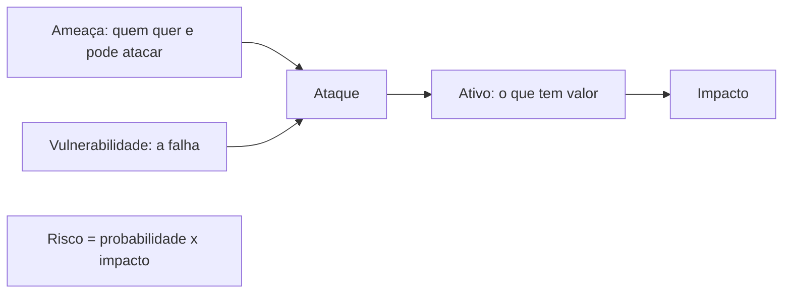

# Fundamentos: CIA, ameaças, superfície de ataque

## Por que isso importa

Vazamentos de dados aparecem no noticiário toda semana, e quase sempre a causa é banal: uma senha fraca, um banco exposto na internet, uma biblioteca desatualizada, um funcionário que clicou num link. Segurança não é um produto que se instala no fim; é um jeito de pensar que precisa estar em cada decisão, do desenho da tabela ao deploy. A LGPD também cobra das empresas que protejam dados pessoais, com multas. E toda pessoa desenvolvedora, mesmo sem ser especialista, escreve código que vai ser atacado: robôs varrem a internet o tempo todo atrás de qualquer porta aberta.

## Intuição

Pense na segurança de uma **casa**. Você não tranca só a porta da frente: há a porta dos fundos, as janelas, a garagem, a chave escondida debaixo do tapete. Cada entrada é parte da **superfície de ataque**, e o ladrão escolhe a mais fraca. Por isso:

- Menos entradas é melhor (não deixe janelas que ninguém usa abertas).
- Cada entrada tem a proteção que merece (grade na janela do térreo, não na do sexto andar): isso é **avaliar o risco**.
- Várias camadas (portão, porta, alarme, cofre) fazem uma falha não ser o fim: é a **defesa em profundidade**.
- A diarista recebe a chave da porta, não a do cofre: é o **menor privilégio**.

E o que se protege não é só "que ninguém entre". É que ninguém **leia** seus documentos (confidencialidade), ninguém os **altere** (integridade), e que você consiga **entrar** em casa quando quiser (disponibilidade).

## Visual

A tríade CIA e um exemplo de ataque a cada lado:

```text
                 Confidencialidade
                 (só quem pode lê)
                 ex.: vazamento do banco de clientes
                        /\
                       /  \
                      /    \
                     /______\
   Integridade                    Disponibilidade
   (ninguém altera sem permissão)  (funciona quando precisa)
   ex.: mudar o valor de um Pix    ex.: DDoS, ransomware
```

Do ativo ao risco:



## Conceito técnico

### A tríade CIA

- **Confidencialidade**: só pessoas autorizadas acessam a informação. Ferramentas: controle de acesso, criptografia (SE-02).
- **Integridade**: a informação não é alterada sem autorização, e alterações são detectáveis. Ferramentas: hashes, assinaturas, MACs, logs de auditoria.
- **Disponibilidade**: o sistema funciona quando é preciso. Ferramentas: redundância, backups, limites de taxa, proteção contra DDoS.

Muitas vezes se acrescentam **autenticidade** (sei quem enviou) e **não repúdio** (quem enviou não pode negar).

### Vocabulário

- **Ativo**: o que tem valor (dados de clientes, dinheiro, reputação, o próprio serviço no ar).
- **Ameaça**: algo ou alguém que pode causar dano (um criminoso, um funcionário insatisfeito, um robô, uma enchente).
- **Vulnerabilidade**: uma fraqueza que pode ser explorada (SQL injection, senha padrão, servidor sem atualização). Vulnerabilidades públicas recebem um código **CVE** e uma nota de gravidade **CVSS**.
- **Exploit**: o código ou técnica que explora a vulnerabilidade.
- **Risco**: a combinação de **probabilidade** e **impacto**. Uma vulnerabilidade gravíssima num sistema desligado e isolado tem risco baixo.
- **Controle**: a medida que reduz o risco (preventiva, detectiva ou corretiva).

Com o risco avaliado, há quatro respostas: **mitigar** (aplicar controles), **transferir** (seguro, terceirizar), **aceitar** (conscientemente, por escrito) ou **evitar** (não fazer a funcionalidade).

### Quem ataca

- **Robôs automatizados**: varrem a internet inteira em minutos procurando portas abertas, senhas padrão e versões vulneráveis. São a maioria. Não é preciso ser alvo de ninguém para ser atacado.
- **Criminosos com fins financeiros**: ransomware, roubo de cartões, fraude, venda de dados.
- **Pessoas de dentro** (insiders): com acesso legítimo, por má-fé ou descuido.
- **Ataques à cadeia de suprimentos**: comprometer uma biblioteca ou ferramenta que muitos usam.
- **Engenharia social**: enganar pessoas (phishing, falso suporte técnico). Muitas vezes é o caminho mais fácil.

### Modelagem de ameaças

Quatro perguntas (Adam Shostack): **O que estamos construindo? O que pode dar errado? O que vamos fazer a respeito? Fizemos um bom trabalho?** Desenhe o fluxo de dados, marque as **fronteiras de confiança** (onde dados passam de uma área menos confiável para outra mais confiável, como da internet para a sua API) e use o **STRIDE** para cada elemento:

| Ameaça | Viola | Exemplo | Controle típico |
|---|---|---|---|
| **S**poofing (falsificar identidade) | autenticidade | usar a sessão de outra pessoa | autenticação forte, MFA |
| **T**ampering (adulterar) | integridade | alterar o preço no corpo da requisição | validar no servidor, assinaturas |
| **R**epudiation (negar ter feito) | não repúdio | "eu não fiz essa transferência" | logs de auditoria |
| **I**nformation disclosure (vazar) | confidencialidade | mensagem de erro com a stack trace | criptografia, mínimo de dados |
| **D**enial of service (negar serviço) | disponibilidade | milhões de requisições de login | limites de taxa, filas |
| **E**levation of privilege (escalar) | autorização | usuário comum chamando rota de admin | checar permissão em cada rota |

### Superfície de ataque

Tudo por onde um atacante pode interagir com o sistema: endpoints públicos, formulários, uploads, portas abertas, painéis de administração, dependências, contas de funcionários, o pipeline de CI (SD-07). Para reduzi-la:

- Desligue o que não é usado (rotas antigas, serviços de exemplo, contas padrão).
- Não exponha bancos, caches e painéis à internet: deixe-os em rede privada.
- Remova dependências desnecessárias e mantenha as outras atualizadas.
- Toda entrada é suspeita: valide no servidor, sempre.

### Princípios de projeto seguro

- **Menor privilégio**: cada usuário, serviço e chave tem só as permissões de que precisa.
- **Defesa em profundidade**: várias camadas independentes; nenhuma é perfeita.
- **Falhar de forma segura**: se a verificação de permissão der erro, a resposta é negar.
- **Padrões seguros** (secure by default): o jeito fácil é o seguro.
- **Mediação completa**: verificar a permissão em **toda** requisição, não só na primeira.
- **Não confie em segredo de projeto** (Kerckhoffs): o sistema deve ser seguro mesmo que o atacante conheça o código. Só as chaves são segredo.
- **Separação de funções** e **mínimo de dados**: não guarde o que não precisa (o dado que você não tem não vaza).

### Senhas, o elo mais atacado

As recomendações atuais do NIST: priorize **comprimento** (frases longas), verifique contra listas de **senhas vazadas**, não force troca periódica nem regras de "um símbolo e uma maiúscula", permita colar (para gerenciadores de senha) e ofereça **MFA**. A força de uma senha aleatória se mede em **bits de entropia**: comprimento vezes log2 do tamanho do alfabeto. Uma senha escolhida por pessoas tem bem menos entropia do que a fórmula sugere, porque pessoas escolhem padrões.

## Código

Entropia e tempo para quebrar por força bruta, supondo um atacante que testa 10 bilhões de senhas por segundo contra um hash rápido.

```python
import math

def entropia(tamanho, alfabeto):
    return tamanho * math.log2(alfabeto)

def tempo_legivel(segundos):
    for nome, s in [("anos", 365 * 86400), ("dias", 86400), ("horas", 3600), ("minutos", 60)]:
        if segundos >= s:
            return f"{segundos / s:,.0f} {nome}"
    return f"{segundos:.3f} segundos"

tentativas_por_segundo = 10_000_000_000
casos = [
    ("8 minúsculas", 8, 26),
    ("8 letras, dígitos e símbolos", 8, 94),
    ("12 letras, dígitos e símbolos", 12, 94),
    ("4 palavras de um dicionário de 7776", 4, 7776),
    ("6 palavras de um dicionário de 7776", 6, 7776),
]
for nome, tamanho, alfabeto in casos:
    bits = entropia(tamanho, alfabeto)
    media = 2 ** bits / 2 / tentativas_por_segundo
    print(f"{nome:38} {bits:5.1f} bits   {tempo_legivel(media)}")
```

Repare que 6 palavras aleatórias (fáceis de lembrar) vencem 8 caracteres "complexos" por uma margem enorme.

## Erros comuns

- **Achar que ninguém vai atacar porque o sistema é pequeno**: os robôs não escolhem.
- **Segurança por obscuridade**: rota de admin "secreta", porta não padrão, algoritmo caseiro.
- **Confiar no front-end**: validação no navegador é conforto para o usuário; o atacante fala direto com a API.
- **Permissões amplas por preguiça**: chave de nuvem com acesso total no servidor da aplicação, usuário do banco como superusuário.
- **Falhar aberto**: `try: verifica() except: pass`.
- **Mensagens de erro detalhadas** em produção (stack traces, SQL, versões).
- **Esquecer a disponibilidade e a integridade**: backup que nunca foi testado não é backup.
- **Guardar dados que não precisa**, "para o caso de um dia servir".

## Pratique

```quiz
id: SE-01-q1
tipo: multipla_escolha
pergunta: "Um ransomware criptografa os servidores de um hospital e o sistema de prontuários para de funcionar. Qual propriedade da tríade CIA foi atingida mais diretamente?"
opcoes: ["Confidencialidade", "Integridade", "Disponibilidade", "Nenhuma, pois os dados não saíram do hospital"]
resposta: 2
explicacao: "O efeito imediato é que o sistema não pode ser usado. Muitos grupos de ransomware hoje também copiam os dados antes de criptografar e ameaçam publicá-los (dupla extorsão), atingindo também a confidencialidade."
dificuldade: 1
```

```quiz
id: SE-01-q2
tipo: multipla_escolha
pergunta: "Um usuário comum descobre que, mudando o id na URL /contas/41 para /contas/42, vê a conta de outra pessoa. Na classificação STRIDE, o problema principal é:"
opcoes: ["Spoofing", "Tampering", "Information disclosure (com falta de autorização)", "Denial of service"]
resposta: 2
explicacao: "O usuário está autenticado como ele mesmo (não há falsificação de identidade); o servidor apenas não verifica se ele pode ver aquela conta, e dados vazam. É o primeiro item do OWASP Top 10 (quebra de controle de acesso), que você verá no SE-04."
dificuldade: 2
```

```quiz
id: SE-01-q3
tipo: verdadeiro_falso
pergunta: "Se o código-fonte de um sistema for publicado, ele deixa necessariamente de ser seguro."
resposta: false
explicacao: "Pelo princípio de Kerckhoffs, um sistema bem projetado continua seguro mesmo que o atacante conheça tudo, exceto as chaves. Linux, OpenSSL e Kubernetes são abertos. Se a segurança depende de esconder o código, ela é frágil."
dificuldade: 1
```

```quiz
id: SE-01-q4
tipo: resposta_curta
pergunta: "Explique o princípio do menor privilégio e dê um exemplo numa aplicação web."
resposta: "Cada usuário, processo ou credencial deve ter apenas as permissões necessárias para sua função, para limitar o estrago se for comprometido. Exemplo: a aplicação se conecta ao banco com um usuário que só pode ler e escrever nas tabelas dela, sem permissão de apagar tabelas ou criar usuários; ou a chave de nuvem do servidor só acessa um bucket."
palavras_chave: ["permissões", "necessárias", "comprometido", "banco"]
dificuldade: 1
```

```quiz
id: SE-01-q5
tipo: multipla_escolha
pergunta: "Qual destas medidas reduz a superfície de ataque?"
opcoes: ["Trocar a porta do SSH para 2222", "Tirar o banco de dados e o painel de administração da internet, deixando-os só na rede privada", "Ofuscar o JavaScript do front-end", "Aumentar o tamanho do logo da empresa"]
resposta: 1
explicacao: "Remover o acesso público elimina entradas inteiras. Mudar a porta só atrasa robôs mais simples (obscuridade), e ofuscar o front-end não impede ninguém de chamar a API diretamente."
dificuldade: 1
```

```quiz
id: SE-01-q6
tipo: codigo
linguagem: python
pergunta: |
  **Priorizando riscos.** Cada risco é `(nome, probabilidade, impacto)`, com notas de 1 a 5. Escreva `matriz_de_risco(riscos)`, que devolve uma lista de `(nome, nota, nivel)` em que `nota = probabilidade * impacto` e o nível é `'alto'` (nota >= 15), `'medio'` (nota >= 8) ou `'baixo'`. Ordene da maior nota para a menor; em empate, por nome em ordem alfabética.
codigo_inicial: |
  def matriz_de_risco(riscos):
      return [(nome, p * i, 'baixo') for nome, p, i in riscos]
usa: [def, for, if, return]
testes:
  - chamada: "matriz_de_risco([('senha padrão no roteador', 4, 4), ('enchente no datacenter', 1, 5)])"
    saida: "[('senha padrão no roteador', 16, 'alto'), ('enchente no datacenter', 5, 'baixo')]"
  - chamada: "matriz_de_risco([('phishing', 4, 2), ('sql injection', 3, 5), ('ddos', 2, 4)])"
    saida: "[('sql injection', 15, 'alto'), ('ddos', 8, 'medio'), ('phishing', 8, 'medio')]"
  - chamada: "matriz_de_risco([])"
    visivel: false
    saida: "[]"
  - chamada: "matriz_de_risco([('b', 2, 2), ('a', 1, 4), ('c', 5, 3), ('d', 3, 3)])"
    visivel: false
    saida: "[('c', 15, 'alto'), ('d', 9, 'medio'), ('a', 4, 'baixo'), ('b', 4, 'baixo')]"
dica: "Monte a lista de tuplas calculando a nota e o nível com if/elif, e ordene com sort(key=lambda r: (-r[1], r[0]))."
solucao: |
  def matriz_de_risco(riscos):
      resultado = []
      for nome, p, i in riscos:
          nota = p * i
          if nota >= 15:
              nivel = 'alto'
          elif nota >= 8:
              nivel = 'medio'
          else:
              nivel = 'baixo'
          resultado.append((nome, nota, nivel))
      resultado.sort(key=lambda r: (-r[1], r[0]))
      return resultado
explicacao: "É a matriz de probabilidade por impacto usada em análises de risco. Ela não é ciência exata (as notas são estimativas), mas força o time a comparar riscos e decidir onde investir primeiro. Repare que a enchente, de impacto máximo, fica abaixo da senha padrão: improvável não quer dizer ignorável, mas a senha padrão vai ser explorada por robôs nesta semana."
dificuldade: 1
```

```quiz
id: SE-01-q7
tipo: codigo
linguagem: python
pergunta: |
  **Bits de entropia.** Escreva `entropia(senha)`, que estima a entropia de uma senha **aleatória** com aquele formato: `len(senha) * log2(alfabeto)`, arredondada com `round`. O alfabeto é a soma dos grupos que aparecem na senha: minúsculas (26), maiúsculas (26), dígitos (10) e qualquer outro caractere (32). Senha vazia tem entropia 0.
codigo_inicial: |
  import math

  def entropia(senha):
      return len(senha) * 4
usa: [def, for, if, return]
testes:
  - chamada: "entropia('senha')"
    saida: "24"
  - chamada: "entropia('Senha123')"
    saida: "48"
  - chamada: "entropia('Tr0ub4dor&3')"
    saida: "72"
  - chamada: "entropia('')"
    visivel: false
    saida: "0"
  - chamada: "entropia('123456')"
    visivel: false
    saida: "20"
  - chamada: "entropia('cavalo correto bateria grampo')"
    visivel: false
    saida: "170"
dica: "Use quatro booleanos (tem minúscula, maiúscula, dígito, outro) preenchidos num for com islower, isupper e isdigit. Some os tamanhos dos grupos presentes e use math.log2."
solucao: |
  import math

  def entropia(senha):
      if not senha:
          return 0
      minus = maius = digito = outro = False
      for c in senha:
          if c.islower():
              minus = True
          elif c.isupper():
              maius = True
          elif c.isdigit():
              digito = True
          else:
              outro = True
      alfabeto = 26 * minus + 26 * maius + 10 * digito + 32 * outro
      return round(len(senha) * math.log2(alfabeto))
explicacao: "É a fórmula que muitos medidores de força de senha usam, e o teste do Tr0ub4dor&3 mostra seu defeito: ela dá 72 bits, mas a senha é uma palavra do dicionário com trocas previsíveis, e um atacante com regras de substituição a quebra rápido. A frase do último teste ganha pelo comprimento (e pelos espaços, contados como 'outro'). Medidores melhores, como o zxcvbn, procuram padrões, palavras e senhas vazadas, como o NIST recomenda."
dificuldade: 2
```

```quiz
id: SE-01-q8
tipo: codigo
linguagem: javascript
pergunta: |
  **Auditando a superfície de ataque.** Cada serviço é `{ nome, porta, publico, autenticado }`. Escreva `expostos(servicos)`, que devolve os nomes, em ordem alfabética, dos serviços **públicos** que merecem atenção:

  - os **sem autenticação**, a não ser as portas 80 e 443 (sites públicos são assim de propósito);
  - e os de **administração ou dados**, mesmo com autenticação: portas 22 (SSH), 3306 (MySQL), 5432 (PostgreSQL), 6379 (Redis) e 27017 (MongoDB).

  Serviços não públicos nunca entram.
codigo_inicial: |
  function expostos(servicos) {
    return servicos.filter((s) => s.publico).map((s) => s.nome);
  }
usa: [function, for, if, return]
testes:
  - chamada: "expostos([{ nome: 'site', porta: 443, publico: true, autenticado: false }, { nome: 'redis', porta: 6379, publico: true, autenticado: false }])"
    saida: "[ 'redis' ]"
  - chamada: "expostos([{ nome: 'db', porta: 5432, publico: true, autenticado: true }, { nome: 'api', porta: 8080, publico: true, autenticado: true }, { nome: 'metricas', porta: 9090, publico: true, autenticado: false }])"
    saida: "[ 'db', 'metricas' ]"
  - chamada: "expostos([{ nome: 'db', porta: 5432, publico: false, autenticado: false }])"
    saida: "[]"
  - chamada: "expostos([{ nome: 'ssh', porta: 22, publico: true, autenticado: true }, { nome: 'blog', porta: 80, publico: true, autenticado: false }, { nome: 'admin', porta: 8443, publico: true, autenticado: false }, { nome: 'mongo', porta: 27017, publico: false, autenticado: false }])"
    visivel: false
    saida: "[ 'admin', 'ssh' ]"
  - chamada: "expostos([])"
    visivel: false
    saida: "[]"
dica: "Guarde as portas sensíveis num array e use includes. Para cada serviço público, entre se for sensível ou se não tiver autenticação e a porta não for 80 nem 443."
solucao: |
  function expostos(servicos) {
    const sensiveis = [22, 3306, 5432, 6379, 27017];
    const nomes = [];
    for (const s of servicos) {
      if (!s.publico) continue;
      const web = s.porta === 80 || s.porta === 443;
      if (sensiveis.includes(s.porta) || (!s.autenticado && !web)) {
        nomes.push(s.nome);
      }
    }
    return nomes.sort();
  }
explicacao: "Buscadores como o Shodan indexam todos os serviços abertos da internet, e milhares de Redis, MongoDB e Elasticsearch sem senha já foram apagados ou sequestrados por robôs. Bancos e SSH com senha também não deveriam estar públicos: uma senha fraca ou uma vulnerabilidade nova basta. O certo é rede privada, VPN ou bastion. Endpoints de métricas e admin abertos (como no segundo teste) vazam informações valiosas para o atacante."
dificuldade: 1
```

## Resumo

- **CIA**: confidencialidade, integridade e disponibilidade (mais autenticidade e não repúdio).
- **Risco = probabilidade x impacto**; responda mitigando, transferindo, aceitando ou evitando.
- A maioria dos ataques é **automatizada**: todo sistema na internet é alvo.
- **Modelagem de ameaças**: fluxo de dados, fronteiras de confiança e **STRIDE**.
- Reduza a **superfície de ataque**: desligue o que não usa, nada de banco ou painel público.
- Princípios: **menor privilégio**, **defesa em profundidade**, **falhar fechado**, **mediação completa**, sem segurança por obscuridade, **mínimo de dados**.
- Senhas: comprimento, listas de vazadas e **MFA**.

## Para ir além

- Faça a modelagem de ameaças de um projeto seu: desenhe o fluxo de dados, marque as fronteiras de confiança e passe o STRIDE em cada seta.
- Procure seu e-mail no Have I Been Pwned e ative um gerenciador de senhas e MFA nas contas importantes.
- Assista às primeiras aulas do MIT 6.858 sobre modelos de ameaça.
- **Próximo módulo**: SE-02 Criptografia: simétrica, assimétrica, hash.
