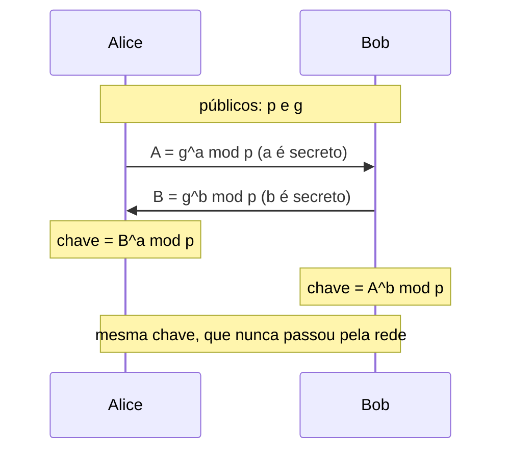

# Criptografia: simétrica, assimétrica, hash

## Por que isso importa

Cada vez que você abre um site com cadeado, faz um Pix, desbloqueia o celular ou manda uma mensagem no WhatsApp, vários algoritmos criptográficos rodam em milissegundos. Como pessoa desenvolvedora, você não vai inventar algoritmos, mas vai **escolher** e **usar** bibliotecas: guardar senhas, assinar tokens (SE-03), criptografar dados sensíveis no banco, verificar webhooks. Quase todas as falhas de criptografia reais não são matemáticas: são **mau uso**. Senha guardada com MD5, nonce repetido, chave no código, modo errado. Entender as ferramentas evita esses erros.

## Intuição

Três objetos do dia a dia:

- **Cofre com chave** (criptografia **simétrica**): a mesma chave tranca e destranca. Rápido e forte, mas como entregar a chave à outra pessoa sem que alguém copie no caminho?
- **Caixa de correio com fenda** (criptografia **assimétrica**): qualquer um pode jogar uma carta pela fenda (a **chave pública**), mas só o dono, com a **chave privada**, abre a caixa. Resolve a entrega de chaves, mas é lento.
- **Impressão digital** (**hash**): um resumo pequeno e único de algo grande. Não dá para reconstruir a pessoa a partir da digital, mas dá para conferir se é ela.

Na prática combinamos os três: a criptografia assimétrica é usada para **combinar uma chave simétrica**, que cifra os dados de verdade, e hashes garantem que nada foi alterado. É exatamente o que o TLS faz (RD-06).

## Visual

```text
Codificação   base64, hex, UTF-8    reversível por qualquer um, SEM chave   (não é segurança)
Hash          SHA-256, SHA-3        só ida; mesmo dado → mesmo resumo        (integridade)
HMAC          HMAC-SHA256           hash com chave secreta                   (integridade + autenticidade)
Simétrica     AES-GCM, ChaCha20     mesma chave cifra e decifra              (confidencialidade)
Assimétrica   RSA, ECDH, Ed25519    par pública/privada                      (trocar chaves, assinar)
Senhas        Argon2id, bcrypt      hash LENTO e com sal                     (guardar senhas)
```



## Conceito técnico

### Codificação não é criptografia

Base64 só troca a representação. `c2VuaGExMjM=` é `senha123` para qualquer pessoa. Nunca use codificação como proteção.

### Hash criptográfico

Uma função que transforma qualquer entrada num resumo de tamanho fixo (SHA-256: 256 bits), com três propriedades:

- **Resistência à pré-imagem**: dado o hash, não dá para achar uma entrada que o gere.
- **Resistência à segunda pré-imagem** e **a colisões**: não dá para achar duas entradas com o mesmo hash.
- **Efeito avalanche**: mudar um bit na entrada muda cerca de metade dos bits do hash.

Usos: conferir integridade de downloads, deduplicar arquivos, endereçar conteúdo (o Git identifica commits por hash), e como base de HMAC e assinaturas. **MD5 e SHA-1 estão quebrados** para colisões: não os use em segurança.

### HMAC

Um hash simples prova que nada mudou **por acidente**, mas um atacante pode alterar a mensagem e recalcular o hash. O **HMAC** mistura uma **chave secreta**: só quem tem a chave produz o código certo. É assim que webhooks (Stripe, GitHub) e tokens JWT com HS256 (SE-03) provam que vieram de quem dizem. Compare códigos com uma função de **tempo constante** (`hmac.compare_digest`), para não vazar informação pelo tempo da comparação.

### Criptografia simétrica

- **AES** (cifra de bloco, 128 bits por bloco, chaves de 128 ou 256 bits) e **ChaCha20** (cifra de fluxo) são os padrões.
- O **modo de operação** importa tanto quanto o algoritmo. **ECB** cifra cada bloco separadamente: blocos iguais viram blocos iguais e padrões aparecem (o famoso pinguim do Linux continua visível cifrado). Não use.
- Use **criptografia autenticada** (AEAD): **AES-GCM** ou **ChaCha20-Poly1305**. Elas cifram **e** detectam alterações.
- O **nonce** (número usado uma vez) **nunca** pode se repetir com a mesma chave. Num modo de fluxo, repetir o nonce faz `c1 XOR c2 = p1 XOR p2`: quem conhece uma mensagem lê a outra.
- O **one-time pad** (XOR com uma chave aleatória do tamanho da mensagem, usada uma só vez) é perfeitamente seguro em teoria, e inútil na prática pela dificuldade de distribuir chaves desse tamanho.

### Criptografia assimétrica

- **RSA**: segurança baseada na dificuldade de fatorar números grandes (você fez um RSA de brinquedo no RD-06). Chaves de 2048 bits ou mais.
- **Curvas elípticas** (ECDH, ECDSA, **Ed25519**, X25519): mesma segurança com chaves muito menores e operações mais rápidas. São o padrão moderno.
- **Diffie-Hellman**: duas partes combinam uma chave secreta em público, sem nunca transmiti-la. Com chaves efêmeras (uma por conexão), dá **sigilo futuro** (forward secrecy): roubar a chave do servidor amanhã não decifra o tráfego gravado hoje.
- **Assinatura digital**: o dono assina com a chave **privada**; qualquer um verifica com a **pública**. Garante autenticidade, integridade e não repúdio. Usada em certificados, atualizações de software, commits assinados, JWT com RS256 e ES256.
- **Certificados** (X.509): uma autoridade certificadora assina "esta chave pública pertence a exemplo.com". É a cadeia que o navegador verifica (RD-06).
- O DH sozinho não sabe **com quem** está falando: um intermediário pode fazer DH com cada lado. Por isso o TLS assina a troca com o certificado.

### Guardando senhas

Nunca guarde senhas em texto, nem cifradas (quem tem a chave lê todas), nem com hash rápido. Um computador com GPUs calcula **bilhões de SHA-256 por segundo**: com um vazamento, as senhas comuns caem em minutos.

- Use uma função **lenta e com memória**: **Argon2id** (primeira escolha), **scrypt** ou **bcrypt**.
- Um **sal** aleatório por usuário, guardado junto com o hash: impede tabelas pré-calculadas (rainbow tables) e faz senhas iguais terem hashes diferentes.
- Guarde os **parâmetros** junto (algoritmo, custo, sal), para poder aumentar o custo no futuro.
- Opcionalmente uma **pimenta** (pepper): um segredo fora do banco, misturado a todas as senhas.

### Aleatoriedade

Chaves, sais, nonces e tokens precisam de um gerador **criptograficamente seguro** (`secrets` no Python, `crypto.getRandomValues` no navegador). `random` e `Math.random` são previsíveis.

### Regras de ouro

- **Não invente** algoritmos nem protocolos. Use bibliotecas de alto nível e bem revisadas (libsodium, `cryptography` do Python, Web Crypto).
- Chaves fora do código: num cofre (Vault, KMS da nuvem), com rotação.
- Criptografia protege dados **em trânsito** (TLS) e **em repouso** (disco, backups, colunas sensíveis); você normalmente precisa das duas.
- Computadores quânticos grandes quebrariam RSA e curvas elípticas: os padrões **pós-quânticos** (ML-KEM, ML-DSA) já estão sendo adotados em TLS e mensageiros.

## Código

O efeito avalanche, um HMAC detectando adulteração e o perigo de reutilizar a chave de uma cifra de fluxo.

```python
import hashlib, hmac, secrets

# 1. Avalanche: uma letra de diferença muda o hash inteiro
for msg in [b"transferir 100 para Ana", b"transferir 900 para Ana"]:
    print(hashlib.sha256(msg).hexdigest()[:32], msg.decode())

# 2. HMAC: sem a chave, não dá para forjar o código
chave = secrets.token_bytes(32)
msg = b'{"pedido": 42, "valor": 100}'
codigo = hmac.new(chave, msg, hashlib.sha256).hexdigest()
adulterada = b'{"pedido": 42, "valor": 1}'
for m in [msg, adulterada]:
    ok = hmac.compare_digest(codigo, hmac.new(chave, m, hashlib.sha256).hexdigest())
    print("válida" if ok else "ADULTERADA", m.decode())

# 3. Mesma chave de fluxo em duas mensagens: o XOR das cifras vaza o XOR dos textos
def xor(a, b):
    return bytes(x ^ y for x, y in zip(a, b))

fluxo = secrets.token_bytes(32)
p1, p2 = b"senha do cofre: 4815", b"reuniao amanha as 10"
c1, c2 = xor(p1, fluxo), xor(p2, fluxo)
print("c1 parece aleatório:", c1.hex()[:20], "...")
print("quem sabe p1 recupera p2:", xor(xor(c1, c2), p1))
```

## Erros comuns

- **Base64 como "criptografia"**.
- **Senhas com MD5, SHA-1 ou SHA-256 puro**, sem sal ou com um sal único para todos.
- **Criptografia caseira**: XOR com uma palavra, algoritmo "secreto" inventado.
- **Modo ECB**, ou CBC sem autenticação (sujeito a ataques de padding oracle).
- **Repetir nonce** com a mesma chave em GCM ou ChaCha20.
- **Chave no código-fonte** ou no repositório.
- **`random` / `Math.random`** para tokens, sais ou chaves.
- **Comparar códigos com `==`** em vez de comparação em tempo constante.
- **Desligar a verificação de certificado** "para funcionar" (`verify=False`).

## Pratique

```quiz
id: SE-02-q1
tipo: multipla_escolha
pergunta: "Um sistema guarda senhas em base64 no banco e chama isso de 'senhas criptografadas'. O que está errado?"
opcoes: ["Nada, base64 é criptografia simétrica", "Base64 é só codificação: qualquer um que veja o banco decodifica as senhas sem chave nenhuma", "Base64 é um hash e deveria ser SHA-256", "Só faltou o sal"]
resposta: 1
explicacao: "Base64 transforma bytes em texto e volta, sem segredo algum. Senhas devem ser guardadas com uma função de hash lenta e com sal (Argon2id, scrypt, bcrypt)."
dificuldade: 1
```

```quiz
id: SE-02-q2
tipo: multipla_escolha
pergunta: "Por que o TLS usa criptografia assimétrica e simétrica na mesma conexão?"
opcoes: ["Para dobrar a segurança cifrando duas vezes", "A assimétrica resolve a combinação da chave e a autenticação do servidor; a simétrica, muito mais rápida, cifra os dados", "Porque a simétrica sozinha não existe em navegadores", "A assimétrica cifra o corpo e a simétrica os cabeçalhos"]
resposta: 1
explicacao: "Operações assimétricas são milhares de vezes mais lentas. O handshake usa ECDHE (assinado pelo certificado) para combinar uma chave, e depois AES-GCM ou ChaCha20-Poly1305 cifram o tráfego."
dificuldade: 2
```

```quiz
id: SE-02-q3
tipo: verdadeiro_falso
pergunta: "SHA-256 é uma boa escolha para guardar senhas, desde que se use um sal por usuário."
resposta: false
explicacao: "O sal impede tabelas pré-calculadas, mas SHA-256 é rápido demais: GPUs testam bilhões de senhas por segundo contra cada hash vazado. Funções de senha (Argon2id, scrypt, bcrypt) são lentas e gastam memória de propósito, tornando a força bruta milhares de vezes mais cara."
dificuldade: 2
```

```quiz
id: SE-02-q4
tipo: multipla_escolha
pergunta: "Para provar que um webhook veio mesmo do seu provedor de pagamentos (com quem você compartilha um segredo), o mais adequado é:"
opcoes: ["Conferir o IP de origem", "Um HMAC-SHA256 do corpo com o segredo, comparado em tempo constante", "Um SHA-256 do corpo enviado no cabeçalho", "Cifrar o corpo com base64"]
resposta: 1
explicacao: "Um hash sem chave pode ser recalculado por quem alterar o corpo. O HMAC exige o segredo, que o atacante não tem. A comparação em tempo constante evita vazar o código byte a byte pelo tempo de resposta."
dificuldade: 2
```

```quiz
id: SE-02-q5
tipo: resposta_curta
pergunta: "O que é uma assinatura digital, que chave é usada para assinar e qual para verificar?"
resposta: "É um valor calculado sobre a mensagem (normalmente sobre seu hash) com a chave privada do autor; qualquer pessoa verifica com a chave pública correspondente. Prova que a mensagem veio de quem tem a chave privada e que não foi alterada."
palavras_chave: ["privada", "pública", "verifica", "alterada"]
dificuldade: 1
```

```quiz
id: SE-02-q6
tipo: codigo
linguagem: python
pergunta: |
  **Nunca reutilize a chave de fluxo.** A função `cifrar` (não mude) faz o XOR da mensagem com a chave. Um atacante interceptou duas mensagens cifradas com a **mesma** chave e descobriu o texto da primeira. Escreva `recuperar(c1, c2, p1)`, que devolve o texto da segunda (bytes) **sem conhecer a chave**. Se as mensagens tiverem tamanhos diferentes, recupere só até o tamanho da menor das três.
codigo_inicial: |
  def cifrar(mensagem, chave):
      # não mude: os testes usam esta função
      return bytes(m ^ chave[i % len(chave)] for i, m in enumerate(mensagem))

  def recuperar(c1, c2, p1):
      return c2
usa: [def, zip, return]
testes:
  - chamada: "recuperar(cifrar(b'ATACAR AO AMANHECER', b'k3y!segura'), cifrar(b'RECUAR PELO RIO SUL', b'k3y!segura'), b'ATACAR AO AMANHECER')"
    saida: "b'RECUAR PELO RIO SUL'"
  - chamada: "recuperar(cifrar(b'ola', b'\\x07\\x99\\x10'), cifrar(b'oi!', b'\\x07\\x99\\x10'), b'ola')"
    saida: "b'oi!'"
  - chamada: "recuperar(cifrar(b'aaaaaa', b'zq'), cifrar(b'segredo', b'zq'), b'aaaaaa')"
    visivel: false
    saida: "b'segred'"
  - chamada: "recuperar(b'', b'', b'')"
    visivel: false
    saida: "b''"
dica: "c1 XOR c2 = (p1 XOR k) XOR (p2 XOR k) = p1 XOR p2. Então p2 = c1 XOR c2 XOR p1. Use zip nas três sequências, que já para na menor."
solucao: |
  def cifrar(mensagem, chave):
      # não mude: os testes usam esta função
      return bytes(m ^ chave[i % len(chave)] for i, m in enumerate(mensagem))

  def recuperar(c1, c2, p1):
      return bytes(a ^ b ^ c for a, b, c in zip(c1, c2, p1))
explicacao: "A chave se cancela no XOR: k XOR k = 0. Esse é o motivo de o nonce de AES-GCM e ChaCha20 nunca poder se repetir, e foi como o WEP do Wi-Fi caiu e como espiões soviéticos foram decifrados no projeto Venona, quando reaproveitaram páginas do one-time pad. Mesmo sem conhecer p1, um atacante consegue adivinhar trechos (cabeçalhos, palavras comuns) e ir desvendando as duas mensagens."
dificuldade: 2
```

```quiz
id: SE-02-q7
tipo: codigo
linguagem: python
pergunta: |
  **Guardando senhas com sal e custo.** (Em produção, use Argon2id ou bcrypt; aqui você vai montar a ideia com SHA-256 repetido.) Escreva:

  - `guardar(senha, sal, n)`: começa com `h = (sal + senha).encode()`, aplica `h = hashlib.sha256(h).digest()` **n vezes**, e devolve a string `f'{sal}${n}${h.hex()}'`;
  - `conferir(senha, guardado)`: separa sal, n e hash pelo `$`, recalcula e compara com `hmac.compare_digest`. Devolve `True` ou `False`.
codigo_inicial: |
  import hashlib, hmac

  def guardar(senha, sal, n):
      return f'{sal}${n}${senha}'

  def conferir(senha, guardado):
      return guardado.endswith(senha)
usa: [def, for, return]
testes:
  - chamada: "conferir('cavalo-correto', guardar('cavalo-correto', 'k9Xa', 1000))"
    saida: "True"
  - chamada: "conferir('cavalo-errado', guardar('cavalo-correto', 'k9Xa', 1000))"
    saida: "False"
  - chamada: "guardar('abc', 's1', 50) != guardar('abc', 's2', 50)"
    saida: "True"
  - chamada: "guardar('abc', 's', 1) == 's$1$' + hashlib.sha256(b'sabc').hexdigest()"
    visivel: false
    saida: "True"
  - chamada: "guardar('abc', 's', 2).split('$')[2] == hashlib.sha256(hashlib.sha256(b'sabc').digest()).hexdigest()"
    visivel: false
    saida: "True"
  - chamada: "conferir('abc', 's$3$' + 'ab' * 32)"
    visivel: false
    saida: "False"
dica: "Em conferir, use sal, n, esperado = guardado.split('$'), converta n com int(n) e compare guardar(senha, sal, n) com guardado usando hmac.compare_digest."
solucao: |
  import hashlib, hmac

  def guardar(senha, sal, n):
      h = (sal + senha).encode()
      for _ in range(n):
          h = hashlib.sha256(h).digest()
      return f'{sal}${n}${h.hex()}'

  def conferir(senha, guardado):
      sal, n, _ = guardado.split('$')
      return hmac.compare_digest(guardar(senha, sal, int(n)), guardado)
explicacao: "Você acabou de montar a estrutura de um hash de senha moderno: sal por usuário (o terceiro teste mostra a mesma senha com hashes diferentes), custo ajustável guardado junto e comparação em tempo constante. Strings do bcrypt e do Argon2 têm o mesmo formato, como $argon2id$v=19$m=65536,t=3,p=4$sal$hash. A diferença é que essas funções também gastam muita memória, o que tira a vantagem das GPUs, e por isso é delas que você deve usar em produção."
dificuldade: 2
```

```quiz
id: SE-02-q8
tipo: codigo
linguagem: javascript
pergunta: |
  **Diffie-Hellman.** Escreva `potMod(base, exp, mod)` (exponenciação modular rápida, por quadrados) e `trocaDeChaves(p, g, a, b)`, que simula Alice (segredo `a`) e Bob (segredo `b`) e devolve `{ A, B, chaveAlice, chaveBob }`, em que `A = g^a mod p`, `B = g^b mod p`, `chaveAlice = B^a mod p` e `chaveBob = A^b mod p`. Os números cabem em `Number` (p < 10^7).
codigo_inicial: |
  function potMod(base, exp, mod) {
    return Math.pow(base, exp) % mod;
  }

  function trocaDeChaves(p, g, a, b) {
    const A = potMod(g, a, p);
    const B = potMod(g, b, p);
    return { A, B, chaveAlice: potMod(B, a, p), chaveBob: potMod(A, b, p) };
  }
usa: [function, while, if, return]
testes:
  - chamada: "trocaDeChaves(23, 5, 6, 15)"
    saida: "{ A: 8, B: 19, chaveAlice: 2, chaveBob: 2 }"
  - chamada: "potMod(3, 200, 1000003)"
    saida: "333986"
  - chamada: "trocaDeChaves(1000003, 2, 123456, 654321)"
    visivel: false
    saida: "{ A: 435147, B: 155159, chaveAlice: 477126, chaveBob: 477126 }"
  - chamada: "potMod(7, 0, 13)"
    visivel: false
    saida: "1"
dica: "Comece com resultado = 1 e base = base % mod. Enquanto exp > 0: se exp for ímpar, resultado = resultado * base % mod; depois base = base * base % mod e exp = Math.floor(exp / 2)."
solucao: |
  function potMod(base, exp, mod) {
    let resultado = 1;
    base = base % mod;
    while (exp > 0) {
      if (exp % 2 === 1) resultado = (resultado * base) % mod;
      base = (base * base) % mod;
      exp = Math.floor(exp / 2);
    }
    return resultado;
  }

  function trocaDeChaves(p, g, a, b) {
    const A = potMod(g, a, p);
    const B = potMod(g, b, p);
    return { A, B, chaveAlice: potMod(B, a, p), chaveBob: potMod(A, b, p) };
  }
explicacao: "As duas chaves são iguais porque (g^b)^a = (g^a)^b = g^(ab) mod p. Quem escuta a rede vê p, g, A e B, mas para achar a chave precisaria do logaritmo discreto de A, que é inviável com p de 2048 bits (ou com curvas elípticas, como no X25519). O código inicial falha porque Math.pow(3, 200) estoura a precisão do Number antes do módulo: por isso a exponenciação é feita reduzindo a cada passo. Lembre que o DH puro não autentica ninguém; o TLS assina a troca com o certificado."
dificuldade: 2
```

## Resumo

- **Codificação** (base64) não protege nada; **hash** dá integridade; **HMAC** adiciona autenticidade com uma chave.
- **Simétrica** (AES-GCM, ChaCha20-Poly1305): rápida, autenticada, com **nonce único**; nada de ECB.
- **Assimétrica** (RSA, curvas elípticas): **Diffie-Hellman** combina chaves em público, **assinaturas** provam autoria; certificados ligam chaves a nomes.
- O TLS combina tudo: troca assinada, cifra simétrica, sigilo futuro.
- **Senhas**: Argon2id, scrypt ou bcrypt, com sal e parâmetros guardados.
- Gerador **seguro** de aleatórios, chaves em cofre, bibliotecas prontas, **nunca** criptografia caseira.

## Para ir além

- Resolva o primeiro conjunto do Cryptopals (até quebrar o XOR com chave repetida).
- Faça o curso Cryptography I do Dan Boneh, indicado pelo OSSU.
- Use a biblioteca `cryptography` do Python (Fernet ou AESGCM) e `argon2-cffi` num projeto seu.
- **Próximo módulo**: SE-03 Autenticação e autorização: sessões, JWT, OAuth 2.0.
