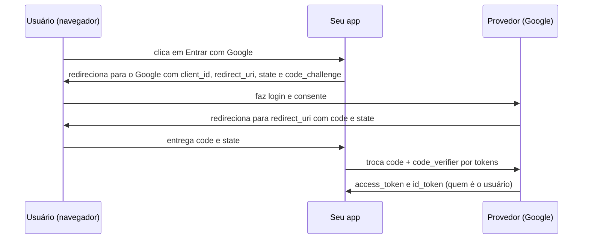

# Autenticação e autorização: sessões, JWT, OAuth 2.0

## Por que isso importa

Quase todo sistema tem login, e o login é a porta mais atacada: robôs testam milhões de senhas vazadas (credential stuffing), roubam sessões e procuram rotas que esquecem de checar permissão. **Quebra de controle de acesso** é o primeiro item do OWASP Top 10, e falhas de autenticação aparecem logo depois. Saber como funcionam sessões, JWT e o "Entrar com Google" é obrigatório para quem faz back-end, e ajuda o front-end a não guardar tokens no lugar errado.

## Intuição

Pense num **show** ou num **evento**:

- Na entrada, você mostra o **documento** e o ingresso: o segurança confere **quem você é**. Isso é **autenticação**.
- Você recebe uma **pulseira**. Daí em diante ninguém pede o documento de novo: a pulseira prova que você já foi conferido. Isso é a **sessão** (ou o token).
- A pulseira tem uma **cor**: verde vai à pista, dourada vai ao camarote. Em cada porta, alguém olha a cor. Isso é **autorização**, e ela é conferida **em cada porta**, não só na entrada.
- O **OAuth** é como a pessoa do evento ligar para a sua empresa para confirmar que você é funcionário, em vez de você levar o crachá: um terceiro confiável atesta por você, e o evento nunca vê sua senha.

## Visual

Sessão com cookie versus token:

```text
SESSÃO (estado no servidor)                    TOKEN JWT (estado no próprio token)
1. POST /login (usuário, senha)                1. POST /login (usuário, senha)
2. servidor cria sessao[abc123] = {id: 7}      2. servidor assina {sub: 7, exp: ...}
3. Set-Cookie: sid=abc123; HttpOnly; Secure    3. devolve eyJhbGciOi...
4. GET /pedidos  Cookie: sid=abc123            4. GET /pedidos  Authorization: Bearer eyJ...
5. servidor consulta sessao[abc123]            5. servidor confere a assinatura, sem consultar nada
   logout = apagar a sessão                       logout = ... esperar expirar (ou lista de bloqueio)
```

O fluxo authorization code com PKCE do OAuth 2.0 / OpenID Connect ("Entrar com Google"):



## Conceito técnico

### Autenticação

- **Fatores**: algo que você **sabe** (senha), algo que você **tem** (celular, chave física), algo que você **é** (biometria). **MFA** combina dois ou mais e bloqueia a imensa maioria dos ataques de senha.
- Prefira **TOTP** (aplicativo autenticador) ou **passkeys/WebAuthn** a SMS, que pode ser desviado (troca de chip).
- **Passkeys** substituem a senha por um par de chaves no dispositivo (SE-02): nada para vazar nem para digitar num site falso.
- **Senhas**: guarde com Argon2id/bcrypt (SE-02), confira contra listas de vazadas, aceite frases longas.
- **Mensagens genéricas**: "usuário ou senha inválidos", tanto no login quanto na recuperação ("se o e-mail existir, enviaremos um link"), para não revelar quem tem conta.
- **Limite de tentativas** por conta e por IP, com atraso crescente ou bloqueio temporário, contra força bruta e credential stuffing.
- **Recuperação de conta** é login também: links de uso único, curtos e com expiração.

### Sessões com cookie

- O identificador de sessão é um valor **aleatório e longo** (gerado com `secrets`), sem significado.
- **Gere um novo** identificador no login (evita fixação de sessão) e **apague** a sessão no logout.
- Atributos do cookie:
  - `HttpOnly`: o JavaScript não lê o cookie (um XSS não rouba a sessão).
  - `Secure`: só trafega por HTTPS.
  - `SameSite=Lax` (ou `Strict`): o navegador não envia o cookie em requisições vindas de outros sites, a principal defesa moderna contra CSRF (SE-04).
  - Expiração por inatividade e absoluta.
- Vantagens: revogação imediata, nada sensível no cliente. Desvantagem: o servidor guarda estado (normalmente no Redis, SD-03).

### JWT (JSON Web Token)

Três partes em base64url separadas por pontos: **cabeçalho** (`{"alg":"HS256"}`), **payload** (as *claims*: `sub`, `exp`, `iat`, `iss`, `aud`, papéis) e **assinatura**.

- O payload é **legível por qualquer um**: é só base64. Assinatura dá integridade, não sigilo. Nada de dados sensíveis.
- **HS256** usa um segredo compartilhado (HMAC); **RS256/ES256** usam par de chaves (quem só valida não consegue emitir).
- Validar = conferir a **assinatura** com o algoritmo **que você espera** (nunca o que o token diz: o ataque `alg: none` e a confusão RS256/HS256 vêm daí), e depois `exp`, `iss` e `aud`.
- **Revogação é difícil**: o token vale até expirar. Use **access tokens curtos** (minutos) e **refresh tokens** guardados no servidor, que podem ser revogados e são rotacionados a cada uso.
- Onde guardar no navegador: um cookie `HttpOnly` é mais seguro que `localStorage`, que qualquer XSS lê.
- Para uma aplicação web comum com um só back-end, **sessões são mais simples e seguras**. JWT brilha entre serviços (SD-04) e com provedores de identidade.

### OAuth 2.0 e OpenID Connect

- **OAuth 2.0** é sobre **autorização delegada**: o usuário permite que um app acesse seus recursos em outro serviço ("este app pode ler seu calendário"), sem entregar a senha. O resultado é um **access token** com **escopos**.
- **OpenID Connect (OIDC)** é a camada de **autenticação** sobre o OAuth: acrescenta o **id_token** (um JWT dizendo quem é o usuário). É o que está por trás do "Entrar com Google/Microsoft/Apple".
- Use o fluxo **authorization code com PKCE** para web, mobile e SPAs. O **PKCE** (code_verifier aleatório, code_challenge = hash dele) impede que um código interceptado seja trocado por outra pessoa. O fluxo implícito está obsoleto.
- O parâmetro **state** protege contra CSRF no retorno. O **redirect_uri** precisa ser comparado exatamente com o cadastrado.
- Para comunicação entre serviços sem usuário: **client credentials**.

### Autorização

- **Mediação completa**: verifique a permissão **no servidor, em toda requisição**, para **o recurso específico**. Esconder o botão no front-end não é autorização.
- **IDOR** (referência direta insegura): `/pedidos/42` precisa conferir se o pedido 42 é do usuário (SE-01).
- **RBAC** (papéis): usuários têm papéis, papéis têm permissões (`pedido:ler`, `pedido:cancelar`). Simples e auditável.
- **ABAC** (atributos): regras que olham atributos do usuário, do recurso e do contexto ("pode editar se for o dono", "só em horário comercial"). Políticas mais finas, às vezes num motor dedicado (OPA, Cedar).
- **ReBAC** (relações): permissões por relações num grafo, como no Google Drive ("é editor da pasta pai"); o Zanzibar do Google popularizou.
- **Negue por padrão**: se nenhuma regra permite, é proibido.

## Código

Montando um JWT à mão para ver que o conteúdo é público e que a assinatura só garante que ninguém o alterou.

```python
import base64, hashlib, hmac, json

def b64url(dados):
    return base64.urlsafe_b64encode(dados).rstrip(b"=").decode()

def assinar(payload, segredo):
    cabecalho = b64url(json.dumps({"alg": "HS256", "typ": "JWT"}).encode())
    corpo = b64url(json.dumps(payload).encode())
    assinatura = hmac.new(segredo, f"{cabecalho}.{corpo}".encode(), hashlib.sha256).digest()
    return f"{cabecalho}.{corpo}.{b64url(assinatura)}"

segredo = b"segredo-do-servidor-com-32-bytes!"
token = assinar({"sub": "ana", "papel": "cliente", "exp": 1767225600}, segredo)
print(token[:60] + "...")

# Qualquer um lê o payload, sem chave nenhuma:
corpo = token.split(".")[1]
print(json.loads(base64.urlsafe_b64decode(corpo + "=" * (-len(corpo) % 4))))

# Mas alterar o papel quebra a assinatura:
cab, _, ass = token.split(".")
falso_corpo = b64url(json.dumps({"sub": "ana", "papel": "admin", "exp": 1767225600}).encode())
esperada = b64url(hmac.new(segredo, f"{cab}.{falso_corpo}".encode(), hashlib.sha256).digest())
print("token adulterado aceito?", hmac.compare_digest(esperada, ass))
```

## Erros comuns

- **Checar permissão só no front-end** ou só na listagem, e não na rota de detalhe ou de edição.
- **Mensagens que revelam se o e-mail existe** no login, cadastro ou recuperação.
- **Sem limite de tentativas** no login e na verificação de código MFA.
- **Não regenerar a sessão** no login; não invalidar no logout ou na troca de senha.
- **Cookie de sessão sem `HttpOnly`, `Secure` e `SameSite`.**
- **JWT**: aceitar `alg: none`, usar o algoritmo do cabeçalho, não checar `exp`/`aud`, segredo fraco, token de 30 dias sem revogação, dados sensíveis no payload, guardar em `localStorage`.
- **OAuth sem `state` e sem PKCE**, ou com `redirect_uri` comparado por prefixo.
- **Usar o access token do OAuth como prova de identidade** em vez do id_token do OIDC.
- **Implementar autenticação do zero** quando uma biblioteca ou provedor maduro resolve.

## Pratique

```quiz
id: SE-03-q1
tipo: multipla_escolha
pergunta: "Um usuário logado como cliente consegue cancelar o pedido de outra pessoa chamando DELETE /pedidos/99 diretamente. O botão não aparece na tela dele. Qual o problema?"
opcoes: ["Autenticação fraca: falta MFA", "Falta autorização no servidor: a rota não confere se o pedido 99 pertence ao usuário", "O cookie não tem HttpOnly", "O JWT expirou"]
resposta: 1
explicacao: "Ele está corretamente autenticado; o que falta é verificar a permissão sobre aquele recurso específico. Esconder o botão não impede ninguém de chamar a API. É um IDOR, o tipo mais comum de quebra de controle de acesso."
dificuldade: 1
```

```quiz
id: SE-03-q2
tipo: multipla_escolha
pergunta: "Qual combinação de atributos de cookie de sessão é a recomendada?"
opcoes: ["Nenhum, para funcionar em todos os navegadores", "HttpOnly; Secure; SameSite=Lax", "Domain=.com; Path=/", "Max-Age de 10 anos para o usuário não precisar logar de novo"]
resposta: 1
explicacao: "HttpOnly impede que um script injetado leia o cookie, Secure impede que ele trafegue sem TLS, e SameSite=Lax faz o navegador não enviá-lo em requisições disparadas por outros sites, bloqueando a maioria dos CSRF."
dificuldade: 1
```

```quiz
id: SE-03-q3
tipo: verdadeiro_falso
pergunta: "Como o JWT é assinado, é seguro colocar nele o CPF e o endereço do usuário, pois ninguém consegue ler."
resposta: false
explicacao: "A assinatura impede alterações, não a leitura: o payload é só base64url, e qualquer um decodifica (é o que o jwt.io faz). Para sigilo existiria o JWE, mas o certo é não colocar dados sensíveis no token."
dificuldade: 1
```

```quiz
id: SE-03-q4
tipo: multipla_escolha
pergunta: "No fluxo authorization code do OAuth, para que serve o PKCE?"
opcoes: ["Para criptografar o access token", "Para que só quem iniciou o fluxo, e tem o code_verifier, consiga trocar o código pelo token, mesmo que alguém intercepte o código", "Para pedir mais escopos", "Para substituir o login no provedor"]
resposta: 1
explicacao: "O app manda o hash (code_challenge) no início e revela o code_verifier só na troca. Um atacante que roube o código no redirecionamento não tem o verifier. Hoje o PKCE é recomendado para todos os clientes, não só os mobile."
dificuldade: 2
```

```quiz
id: SE-03-q5
tipo: resposta_curta
pergunta: "Qual a diferença entre OAuth 2.0 e OpenID Connect?"
resposta: "OAuth 2.0 é um protocolo de autorização delegada: o usuário permite que um app acesse recursos dele em outro serviço, e o app recebe um access token com escopos. O OpenID Connect é uma camada de autenticação sobre o OAuth que acrescenta o id_token, um JWT que diz quem é o usuário; é ele que se usa para login."
palavras_chave: ["autorização", "autenticação", "id_token", "access token"]
dificuldade: 2
```

```quiz
id: SE-03-q6
tipo: codigo
linguagem: python
pergunta: |
  **Validando um JWT corretamente.** A função `criar_jwt` (não mude) gera tokens HS256 (e, para os testes, também tokens com `alg` diferente). Escreva `validar_jwt(token, segredo, agora)`, que devolve o payload (dicionário) se o token for válido, ou uma string com o motivo da recusa, nesta ordem de verificação:

  1. `'formato'` se o token não tiver exatamente 3 partes separadas por `.`;
  2. `'alg'` se o cabeçalho não tiver `alg` igual a `'HS256'` (nunca confie no algoritmo do token);
  3. `'assinatura'` se a assinatura não bater (compare com `hmac.compare_digest`);
  4. `'expirado'` se o payload tiver `exp` e `agora >= exp`.

  Use `b64url_decode` para decodificar as partes.
codigo_inicial: |
  import base64, hashlib, hmac, json

  def b64url(dados):
      # não mude: os testes usam esta função
      return base64.urlsafe_b64encode(dados).rstrip(b'=').decode()

  def b64url_decode(texto):
      # não mude: os testes usam esta função
      return base64.urlsafe_b64decode(texto + '=' * (-len(texto) % 4))

  def criar_jwt(payload, segredo, alg='HS256'):
      # não mude: os testes usam esta função
      cab = b64url(json.dumps({'alg': alg, 'typ': 'JWT'}).encode())
      corpo = b64url(json.dumps(payload).encode())
      if alg != 'HS256':
          return f'{cab}.{corpo}.'
      ass = hmac.new(segredo.encode(), f'{cab}.{corpo}'.encode(), hashlib.sha256).digest()
      return f'{cab}.{corpo}.{b64url(ass)}'

  def validar_jwt(token, segredo, agora):
      corpo = token.split('.')[1]
      return json.loads(b64url_decode(corpo))
usa: [def, if, return]
testes:
  - chamada: "validar_jwt(criar_jwt({'sub': 'ana', 'exp': 2000}, 's3gredo'), 's3gredo', 1000)"
    saida: "{'sub': 'ana', 'exp': 2000}"
  - chamada: "validar_jwt(criar_jwt({'sub': 'ana', 'exp': 2000}, 's3gredo'), 'outro', 1000)"
    saida: "'assinatura'"
  - chamada: "validar_jwt(criar_jwt({'sub': 'ana', 'exp': 2000}, 's3gredo'), 's3gredo', 2000)"
    saida: "'expirado'"
  - chamada: "validar_jwt(criar_jwt({'sub': 'admin'}, '', alg='none'), 's3gredo', 1000)"
    saida: "'alg'"
  - chamada: "validar_jwt('abc.def', 'k', 0)"
    visivel: false
    saida: "'formato'"
  - chamada: "(lambda t, f: validar_jwt(t.split('.')[0] + '.' + f.split('.')[1] + '.' + t.split('.')[2], 'k', 0))(criar_jwt({'sub': 'ana', 'admin': False}, 'k'), criar_jwt({'sub': 'ana', 'admin': True}, 'k'))"
    visivel: false
    saida: "'assinatura'"
  - chamada: "validar_jwt(criar_jwt({'sub': 'bia'}, 'k'), 'k', 10**12)"
    visivel: false
    saida: "{'sub': 'bia'}"
dica: "Separe com partes = token.split('.'). Leia o cabeçalho com json.loads(b64url_decode(partes[0])). Recalcule a assinatura de partes[0] + '.' + partes[1] com hmac.new(segredo.encode(), ..., hashlib.sha256), passe por b64url e compare com partes[2]."
solucao: |
  import base64, hashlib, hmac, json

  def b64url(dados):
      # não mude: os testes usam esta função
      return base64.urlsafe_b64encode(dados).rstrip(b'=').decode()

  def b64url_decode(texto):
      # não mude: os testes usam esta função
      return base64.urlsafe_b64decode(texto + '=' * (-len(texto) % 4))

  def criar_jwt(payload, segredo, alg='HS256'):
      # não mude: os testes usam esta função
      cab = b64url(json.dumps({'alg': alg, 'typ': 'JWT'}).encode())
      corpo = b64url(json.dumps(payload).encode())
      if alg != 'HS256':
          return f'{cab}.{corpo}.'
      ass = hmac.new(segredo.encode(), f'{cab}.{corpo}'.encode(), hashlib.sha256).digest()
      return f'{cab}.{corpo}.{b64url(ass)}'

  def validar_jwt(token, segredo, agora):
      partes = token.split('.')
      if len(partes) != 3:
          return 'formato'
      cabecalho = json.loads(b64url_decode(partes[0]))
      if cabecalho.get('alg') != 'HS256':
          return 'alg'
      esperada = hmac.new(segredo.encode(), f'{partes[0]}.{partes[1]}'.encode(), hashlib.sha256).digest()
      if not hmac.compare_digest(b64url(esperada), partes[2]):
          return 'assinatura'
      payload = json.loads(b64url_decode(partes[1]))
      if 'exp' in payload and agora >= payload['exp']:
          return 'expirado'
      return payload
explicacao: "A ordem importa: só se confia no payload depois de verificar a assinatura. O teste do alg none reproduz uma falha real de várias bibliotecas em 2015, que aceitavam tokens sem assinatura porque o próprio token dizia que não precisava. O teste oculto que troca o payload (admin: True) mostra por que a assinatura cobre cabeçalho e corpo juntos. Em produção, use uma biblioteca (PyJWT, jose) passando a lista de algoritmos aceitos, e cheque também iss e aud."
dificuldade: 3
```

```quiz
id: SE-03-q7
tipo: codigo
linguagem: python
pergunta: |
  **RBAC com dono.** `papeis` é um dicionário `papel -> lista de permissões` no formato `'tipo:acao'`, em que `tipo` ou `acao` podem ser `'*'` (qualquer um), e a permissão pode terminar em `':proprio'`, valendo só quando o recurso é do usuário. Escreva `pode(usuario, acao, recurso, papeis)`, em que `usuario = {'id': ..., 'papeis': [...]}` e `recurso = {'tipo': ..., 'dono': ...}`. Devolva `True` se alguma permissão de algum papel do usuário permitir; caso contrário, `False` (negue por padrão). Papéis inexistentes são ignorados.
codigo_inicial: |
  def pode(usuario, acao, recurso, papeis):
      return len(usuario['papeis']) > 0
usa: [def, for, if, return]
testes:
  - chamada: "pode({'id': 1, 'papeis': ['cliente']}, 'ler', {'tipo': 'pedido', 'dono': 1}, {'cliente': ['pedido:ler:proprio']})"
    saida: "True"
  - chamada: "pode({'id': 1, 'papeis': ['cliente']}, 'ler', {'tipo': 'pedido', 'dono': 2}, {'cliente': ['pedido:ler:proprio']})"
    saida: "False"
  - chamada: "pode({'id': 5, 'papeis': ['suporte']}, 'ler', {'tipo': 'pedido', 'dono': 2}, {'suporte': ['pedido:ler', 'cliente:ler']})"
    saida: "True"
  - chamada: "pode({'id': 5, 'papeis': ['suporte']}, 'cancelar', {'tipo': 'pedido', 'dono': 2}, {'suporte': ['pedido:ler']})"
    saida: "False"
  - chamada: "pode({'id': 9, 'papeis': ['fantasma', 'admin']}, 'apagar', {'tipo': 'usuario', 'dono': 3}, {'admin': ['*:*']})"
    visivel: false
    saida: "True"
  - chamada: "pode({'id': 3, 'papeis': ['cliente']}, 'editar', {'tipo': 'endereco', 'dono': 3}, {'cliente': ['endereco:*:proprio', 'pedido:ler:proprio']})"
    visivel: false
    saida: "True"
  - chamada: "pode({'id': 3, 'papeis': []}, 'ler', {'tipo': 'pedido', 'dono': 3}, {'cliente': ['*:*']})"
    visivel: false
    saida: "False"
dica: "Para cada permissão, faça partes = p.split(':'). Ela casa se partes[0] for '*' ou o tipo, partes[1] for '*' ou a ação, e (se houver um terceiro pedaço 'proprio') o dono do recurso for o id do usuário. Use papeis.get(papel, [])."
solucao: |
  def pode(usuario, acao, recurso, papeis):
      for papel in usuario['papeis']:
          for permissao in papeis.get(papel, []):
              partes = permissao.split(':')
              if partes[0] not in ('*', recurso['tipo']):
                  continue
              if partes[1] not in ('*', acao):
                  continue
              if len(partes) == 3 and recurso['dono'] != usuario['id']:
                  continue
              return True
      return False
explicacao: "É RBAC com uma pitada de ABAC (o atributo dono). A função só devolve True quando uma regra permite explicitamente, então um papel desconhecido ou uma lista vazia negam, o padrão seguro. Repare que a checagem precisa do recurso carregado do banco (para saber o dono): é por isso que a autorização fica no servidor, junto da consulta, e não num middleware que só olha a URL."
dificuldade: 2
```

```quiz
id: SE-03-q8
tipo: codigo
linguagem: javascript
pergunta: |
  **Bloqueio contra força bruta.** `eventos` são tentativas de login em ordem de tempo: `{ t, usuario, ok }` (t em segundos). Escreva `bloqueados(eventos, maxFalhas, janela)`, que devolve, em ordem alfabética, os usuários que em algum momento acumularam `maxFalhas` falhas dentro de uma janela de `janela` segundos (falhas com `t > agora - janela`). Um login bem-sucedido zera as falhas daquele usuário. Depois de bloqueado, o usuário continua na lista.
codigo_inicial: |
  function bloqueados(eventos, maxFalhas, janela) {
    const nomes = eventos.filter((e) => !e.ok).map((e) => e.usuario);
    return [...new Set(nomes)].sort();
  }
usa: [function, for, if, return]
testes:
  - chamada: "bloqueados([{ t: 1, usuario: 'ana', ok: false }, { t: 2, usuario: 'ana', ok: false }, { t: 3, usuario: 'ana', ok: false }], 3, 60)"
    saida: "[ 'ana' ]"
  - chamada: "bloqueados([{ t: 1, usuario: 'ana', ok: false }, { t: 2, usuario: 'ana', ok: false }, { t: 3, usuario: 'ana', ok: true }, { t: 4, usuario: 'ana', ok: false }], 3, 60)"
    saida: "[]"
  - chamada: "bloqueados([{ t: 0, usuario: 'bia', ok: false }, { t: 30, usuario: 'bia', ok: false }, { t: 61, usuario: 'bia', ok: false }], 3, 60)"
    saida: "[]"
  - chamada: "bloqueados([{ t: 0, usuario: 'bia', ok: false }, { t: 30, usuario: 'bia', ok: false }, { t: 59, usuario: 'bia', ok: false }, { t: 5, usuario: 'caio', ok: false }], 3, 60)"
    visivel: false
    saida: "[ 'bia' ]"
  - chamada: "bloqueados([{ t: 1, usuario: 'z', ok: false }, { t: 2, usuario: 'y', ok: false }, { t: 3, usuario: 'z', ok: false }, { t: 4, usuario: 'y', ok: false }, { t: 100, usuario: 'z', ok: true }], 2, 10)"
    visivel: false
    saida: "[ 'y', 'z' ]"
  - chamada: "bloqueados([], 3, 60)"
    visivel: false
    saida: "[]"
dica: "Guarde num objeto falhas[usuario] a lista de tempos das falhas. Em cada falha, acrescente o t e mantenha só os tempos maiores que t - janela (um laço que monta uma lista nova). Se o tamanho chegar a maxFalhas, adicione o usuário num Set."
solucao: |
  function bloqueados(eventos, maxFalhas, janela) {
    const falhas = {};
    const lista = new Set();
    for (const e of eventos) {
      if (e.ok) {
        falhas[e.usuario] = [];
        continue;
      }
      const recentes = [];
      for (const t of falhas[e.usuario] || []) {
        if (t > e.t - janela) recentes.push(t);
      }
      recentes.push(e.t);
      falhas[e.usuario] = recentes;
      if (recentes.length >= maxFalhas) lista.add(e.usuario);
    }
    return [...lista].sort();
  }
explicacao: "É uma janela deslizante por usuário. No terceiro teste a primeira falha (t=0) sai da janela quando chega a de t=61, e a bia não é bloqueada. Na vida real, combine com limites por IP, porque o credential stuffing testa uma senha em milhares de contas diferentes, e cada conta sozinha nunca chega ao limite. E cuidado: bloquear a conta de verdade permite que um atacante tranque usuários de propósito; atrasos crescentes e CAPTCHA costumam ser melhores que bloqueio total."
dificuldade: 2
```

## Resumo

- **Autenticação** diz quem você é; **autorização** diz o que pode fazer, conferida **no servidor, em cada requisição, para cada recurso**.
- **MFA** e **passkeys** derrotam a maioria dos ataques de senha; limite tentativas e não revele quem tem conta.
- **Sessões**: id aleatório, regenerado no login, cookie `HttpOnly; Secure; SameSite`. Simples e revogáveis.
- **JWT**: payload legível, valide assinatura com o algoritmo esperado, `exp`, `iss`, `aud`; tokens curtos com refresh revogável.
- **OAuth 2.0** delega acesso; **OIDC** autentica; use **authorization code + PKCE** com `state`.
- **RBAC**, **ABAC** e **ReBAC**; negue por padrão.

## Para ir além

- Implemente login com sessões num projeto seu (Flask, FastAPI ou Express), com cookie seguro, limite de tentativas e TOTP.
- Cole um JWT de algum serviço no jwt.io e veja o que ele carrega.
- Configure "Entrar com Google" seguindo o fluxo com PKCE e confira cada parâmetro na barra de endereço.
- **Próximo módulo**: SE-04 OWASP Top 10: SQL injection, XSS, CSRF e outros.
