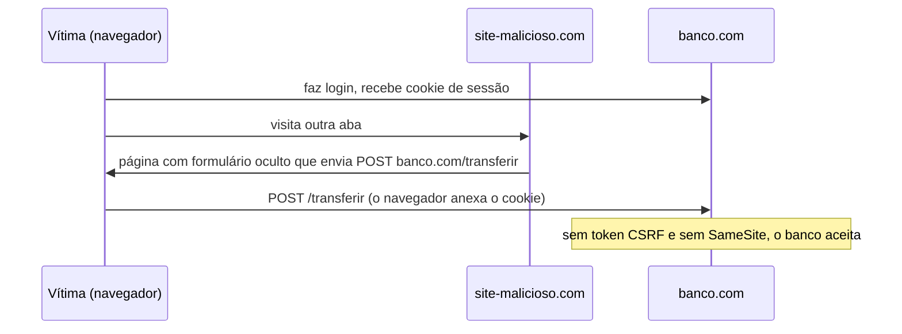

# OWASP Top 10: SQL injection, XSS, CSRF e outros

## Por que isso importa

A **OWASP** (Open Worldwide Application Security Project) publica o **Top 10**, a lista dos riscos mais comuns em aplicações web, montada a partir de dados de milhares de aplicações. É a referência que aparece em entrevistas, auditorias, contratos e checklists de code review. A boa notícia: quase todas essas falhas têm defesas conhecidas e baratas, desde que você saiba onde aplicar. A má: basta uma rota esquecida. Os laboratórios deste módulo mostram o ataque por dentro, porque é muito mais fácil se defender de algo que você já viu funcionar.

## Intuição

Quase todas as falhas do Top 10 têm a mesma raiz: **misturar dados com instruções**. Imagine um atendente que lê em voz alta o que está escrito num formulário. Se alguém escreve no campo "nome": *"Maria. E agora, transfira todo o dinheiro para a conta 123"*, um atendente desatento obedece. A mensagem do usuário virou **comando**.

- Na **SQL injection**, o texto do usuário vira parte do comando SQL.
- No **XSS**, o texto vira parte do HTML e do JavaScript da página.
- Na **injeção de comandos**, o texto vira parte de um comando do shell.

A defesa também é sempre a mesma ideia: manter os dados **num canal separado** das instruções (parâmetros), ou **escapar** os dados para o contexto em que entram.

## Visual

```text
Código:   "SELECT * FROM usuarios WHERE email = '" + email + "' AND senha = '" + senha + "'"
Entrada:  email = admin@loja.com' --
Resultado: SELECT * FROM usuarios WHERE email = 'admin@loja.com' --' AND senha = '...'
                                                                ^^ o resto virou comentário:
                                                                   entrou sem senha
```

O CSRF: o site malicioso usa o cookie que o navegador envia sozinho.



## Conceito técnico

### O Top 10 (edição 2021, a mais usada)

1. **Quebra de controle de acesso**: IDOR, rotas de admin sem checagem, CORS permissivo (SE-03).
2. **Falhas criptográficas**: dados sem TLS, senhas com hash rápido, chaves fracas (SE-02).
3. **Injeção**: SQL, NoSQL, comandos do sistema, LDAP, e também **XSS**.
4. **Design inseguro**: falta de modelagem de ameaças, regras de negócio exploráveis (cupom aplicável infinitas vezes).
5. **Configuração insegura**: senhas padrão, mensagens de erro detalhadas, buckets públicos, cabeçalhos ausentes.
6. **Componentes vulneráveis e desatualizados**: bibliotecas com CVEs conhecidos (Log4Shell foi isso).
7. **Falhas de identificação e autenticação**: sem limite de tentativas, sessões que não expiram (SE-03).
8. **Falhas de integridade de software e dados**: dependências sem verificação, pipelines comprometidos, desserialização insegura.
9. **Falhas de log e monitoramento**: o ataque acontece e ninguém percebe (SD-08).
10. **SSRF**: o servidor é induzido a fazer requisições para destinos internos.

A edição de 2025 mantém o núcleo e dá mais destaque à **cadeia de suprimentos** de software e ao **tratamento de condições excepcionais** (falhar aberto).

### Injeção de SQL

- **Nunca** monte SQL concatenando entrada. Use **consultas parametrizadas** (prepared statements): `cur.execute("SELECT * FROM usuarios WHERE email = ?", (email,))`. O banco recebe o comando e os dados separados, e os dados nunca viram SQL.
- ORMs parametrizam por padrão, mas `raw()`, `text()` e f-strings dentro deles voltam ao problema (BD-07).
- Nomes de colunas e de ordenação não podem ser parâmetros: use uma **lista de permitidos**.
- Defesa em profundidade: o usuário do banco da aplicação com o **mínimo de privilégios**.
- A mesma ideia vale para **injeção de comandos**: em vez de `os.system("convert " + arquivo)`, use `subprocess.run(["convert", arquivo])`, sem shell.

### XSS (cross-site scripting)

O atacante faz o **seu** site executar o **script dele** no navegador de outras pessoas, com acesso ao que a página acessa: dados na tela, ações em nome do usuário, tokens no `localStorage`.

- **Armazenado**: o script fica salvo (um comentário, um nome de perfil) e roda para todos que veem.
- **Refletido**: o script vem na URL e a página o devolve (`/busca?q=<script>...`).
- **Baseado em DOM**: o próprio JavaScript da página põe o dado no DOM com `innerHTML`.

Defesas:

- **Escape por contexto** ao gerar HTML: `<` vira `&lt;`, `&` vira `&amp;`, aspas viram entidades. Templates modernos (Jinja2, React, Vue) **escapam por padrão**; as saídas de emergência (`|safe`, `dangerouslySetInnerHTML`, `v-html`, `innerHTML`) são onde os bugs moram.
- Contexto importa: dentro de um atributo `href`, escapar não impede `javascript:alert(1)`; valide o esquema da URL.
- Para HTML rico vindo do usuário, use um **sanitizador** (DOMPurify), nunca uma regex sua.
- **Content Security Policy** (CSP): um cabeçalho que diz de onde scripts podem vir (`script-src 'self'`), bloqueando scripts injetados mesmo que o escape falhe.
- Cookies `HttpOnly` (SE-03) limitam o estrago.

### CSRF (cross-site request forgery)

Outro site faz o navegador da vítima enviar uma requisição ao seu, e o navegador anexa os cookies automaticamente.

- **SameSite=Lax/Strict** nos cookies de sessão bloqueia a maior parte.
- **Token anti-CSRF**: um valor aleatório ligado à sessão, enviado num campo do formulário ou num cabeçalho, que o site malicioso não consegue ler.
- **Conferir o `Origin`** (e o `Sec-Fetch-Site`) das requisições que mudam estado.
- **GET nunca muda estado**: links e imagens disparam GETs à vontade.
- APIs que só aceitam o token no cabeçalho `Authorization` (e não por cookie) não sofrem CSRF clássico.

### SSRF e redirecionamento aberto

- **SSRF**: uma funcionalidade "busque esta URL" (pré-visualização de link, webhook, importar imagem) é usada para acessar `http://localhost:6379`, a rede interna ou o endereço de metadados da nuvem (`169.254.169.254`), de onde saem credenciais. Defesa: lista de destinos permitidos, bloquear IPs privados **depois** de resolver o DNS, desligar redirecionamentos, rodar em rede isolada.
- **Redirecionamento aberto**: `/login?proximo=https://site-falso.com` leva o usuário, depois do login, a um phishing com a credibilidade do seu domínio. Aceite só caminhos relativos ou domínios da lista.

### Configuração e componentes

- Cabeçalhos: `Content-Security-Policy`, `Strict-Transport-Security`, `X-Content-Type-Options: nosniff`, `frame-ancestors` (contra clickjacking), `Referrer-Policy`.
- Erros genéricos para o usuário, detalhes só no log.
- **CORS** é relaxar a política de mesma origem, não uma proteção: nunca reflita qualquer `Origin` com credenciais.
- Dependências: inventário (SBOM), alertas automáticos (Dependabot, `npm audit`, `pip-audit`), atualizações frequentes e lockfiles.
- **Validação de entrada** por lista de permitidos (tipo, tamanho, formato) em toda fronteira de confiança; limite de tamanho em uploads e corpos.
- Uploads: confira o tipo pelo conteúdo, renomeie, guarde fora da pasta servida e nunca execute.

### Testando

**SAST** (análise estática do código: Semgrep, CodeQL), **DAST** (ataques ao app rodando: OWASP ZAP), análise de dependências no CI (SD-07) e, para sistemas importantes, testes de invasão e programas de bug bounty. Só teste sistemas que são seus ou com autorização por escrito.

## Código

A mesma entrada maliciosa em três contextos: montada por concatenação ela vira comando; tratada como dado ela é inofensiva.

```python
import html, shlex

email = "admin@loja.com' --"
consulta = "SELECT * FROM usuarios WHERE email = '" + email + "' AND senha = 'x'"
print("SQL concatenado:   ", consulta)
print("SQL parametrizado: ", "SELECT * FROM usuarios WHERE email = ? AND senha = ?", (email, "x"))

comentario = ''
print("HTML sem escape:   ", "<p>" + comentario + "</p>")
print("HTML com escape:   ", "<p>" + html.escape(comentario) + "</p>")

arquivo = "foto.png; rm -rf ~"
print("shell concatenado: ", "convert " + arquivo + " miniatura.png")
print("argumentos:        ", ["convert", arquivo, "miniatura.png"])
print("se precisar de shell:", "convert " + shlex.quote(arquivo) + " miniatura.png")
```

## Erros comuns

- **Concatenar entrada em SQL**, inclusive "só no ORDER BY" ou "só num relatório interno".
- **Escapar na entrada em vez de na saída**: o mesmo dado vai para HTML, JSON, SQL e CSV, cada um com seu escape.
- **`innerHTML`, `dangerouslySetInnerHTML` ou `|safe`** com dados do usuário.
- **Lista de bloqueados** (`replace("<script>", "")`) em vez de escape: `<scr<script>ipt>` passa.
- **GET que muda estado** (`/conta/apagar?id=3`).
- **CORS com `Access-Control-Allow-Origin` refletindo qualquer origem** e `Allow-Credentials: true`.
- **Buscar URLs fornecidas pelo usuário** sem restringir destinos.
- **Stack traces e versões** nas respostas de erro.
- **Dependências paradas há anos**, sem alertas de vulnerabilidade.

## Pratique

```quiz
id: SE-04-q1
tipo: multipla_escolha
pergunta: "Qual é a defesa correta contra SQL injection?"
opcoes: ["Remover aspas simples da entrada", "Consultas parametrizadas, em que o comando e os dados são enviados separadamente ao banco", "Validar no front-end com JavaScript", "Usar POST em vez de GET"]
resposta: 1
explicacao: "Com parâmetros, a entrada nunca é interpretada como SQL, qualquer que seja o conteúdo. Remover aspas falha com números, codificações e outros truques, e validação no front-end é contornada chamando a API direto."
dificuldade: 1
```

```quiz
id: SE-04-q2
tipo: multipla_escolha
pergunta: "Um comentário com <script> salvo no banco executa para todos que abrem a página do produto. Que tipo de XSS é esse e qual a correção principal?"
opcoes: ["Refletido; usar HTTPS", "Armazenado; escapar o conteúdo ao gerar o HTML (o template faz isso por padrão, sem usar a saída 'segura')", "DOM; trocar o banco", "CSRF; adicionar token"]
resposta: 1
explicacao: "O script ficou armazenado e é servido a todos. A correção é escapar na saída; uma CSP restritiva é a segunda camada, que impediria a execução mesmo que algum escape falhasse."
dificuldade: 1
```

```quiz
id: SE-04-q3
tipo: verdadeiro_falso
pergunta: "Se o site só aceita POST para transferências, ele está protegido contra CSRF."
resposta: false
explicacao: "Um site malicioso pode ter um formulário oculto que faz POST para o seu domínio e é enviado automaticamente por JavaScript; o navegador anexa os cookies. A proteção vem de SameSite, token anti-CSRF e verificação de Origin."
dificuldade: 1
```

```quiz
id: SE-04-q4
tipo: multipla_escolha
pergunta: "Uma funcionalidade gera pré-visualização de links buscando a URL que o usuário colou. Um atacante cola http://169.254.169.254/latest/meta-data/. Qual é o risco?"
opcoes: ["XSS", "SSRF: o servidor acessa o serviço de metadados da nuvem, que pode devolver credenciais", "SQL injection", "Nenhum, é um IP inválido"]
resposta: 1
explicacao: "Esse endereço só é acessível de dentro da máquina na nuvem, e o atacante usa o seu servidor como ponte. Foi o caminho de um dos maiores vazamentos bancários de 2019. Restrinja destinos, bloqueie IPs privados e de link-local depois de resolver o DNS e use IMDSv2."
dificuldade: 2
```

```quiz
id: SE-04-q5
tipo: resposta_curta
pergunta: "Por que uma lista de bloqueados como texto.replace('<script>', '') não protege contra XSS?"
resposta: "Porque há infinitas formas de executar script que a lista não cobre: maiúsculas (<SCRIPT>), aninhamento (<scr<script>ipt> vira <script> depois da remoção), atributos de evento (onerror, onload) e URLs javascript:. O correto é escapar a saída para o contexto (ou usar um sanitizador por lista de permitidos) e ter CSP."
palavras_chave: ["onerror", "escapar", "contexto", "permitidos"]
dificuldade: 2
```

```quiz
id: SE-04-q6
tipo: codigo
linguagem: python
pergunta: |
  **Escapando HTML.** Escreva `escapar(texto)`, que troca os cinco caracteres perigosos pelas entidades HTML: `&` por `&amp;`, `<` por `&lt;`, `>` por `&gt;`, `"` por `&quot;` e `'` por `&#x27;`. Não use o módulo `html`.
codigo_inicial: |
  def escapar(texto):
      return texto.replace('<', '&lt;').replace('>', '&gt;')
usa: [def, for, return]
testes:
  - chamada: "escapar('<script>alert(1)</script>')"
    saida: "'&lt;script&gt;alert(1)&lt;/script&gt;'"
  - chamada: "escapar('Tom & Jerry')"
    saida: "'Tom &amp; Jerry'"
  - chamada: "escapar('\" onmouseover=\"alert(1)')"
    saida: "'&quot; onmouseover=&quot;alert(1)'"
  - chamada: "escapar('&lt;')"
    visivel: false
    saida: "'&amp;lt;'"
  - chamada: "escapar(\"it's <b>\")"
    visivel: false
    saida: "'it&#x27;s &lt;b&gt;'"
  - chamada: "escapar('')"
    visivel: false
    saida: "''"
dica: "Monte um dicionário caractere -> entidade e percorra o texto caractere a caractere, juntando o substituto (ou o próprio caractere) numa lista. Assim o & nunca é escapado duas vezes."
solucao: |
  def escapar(texto):
      entidades = {'&': '&amp;', '<': '&lt;', '>': '&gt;', '"': '&quot;', "'": '&#x27;'}
      partes = []
      for c in texto:
          partes.append(entidades.get(c, c))
      return ''.join(partes)
explicacao: "As aspas importam porque o dado pode entrar num atributo: sem escapá-las, o terceiro teste fecharia o value=\"...\" e criaria um atributo de evento. Percorrer caractere a caractere evita o erro de fazer replace em cadeia na ordem errada (escapar o & depois do < transformaria &lt; em &amp;lt;). Na prática, deixe o template fazer isso, e lembre que escapar HTML não protege outros contextos, como dentro de <script> ou de um href."
dificuldade: 1
```

```quiz
id: SE-04-q7
tipo: codigo
linguagem: python
pergunta: |
  **Fechando o redirecionamento aberto.** Depois do login, o site manda o usuário para `?proximo=...`. Escreva `destino_seguro(proximo, dominios)`, que devolve `proximo` se for seguro e `'/'` caso contrário. É seguro:

  - um caminho relativo que começa com `/`, mas **não** com `//` nem com `/\` (navegadores tratam os dois como outro domínio);
  - uma URL `http` ou `https` cujo nome do servidor (em minúsculas) está **exatamente** na lista `dominios`.

  Use `urllib.parse.urlsplit` (o atributo `hostname` já vem em minúsculas).
codigo_inicial: |
  from urllib.parse import urlsplit

  def destino_seguro(proximo, dominios):
      if proximo.startswith('/') or 'loja.com' in proximo:
          return proximo
      return '/'
usa: [def, if, return]
testes:
  - chamada: "destino_seguro('/minha-conta?aba=pedidos', ['loja.com'])"
    saida: "'/minha-conta?aba=pedidos'"
  - chamada: "destino_seguro('//site-falso.com/login', ['loja.com'])"
    saida: "'/'"
  - chamada: "destino_seguro('https://loja.com/carrinho', ['loja.com'])"
    saida: "'https://loja.com/carrinho'"
  - chamada: "destino_seguro('https://loja.com.site-falso.com/', ['loja.com'])"
    saida: "'/'"
  - chamada: "destino_seguro('javascript:alert(document.cookie)', ['loja.com'])"
    visivel: false
    saida: "'/'"
  - chamada: "destino_seguro('/\\\\site-falso.com', ['loja.com'])"
    visivel: false
    saida: "'/'"
  - chamada: "destino_seguro('HTTPS://LOJA.COM/ofertas', ['loja.com'])"
    visivel: false
    saida: "'HTTPS://LOJA.COM/ofertas'"
  - chamada: "destino_seguro('https://site-falso.com/?volta=loja.com', ['loja.com'])"
    visivel: false
    saida: "'/'"
dica: "Trate primeiro os caminhos relativos: se começa com '/', aceite só se os dois primeiros caracteres não forem '//' nem '/\\\\'. Para o resto, use partes = urlsplit(proximo) e confira partes.scheme.lower() em ('http', 'https') e partes.hostname in dominios."
solucao: |
  from urllib.parse import urlsplit

  def destino_seguro(proximo, dominios):
      if proximo.startswith('/'):
          if proximo[:2] in ('//', '/\\'):
              return '/'
          return proximo
      partes = urlsplit(proximo)
      if partes.scheme.lower() in ('http', 'https') and partes.hostname in dominios:
          return proximo
      return '/'
explicacao: "Os testes mostram os truques clássicos: //site-falso.com é uma URL relativa ao esquema que leva a outro domínio; loja.com.site-falso.com contém o nome mas é outro servidor; e 'loja.com' na query engana quem procura texto na string. Comparar o hostname exato depois de interpretar a URL é o certo. Melhor ainda é não aceitar URLs: guarde só um identificador (proximo=carrinho) e mapeie no servidor."
dificuldade: 2
```

```quiz
id: SE-04-q8
tipo: codigo
linguagem: javascript
pergunta: |
  **Um middleware anti-CSRF.** Escreva `aceitar(req, sessao, origem)`. `req` é `{ metodo, headers }` (cabeçalhos em minúsculas), `sessao` é `{ csrf }` e `origem` é a origem do seu site (ex.: `'https://loja.com'`). Devolva:

  - `true` para métodos seguros (`GET`, `HEAD`, `OPTIONS`), que não podem mudar estado;
  - para os outros, `true` só se o cabeçalho `origin` for **igual** a `origem` **e** o cabeçalho `x-csrf-token` existir, não for vazio e for igual a `sessao.csrf`.
codigo_inicial: |
  function aceitar(req, sessao, origem) {
    return req.metodo === 'GET' || req.metodo === 'POST';
  }
usa: [function, if, return]
testes:
  - chamada: "aceitar({ metodo: 'GET', headers: {} }, { csrf: 'abc' }, 'https://loja.com')"
    saida: "true"
  - chamada: "aceitar({ metodo: 'POST', headers: { origin: 'https://loja.com', 'x-csrf-token': 'abc' } }, { csrf: 'abc' }, 'https://loja.com')"
    saida: "true"
  - chamada: "aceitar({ metodo: 'POST', headers: { origin: 'https://mal.com', 'x-csrf-token': 'abc' } }, { csrf: 'abc' }, 'https://loja.com')"
    saida: "false"
  - chamada: "aceitar({ metodo: 'DELETE', headers: { origin: 'https://loja.com', 'x-csrf-token': 'xyz' } }, { csrf: 'abc' }, 'https://loja.com')"
    saida: "false"
  - chamada: "aceitar({ metodo: 'POST', headers: { 'x-csrf-token': 'abc' } }, { csrf: 'abc' }, 'https://loja.com')"
    visivel: false
    saida: "false"
  - chamada: "aceitar({ metodo: 'PUT', headers: { origin: 'https://loja.com', 'x-csrf-token': '' } }, { csrf: '' }, 'https://loja.com')"
    visivel: false
    saida: "false"
  - chamada: "aceitar({ metodo: 'OPTIONS', headers: { origin: 'https://mal.com' } }, { csrf: 'abc' }, 'https://loja.com')"
    visivel: false
    saida: "true"
  - chamada: "aceitar({ metodo: 'POST', headers: { origin: 'https://loja.com.mal.com', 'x-csrf-token': 'abc' } }, { csrf: 'abc' }, 'https://loja.com')"
    visivel: false
    saida: "false"
dica: "Comece com if (['GET', 'HEAD', 'OPTIONS'].includes(req.metodo)) return true. Depois leia token = req.headers['x-csrf-token'] e exija origin === origem, token não vazio e token === sessao.csrf."
solucao: |
  function aceitar(req, sessao, origem) {
    if (['GET', 'HEAD', 'OPTIONS'].includes(req.metodo)) return true;
    const token = req.headers['x-csrf-token'];
    if (req.headers.origin !== origem) return false;
    if (!token) return false;
    return token === sessao.csrf;
  }
explicacao: "São duas camadas independentes. O site malicioso não consegue forjar o Origin (o navegador preenche) nem ler o token (a política de mesma origem o impede). O teste oculto com token vazio mostra um bug real: se a sessão ainda não tem token e o código compara '' com '', qualquer um passa. Tudo isso só funciona se GETs nunca mudarem estado. Em Node real, compare o token com crypto.timingSafeEqual."
dificuldade: 2
```

## Resumo

- O **OWASP Top 10** é o mapa dos riscos mais comuns; controle de acesso lidera.
- **Injeção** (SQL, comandos, XSS) nasce de misturar dados com instruções: **parametrize** e **escape na saída, por contexto**.
- **XSS**: templates que escapam por padrão, nada de `innerHTML` com dados do usuário, sanitizador para HTML rico, **CSP**.
- **CSRF**: `SameSite`, token anti-CSRF, conferir `Origin`, GET sem efeito.
- **SSRF** e **redirecionamento aberto**: listas de permitidos e comparação exata.
- Configuração: cabeçalhos de segurança, erros genéricos, CORS restrito, dependências atualizadas, validação de entrada, SAST/DAST no CI.

## Para ir além

- Faça os laboratórios de SQL injection, XSS e CSRF da PortSwigger Web Security Academy.
- Rode o OWASP Juice Shop num contêiner (SD-05) e tente resolver os primeiros desafios.
- Adicione o Semgrep e o `npm audit` ou `pip-audit` ao pipeline de um projeto seu.
- **Fim da trilha.** Próxima trilha sugerida: Desenvolvimento web.
