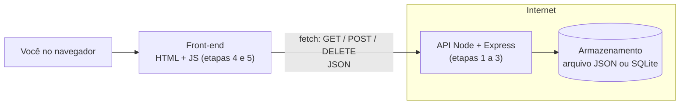

# Projeto: aplicação full stack publicada

## O que você vai construir

O **Diário de estudos**: uma aplicação web em que você registra cada sessão de estudo (tema, minutos e data) e vê quanto tempo dedicou a cada assunto. Ela tem as três partes de qualquer sistema web:

- **front-end**: a página no navegador, com o formulário e a lista;
- **back-end**: uma API em Node.js que recebe e devolve JSON;
- **armazenamento**: onde as sessões ficam guardadas.

No fim, ela estará **publicada**, com um endereço que você pode abrir no celular e mostrar para alguém. Este é o projeto da Trilha 13, inspirado no **Full Stack Open**.



## Etapa 0: o contrato

Front-end e back-end são feitos separados e conversam só por HTTP. Antes de programar qualquer lado, escreva o **contrato** da API: as rotas, o que cada uma recebe e o que devolve.

| Método e caminho | Corpo enviado | Resposta |
|---|---|---|
| `GET /api/sessoes` | (nada) | `200` com a lista de sessões |
| `POST /api/sessoes` | `{ "tema": "SQL", "minutos": 45, "data": "2026-11-10" }` | `201` com a sessão criada (e o `id`), ou `400` com `{ "erros": [...] }` |
| `DELETE /api/sessoes/3` | (nada) | `204` sem corpo, ou `404` se o id não existe |

```quiz
id: PJ-06-q1
tipo: multipla_escolha
pergunta: "A pessoa envia o formulário sem preencher o tema. Qual resposta a API deve dar?"
opcoes:
  - "200 OK, com a sessão salva sem tema"
  - "400 Bad Request, com a lista do que está errado"
  - "404 Not Found"
  - "500 Internal Server Error"
resposta: 1
explicacao: "4xx significa 'o problema está no pedido'; 5xx, 'o problema está no servidor'. Dados inválidos são culpa do pedido, então 400, e o corpo explica o que corrigir. 404 é para recurso inexistente; 500 deveria aparecer só quando o servidor quebrou."
dificuldade: 1
```

## Etapa 1: validar uma sessão

A mesma função de validação serve aos dois lados: no navegador ela mostra o erro na hora; no servidor ela é **obrigatória**, porque qualquer pessoa pode mandar um pedido direto para a API, sem passar pela sua página.

```quiz
id: PJ-06-e1
tipo: codigo
linguagem: javascript
pergunta: |
  Escreva `validarSessao(s)`, que recebe um objeto e devolve uma **lista de mensagens de erro**, na ordem abaixo (lista vazia = válido):

  - `"tema obrigatório"` se `tema` não é texto ou fica vazio depois de `trim()`;
  - `"minutos deve ser um inteiro entre 1 e 600"` se `minutos` não é inteiro (`Number.isInteger`) ou está fora da faixa;
  - `"data no formato AAAA-MM-DD"` se `data` não casa com a expressão regular `/^\d{4}-\d{2}-\d{2}$/`.
codigo_inicial: |
  function validarSessao(s) {
    const erros = [];
    return erros;
  }
usa: [function, if, push, return]
testes:
  - chamada: "validarSessao({ tema: 'SQL', minutos: 45, data: '2026-11-10' })"
    saida: "[]"
  - chamada: "validarSessao({ tema: '  ', minutos: 45, data: '2026-11-10' })"
    saida: "[ 'tema obrigatório' ]"
  - chamada: "validarSessao({})"
    saida: "[ 'tema obrigatório', 'minutos deve ser um inteiro entre 1 e 600', 'data no formato AAAA-MM-DD' ]"
  - chamada: "validarSessao({ tema: 'Redes', minutos: '30', data: '10/11/2026' })"
    visivel: false
    saida: "[ 'minutos deve ser um inteiro entre 1 e 600', 'data no formato AAAA-MM-DD' ]"
  - chamada: "[validarSessao({ tema: 'x', minutos: 600, data: '2026-01-01' }).length, validarSessao({ tema: 'x', minutos: 0, data: '2026-01-01' }).length, validarSessao({ tema: 'x', minutos: 2.5, data: '2026-01-01' }).length]"
    visivel: false
    saida: "[ 0, 1, 1 ]"
dica: "if (typeof s.tema !== 'string' || s.tema.trim() === '') erros.push('tema obrigatório'); depois if (!Number.isInteger(s.minutos) || s.minutos < 1 || s.minutos > 600) ...; e if (typeof s.data !== 'string' || !/^\\d{4}-\\d{2}-\\d{2}$/.test(s.data)) ..."
solucao: |
  function validarSessao(s) {
    const erros = [];
    if (typeof s.tema !== 'string' || s.tema.trim() === '') {
      erros.push('tema obrigatório');
    }
    if (!Number.isInteger(s.minutos) || s.minutos < 1 || s.minutos > 600) {
      erros.push('minutos deve ser um inteiro entre 1 e 600');
    }
    if (typeof s.data !== 'string' || !/^\d{4}-\d{2}-\d{2}$/.test(s.data)) {
      erros.push('data no formato AAAA-MM-DD');
    }
    return erros;
  }
explicacao: "Devolver todos os erros de uma vez (e não só o primeiro) deixa a pessoa corrigir tudo numa tentativa. Repare no teste oculto: '30' (texto) não é inteiro. Um formulário HTML sempre entrega texto, então o front-end precisa converter com Number(...) antes de enviar; se esquecer, o servidor recusa, que é exatamente o papel dele."
dificuldade: 1
```

## Etapa 2: as rotas da API

O servidor de verdade usa o Express (etapa 6). Para testar a lógica aqui, sem rede, escreva as rotas como uma **função pura**: recebe o pedido e o banco em memória e devolve `{ status, corpo }`. No Express, cada rota só vai chamar essa função; separar a regra do framework também deixa os testes simples.

```quiz
id: PJ-06-e2
tipo: codigo
linguagem: javascript
pergunta: |
  Escreva `tratar(pedido, banco)`. O `pedido` é `{ metodo, caminho, corpo }` e o `banco` é `{ sessoes: [], proximoId: 1 }`. Siga o contrato da etapa 0:

  - `GET /api/sessoes` → `{ status: 200, corpo: banco.sessoes }`;
  - `POST /api/sessoes` → se `validarSessao` (pronta) achar erros, `{ status: 400, corpo: { erros } }`; senão crie `{ id, tema, minutos, data }` (tema com `trim()`, `id` vindo de `banco.proximoId`, que avança), guarde e devolva `201` com a sessão;
  - `DELETE /api/sessoes/:id` → `204` (corpo `null`) se removeu, `404` com `{ erro: 'sessão não encontrada' }` se não;
  - qualquer outra coisa → `404` com `{ erro: 'rota não encontrada' }`.

  A função `simular` no fim (não mude) roda uma lista de pedidos e resume os status.
codigo_inicial: |
  function validarSessao(s) {
    const erros = [];
    if (typeof s.tema !== 'string' || s.tema.trim() === '') erros.push('tema obrigatório');
    if (!Number.isInteger(s.minutos) || s.minutos < 1 || s.minutos > 600) erros.push('minutos deve ser um inteiro entre 1 e 600');
    if (typeof s.data !== 'string' || !/^\d{4}-\d{2}-\d{2}$/.test(s.data)) erros.push('data no formato AAAA-MM-DD');
    return erros;
  }

  function tratar(pedido, banco) {
    return { status: 500, corpo: null };
  }

  // não mude: roda os pedidos em sequência num banco novo
  function simular(pedidos) {
    const banco = { sessoes: [], proximoId: 1 };
    const status = pedidos.map(([metodo, caminho, corpo]) => tratar({ metodo, caminho, corpo }, banco).status);
    return `${status.join(' ')} | ${banco.sessoes.map((s) => `${s.id}:${s.tema}`).join(',')}`;
  }
usa: [function, if, return, push]
testes:
  - chamada: "simular([['POST', '/api/sessoes', { tema: ' SQL ', minutos: 45, data: '2026-11-10' }], ['GET', '/api/sessoes']])"
    saida: "'201 200 | 1:SQL'"
  - chamada: "tratar({ metodo: 'POST', caminho: '/api/sessoes', corpo: { tema: '', minutos: 10, data: '2026-11-10' } }, { sessoes: [], proximoId: 1 })"
    saida: "{ status: 400, corpo: { erros: [ 'tema obrigatório' ] } }"
  - chamada: "simular([['POST', '/api/sessoes', { tema: 'A', minutos: 5, data: '2026-01-01' }], ['POST', '/api/sessoes', { tema: 'B', minutos: 5, data: '2026-01-02' }], ['DELETE', '/api/sessoes/1'], ['DELETE', '/api/sessoes/1']])"
    saida: "'201 201 204 404 | 2:B'"
  - chamada: "simular([['GET', '/api/outra'], ['PUT', '/api/sessoes'], ['POST', '/api/sessoes', { tema: 'C', minutos: 700, data: '2026-01-01' }], ['POST', '/api/sessoes', { tema: 'D', minutos: 70, data: '2026-01-01' }], ['DELETE', '/api/sessoes/abc']])"
    visivel: false
    saida: "'404 404 400 201 404 | 1:D'"
  - chamada: "tratar({ metodo: 'POST', caminho: '/api/sessoes', corpo: { tema: 'Git', minutos: 20, data: '2026-11-11' } }, { sessoes: [], proximoId: 7 })"
    visivel: false
    saida: "{ status: 201, corpo: { id: 7, tema: 'Git', minutos: 20, data: '2026-11-11' } }"
dica: "Compare primeiro o caminho exato da coleção: if (pedido.caminho === '/api/sessoes') { if GET ...; if POST ... }. Para o DELETE, use uma expressão regular: const m = pedido.caminho.match(/^\\/api\\/sessoes\\/(\\d+)$/); com m e método DELETE, ache o índice com findIndex(s => s.id === Number(m[1])) e remova com splice."
solucao: |
  function validarSessao(s) {
    const erros = [];
    if (typeof s.tema !== 'string' || s.tema.trim() === '') erros.push('tema obrigatório');
    if (!Number.isInteger(s.minutos) || s.minutos < 1 || s.minutos > 600) erros.push('minutos deve ser um inteiro entre 1 e 600');
    if (typeof s.data !== 'string' || !/^\d{4}-\d{2}-\d{2}$/.test(s.data)) erros.push('data no formato AAAA-MM-DD');
    return erros;
  }

  function tratar(pedido, banco) {
    const { metodo, caminho, corpo } = pedido;
    if (caminho === '/api/sessoes' && metodo === 'GET') {
      return { status: 200, corpo: banco.sessoes };
    }
    if (caminho === '/api/sessoes' && metodo === 'POST') {
      const erros = validarSessao(corpo ?? {});
      if (erros.length > 0) {
        return { status: 400, corpo: { erros } };
      }
      const sessao = { id: banco.proximoId, tema: corpo.tema.trim(), minutos: corpo.minutos, data: corpo.data };
      banco.proximoId += 1;
      banco.sessoes.push(sessao);
      return { status: 201, corpo: sessao };
    }
    const m = caminho.match(/^\/api\/sessoes\/(\d+)$/);
    if (m && metodo === 'DELETE') {
      const i = banco.sessoes.findIndex((s) => s.id === Number(m[1]));
      if (i === -1) {
        return { status: 404, corpo: { erro: 'sessão não encontrada' } };
      }
      banco.sessoes.splice(i, 1);
      return { status: 204, corpo: null };
    }
    return { status: 404, corpo: { erro: 'rota não encontrada' } };
  }

  // não mude: roda os pedidos em sequência num banco novo
  function simular(pedidos) {
    const banco = { sessoes: [], proximoId: 1 };
    const status = pedidos.map(([metodo, caminho, corpo]) => tratar({ metodo, caminho, corpo }, banco).status);
    return `${status.join(' ')} | ${banco.sessoes.map((s) => `${s.id}:${s.tema}`).join(',')}`;
  }
explicacao: "O id vem de um contador que só cresce, nunca de `sessoes.length + 1`: depois de apagar a sessão 1, o tamanho volta a 1 e a próxima ganharia um id repetido. O servidor monta a sessão campo a campo em vez de guardar o `corpo` inteiro, para ninguém conseguir gravar campos extras (como um `id` escolhido por quem enviou). O PUT sem rota cai no 404 genérico; uma API mais caprichada responderia 405 (método não permitido)."
dificuldade: 3
```

## Etapa 3: o resumo por tema

```quiz
id: PJ-06-e3
tipo: codigo
linguagem: javascript
pergunta: |
  Escreva `resumo(sessoes)`, que devolve um texto com o total de minutos por tema, do maior para o menor (empate: ordem alfabética do tema), no formato `SQL: 90 min | Python: 45 min`. Lista vazia devolve `"nenhuma sessão ainda"`. Use `reduce` para somar os minutos num objeto e `sort` para ordenar.
codigo_inicial: |
  function resumo(sessoes) {
    return '';
  }
usa: [reduce, sort, map, join, return]
testes:
  - chamada: "resumo([{ tema: 'SQL', minutos: 30 }, { tema: 'Python', minutos: 45 }, { tema: 'SQL', minutos: 60 }])"
    saida: "'SQL: 90 min | Python: 45 min'"
  - chamada: "resumo([])"
    saida: "'nenhuma sessão ainda'"
  - chamada: "resumo([{ tema: 'Redes', minutos: 20 }, { tema: 'Git', minutos: 20 }, { tema: 'C', minutos: 5 }, { tema: 'Git', minutos: 1 }])"
    visivel: false
    saida: "'Git: 21 min | Redes: 20 min | C: 5 min'"
  - chamada: "resumo([{ tema: 'B', minutos: 10 }, { tema: 'A', minutos: 10 }])"
    visivel: false
    saida: "'A: 10 min | B: 10 min'"
dica: "const totais = sessoes.reduce((acc, s) => { acc[s.tema] = (acc[s.tema] ?? 0) + s.minutos; return acc; }, {}); depois Object.entries(totais).sort(([ta, a], [tb, b]) => b - a || ta.localeCompare(tb)) e um map para o texto."
solucao: |
  function resumo(sessoes) {
    if (sessoes.length === 0) {
      return 'nenhuma sessão ainda';
    }
    const somar = (acc, s) => {
      acc[s.tema] = (acc[s.tema] ?? 0) + s.minutos;
      return acc;
    };
    const totais = sessoes.reduce(somar, {});
    return Object.entries(totais)
      .sort(([temaA, a], [temaB, b]) => b - a || temaA.localeCompare(temaB))
      .map(([tema, min]) => `${tema}: ${min} min`)
      .join(' | ');
  }
explicacao: "`b - a || ...` é o idioma para ordenar por vários critérios: se a diferença é 0 (empate), o `||` passa para o segundo critério. Este resumo é calculado no front-end a partir da lista que a API devolve; com milhares de sessões, valeria a pena criar uma rota `GET /api/resumo` e calcular no servidor (ou no banco, com GROUP BY)."
dificuldade: 2
```

## Etapa 4: a interface

Agora a página. Ela tem um formulário acessível (WB-01), a lista de sessões e o resumo. Quando o formulário é enviado, o JavaScript **impede o recarregamento** (`preventDefault`), valida, acrescenta a sessão e redesenha a lista.

Um cuidado de segurança: o tema é escrito pela pessoa. Se ele for colocado na página com `innerHTML`, um tema como `` vira código rodando no navegador (**XSS**, cross-site scripting). Use sempre `textContent` para texto vindo de fora.

```quiz
id: PJ-06-e4
tipo: codigo
linguagem: html
pergunta: |
  Complete a página: um `form` (o `novalidate` deixa a validação com o seu JavaScript) com os campos `#tema` (texto), `#minutos` (number) e `#data` (date), cada um com `label`, e um botão de envio; uma lista `ul#lista`; e um parágrafo `p#total`.

  No envio do formulário: impeça o recarregamento, converta os minutos com `Number(...)`, e, se `validarSessao` (pronta) não achar erros, acrescente a sessão ao array `sessoes`, limpe o formulário (`form.reset()`) e redesenhe: um `li` por sessão com o texto `tema: N min (data)` e, em `#total`, `Total: X min`. Se houver erros, mostre-os em `p#erros`. Use `textContent`, nunca `innerHTML`, para o tema.
codigo_inicial: |
  <h1>Diário de estudos</h1>
  <form id="form" novalidate>
    <!-- campos aqui -->
  </form>
  <p id="erros"></p>
  <ul id="lista"></ul>
  <p id="total">Total: 0 min</p>

  <script>
    function validarSessao(s) {
      const erros = [];
      if (typeof s.tema !== 'string' || s.tema.trim() === '') erros.push('tema obrigatório');
      if (!Number.isInteger(s.minutos) || s.minutos < 1 || s.minutos > 600) erros.push('minutos deve ser um inteiro entre 1 e 600');
      if (typeof s.data !== 'string' || !/^\d{4}-\d{2}-\d{2}$/.test(s.data)) erros.push('data no formato AAAA-MM-DD');
      return erros;
    }

    const sessoes = [];
    // escute o submit do formulário aqui
  </script>
usa: [form, label, input, button, ul, script]
testes:
  - verifica: "['tema', 'minutos', 'data'].every((id) => document.getElementById(id) && document.querySelector(`label[for='${id}']`))"
    descricao: "os três campos existem e cada um tem label"
  - verifica: "document.getElementById('minutos').type === 'number' && document.getElementById('data').type === 'date' && !!document.querySelector('#form button, #form [type=submit]')"
    descricao: "minutos é number, data é date e há botão de envio"
  - verifica: "(() => { const f = document.getElementById('form'); document.getElementById('tema').value = 'SQL'; document.getElementById('minutos').value = '45'; document.getElementById('data').value = '2026-11-10'; f.requestSubmit(); const li = document.querySelectorAll('#lista li'); return li.length === 1 && li[0].textContent.trim() === 'SQL: 45 min (2026-11-10)' && document.getElementById('total').textContent.trim() === 'Total: 45 min' && document.getElementById('tema').value === ''; })()"
    descricao: "enviar adiciona a sessão na lista, atualiza o total e limpa o formulário"
  - verifica: "(() => { const f = document.getElementById('form'); document.getElementById('tema').value = ''; document.getElementById('minutos').value = '10'; document.getElementById('data').value = '2026-11-10'; f.requestSubmit(); return document.querySelectorAll('#lista li').length === 0 && document.getElementById('erros').textContent.includes('tema obrigatório'); })()"
    descricao: "sessão inválida mostra o erro e não entra na lista"
  - verifica: "(() => { const f = document.getElementById('form'); for (const [t, m] of [['Git', '20'], ['<b>x</b>', '5']]) { document.getElementById('tema').value = t; document.getElementById('minutos').value = m; document.getElementById('data').value = '2026-11-11'; f.requestSubmit(); } const li = document.querySelectorAll('#lista li'); return li.length === 2 && !document.querySelector('#lista b') && li[1].textContent.includes('<b>x</b>') && document.getElementById('total').textContent.trim() === 'Total: 25 min'; })()"
    descricao: "várias sessões somam no total e o tema não vira HTML (sem XSS)"
    visivel: false
dica: "form.addEventListener('submit', (ev) => { ev.preventDefault(); const s = { tema: tema.value, minutos: Number(minutos.value), data: data.value }; const erros = validarSessao(s); ... }). Para desenhar: lista.replaceChildren(), e para cada sessão const li = document.createElement('li'); li.textContent = `${s.tema}: ${s.minutos} min (${s.data})`; lista.append(li). O total é sessoes.reduce((t, s) => t + s.minutos, 0)."
solucao: |
  <h1>Diário de estudos</h1>
  <form id="form" novalidate>
    <label for="tema">Tema</label>
    <input id="tema" name="tema" required>
    <label for="minutos">Minutos</label>
    <input id="minutos" name="minutos" type="number" min="1" max="600" required>
    <label for="data">Data</label>
    <input id="data" name="data" type="date" required>
    <button type="submit">Registrar</button>
  </form>
  <p id="erros"></p>
  <ul id="lista"></ul>
  <p id="total">Total: 0 min</p>

  <script>
    function validarSessao(s) {
      const erros = [];
      if (typeof s.tema !== 'string' || s.tema.trim() === '') erros.push('tema obrigatório');
      if (!Number.isInteger(s.minutos) || s.minutos < 1 || s.minutos > 600) erros.push('minutos deve ser um inteiro entre 1 e 600');
      if (typeof s.data !== 'string' || !/^\d{4}-\d{2}-\d{2}$/.test(s.data)) erros.push('data no formato AAAA-MM-DD');
      return erros;
    }

    const sessoes = [];
    const form = document.getElementById('form');
    const lista = document.getElementById('lista');

    function desenhar() {
      lista.replaceChildren();
      for (const s of sessoes) {
        const li = document.createElement('li');
        li.textContent = `${s.tema}: ${s.minutos} min (${s.data})`;
        lista.append(li);
      }
      const total = sessoes.reduce((t, s) => t + s.minutos, 0);
      document.getElementById('total').textContent = `Total: ${total} min`;
    }

    form.addEventListener('submit', (ev) => {
      ev.preventDefault();
      const s = {
        tema: document.getElementById('tema').value.trim(),
        minutos: Number(document.getElementById('minutos').value),
        data: document.getElementById('data').value,
      };
      const erros = validarSessao(s);
      document.getElementById('erros').textContent = erros.join('; ');
      if (erros.length > 0) return;
      sessoes.push(s);
      form.reset();
      desenhar();
    });
  </script>
explicacao: "`requestSubmit()` dispara o evento submit como um clique no botão faria, por isso os testes conseguem simular o uso. Sem o `novalidate`, os atributos `required`, `min` e `max` bloqueariam o envio no próprio navegador; aqui eles ficam como dica para o teclado do celular e a validação é do JavaScript, que mostra mensagens próprias. Nenhum dos dois substitui a validação do servidor: qualquer um pode removê-los pelas ferramentas do desenvolvedor. O teste oculto confere o XSS: com textContent, `<b>x</b>` aparece como texto, sem virar negrito."
dificuldade: 3
```

## Etapa 5: ligar o front-end à API

Na etapa 4 as sessões ficavam só no array `sessoes`: recarregou a página, sumiu. Agora o front-end passa a falar com a API pelo `fetch`. Este trecho não roda no app (não há servidor aqui), mas é o que vai no `app.js` do seu projeto:

```text
const API = '/api/sessoes';

async function carregar() {
  const resposta = await fetch(API);
  sessoes = await resposta.json();
  desenhar();
}

async function registrar(s) {
  const resposta = await fetch(API, {
    method: 'POST',
    headers: { 'Content-Type': 'application/json' },
    body: JSON.stringify(s),
  });
  if (resposta.status === 400) {
    const { erros } = await resposta.json();   // o servidor também valida
    mostrarErros(erros);
    return;
  }
  if (!resposta.ok) throw new Error(`erro ${resposta.status}`);
  sessoes.push(await resposta.json());          // a sessão já vem com o id
  desenhar();
}

carregar();
```

```quiz
id: PJ-06-q2
tipo: verdadeiro_falso
pergunta: "Se o front-end já valida os dados antes do `fetch`, o servidor pode pular a validação."
resposta: false
explicacao: "O front-end roda no computador de quem usa: dá para editar o JavaScript, desligar a validação ou mandar pedidos direto com `curl`. A validação no navegador é conforto (erro na hora, sem ida ao servidor); a do servidor é segurança. As duas usam a mesma regra, por isso vale compartilhar a `validarSessao`."
dificuldade: 1
```

## Etapa 6: o servidor de verdade

No seu computador, com o Node.js 20 ou mais novo:

```bash
mkdir diario-de-estudos && cd diario-de-estudos
npm init -y
npm install express
mkdir public          # index.html e app.js do front-end vão aqui
```

`server.js`, reaproveitando `validarSessao` e `tratar` das etapas 1 e 2 (num arquivo `regras.js` exportado com `module.exports`):

```text
const express = require('express');
const fs = require('node:fs');
const { tratar } = require('./regras');

const ARQUIVO = process.env.ARQUIVO_DADOS ?? 'dados.json';
const banco = fs.existsSync(ARQUIVO)
  ? JSON.parse(fs.readFileSync(ARQUIVO, 'utf8'))
  : { sessoes: [], proximoId: 1 };

const app = express();
app.use(express.json());            // lê o corpo JSON dos pedidos
app.use(express.static('public'));  // serve o front-end

app.all('/api/*', (req, res) => {
  const { status, corpo } = tratar({ metodo: req.method, caminho: req.path, corpo: req.body }, banco);
  if (req.method !== 'GET' && status < 400) {
    fs.writeFileSync(ARQUIVO, JSON.stringify(banco));   // persiste a mudança
  }
  if (corpo === null) res.status(status).end();
  else res.status(status).json(corpo);
});

const PORTA = process.env.PORT ?? 3000;
app.listen(PORTA, () => console.log(`rodando em http://localhost:${PORTA}`));
```

Rode com `node server.js`, abra `http://localhost:3000` e teste a API também pelo terminal:

```bash
curl -X POST localhost:3000/api/sessoes -H 'Content-Type: application/json' \
  -d '{"tema":"SQL","minutos":45,"data":"2026-11-10"}'
curl localhost:3000/api/sessoes
```

Servir o front-end pelo **mesmo** servidor evita o problema de **CORS** (o navegador bloqueia, por padrão, pedidos de uma página para outra origem). Se um dia o front-end ficar num domínio e a API em outro, a API precisa responder com o cabeçalho `Access-Control-Allow-Origin`.

## Etapa 7: publicar

1. **Versione** no GitHub (FP-09), com um `.gitignore` contendo `node_modules` e `dados.json`.
2. No `package.json`, crie o script `"start": "node server.js"` e declare `"engines": { "node": ">=20" }`.
3. Crie uma conta num serviço que roda Node a partir do GitHub (Render, Railway, Fly.io e Koyeb têm planos gratuitos ou de teste; as condições mudam, confira antes). Aponte para o repositório, comando de build `npm install`, comando de início `npm start`.
4. O serviço define a variável `PORT`: por isso o servidor lê `process.env.PORT`. Nunca coloque senhas no código: use as variáveis de ambiente do painel.
5. **Atenção à persistência**: em muitos planos gratuitos o disco é apagado a cada nova publicação, e o `dados.json` some junto. Para guardar de verdade, use um disco persistente do serviço ou um banco gerenciado (um PostgreSQL gratuito, por exemplo) no lugar do arquivo. A função `tratar` não muda: só o que acontece depois dela.
6. Abra o endereço público no celular, registre uma sessão e confira com `curl https://seu-app.../api/sessoes`.

```quiz
id: PJ-06-q3
tipo: resposta_curta
pergunta: "Depois de publicar, você registrou 5 sessões. No dia seguinte, depois de enviar uma pequena correção para o GitHub, a lista aparece vazia. O que provavelmente aconteceu e como resolver?"
resposta: "O serviço criou um novo contêiner na publicação e o disco dele é efêmero: o dados.json foi apagado. A correção é guardar os dados fora do contêiner, num disco persistente ou num banco de dados gerenciado (PostgreSQL, por exemplo), configurado por variável de ambiente."
palavras_chave: ["disco", "efêmero", "persist", "banco"]
dificuldade: 2
```

## Checklist de entrega

- [ ] O endereço público abre no celular e no computador.
- [ ] Criar, listar e apagar sessões funcionam, e os dados sobrevivem a uma nova publicação.
- [ ] Dados inválidos mostram erro no formulário, e a API responde 400 se receber direto pelo `curl`.
- [ ] Um tema com `<script>` aparece como texto.
- [ ] O README tem: o que é, o link público, como rodar localmente e o contrato da API.
- [ ] Os testes das regras (`validarSessao`, `tratar`, `resumo`) rodam com `node --test`.

## Ideias para ir além

- **React** (WB-05): refaça o front-end com componentes `Formulario`, `Lista` e `Resumo` e o estado em `useState`, como no Full Stack Open.
- **TypeScript** (WB-03): tipe a `Sessao` e o `Pedido`; o compilador passa a pegar erros de contrato.
- **Usuários**: login com sessão ou token, e cada pessoa vendo só as suas sessões (Trilha 12 para fazer com segurança).
- **Gráfico**: minutos por semana com um `<canvas>` ou uma biblioteca de gráficos.
- **PWA**: funcione offline e sincronize quando voltar a internet.

## Resumo

- Uma aplicação full stack é **front-end + API + armazenamento**, ligados por **HTTP e JSON** segundo um **contrato**.
- **Valide nos dois lados**: no navegador por conforto, no servidor por segurança.
- Rotas REST usam **métodos e códigos** com significado: 200, 201, 204, 400, 404.
- Texto vindo de fora entra na página com **textContent**, nunca innerHTML (XSS).
- Publicar exige **variáveis de ambiente**, **porta dada pelo serviço** e **armazenamento persistente**.

## Para ir além

- **Full Stack Open**: as partes 0 a 4 seguem este mesmo caminho com React, Express, MongoDB e testes, e as seguintes acrescentam login, testes de ponta a ponta e TypeScript.
- **Próximos passos**: WB-06 (acessibilidade e performance) para polir a interface e a Trilha 11 (DevOps) para automatizar a publicação com CI/CD.
