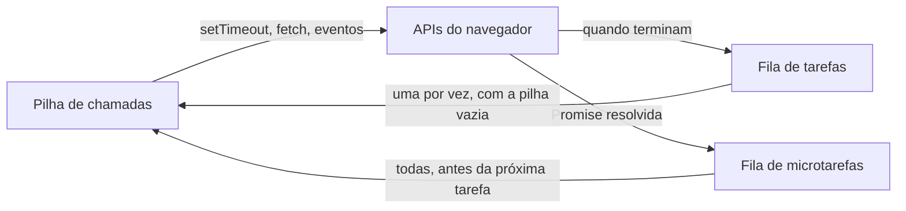

# JavaScript e o DOM; event loop

## Por que isso importa

O JavaScript é a única linguagem que roda nativamente em todo navegador, e com o Node ele roda também no servidor (WB-04). Mesmo usando React (WB-05), você vai lidar com eventos, com o DOM e, principalmente, com **código assíncrono**: buscar dados, esperar o usuário, temporizadores. Os bugs mais confusos do front-end ("por que esse valor está undefined?", "por que a tela travou?", "por que isso imprime antes daquilo?") vêm de não entender o **event loop**. E perguntas sobre a ordem de `setTimeout` e `Promise` são clássicas em entrevistas.

## Intuição

O JavaScript do navegador é como um **cozinheiro sozinho** num restaurante. Ele só faz **uma coisa por vez** (uma única thread). Quando um prato vai ao forno por 20 minutos, ele não fica olhando o forno: coloca um **timer** e volta a atender outros pedidos. Quando o timer toca, o pedido de "tirar do forno" entra numa **fila**, e ele atende quando terminar o que está fazendo agora.

- O que ele está fazendo agora é a **pilha de chamadas**.
- O forno, o timer e o garçom que traz pedidos novos são as **APIs do navegador** (timers, rede, eventos), que trabalham em paralelo.
- Os bilhetes esperando são a **fila de tarefas**.
- Há também uma fila **VIP**, as **microtarefas** (continuações de Promises): ele sempre esvazia a fila VIP inteira antes de pegar o próximo bilhete normal.

Se ele resolver descascar 1000 batatas de uma vez (um laço pesado), ninguém mais é atendido: a página **trava**.

## Visual



O DOM é uma árvore de objetos que o JavaScript pode ler e alterar:

```text
document
└── html
    ├── head
    │   └── title "Loja"
    └── body
        ├── h1 "Carrinho"
        ├── ul#itens
        │   ├── li "Caderno"
        │   └── li "Caneta"
        └── button#comprar "Finalizar"
```

## Conceito técnico

### O JavaScript moderno do dia a dia

```javascript
const precos = [30, 12, 45];                 // const: não reatribui; let: pode reatribuir
const comImposto = precos.map((p) => p * 1.1);
const caros = precos.filter((p) => p > 20);
const total = precos.reduce((soma, p) => soma + p, 0);

const usuario = { nome: 'Ana', cidade: 'Recife', idade: 31 };
const { nome, ...resto } = usuario;          // desestruturação e rest
const atualizado = { ...usuario, idade: 32 }; // spread: cópia com alteração

const saudacao = `Olá, ${nome}!`;            // template string
const cep = usuario.endereco?.cep ?? 'sem CEP'; // encadeamento opcional e ??
```

- Nunca use `var` (escopo confuso) nem `==` (conversões estranhas: `'' == 0` é `true`); use `===`.
- Funções são valores: podem ser passadas e devolvidas (callbacks).
- **Módulos**: `export function x()` e `import { x } from './util.js'`; na página, `<script type="module">`.

### Selecionando e alterando o DOM

- `document.querySelector('#itens li')` (o primeiro) e `querySelectorAll` (todos), com seletores CSS (WB-01).
- `el.textContent = 'texto'` troca o texto **com segurança**. `el.innerHTML = ...` interpreta HTML: com dados do usuário, é XSS (SE-04).
- Criar: `const li = document.createElement('li'); li.textContent = nome; lista.append(li);`. Remover: `li.remove()`.
- Classes e atributos: `el.classList.toggle('ativo')`, `el.setAttribute('aria-expanded', 'true')`, `el.dataset.id` (lê `data-id`).
- Formulários: `input.value`, `checkbox.checked`, `new FormData(form)`.
- O script precisa rodar **depois** que o HTML existir: coloque `<script>` no fim do `body`, use `defer` ou `type="module"`.

### Eventos

```javascript
botao.addEventListener('click', (evento) => {
  console.log('clicou em', evento.target);
});

form.addEventListener('submit', (evento) => {
  evento.preventDefault();   // impede o envio padrão, que recarregaria a página
  // ... lê os campos e faz um fetch
});
```

- Eventos **sobem** pela árvore (bubbling): um clique num `li` também é um clique no `ul` e no `body`.
- **Delegação**: um único ouvinte no pai atende todos os filhos, inclusive os criados depois: `lista.addEventListener('click', (e) => { const li = e.target.closest('li'); ... })`.
- `preventDefault()` cancela o comportamento padrão (envio de formulário, navegação do link); `stopPropagation()` impede a subida (use pouco).
- Eventos frequentes (`scroll`, `input`, `resize`) pedem **debounce** ou **throttle**.

### O event loop

O motor JavaScript executa um código até a **pilha esvaziar**. Então:

1. Executa **todas** as **microtarefas** pendentes (callbacks de `.then`, continuação depois de um `await`, `queueMicrotask`), incluindo as que forem criadas no caminho.
2. O navegador pode **renderizar** a tela.
3. Pega **uma** **tarefa** da fila (um `setTimeout` vencido, um evento de clique, uma resposta de rede) e executa. Volta ao passo 1.

Consequências:

- `setTimeout(fn, 0)` não roda "agora": roda depois do código atual **e** de todas as microtarefas.
- Um laço longo bloqueia cliques, animações e a renderização. Divida o trabalho ou use um **Web Worker**.
- `await` não bloqueia a thread: ele **pausa a função** e devolve o controle ao loop.

### Promises, async/await e fetch

```javascript
async function carregarProdutos() {
  try {
    const resposta = await fetch('/api/produtos');
    if (!resposta.ok) throw new Error(`HTTP ${resposta.status}`);
    const produtos = await resposta.json();
    mostrar(produtos);
  } catch (erro) {
    mostrarErro('Não foi possível carregar os produtos.');
  }
}

// em paralelo, não um depois do outro:
const [usuario, pedidos] = await Promise.all([buscarUsuario(), buscarPedidos()]);
```

- Uma **Promise** representa um valor futuro: pendente, realizada ou rejeitada.
- `fetch` só rejeita em falha de **rede**; um 404 ou 500 chega como resposta normal: confira `resposta.ok`.
- `Promise.all` falha se qualquer uma falhar; `Promise.allSettled` espera todas; `Promise.race`/`any` ficam com a primeira.
- Esquecer o `await` é o bug clássico: você recebe uma `Promise` em vez do valor.
- Use `AbortController` para cancelar buscas que não importam mais (o usuário digitou outra letra).

## Código

Adivinhe a ordem antes de rodar. Depois confira com as regras do event loop.

```javascript
console.log('1: início');

setTimeout(() => console.log('6: setTimeout (tarefa)'), 0);

Promise.resolve()
  .then(() => console.log('3: then (microtarefa)'))
  .then(() => console.log('5: segundo then (microtarefa criada por microtarefa)'));

queueMicrotask(() => console.log('4: queueMicrotask'));

(async () => {
  console.log('2: dentro da async, antes do await (síncrono)');
  await null;
  console.log('4b: depois do await (microtarefa)');
})();

console.log('2b: fim do script');
```

A saída é `1, 2, 2b, 3, 4, 4b, 5, 6`: primeiro todo o código síncrono, depois todas as microtarefas na ordem em que foram enfileiradas (inclusive a criada pelo primeiro `then`), e só então a tarefa do `setTimeout`.

## Erros comuns

- **`innerHTML` com dados do usuário** (XSS); use `textContent` e `createElement`.
- **Script no `head` sem `defer`**: `querySelector` devolve `null` porque o elemento ainda não existe.
- **Esquecer o `preventDefault()`** no submit e ver a página recarregar.
- **Adicionar um ouvinte a cada item** de uma lista de 1000, em vez de delegar ao pai.
- **Esquecer o `await`** ou não tratar a rejeição (erro "Uncaught (in promise)").
- **Achar que `fetch` rejeita em 404 ou 500.**
- **`await` dentro de um `for`** quando as buscas são independentes: use `Promise.all`.
- **Laço pesado na thread principal**, travando a página.
- **`==` e `var`.**

## Pratique

```quiz
id: WB-02-q1
tipo: multipla_escolha
pergunta: "Em que ordem aparecem as letras? console.log('A'); setTimeout(() => console.log('B'), 0); Promise.resolve().then(() => console.log('C')); console.log('D');"
opcoes: ["A B C D", "A D B C", "A D C B", "A C D B"]
resposta: 2
explicacao: "Primeiro o código síncrono (A, D). Com a pilha vazia, todas as microtarefas rodam (C, do then). Só então a próxima tarefa, o setTimeout (B), mesmo com atraso 0."
dificuldade: 2
```

```quiz
id: WB-02-q2
tipo: multipla_escolha
pergunta: "Você quer mostrar na página o nome que o usuário digitou. Qual é a forma segura?"
opcoes: ["el.innerHTML = nome", "el.textContent = nome", "document.write(nome)", "el.outerHTML = nome"]
resposta: 1
explicacao: "textContent trata o valor como texto puro: um nome como  aparece literalmente, sem virar HTML. As outras opções interpretam o valor como HTML e abrem espaço para XSS."
dificuldade: 1
```

```quiz
id: WB-02-q3
tipo: verdadeiro_falso
pergunta: "Se o servidor responder 404, a Promise devolvida por fetch é rejeitada e cai no catch."
resposta: false
explicacao: "fetch só rejeita quando a requisição não se completa (rede fora, CORS bloqueado, abortada). Um 404 ou 500 é uma resposta válida: você precisa conferir resposta.ok ou resposta.status."
dificuldade: 1
```

```quiz
id: WB-02-q4
tipo: multipla_escolha
pergunta: "Uma lista recebe itens novos dinamicamente, e cada item deve reagir a cliques. Qual a melhor abordagem?"
opcoes: ["Adicionar um ouvinte a cada li logo após o carregamento", "Um único ouvinte no ul que usa event.target.closest('li') (delegação)", "Usar onclick no HTML de cada item", "Verificar com setInterval quais itens foram clicados"]
resposta: 1
explicacao: "Como os eventos sobem pela árvore, um ouvinte no pai recebe os cliques de todos os filhos, inclusive dos criados depois. É mais simples e mais leve que um ouvinte por item."
dificuldade: 1
```

```quiz
id: WB-02-q5
tipo: resposta_curta
pergunta: "Por que um laço que demora 3 segundos, rodando no clique de um botão, trava a página inteira?"
resposta: "Porque o JavaScript da página roda numa única thread: enquanto o laço ocupa a pilha de chamadas, o event loop não consegue processar outras tarefas, como cliques, digitação e timers, nem deixar o navegador renderizar. A solução é dividir o trabalho em pedaços ou movê-lo para um Web Worker."
palavras_chave: ["thread", "pilha", "event loop", "renderizar"]
dificuldade: 2
```

```quiz
id: WB-02-q6
tipo: codigo
linguagem: html
pergunta: |
  **Um contador.** Complete o `<script>`: cada clique em **+** soma 1 ao número mostrado em `#valor`, cada clique em **zerar** volta a 0. Use `addEventListener` e `textContent`.
codigo_inicial: |
  <p>Cliques: <span id="valor">0</span></p>
  <button id="mais">+</button>
  <button id="zerar">zerar</button>
  <script>
    let contador = 0;
    const valor = document.querySelector('#valor');
    // seu código aqui
  </script>
usa: [addEventListener, textContent]
testes:
  - verifica: "document.querySelector('#valor').textContent === '0'"
    descricao: "começa em 0"
  - verifica: "(document.querySelector('#mais').click(), document.querySelector('#mais').click(), document.querySelector('#valor').textContent === '2')"
    descricao: "dois cliques em + mostram 2"
  - verifica: "(document.querySelector('#mais').click(), document.querySelector('#zerar').click(), document.querySelector('#mais').click(), document.querySelector('#valor').textContent === '1')"
    descricao: "zerar volta para 0 e o contador continua dali"
    visivel: false
dica: "Ouça o click de #mais: some 1 a contador e escreva valor.textContent = contador. Faça o mesmo em #zerar atribuindo 0."
solucao: |
  <p>Cliques: <span id="valor">0</span></p>
  <button id="mais">+</button>
  <button id="zerar">zerar</button>
  <script>
    let contador = 0;
    const valor = document.querySelector('#valor');
    document.querySelector('#mais').addEventListener('click', () => {
      contador += 1;
      valor.textContent = contador;
    });
    document.querySelector('#zerar').addEventListener('click', () => {
      contador = 0;
      valor.textContent = contador;
    });
  </script>
explicacao: "É o padrão de toda interface: o estado vive numa variável, os eventos mudam o estado, e uma linha atualiza a tela a partir do estado. Quando a tela tem dezenas de lugares que dependem do estado, manter isso à mão fica difícil, e é exatamente o problema que o React resolve (WB-05)."
dificuldade: 1
```

```quiz
id: WB-02-q7
tipo: codigo
linguagem: html
pergunta: |
  **Lista de tarefas.** Ao enviar o formulário, acrescente um `<li>` com o texto digitado (sem espaços nas pontas) em `#lista` e limpe o campo. Ignore textos vazios. A página **não** pode recarregar, e o texto deve aparecer como texto, mesmo que tenha cara de HTML.
codigo_inicial: |
  <form id="form">
    <input id="tarefa" placeholder="Nova tarefa">
    <button>Adicionar</button>
  </form>
  <ul id="lista"></ul>
  <script>
    const form = document.querySelector('#form');
    const campo = document.querySelector('#tarefa');
    const lista = document.querySelector('#lista');
  </script>
usa: [addEventListener, preventDefault, createElement, textContent]
testes:
  - verifica: "(() => { const c = document.querySelector('#tarefa'); c.value = '  Estudar DOM '; document.querySelector('#form').requestSubmit(); const li = document.querySelectorAll('#lista li'); return li.length === 1 && li[0].textContent === 'Estudar DOM'; })()"
    descricao: "adiciona o item sem os espaços das pontas"
  - verifica: "(() => { const c = document.querySelector('#tarefa'); c.value = 'Ler'; document.querySelector('#form').requestSubmit(); return c.value === ''; })()"
    descricao: "limpa o campo depois de adicionar"
  - verifica: "(() => { const c = document.querySelector('#tarefa'); c.value = '   '; document.querySelector('#form').requestSubmit(); return document.querySelectorAll('#lista li').length === 0; })()"
    descricao: "ignora texto vazio"
    visivel: false
  - verifica: "(() => { const c = document.querySelector('#tarefa'); c.value = '<b>negrito</b>'; document.querySelector('#form').requestSubmit(); const li = document.querySelector('#lista li'); return li !== null && li.querySelector('b') === null && li.textContent === '<b>negrito</b>'; })()"
    descricao: "o texto não vira HTML"
    visivel: false
  - verifica: "(() => { const c = document.querySelector('#tarefa'); const f = document.querySelector('#form'); c.value = 'a'; f.requestSubmit(); c.value = 'b'; f.requestSubmit(); const li = document.querySelectorAll('#lista li'); return li.length === 2 && li[1].textContent === 'b'; })()"
    descricao: "itens entram na ordem"
    visivel: false
dica: "No submit: evento.preventDefault(); const texto = campo.value.trim(); if (!texto) return; crie o li com document.createElement('li'), use li.textContent = texto, lista.append(li) e campo.value = ''."
solucao: |
  <form id="form">
    <input id="tarefa" placeholder="Nova tarefa">
    <button>Adicionar</button>
  </form>
  <ul id="lista"></ul>
  <script>
    const form = document.querySelector('#form');
    const campo = document.querySelector('#tarefa');
    const lista = document.querySelector('#lista');
    form.addEventListener('submit', (evento) => {
      evento.preventDefault();
      const texto = campo.value.trim();
      if (!texto) return;
      const li = document.createElement('li');
      li.textContent = texto;
      lista.append(li);
      campo.value = '';
    });
  </script>
explicacao: "Ouvir o submit (e não o click do botão) faz o Enter funcionar também, e mantém a validação nativa do formulário. O preventDefault impede o envio padrão, que recarregaria a página e perderia a lista. E o teste oculto com <b> mostra por que createElement + textContent é o caminho seguro: com innerHTML, o mesmo campo seria uma porta para XSS."
dificuldade: 1
```

```quiz
id: WB-02-q8
tipo: codigo
linguagem: javascript
pergunta: |
  **Simulando o event loop.** Escreva `executar(script)`. `script` é uma lista de passos `{ nome, tipo, agenda }`, em que `tipo` é `'sync'`, `'micro'` ou `'macro'` e `agenda` (opcional) é uma lista de passos que **aquele passo cria quando executa**. Regras:

  - um passo `sync` executa na hora; `micro` vai para o fim da fila de microtarefas; `macro` vai para o fim da fila de tarefas;
  - ao executar um passo, registre o `nome` e processe a sua `agenda` com essas mesmas regras;
  - primeiro os passos do script, em ordem; depois, repita: esvazie **toda** a fila de microtarefas e então execute **uma** tarefa, até as duas filas acabarem.

  Devolva a lista de nomes na ordem em que executaram.
codigo_inicial: |
  function executar(script) {
    const ordem = ['sync', 'micro', 'macro'];
    return [...script].sort((a, b) => ordem.indexOf(a.tipo) - ordem.indexOf(b.tipo)).map((p) => p.nome);
  }
usa: [function, while, if, return]
testes:
  - chamada: "executar([{ nome: 'A', tipo: 'sync' }, { nome: 'B', tipo: 'macro' }, { nome: 'C', tipo: 'micro' }, { nome: 'D', tipo: 'sync' }])"
    saida: "[ 'A', 'D', 'C', 'B' ]"
  - chamada: "executar([{ nome: 't1', tipo: 'macro', agenda: [{ nome: 'm1', tipo: 'micro' }] }, { nome: 't2', tipo: 'macro' }])"
    saida: "[ 't1', 'm1', 't2' ]"
  - chamada: "executar([{ nome: 'p1', tipo: 'micro', agenda: [{ nome: 'p2', tipo: 'micro' }, { nome: 'log', tipo: 'sync' }] }, { nome: 'timer', tipo: 'macro' }])"
    saida: "[ 'p1', 'log', 'p2', 'timer' ]"
  - chamada: "executar([{ nome: 'a', tipo: 'macro', agenda: [{ nome: 'b', tipo: 'macro' }, { nome: 'c', tipo: 'micro', agenda: [{ nome: 'd', tipo: 'macro' }] }] }, { nome: 'e', tipo: 'macro' }])"
    visivel: false
    saida: "[ 'a', 'c', 'e', 'b', 'd' ]"
  - chamada: "executar([])"
    visivel: false
    saida: "[]"
  - chamada: "executar([{ nome: 's', tipo: 'sync', agenda: [{ nome: 'x', tipo: 'micro' }, { nome: 'y', tipo: 'sync', agenda: [{ nome: 'z', tipo: 'micro' }] }] }, { nome: 'w', tipo: 'micro' }])"
    visivel: false
    saida: "[ 's', 'y', 'x', 'z', 'w' ]"
dica: "Crie as filas micro e macro e uma função interna agendar(passo): se for sync, chame rodar(passo); se micro ou macro, faça push na fila certa. rodar(passo) registra o nome e chama agendar para cada item de passo.agenda. Depois do script: while (micro.length || macro.length) { while (micro.length) rodar(micro.shift()); if (macro.length) rodar(macro.shift()); }."
solucao: |
  function executar(script) {
    const log = [];
    const micro = [];
    const macro = [];
    function rodar(passo) {
      log.push(passo.nome);
      for (const p of passo.agenda || []) agendar(p);
    }
    function agendar(passo) {
      if (passo.tipo === 'sync') rodar(passo);
      else if (passo.tipo === 'micro') micro.push(passo);
      else macro.push(passo);
    }
    for (const passo of script) agendar(passo);
    while (micro.length || macro.length) {
      while (micro.length) rodar(micro.shift());
      if (macro.length) rodar(macro.shift());
    }
    return log;
  }
explicacao: "O código inicial ordena por tipo e acerta o primeiro teste, mas erra quando passos criam outros. O segundo teste é o ponto-chave: a microtarefa criada pela tarefa t1 roda antes de t2, porque as microtarefas são esvaziadas entre uma tarefa e outra. No último teste oculto, um passo síncrono dentro de outro roda na hora (y antes de x). É por isso que uma cadeia infinita de Promises consegue travar a página tanto quanto um laço: a fila de microtarefas nunca esvazia e o navegador nunca chega a renderizar."
dificuldade: 3
```

## Resumo

- JavaScript moderno: `const`/`let`, arrow functions, `map`/`filter`/`reduce`, desestruturação, spread, `?.`, `??`, `===`, módulos.
- **DOM**: `querySelector`, `createElement`, `textContent` (seguro), `classList`, `dataset`; cuidado com `innerHTML`.
- **Eventos**: `addEventListener`, bubbling, **delegação**, `preventDefault`.
- **Event loop**: uma thread; código síncrono, depois **todas as microtarefas**, renderização, **uma tarefa**, e de novo.
- **Async**: Promises, `async/await`, `fetch` (confira `ok`), `Promise.all` para paralelo, `try/catch`.

## Para ir além

- Refaça a lista de tarefas guardando os itens no `localStorage` e permitindo marcar e apagar com delegação de eventos.
- Assista à palestra do Philip Roberts e brinque com o Loupe, a ferramenta que ele mostra.
- Leia a parte 2 do javascript.info sobre eventos.
- **Próximo módulo**: WB-03 TypeScript.
